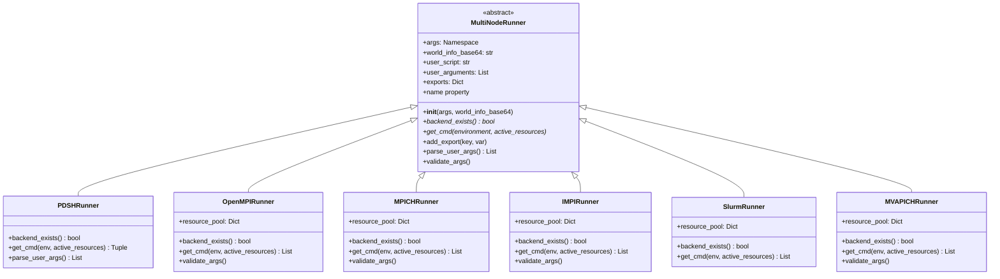
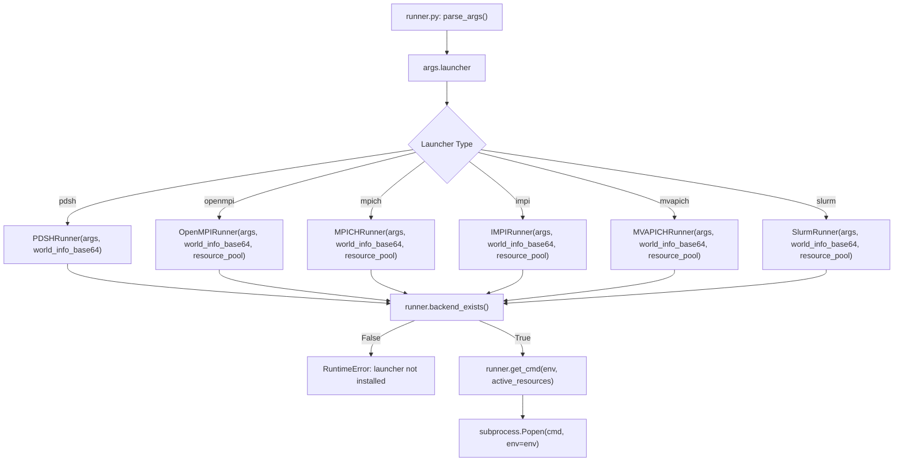

<!-- source: DeepWiki mcp.deepwiki.com · repo deepspeedai/DeepSpeed · page 8.2 Multi-Node Runners and Backends · fetched 2026-10-21 -->

# Multi-Node Runners and Backends

Relevant source files

The following files were used as context for generating this wiki page:

- [deepspeed/constants.py](deepspeed/constants.py)
- [deepspeed/elasticity/elastic_agent.py](deepspeed/elasticity/elastic_agent.py)
- [deepspeed/launcher/constants.py](deepspeed/launcher/constants.py)
- [deepspeed/launcher/launch.py](deepspeed/launcher/launch.py)
- [deepspeed/launcher/launcher_helper.py](deepspeed/launcher/launcher_helper.py)
- [deepspeed/launcher/multinode_runner.py](deepspeed/launcher/multinode_runner.py)
- [deepspeed/launcher/runner.py](deepspeed/launcher/runner.py)
- [deepspeed/runtime/checkpoint_engine/nebula_checkpoint_engine.py](deepspeed/runtime/checkpoint_engine/nebula_checkpoint_engine.py)
- [deepspeed/runtime/checkpoint_engine/torch_checkpoint_engine.py](deepspeed/runtime/checkpoint_engine/torch_checkpoint_engine.py)
- [deepspeed/runtime/eigenvalue.py](deepspeed/runtime/eigenvalue.py)
- [tests/unit/launcher/test_ds_arguments.py](tests/unit/launcher/test_ds_arguments.py)
- [tests/unit/launcher/test_multinode_runner.py](tests/unit/launcher/test_multinode_runner.py)
- [tests/unit/launcher/test_user_args.py](tests/unit/launcher/test_user_args.py)

This document describes the multi-node runner implementations that DeepSpeed uses to launch distributed training jobs across multiple worker nodes. Each runner is a backend-specific adapter that translates DeepSpeed's launch request into the appropriate commands for different cluster management systems (SSH-based, MPI-based, or SLURM-based).

For information about the overall launcher architecture and how runners are selected, see [Launcher Architecture](#8.1). For details about environment variable setup and rank assignment, see [Environment Setup and Process Spawning](#8.3).

## Overview

DeepSpeed supports six different multi-node launching backends, each implemented as a subclass of `MultiNodeRunner`. These runners handle the complexities of distributed process spawning, environment variable propagation, and backend-specific command construction.

**Supported Backends:**
- **PDSH**: SSH-based parallel shell for simple multi-node execution.
- **OpenMPI**: Open source MPI implementation with TCP/UCX support.
- **MPICH**: MPICH MPI implementation.
- **Intel MPI (IMPI)**: Intel's MPI implementation with optimized core binding.
- **SLURM**: HPC workload manager integration using `srun`.
- **MVAPICH**: MVAPICH2-GDR for InfiniBand and GPU-aware communication.

Sources: [deepspeed/launcher/multinode_runner.py:1-496](), [deepspeed/launcher/constants.py:1-17](), [deepspeed/launcher/runner.py:27-28]()

## Runner Class Hierarchy

The system uses an abstract base class `MultiNodeRunner` to define the interface for all backend implementations.

Sources: [deepspeed/launcher/multinode_runner.py:19-53](), [deepspeed/launcher/multinode_runner.py:55-124](), [deepspeed/launcher/multinode_runner.py:126-204](), [deepspeed/launcher/multinode_runner.py:206-276](), [deepspeed/launcher/multinode_runner.py:278-361](), [deepspeed/launcher/multinode_runner.py:363-409](), [deepspeed/launcher/multinode_runner.py:411-496]()

## Runner Selection and Instantiation

The launcher selects and instantiates runners based on the `--launcher` command-line argument. The selection occurs in `deepspeed.launcher.runner` after resource pool parsing.

Sources: [deepspeed/launcher/runner.py:578-593](), [deepspeed/launcher/runner.py:594-595](), [deepspeed/launcher/multinode_runner.py:30-31]()

## PDSHRunner Implementation

`PDSHRunner` uses the parallel distributed shell (`pdsh`) to execute SSH commands in parallel across multiple nodes. This is the default launcher.

### Key Features
- **SSH-based**: Uses passwordless SSH to spawn processes on remote nodes.
- **Node rank substitution**: Uses `%n` placeholder which `pdsh` replaces with the node index (rank) [deepspeed/launcher/multinode_runner.py:100]().
- **Fan-out control**: Limits concurrent SSH connections via `PDSH_MAX_FAN_OUT` (default 1024) [deepspeed/launcher/runner.py:41]().

### Command Structure
The `get_cmd()` method returns a tuple containing the launch command, a kill command, and the environment [deepspeed/launcher/multinode_runner.py:123]().

| Component | Code Implementation |
|-----------|---------------------|
| Base Command | `pdsh -S -f 1024 -w <workers> <launcher_args>` [deepspeed/launcher/multinode_runner.py:89-90]() |
| DeepSpeed Entry | `python -u -m deepspeed.launcher.launch` [deepspeed/launcher/multinode_runner.py:99]() |
| Arguments | `--world_info`, `--node_rank=%n`, `--master_addr`, `--master_port` [deepspeed/launcher/multinode_runner.py:100-101]() |

Sources: [deepspeed/launcher/multinode_runner.py:55-124](), [deepspeed/launcher/multinode_runner.py:78-123]()

## OpenMPIRunner Implementation

`OpenMPIRunner` uses OpenMPI's `mpirun`. It specifically disables `openib` by default in favor of TCP/UCX for broader compatibility [deepspeed/launcher/multinode_runner.py:172]().

### MPI Environment Setup
OpenMPI requires mapping internal rank variables to standard DeepSpeed variables. This is handled by ensuring `ompi_info` exists [deepspeed/launcher/multinode_runner.py:135]() and setting up the command to include necessary MCA parameters.

### Network Interface Configuration
By default, it includes `btl_tcp_if_include eth0` unless overridden in `launcher_args` [deepspeed/launcher/multinode_runner.py:157-163]().

Sources: [deepspeed/launcher/multinode_runner.py:126-204](), [tests/unit/launcher/test_multinode_runner.py:30-54]()

## MPICHRunner and IMPIRunner

These runners use the `mpirun` command but rely on a helper script `launcher_helper.py` to map environment variables on the remote nodes.

### MPICH Implementation
MPICH uses the `-ppn` (processes per node) flag and requires a uniform number of devices per node [deepspeed/launcher/multinode_runner.py:234]().

| MPI Variable | Standard Variable | Source |
|--------------|-------------------|--------|
| `PMIX_RANK` / `PMI_RANK` | `RANK` | [deepspeed/launcher/launcher_helper.py:88-90]() |
| `PALS_LOCAL_RANKID` / `MPI_LOCALRANKID` | `LOCAL_RANK` | [deepspeed/launcher/launcher_helper.py:89-90]() |

### Intel MPI (IMPI) Implementation
Intel MPI provides enhanced core binding support. When `--bind_cores_to_rank` is enabled, it uses `numactl` to bind each rank to specific CPU cores [deepspeed/launcher/multinode_runner.py:344-360]().

Sources: [deepspeed/launcher/multinode_runner.py:206-361](), [deepspeed/launcher/launcher_helper.py:81-101]()

## SlurmRunner Implementation

`SlurmRunner` integrates with SLURM's `srun` command. It is designed for HPC environments where SLURM manages the resource allocation.

### Command Construction
- Uses `srun -n <total_procs>` [deepspeed/launcher/multinode_runner.py:408]().
- Passes `--nodes` and `--gpus` limits if specified [deepspeed/launcher/multinode_runner.py:383-386]().
- Environment variables are passed via `--export=ALL,<vars>` [deepspeed/launcher/multinode_runner.py:402-404]().

Sources: [deepspeed/launcher/multinode_runner.py:363-409](), [tests/unit/launcher/test_multinode_runner.py:63-68]()

## MVAPICHRunner Implementation

`MVAPICHRunner` is optimized for MVAPICH2-GDR. It sets several performance-critical environment variables for GPU-aware communication [deepspeed/launcher/multinode_runner.py:418-436]().

### Performance Tuning Variables
- `MV2_USE_CUDA=1`: Enables CUDA-aware MPI [deepspeed/launcher/multinode_runner.py:423]().
- `MV2_SUPPORT_DL=1`: Optimized support for Deep Learning frameworks [deepspeed/launcher/multinode_runner.py:424]().
- `MV2_SMP_USE_CMA=0`: Disables CMA as it is often restricted on modern Linux kernels [deepspeed/launcher/multinode_runner.py:418]().

Sources: [deepspeed/launcher/multinode_runner.py:411-496](), [deepspeed/launcher/constants.py:14]()

## Common Patterns Across Runners

### Environment Variable Export
All runners use the `add_export(key, var)` method to collect environment variables. This method includes a regex check to wrap values in double quotes if they contain special characters (e.g., `64(x2)`) [deepspeed/launcher/multinode_runner.py:37-41]().

### Backend Detection
Each runner implements `backend_exists()` to verify the availability of the underlying toolchain:
- **PDSH**: `shutil.which('pdsh')` [deepspeed/launcher/multinode_runner.py:61]().
- **OpenMPI**: `shutil.which('ompi_info')` [deepspeed/launcher/multinode_runner.py:135]().
- **Slurm**: `shutil.which('sinfo')` [deepspeed/launcher/multinode_runner.py:370]().

### Argument Handling
The `parse_user_args()` method allows backends to modify user-provided script arguments. For example, `PDSHRunner` escapes arguments containing spaces to prevent `pdsh` from splitting them incorrectly [deepspeed/launcher/multinode_runner.py:65-71]().

Sources: [deepspeed/launcher/multinode_runner.py:19-53](), [tests/unit/launcher/test_user_args.py:88-102]()

## Integration with Elastic Training

When `--elastic_training` is enabled, runners like `PDSHRunner` modify the command to launch `deepspeed.launcher.launch` with elastic flags [deepspeed/launcher/multinode_runner.py:115-118](). This eventually invokes the `DSElasticAgent` which manages dynamic rank assignment and fault tolerance [deepspeed/elasticity/elastic_agent.py:32-43]().

Sources: [deepspeed/launcher/multinode_runner.py:115-118](), [deepspeed/elasticity/elastic_agent.py:32-125]()

---

