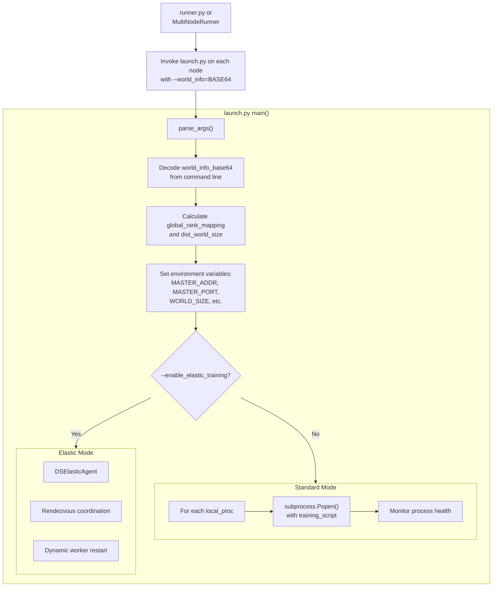
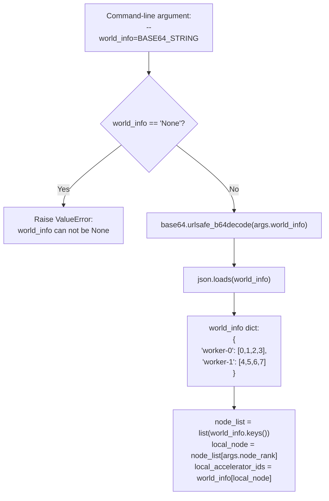
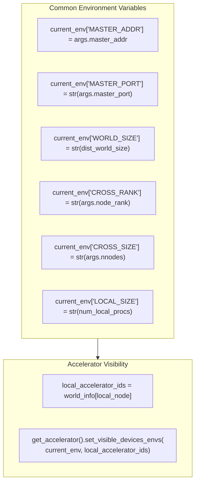
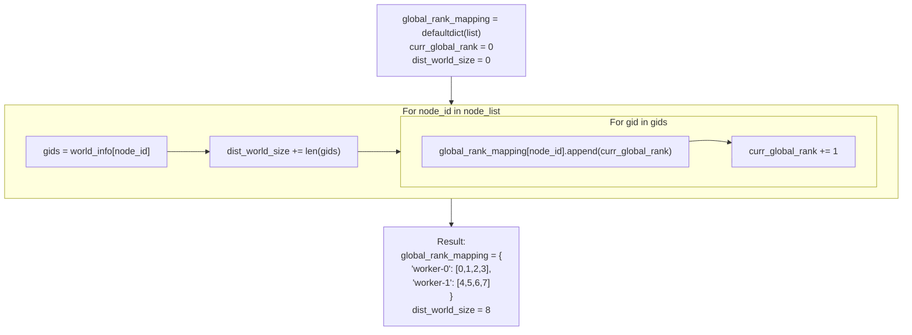
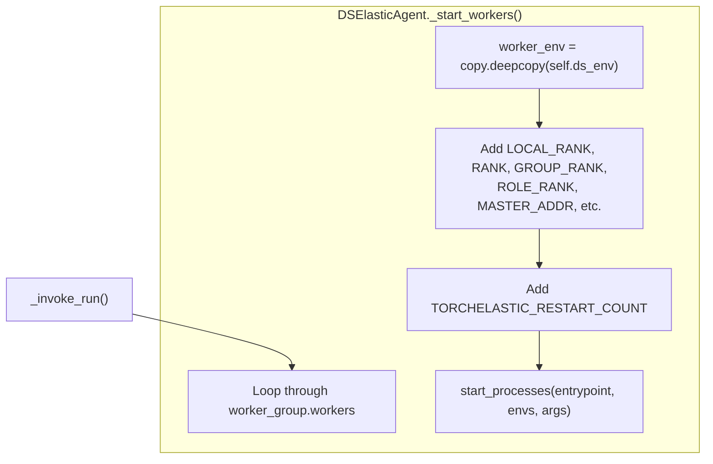

<!-- source: DeepWiki mcp.deepwiki.com · repo deepspeedai/DeepSpeed · page 8.3 Environment Setup and Process Spawning · fetched 2026-10-21 -->

# Environment Setup and Process Spawning

Relevant source files

The following files were used as context for generating this wiki page:

- [deepspeed/constants.py](deepspeed/constants.py)
- [deepspeed/elasticity/elastic_agent.py](deepspeed/elasticity/elastic_agent.py)
- [deepspeed/launcher/constants.py](deepspeed/launcher/constants.py)
- [deepspeed/launcher/launch.py](deepspeed/launcher/launch.py)
- [deepspeed/launcher/launcher_helper.py](deepspeed/launcher/launcher_helper.py)
- [deepspeed/launcher/multinode_runner.py](deepspeed/launcher/multinode_runner.py)
- [deepspeed/launcher/runner.py](deepspeed/launcher/runner.py)
- [deepspeed/runtime/checkpoint_engine/nebula_checkpoint_engine.py](deepspeed/runtime/checkpoint_engine/nebula_checkpoint_engine.py)
- [deepspeed/runtime/checkpoint_engine/torch_checkpoint_engine.py](deepspeed/runtime/checkpoint_engine/torch_checkpoint_engine.py)
- [deepspeed/runtime/eigenvalue.py](deepspeed/runtime/eigenvalue.py)
- [tests/unit/launcher/test_ds_arguments.py](tests/unit/launcher/test_ds_arguments.py)
- [tests/unit/launcher/test_multinode_runner.py](tests/unit/launcher/test_multinode_runner.py)
- [tests/unit/launcher/test_user_args.py](tests/unit/launcher/test_user_args.py)

## Purpose and Scope

This document explains how DeepSpeed's `launch.py` script sets up the distributed training environment and spawns worker processes on each node. After the launcher architecture (page 8.1) and multi-node runners (page 8.2) distribute execution to each node, `launch.py` performs the critical per-node work of:

1. **World info decoding** - Parsing the encoded cluster topology.
2. **Environment variable configuration** - Setting PyTorch distributed environment.
3. **Rank assignment** - Computing global and local ranks for each worker.
4. **Process spawning** - Creating subprocess for each GPU/accelerator.
5. **Process monitoring** - Tracking worker health and propagating errors.
6. **Elastic training support** - Using `DSElasticAgent` for fault tolerance.

This page focuses on the mechanics of `launch.py` [deepspeed/launcher/launch.py:1-424]() and the elastic training agent [deepspeed/elasticity/elastic_agent.py:1-180]().

## Launch.py Architecture

The `launch.py` script is invoked on each node after the multi-node runner distributes execution. It serves as the per-node process manager, similar to `torch.distributed.launch` but with added support for arbitrary GPU exclusion and specific accelerator handling [deepspeed/launcher/launch.py:5-12]().

**Diagram: Launch.py Execution Flow**

**Sources:** [deepspeed/launcher/launch.py:145-376]()

## World Info Decoding and Rank Calculation

The `launch.py` script receives the `world_info` argument from the multi-node runner (e.g., `PDSHRunner` [deepspeed/launcher/multinode_runner.py:99-101]()) and decodes it to determine the cluster topology.

### World Info Decoding Process

**Diagram: World Info Decoding**

**Sources:** [deepspeed/launcher/launch.py:157-168]()

The decoded `world_info` is a dictionary mapping hostnames to lists of accelerator IDs. The `args.node_rank` parameter identifies which node this `launch.py` instance is running on [deepspeed/launcher/launch.py:165-168]().

## Environment Variable Setup

After decoding `world_info` and computing rank mappings, `launch.py` configures environment variables for distributed training.

### Common Environment Variables

These environment variables are set once and shared by all local worker processes:

**Diagram: Common Environment Setup**

**Sources:** [deepspeed/launcher/launch.py:182-192](), [deepspeed/constants.py:23-26]()

**Environment Variable Definitions:**

| Variable | Value | Description |
|----------|-------|-------------|
| `MASTER_ADDR` | `args.master_addr` | Master node IP address for rendezvous [deepspeed/launcher/launch.py:46-52]() |
| `MASTER_PORT` | `str(args.master_port)` | Master node port (default 29500) [deepspeed/launcher/launch.py:53-58]() |
| `WORLD_SIZE` | `str(dist_world_size)` | Total number of worker processes globally [deepspeed/launcher/launch.py:186]() |
| `CROSS_RANK` | `str(args.node_rank)` | This node's rank [0, num_nodes) [deepspeed/launcher/launch.py:188]() |
| `CROSS_SIZE` | `str(args.nnodes)` | Total number of nodes [deepspeed/launcher/launch.py:189]() |
| `LOCAL_SIZE` | `str(num_local_procs)` | Number of workers on this node [deepspeed/launcher/launch.py:190]() |

### Accelerator Visibility Configuration

The `get_accelerator().set_visible_devices_envs()` method configures device visibility based on the local accelerator IDs [deepspeed/launcher/launch.py:182-184](). This abstraction ensures consistent behavior across hardware platforms (CUDA, ROCm, XPU, etc.).

### Additional Environment Sources

`launch.py` and the runners may also load environment variables from:

*   **DLTS Pod Environment**: Reads from `DLTS_POD_ENV_PATH` if present [deepspeed/launcher/launch.py:211-219]().
*   **Launcher Helper**: For specific backends like `MPICH`, the `launcher_helper.py` maps vendor-specific variables (e.g., `PMI_RANK`, `MPI_LOCALRANKID`) to standard `RANK` and `LOCAL_RANK` [deepspeed/launcher/launcher_helper.py:87-90]().
*   **Nebula**: Exporting `NEBULA_EXPORT_ENVS` for specialized checkpointing [deepspeed/launcher/runner.py:30-38]().

## Process-Specific Environment and Spawning

### Global Rank Mapping

`launch.py` builds a global rank mapping that assigns sequential ranks to all workers across all nodes [deepspeed/launcher/launch.py:170-180]().

**Diagram: global_rank_mapping Construction**

**Sources:** [deepspeed/launcher/launch.py:170-180]()

### Per-Process Rank Assignment and Spawning

In standard (non-elastic) mode, `launch.py` spawns one subprocess for each local accelerator [deepspeed/launcher/launch.py:237-273]().

**Key Implementation Details:**

1.  **Rank Assignment**: `dist_rank` is fetched from `global_rank_mapping[local_node][local_proc]`, and `local_rank` is computed via modulo [deepspeed/launcher/launch.py:239-242]().
2.  **Command Construction**:
    *   Starts with `sys.executable -u` unless `--no_python` is specified [deepspeed/launcher/launch.py:251-253]().
    *   Adds `-m` flag if `--module` is used [deepspeed/launcher/launch.py:254-255]().
    *   Adds `--local_rank={local_rank}` to the user script arguments unless `--no_local_rank` is specified [deepspeed/launcher/launch.py:259-261]().
3.  **CPU Core Binding**: If `--bind_cores_to_rank` is set, `get_numactl_cmd()` is used to generate binding commands (e.g., `numactl --physcpubind`) [deepspeed/launcher/launch.py:246-249]().
4.  **Logging**: If `--enable_each_rank_log` is enabled, `stdout` and `stderr` are redirected to unique log files per rank [deepspeed/launcher/launch.py:265-270]().

## Elastic Training Support

When `--enable_elastic_training` is passed to `launch.py`, it instantiates a `DSElasticAgent` [deepspeed/launcher/launch.py:283-300]().

### DSElasticAgent Implementation

`DSElasticAgent` extends Torch's `LocalElasticAgent` to provide DeepSpeed-specific environment management and fault tolerance [deepspeed/elasticity/elastic_agent.py:32-41]().

**Diagram: Elastic Agent Process Spawning**

**Sources:** [deepspeed/elasticity/elastic_agent.py:65-125]()

**Key Elastic Features:**
*   **Dynamic Rendezvous**: Uses a `Store` to set `MASTER_ADDR` and `MASTER_PORT` dynamically if not provided [deepspeed/elasticity/elastic_agent.py:46-63]().
*   **Environment Propagation**: Injects a comprehensive set of `TORCHELASTIC_*` variables into every worker process [deepspeed/elasticity/elastic_agent.py:80-97]().
*   **Process Monitoring**: The `_invoke_run` loop monitors worker health and initiates restarts if the `rdzv_handler` detects node membership changes or worker failures [deepspeed/elasticity/elastic_agent.py:127-172]().

**Sources:** [deepspeed/launcher/launch.py](), [deepspeed/launcher/multinode_runner.py](), [deepspeed/elasticity/elastic_agent.py](), [deepspeed/launcher/launcher_helper.py]()

---

