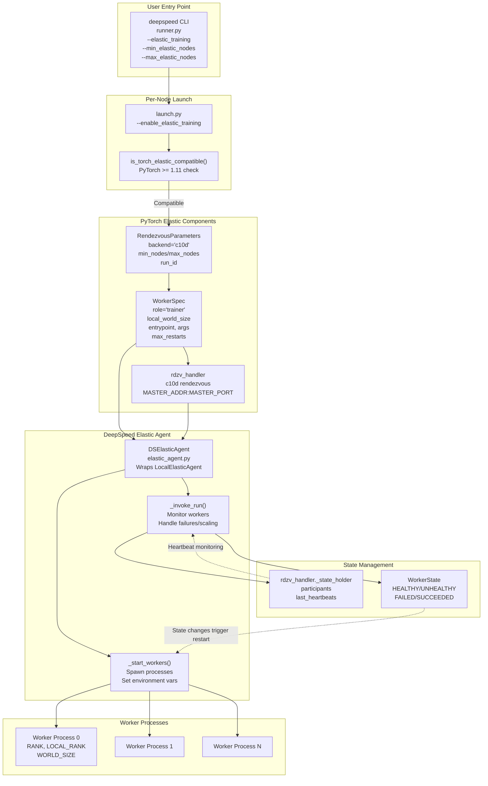
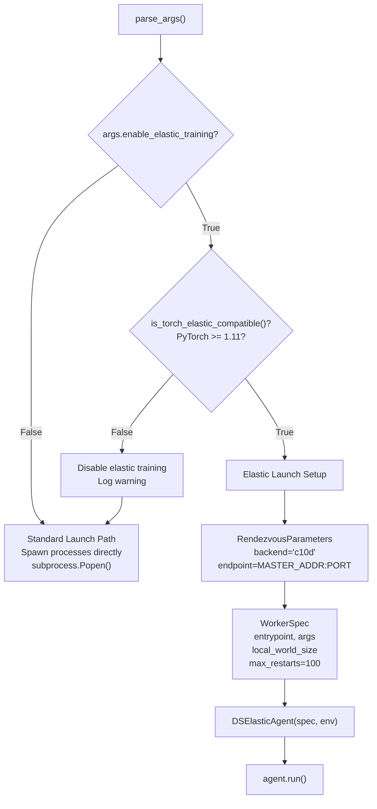

<!-- source: DeepWiki mcp.deepwiki.com · repo deepspeedai/DeepSpeed · page 8.4 Elastic Training · fetched 2026-10-21 -->

# Elastic Training

Relevant source files

The following files were used as context for generating this wiki page:

- [deepspeed/constants.py](deepspeed/constants.py)
- [deepspeed/elasticity/__init__.py](deepspeed/elasticity/__init__.py)
- [deepspeed/elasticity/config.py](deepspeed/elasticity/config.py)
- [deepspeed/elasticity/constants.py](deepspeed/elasticity/constants.py)
- [deepspeed/elasticity/elastic_agent.py](deepspeed/elasticity/elastic_agent.py)
- [deepspeed/elasticity/elasticity.py](deepspeed/elasticity/elasticity.py)
- [deepspeed/launcher/constants.py](deepspeed/launcher/constants.py)
- [deepspeed/launcher/launch.py](deepspeed/launcher/launch.py)
- [deepspeed/launcher/launcher_helper.py](deepspeed/launcher/launcher_helper.py)
- [deepspeed/launcher/multinode_runner.py](deepspeed/launcher/multinode_runner.py)
- [deepspeed/launcher/runner.py](deepspeed/launcher/runner.py)
- [deepspeed/runtime/checkpoint_engine/nebula_checkpoint_engine.py](deepspeed/runtime/checkpoint_engine/nebula_checkpoint_engine.py)
- [deepspeed/runtime/checkpoint_engine/torch_checkpoint_engine.py](deepspeed/runtime/checkpoint_engine/torch_checkpoint_engine.py)
- [deepspeed/runtime/eigenvalue.py](deepspeed/runtime/eigenvalue.py)
- [tests/unit/launcher/test_ds_arguments.py](tests/unit/launcher/test_ds_arguments.py)
- [tests/unit/launcher/test_multinode_runner.py](tests/unit/launcher/test_multinode_runner.py)
- [tests/unit/launcher/test_user_args.py](tests/unit/launcher/test_user_args.py)

## Purpose and Scope

This document describes DeepSpeed's **Elastic Training** system, which enables dynamic scaling and fault tolerance for distributed training jobs. Elastic training allows training to continue when nodes fail or when new nodes join the cluster, providing resilience against hardware failures and enabling efficient resource utilization in shared cluster environments.

The system is centered around the `DSElasticAgent`, which extends PyTorch's elastic training infrastructure to integrate seamlessly with DeepSpeed's orchestration and configuration management.

Sources: [deepspeed/launcher/runner.py:92-102](), [deepspeed/launcher/launch.py:72](), [deepspeed/elasticity/elastic_agent.py:32-43]()

---

## Overview

Elastic training in DeepSpeed provides:

- **Fault Tolerance**: Automatic recovery and process re-spawning when worker nodes or processes fail.
- **Dynamic Scaling**: The ability for the cluster size to grow or shrink during training without manual intervention.
- **Rendezvous Management**: Using a centralized store to manage node membership and master address/port discovery.
- **Batch Size Adaptability**: Logic to determine compatible batch sizes across varying GPU counts (Elasticity v1 and v2).

Sources: [deepspeed/elasticity/elastic_agent.py:127-191](), [deepspeed/elasticity/elasticity.py:126-170](), [deepspeed/launcher/launch.py:274-328]()

---

## System Architecture

### High-Level Component Interaction

Sources: [deepspeed/launcher/runner.py:92-102](), [deepspeed/launcher/launch.py:274-328](), [deepspeed/elasticity/elastic_agent.py:32-191]()

---

## Configuration and Command-Line Options

### Runner CLI Arguments
The `deepspeed` CLI supports specific flags to trigger elastic behavior:

| Argument | Type | Default | Description |
|----------|------|---------|-------------|
| `--elastic_training` | flag | False | Enable elastic training support [deepspeed/launcher/runner.py:188]() |
| `--min_elastic_nodes` | int | -1 | Minimum number of nodes required [deepspeed/launcher/runner.py:92]() |
| `--max_elastic_nodes` | int | -1 | Maximum number of nodes allowed [deepspeed/launcher/runner.py:98]() |

### Elasticity Configuration Object
The `ElasticityConfig` class parses the `elasticity` block in the DeepSpeed JSON configuration.

| Parameter | Default | Description |
|-----------|---------|-------------|
| `max_train_batch_size` | 2000 | The maximum global batch size the model can tolerate [deepspeed/elasticity/constants.py:37]() |
| `micro_batch_sizes` | [2, 4, 6] | Acceptable micro batch sizes to search over [deepspeed/elasticity/constants.py:41]() |
| `min_gpus` / `max_gpus` | 1 / 10000 | GPU count range for compatibility search [deepspeed/elasticity/constants.py:45-48]() |
| `version` | 0.2 | Elasticity logic version (0.1 or 0.2) [deepspeed/elasticity/constants.py:74]() |

Sources: [deepspeed/elasticity/config.py:28-106](), [deepspeed/elasticity/constants.py:28-75]()

---

## Launch Flow and Process Spawning

### Elastic Launch Decision Tree

Sources: [deepspeed/launcher/launch.py:205-328](), [deepspeed/launcher/launch.py:29]()

### DSElasticAgent Implementation
The `DSElasticAgent` class extends PyTorch's `LocalElasticAgent` to inject DeepSpeed-specific environment variables and handle master address discovery.

- **Master Discovery**: `_set_master_addr_port` uses `hostname -I` to determine the master IP if not provided [deepspeed/elasticity/elastic_agent.py:45-63]().
- **Worker Environment**: `_start_workers` populates a comprehensive set of environment variables for each rank, including `LOCAL_RANK`, `RANK`, `WORLD_SIZE`, and `MASTER_ADDR` [deepspeed/elasticity/elastic_agent.py:80-97]().
- **Process Management**: It uses `start_processes` to manage the lifecycle of worker ranks on the local node [deepspeed/elasticity/elastic_agent.py:114-123]().

Sources: [deepspeed/elasticity/elastic_agent.py:32-125]()

---

## Elasticity Logic (v1 vs v2)

DeepSpeed provides two versions of compatibility logic to determine how global batch size relates to GPU counts.

### Elasticity v0.1
Calculates compatible GPU counts based on Lowest Common Multiple (LCM) of micro-batches and Highly Composite Numbers (HCN) to maximize the number of valid cluster sizes.
- **Functions**: `_get_compatible_gpus_v01`, `get_candidate_batch_sizes`, `get_valid_gpus`.

Sources: [deepspeed/elasticity/elasticity.py:27-123]()

### Elasticity v0.2
Adds support for **Model Parallelism** and **Node-Level scaling**. It ensures that the number of GPUs per node is divisible by the model parallel size and scales at the node level rather than the individual GPU level.
- **Function**: `_get_compatible_gpus_v02`.

Sources: [deepspeed/elasticity/elasticity.py:126-170]()

### Highly Composite Numbers (HCN)
DeepSpeed uses a predefined list of HCNs (up to 720,720) to find batch sizes that have many divisors, increasing the likelihood of compatibility with different GPU counts.

Sources: [deepspeed/elasticity/elasticity.py:19-24]()

---

## Monitoring and Fault Tolerance

The `DSElasticAgent` runs a monitoring loop in `_invoke_run` that detects failures and scaling events.

1. **Heartbeat Monitoring**: It checks the rendezvous handler's state for dead nodes based on `keep_alive_interval` [deepspeed/elasticity/elastic_agent.py:148-153]().
2. **Membership Changes**: If the number of participants in the rendezvous changes (e.g., a new node joins), it triggers a restart [deepspeed/elasticity/elastic_agent.py:163-164]().
3. **Restart Logic**:
    - Scaling events (new nodes joining) do not count towards `max_restarts` [deepspeed/elasticity/elastic_agent.py:107-108]().
    - Failures decrement `_remaining_restarts`. If zero, the job is marked as `FAILED` [deepspeed/elasticity/elastic_agent.py:165-178]().
4. **Log Management**: Each restart attempt creates a new directory `attempt_{restart_count}` to isolate logs [deepspeed/elasticity/elastic_agent.py:109-111]().

Sources: [deepspeed/elasticity/elastic_agent.py:127-191]()

---

## Integration with Checkpointing

While `DSElasticAgent` handles process orchestration, fault tolerance requires a checkpointing engine to resume training. DeepSpeed supports several engines:

- **TorchCheckpointEngine**: Standard PyTorch-based serialization [deepspeed/runtime/checkpoint_engine/torch_checkpoint_engine.py:15-44]().
- **NebulaCheckpointEngine**: Integrates with Microsoft Nebula for faster, multi-tiered checkpointing, which is highly beneficial for frequent restarts in elastic environments [deepspeed/runtime/checkpoint_engine/nebula_checkpoint_engine.py:20-109]().

Sources: [deepspeed/runtime/checkpoint_engine/torch_checkpoint_engine.py:15-44](), [deepspeed/runtime/checkpoint_engine/nebula_checkpoint_engine.py:20-109]()

---

