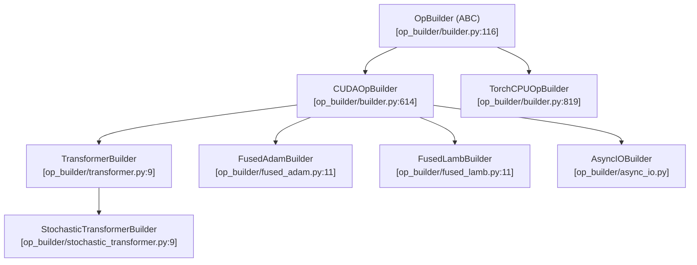
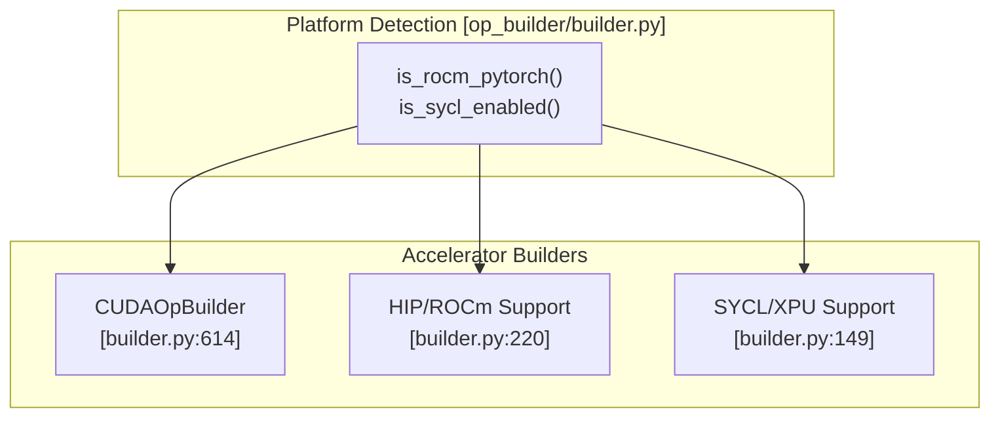

<!-- source: DeepWiki mcp.deepwiki.com · repo deepspeedai/DeepSpeed · page 9 Build System and Custom Operations · fetched 2026-10-21 -->

# Build System and Custom Operations

Relevant source files

The following files were used as context for generating this wiki page:

- [build_win.bat](build_win.bat)
- [docs/_tutorials/advanced-install.md](docs/_tutorials/advanced-install.md)
- [environment.yml](environment.yml)
- [install.sh](install.sh)
- [op_builder/__init__.py](op_builder/__init__.py)
- [op_builder/builder.py](op_builder/builder.py)
- [op_builder/fused_adam.py](op_builder/fused_adam.py)
- [op_builder/fused_lamb.py](op_builder/fused_lamb.py)
- [op_builder/stochastic_transformer.py](op_builder/stochastic_transformer.py)
- [op_builder/transformer.py](op_builder/transformer.py)
- [setup.py](setup.py)
- [tests/benchmarks/flatten_bench.py](tests/benchmarks/flatten_bench.py)
- [tests/benchmarks/unflatten_bench.py](tests/benchmarks/unflatten_bench.py)
- [tests/unit/modeling.py](tests/unit/modeling.py)
- [tests/unit/modelingpreln.py](tests/unit/modelingpreln.py)

## Purpose and Scope

This document describes the build system and compilation infrastructure for DeepSpeed's C++/CUDA custom operations (ops). DeepSpeed includes numerous high-performance kernels written in C++, CUDA, HIP, and SYCL that must be compiled against the user's specific environment. The build system handles compilation in two modes: **just-in-time (JIT)** compilation at first use, and **pre-build** compilation during installation.

For information about installing DeepSpeed and configuration options, see [Installation](#2.1). For details about the specific optimized operations used during training and inference, see [Core Training Engine](#3) and [Inference Optimization](#5).

## OpBuilder Architecture

The build system is centered around the `OpBuilder` class hierarchy. Each custom operation has a corresponding builder class that specifies its source files, compilation flags, and platform-specific dependencies.

### Builder Class Hierarchy

**Sources:** [op_builder/builder.py:116-867](), [op_builder/transformer.py:9-37](), [op_builder/fused_adam.py:11-38](), [op_builder/fused_lamb.py:11-41]()

### OpBuilder Base Class
The abstract `OpBuilder` class [op_builder/builder.py:116-612]() defines the interface for all extensions. It manages the `_loaded_ops` cache [op_builder/builder.py:122]() and provides the logic for both JIT and pre-build loading via the `load()` method [op_builder/builder.py:525-542](). For details on the builder hierarchy, see [OpBuilder Architecture](#9.1).

## Compilation Modes: JIT vs Pre-build

DeepSpeed supports two compilation strategies controlled by environment variables, primarily `DS_BUILD_OPS` [setup.py:153]().

### JIT (Just-In-Time) Compilation
**Default mode** on Linux (`DS_BUILD_OPS=0`). Operations are compiled on first use using `torch.utils.cpp_extension.load()` [op_builder/builder.py:592](). Build artifacts are stored by default in `/tmp/torch_extensions` [op_builder/builder.py:27]() or a path specified by `TORCH_EXTENSIONS_DIR` [docs/_tutorials/advanced-install.md:129]().

### Pre-build Compilation
**Enabled** by setting `DS_BUILD_OPS=1` [setup.py:153-156](). Operations are compiled during `pip install` or `python setup.py install`. This is the default behavior on Windows [setup.py:152](). Individual ops can be toggled using specific flags like `DS_BUILD_FUSED_ADAM` [op_builder/fused_adam.py:12]().

For a comparison of these modes, see [JIT vs Pre-build Compilation](#9.2).

## Platform-Specific Support

DeepSpeed abstracts hardware differences (NVIDIA CUDA, AMD ROCm, Intel SYCL, etc.) through its builder system.

**Sources:** [op_builder/builder.py:149-286](), [op_builder/builder.py:614-817]()

### Supported Accelerators
- **CUDA**: Primary support for NVIDIA GPUs.
- **ROCm**: Support for AMD GPUs via `hipify_extension()` [op_builder/builder.py:750]().
- **SYCL/XPU**: Support for Intel accelerators [op_builder/builder.py:204]().
- **Others**: The system also includes builders for NPU, HPU (Gaudi), MLU, and more.

For details on cross-platform support, see [Platform-Specific Extensions](#9.3).

## CUDA Compatibility and Version Management

The build system performs strict checks to ensure the installed CUDA toolkit matches the version PyTorch was compiled with [op_builder/builder.py:90-113](). It manages `compute_capability_args` [op_builder/builder.py:616]() to target specific GPU architectures (e.g., Ampere, Hopper) using `TORCH_CUDA_ARCH_LIST` [op_builder/builder.py:633]().

For details on version matching and compute capabilities, see [CUDA Compatibility and Version Management](#9.4).

## Async I/O and DeepNVMe

DeepSpeed includes a specialized `AsyncIOBuilder` [setup.py:60]() for high-performance asynchronous NVMe I/O. This is critical for ZeRO-Infinity offloading, allowing the system to overlap parameter swapping with computation. It supports features like **GPUDirect Storage (GDS)** and the `FastFileWriter` [op_builder/builder.py:10]().

For details on NVMe optimization, see [Async I/O and DeepNVMe](#9.5).

## Build Environment Summary

| Variable | Purpose | File Reference |
|----------|---------|----------------|
| `DS_BUILD_OPS` | Global toggle for pre-compilation | [setup.py:153]() |
| `DS_ENABLE_NINJA` | Force use of Ninja build system | [setup.py:131]() |
| `DS_SKIP_CUDA_CHECK` | Bypass CUDA version mismatch check | [op_builder/builder.py:102]() |
| `TORCH_CUDA_ARCH_LIST` | Specify target GPU architectures | [op_builder/builder.py:633]() |

**Sources:** [setup.py:131-153](), [op_builder/builder.py:102-633]()

---

