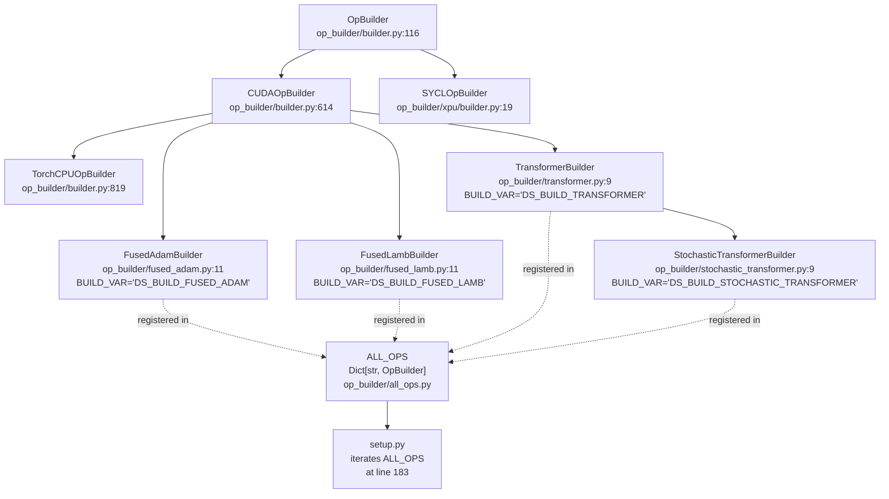
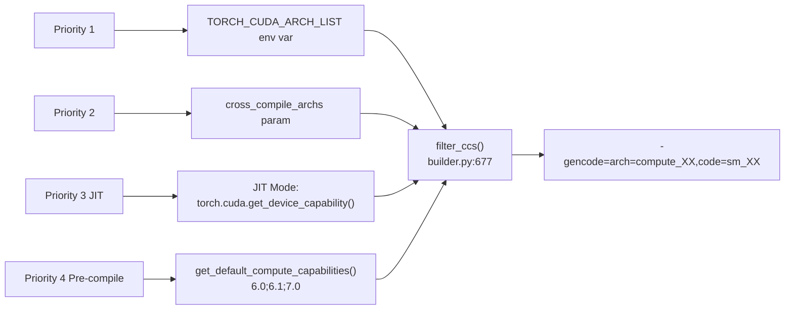
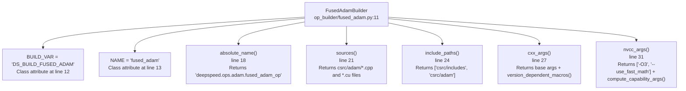
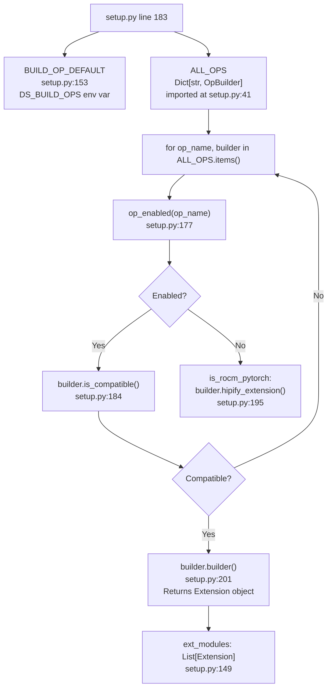
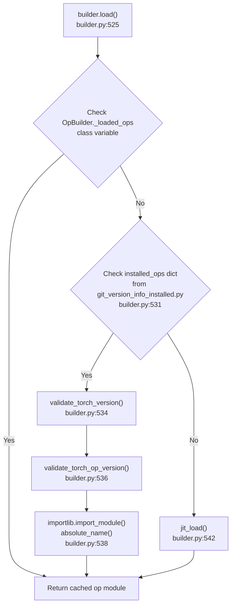

<!-- source: DeepWiki mcp.deepwiki.com · repo deepspeedai/DeepSpeed · page 9.1 OpBuilder Architecture · fetched 2026-10-21 -->

# OpBuilder Architecture

<details>
<summary>Relevant source files</summary>

The following files were used as context for generating this wiki page:

- [build_win.bat](build_win.bat)
- [docs/_tutorials/advanced-install.md](docs/_tutorials/advanced-install.md)
- [environment.yml](environment.yml)
- [install.sh](install.sh)
- [op_builder/__init__.py](op_builder/__init__.py)
- [op_builder/builder.py](op_builder/builder.py)
- [op_builder/fused_adam.py](op_builder/fused_adam.py)
- [op_builder/fused_lamb.py](op_builder/fused_lamb.py)
- [op_builder/stochastic_transformer.py](op_builder/stochastic_transformer.py)
- [op_builder/transformer.py](op_builder/transformer.py)
- [setup.py](setup.py)
- [tests/benchmarks/flatten_bench.py](tests/benchmarks/flatten_bench.py)
- [tests/benchmarks/unflatten_bench.py](tests/benchmarks/unflatten_bench.py)
- [tests/unit/modeling.py](tests/unit/modeling.py)
- [tests/unit/modelingpreln.py](tests/unit/modelingpreln.py)

</details>


## Purpose and Scope

This document describes the OpBuilder architecture, which provides DeepSpeed's extensible framework for compiling and loading custom CUDA/C++ operations. The OpBuilder system abstracts platform-specific compilation details through a hierarchy of builder classes, enabling DeepSpeed to support multiple hardware backends (NVIDIA CUDA, AMD ROCm, Intel XPU, and others) with a unified interface.

This page covers the builder class hierarchy, operation registration system, and build orchestration. For details on JIT vs pre-compilation workflows, see page 9.2 (Compilation Strategies). For platform-specific compatibility checks and build configurations, see page 9.3 (Platform-Specific Builds).

## Core Architecture Overview

The OpBuilder system follows the Builder pattern, where each custom operation has a corresponding builder class that knows how to compile and load that operation. The architecture consists of three layers:

1.  **Abstract Base Layer**: `OpBuilder` defines the interface all builders must implement.
2.  **Platform Layer**: `CUDAOpBuilder`, `TorchCPUOpBuilder`, and various accelerator-specific builders (e.g., `SYCLOpBuilder`) provide platform-specific compilation logic.
3.  **Concrete Operations Layer**: Specific builders like `FusedAdamBuilder` and `TransformerBuilder` define source files and compilation flags for individual operations.

#### Diagram: OpBuilder Class Hierarchy and Registration System


**Sources:** [op_builder/builder.py:116-867](), [op_builder/fused_adam.py:11-38](), [op_builder/fused_lamb.py:11-41](), [op_builder/transformer.py:9-37](), [op_builder/stochastic_transformer.py:9-23](), [setup.py:41](), [setup.py:183]()

## OpBuilder Abstract Base Class

The `OpBuilder` class at [op_builder/builder.py:116-612]() defines the contract that all operation builders must fulfill. It is an abstract base class that cannot be instantiated directly.

### Core Abstract Methods

Each concrete builder must implement:

| Method | Purpose | Return Type |
|--------|---------|-------------|
| `absolute_name()` | Fully qualified module name for the compiled op | `str` |
| `sources()` | List of source files to compile | `List[str]` |

**Example from FusedAdamBuilder:**
```python
# op_builder/fused_adam.py:18-22
def absolute_name(self):
    return f'deepspeed.ops.adam.{self.NAME}_op'

def sources(self):
    return ['csrc/adam/fused_adam_frontend.cpp', 'csrc/adam/multi_tensor_adam.cu']
```

### Optional Override Methods

Builders can customize compilation by overriding:

| Method | Purpose | Default |
|--------|---------|---------|
| `include_paths()` | Include directories for compilation | `[]` |
| `cxx_args()` | C++ compiler flags | Platform-specific |
| `nvcc_args()` | NVCC compiler flags (CUDA) | Platform-specific |
| `extra_ldflags()` | Additional linker flags | `[]` |
| `is_compatible()` | Check if op can be built on this system | `True` |

### Shared Class State

The OpBuilder class maintains shared state across all instances:

- `_loaded_ops` [op_builder/builder.py:122](): Cache of already-loaded operation modules.
- `_rocm_version`, `_rocm_gpu_arch`, `_rocm_wavefront_size` [op_builder/builder.py:117-119](): ROCm platform detection cache.
- `_is_rocm_pytorch`, `_is_sycl_enabled` [op_builder/builder.py:120-121](): Platform capability flags.

**Sources:** [op_builder/builder.py:116-524](), [op_builder/fused_adam.py:11-38]()

## Platform-Specific Builder Classes

### CUDAOpBuilder

`CUDAOpBuilder` at [op_builder/builder.py:614-817]() extends `OpBuilder` for NVIDIA CUDA and AMD ROCm compilation. It handles architecture detection and compiler flag generation.

#### Diagram: Compute Capability Selection Logic


The `compute_capability_args()` method at [op_builder/builder.py:616-675]() determines which GPU architectures to compile for:

1.  **JIT Mode** [op_builder/builder.py:635-643](): Detects visible GPUs at runtime using `torch.cuda.get_device_capability()` and compiles for those specific architectures.
2.  **Cross-Compile Mode** [op_builder/builder.py:645-658](): Uses the `TORCH_CUDA_ARCH_LIST` environment variable or `get_default_compute_capabilities()` to compile for multiple architectures.

**Version-Dependent Macros:**

The `version_dependent_macros()` method at [op_builder/builder.py:684-695]() adds compilation flags based on PyTorch version to maintain API compatibility:
- `-DVERSION_GE_1_1` for PyTorch >= 1.1
- `-DVERSION_GE_1_3` for PyTorch >= 1.3
- `-DVERSION_GE_1_5` for PyTorch >= 1.5

**Sources:** [op_builder/builder.py:614-817](), [op_builder/builder.py:62-78]()

### TorchCPUOpBuilder

`TorchCPUOpBuilder` at [op_builder/builder.py:819-867]() extends `CUDAOpBuilder` to provide CPU fallback capability. When CUDA is unavailable, it:

- Detects CPU architecture using `cpu_arch()` [op_builder/builder.py:403-425]() (returns flags like `-march=native`).
- Determines SIMD width using `simd_width()` [op_builder/builder.py:465-487]() (detects AVX512, AVX256, etc.).
- Adds OpenMP support via `-fopenmp` flags [op_builder/builder.py:861]().
- Links against CUDA runtime libraries when available [op_builder/builder.py:846-854]().

**Sources:** [op_builder/builder.py:819-867](), [op_builder/builder.py:403-487]()

### SYCLOpBuilder

`SYCLOpBuilder` at [op_builder/xpu/builder.py:19-133]() provides Intel XPU support using SYCL/DPC++:

- Uses `DPCPPExtension` from Intel Extension for PyTorch [op_builder/xpu/builder.py:23-35]().
- Compiles with `-fsycl -fsycl-targets=spir64_gen` flags [op_builder/xpu/builder.py:55-61]().
- Targets Intel PVC devices with specific compiler options [op_builder/xpu/builder.py:66-74]().

**Sources:** [op_builder/xpu/builder.py:19-133]()

## Concrete Operation Builders

Each DeepSpeed operation has a dedicated builder class that specifies its source files, include paths, and flags.

#### Diagram: Operation Builder Pattern (FusedAdamBuilder Example)



### FusedAdamBuilder Example

The `FusedAdamBuilder` at [op_builder/fused_adam.py:11-38]() demonstrates the typical structure:

```python
class FusedAdamBuilder(CUDAOpBuilder):
    BUILD_VAR = "DS_BUILD_FUSED_ADAM"  # Environment variable name
    NAME = "fused_adam"                 # Operation identifier
    
    def absolute_name(self):
        return f'deepspeed.ops.adam.{self.NAME}_op'
    
    def sources(self):
        return ['csrc/adam/fused_adam_frontend.cpp', 
                'csrc/adam/multi_tensor_adam.cu']
```

### Inheritance for Variants

Some operations extend existing builders. `StochasticTransformerBuilder` at [op_builder/stochastic_transformer.py:9-23]() extends `TransformerBuilder`:

```python
class StochasticTransformerBuilder(TransformerBuilder):
    BUILD_VAR = "DS_BUILD_STOCHASTIC_TRANSFORMER"
    NAME = "stochastic_transformer"
    
    def nvcc_args(self):
        args = super().nvcc_args()
        args.append('-D__STOCHASTIC_MODE__')  # Add compilation flag
        return args
```

**Sources:** [op_builder/fused_adam.py:11-38](), [op_builder/transformer.py:9-37](), [op_builder/stochastic_transformer.py:9-23]()

## Operation Registration and Discovery

### ALL_OPS Registry

Operations are registered in the `ALL_OPS` dictionary (referenced at [setup.py:41]() and [setup.py:183]()). This registry maps operation names to their builder instances, enabling:

1.  **Discovery**: `setup.py` iterates over all registered operations.
2.  **Compatibility Checking**: Each builder's `is_compatible()` method is called.
3.  **Selective Building**: Environment variables control which ops to build.

### Build Variable System

Each operation has a `BUILD_VAR` class attribute that names the environment variable controlling its compilation:

| Operation | BUILD_VAR | Default Behavior |
|-----------|-----------|------------------|
| FusedAdam | `DS_BUILD_FUSED_ADAM` | Controlled by `DS_BUILD_OPS` |
| FusedLamb | `DS_BUILD_FUSED_LAMB` | Controlled by `DS_BUILD_OPS` |
| Transformer | `DS_BUILD_TRANSFORMER` | Controlled by `DS_BUILD_OPS` |

The `op_enabled()` function at [setup.py:177-179]() checks the environment variable with fallback to `DS_BUILD_OPS` (defaulting to 1 on Windows, 0 on Linux as per [setup.py:152-153]()).

**Sources:** [setup.py:41](), [setup.py:152-153](), [setup.py:171-179](), [op_builder/fused_adam.py:12](), [op_builder/fused_lamb.py:12]()

## Build Orchestration Flow

#### Diagram: Installation-Time Build Orchestration Flow



The orchestration at [setup.py:183-201]() performs these steps:

1.  **Check Compatibility**: `builder.is_compatible()` validates system requirements.
2.  **Check Enable Status**: `op_enabled(op_name)` reads environment variables.
3.  **ROCm Hipification**: If ROCm and not enabled, call `hipify_extension()` [setup.py:195]().
4.  **Build Extension**: If enabled and compatible, call `builder.builder()` to create the extension object [setup.py:201]().

**Sources:** [setup.py:152-203](), [setup.py:177-179]()

## Loading Mechanism

### Two-Path Loading Strategy

The `load()` method at [op_builder/builder.py:525-542]() implements a strategy to either import a pre-compiled module or trigger JIT compilation.

#### Diagram: OpBuilder.load() Decision Flow


### JIT Compilation Path

The `jit_load()` method at [op_builder/builder.py:544-611]() handles just-in-time compilation using `torch.utils.cpp_extension.load()`. It verifies `ninja` availability [op_builder/builder.py:549-553](), prepares absolute source paths [op_builder/builder.py:562-563](), and manages environment variables to prevent architecture overrides [op_builder/builder.py:569-572]().

**Sources:** [op_builder/builder.py:525-611](), [docs/_tutorials/advanced-install.md:114-124]()

## Helper Methods and Utilities

### Compatibility and Versioning

Platform detection and version validation are critical for stable builds:

- `installed_cuda_version()`: Parses version from `nvcc -V` [op_builder/builder.py:47-59]().
- `assert_no_cuda_mismatch()`: Compares system CUDA with PyTorch's compiled CUDA version [op_builder/builder.py:90-113]().
- `is_rocm_pytorch()`: Detects if PyTorch was built with ROCm support [op_builder/builder.py:185-201]().
- `has_function()`: Tests for library dependencies by attempting to compile a minimal C program [op_builder/builder.py:315-395]().

### Hardware Optimization

- `cpu_arch()`: Detects the CPU architecture to provide optimized flags like `-march=native` [op_builder/builder.py:403-425]().
- `simd_width()`: Detects the maximum SIMD width (AVX512, AVX2, etc.) supported by the host [op_builder/builder.py:465-487]().

**Sources:** [op_builder/builder.py:47-113](), [op_builder/builder.py:185-201](), [op_builder/builder.py:315-487]()

---

