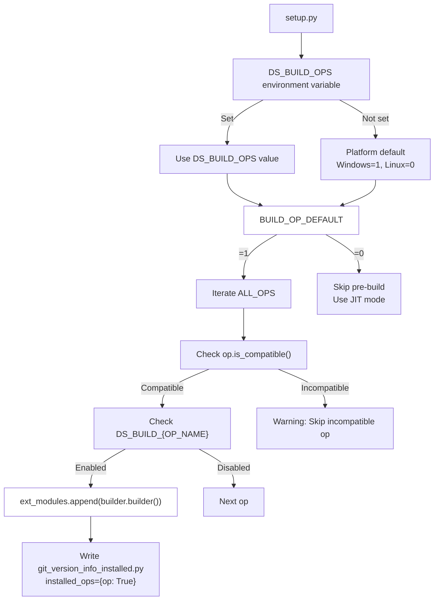
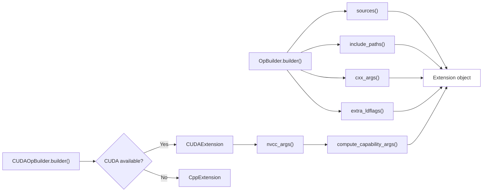
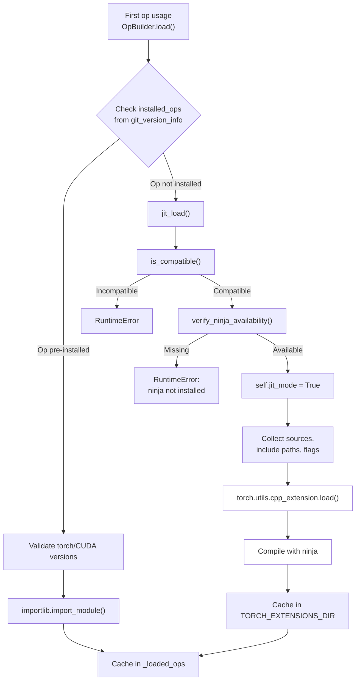
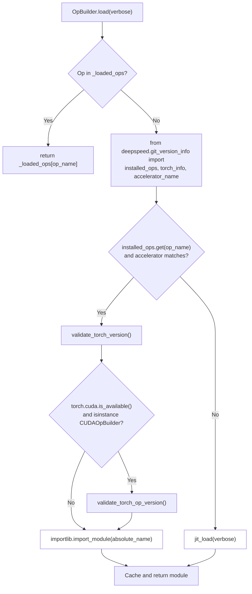
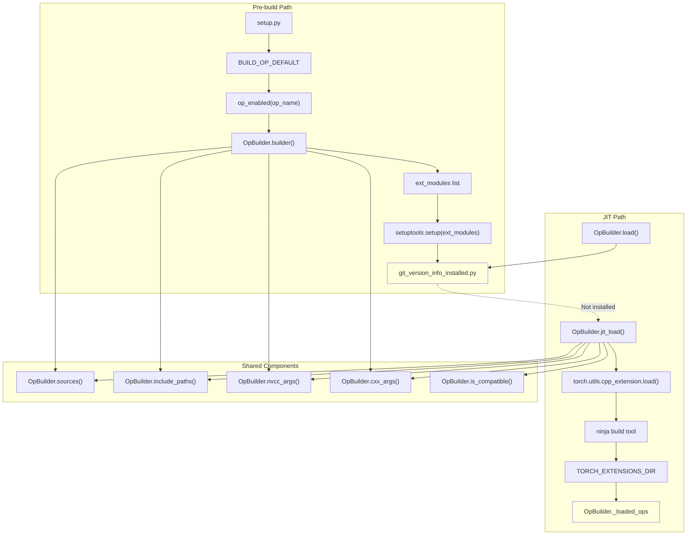

<!-- source: DeepWiki mcp.deepwiki.com · repo deepspeedai/DeepSpeed · page 9.2 JIT vs Pre-build Compilation · fetched 2026-10-21 -->

# JIT vs Pre-build Compilation

<details>
<summary>Relevant source files</summary>

The following files were used as context for generating this wiki page:

- [build_win.bat](build_win.bat)
- [docs/_tutorials/advanced-install.md](docs/_tutorials/advanced-install.md)
- [environment.yml](environment.yml)
- [install.sh](install.sh)
- [op_builder/builder.py](op_builder/builder.py)
- [op_builder/fused_adam.py](op_builder/fused_adam.py)
- [op_builder/fused_lamb.py](op_builder/fused_lamb.py)
- [op_builder/stochastic_transformer.py](op_builder/stochastic_transformer.py)
- [op_builder/transformer.py](op_builder/transformer.py)
- [setup.py](setup.py)

</details>


## Purpose and Scope

This page explains the two compilation strategies DeepSpeed uses for building C++/CUDA extensions (ops): **Just-In-Time (JIT) compilation** and **pre-build compilation**. It covers how each mode works, when each is used, and how to control the compilation strategy through environment variables and configuration.

For information about the OpBuilder architecture and individual op builders, see [OpBuilder Architecture](op_builder/builder.py:116-122). For platform-specific extensions and detection mechanisms, see [Platform-Specific Extensions](op_builder/builder.py:750-770).

## Overview

DeepSpeed's C++/CUDA extensions can be compiled in two distinct modes:

| Compilation Mode | When It Occurs | Default Behavior |
|-----------------|----------------|------------------|
| **Pre-build** | During `pip install` or `setup.py install` | Windows default (`DS_BUILD_OPS=1`) |
| **JIT (Just-In-Time)** | On first use at runtime | Linux/Unix default (`DS_BUILD_OPS=0`) |

The compilation mode is controlled primarily by the `DS_BUILD_OPS` environment variable. When set to `1`, DeepSpeed pre-compiles all compatible ops during installation. When set to `0` (or unset on Linux), ops are compiled just-in-time when first loaded at runtime.

**Sources:** [setup.py:151-154](), [op_builder/builder.py:525-542](), [docs/_tutorials/advanced-install.md:9-13]()

## Pre-build Compilation Mode

### Installation-Time Compilation

Pre-build compilation happens during the DeepSpeed installation process. The `setup.py` script determines which ops to compile based on environment variables and system compatibility.



**Diagram: Pre-build Compilation Decision Flow**

The key code path starts in `setup.py`:

[setup.py:152-154]() determines the default based on platform:
```python
BUILD_OP_PLATFORM = 1 if sys.platform == "win32" else 0
BUILD_OP_DEFAULT = int(get_env_if_set('DS_BUILD_OPS', BUILD_OP_PLATFORM))
```

[setup.py:182-201]() iterates through all ops and builds those that are compatible and enabled:
- Checks `builder.is_compatible()` for system compatibility [setup.py:184]()
- Checks individual `DS_BUILD_{OP_NAME}` environment variables [setup.py:177-179]()
- Calls `builder.builder()` to create the extension [setup.py:199]()
- Appends to `ext_modules` list for setuptools [setup.py:199]()

**Sources:** [setup.py:151-201](), [op_builder/builder.py:700-748]()

### The builder() Method

Each `OpBuilder` subclass implements the `builder()` method to create a `CppExtension` or `CUDAExtension` object for setuptools.



**Diagram: builder() Method Flow**

[op_builder/builder.py:700-748]() shows the `CUDAOpBuilder.builder()` implementation:
- Checks for CUDA availability via `assert_no_cuda_mismatch()` [op_builder/builder.py:701]()
- Sets `self.build_for_cpu = True` if CUDA is missing [op_builder/builder.py:707]()
- Creates `CUDAExtension` or `CppExtension` accordingly [op_builder/builder.py:726-745]()
- Includes compute capability flags via `compute_capability_args()` [op_builder/builder.py:741]()
- Handles ROCm-specific paths and flags [op_builder/builder.py:712-723]()

**Sources:** [op_builder/builder.py:516-523](), [op_builder/builder.py:700-748]()

### Per-Op Build Control

Individual ops can be enabled/disabled during pre-build using specific environment variables:

```bash
DS_BUILD_TRANSFORMER=1 pip install deepspeed        # Build only transformer op
DS_BUILD_FUSED_ADAM=1 DS_BUILD_FUSED_LAMB=1 pip install deepspeed  # Multiple ops
```

[setup.py:171-179]() defines the logic:
```python
def op_envvar(op_name):
    return ALL_OPS[op_name].BUILD_VAR

def op_enabled(op_name):
    env_var = op_envvar(op_name)
    return int(get_env_if_set(env_var, BUILD_OP_DEFAULT))
```

Each op builder defines a `BUILD_VAR` class attribute (e.g., `DS_BUILD_TRANSFORMER`, `DS_BUILD_FUSED_ADAM`) used as the environment variable name.

**Sources:** [setup.py:171-179](), [op_builder/transformer.py:10](), [op_builder/fused_adam.py:12](), [op_builder/fused_lamb.py:12]()

## JIT Compilation Mode

### Runtime Compilation

JIT compilation occurs when an op is first loaded at runtime. DeepSpeed uses PyTorch's C++ extension loader with ninja to compile and cache extensions.



**Diagram: JIT Compilation Flow**

The entry point is [op_builder/builder.py:525-542](), the `OpBuilder.load()` method:
1. Checks if op is already in `_loaded_ops` cache [op_builder/builder.py:526]()
2. Reads `installed_ops` from `deepspeed/git_version_info_installed.py` [op_builder/builder.py:529-530]()
3. If op was pre-installed, validates versions and imports it [op_builder/builder.py:534-540]()
4. Otherwise, calls `jit_load()` for runtime compilation [op_builder/builder.py:542]()

**Sources:** [op_builder/builder.py:525-542](), [op_builder/builder.py:544-611]()

### The jit_load() Method

[op_builder/builder.py:544-611]() implements the JIT compilation logic:

```python
def jit_load(self, verbose=True):
    if not self.is_compatible(verbose):
        raise RuntimeError(...)
    
    # Verify ninja is installed
    verify_ninja_availability()
    
    self.jit_mode = True
    from torch.utils.cpp_extension import load
    
    # Get sources and include paths
    sources = [os.path.abspath(self.deepspeed_src_path(path)) for path in self.sources()]
    extra_include_paths = [os.path.abspath(self.deepspeed_src_path(path)) for path in self.include_paths()]
    
    # Prepare compilation flags
    nvcc_args = self.strip_empty_entries(self.nvcc_args())
    cxx_args = self.strip_empty_entries(self.cxx_args())
    
    # Load (compile + import)
    op_module = load(name=self.name, sources=sources, ...)
    
    # Cache the loaded module
    __class__._loaded_ops[self.name] = op_module
    return op_module
```

Key aspects:
- **Ninja requirement**: [op_builder/builder.py:549-553]() verifies ninja is available via `verify_ninja_availability()`.
- **JIT mode flag**: [op_builder/builder.py:558]() sets `self.jit_mode = True`.
- **PyTorch loader**: [op_builder/builder.py:592-599]() uses `torch.utils.cpp_extension.load()`.
- **Caching**: [op_builder/builder.py:609]() caches compiled module in `_loaded_ops`.

**Sources:** [op_builder/builder.py:544-611]()

### TORCH_EXTENSIONS_DIR

JIT-compiled extensions are cached to avoid recompilation. The cache location is controlled by the `TORCH_EXTENSIONS_DIR` environment variable.

| Environment Variable | Default Value | Purpose |
|---------------------|---------------|---------|
| `TORCH_EXTENSIONS_DIR` | `/tmp/torch_extensions` (or torch default) | Cache directory for JIT-compiled extensions |

This is particularly important when using multiple virtual environments, as each may have different PyTorch/CUDA versions. [docs/_tutorials/advanced-install.md:119-130]() recommends setting unique cache directories per environment:

```bash
TORCH_EXTENSIONS_DIR=./torch-extensions deepspeed train.py
```

**Sources:** [docs/_tutorials/advanced-install.md:114-130](), [op_builder/builder.py:27]()

### Compute Capabilities in JIT Mode

[op_builder/builder.py:634-643]() shows how compute capabilities are determined in JIT mode:

```python
if self.jit_mode:
    # Compile for underlying architectures since we know those at runtime
    for i in range(torch.cuda.device_count()):
        CC_MAJOR, CC_MINOR = torch.cuda.get_device_capability(i)
        cc = f"{CC_MAJOR}.{CC_MINOR}"
        if cc not in ccs:
            ccs.append(cc)
    ccs = sorted(ccs)
    ccs[-1] += '+PTX'
```

In JIT mode, DeepSpeed detects all visible GPUs and compiles only for their specific compute capabilities, adding PTX for forward compatibility [op_builder/builder.py:643](). This makes compilation faster but limits portability.

**Sources:** [op_builder/builder.py:616-675]()

## Compilation Mode Selection

### The load() Decision Logic

The `OpBuilder.load()` method implements the decision logic for selecting between pre-built and JIT compilation:



**Diagram: Compilation Mode Selection Logic**

[op_builder/builder.py:525-542]() implements this flow:

1. **Check cache**: If op already loaded, return from `_loaded_ops` [op_builder/builder.py:526]().
2. **Read git_version_info**: Check if op was pre-installed during setup [op_builder/builder.py:530]().
3. **Validate versions**: If pre-installed, ensure torch/CUDA versions match [op_builder/builder.py:534-536]().
4. **Import or JIT**: Use pre-built if available, otherwise JIT compile [op_builder/builder.py:540-542]().

**Sources:** [op_builder/builder.py:525-542]()

### Version Validation

When loading pre-built ops, DeepSpeed validates that the current runtime environment matches the build environment:

[op_builder/builder.py:153-161]() validates PyTorch version:
```python
@staticmethod
def validate_torch_version(torch_info):
    install_torch_version = torch_info['version']
    current_torch_version = ".".join(torch.__version__.split('.')[:2])
    if install_torch_version != current_torch_version:
        raise RuntimeError("PyTorch version mismatch! ...")
```

[op_builder/builder.py:164-182]() validates CUDA/HIP version:
```python
@staticmethod
def validate_torch_op_version(torch_info):
    if not OpBuilder.is_rocm_pytorch():
        current_cuda_version = ".".join(torch.version.cuda.split('.')[:2])
        install_cuda_version = torch_info['cuda_version']
        if install_cuda_version != current_cuda_version:
            raise RuntimeError("CUDA version mismatch! ...")
```

These validations prevent ABI incompatibilities from using pre-built extensions compiled with different toolchain versions.

**Sources:** [op_builder/builder.py:153-182](), [op_builder/builder.py:534-536]()

### git_version_info_installed.py

During pre-build compilation, [setup.py:285-291]() writes installation metadata to `deepspeed/git_version_info_installed.py`:

```python
with open('deepspeed/git_version_info_installed.py', 'w') as fd:
    fd.write(f"version='{version_str}'\n")
    fd.write(f"git_hash='{git_hash}'\n")
    fd.write(f"git_branch='{git_branch}'\n")
    fd.write(f"installed_ops={install_ops}\n")  # Dict of {op_name: True/False}
    fd.write(f"accelerator_name='{accelerator_name}'\n")
    fd.write(f"torch_info={torch_info}\n")  # torch/CUDA versions
```

This file is imported at runtime [op_builder/builder.py:529]() to determine which ops were pre-installed.

**Sources:** [setup.py:285-291](), [op_builder/builder.py:529-540]()

## Key Differences Between Modes

### Comparison Table

| Aspect | Pre-build Compilation | JIT Compilation |
|--------|----------------------|-----------------|
| **When compiled** | During installation (`pip install`) | On first use at runtime |
| **Trigger** | `DS_BUILD_OPS=1` or platform default (Windows) | `DS_BUILD_OPS=0` or platform default (Linux) |
| **Requires** | PyTorch installed before `pip install` | Ninja build tool at runtime |
| **Compute capabilities** | Cross-compile for multiple CCs via `TORCH_CUDA_ARCH_LIST` | Auto-detect visible GPUs, compile for their CCs only |
| **Compilation time** | During installation (one-time, upfront) | First run (on-demand, per-environment) |
| **Binary portability** | Can distribute wheels with pre-built ops | Not portable; each environment compiles |
| **Cache location** | Python site-packages (`deepspeed/ops/`) | `TORCH_EXTENSIONS_DIR` (default: `~/.cache/torch_extensions`) |
| **Version validation** | Strict (validates torch/CUDA match) | Implicit (compiles with current environment) |
| **Error timing** | Installation time (build failures) | Runtime (first load failures) |

### Code Entity Mapping



**Diagram: Code Entities in Pre-build vs JIT Paths**

**Sources:** [op_builder/builder.py:116-867](), [setup.py:149-335]()

## Platform-Specific Behavior

### Windows vs Linux Defaults

[setup.py:152-154]() sets different defaults based on platform:

```python
BUILD_OP_PLATFORM = 1 if sys.platform == "win32" else 0
BUILD_OP_DEFAULT = int(get_env_if_set('DS_BUILD_OPS', BUILD_OP_PLATFORM))
```

- **Windows**: Pre-build is default (`DS_BUILD_OPS=1`).
  - Reason: Windows lacks standard build tools; pre-building avoids runtime compilation issues.
  - JIT requires Visual C++ build tools and proper configuration [setup.py:8-12].
  
- **Linux/Unix**: JIT is default (`DS_BUILD_OPS=0`).
  - Reason: Most systems have GCC/Clang; JIT is convenient and avoids CUDA version mismatches.
  - Faster installation, compilation deferred to first use [docs/_tutorials/advanced-install.md:100-105].

[build_win.bat:1-17]() shows Windows-specific pre-build configuration with many ops disabled (e.g., `DS_BUILD_AIO=0`, `DS_BUILD_SPARSE_ATTN=0`).

**Sources:** [setup.py:152-154](), [build_win.bat:1-17]()

### Cross-Compilation Considerations

When pre-building for distribution (e.g., PyPI wheels), compute capabilities must be explicitly specified:

[op_builder/builder.py:644-657]() handles cross-compilation mode:
```python
else:
    # Cross-compile mode, compile for various architectures
    cross_compile_archs_env = os.environ.get('TORCH_CUDA_ARCH_LIST', None)
    if cross_compile_archs_env is not None:
        cross_compile_archs = cross_compile_archs_env.replace(' ', ';')
    else:
        if cross_compile_archs is None:
            cross_compile_archs = get_default_compute_capabilities()
    ccs = cross_compile_archs.split(';')
```

[op_builder/builder.py:62-78]() defines default compute capabilities:
- CUDA 11.0+: Adds 8.0 (A100)
- CUDA 11.1+: Adds 8.6 (RTX 3090)
- CUDA 11.8+: Adds 9.0 (H100)
- CUDA 12.0+: Adds 8.0, 8.6, 9.0
- CUDA 12.8+: Adds 10.0, 12.0

[docs/_tutorials/advanced-install.md:154-162]() explains setting compute capabilities:
```bash
TORCH_CUDA_ARCH_LIST="6.1;7.5;8.6" pip install deepspeed
```

**Sources:** [op_builder/builder.py:62-78](), [op_builder/builder.py:616-675](), [docs/_tutorials/advanced-install.md:142-165]()

## Advantages and Trade-offs

### Pre-build Compilation

**Advantages:**
- Faster first execution (no compilation delay).
- Binary wheels can be distributed to similar systems [docs/_tutorials/advanced-install.md:84-94].
- Build errors caught during installation (fail-fast).
- Explicit control over compute capabilities for portability [docs/_tutorials/advanced-install.md:154-162].

**Trade-offs:**
- Requires PyTorch installed before DeepSpeed installation [docs/_tutorials/advanced-install.md:30-31].
- Longer installation time.
- Version mismatches require reinstallation [op_builder/builder.py:157-161].
- Increased wheel size when distributing.

### JIT Compilation

**Advantages:**
- Faster installation (no upfront compilation) [docs/_tutorials/advanced-install.md:100-102].
- No version mismatch issues (always compiles with current environment).
- Automatically optimized for available hardware [op_builder/builder.py:634-643].
- Smaller distribution size.

**Trade-offs:**
- Slower first execution (compilation overhead).
- Requires ninja and build tools at runtime [environment.yml:14].
- Not portable across machines.
- Requires re-compilation per virtual environment (unless `TORCH_EXTENSIONS_DIR` shared) [docs/_tutorials/advanced-install.md:119-125].

**Sources:** [docs/_tutorials/advanced-install.md:1-206](), [setup.py:151-201](), [op_builder/builder.py:525-611]()

## Environment Variables Reference

| Variable | Default | Effect | Scope |
|----------|---------|--------|-------|
| `DS_BUILD_OPS` | `0` (Linux), `1` (Windows) | Enable/disable all pre-build ops | Installation |
| `DS_BUILD_{OP_NAME}` | Inherits `DS_BUILD_OPS` | Enable/disable specific op | Installation |
| `TORCH_CUDA_ARCH_LIST` | Platform-dependent | Compute capabilities to compile for | Both |
| `TORCH_EXTENSIONS_DIR` | `/tmp/torch_extensions` | JIT cache directory | Runtime (JIT only) |
| `DS_SKIP_CUDA_CHECK` | `0` | Skip CUDA version mismatch check | Installation |
| `DS_ENABLE_NINJA` | Unset | Force use of ninja for pre-build | Installation |

Specific op build variables include:
- `DS_BUILD_TRANSFORMER` [op_builder/transformer.py:10]
- `DS_BUILD_FUSED_ADAM` [op_builder/fused_adam.py:12]
- `DS_BUILD_FUSED_LAMB` [op_builder/fused_lamb.py:12]
- `DS_BUILD_STOCHASTIC_TRANSFORMER` [op_builder/stochastic_transformer.py:10]
- And many others (see [docs/_tutorials/advanced-install.md:58-75]())

**Sources:** [setup.py:152-179](), [op_builder/builder.py:570-607](), [op_builder/builder.py:785-806](), [docs/_tutorials/advanced-install.md:36-75]()

---

