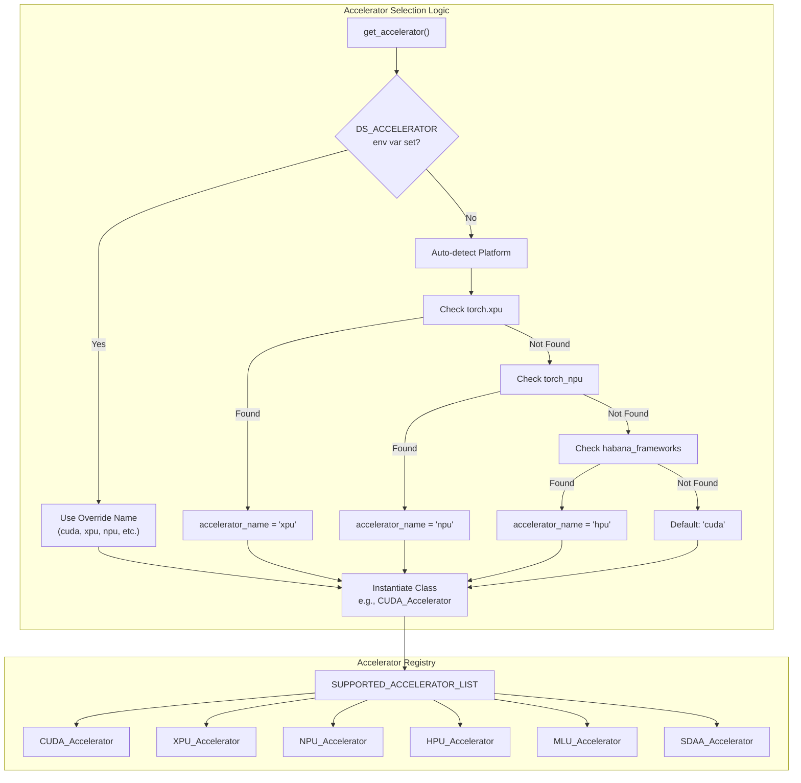
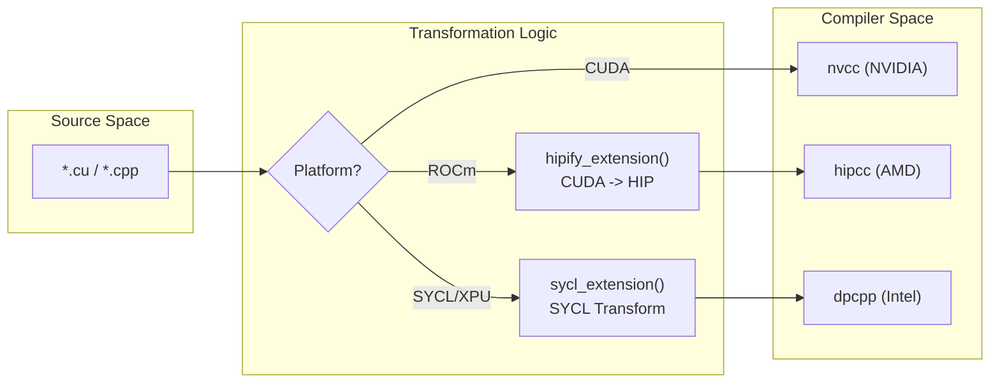

<!-- source: DeepWiki mcp.deepwiki.com · repo deepspeedai/DeepSpeed · page 9.3 Platform-Specific Extensions · fetched 2026-10-21 -->

# Platform-Specific Extensions

Relevant source files

The following files were used as context for generating this wiki page:

- [.pre-commit-config.yaml](.pre-commit-config.yaml)
- [accelerator/abstract_accelerator.py](accelerator/abstract_accelerator.py)
- [accelerator/cpu_accelerator.py](accelerator/cpu_accelerator.py)
- [accelerator/cuda_accelerator.py](accelerator/cuda_accelerator.py)
- [accelerator/hpu_accelerator.py](accelerator/hpu_accelerator.py)
- [accelerator/mlu_accelerator.py](accelerator/mlu_accelerator.py)
- [accelerator/mps_accelerator.py](accelerator/mps_accelerator.py)
- [accelerator/npu_accelerator.py](accelerator/npu_accelerator.py)
- [accelerator/real_accelerator.py](accelerator/real_accelerator.py)
- [accelerator/sdaa_accelerator.py](accelerator/sdaa_accelerator.py)
- [accelerator/supa_accelerator.py](accelerator/supa_accelerator.py)
- [accelerator/xpu_accelerator.py](accelerator/xpu_accelerator.py)
- [build_win.bat](build_win.bat)
- [csrc/xpu/adam/multi_tensor_apply.dp.hpp](csrc/xpu/adam/multi_tensor_apply.dp.hpp)
- [csrc/xpu/packbits/packing.cpp](csrc/xpu/packbits/packing.cpp)
- [deepspeed/env_report.py](deepspeed/env_report.py)
- [deepspeed/utils/nvtx.py](deepspeed/utils/nvtx.py)
- [docs/_tutorials/accelerator-abstraction-interface.md](docs/_tutorials/accelerator-abstraction-interface.md)
- [docs/_tutorials/accelerator-setup-guide.md](docs/_tutorials/accelerator-setup-guide.md)
- [docs/_tutorials/advanced-install.md](docs/_tutorials/advanced-install.md)
- [docs/assets/images/deepnvme_ops_report.png](docs/assets/images/deepnvme_ops_report.png)
- [environment.yml](environment.yml)
- [install.sh](install.sh)
- [op_builder/builder.py](op_builder/builder.py)
- [op_builder/fused_adam.py](op_builder/fused_adam.py)
- [op_builder/fused_lamb.py](op_builder/fused_lamb.py)
- [op_builder/stochastic_transformer.py](op_builder/stochastic_transformer.py)
- [op_builder/supa/__init__.py](op_builder/supa/__init__.py)
- [op_builder/supa/async_io.py](op_builder/supa/async_io.py)
- [op_builder/supa/builder.py](op_builder/supa/builder.py)
- [op_builder/supa/cpu_adagrad.py](op_builder/supa/cpu_adagrad.py)
- [op_builder/supa/cpu_adam.py](op_builder/supa/cpu_adam.py)
- [op_builder/supa/cpu_lion.py](op_builder/supa/cpu_lion.py)
- [op_builder/supa/fused_adam.py](op_builder/supa/fused_adam.py)
- [op_builder/supa/fused_lamb.py](op_builder/supa/fused_lamb.py)
- [op_builder/supa/fused_lion.py](op_builder/supa/fused_lion.py)
- [op_builder/transformer.py](op_builder/transformer.py)
- [op_builder/xpu/__init__.py](op_builder/xpu/__init__.py)
- [op_builder/xpu/builder.py](op_builder/xpu/builder.py)
- [op_builder/xpu/flash_attn.py](op_builder/xpu/flash_attn.py)
- [scripts/check-extraindexurl.py](scripts/check-extraindexurl.py)
- [setup.py](setup.py)
- [tests/unit/utils/test_nvtx.py](tests/unit/utils/test_nvtx.py)

DeepSpeed's platform-specific extension system provides a unified interface for building and executing operations across diverse hardware architectures. This document details the accelerator abstraction layer and the platform detection mechanisms that enable support for NVIDIA CUDA, AMD ROCm, Intel XPU/SYCL, Huawei NPU, Habana HPU, and more.

## Accelerator Abstraction Layer

DeepSpeed uses an abstraction layer to decouple high-level logic from low-level hardware implementations. The core of this system is the `DeepSpeedAccelerator` base class and the `get_accelerator()` factory function.

### Accelerator Factory and Detection

The `get_accelerator()` function in `accelerator/real_accelerator.py` determines the active hardware platform through environment variables or automatic detection.

**Sources:** [accelerator/real_accelerator.py:51-170](), [accelerator/real_accelerator.py:23-23]()

### Supported Accelerators

| Accelerator | Class Name | Communication Backend | File Path |
| :--- | :--- | :--- | :--- |
| **NVIDIA GPU** | `CUDA_Accelerator` | `nccl` (Linux) / `gloo` (Win) | [accelerator/cuda_accelerator.py:29-29]() |
| **Intel XPU** | `XPU_Accelerator` | `ccl` or `xccl` | [accelerator/xpu_accelerator.py:19-19]() |
| **Huawei NPU** | `NPU_Accelerator` | `hccl` | [accelerator/npu_accelerator.py:17-17]() |
| **Habana HPU** | `HPU_Accelerator` | `hccl` | [accelerator/hpu_accelerator.py:15-15]() |
| **Intel CPU** | `CPU_Accelerator` | `ccl` or `gloo` | [accelerator/cpu_accelerator.py:25-25]() |
| **Apple MPS** | `MPS_Accelerator` | `None` | [accelerator/mps_accelerator.py:18-18]() |
| **Moore Threads** | `SUPA_Accelerator` | `None` | [accelerator/supa_accelerator.py:12-12]() |

---

## OpBuilder Platform Detection

The `OpBuilder` architecture manages the compilation of C++/CUDA/HIP extensions. It uses static methods to query the environment and cache platform capabilities.

### CUDA and ROCm Detection

DeepSpeed distinguishes between NVIDIA and AMD platforms by checking PyTorch's build metadata and searching for toolkit home directories.

*   **`is_rocm_pytorch()`**: Checks if `torch.version.hip` is available and `ROCM_HOME` exists. [op_builder/builder.py:184-201]()
*   **`installed_cuda_version()`**: Executes `nvcc -V` to parse the major and minor version of the NVIDIA toolkit. [op_builder/builder.py:47-59]()
*   **`installed_rocm_version()`**: Reads version information from `.info/version` or `rocm_version.h`. [op_builder/builder.py:219-252]()

### Hardware Architecture Discovery

For AMD GPUs, specific architecture strings (e.g., `gfx908`) and SIMD wavefront sizes are required for optimal compilation.

*   **`get_rocm_gpu_arch()`**: Executes `rocminfo` to retrieve the architecture string. [op_builder/builder.py:254-268]()
*   **`get_rocm_wavefront_size()`**: Parses `rocminfo` output to determine if the hardware uses 32 or 64-wide wavefronts. [op_builder/builder.py:270-286]()

---

## Platform-Specific Compilation Pipeline

The build system adapts source files and compiler flags based on the detected accelerator.

### HIPification (AMD ROCm)

When building for AMD GPUs, DeepSpeed utilizes PyTorch's `hipify` tool to translate CUDA kernels into HIP kernels. This is triggered by `hipify_extension()` within the builder. [op_builder/builder.py:750-762]()

### Compiler Arguments (`nvcc_args`)

The `nvcc_args()` method generates a list of arguments specific to the platform:

*   **CUDA**: Sets `-std=c++14/17/20` based on version, adds `--use_fast_math`, and specifies compute capabilities via `-gencode`. [op_builder/builder.py:770-807]()
*   **ROCm**: Sets `-std=c++17`, defines `__HIP_PLATFORM_AMD__`, and passes the detected `ROCM_WAVEFRONT_SIZE`. [op_builder/builder.py:774-782]()

**Sources:** [op_builder/builder.py:764-807](), [op_builder/builder.py:146-150]()

---

## Version Compatibility and Validation

DeepSpeed enforces strict version checks between the environment used to compile extensions and the runtime environment.

### CUDA Version Mismatch

The `assert_no_cuda_mismatch()` function compares the system's `nvcc` version with the version PyTorch was compiled with.

*   **Exact Match**: Major and minor versions must align.
*   **Compatible Mismatch**: Certain minor versions are permitted if listed in `cuda_minor_mismatch_ok`. [op_builder/builder.py:83-87]()
*   **Override**: Setting `DS_SKIP_CUDA_CHECK=1` allows proceeding with a warning. [op_builder/builder.py:102-108]()

### Runtime Validation

When an op is loaded, DeepSpeed calls `validate_torch_version()` and `validate_torch_op_version()` to ensure the runtime PyTorch and CUDA/HIP versions match the build-time metadata stored in the op. [op_builder/builder.py:153-183]()

---

## Installation and Pre-build

The `setup.py` and `install.sh` scripts orchestrate platform-specific builds.

*   **`DS_BUILD_OPS`**: Environment variable to force pre-compilation of kernels during installation. [setup.py:153-156]()
*   **Dependency Management**: `setup.py` dynamically adds requirements like `nvidia-ml-py` only for NVIDIA platforms or specific `cupy` versions for 1-bit optimizers based on the CUDA/ROCm version. [setup.py:97-118]()
*   **Windows Support**: The `build_win.bat` script handles symlink creation and environment setup for Windows-based CUDA builds. [setup.py:8-19]()

**Sources:** [setup.py:1-156](), [install.sh:154-182](), [op_builder/builder.py:1-113]()

---

