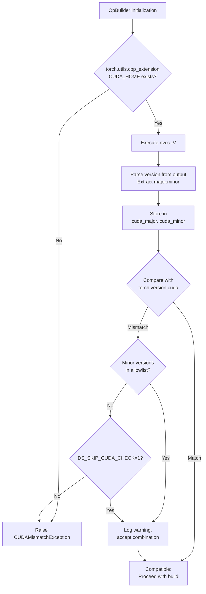
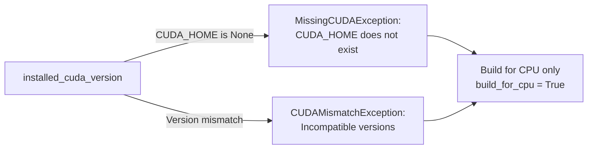
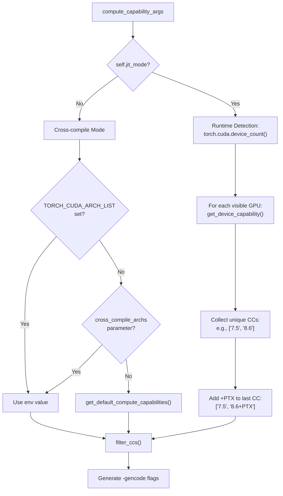
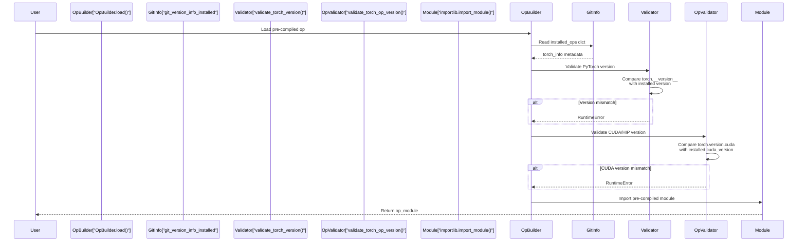
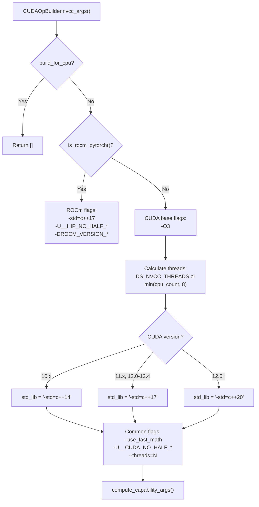

<!-- source: DeepWiki mcp.deepwiki.com · repo deepspeedai/DeepSpeed · page 9.4 CUDA Compatibility and Version Management · fetched 2026-10-21 -->

# CUDA Compatibility and Version Management

<details>
<summary>Relevant source files</summary>

The following files were used as context for generating this wiki page:

- [build_win.bat](build_win.bat)
- [csrc/fp_quantizer/fp_quantize_impl.cu](csrc/fp_quantizer/fp_quantize_impl.cu)
- [docs/_tutorials/advanced-install.md](docs/_tutorials/advanced-install.md)
- [environment.yml](environment.yml)
- [install.sh](install.sh)
- [op_builder/builder.py](op_builder/builder.py)
- [op_builder/fp_quantizer.py](op_builder/fp_quantizer.py)
- [op_builder/fused_adam.py](op_builder/fused_adam.py)
- [op_builder/fused_lamb.py](op_builder/fused_lamb.py)
- [op_builder/inference_core_ops.py](op_builder/inference_core_ops.py)
- [op_builder/inference_cutlass_builder.py](op_builder/inference_cutlass_builder.py)
- [op_builder/ragged_ops.py](op_builder/ragged_ops.py)
- [op_builder/ragged_utils.py](op_builder/ragged_utils.py)
- [op_builder/sparse_attn.py](op_builder/sparse_attn.py)
- [op_builder/spatial_inference.py](op_builder/spatial_inference.py)
- [op_builder/stochastic_transformer.py](op_builder/stochastic_transformer.py)
- [op_builder/transformer.py](op_builder/transformer.py)
- [op_builder/transformer_inference.py](op_builder/transformer_inference.py)
- [setup.py](setup.py)

</details>


## Purpose and Scope

This page documents DeepSpeed's system for managing CUDA version compatibility and compute capability selection during the build and runtime phases. It covers the detection mechanisms, validation logic, and configuration options that ensure CUDA extensions are compiled with compatible CUDA toolkits and for appropriate GPU architectures.

For information about the broader build system architecture, see [OpBuilder Architecture](9.1). For details on JIT compilation strategies, see [JIT vs Pre-build Compilation](9.2). For platform-specific concerns beyond CUDA, see [Platform-Specific Extensions](9.3).

## CUDA Version Detection and Validation

DeepSpeed performs CUDA version detection at build time and validates compatibility between the installed CUDA toolkit and the version PyTorch was compiled against. This validation prevents runtime errors that occur when extensions are compiled with incompatible CUDA versions.

### Version Detection Mechanism



**Diagram: CUDA Version Detection and Validation Flow**

The `installed_cuda_version()` function reads the CUDA toolkit version from the `nvcc` compiler (retrieved via `torch.utils.cpp_extension.CUDA_HOME`) and returns it as a tuple of `(major, minor)` version numbers. This is compared against the CUDA version PyTorch was compiled with (`torch.version.cuda`).

Sources: [op_builder/builder.py:47-60](), [op_builder/builder.py:90-113]()

### Version Compatibility Rules

DeepSpeed maintains compatibility allowlists for minor CUDA version mismatches within the same major version:

| Major Version | Compatible Minor Versions |
|--------------|---------------------------|
| 10 | 10.0, 10.1, 10.2 |
| 11 | 11.0, 11.1, 11.2, 11.3, 11.4, 11.5, 11.6, 11.7, 11.8 |
| 12 | 12.0, 12.1, 12.2, 12.3, 12.4, 12.5, 12.6, 12.8, 12.9 (no 12.7) |

**Table: CUDA Minor Version Compatibility Matrix**

The `cuda_minor_mismatch_ok` dictionary defines these allowlists. If the installed CUDA version and PyTorch's CUDA version both appear in the same allowlist, the combination is accepted with a warning message.

Sources: [op_builder/builder.py:81-87](), [op_builder/builder.py:95-101]()

### Exception Handling



**Diagram: CUDA Exception Handling**

Two custom exceptions are raised during version detection:
- `MissingCUDAException`: Raised when `CUDA_HOME` environment variable is not set or the CUDA toolkit is not found.
- `CUDAMismatchException`: Raised when incompatible CUDA versions are detected and cannot be reconciled.

Sources: [op_builder/builder.py:39-44](), [op_builder/builder.py:109-112]()

## Compute Capability Selection

DeepSpeed must compile CUDA kernels for specific GPU compute capabilities (architectures). The selection mechanism differs between JIT mode and pre-build mode.

### Compute Capability Detection



**Diagram: Compute Capability Selection Logic**

Sources: [op_builder/builder.py:616-675]()

### JIT Mode vs Pre-build Mode

In **JIT mode**, DeepSpeed compiles for the specific GPU architectures visible at runtime by querying `torch.cuda.device_count()` and `torch.cuda.get_device_capability(i)`.

In **pre-build mode** (cross-compilation), architecture selection follows this priority:
1. `TORCH_CUDA_ARCH_LIST` environment variable (highest priority).
2. `cross_compile_archs` parameter passed to `compute_capability_args()`.
3. `get_default_compute_capabilities()` (fallback).

Sources: [op_builder/builder.py:635-657]()

### Default Compute Capabilities

The `get_default_compute_capabilities()` function returns architecture lists based on the installed CUDA version detected via `installed_cuda_version()`:

| CUDA Version | Additional Compute Capabilities | Resulting List |
|--------------|---------------------------------|----------------|
| Base (Any)   | -                               | `6.0;6.1;7.0`  |
| 11.0+        | `8.0`                           | `6.0;6.1;7.0;8.0` |
| 11.1+        | `8.6`                           | `6.0;6.1;7.0;8.0;8.6` |
| 11.8+        | `9.0`                           | `6.0;6.1;7.0;8.0;8.6;9.0` |
| 12.0+        | `8.0;8.6;9.0`                   | `6.0;6.1;7.0;8.0;8.6;9.0` |
| 12.8+        | `10.0;12.0`                     | `6.0;6.1;7.0;8.0;8.6;9.0;10.0;12.0` |

Sources: [op_builder/builder.py:62-78]()

### Architecture Compilation Flags

Once compute capabilities are determined, DeepSpeed generates `nvcc` compiler flags using `-gencode`. For the highest detected architecture, a PTX generation flag is appended for forward compatibility.

Sources: [op_builder/builder.py:664-670]()

### BF16 Support Detection

DeepSpeed automatically disables BF16 (bfloat16) support if any target compute capability is ≤7.x, as BF16 requires compute capability 8.0 or higher. When enabled, it defines `BF16_AVAILABLE` and undefines CUDA bfloat16 operator inhibitors.

Sources: [op_builder/builder.py:665-673](), [op_builder/builder.py:580-585]()

## Version Validation at Runtime

When loading pre-compiled extensions via `OpBuilder.load()`, DeepSpeed validates that the extension was built with compatible versions.

### Runtime Validation Flow



**Diagram: Pre-compiled Extension Validation Sequence**

Sources: [op_builder/builder.py:525-542]()

### Validation Functions

**PyTorch Version Validation**
The `validate_torch_version()` method compares the current runtime `torch.__version__` against the version recorded in `torch_info['version']` during installation.

Sources: [op_builder/builder.py:153-161]()

**CUDA/HIP Version Validation**
The `validate_torch_op_version()` method validates CUDA or HIP (for ROCm) versions. It ensures `torch.version.cuda` matches the `install_cuda_version` stored in the build metadata.

Sources: [op_builder/builder.py:164-182]()

## Environment Variables and Configuration

DeepSpeed provides several environment variables to control CUDA version checking and architecture selection.

### Key Environment Variables

| Variable | Purpose | Default | Example |
|----------|---------|---------|---------|
| `DS_SKIP_CUDA_CHECK` | Skip CUDA version mismatch check | `0` | `DS_SKIP_CUDA_CHECK=1` |
| `TORCH_CUDA_ARCH_LIST` | Specify target compute capabilities | Auto-detect | `TORCH_CUDA_ARCH_LIST="6.1;7.5;8.6"` |
| `CUDA_HOME` | Path to CUDA toolkit | Auto-detect | `CUDA_HOME=/usr/local/cuda-11.8` |
| `DS_NVCC_THREADS` | Number of parallel nvcc threads | `min(cpu_count, 8)` | `DS_NVCC_THREADS=4` |
| `DS_DEBUG_CUDA_BUILD` | Enable verbose nvcc output | `0` | `DS_DEBUG_CUDA_BUILD=1` |
| `DS_IGNORE_CUDA_DETECTION` | Bypasses CUDA architecture checks in specific builders | `None` | `DS_IGNORE_CUDA_DETECTION=1` |

Sources: [op_builder/builder.py:102-107](), [op_builder/builder.py:570-572](), [op_builder/builder.py:785-789](), [op_builder/builder.py:804-805](), [op_builder/transformer_inference.py:30]()

### Architecture-Specific Restrictions

Certain builders implement stricter compatibility checks:
- **InferenceBuilder**: Requires Pascal (6.0) or newer. Requires CUDA 11+ for Ampere (8.0) or newer. [op_builder/transformer_inference.py:34-43]()
- **FPQuantizerBuilder**: Requires Ampere (8.0) or newer. [op_builder/fp_quantizer.py:40-49]()
- **RaggedOpsBuilder**: Retains only compute capabilities ≥ 8.0 due to Blocked Flash dependencies. [op_builder/ragged_ops.py:47-58]()

## NVCC Compiler Flag Management

DeepSpeed constructs `nvcc` compiler flags based on CUDA version, platform, and build configuration.

### Standard NVCC Arguments



**Diagram: NVCC Compiler Flag Construction**

Sources: [op_builder/builder.py:770-807]()

### C++ Standard Selection by CUDA Version

DeepSpeed automatically selects the appropriate C++ standard based on the detected `cuda_major` and `cuda_minor`:
- **CUDA 10.x**: `-std=c++14`
- **CUDA 11.x and 12.0-12.4**: `-std=c++17`
- **CUDA 12.5+**: `-std=c++20`

Sources: [op_builder/builder.py:791-798]()

## Installation and Build-Time Version Capture

During `setup.py` execution, DeepSpeed captures version information for later validation.

### torch_info Dictionary Structure

The `torch_info` dictionary contains comprehensive version metadata used to populate `git_version_info_installed.py`:

```python
torch_info = {
    "version": torch_version,        # "2.1"
    "bf16_support": bf16_support,    # True/False
    "cuda_version": cuda_version,    # "11.8"
    "nccl_version": nccl_version,    # "2.15"
    "hip_version": hip_version       # "5.2" or "0.0"
}
```

Sources: [setup.py:257-282]()

### Multi-Node Installation Compatibility

The `install.sh` script facilitates multi-node deployment by building a wheel locally and using `pdcp` to distribute it to hosts listed in a hostfile. It assumes that all target machines have identical software environments (CUDA toolkit, PyTorch, etc.) to ensure the pre-compiled kernels are compatible.

Sources: [install.sh:163-181](), [docs/_tutorials/advanced-install.md:84-85]()

---

