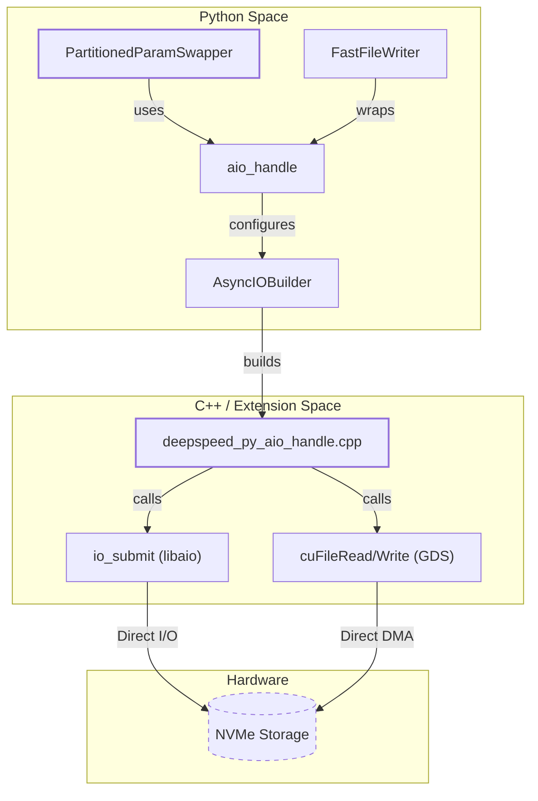
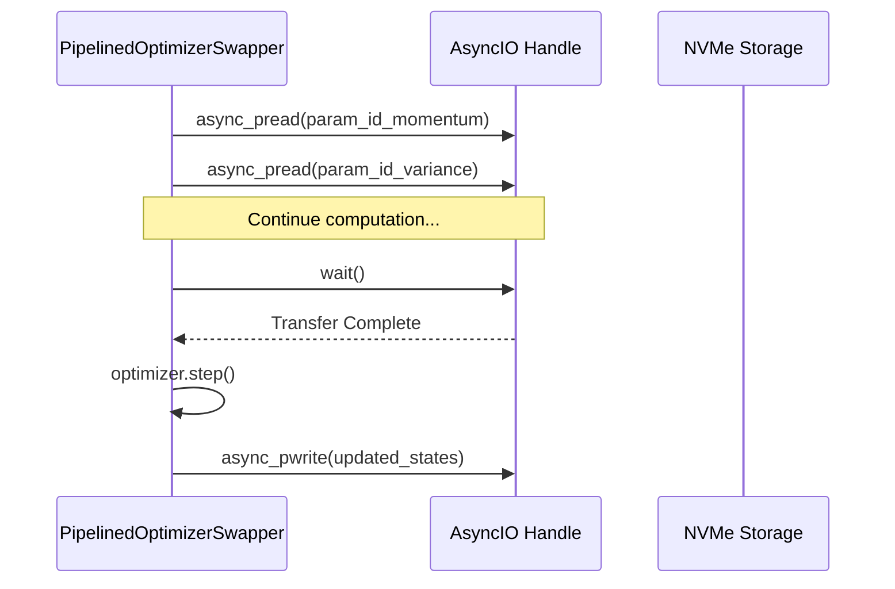

<!-- source: DeepWiki mcp.deepwiki.com · repo deepspeedai/DeepSpeed · page 9.5 Async I/O and DeepNVMe · fetched 2026-10-21 -->

# Async I/O and DeepNVMe

Relevant source files

The following files were used as context for generating this wiki page:

- [.github/workflows/aws-torch-latest-full.yml](.github/workflows/aws-torch-latest-full.yml)
- [ci/__init__.py](ci/__init__.py)
- [ci/accelerate.py](ci/accelerate.py)
- [ci/torch_latest.py](ci/torch_latest.py)
- [csrc/aio/common/deepspeed_aio_common.cpp](csrc/aio/common/deepspeed_aio_common.cpp)
- [csrc/aio/common/deepspeed_aio_utils.cpp](csrc/aio/common/deepspeed_aio_utils.cpp)
- [csrc/aio/py_lib/deepspeed_aio_thread.h](csrc/aio/py_lib/deepspeed_aio_thread.h)
- [csrc/aio/py_lib/deepspeed_pin_tensor.h](csrc/aio/py_lib/deepspeed_pin_tensor.h)
- [csrc/aio/py_lib/deepspeed_py_aio.cpp](csrc/aio/py_lib/deepspeed_py_aio.cpp)
- [csrc/aio/py_lib/deepspeed_py_aio.h](csrc/aio/py_lib/deepspeed_py_aio.h)
- [csrc/aio/py_lib/deepspeed_py_aio_handle.cpp](csrc/aio/py_lib/deepspeed_py_aio_handle.cpp)
- [csrc/aio/py_lib/deepspeed_py_aio_handle.h](csrc/aio/py_lib/deepspeed_py_aio_handle.h)
- [csrc/aio/py_lib/deepspeed_py_copy.cpp](csrc/aio/py_lib/deepspeed_py_copy.cpp)
- [csrc/aio/py_lib/deepspeed_py_copy.h](csrc/aio/py_lib/deepspeed_py_copy.h)
- [csrc/aio/py_lib/py_ds_aio.cpp](csrc/aio/py_lib/py_ds_aio.cpp)
- [csrc/aio/py_test/ds_aio_basic.py](csrc/aio/py_test/ds_aio_basic.py)
- [csrc/aio/py_test/ds_aio_handle.py](csrc/aio/py_test/ds_aio_handle.py)
- [csrc/aio/py_test/test_ds_aio.py](csrc/aio/py_test/test_ds_aio.py)
- [csrc/xpu/includes/simd.h](csrc/xpu/includes/simd.h)
- [csrc/xpu/includes/type_shim.h](csrc/xpu/includes/type_shim.h)
- [deepspeed/io/fast_file_writer.py](deepspeed/io/fast_file_writer.py)
- [deepspeed/runtime/swap_tensor/__init__.py](deepspeed/runtime/swap_tensor/__init__.py)
- [deepspeed/runtime/swap_tensor/async_swapper.py](deepspeed/runtime/swap_tensor/async_swapper.py)
- [deepspeed/runtime/swap_tensor/optimizer_utils.py](deepspeed/runtime/swap_tensor/optimizer_utils.py)
- [deepspeed/runtime/swap_tensor/partitioned_optimizer_swapper.py](deepspeed/runtime/swap_tensor/partitioned_optimizer_swapper.py)
- [deepspeed/runtime/swap_tensor/partitioned_param_swapper.py](deepspeed/runtime/swap_tensor/partitioned_param_swapper.py)
- [deepspeed/runtime/swap_tensor/pipelined_optimizer_swapper.py](deepspeed/runtime/swap_tensor/pipelined_optimizer_swapper.py)
- [deepspeed/runtime/swap_tensor/utils.py](deepspeed/runtime/swap_tensor/utils.py)
- [op_builder/async_io.py](op_builder/async_io.py)
- [op_builder/gds.py](op_builder/gds.py)
- [tests/unit/ops/aio/test_aio.py](tests/unit/ops/aio/test_aio.py)
- [tests/unit/ops/aio/test_fast_file_writer_fd_close.py](tests/unit/ops/aio/test_fast_file_writer_fd_close.py)
- [tests/unit/runtime/zero/test_nvme_checkpointing.py](tests/unit/runtime/zero/test_nvme_checkpointing.py)
- [tests/unit/v1/zero/test_zero.py](tests/unit/v1/zero/test_zero.py)
- [tests/unit/v1/zero/test_zero_autocast.py](tests/unit/v1/zero/test_zero_autocast.py)

The DeepSpeed Async I/O (AIO) library and DeepNVMe framework provide high-performance, asynchronous access to NVMe storage. This infrastructure is a critical component of **ZeRO-Infinity**, enabling the offloading of model parameters, gradients, and optimizer states to NVMe memory when model sizes exceed combined GPU and CPU memory capacities.

## Architecture and Data Flow

The Async I/O system bridges Python-side tensor management with low-level Linux `libaio` or NVIDIA GPUDirect Storage (GDS). It uses a pool of pinned memory buffers to overlap computation with I/O transfers, ensuring that storage latency does not stall the training pipeline.

### High-Level Data Flow
1. **Request**: A high-level component (e.g., `PartitionedParamSwapper`) requests a tensor swap-in from NVMe.
2. **Handle Management**: The `aio_handle` schedules the request using `io_submit` via the `async_io` C++ extension [op_builder/async_io.py:15]().
3. **Execution**: The C++ backend executes parallel reads/writes using multiple threads and `O_DIRECT` to bypass the Linux page cache [csrc/aio/common/deepspeed_aio_common.cpp:151-166]().
4. **Completion**: The Python layer calls `wait()` to reap completed I/O events [csrc/aio/py_lib/py_ds_aio.cpp:125-128]().

### Code Entity Space Mapping
The following diagram maps the high-level system concepts to their specific implementations in the codebase.

**System Architecture Mapping**

**Sources:** [op_builder/async_io.py:13-35](), [deepspeed/runtime/swap_tensor/partitioned_param_swapper.py:95-98](), [csrc/aio/py_lib/py_ds_aio.cpp:22-29]()

---

## Key Components

### AsyncIOBuilder and GDSBuilder
These are the OpBuilders responsible for compiling the asynchronous I/O extensions.
*   **AsyncIOBuilder**: The standard Linux AIO implementation requiring `libaio-dev` [op_builder/async_io.py:113](). It supports features like `single_submit` and `overlap_events` to tune performance [op_builder/async_io.py:111-121]().
*   **GDSBuilder**: An extension of AsyncIOBuilder that integrates NVIDIA GPUDirect Storage (GDS). It links against `libcufile` to enable direct DMA transfers between NVMe and GPU memory, bypassing the CPU entirely [op_builder/gds.py:27-36]().

### Partitioned Parameter Swapper
The `AsyncPartitionedParameterSwapper` class manages the lifecycle of model parameters on NVMe for ZeRO-Stage 3 [deepspeed/runtime/swap_tensor/partitioned_param_swapper.py:37]().

*   **State Tracking**: Parameters transition through `AVAILABLE`, `NOT_AVAILABLE`, and `INFLIGHT` states [deepspeed/runtime/swap_tensor/partitioned_param_swapper.py:26-35]().
*   **Buffer Management**: It maintains a `SwapBufferPool` of pinned memory to facilitate transfers [deepspeed/runtime/swap_tensor/partitioned_param_swapper.py:124-131]().
*   **Path Mapping**: Automatically generates and manages unique file paths for each parameter on the NVMe device [deepspeed/runtime/swap_tensor/partitioned_param_swapper.py:148-161]().

### FastFileWriter
`FastFileWriter` is a specialized utility designed for high-speed checkpointing. It implements the Python file-like interface but uses the AIO backend for performance [deepspeed/io/fast_file_writer.py]().

*   **Memory Management**: It requires a `pinned_tensor` to serve as a bounce buffer for `O_DIRECT` operations [tests/unit/ops/aio/test_fast_file_writer_fd_close.py:64-70]().
*   **Resource Cleanup**: It ensures proper file descriptor management through its `close()` method to prevent inode leakage on unlinked files [tests/unit/ops/aio/test_fast_file_writer_fd_close.py:7-16]().

---

## Implementation Details

### Asynchronous Operations
The C++ backend provides several modes of operation via the `aio_handle` [csrc/aio/py_lib/py_ds_aio.cpp:22]():
*   **`sync_pread` / `sync_pwrite`**: Parallel but synchronous operations that block until the entire transfer is complete [csrc/aio/py_lib/py_ds_aio.cpp:74-86]().
*   **`async_pread` / `async_pwrite`**: Submits I/O requests to the kernel and returns immediately. Users must later call `wait()` [csrc/aio/py_lib/py_ds_aio.cpp:88-112]().

### Optimizer State Swapping
The `OptimizerSwapper` and `PipelinedOptimizerSwapper` handle the movement of optimizer states (like Adam's momentum and variance) [deepspeed/runtime/swap_tensor/optimizer_utils.py:159]().

**Optimizer State Swap Flow**

**Sources:** [deepspeed/runtime/swap_tensor/pipelined_optimizer_swapper.py:102-128](), [deepspeed/runtime/swap_tensor/optimizer_utils.py:113-122]()

### Configuration
DeepNVMe and Async I/O are configured via the `aio` block in the DeepSpeed JSON configuration. Key parameters include:
| Parameter | Description |
| :--- | :--- |
| `block_size` | Size of each I/O operation (default 1MB) [csrc/aio/py_lib/py_ds_aio.cpp:25]() |
| `queue_depth` | Number of simultaneous I/O requests in flight [csrc/aio/py_lib/py_ds_aio.cpp:26]() |
| `intra_op_parallelism` | Number of threads per I/O operation [csrc/aio/py_lib/py_ds_aio.cpp:29]() |
| `use_gds` | Enables NVIDIA GPUDirect Storage if available [deepspeed/runtime/swap_tensor/partitioned_param_swapper.py:95]() |

---

## System Requirements and Compatibility
*   **OS**: Linux (required for `libaio` and `O_DIRECT`) [tests/unit/ops/aio/test_fast_file_writer_fd_close.py:30-31]().
*   **Dependencies**: `libaio-dev` package must be installed on the host [op_builder/async_io.py:113]().
*   **Filesystem**: The storage path must support `O_DIRECT`. Standard filesystems like Ext4 and XFS are supported; overlay filesystems (common in Docker) may require mounting a native host directory [.github/workflows/aws-torch-latest-full.yml:98-99]().

**Sources:** [op_builder/async_io.py:102-113](), [tests/unit/ops/aio/test_aio.py:22-23]()

---

