# Page: Overview

# Overview

<details>
<summary>Relevant source files</summary>

The following files were used as context for generating this wiki page:

- [AGENTS.md](AGENTS.md)
- [CLAUDE.md](CLAUDE.md)
- [README.md](README.md)
- [azure/README.md](azure/README.md)
- [deepspeed/runtime/activation_checkpointing/checkpointing.py](deepspeed/runtime/activation_checkpointing/checkpointing.py)
- [deepspeed/runtime/base_optimizer.py](deepspeed/runtime/base_optimizer.py)
- [deepspeed/runtime/bf16_optimizer.py](deepspeed/runtime/bf16_optimizer.py)
- [deepspeed/runtime/config.py](deepspeed/runtime/config.py)
- [deepspeed/runtime/constants.py](deepspeed/runtime/constants.py)
- [deepspeed/runtime/engine.py](deepspeed/runtime/engine.py)
- [deepspeed/runtime/utils.py](deepspeed/runtime/utils.py)
- [deepspeed/runtime/zero/config.py](deepspeed/runtime/zero/config.py)
- [deepspeed/runtime/zero/mics.py](deepspeed/runtime/zero/mics.py)
- [deepspeed/runtime/zero/parameter_offload.py](deepspeed/runtime/zero/parameter_offload.py)
- [deepspeed/runtime/zero/partition_parameters.py](deepspeed/runtime/zero/partition_parameters.py)
- [deepspeed/runtime/zero/partitioned_param_coordinator.py](deepspeed/runtime/zero/partitioned_param_coordinator.py)
- [deepspeed/runtime/zero/stage3.py](deepspeed/runtime/zero/stage3.py)
- [deepspeed/runtime/zero/stage_1_and_2.py](deepspeed/runtime/zero/stage_1_and_2.py)
- [deepspeed/runtime/zero/utils.py](deepspeed/runtime/zero/utils.py)
- [docs/_config.yml](docs/_config.yml)
- [docs/_data/navigation.yml](docs/_data/navigation.yml)
- [docs/_pages/config-json.md](docs/_pages/config-json.md)
- [docs/_tutorials/azure.md](docs/_tutorials/azure.md)
- [docs/_tutorials/cifar-10.md](docs/_tutorials/cifar-10.md)
- [docs/_tutorials/getting-started.md](docs/_tutorials/getting-started.md)
- [docs/contributing.md](docs/contributing.md)
- [docs/index.md](docs/index.md)

</details>


This document provides a high-level overview of the DeepSpeed library, its architecture, major subsystems, and key entry points. It is intended to orient new developers and users to the codebase structure and design principles.

## What is DeepSpeed?

DeepSpeed is a deep learning optimization library that has enabled training of some of the world's most powerful language models, including Megatron-Turing NLG 530B and BLOOM 176B [README.md:67-69](). The library provides system-level innovations that make large-scale distributed training effective, efficient, and accessible.

### Core Innovations

DeepSpeed's key innovations address the fundamental challenges of training and serving large models:

*   **Memory Optimization**:
    *   **ZeRO (Zero Redundancy Optimizer)**: Eliminates memory redundancy by partitioning optimizer states (Stage 1), gradients (Stage 2), and parameters (Stage 3) across data-parallel processes [deepspeed/runtime/zero/stage_1_and_2.py:128-132](), [deepspeed/runtime/zero/stage3.py:138-142]().
    *   **ZeRO-Offload**: Offloads optimizer states and gradients to CPU memory or NVMe storage to enable training models with billions or trillions of parameters on limited GPU memory [deepspeed/runtime/zero/stage3.py:169-171]().
    *   **SuperOffload**: Advanced offloading engine optimized for modern "superchip" architectures [README.md:31-31]().
    *   **ZenFlow**: Stall-free offloading engine for LLM training that hides offloading overhead [README.md:43-43]().

*   **Parallelism Strategies**:
    *   **Pipeline Parallelism**: Layer-wise model partitioning via `PipelineModule` and `PipelineEngine` [deepspeed/runtime/engine.py:109-109]().
    *   **Tensor Parallelism (AutoTP)**: Automatic model partitioning across GPUs for both training and inference [deepspeed/runtime/engine.py:45-45]().
    *   **Sequence Parallelism**: DeepSpeed-Ulysses for long-context training, including Arctic Long Sequence Training (ALST) for multi-million token sequences [README.md:45-45]().

*   **Inference Optimization**:
    *   **Module Injection**: Replaces standard PyTorch layers with hand-optimized CUDA kernels [deepspeed/runtime/engine.py:45-45]().
    *   **FastGen (V2)**: High-performance inference engine with ragged batching and KV-cache management.

*   **Hardware & Portability**:
    *   **Accelerator Abstraction**: Unified API supporting NVIDIA, AMD, Intel Gaudi, Intel XPU, Huawei Ascend, and more [deepspeed/runtime/engine.py:121-121]().

**Sources**: [README.md:67-69](), [deepspeed/runtime/zero/stage3.py:138-142](), [deepspeed/runtime/engine.py:109-130]().

## High-Level Architecture

DeepSpeed's architecture centers around the `DeepSpeedEngine`, which orchestrates the interaction between the model, the distributed communication backend, and the memory-optimized optimizers.

### System Architecture and Code Mapping

The following diagram bridges the high-level concepts to the specific classes and files in the codebase.

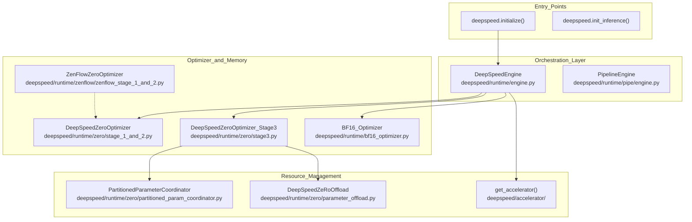
**Sources**: [deepspeed/runtime/engine.py:24-130](), [deepspeed/runtime/zero/stage3.py:136-150](), [deepspeed/runtime/zero/parameter_offload.py:112-120]().

## Core Components

### 1. Training Engine (`DeepSpeedEngine`)
The `DeepSpeedEngine` is the central class that wraps a `torch.nn.Module` [deepspeed/runtime/engine.py:15-16](). It manages the training lifecycle, including:
*   **Forward/Backward Passes**: Handling gradient accumulation and micro-batching [docs/_pages/config-json.md:25-29]().
*   **Optimizer Integration**: Wrapping standard optimizers with ZeRO or mixed-precision logic [deepspeed/runtime/engine.py:29-42]().
*   **Checkpointing**: Managing model and optimizer state persistence [deepspeed/runtime/engine.py:100-100]().

### 2. ZeRO Memory Optimizers
DeepSpeed provides different stages of ZeRO to trade off communication for memory savings:
*   **Stage 1 & 2**: Implemented in `DeepSpeedZeroOptimizer`. Partitions optimizer states and gradients [deepspeed/runtime/zero/stage_1_and_2.py:126-138]().
*   **Stage 3**: Implemented in `DeepSpeedZeroOptimizer_Stage3`. Partitions model parameters and dynamically gathers them during the forward and backward passes [deepspeed/runtime/zero/stage3.py:136-148]().

### 3. Parameter Management (`PartitionedParameterCoordinator`)
For ZeRO Stage 3, the `PartitionedParameterCoordinator` tracks the status of parameters (e.g., `AVAILABLE`, `NOT_AVAILABLE`, `INFLIGHT`) and manages prefetching to hide communication latency [deepspeed/runtime/zero/partitioned_param_coordinator.py:64-74]().

**Sources**: [deepspeed/runtime/engine.py:15-42](), [deepspeed/runtime/zero/stage3.py:136-148](), [deepspeed/runtime/zero/partitioned_param_coordinator.py:64-74]().

## Data and Control Flow

The following diagram illustrates the lifecycle of a parameter in ZeRO-3 during a training step, showing the interaction between the Engine, Coordinator, and Accelerator.

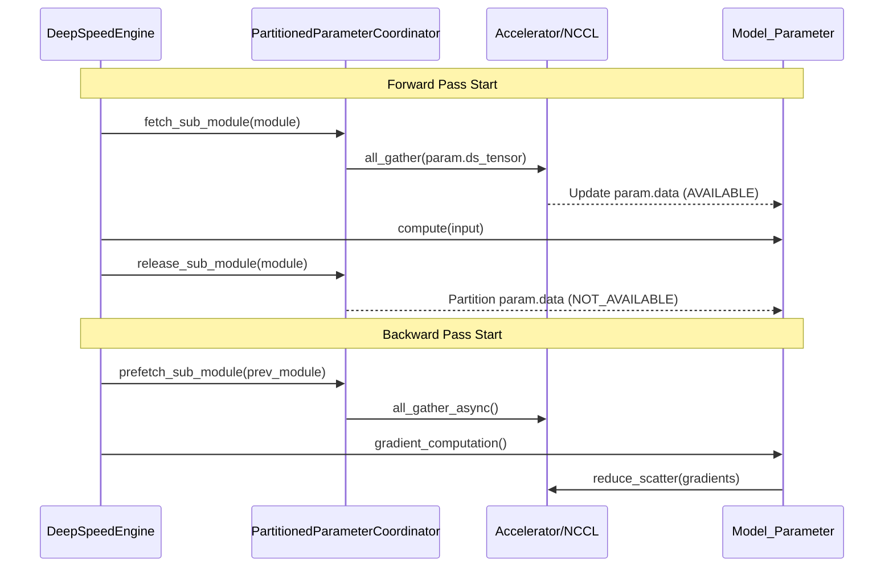
**Sources**: [deepspeed/runtime/zero/partitioned_param_coordinator.py:64-150](), [deepspeed/runtime/zero/stage3.py:81-112]().

## Configuration System

DeepSpeed is driven by a JSON configuration that defines the optimization strategy. Key parameters include:

| Parameter | Type | Description |
| :--- | :--- | :--- |
| `train_batch_size` | int | Effective batch size (micro_batch * accumulation * GPUs) [docs/_pages/config-json.md:12-16]() |
| `optimizer` | dict | Optimizer type (Adam, AdamW, Muon, etc.) and its parameters [docs/_pages/config-json.md:35-42]() |
| `zero_optimization` | dict | Configuration for ZeRO stages and offloading [deepspeed/runtime/zero/config.py:22-22]() |
| `fp16` / `bf16` | dict | Mixed precision settings [deepspeed/runtime/config.py:27-27]() |

**Sources**: [docs/_pages/config-json.md:7-42](), [deepspeed/runtime/config.py:16-30]().

## Ecosystem and Integrations

DeepSpeed is integrated into major AI frameworks and used for large-scale model training:
*   **Frameworks**: Hugging Face Transformers, PyTorch Lightning, MosaicML, and Ray [README.md:93-95]().
*   **Adoption**: Used to train models like Megatron-Turing NLG (530B), BLOOM (176B), and GPT-NeoX (20B) [README.md:82-88]().
*   **Multi-Platform**: Native support for NVIDIA (CUDA), AMD (ROCm), Intel (Gaudi/XPU), and more [deepspeed/runtime/engine.py:121-121]().

**Sources**: [README.md:73-95](), [deepspeed/runtime/engine.py:121-121]().

---

# Page: Getting Started

# Getting Started

<details>
<summary>Relevant source files</summary>

The following files were used as context for generating this wiki page:

- [README.md](README.md)
- [azure/README.md](azure/README.md)
- [build_win.bat](build_win.bat)
- [docs/_config.yml](docs/_config.yml)
- [docs/_data/navigation.yml](docs/_data/navigation.yml)
- [docs/_tutorials/advanced-install.md](docs/_tutorials/advanced-install.md)
- [docs/_tutorials/azure.md](docs/_tutorials/azure.md)
- [docs/_tutorials/cifar-10.md](docs/_tutorials/cifar-10.md)
- [docs/_tutorials/getting-started.md](docs/_tutorials/getting-started.md)
- [docs/contributing.md](docs/contributing.md)
- [docs/index.md](docs/index.md)
- [environment.yml](environment.yml)
- [install.sh](install.sh)
- [op_builder/builder.py](op_builder/builder.py)
- [op_builder/fused_adam.py](op_builder/fused_adam.py)
- [op_builder/fused_lamb.py](op_builder/fused_lamb.py)
- [op_builder/stochastic_transformer.py](op_builder/stochastic_transformer.py)
- [op_builder/transformer.py](op_builder/transformer.py)
- [setup.py](setup.py)

</details>


## Purpose and Scope

This page provides an overview of DeepSpeed's core workflow and guides you through the initial setup required to start training models. It covers the basic concepts, initialization patterns, and launching mechanisms needed to get a training job running.

For detailed installation procedures including Docker setup and distributed environments, see [Installation](#2.1). For comprehensive API documentation and advanced usage patterns, see [Basic Usage and API](#2.2). For a complete reference of configuration options, see [Configuration System](#2.3).

---

## Prerequisites

Before installing DeepSpeed, ensure your system meets the following requirements:

### Software Requirements

| Component | Requirement |
|-----------|-------------|
| **PyTorch** | Must be installed **before** DeepSpeed for pre-compilation. Version >= 1.9 recommended |
| **Python** | Compatible with PyTorch's Python version requirements |
| **C++/CUDA Compiler** | `nvcc` (NVIDIA) or `hipcc` (AMD) for compiling custom operations |
| **Build Tools** | `ninja` for JIT compilation (installed automatically with PyTorch) |

### Hardware Requirements

DeepSpeed is tested and validated on the following hardware platforms:

| Platform | Accelerators | Backend |
|----------|-------------|---------|
| **NVIDIA** | Pascal, Volta, Ampere, Hopper, Blackwell architectures | NCCL |
| **AMD** | MI100, MI200, MI300 | RCCL / SDMA |
| **Intel** | Gaudi2/3 HPU, Data Center GPU Max (XPU), Xeon CPUs | HCCL, CCL |
| **Huawei** | Ascend NPU | HCCL |
| **Apple** | M-series (MPS) | N/A (no distributed) |

**Note**: DeepSpeed supports a wide range of accelerators via its abstraction layer. For AMD GPUs, DeepSpeed now supports System DMA (SDMA) for ZeRO-3 to offload collectives off compute units.

Sources: [README.md:27-28](), [README.md:114-131](), [docs/_tutorials/getting-started.md:13-15](), [op_builder/builder.py:62-78]()

---

## Installation Overview

The quickest installation method is via PyPI:

```bash
pip install deepspeed
```

After installation, verify your environment using the DeepSpeed environment report tool:

```bash
ds_report
```

This command displays which DeepSpeed extensions/operations are compatible with your system and whether they are currently built.

**Default Compilation Strategy**: DeepSpeed uses Just-In-Time (JIT) compilation for custom operations. On first use, operations are compiled automatically using torch's JIT C++ extension loader. For pre-compilation, you can set `DS_BUILD_OPS=1` during install.

Sources: [docs/_tutorials/advanced-install.md:7-17](), [docs/_tutorials/advanced-install.md:38-44](), [setup.py:152-155]()

---

## Core Concepts

### DeepSpeed Architecture Overview

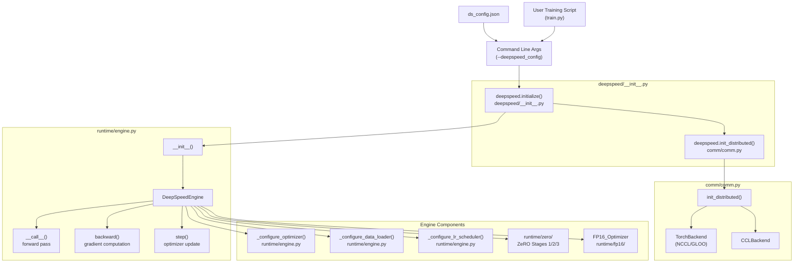

**DeepSpeed Architecture: Core Components and Code Structure**

The central abstraction in DeepSpeed is the `DeepSpeedEngine` class defined in [runtime/engine.py](). The engine is created via `deepspeed.initialize()` and provides three primary methods: `__call__()` for forward pass, `backward()` for gradient computation, and `step()` for parameter updates.

Sources: [deepspeed/__init__.py](), [runtime/engine.py](), [docs/_tutorials/getting-started.md:20-38]()

### Key Components

**DeepSpeedEngine** ([runtime/engine.py]()): The main engine class that wraps your PyTorch model. It handles distributed data parallel, mixed precision, and ZeRO optimizations transparently.

**OpBuilder System** ([op_builder/builder.py]()): The `OpBuilder` base class and its children (e.g., `FusedAdamBuilder`, `AsyncIOBuilder`) manage the compilation and loading of C++/CUDA extensions.

**Launcher System** ([launcher/runner.py]()): The `deepspeed` command-line tool orchestrates multi-node job launching, supporting backends like PDSH, OpenMPI, and Slurm.

Sources: [runtime/engine.py](), [op_builder/builder.py](), [launcher/runner.py]()

---

## Basic Workflow

### Complete Training Workflow

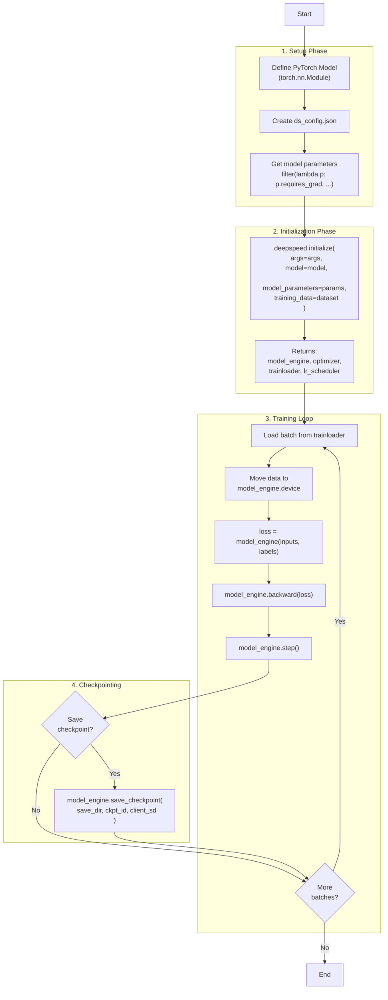

**DeepSpeed Training Workflow: From Model Definition to Training**

Sources: [docs/_tutorials/getting-started.md:25-132](), [docs/_tutorials/cifar-10.md:126-168]()

---

## Initialization

### The `deepspeed.initialize()` API

The entry point for DeepSpeed training is the `deepspeed.initialize()` function. It sets up the distributed environment and wraps your model in a `DeepSpeedEngine`.

**Function Signature** ([docs/_tutorials/cifar-10.md:115-124]()):

```python
model_engine, optimizer, trainloader, lr_scheduler = deepspeed.initialize(
    args=cmd_args,              # Command-line arguments
    model=model,                # Your torch.nn.Module
    model_parameters=params,    # Model parameters to optimize
    training_data=trainset,     # Training dataset (optional)
    optimizer=None,             # Custom optimizer (optional)
    lr_scheduler=None,          # Custom LR scheduler (optional)
)
```

**Typical Initialization Pattern:**

```python
import deepspeed
parameters = filter(lambda p: p.requires_grad, net.parameters())
model_engine, optimizer, trainloader, _ = deepspeed.initialize(
    args=args,
    model=net,
    model_parameters=parameters,
    training_data=trainset
)
```

**Important Notes:**
- Replace `torch.distributed.init_process_group()` with `deepspeed.init_distributed()`.
- DeepSpeed automatically executes the learning rate schedule at every training step if using a DeepSpeed-managed scheduler.
- All processes must call `initialize()`.

Sources: [docs/_tutorials/getting-started.md:28-54](), [docs/_tutorials/cifar-10.md:128-138]()

---

## Training Loop

### Training API

The `DeepSpeedEngine` provides a simple three-method API for training:

```python
for step, batch in enumerate(trainloader):
    # 1. Forward pass
    loss = model_engine(batch)
    
    # 2. Backward pass - handles loss scaling and gradient averaging
    model_engine.backward(loss)
    
    # 3. Parameter update - handles optimizer step and LR scheduling
    model_engine.step()
```

**Automatic Operations Handled by DeepSpeedEngine:**

| Operation | Implementation |
|-----------|----------------|
| **Gradient Averaging** | Averaged across data parallel processes after `train_batch_size`. |
| **Loss Scaling** | Automatically handles scaling in FP16/mixed precision to avoid underflow. |
| **LR Scheduling** | DeepSpeed calls `step()` on the scheduler at every training step. |

Sources: [docs/_tutorials/getting-started.md:63-89](), [docs/_tutorials/cifar-10.md:157-167]()

---

## Configuration System

DeepSpeed features are controlled via a JSON configuration file.

**Minimal Configuration Example** ([docs/_tutorials/cifar-10.md:178-203]()):

```json
{
  "train_batch_size": 4,
  "optimizer": {
    "type": "Adam",
    "params": {
      "lr": 0.001
    }
  },
  "fp16": {
    "enabled": true
  },
  "zero_optimization": {
    "stage": 2
  }
}
```

For a full set of features, see the [Configuration System](#2.3) child page.

Sources: [docs/_tutorials/getting-started.md:146-161](), [docs/_tutorials/cifar-10.md:178-203]()

---

## Launching Training Jobs

DeepSpeed includes a launcher to handle distributed environment setup.

**Single Node Launch:**
```bash
deepspeed your_script.py --deepspeed_config ds_config.json
```

**Multi-Node Launch:**
DeepSpeed uses an MPI-style hostfile to define resources.
```bash
deepspeed --hostfile=my_hostfile your_script.py --deepspeed_config ds_config.json
```

**Hostfile Format** ([install.sh:23]()):
```
worker-1 slots=8
worker-2 slots=8
```

Sources: [docs/_tutorials/getting-started.md:212-213](), [install.sh:11-27](), [launcher/runner.py]()

---

## Checkpointing

Saving and loading training state is handled via `save_checkpoint` and `load_checkpoint`.

```python
# Save checkpoint
model_engine.save_checkpoint(save_dir, ckpt_id, client_sd=client_sd)

# Load checkpoint
_, client_sd = model_engine.load_checkpoint(load_dir, ckpt_id)
```

**Important**: All processes must call these methods to ensure master weights and optimizer states are saved/restored correctly.

Sources: [docs/_tutorials/getting-started.md:100-137]()

---

## Next Steps

Explore the detailed child pages for specific topics:

- **[Installation](#2.1)** — Detailed setup for different platforms (NVIDIA, AMD, Intel).
- **[Basic Usage and API](#2.2)** — Deep dive into the engine APIs and training loop.
- **[Configuration System](#2.3)** — Full reference for the JSON configuration parameters.

Sources: [docs/_config.yml:35-66](), [docs/_data/navigation.yml:24-50]()

---

# Page: Installation

# Installation

<details>
<summary>Relevant source files</summary>

The following files were used as context for generating this wiki page:

- [.github/workflows/setup-venv/action.yml](.github/workflows/setup-venv/action.yml)
- [.gitignore](.gitignore)
- [build_win.bat](build_win.bat)
- [deepspeed/inference/config.py](deepspeed/inference/config.py)
- [deepspeed/pipe/__init__.py](deepspeed/pipe/__init__.py)
- [deepspeed/runtime/config_utils.py](deepspeed/runtime/config_utils.py)
- [deepspeed/runtime/pipe/__init__.py](deepspeed/runtime/pipe/__init__.py)
- [deepspeed/runtime/zero/linear.py](deepspeed/runtime/zero/linear.py)
- [deepspeed/runtime/zero/offload_config.py](deepspeed/runtime/zero/offload_config.py)
- [docker/Dockerfile](docker/Dockerfile)
- [docs/_tutorials/advanced-install.md](docs/_tutorials/advanced-install.md)
- [docs/code-docs/source/conf.py](docs/code-docs/source/conf.py)
- [docs/code-docs/source/memory.rst](docs/code-docs/source/memory.rst)
- [environment.yml](environment.yml)
- [install.sh](install.sh)
- [op_builder/builder.py](op_builder/builder.py)
- [op_builder/fused_adam.py](op_builder/fused_adam.py)
- [op_builder/fused_lamb.py](op_builder/fused_lamb.py)
- [op_builder/stochastic_transformer.py](op_builder/stochastic_transformer.py)
- [op_builder/transformer.py](op_builder/transformer.py)
- [requirements/requirements-dev.txt](requirements/requirements-dev.txt)
- [requirements/requirements-inf.txt](requirements/requirements-inf.txt)
- [requirements/requirements-readthedocs.txt](requirements/requirements-readthedocs.txt)
- [requirements/requirements.txt](requirements/requirements.txt)
- [setup.py](setup.py)
- [tests/conftest.py](tests/conftest.py)
- [tests/unit/inference/quantization/test_intX_quantization.py](tests/unit/inference/quantization/test_intX_quantization.py)
- [tests/unit/runtime/test_autocast.py](tests/unit/runtime/test_autocast.py)
- [tests/unit/runtime/zero/test_zero_dynamic_class.py](tests/unit/runtime/zero/test_zero_dynamic_class.py)
- [tests/unit/runtime/zero/test_zero_nesting_init.py](tests/unit/runtime/zero/test_zero_nesting_init.py)
- [tests/unit/v1/zero/test_zero_functorch_linear.py](tests/unit/v1/zero/test_zero_functorch_linear.py)

</details>


This document describes how to install DeepSpeed, covering installation methods, build system architecture, operation compilation strategies, and platform-specific considerations.

For basic usage patterns after installation, see [Basic Usage and API](#2.2). For distributed launching and multi-node setup, see [Launcher Architecture](#8.1). For build system internals, see [Launcher Architecture](#8.1).

## Installation Methods Overview

DeepSpeed supports three primary installation methods with different operation compilation strategies:

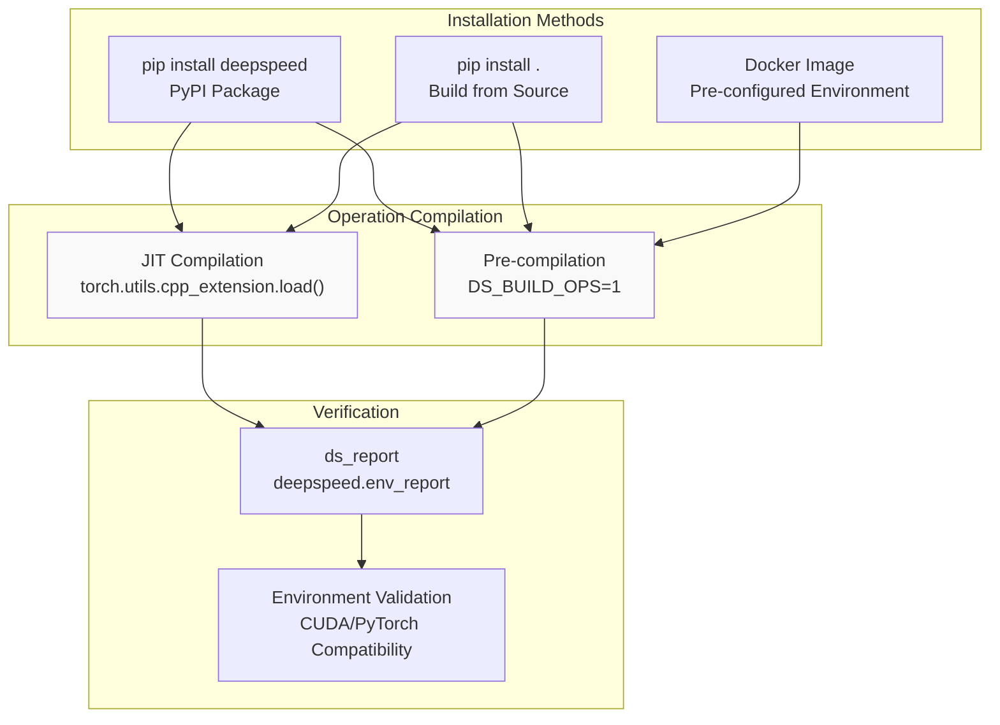

**Sources:** [docs/_tutorials/advanced-install.md:7-17](), [setup.py:152-159](), [install.sh:154-183]()

## Quick Installation via PyPI

The simplest installation method uses pip to install the latest DeepSpeed release:

```bash
pip install deepspeed
```

This installation:
- Installs core DeepSpeed Python package and dependencies listed in `requirements/requirements.txt` [requirements/requirements.txt:1-12]().
- Does NOT pre-compile C++/CUDA operations by default on Linux [setup.py:151-153]().
- Operations compile just-in-time (JIT) on first use via `torch.utils.cpp_extension.load()` [op_builder/builder.py:544-611]().
- Stores compiled ops in `/tmp/torch_extensions` by default, or as configured by `TORCH_EXTENSIONS_DIR` [op_builder/builder.py:27-27]().

**Requirements:**
- PyTorch >= 2.0.0 recommended [requirements/requirements.txt:10-10]().
- CUDA toolkit (nvcc) for GPU operations [op_builder/builder.py:47-59]().
- `ninja` build system for JIT compilation [requirements/requirements.txt:4-4]().

**Sources:** [docs/_tutorials/advanced-install.md:7-17](), [requirements/requirements.txt:1-12](), [setup.py:151-153]()

## Verification with ds_report

After installation, verify the installation and check operation compatibility:

```bash
ds_report
```

The `ds_report` utility provides a comprehensive environment report. It is used to debug installation or compatibility issues by checking which "ops" are compatible with the current machine [docs/_tutorials/advanced-install.md:19-26]().

| Information Category | Details Reported |
|---------------------|------------------|
| **Environment Info** | PyTorch version, CUDA version, DeepSpeed version |
| **Operation Status** | Which ops are installed vs compatible |
| **Build Tools** | ninja availability, nvcc version |

**Sources:** [docs/_tutorials/advanced-install.md:19-26](), [op_builder/builder.py:306-310]()

## Build System Architecture

DeepSpeed's build system centers on the `OpBuilder` hierarchy defined in [op_builder/builder.py]().

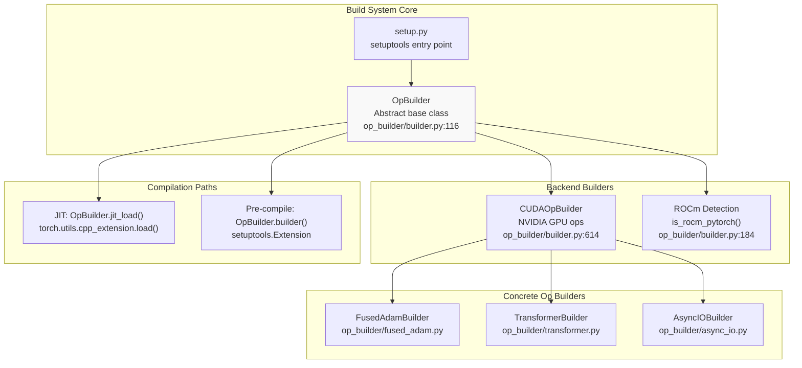

### OpBuilder Base Class

The `OpBuilder` class [op_builder/builder.py:116-612]() defines the interface all operation builders must implement. It manages both JIT and pre-compilation logic.

**Key Methods:**

| Method | Purpose | Location |
|--------|---------|----------|
| `absolute_name()` | Python module path for operation | [op_builder/builder.py:132-137]() |
| `sources()` | List of C++/CUDA source files | [op_builder/builder.py:139-144]() |
| `load()` | Load pre-installed or JIT compile | [op_builder/builder.py:525-542]() |
| `jit_load()` | JIT compile and load operation | [op_builder/builder.py:544-611]() |
| `is_compatible()` | Check system compatibility | [op_builder/builder.py:306-310]() |

**Sources:** [op_builder/builder.py:116-612](), [setup.py:183-203]()

## JIT vs Pre-compilation

### Just-In-Time (JIT) Compilation

**Default behavior** on Linux [setup.py:152-153](). DeepSpeed uses `torch.utils.cpp_extension.load` to compile extensions at runtime.

**JIT compilation process** [op_builder/builder.py:544-611]():
1. Check if the op is already in `_loaded_ops`.
2. Verify `ninja` is installed.
3. Call `torch.utils.cpp_extension.load()` using source files provided by `sources()`.
4. Cache the resulting shared object in `TORCH_EXTENSIONS_DIR`.

**Sources:** [op_builder/builder.py:544-611](), [docs/_tutorials/advanced-install.md:10-13]()

### Pre-compilation

**Explicit pre-compilation** compiles compatible operations during the installation phase. This is triggered by setting `DS_BUILD_OPS=1` [docs/_tutorials/advanced-install.md:39-44]().

**Selective pre-compilation flags:**
- `DS_BUILD_AIO`: Builds asynchronous (NVMe) I/O op [docs/_tutorials/advanced-install.md:60]().
- `DS_BUILD_FUSED_ADAM`: Builds the FusedAdam op [docs/_tutorials/advanced-install.md:65]().
- `DS_BUILD_CPU_ADAM`: Builds the CPUAdam op [docs/_tutorials/advanced-install.md:62]().
- `DS_BUILD_TRANSFORMER`: Builds the transformer op [docs/_tutorials/advanced-install.md:72]().

**Sources:** [docs/_tutorials/advanced-install.md:28-75](), [setup.py:156-181]()

## System Requirements and Dependencies

### Core Requirements

**Mandatory dependencies** defined in `requirements/requirements.txt`:
- `torch >= 2.0.0` [requirements/requirements.txt:10]()
- `ninja` [requirements/requirements.txt:4]()
- `numpy` [requirements/requirements.txt:5]()
- `psutil` [requirements/requirements.txt:7]()
- `pydantic >= 2.0.0` [requirements/requirements.txt:9]()

### Compute Capability Selection

DeepSpeed determines default compute capabilities based on the installed CUDA version [op_builder/builder.py:62-78]().

**Default Logic:**
- Base: `6.0;6.1;7.0` [op_builder/builder.py:28]().
- CUDA 11.x: Adds `8.0`, `8.6`, or `9.0` depending on minor version [op_builder/builder.py:67-73]().
- CUDA 12.x: Adds `8.0;8.6;9.0` and potentially `10.0;12.0` [op_builder/builder.py:74-77]().

Users can override this via `TORCH_CUDA_ARCH_LIST` [docs/_tutorials/advanced-install.md:157-157]().

**Sources:** [op_builder/builder.py:62-78](), [requirements/requirements.txt:1-12]()

## Platform-Specific Installation

### NVIDIA CUDA

DeepSpeed strictly validates the CUDA version mismatch between the system `nvcc` and the version PyTorch was compiled with [op_builder/builder.py:90-113]().

**Compatibility Rules:**
- Exact match is preferred.
- Minor version mismatches are allowed for specific versions (e.g., CUDA 11.0 through 11.8) [op_builder/builder.py:83-87]().
- Can be bypassed with `DS_SKIP_CUDA_CHECK=1` [op_builder/builder.py:102]().

### Windows

Windows installation defaults to pre-compiling ops (`DS_BUILD_OPS=1`) [setup.py:152-153]().
- Requires Visual CPP build tools [setup.py:10]().
- Uses `build_win.bat` to create wheels [setup.py:16]().

### Distributed Installation Across Clusters

For multi-node clusters, DeepSpeed provides an `install.sh` script that leverages `pdsh` and `pdcp` to distribute and install wheels across all nodes listed in a hostfile [install.sh:163-182]().

**Flow of `install.sh`:**
1. Build a local wheel using `python -m build --wheel` [install.sh:155]().
2. Read hosts from the hostfile (default `/job/hostfile`) [install.sh:164-169]().
3. Use `pdcp` to copy requirements and the wheel to `/tmp/deepspeed_wheels` on all nodes [install.sh:174-178]().
4. Use `pdsh` to run `pip install` on all remote nodes [install.sh:179]().

**Sources:** [install.sh:1-183](), [setup.py:8-19](), [op_builder/builder.py:83-113]()

## Docker Environment Setup

DeepSpeed includes a comprehensive `Dockerfile` for creating reproducible environments.

**Key Components of the Docker Image:**
- **Base:** NVIDIA CUDA devel images [docker/Dockerfile:1]().
- **System Deps:** `libaio-dev`, `openmpi-bin`, `pdsh` [docker/Dockerfile:38-51]().
- **Python Deps:** Installs `requirements.txt` and `requirements-dev.txt` [docker/Dockerfile:106-111]().
- **DeepSpeed:** Clones and installs DeepSpeed with `DS_BUILD_OPS=1` to ensure all kernels are pre-compiled [docker/Dockerfile:158-166]().

**Sources:** [docker/Dockerfile:1-184](), [requirements/requirements-dev.txt:1-21]()

---

# Page: Basic Usage and API

# Basic Usage and API

<details>
<summary>Relevant source files</summary>

The following files were used as context for generating this wiki page:

- [README.md](README.md)
- [azure/README.md](azure/README.md)
- [deepspeed/runtime/activation_checkpointing/checkpointing.py](deepspeed/runtime/activation_checkpointing/checkpointing.py)
- [deepspeed/runtime/base_optimizer.py](deepspeed/runtime/base_optimizer.py)
- [deepspeed/runtime/bf16_optimizer.py](deepspeed/runtime/bf16_optimizer.py)
- [deepspeed/runtime/config.py](deepspeed/runtime/config.py)
- [deepspeed/runtime/constants.py](deepspeed/runtime/constants.py)
- [deepspeed/runtime/engine.py](deepspeed/runtime/engine.py)
- [deepspeed/runtime/utils.py](deepspeed/runtime/utils.py)
- [deepspeed/runtime/zero/config.py](deepspeed/runtime/zero/config.py)
- [deepspeed/runtime/zero/mics.py](deepspeed/runtime/zero/mics.py)
- [deepspeed/runtime/zero/parameter_offload.py](deepspeed/runtime/zero/parameter_offload.py)
- [deepspeed/runtime/zero/partition_parameters.py](deepspeed/runtime/zero/partition_parameters.py)
- [deepspeed/runtime/zero/partitioned_param_coordinator.py](deepspeed/runtime/zero/partitioned_param_coordinator.py)
- [deepspeed/runtime/zero/stage3.py](deepspeed/runtime/zero/stage3.py)
- [deepspeed/runtime/zero/stage_1_and_2.py](deepspeed/runtime/zero/stage_1_and_2.py)
- [deepspeed/runtime/zero/utils.py](deepspeed/runtime/zero/utils.py)
- [docs/_config.yml](docs/_config.yml)
- [docs/_data/navigation.yml](docs/_data/navigation.yml)
- [docs/_pages/config-json.md](docs/_pages/config-json.md)
- [docs/_tutorials/azure.md](docs/_tutorials/azure.md)
- [docs/_tutorials/cifar-10.md](docs/_tutorials/cifar-10.md)
- [docs/_tutorials/getting-started.md](docs/_tutorials/getting-started.md)
- [docs/contributing.md](docs/contributing.md)
- [docs/index.md](docs/index.md)

</details>


This page introduces the fundamental DeepSpeed API for distributed training. It covers the `deepspeed.initialize()` function, the `DeepSpeedEngine` object, and the basic training loop structure. For installation instructions, see [Installation](#2.1). For detailed configuration options, see [Configuration System](#2.3). For advanced training features like ZeRO optimization and pipeline parallelism, see [Core Training Engine](#3) and [Pipeline Parallelism](#4).

---

## API Overview

DeepSpeed wraps your PyTorch model in a `DeepSpeedEngine` that manages all aspects of distributed training, optimization, and memory management. The API is designed to require minimal code changes from standard PyTorch training scripts.

**Core Workflow Diagram**

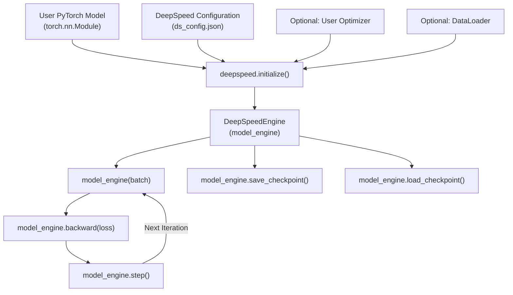

**Sources:** [deepspeed/runtime/engine.py:207-460](), [docs/_tutorials/getting-started.md:18-47]()

---

## The `deepspeed.initialize()` Function

The `deepspeed.initialize()` function is the entry point for all DeepSpeed training. It configures the distributed environment, wraps your model, and returns a `DeepSpeedEngine` instance along with optimizer, dataloader, and scheduler objects.

### Function Signature and Return Values

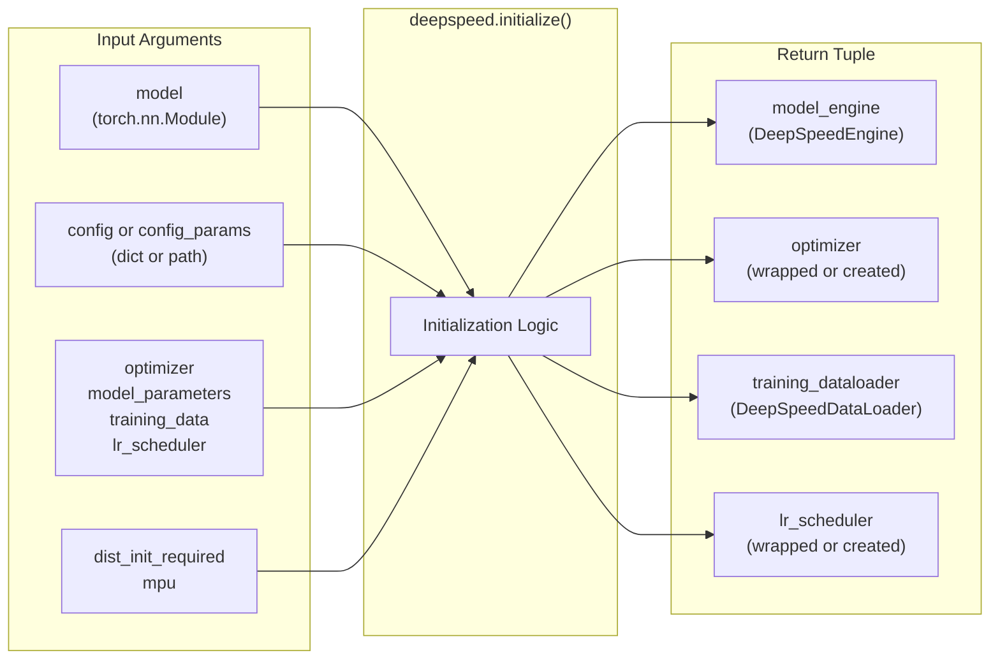

**Key Parameters:**

| Parameter | Type | Description |
|-----------|------|-------------|
| `model` | `torch.nn.Module` | Your PyTorch model to be trained |
| `config` or `config_params` | `str` or `dict` | Path to JSON config file or dictionary with configuration |
| `optimizer` | `torch.optim.Optimizer` (optional) | User-defined optimizer; if None, created from config |
| `model_parameters` | Iterable (optional) | Parameters to optimize; defaults to `model.parameters()` |
| `training_data` | `torch.utils.data.Dataset` (optional) | Training dataset; DeepSpeed will create DataLoader |
| `lr_scheduler` | Learning rate scheduler (optional) | User-defined scheduler; if None, created from config |
| `mpu` | Model parallel unit (optional) | For tensor/pipeline parallelism coordination |
| `dist_init_required` | `bool` (optional) | Whether to initialize `torch.distributed`; default auto-detects |

**Return Values:**

The function returns a 4-tuple: `(model_engine, optimizer, training_dataloader, lr_scheduler)`

- `model_engine`: The `DeepSpeedEngine` instance wrapping your model [deepspeed/runtime/engine.py:207]()
- `optimizer`: The optimizer (wrapped or created by DeepSpeed) [deepspeed/runtime/engine.py:241]()
- `training_dataloader`: The `DeepSpeedDataLoader` if `training_data` was provided [deepspeed/runtime/engine.py:244]()
- `lr_scheduler`: The learning rate scheduler if configured [deepspeed/runtime/engine.py:242]()

**Sources:** [deepspeed/runtime/engine.py:210-223](), [docs/_tutorials/getting-started.md:25-38]()

### Minimal Initialization Example

```python
import deepspeed

# Option 1: Config from file
model_engine, optimizer, _, _ = deepspeed.initialize(
    model=model,
    config="ds_config.json"
)

# Option 2: Config as dictionary
ds_config = {
    "train_batch_size": 16,
    "fp16": {"enabled": True}
}
model_engine, optimizer, _, _ = deepspeed.initialize(
    model=model,
    config_params=ds_config
)
```

**Sources:** [docs/_tutorials/getting-started.md:25-31](), [deepspeed/runtime/engine.py:239-240]()

---

## The DeepSpeedEngine Object

The `DeepSpeedEngine` class ([deepspeed/runtime/engine.py:207]()) is the core training engine that orchestrates all distributed training operations. It inherits from `torch.nn.Module` and can be called like a standard PyTorch model.

### Key Components

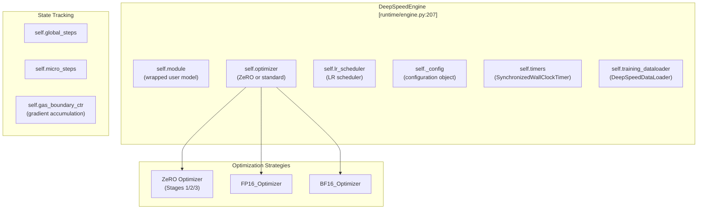

**Sources:** [deepspeed/runtime/engine.py:207-266](), [deepspeed/runtime/engine.py:336-372](), [deepspeed/runtime/zero/stage_1_and_2.py:126](), [deepspeed/runtime/zero/stage3.py:136](), [deepspeed/runtime/bf16_optimizer.py:36]()

### Engine Attributes

| Attribute | Description |
|-----------|-------------|
| `module` | The original PyTorch model (accessible via `model_engine.module`) [deepspeed/runtime/engine.py:233]() |
| `optimizer` | The wrapped or created optimizer instance [deepspeed/runtime/engine.py:241]() |
| `lr_scheduler` | The learning rate scheduler [deepspeed/runtime/engine.py:242]() |
| `global_steps` | Total number of optimizer steps taken [deepspeed/runtime/engine.py:248]() |
| `micro_steps` | Current micro-batch step within gradient accumulation [deepspeed/runtime/engine.py:249]() |
| `train_batch_size()` | Method returning effective global batch size [deepspeed/runtime/engine.py:659]() |
| `train_micro_batch_size_per_gpu()` | Method returning per-GPU micro-batch size [deepspeed/runtime/engine.py:666]() |
| `gradient_accumulation_steps()` | Method returning number of gradient accumulation steps [deepspeed/runtime/engine.py:670]() |

**Sources:** [deepspeed/runtime/engine.py:233-264](), [deepspeed/runtime/engine.py:659-673]()

---

## Basic Training Loop

DeepSpeed maintains a PyTorch-like training loop with three core methods: forward pass (calling the engine), backward pass, and optimizer step.

### Standard Training Loop Pattern

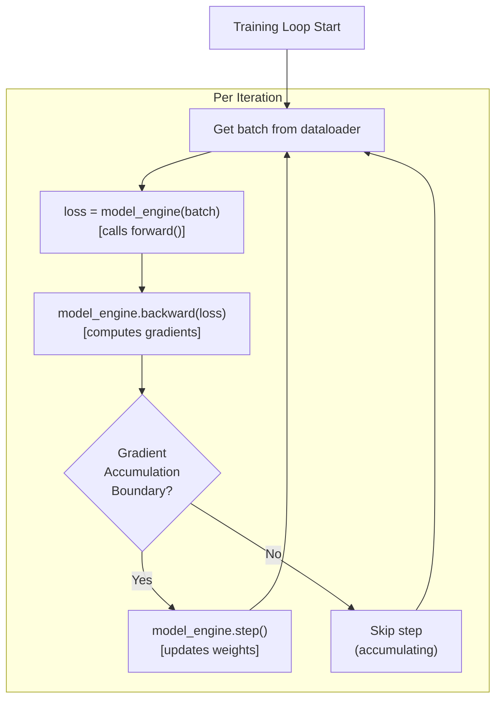

**Sources:** [docs/code-docs/source/training.rst:7-17](), [deepspeed/runtime/engine.py:1706-1850]()

### Code Example

```python
for step, batch in enumerate(data_loader):
    # Forward pass - returns loss
    loss = model_engine(batch)
    
    # Backward pass - computes gradients
    model_engine.backward(loss)
    
    # Optimizer step - updates weights (respects gradient accumulation)
    model_engine.step()
```

**Note:** Starting from DeepSpeed v0.18.3, you can call `loss.backward()` directly instead of `model_engine.backward(loss)` when using compatible PyTorch versions. The engine tracks gradient computation internally via hooks [deepspeed/runtime/engine.py:434-457]().

**Sources:** [docs/code-docs/source/training.rst:7-23](), [deepspeed/runtime/engine.py:1706-1850]()

---

## Core API Methods

### Forward Pass: `__call__()` and `forward()`

The engine can be called directly like a standard PyTorch module. It delegates to the wrapped model's forward method [deepspeed/runtime/engine.py:1496]().

**Method Mapping:**


**Key Points:**
- Pass input batch directly to the engine: `loss = model_engine(input_batch)`
- The engine handles data movement to the correct device via `move_to_device` [deepspeed/runtime/utils.py:188]()
- For ZeRO-3, parameters are automatically gathered and released via the `PartitionedParameterCoordinator` [deepspeed/runtime/zero/partitioned_param_coordinator.py:64]()

**Sources:** [deepspeed/runtime/engine.py:1496-1510](), [docs/code-docs/source/training.rst:24-26](), [deepspeed/runtime/zero/parameter_offload.py:112]()

### Backward Pass: `backward()`

Computes gradients with support for gradient accumulation, mixed precision, and ZeRO optimizations [deepspeed/runtime/engine.py:1706]().

**Backward Pass Flow:**

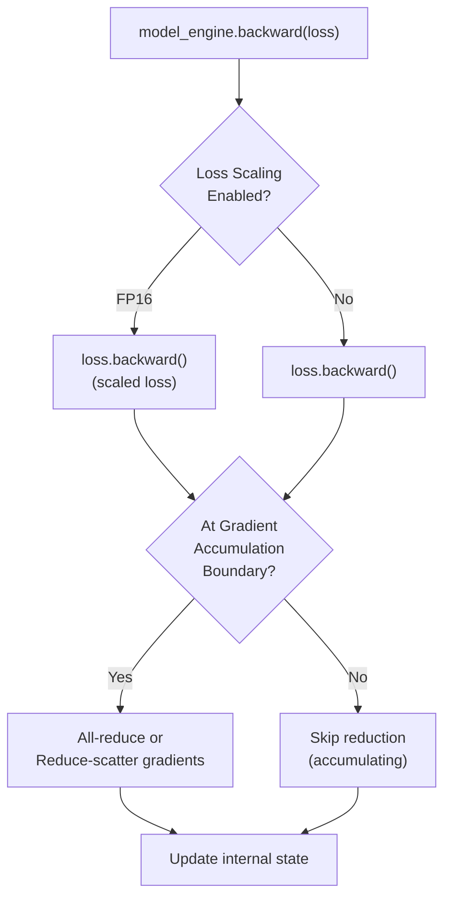

**Important:** 
- Only scalar losses are supported for `model_engine.backward(loss)` [deepspeed/runtime/engine.py:1721]().
- Gradient accumulation is handled automatically based on configuration [deepspeed/runtime/engine.py:1762]().

**Sources:** [deepspeed/runtime/engine.py:1706-1850](), [docs/code-docs/source/training.rst:28-32]()

### Optimizer Step: `step()`

Updates model parameters after gradient computation. Automatically handles gradient accumulation boundaries [deepspeed/runtime/engine.py:1852]().

**Step Execution Logic:**

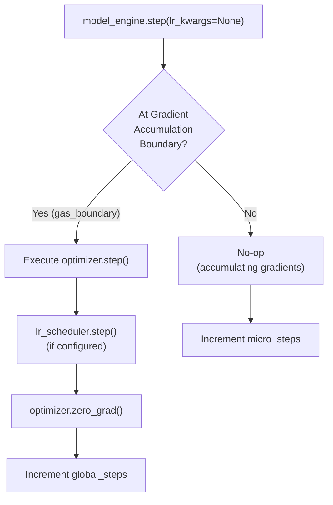

**Key Behaviors:**
- Respects `gradient_accumulation_steps` from configuration [deepspeed/runtime/engine.py:1866]().
- Automatically manages learning rate scheduling if configured [deepspeed/runtime/engine.py:1955]().
- Returns `True` if step was executed, `False` if skipped (accumulating) [deepspeed/runtime/engine.py:1980]().

**Sources:** [deepspeed/runtime/engine.py:1852-2073](), [deepspeed/runtime/engine.py:248-249]()

---

## Gradient Accumulation

DeepSpeed automatically handles gradient accumulation to simulate larger batch sizes without proportional memory increase.

**Gradient Accumulation Configuration:**

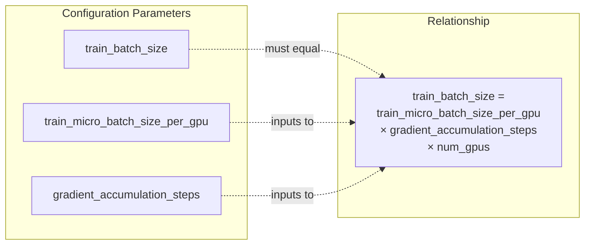

**Configuration Example:**

```json
{
  "train_batch_size": 128,
  "train_micro_batch_size_per_gpu": 4,
  "gradient_accumulation_steps": 8,
  "steps_per_print": 10
}
```

With 4 GPUs:
- Effective batch size = 128
- Each GPU processes 4 samples per micro-step
- 8 micro-steps before weight update
- Calculation: 4 × 8 × 4 = 128 ✓

**Sources:** [docs/_pages/config-json.md:7-30](), [deepspeed/runtime/engine.py:659-673]()

---

## API Method Reference Table

| Method | Purpose | Key Arguments | Returns |
|--------|---------|---------------|---------|
| `deepspeed.initialize()` | Initialize DeepSpeed engine | `model`, `config`, `optimizer`, etc. | `(engine, optimizer, dataloader, scheduler)` |
| `model_engine(input)` | Forward pass | Model inputs | Model outputs (loss, logits, etc.) |
| `backward(loss)` | Backward pass | Scalar loss tensor | None |
| `step(lr_kwargs)` | Optimizer step | Optional LR kwargs | `bool` (True if step executed) |
| `save_checkpoint(dir, tag)` | Save model/optimizer state | Directory path, checkpoint tag | None |
| `load_checkpoint(dir, tag)` | Load model/optimizer state | Directory path, checkpoint tag | Load info tuple |
| `get_batch_info()` | Query batch configuration | None | `(train_bs, micro_bs, gas)` |
| `train_batch_size()` | Get effective batch size | None | `int` |
| `zero_grad()` | Zero out gradients | None | None |

**Sources:** [deepspeed/runtime/engine.py:207-2000](), [docs/code-docs/source/training.rst:1-200]()

---

## Configuration Integration

The `deepspeed.initialize()` function accepts configuration in two ways:

**Method 1: JSON File**
```python
model_engine, _, _, _ = deepspeed.initialize(
    model=model,
    config="path/to/ds_config.json"
)
```

**Method 2: Python Dictionary**
```python
config_dict = {
    "train_batch_size": 16,
    "optimizer": {"type": "Adam", "params": {"lr": 0.001}}
}
model_engine, _, _, _ = deepspeed.initialize(
    model=model,
    config_params=config_dict
)
```

For detailed configuration options, see [Configuration System](#2.3).

**Sources:** [deepspeed/runtime/config.py:1-100](), [deepspeed/runtime/engine.py:276-278]()

---

# Page: Configuration System

# Configuration System

<details>
<summary>Relevant source files</summary>

The following files were used as context for generating this wiki page:

- [.gitignore](.gitignore)
- [deepspeed/inference/config.py](deepspeed/inference/config.py)
- [deepspeed/pipe/__init__.py](deepspeed/pipe/__init__.py)
- [deepspeed/runtime/activation_checkpointing/checkpointing.py](deepspeed/runtime/activation_checkpointing/checkpointing.py)
- [deepspeed/runtime/base_optimizer.py](deepspeed/runtime/base_optimizer.py)
- [deepspeed/runtime/bf16_optimizer.py](deepspeed/runtime/bf16_optimizer.py)
- [deepspeed/runtime/config.py](deepspeed/runtime/config.py)
- [deepspeed/runtime/config_utils.py](deepspeed/runtime/config_utils.py)
- [deepspeed/runtime/constants.py](deepspeed/runtime/constants.py)
- [deepspeed/runtime/engine.py](deepspeed/runtime/engine.py)
- [deepspeed/runtime/pipe/__init__.py](deepspeed/runtime/pipe/__init__.py)
- [deepspeed/runtime/utils.py](deepspeed/runtime/utils.py)
- [deepspeed/runtime/zero/config.py](deepspeed/runtime/zero/config.py)
- [deepspeed/runtime/zero/linear.py](deepspeed/runtime/zero/linear.py)
- [deepspeed/runtime/zero/mics.py](deepspeed/runtime/zero/mics.py)
- [deepspeed/runtime/zero/offload_config.py](deepspeed/runtime/zero/offload_config.py)
- [deepspeed/runtime/zero/parameter_offload.py](deepspeed/runtime/zero/parameter_offload.py)
- [deepspeed/runtime/zero/partition_parameters.py](deepspeed/runtime/zero/partition_parameters.py)
- [deepspeed/runtime/zero/partitioned_param_coordinator.py](deepspeed/runtime/zero/partitioned_param_coordinator.py)
- [deepspeed/runtime/zero/stage3.py](deepspeed/runtime/zero/stage3.py)
- [deepspeed/runtime/zero/stage_1_and_2.py](deepspeed/runtime/zero/stage_1_and_2.py)
- [deepspeed/runtime/zero/utils.py](deepspeed/runtime/zero/utils.py)
- [docs/_pages/config-json.md](docs/_pages/config-json.md)
- [docs/_posts/2020-09-09-sparse-attention.md](docs/_posts/2020-09-09-sparse-attention.md)
- [docs/_tutorials/megatron.md](docs/_tutorials/megatron.md)
- [docs/_tutorials/one-cycle.md](docs/_tutorials/one-cycle.md)
- [docs/_tutorials/pipeline.md](docs/_tutorials/pipeline.md)
- [docs/_tutorials/pytorch-profiler.md](docs/_tutorials/pytorch-profiler.md)
- [docs/_tutorials/sparse-attention.md](docs/_tutorials/sparse-attention.md)
- [docs/_tutorials/zero-offload.md](docs/_tutorials/zero-offload.md)
- [docs/_tutorials/zero.md](docs/_tutorials/zero.md)
- [docs/code-docs/source/conf.py](docs/code-docs/source/conf.py)
- [docs/code-docs/source/memory.rst](docs/code-docs/source/memory.rst)
- [requirements/requirements-readthedocs.txt](requirements/requirements-readthedocs.txt)
- [requirements/requirements-sparse_attn.txt](requirements/requirements-sparse_attn.txt)
- [requirements/requirements.txt](requirements/requirements.txt)
- [tests/unit/runtime/test_autocast.py](tests/unit/runtime/test_autocast.py)
- [tests/unit/v1/zero/test_zero_functorch_linear.py](tests/unit/v1/zero/test_zero_functorch_linear.py)

</details>


## Purpose and Scope

The Configuration System in DeepSpeed provides a centralized mechanism for controlling all aspects of training and inference through a JSON configuration file (`ds_config.json`). This system parses, validates, and distributes configuration parameters to all DeepSpeed components including the training engine, optimizers, ZeRO stages, and various optimization features.

For information about how the DeepSpeedEngine uses configuration during initialization, see [DeepSpeedEngine Architecture](#3.1). For details on ZeRO-specific configuration parameters, see [Training Loop and Gradient Management](#3.3).

## Configuration File Structure

DeepSpeed accepts configuration through a JSON or HJSON file, typically named `ds_config.json`. This file contains nested dictionaries that control all aspects of the training process.

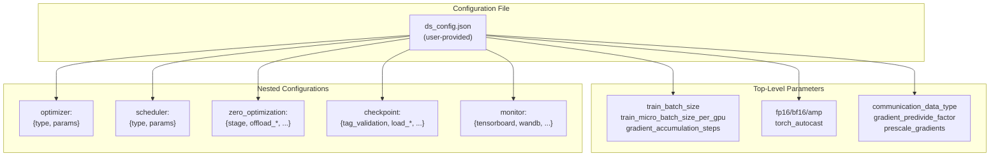

**Configuration File Organization**

Sources: [docs/_pages/config-json.md:7-30](), [deepspeed/runtime/constants.py:11-100]()

## Configuration Loading and Parsing

### Loading Process

The configuration loading process begins when the user calls `deepspeed.initialize()` and involves parsing, validation, and distribution of parameters.

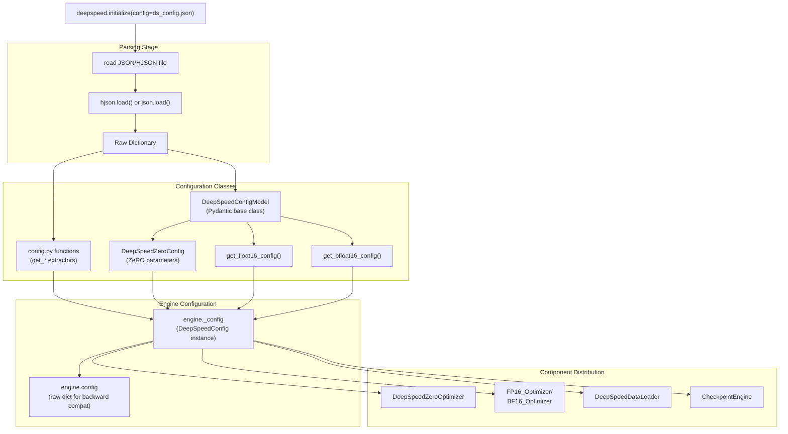

**Configuration Parsing Flow from File to Engine Components**

Sources: [deepspeed/runtime/config.py:11-32](), [deepspeed/runtime/engine.py:204-283]()

### Configuration Classes

The configuration system uses a combination of Pydantic models and legacy extraction functions:

| Class/Module | Purpose | Key Methods |
|--------------|---------|-------------|
| `DeepSpeedConfigModel` | Base class using Pydantic for validation [deepspeed/runtime/config_utils.py:31]() | Field validation, type checking |
| `DeepSpeedZeroConfig` | ZeRO optimization parameters [deepspeed/runtime/zero/config.py:90]() | Stage, offload settings, bucket sizes |
| `get_float16_config()` | FP16 precision configuration [deepspeed/runtime/precision_config.py]() | Loss scale, hysteresis, min scale |
| `get_bfloat16_config()` | BF16 precision configuration [deepspeed/runtime/precision_config.py]() | Enabled flag, overflow check |
| `get_zero_config()` | Extract ZeRO configuration [deepspeed/runtime/zero/config.py:71]() | Returns `DeepSpeedZeroConfig` instance |
| `DtypeEnum` | Enumeration for data types [deepspeed/runtime/config.py:101]() | Maps strings like "fp16" to `torch.float16` |

Sources: [deepspeed/runtime/config.py:101-125](), [deepspeed/runtime/zero/config.py:90-232](), [deepspeed/runtime/config_utils.py:31-40]()

## Core Configuration Components

### Batch Size Resolution

DeepSpeed requires exactly two of three batch-related parameters to be specified. The third is automatically calculated.

**Batch Size Relationship:**
`train_batch_size = train_micro_batch_size_per_gpu × gradient_accumulation_steps × num_gpus` [docs/_pages/config-json.md:9]()

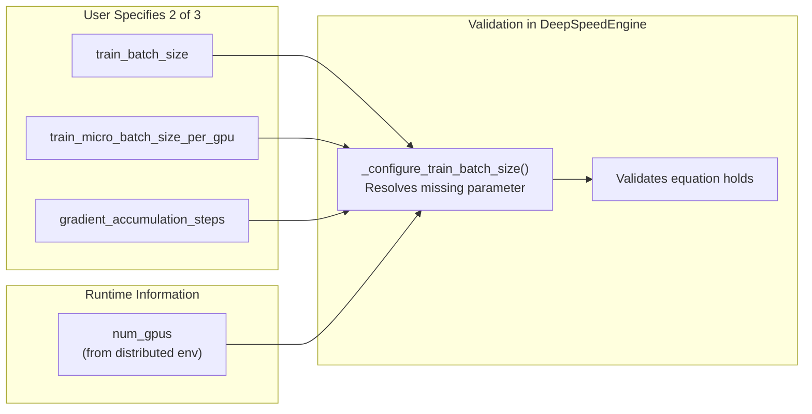

**Batch Size Parameter Resolution**

Sources: [deepspeed/runtime/engine.py:1000-1100](), [deepspeed/runtime/config.py:197-200]()

### Configuration Parameter Access Pattern

The `DeepSpeedEngine` accesses configuration through two interfaces:

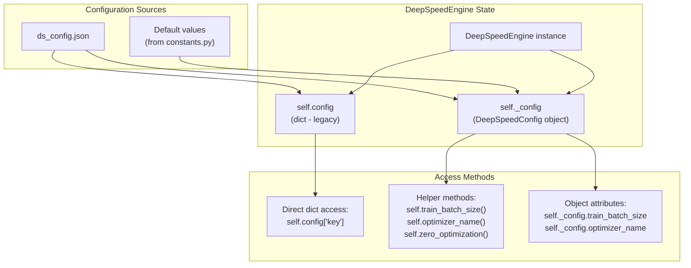

**Two-Level Configuration Access in DeepSpeedEngine**

Sources: [deepspeed/runtime/engine.py:233-234](), [deepspeed/runtime/engine.py:828-865]()

## Configuration Parameter Categories

### Training Parameters

| Parameter | Type | Default | Description |
|-----------|------|---------|-------------|
| `train_batch_size` | int | None | Effective training batch size [deepspeed/runtime/constants.py:19]() |
| `train_micro_batch_size_per_gpu` | int | None | Batch size per GPU per step [deepspeed/runtime/constants.py:95]() |
| `gradient_accumulation_steps` | int | 1 | Steps to accumulate gradients [deepspeed/runtime/constants.py:107]() |
| `steps_per_print` | int | None | Logging frequency [deepspeed/runtime/constants.py:81]() |
| `sparse_gradients` | bool | False | Enable CSR gradient sparsity [deepspeed/runtime/constants.py:111]() |

Sources: [deepspeed/runtime/constants.py:11-112](), [docs/_pages/config-json.md:7-30]()

### Precision Configuration

DeepSpeed supports multiple precision modes configured through nested dictionaries.

**FP16 Configuration:**
```json
{
  "fp16": {
    "enabled": true,
    "loss_scale": 0,
    "initial_scale_power": 16,
    "loss_scale_window": 1000,
    "hysteresis": 2,
    "min_loss_scale": 1
  }
}
```
Sources: [deepspeed/runtime/constants.py:156-168](), [docs/_pages/config-json.md:208-288]()

**BF16 Configuration:**
```json
{
  "bf16": {
    "enabled": true,
    "immediate_grad_update": false,
    "check_overflow": false
  }
}
```
Sources: [deepspeed/runtime/constants.py:119-126](), [deepspeed/runtime/bf16_optimizer.py:41-50]()

**Torch Autocast Configuration:**
```json
{
  "torch_autocast": {
    "enabled": true,
    "dtype": "bf16",
    "lower_precision_safe_modules": ["torch.nn.Linear"]
  }
}
```
Sources: [deepspeed/runtime/config.py:168-194]()

### Optimizer and Scheduler Configuration

DeepSpeed natively supports optimizers like **Adam**, **AdamW**, **Lamb**, and **Muon** [docs/_pages/config-json.md:39]().

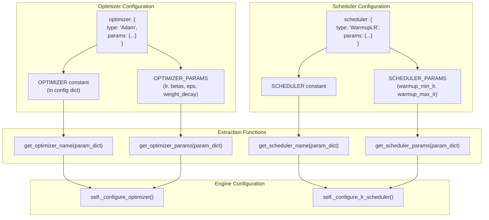

**Optimizer and Scheduler Configuration Processing**

Sources: [deepspeed/runtime/config.py:71-87](), [deepspeed/runtime/constants.py:61-70](), [docs/_pages/config-json.md:33-180]()

### ZeRO Optimization Configuration

ZeRO configuration is handled by the `DeepSpeedZeroConfig` class [deepspeed/runtime/zero/config.py:90]().

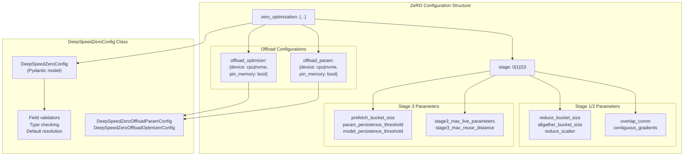

**ZeRO Configuration Hierarchy**

Sources: [deepspeed/runtime/zero/config.py:90-200](), [deepspeed/runtime/zero/offload_config.py:12]()

## Configuration Validation and Defaults

### Default Value Resolution

The configuration system uses a multi-layered approach to default values, leveraging `get_scalar_param` [deepspeed/runtime/config_utils.py:18]() and Pydantic field defaults.

```mermaid
graph TB
    subgraph "Default Sources"
        CONSTANTS["constants.py<br/>*_DEFAULT constants"]
        PYDANTIC["Pydantic Field defaults"]
        LEGACY["Legacy get_scalar_param()"]
    end
    
    subgraph "Resolution Order"
        USER_VAL["User-provided value<br/>(in ds_config.json)"]
        CHECK["Value present?"]
        USE_DEFAULT["Use default value"]
        USE_USER["Use user value"]
    end
    
    subgraph "Validation"
        TYPE_CHECK["Type validation"]
        RANGE_CHECK["Range validation<br/>(min/max)"]
        DEPENDENCY["Dependency validation<br/>(e.g., batch size equation)"]
    end
    
    CONSTANTS --> USE_DEFAULT
    PYDANTIC --> USE_DEFAULT
    LEGACY --> USE_DEFAULT
    
    USER_VAL --> CHECK
    CHECK -->|No| USE_DEFAULT
    CHECK -->|Yes| USE_USER
    
    USE_USER --> TYPE_CHECK
    USE_DEFAULT --> TYPE_CHECK
    TYPE_CHECK --> RANGE_CHECK
    RANGE_CHECK --> DEPENDENCY
```

**Configuration Default Resolution and Validation Process**

Sources: [deepspeed/runtime/config.py:17-21](), [deepspeed/runtime/config_utils.py:10-31](), [deepspeed/runtime/constants.py:19-210]()

## Configuration Access Patterns in Runtime

### Component-Specific Configuration Access

DeepSpeed components ingest configuration objects during initialization to set internal state.

| Component | Configuration Ingested |
|-----------|------------------------|
| `DeepSpeedZeroOptimizer` | `offload_optimizer_config`, `zenflow_config` [deepspeed/runtime/zero/stage_1_and_2.py:156-157]() |
| `DeepSpeedZeroOptimizer_Stage3` | `offload_optimizer_config`, `offload_param_config`, `zenflow_config` [deepspeed/runtime/zero/stage3.py:169-171]() |
| `BF16_Optimizer` | `bfloat16_config` [deepspeed/runtime/bf16_optimizer.py:41]() |
| `DeepSpeedZeRoOffload` | `offload_param_config`, `ds_config` [deepspeed/runtime/zero/parameter_offload.py:118-127]() |
| `PartitionedParameterCoordinator` | `prefetch_bucket_sz`, `max_reuse_distance_in_numel` [deepspeed/runtime/zero/partitioned_param_coordinator.py:82-84]() |

```mermaid
graph TB
    subgraph "DeepSpeedEngine"
        ENGINE["DeepSpeedEngine instance"]
        CONFIG["engine._config"]
    end
    
    subgraph "ZeRO Optimizer"
        ZERO_INIT["DeepSpeedZeroOptimizer.__init__()"]
        ZERO_PARAMS["reduce_bucket_size<br/>allgather_bucket_size<br/>contiguous_gradients<br/>overlap_comm"]
        ZERO_OFFLOAD["offload_optimizer_config<br/>offload_param_config"]
    end
    
    subgraph "FP16 Wrapper"
        FP16_INIT["FP16_Optimizer.__init__()"]
        FP16_PARAMS["static_loss_scale<br/>dynamic_loss_scale<br/>initial_scale_power<br/>loss_scale_window"]
    end
    
    subgraph "Data Loader"
        DL_INIT["DeepSpeedDataLoader.__init__()"]
        DL_PARAMS["train_micro_batch_size_per_gpu<br/>data_sampling config"]
    end
    
    subgraph "Checkpoint Engine"
        CKPT_INIT["create_checkpoint_engine()"]
        CKPT_PARAMS["checkpoint_tag_validation<br/>checkpoint_writer"]
    end
    
    ENGINE --> CONFIG
    
    CONFIG --> ZERO_INIT
    ZERO_INIT --> ZERO_PARAMS
    ZERO_INIT --> ZERO_OFFLOAD
    
    CONFIG --> FP16_INIT
    FP16_INIT --> FP16_PARAMS
    
    CONFIG --> DL_INIT
    DL_INIT --> DL_PARAMS
    
    CONFIG --> CKPT_INIT
    CKPT_INIT --> CKPT_PARAMS
```

**Configuration Distribution to DeepSpeed Components**

Sources: [deepspeed/runtime/engine.py:354-383](), [deepspeed/runtime/zero/stage_1_and_2.py:138-173](), [deepspeed/runtime/zero/stage3.py:148-198]()

### Summary

The DeepSpeed Configuration System provides:
1. **Centralized Control**: Single JSON/HJSON file controls all training aspects.
2. **Type Safety**: `DeepSpeedConfigModel` (Pydantic) provides validation [deepspeed/runtime/config_utils.py:31]().
3. **Resolution Logic**: Automatic calculation of missing batch parameters [docs/_pages/config-json.md:9]().
4. **Hardware Abstraction**: Configuration of CPU/NVMe offloading via `OffloadDeviceEnum` [deepspeed/runtime/zero/offload_config.py:12]().
5. **Precision Management**: Structured configuration for FP16, BF16, and Autocast [deepspeed/runtime/config.py:101-180]().

Sources: [deepspeed/runtime/config.py:1-210](), [deepspeed/runtime/engine.py:204-410]()

---

# Page: Core Training Engine

# Core Training Engine

<details>
<summary>Relevant source files</summary>

The following files were used as context for generating this wiki page:

- [README.md](README.md)
- [azure/README.md](azure/README.md)
- [deepspeed/runtime/activation_checkpointing/checkpointing.py](deepspeed/runtime/activation_checkpointing/checkpointing.py)
- [deepspeed/runtime/base_optimizer.py](deepspeed/runtime/base_optimizer.py)
- [deepspeed/runtime/bf16_optimizer.py](deepspeed/runtime/bf16_optimizer.py)
- [deepspeed/runtime/config.py](deepspeed/runtime/config.py)
- [deepspeed/runtime/constants.py](deepspeed/runtime/constants.py)
- [deepspeed/runtime/engine.py](deepspeed/runtime/engine.py)
- [deepspeed/runtime/utils.py](deepspeed/runtime/utils.py)
- [deepspeed/runtime/zero/config.py](deepspeed/runtime/zero/config.py)
- [deepspeed/runtime/zero/mics.py](deepspeed/runtime/zero/mics.py)
- [deepspeed/runtime/zero/parameter_offload.py](deepspeed/runtime/zero/parameter_offload.py)
- [deepspeed/runtime/zero/partition_parameters.py](deepspeed/runtime/zero/partition_parameters.py)
- [deepspeed/runtime/zero/partitioned_param_coordinator.py](deepspeed/runtime/zero/partitioned_param_coordinator.py)
- [deepspeed/runtime/zero/stage3.py](deepspeed/runtime/zero/stage3.py)
- [deepspeed/runtime/zero/stage_1_and_2.py](deepspeed/runtime/zero/stage_1_and_2.py)
- [deepspeed/runtime/zero/utils.py](deepspeed/runtime/zero/utils.py)
- [docs/_config.yml](docs/_config.yml)
- [docs/_data/navigation.yml](docs/_data/navigation.yml)
- [docs/_pages/config-json.md](docs/_pages/config-json.md)
- [docs/_tutorials/azure.md](docs/_tutorials/azure.md)
- [docs/_tutorials/cifar-10.md](docs/_tutorials/cifar-10.md)
- [docs/_tutorials/getting-started.md](docs/_tutorials/getting-started.md)
- [docs/contributing.md](docs/contributing.md)
- [docs/index.md](docs/index.md)

</details>


## Purpose and Scope

The Core Training Engine is the central orchestration system in DeepSpeed that manages the training loop, optimizer integration, gradient management, and memory optimization. This document deep-dives into the `DeepSpeedEngine` class, the primary orchestrator that integrates ZeRO optimizers, mixed-precision mechanisms, and checkpointing strategies.

For details on specific subsystems, see the child pages:
- [DeepSpeedEngine Architecture](#3.1) — Internal initialization and component integration.
- [ZeRO Memory Optimization](#3.2) — Partitioning strategies for memory efficiency.
- [Training Loop and Gradient Management](#3.3) — Step-by-step execution and accumulation.
- [Mixed Precision Training](#3.4) — Loss scaling and lower precision (FP16/BF16/AMP) support.
- [Checkpointing System](#3.5) — ZeRO-aware and Universal Checkpointing.
- [Optimizers and Learning Rate Schedules](#3.6) — Built-in high-performance optimizers.
- [ZenFlow and SuperOffload](#3.7) — Stall-free offloading and Superchip optimizations.

## DeepSpeedEngine Architecture

The `DeepSpeedEngine` class ([deepspeed/runtime/engine.py:205-565]()) is the central entry point for DeepSpeed training. It wraps the user's model and provides unified APIs for training operations.

### Engine Initialization Flow

```mermaid
graph TB
    User["User Script<br/>deepspeed.initialize()"]
    Init["DeepSpeedEngine.__init__<br/>[engine.py:208-458]"]
    
    subgraph "Configuration Phase"
        SanityCheck["_do_args_sanity_check<br/>[engine.py:274]"]
        ConfigArgs["_configure_with_arguments<br/>[engine.py:275]"]
        TensorParallel["_configure_tensor_parallel<br/>[engine.py:277-278]"]
    end
    
    subgraph "Model Setup"
        DistModel["_configure_distributed_model<br/>[engine.py:302]"]
        GetParams["_get_model_parameters<br/>[engine.py:311]"]
    end
    
    subgraph "Optimizer Configuration"
        ConfigOptim["_configure_optimizer<br/>[engine.py:362]"]
        ConfigZeRO["_configure_zero_optimizer"]
        ConfigBF16["_configure_bf16_optimizer"]
        ConfigLR["_configure_lr_scheduler<br/>[engine.py:363]"]
    end
    
    subgraph "Checkpointing Setup"
        ConfigCheckpoint["_configure_checkpointing<br/>[engine.py:390]"]
    end
    
    User --> Init
    Init --> SanityCheck
    SanityCheck --> ConfigArgs
    ConfigArgs --> TensorParallel
    TensorParallel --> DistModel
    DistModel --> GetParams
    GetParams --> ConfigOptim
    ConfigOptim --> ConfigZeRO
    ConfigOptim --> ConfigBF16
    ConfigOptim --> ConfigLR
    ConfigLR --> ConfigCheckpoint
```

**Sources:** [deepspeed/runtime/engine.py:205-458]()

### Key Engine Attributes

| Attribute | Type | Purpose |
|-----------|------|---------|
| `module` | `torch.nn.Module` | The user's model, potentially wrapped for distributed training |
| `optimizer` | `ZeROOptimizer` | Optimizer wrapper providing ZeRO optimizations [deepspeed/runtime/base_optimizer.py:18]() |
| `lr_scheduler` | `_LRScheduler` | Learning rate scheduler |
| `global_steps` | `int` | Total number of optimizer steps executed |
| `micro_steps` | `int` | Micro-batches processed in current accumulation cycle |

**Sources:** [deepspeed/runtime/engine.py:231-263]()

## Memory Optimization and ZeRO

DeepSpeed utilizes the Zero Redundancy Optimizer (ZeRO) to eliminate memory redundancies by partitioning model states across GPUs. The engine selects the appropriate wrapper based on the `zero_optimization` configuration.

```mermaid
graph LR
    subgraph "ZeRO Wrappers"
        Z12["DeepSpeedZeroOptimizer<br/>Stage 1 & 2<br/>[stage_1_and_2.py:126]"]
        Z3["DeepSpeedZeroOptimizer_Stage3<br/>Stage 3<br/>[stage3.py:136]"]
    end
    
    subgraph "Offload Engines"
        Offload["DeepSpeedZeRoOffload<br/>[parameter_offload.py:112]"]
        Coord["PartitionedParameterCoordinator<br/>[partitioned_param_coordinator.py:64]"]
    end
    
    Z3 --> Offload
    Offload --> Coord
```

- **Stage 1 & 2**: Partitions optimizer states and gradients. Managed by `DeepSpeedZeroOptimizer` ([deepspeed/runtime/zero/stage_1_and_2.py:126]()).
- **Stage 3**: Partitions parameters, collecting them on-demand during forward/backward passes. Managed by `DeepSpeedZeroOptimizer_Stage3` ([deepspeed/runtime/zero/stage3.py:136]()).

For details, see [ZeRO Memory Optimization](#3.2).

**Sources:** [deepspeed/runtime/zero/stage_1_and_2.py:126-173](), [deepspeed/runtime/zero/stage3.py:136-198](), [deepspeed/runtime/zero/parameter_offload.py:112-180]()

## Training Execution Flow

The training loop follows a structured forward-backward-step pattern managed by the engine, handling micro-batching and gradient accumulation boundaries.

```mermaid
graph TB
    TrainBatch["engine.train_batch()"]
    
    subgraph "Micro-batch Loop"
        Forward["engine.forward()<br/>[engine.py:1934]"]
        Backward["engine.backward()<br/>[engine.py:1976]"]
        CheckGAS["Check boundary<br/>[engine.py:1801]"]
    end
    
    subgraph "Accumulation Boundary"
        Step["engine.step()<br/>[engine.py:2065]"]
        OptimStep["optimizer.step()"]
    end
    
    TrainBatch --> Forward
    Forward --> Backward
    Backward --> CheckGAS
    CheckGAS -->|"Is boundary"| Step
```

### Gradient Accumulation
The engine tracks boundaries using `is_gradient_accumulation_boundary` ([deepspeed/runtime/engine.py:1801]()) and automatically scales losses if `scale_wrt_gas` is enabled ([deepspeed/runtime/engine.py:2009]()).

For details, see [Training Loop and Gradient Management](#3.3).

**Sources:** [deepspeed/runtime/engine.py:1801-1821](), [deepspeed/runtime/engine.py:1934-2154]()

## Mixed Precision Training

DeepSpeed supports multiple mixed-precision modes to accelerate training and reduce memory usage:
- **FP16**: Uses `FP16_Optimizer` with loss scaling ([deepspeed/runtime/fp16/fused_optimizer.py]()).
- **BF16**: Uses `BF16_Optimizer` which does not require loss scaling ([deepspeed/runtime/bf16_optimizer.py:36]()).
- **AMP**: Integration with PyTorch Automatic Mixed Precision.

For details, see [Mixed Precision Training](#3.4).

**Sources:** [deepspeed/runtime/bf16_optimizer.py:36-110](), [deepspeed/runtime/engine.py:1176-1289]()

## Checkpointing and Offloading

### Checkpointing System
DeepSpeed provides a robust checkpointing system that is aware of ZeRO's partitioned states. It supports saving/loading partitioned states and "Universal Checkpointing" for changing hardware configurations ([deepspeed/runtime/engine.py:2573]()).

For details, see [Checkpointing System](#3.5).

### Advanced Offloading (ZenFlow & SuperOffload)
- **ZenFlow**: A stall-free offloading engine that uses selective gradient offloading to overlap computation with host-device communication ([deepspeed/runtime/zenflow/zenflow_stage_1_and_2.py:25]()).
- **SuperOffload**: Optimized for Superchips (e.g., NVIDIA GH200), providing speculation-then-validation mechanisms to maximize throughput.

For details, see [ZenFlow and SuperOffload](#3.7).

**Sources:** [deepspeed/runtime/engine.py:2573-2650](), [deepspeed/runtime/zenflow/zenflow_stage_1_and_2.py:25-50]()

## Summary of Key Classes

| Class | Purpose | File |
|-------|---------|------|
| `DeepSpeedEngine` | Main training orchestration engine | [deepspeed/runtime/engine.py:205]() |
| `DeepSpeedZeroOptimizer` | ZeRO Stage 1 & 2 optimizer wrapper | [deepspeed/runtime/zero/stage_1_and_2.py:126]() |
| `DeepSpeedZeroOptimizer_Stage3` | ZeRO Stage 3 parameter partitioning | [deepspeed/runtime/zero/stage3.py:136]() |
| `BF16_Optimizer` | BFloat16 mixed precision management | [deepspeed/runtime/bf16_optimizer.py:36]() |
| `DeepSpeedZeRoOffload` | Orchestrates parameter offloading to CPU/NVMe | [deepspeed/runtime/zero/parameter_offload.py:112]() |

**Sources:** [deepspeed/runtime/engine.py:205](), [deepspeed/runtime/zero/stage_1_and_2.py:126](), [deepspeed/runtime/zero/stage3.py:136](), [deepspeed/runtime/bf16_optimizer.py:36](), [deepspeed/runtime/zero/parameter_offload.py:112]()

---

# Page: DeepSpeedEngine Architecture

# DeepSpeedEngine Architecture

<details>
<summary>Relevant source files</summary>

The following files were used as context for generating this wiki page:

- [deepspeed/runtime/activation_checkpointing/checkpointing.py](deepspeed/runtime/activation_checkpointing/checkpointing.py)
- [deepspeed/runtime/base_optimizer.py](deepspeed/runtime/base_optimizer.py)
- [deepspeed/runtime/bf16_optimizer.py](deepspeed/runtime/bf16_optimizer.py)
- [deepspeed/runtime/compiler.py](deepspeed/runtime/compiler.py)
- [deepspeed/runtime/config.py](deepspeed/runtime/config.py)
- [deepspeed/runtime/constants.py](deepspeed/runtime/constants.py)
- [deepspeed/runtime/engine.py](deepspeed/runtime/engine.py)
- [deepspeed/runtime/utils.py](deepspeed/runtime/utils.py)
- [deepspeed/runtime/zero/config.py](deepspeed/runtime/zero/config.py)
- [deepspeed/runtime/zero/mics.py](deepspeed/runtime/zero/mics.py)
- [deepspeed/runtime/zero/mics_utils.py](deepspeed/runtime/zero/mics_utils.py)
- [deepspeed/runtime/zero/muon/__init__.py](deepspeed/runtime/zero/muon/__init__.py)
- [deepspeed/runtime/zero/muon/muon_optimizer.py](deepspeed/runtime/zero/muon/muon_optimizer.py)
- [deepspeed/runtime/zero/muon/original_muon.py](deepspeed/runtime/zero/muon/original_muon.py)
- [deepspeed/runtime/zero/parameter_offload.py](deepspeed/runtime/zero/parameter_offload.py)
- [deepspeed/runtime/zero/partition_parameters.py](deepspeed/runtime/zero/partition_parameters.py)
- [deepspeed/runtime/zero/partitioned_param_coordinator.py](deepspeed/runtime/zero/partitioned_param_coordinator.py)
- [deepspeed/runtime/zero/stage3.py](deepspeed/runtime/zero/stage3.py)
- [deepspeed/runtime/zero/stage_1_and_2.py](deepspeed/runtime/zero/stage_1_and_2.py)
- [deepspeed/runtime/zero/utils.py](deepspeed/runtime/zero/utils.py)
- [deepspeed/sequence/fpdt_layer.py](deepspeed/sequence/fpdt_layer.py)
- [deepspeed/utils/logging.py](deepspeed/utils/logging.py)
- [deepspeed/utils/timer.py](deepspeed/utils/timer.py)
- [deepspeed/utils/torch.py](deepspeed/utils/torch.py)
- [docs/_pages/config-json.md](docs/_pages/config-json.md)
- [tests/unit/ops/muon/test_muon.py](tests/unit/ops/muon/test_muon.py)
- [tests/unit/v1/zero/test_zero_torch_func.py](tests/unit/v1/zero/test_zero_torch_func.py)

</details>


## Purpose and Scope

This document describes the architecture of `DeepSpeedEngine`, the core orchestrator class for DeepSpeed training. The `DeepSpeedEngine` manages the entire training lifecycle including model initialization, optimizer configuration, forward/backward passes, gradient synchronization, and checkpointing. 

**Sources:** [deepspeed/runtime/engine.py:1-420]()

---

## DeepSpeedEngine Overview

The `DeepSpeedEngine` class is the central component that wraps a PyTorch model and orchestrates all DeepSpeed functionality. It inherits from `torch.nn.Module` [deepspeed/runtime/engine.py:201-204]() and acts as a drop-in replacement for the original model, providing additional capabilities for distributed training, mixed precision, and memory optimization.

### Class Definition and Integration

```mermaid
graph TB
    Module["torch.nn.Module"]
    DSEngine["DeepSpeedEngine<br/>(deepspeed/runtime/engine.py)"]
    UserModel["User's Model<br/>(e.g., GPT, BERT)"]
    
    Module --> DSEngine
    UserModel --> DSEngine
    
    DSEngine -->|"wraps"| ModuleAttr["self.module<br/>(original model)"]
    DSEngine -->|"manages"| Optimizer["self.optimizer<br/>(wrapped ZeRO/FP16/BF16)"]
    DSEngine -->|"manages"| LRScheduler["self.lr_scheduler"]
    DSEngine -->|"manages"| Dataloader["self.training_dataloader"]
```

**Sources:** [deepspeed/runtime/engine.py:201-218](), [deepspeed/runtime/engine.py:294-304]()

### Core Responsibilities

| Responsibility | Description | Key Methods/Attributes |
|----------------|-------------|------------------------|
| **Model Management** | Wraps and configures the user model for distributed training | `self.module`, `_configure_distributed_model()` [deepspeed/runtime/engine.py:295-300]() |
| **Optimizer Wrapping** | Wraps user optimizer with ZeRO, FP16, or BF16 optimizers | `self.optimizer`, `_configure_optimizer()` [deepspeed/runtime/engine.py:355-360]() |
| **Training Loop** | Provides forward/backward/step interface | `forward()`, `backward()`, `step()` [deepspeed/runtime/engine.py:1664-2209]() |
| **Gradient Management** | Handles gradient accumulation and synchronization | `self.gradient_accumulation_steps`, `_is_gradient_accumulation_boundary` [deepspeed/runtime/engine.py:256-260]() |
| **Checkpointing** | Manages model and optimizer state persistence | `save_checkpoint()`, `load_checkpoint()` [deepspeed/runtime/engine.py:3092-3391]() |
| **Configuration** | Parses and applies ds_config.json settings | `self._config`, `self.config` [deepspeed/runtime/engine.py:233-234]() |

**Sources:** [deepspeed/runtime/engine.py:204-262](), [deepspeed/runtime/engine.py:326-368]()

---

## Initialization Flow

The `DeepSpeedEngine` is typically initialized via `deepspeed.initialize()`. The initialization process involves several critical configuration steps to prepare the distributed environment and wrap components.

### Initialization Sequence

```mermaid
graph TB
    User["User calls deepspeed.initialize()"]
    Init["DeepSpeedEngine.__init__<br/>(deepspeed/runtime/engine.py)"]
    
    User --> Init
    
    Init --> ArgsCheck["_do_args_sanity_check()"]
    Init --> ConfigArgs["_configure_with_arguments()"]
    Init --> DistVars["_set_distributed_vars()"]
    Init --> DistModel["_configure_distributed_model()"]
    Init --> GetParams["_get_model_parameters()"]
    Init --> ConfigOpt["_configure_optimizer()"]
    Init --> ConfigLR["_configure_lr_scheduler()"]
    Init --> ConfigCkpt["_configure_checkpointing()"]
    
    ConfigOpt --> ZeroOpt["_configure_zero_optimizer()<br/>(ZeRO Stages 1-3)"]
    ConfigOpt --> FP16Opt["_configure_fp16_optimizer()"]
    ConfigOpt --> BF16Opt["_configure_bf16_optimizer()"]
```

**Sources:** [deepspeed/runtime/engine.py:204-422]()

### Key Initialization Steps

#### 1. Configuration Loading
The engine loads configuration from a JSON file or dictionary, parsing it into a `DeepSpeedConfig` instance [deepspeed/runtime/engine.py:233-234](). This includes batch size parameters, optimizer settings, and ZeRO configurations.

#### 2. Distributed Setup
The `_set_distributed_vars()` method [deepspeed/runtime/engine.py:1270-1322]() initializes rank and world size information using `deepspeed.comm` [deepspeed/runtime/engine.py:26]().

#### 3. Model Wrapping
The `_configure_distributed_model()` method [deepspeed/runtime/engine.py:1495-1595]() determines the wrapping strategy. For ZeRO Stage 3, it integrates with `DeepSpeedZeRoOffload` [deepspeed/runtime/zero/parameter_offload.py:112]() to enable parameter partitioning.

#### 4. Optimizer Wrapping Logic
The engine wraps the user's optimizer based on the precision and ZeRO stage:
*   **ZeRO Stage 1 & 2**: Wrapped by `DeepSpeedZeroOptimizer` [deepspeed/runtime/zero/stage_1_and_2.py:126]().
*   **ZeRO Stage 3**: Wrapped by `DeepSpeedZeroOptimizer_Stage3` [deepspeed/runtime/zero/stage3.py:136]().
*   **FP16**: Wrapped by `FP16_Optimizer` [deepspeed/runtime/fp16/fused_optimizer.py:33]().
*   **BF16**: Wrapped by `BF16_Optimizer` [deepspeed/runtime/bf16_optimizer.py:36]().

**Sources:** [deepspeed/runtime/engine.py:1839-2073]()

---

## Training Loop Architecture

DeepSpeed replaces the standard PyTorch training loop pattern with its own methods to manage gradient accumulation and synchronization.

### Forward Pass
The `forward()` method [deepspeed/runtime/engine.py:1664]() handles:
1.  **Pipeline Parallelism**: If the model is a `PipelineModule`, it delegates to the pipeline engine [deepspeed/runtime/engine.py:1674]().
2.  **Autocast**: Integrates with `torch.autocast` if configured [deepspeed/runtime/engine.py:1713]().
3.  **ZeRO-3 Hooks**: If ZeRO-3 is enabled, parameter fetching hooks are triggered via `ZeROOrderedDict` [deepspeed/runtime/zero/parameter_offload.py:40]().

### Backward Pass
The `backward()` method [deepspeed/runtime/engine.py:1735]() manages:
1.  **Loss Scaling**: Applies loss scaling for FP16 training [deepspeed/runtime/engine.py:1765]().
2.  **Gradient Accumulation**: Increments `self.micro_steps` and determines if a boundary is reached [deepspeed/runtime/engine.py:1780-1800]().
3.  **Synchronization**: Controls whether gradient reduction (AllReduce) should occur [deepspeed/runtime/engine.py:1745]().

### Optimizer Step
The `step()` method [deepspeed/runtime/engine.py:2209]() performs the update:
1.  **Boundary Check**: Only executes if `_is_gradient_accumulation_boundary` is true [deepspeed/runtime/engine.py:2220]().
2.  **Optimizer Update**: Calls `self.optimizer.step()` [deepspeed/runtime/engine.py:2285]().
3.  **LR Scheduler**: Automatically updates the learning rate scheduler [deepspeed/runtime/engine.py:2303]().
4.  **Zero Grad**: Automatically clears gradients after the step [deepspeed/runtime/engine.py:2317]().

**Sources:** [deepspeed/runtime/engine.py:1664-2392]()

---

## Optimizer and Precision Integration

The engine serves as a container for specialized optimizers that handle memory and precision.

### Precision Management

| Mode | Optimizer Class | Key Feature |
|------|-----------------|-------------|
| **FP16** | `FP16_Optimizer` | Dynamic loss scaling, FP32 master weights [deepspeed/runtime/fp16/fused_optimizer.py:33]() |
| **BF16** | `BF16_Optimizer` | BF16/FP32 group management, no loss scaling needed [deepspeed/runtime/bf16_optimizer.py:36]() |
| **ZeRO-1/2** | `DeepSpeedZeroOptimizer` | Partitioned optimizer states and gradients [deepspeed/runtime/zero/stage_1_and_2.py:126]() |
| **ZeRO-3** | `DeepSpeedZeroOptimizer_Stage3` | Partitioned parameters, gradients, and states [deepspeed/runtime/zero/stage3.py:136]() |

**Sources:** [deepspeed/runtime/engine.py:1839-2073]()

### ZeRO Stage 3 Parameter Coordination
ZeRO-3 utilizes a `PartitionedParameterCoordinator` [deepspeed/runtime/zero/partitioned_param_coordinator.py:64]() to manage the lifecycle of parameters.

```mermaid
graph LR
    subgraph "Parameter States (ZeroParamStatus)"
        NOT_AVAILABLE["NOT_AVAILABLE<br/>(Partitioned)"]
        INFLIGHT["INFLIGHT<br/>(Being Gathered)"]
        AVAILABLE["AVAILABLE<br/>(Full Tensor in Memory)"]
    end
    
    NOT_AVAILABLE -->|"all_gather()"| INFLIGHT
    INFLIGHT -->|"wait()"| AVAILABLE
    AVAILABLE -->|"partition()"| NOT_AVAILABLE
```

**Sources:** [deepspeed/runtime/zero/partition_parameters.py:25-36](), [deepspeed/runtime/zero/partitioned_param_coordinator.py:64-150]()

---

## Checkpoint Management

DeepSpeedEngine provides `save_checkpoint()` [deepspeed/runtime/engine.py:3092]() and `load_checkpoint()` [deepspeed/runtime/engine.py:3391]() to handle complex distributed state.

### State Dictionary Components
The engine aggregates state from multiple components [deepspeed/runtime/engine.py:3197-3322]():
*   **Module**: `self.module.state_dict()`
*   **Optimizer**: `self.optimizer.state_dict()`
*   **LR Scheduler**: `self.lr_scheduler.state_dict()`
*   **Metadata**: `global_steps`, `skipped_steps`, `global_samples`.

### ZeRO-Aware Checkpointing
For ZeRO stages, the checkpointing system must handle partitioned states. ZeRO-3 specifically can save "sharded" checkpoints where each rank saves its own partition, or "universal" checkpoints that can be loaded on different GPU counts [deepspeed/runtime/zero/stage3.py:1500-1800]().

**Sources:** [deepspeed/runtime/engine.py:3092-3656]()

---

## Batch Size and Gradient Accumulation

The engine enforces a specific relationship between batch size parameters to ensure consistency across the distributed cluster.

### Batch Size Calculation
The global training batch size is calculated as:
`train_batch_size = train_micro_batch_size_per_gpu * gradient_accumulation_steps * dp_world_size` [deepspeed/runtime/engine.py:562-576]().

| Parameter | Source | Description |
|-----------|--------|-------------|
| `train_batch_size` | `ds_config.json` | Total samples per optimizer update |
| `train_micro_batch_size_per_gpu` | `ds_config.json` | Samples processed per GPU per forward/backward |
| `gradient_accumulation_steps` | `ds_config.json` | Number of micro-batches to accumulate before update |

**Sources:** [deepspeed/runtime/constants.py:19-108](), [docs/_pages/config-json.md:12-30]()

---

## Summary of Key Internal State

| Variable | Type | Purpose |
|----------|------|---------|
| `self.global_steps` | `int` | Count of successful optimizer updates [deepspeed/runtime/engine.py:227]() |
| `self.micro_steps` | `int` | Count of micro-batches since last update [deepspeed/runtime/engine.py:230]() |
| `self._is_gradient_accumulation_boundary` | `bool` | True if current step is an update boundary [deepspeed/runtime/engine.py:256]() |
| `self.optimizer` | `ZeROOptimizer` | The wrapped DeepSpeed optimizer [deepspeed/runtime/engine.py:220]() |
| `self.checkpoint_engine` | `CheckpointEngine` | Backend for file I/O operations [deepspeed/runtime/engine.py:251]() |

**Sources:** [deepspeed/runtime/engine.py:201-262]()

---

# Page: ZeRO Memory Optimization

# ZeRO Memory Optimization

<details>
<summary>Relevant source files</summary>

The following files were used as context for generating this wiki page:

- [deepspeed/runtime/activation_checkpointing/checkpointing.py](deepspeed/runtime/activation_checkpointing/checkpointing.py)
- [deepspeed/runtime/base_optimizer.py](deepspeed/runtime/base_optimizer.py)
- [deepspeed/runtime/bf16_optimizer.py](deepspeed/runtime/bf16_optimizer.py)
- [deepspeed/runtime/config.py](deepspeed/runtime/config.py)
- [deepspeed/runtime/constants.py](deepspeed/runtime/constants.py)
- [deepspeed/runtime/engine.py](deepspeed/runtime/engine.py)
- [deepspeed/runtime/utils.py](deepspeed/runtime/utils.py)
- [deepspeed/runtime/zero/config.py](deepspeed/runtime/zero/config.py)
- [deepspeed/runtime/zero/leaf_module_config.py](deepspeed/runtime/zero/leaf_module_config.py)
- [deepspeed/runtime/zero/mics.py](deepspeed/runtime/zero/mics.py)
- [deepspeed/runtime/zero/parameter_offload.py](deepspeed/runtime/zero/parameter_offload.py)
- [deepspeed/runtime/zero/partition_parameters.py](deepspeed/runtime/zero/partition_parameters.py)
- [deepspeed/runtime/zero/partitioned_param_coordinator.py](deepspeed/runtime/zero/partitioned_param_coordinator.py)
- [deepspeed/runtime/zero/stage3.py](deepspeed/runtime/zero/stage3.py)
- [deepspeed/runtime/zero/stage_1_and_2.py](deepspeed/runtime/zero/stage_1_and_2.py)
- [deepspeed/runtime/zero/utils.py](deepspeed/runtime/zero/utils.py)
- [deepspeed/utils/__init__.py](deepspeed/utils/__init__.py)
- [deepspeed/utils/mixed_precision_linkage.py](deepspeed/utils/mixed_precision_linkage.py)
- [deepspeed/utils/tensor_fragment.py](deepspeed/utils/tensor_fragment.py)
- [deepspeed/utils/z3_leaf_module.py](deepspeed/utils/z3_leaf_module.py)
- [docs/_pages/config-json.md](docs/_pages/config-json.md)
- [docs/_posts/2020-09-09-sparse-attention.md](docs/_posts/2020-09-09-sparse-attention.md)
- [docs/_tutorials/megatron.md](docs/_tutorials/megatron.md)
- [docs/_tutorials/one-cycle.md](docs/_tutorials/one-cycle.md)
- [docs/_tutorials/pipeline.md](docs/_tutorials/pipeline.md)
- [docs/_tutorials/pytorch-profiler.md](docs/_tutorials/pytorch-profiler.md)
- [docs/_tutorials/sparse-attention.md](docs/_tutorials/sparse-attention.md)
- [docs/_tutorials/zero-offload.md](docs/_tutorials/zero-offload.md)
- [docs/_tutorials/zero.md](docs/_tutorials/zero.md)
- [docs/code-docs/source/zero3.rst](docs/code-docs/source/zero3.rst)
- [requirements/requirements-sparse_attn.txt](requirements/requirements-sparse_attn.txt)
- [tests/unit/runtime/zero/test_zero_leaf_module.py](tests/unit/runtime/zero/test_zero_leaf_module.py)
- [tests/unit/runtime/zero/test_zero_tensor_fragment.py](tests/unit/runtime/zero/test_zero_tensor_fragment.py)

</details>


## Purpose and Scope

This page introduces the **ZeRO (Zero Redundancy Optimizer)** memory optimization strategy in DeepSpeed, which enables training of large models by partitioning model states across distributed processes. This page covers the high-level concepts, architecture, and configuration of ZeRO optimization.

For detailed implementation of specific stages, see:
- **ZeRO Stages 1 and 2**: [ZeRO Stages 1 and 2](#3.2.1) - Optimizer state and gradient partitioning
- **ZeRO Stage 3**: [ZeRO Stage 3 and Parameter Partitioning](#3.2.2) - Parameter partitioning  
- **Parameter Lifecycle and Offloading**: [Parameter Lifecycle and Offloading](#3.2.3) - Parameter states and CPU/NVMe offloading

For the overall training engine architecture, see [DeepSpeedEngine Architecture](#3.1).

## Overview

ZeRO addresses the memory redundancy problem in data-parallel training where each GPU maintains a full copy of the model's:
1. **Optimizer states** (e.g., momentum and variance in Adam)
2. **Gradients**
3. **Parameters**

By partitioning these states across data-parallel processes, ZeRO reduces per-GPU memory consumption proportionally to the data-parallel degree, enabling training of models with billions or trillions of parameters.

### The Three Stages

ZeRO implements progressive optimization through three stages defined in the `ZeroStageEnum`:

| Stage | What is Partitioned | Memory Reduction Factor | Communication Overhead |
|-------|---------------------|------------------------|----------------------|
| **Stage 0** | None (baseline DDP) | 1x | Gradient AllReduce |
| **Stage 1** | Optimizer States | ~4x | Gradient AllReduce |
| **Stage 2** | Gradients + Optimizer States | ~8x | Gradient ReduceScatter |
| **Stage 3** | Parameters + Gradients + Optimizer States | Linear with DP degree | Parameter AllGather |

**Sources:** [deepspeed/runtime/zero/config.py:81-87](), [deepspeed/runtime/zero/config.py:95-100]()

## High-Level Architecture

### ZeRO Optimizer Selection

The `DeepSpeedEngine` selects the appropriate ZeRO implementation based on the `stage` parameter in the configuration.

```mermaid
graph TB
    User["User Training Script"]
    Initialize["deepspeed.initialize()"]
    Engine["DeepSpeedEngine"]
    Config["DeepSpeedZeroConfig"]
    
    subgraph "ZeRO Optimizer Selection Logic"
        CheckStage{"ZeRO Stage?"}
        Stage0["Standard Optimizer<br/>(FP16/BF16 Wrapper)"]
        Stage12["DeepSpeedZeroOptimizer<br/>(stage_1_and_2.py)"]
        Stage3["DeepSpeedZeroOptimizer_Stage3<br/>(stage3.py)"]
    end
    
    subgraph "ZeRO Stage 3 Infrastructure"
        Offload["DeepSpeedZeRoOffload<br/>(parameter_offload.py)"]
        Coordinator["PartitionedParameterCoordinator<br/>(partitioned_param_coordinator.py)"]
        Init["Init Context Manager<br/>(partition_parameters.py)"]
    end
    
    User --> Initialize
    Initialize --> Config
    Initialize --> Engine
    Config --> CheckStage
    
    CheckStage -->|"stage=0"| Stage0
    CheckStage -->|"stage=1,2"| Stage12
    CheckStage -->|"stage=3"| Stage3
    
    Stage12 --> Engine
    Stage3 --> Engine
    
    Stage3 --> Offload
    Offload --> Coordinator
    Init -.->|"Used during<br/>model construction"| Stage3
```

**Diagram: ZeRO Optimizer Selection and Integration Flow**

The engine determines the optimizer wrapper during initialization. For Stage 3, it further initializes the `DeepSpeedZeRoOffload` and `PartitionedParameterCoordinator` to manage the dynamic parameter lifecycle.

**Sources:** [deepspeed/runtime/engine.py:30-34](), [deepspeed/runtime/zero/config.py:95-100](), [deepspeed/runtime/zero/parameter_offload.py:112-156]()

### Memory State Partitioning

```mermaid
graph LR
    subgraph "Standard Data Parallel (No ZeRO)"
        GPU0_Full["GPU 0<br/>━━━━━━━━━━━<br/>Parameters (P)<br/>Gradients (G)<br/>Optimizer States (OS)"]
        GPU1_Full["GPU 1<br/>━━━━━━━━━━━<br/>Parameters (P)<br/>Gradients (G)<br/>Optimizer States (OS)"]
    end
    
    subgraph "ZeRO Stage 1: Partition Optimizer States"
        GPU0_S1["GPU 0<br/>━━━━━━━━━━━<br/>Parameters (P)<br/>Gradients (G)<br/>OS_0"]
        GPU1_S1["GPU 1<br/>━━━━━━━━━━━<br/>Parameters (P)<br/>Gradients (G)<br/>OS_1"]
    end
    
    subgraph "ZeRO Stage 2: Partition Gradients + OS"
        GPU0_S2["GPU 0<br/>━━━━━━━━━━━<br/>Parameters (P)<br/>G_0<br/>OS_0"]
        GPU1_S2["GPU 1<br/>━━━━━━━━━━━<br/>Parameters (P)<br/>G_1<br/>OS_1"]
    end
    
    subgraph "ZeRO Stage 3: Partition All"
        GPU0_S3["GPU 0<br/>━━━━━━━━━━━<br/>P_0<br/>G_0<br/>OS_0"]
        GPU1_S3["GPU 1<br/>━━━━━━━━━━━<br/>P_1<br/>G_1<br/>OS_1"]
    end
```

**Diagram: Progressive Memory Partitioning Across ZeRO Stages**

**Sources:** [deepspeed/runtime/zero/stage_1_and_2.py:126-136](), [deepspeed/runtime/zero/stage3.py:136-146]()

## Configuration

### Basic Configuration Structure

ZeRO is configured through the `zero_optimization` section in the DeepSpeed configuration JSON. The `DeepSpeedZeroConfig` class validates these parameters using Pydantic.

```json
{
  "zero_optimization": {
    "stage": 3,
    "contiguous_gradients": true,
    "overlap_comm": true,
    "reduce_scatter": true,
    "reduce_bucket_size": 500000000,
    "allgather_bucket_size": 500000000,
    "offload_optimizer": {
      "device": "cpu",
      "pin_memory": true
    },
    "offload_param": {
      "device": "cpu",
      "pin_memory": true
    }
  }
}
```

**Sources:** [deepspeed/runtime/zero/config.py:90-170](), [docs/_pages/config-json.md:283-439]()

### Key Configuration Parameters

| Parameter | Type | Purpose | Stages |
|-----------|------|---------|--------|
| `stage` | int (0-3) | Selects ZeRO optimization stage | All |
| `contiguous_gradients` | bool | Copies gradients to contiguous buffer to avoid fragmentation | 1, 2, 3 |
| `overlap_comm` | bool | Overlaps gradient reduction with backward computation | 2, 3 |
| `reduce_scatter` | bool | Uses reduce-scatter instead of allreduce for gradients | 2, 3 |
| `reduce_bucket_size` | int | Number of elements reduced/allreduced at once | 1, 2, 3 |
| `allgather_bucket_size` | int | Number of elements allgathered at once | 1, 2, 3 |
| `offload_optimizer` | dict | Configuration for offloading optimizer states to CPU/NVMe | 1, 2, 3 |
| `offload_param` | dict | Configuration for offloading parameters to CPU/NVMe | 3 only |

**Sources:** [deepspeed/runtime/zero/config.py:102-170](), [deepspeed/runtime/zero/stage_1_and_2.py:147-154]()

### Stage 3 Specific Parameters

| Parameter | Purpose | Default |
|-----------|---------|---------|
| `stage3_max_live_parameters` | Maximum number of parameters kept in GPU memory | 1e9 |
| `stage3_max_reuse_distance` | Maximum distance between parameter reuses before release | 1e9 |
| `stage3_prefetch_bucket_size` | Number of parameters prefetched together | 5e7 |
| `stage3_param_persistence_threshold` | Parameters smaller than this remain persistently allocated | 1e5 |

**Sources:** [deepspeed/runtime/zero/config.py:206-253](), [deepspeed/runtime/zero/partitioned_param_coordinator.py:105-113]()

## Key Classes and Components

### Optimizer Classes

The ZeRO optimizers inherit from a common `ZeROOptimizer` base class.

```mermaid
graph TB
    ZeROOptimizer["ZeROOptimizer<br/>(base_optimizer.py)<br/>Base class"]
    
    subgraph "DeepSpeedZeroOptimizer (Stage 1/2)"
        Z12["deepspeed.runtime.zero.stage_1_and_2.DeepSpeedZeroOptimizer"]
        Z12_Methods["• initialize_gradient_partitioning<br/>• reduce_scatter_gradients<br/>• allgather_params<br/>• step()"]
    end
    
    subgraph "DeepSpeedZeroOptimizer_Stage3 (Stage 3)"
        Z3["deepspeed.runtime.zero.stage3.DeepSpeedZeroOptimizer_Stage3"]
        Z3_Methods["• partition_all_parameters<br/>• _create_fp16_partitions<br/>• _create_fp32_partitions<br/>• step()"]
    end
    
    ZeROOptimizer --> Z12
    ZeROOptimizer --> Z3
```

**Diagram: ZeRO Optimizer Class Hierarchy**

**Sources:** [deepspeed/runtime/zero/stage_1_and_2.py:126](), [deepspeed/runtime/zero/stage3.py:136]()

### Stage 3 Parameter Management

Stage 3 uses a complex orchestration system to gather parameters on-demand.

| Component | Class/Entity | File | Role |
|-----------|--------------|------|------|
| **Coordinator** | `PartitionedParameterCoordinator` | [deepspeed/runtime/zero/partitioned_param_coordinator.py:64]() | Tracks module order and handles async parameter fetching/release. |
| **Offload Mgr** | `DeepSpeedZeRoOffload` | [deepspeed/runtime/zero/parameter_offload.py:112]() | Manages the offloading logic and hooks into the module forward/backward. |
| **Context Mgr** | `Init` | [deepspeed/runtime/zero/partition_parameters.py:410]() | Used to automatically partition parameters during model initialization. |
| **Status Tracker** | `ZeroParamStatus` | [deepspeed/runtime/zero/partition_parameters.py:228]() | Enum for parameter state: `NOT_AVAILABLE`, `INFLIGHT`, `AVAILABLE`. |

**Sources:** [deepspeed/runtime/zero/partition_parameters.py:228-237](), [deepspeed/runtime/zero/parameter_offload.py:112-134](), [deepspeed/runtime/zero/partitioned_param_coordinator.py:64-93]()

### Parameter State Machine

Parameters in ZeRO Stage 3 transition through states managed by the `PartitionedParameterCoordinator`.

```mermaid
stateDiagram-v2
    [*] --> NOT_AVAILABLE: Parameter initialized<br/>and partitioned
    
    NOT_AVAILABLE --> INFLIGHT: all_gather() called<br/>via fetch_sub_module
    
    INFLIGHT --> AVAILABLE: wait() called on handle
    
    AVAILABLE --> NOT_AVAILABLE: release_sub_module() called<br/>after computation
    
    AVAILABLE --> AVAILABLE: Parameter in use<br/>within module
```

**Diagram: Parameter State Transitions in ZeRO-3**

**Sources:** [deepspeed/runtime/zero/partition_parameters.py:228-237](), [deepspeed/runtime/zero/partitioned_param_coordinator.py:64-150]()

## Communication Patterns

### Gradient Reduction

- **Stage 1**: Uses AllReduce to synchronize gradients across all ranks. Every rank receives the full averaged gradient, but only updates its own partition of optimizer states. [deepspeed/runtime/zero/stage_1_and_2.py:1114-1168]()
- **Stage 2**: Uses ReduceScatter. Each rank receives only the partition of the averaged gradient that corresponds to its optimizer state partition. [deepspeed/runtime/zero/stage_1_and_2.py:1273-1347]()
- **Stage 3**: Similar to Stage 2, but gradients are reduced into partitioned buffers that may be offloaded to CPU/NVMe. [deepspeed/runtime/zero/stage3.py:1580-1650]()

### Parameter Gathering (Stage 3)

In Stage 3, parameters are gathered using `all_gather` before a module's forward or backward pass. The `PartitionedParameterCoordinator` manages an `allgather_stream` to overlap this communication with computation.

**Sources:** [deepspeed/runtime/zero/partitioned_param_coordinator.py:120-133](), [deepspeed/runtime/zero/partitioned_param_coordinator.py:387-456]()

## Summary

ZeRO memory optimization is the foundational technology in DeepSpeed for training massive models. By intelligently partitioning model states and utilizing hierarchical memory (GPU, CPU, NVMe), it removes the memory barriers of standard data parallelism.

For further details, refer to the specific stage documentation:
- [ZeRO Stages 1 and 2](#3.2.1)
- [ZeRO Stage 3 and Parameter Partitioning](#3.2.2)
- [Parameter Lifecycle and Offloading](#3.2.3)

---

# Page: ZeRO Stages 1 and 2

# ZeRO Stages 1 and 2

<details>
<summary>Relevant source files</summary>

The following files were used as context for generating this wiki page:

- [deepspeed/runtime/activation_checkpointing/checkpointing.py](deepspeed/runtime/activation_checkpointing/checkpointing.py)
- [deepspeed/runtime/base_optimizer.py](deepspeed/runtime/base_optimizer.py)
- [deepspeed/runtime/bf16_optimizer.py](deepspeed/runtime/bf16_optimizer.py)
- [deepspeed/runtime/config.py](deepspeed/runtime/config.py)
- [deepspeed/runtime/constants.py](deepspeed/runtime/constants.py)
- [deepspeed/runtime/engine.py](deepspeed/runtime/engine.py)
- [deepspeed/runtime/utils.py](deepspeed/runtime/utils.py)
- [deepspeed/runtime/zero/config.py](deepspeed/runtime/zero/config.py)
- [deepspeed/runtime/zero/mics.py](deepspeed/runtime/zero/mics.py)
- [deepspeed/runtime/zero/parameter_offload.py](deepspeed/runtime/zero/parameter_offload.py)
- [deepspeed/runtime/zero/partition_parameters.py](deepspeed/runtime/zero/partition_parameters.py)
- [deepspeed/runtime/zero/partitioned_param_coordinator.py](deepspeed/runtime/zero/partitioned_param_coordinator.py)
- [deepspeed/runtime/zero/stage3.py](deepspeed/runtime/zero/stage3.py)
- [deepspeed/runtime/zero/stage_1_and_2.py](deepspeed/runtime/zero/stage_1_and_2.py)
- [deepspeed/runtime/zero/utils.py](deepspeed/runtime/zero/utils.py)
- [docs/_pages/config-json.md](docs/_pages/config-json.md)
- [docs/_posts/2020-09-09-sparse-attention.md](docs/_posts/2020-09-09-sparse-attention.md)
- [docs/_tutorials/megatron.md](docs/_tutorials/megatron.md)
- [docs/_tutorials/one-cycle.md](docs/_tutorials/one-cycle.md)
- [docs/_tutorials/pipeline.md](docs/_tutorials/pipeline.md)
- [docs/_tutorials/pytorch-profiler.md](docs/_tutorials/pytorch-profiler.md)
- [docs/_tutorials/sparse-attention.md](docs/_tutorials/sparse-attention.md)
- [docs/_tutorials/zero-offload.md](docs/_tutorials/zero-offload.md)
- [docs/_tutorials/zero.md](docs/_tutorials/zero.md)
- [requirements/requirements-sparse_attn.txt](requirements/requirements-sparse_attn.txt)

</details>


## Purpose and Scope

This page documents the implementation of ZeRO (Zero Redundancy Optimizer) Stages 1 and 2 in DeepSpeed. These stages reduce memory consumption during training by partitioning optimizer states and gradients across data parallel processes.

**Scope:**
- **ZeRO Stage 1**: Optimizer state partitioning only.
- **ZeRO Stage 2**: Optimizer state and gradient partitioning.

**Related Pages:**
- For ZeRO Stage 3 (parameter partitioning), see [ZeRO Stage 3](3.2.2).
- For parameter offloading and lifecycle management, see [Parameter Lifecycle and Offloading](3.2.3).
- For ZeRO configuration options, see [Configuration System](2.3).

## Overview

ZeRO Stages 1 and 2 are implemented in the `DeepSpeedZeroOptimizer` class, which wraps a base optimizer and manages memory-efficient distributed training through state and gradient partitioning.

### ZeRO Stage Definitions

| Stage | What is Partitioned | Memory Savings | Class Flag |
|-------|-------------------|----------------|------------|
| Stage 0 | Nothing (disabled) | None | N/A |
| Stage 1 | Optimizer states | 4x with Adam | `partition_grads=False` |
| Stage 2 | Optimizer states + Gradients | 8x with Adam | `partition_grads=True` |

**Key Insight:** Each data parallel rank only stores and updates a partition of the optimizer states and (optionally) gradients, rather than maintaining full copies. Parameters remain replicated across all ranks.

Sources: [deepspeed/runtime/zero/stage_1_and_2.py:126-173](), [deepspeed/runtime/zero/config.py:81-87]()

## Architecture and Key Components

### Component Diagram

```mermaid
graph TB
    subgraph "DeepSpeedEngine"
        Engine["DeepSpeedEngine<br/>(runtime/engine.py:255)"]
    end
    
    subgraph "ZeRO Optimizer"
        ZeroOpt["DeepSpeedZeroOptimizer<br/>(zero/stage_1_and_2.py:126)"]
        BaseOpt["self.optimizer<br/>(torch.optim.Adam, etc.)"]
        
        ZeroOpt -->|wraps| BaseOpt
    end
    
    subgraph "Memory Structures"
        BF16Groups["self.bit16_groups<br/>List[List[Parameter]]<br/>Original model params"]
        BF16Flat["self.bit16_groups_flat<br/>List[Tensor]<br/>Flattened params"]
        ParallelPart["self.parallel_partitioned_bit16_groups<br/>List[List[Tensor]]<br/>Partitioned across ranks"]
        FP32Single["self.single_partition_of_fp32_groups<br/>List[Tensor]<br/>FP32 master weights (this rank)"]
        FP32Grads["self.fp32_groups_gradients<br/>List[List[Tensor]]<br/>FP32 gradients buffer"]
    end
    
    subgraph "Communication Methods"
        AllReduce["allreduce_bucket()<br/>Stage 1 gradient sync"]
        ReduceScatter["reduce_scatter_bucket()<br/>Stage 2 gradient sync"]
        AllGather["allgather_and_copy()<br/>Parameter gathering"]
    end
    
    Engine -->|"_configure_zero_optimizer()"| ZeroOpt
    ZeroOpt -->|manages| BF16Groups
    BF16Groups -->|"flatten_dense_tensors_aligned()"| BF16Flat
    BF16Flat -->|"get_data_parallel_partitions()"| ParallelPart
    ParallelPart -->|"clone().float()"| FP32Single
    BaseOpt -->|"step()"| FP32Single
    
    ZeroOpt -->|"partition_grads=False"| AllReduce
    ZeroOpt -->|"partition_grads=True"| ReduceScatter
    ZeroOpt -->|"after step()"| AllGather
    FP32Grads -.->|bucketed| AllReduce
    FP32Grads -.->|bucketed| ReduceScatter
```

Sources: [deepspeed/runtime/zero/stage_1_and_2.py:126-586](), [deepspeed/runtime/engine.py:363-368]()

### Core Class Structure

```mermaid
classDiagram
    class DeepSpeedZeroOptimizer {
        +optimizer: Optimizer
        +partition_gradients: bool
        +bit16_groups: List~List~Parameter~~
        +bit16_groups_flat: List~Tensor~
        +parallel_partitioned_bit16_groups: List~List~Tensor~~
        +single_partition_of_fp32_groups: List~Tensor~
        +fp32_groups_gradients: List~List~Tensor~~
        +fp32_groups_gradients_flat: List~Tensor~
        +reduce_bucket_size: int
        +allgather_bucket_size: int
        +ipg_buckets: Dict~dtype, IPGBucket~
        
        +step() LossScaleOptimizer
        +backward(loss) None
        +allreduce_bucket(bucket_index, rank, dtype) None
        +reduce_scatter_bucket(bucket_index, rank, dtype) None
        +allgather_and_copy(data_parallel_partitions, data_parallel_world_size) None
        +_partition_gradients() None
        +initialize_gradient_partitioning_data_structures() None
        +get_data_parallel_partitions(tensor, i) List~Tensor~
        +flatten_dense_tensors_aligned(tensor_list, alignment) Tensor
        +reduce_ipg_grads_callback(param_group_id, param) Function
    }
    
    class ZeROOptimizer {
        <<abstract>>
        +_global_grad_norm: float
    }
    
    class IPGBucket {
        +buffer: List~Tensor~
        +params: List~Tensor~
        +grads: List~Tensor~
        +elements: int
        +has_moe_params: bool
        +clear() None
    }
    
    ZeROOptimizer <|-- DeepSpeedZeroOptimizer
    DeepSpeedZeroOptimizer --> IPGBucket: "self.ipg_buckets[dtype]"
```

Sources: [deepspeed/runtime/zero/stage_1_and_2.py:126-173](), [deepspeed/runtime/zero/stage_1_and_2.py:111-124](), [deepspeed/runtime/base_optimizer.py:18-30]()

## Stage 1: Optimizer State Partitioning

### Memory Layout

In ZeRO Stage 1, model parameters and gradients are replicated across all data parallel ranks, but optimizer states are partitioned.

```mermaid
graph LR
    subgraph "Rank 0"
        R0P["Parameters (FP16)<br/>Full Copy"]
        R0G["Gradients (FP32)<br/>Full Copy"]
        R0O["Optimizer States<br/>Partition 0/N"]
        R0M["Master Weights (FP32)<br/>Partition 0/N"]
    end
    
    subgraph "Rank 1"
        R1P["Parameters (FP16)<br/>Full Copy"]
        R1G["Gradients (FP32)<br/>Full Copy"]
        R1O["Optimizer States<br/>Partition 1/N"]
        R1M["Master Weights (FP32)<br/>Partition 1/N"]
    end
    
    subgraph "Rank N-1"
        RNP["Parameters (FP16)<br/>Full Copy"]
        RNG["Gradients (FP32)<br/>Full Copy"]
        RNO["Optimizer States<br/>Partition N-1/N"]
        RNM["Master Weights (FP32)<br/>Partition N-1/N"]
    end
```

**Key Characteristics:**
- **Replicated**: Model parameters (`bit16_groups`), gradients (`fp32_groups_gradients`).
- **Partitioned**: Optimizer states, FP32 master weights (`single_partition_of_fp32_groups`).
- **Communication**: `allreduce` for gradients, `allgather` for updated parameters.

Sources: [deepspeed/runtime/zero/stage_1_and_2.py:354-483]()

### Training Step Flow (Stage 1)

```mermaid
sequenceDiagram
    participant User
    participant Engine as DeepSpeedEngine
    participant ZeroOpt as DeepSpeedZeroOptimizer
    participant AllReduce as AllReduce Collective
    participant AllGather as AllGather Collective
    participant BaseOpt as Base Optimizer
    
    User->>Engine: loss.backward()
    Engine->>ZeroOpt: backward(loss)
    
    Note over ZeroOpt: Gradients accumulated in<br/>fp32_groups_gradients
    
    ZeroOpt->>ZeroOpt: _create_reduce_and_remove_grad_hooks()
    Note over ZeroOpt: Hooks trigger gradient reduction
    
    ZeroOpt->>AllReduce: allreduce_bucket(gradients)
    Note over AllReduce: Synchronize gradients<br/>across all ranks
    AllReduce-->>ZeroOpt: Averaged gradients
    
    User->>Engine: engine.step()
    Engine->>ZeroOpt: step()
    
    ZeroOpt->>ZeroOpt: Check overflow
    ZeroOpt->>BaseOpt: step() on partition
    Note over BaseOpt: Updates only this rank's<br/>partition of master weights
    
    ZeroOpt->>AllGather: allgather_and_copy(updated_partitions)
    Note over AllGather: Gather all partitions to<br/>reconstruct full parameters
    AllGather-->>ZeroOpt: Full FP32 weights
    
    ZeroOpt->>ZeroOpt: Copy FP32 to FP16 params
    ZeroOpt-->>User: Training step complete
```

Sources: [deepspeed/runtime/zero/stage_1_and_2.py:773-900](), [deepspeed/runtime/zero/stage_1_and_2.py:1078-1228]()

### Implementation Details

The optimizer partitions parameters during initialization:

1. **Parameter Flattening**: Parameters are flattened into a single contiguous buffer per parameter group [deepspeed/runtime/zero/stage_1_and_2.py:404-417]().
2. **Partitioning**: The flat buffer is divided into equal-sized partitions (one per rank) [deepspeed/runtime/zero/stage_1_and_2.py:427-428]().
3. **FP32 Partition Creation**: Each rank creates an FP32 copy of its partition for optimizer updates [deepspeed/runtime/zero/stage_1_and_2.py:449-450]().

Sources: [deepspeed/runtime/zero/stage_1_and_2.py:354-483]()

## Stage 2: Optimizer State + Gradient Partitioning

### Memory Layout

In ZeRO Stage 2, both optimizer states and gradients are partitioned.

```mermaid
graph LR
    subgraph "Rank 0"
        R0P["Parameters (FP16)<br/>Full Copy"]
        R0G["Gradients (FP32)<br/>Partition 0/N"]
        R0O["Optimizer States<br/>Partition 0/N"]
        R0M["Master Weights (FP32)<br/>Partition 0/N"]
    end
    
    subgraph "Rank 1"
        R1P["Parameters (FP16)<br/>Full Copy"]
        R1G["Gradients (FP32)<br/>Partition 1/N"]
        R1O["Optimizer States<br/>Partition 1/N"]
        R1M["Master Weights (FP32)<br/>Partition 1/N"]
    end
    
    subgraph "Rank N-1"
        RNP["Parameters (FP16)<br/>Full Copy"]
        RNG["Gradients (FP32)<br/>Partition N-1/N"]
        RNO["Optimizer States<br/>Partition N-1/N"]
        RNM["Master Weights (FP32)<br/>Partition N-1/N"]
    end
```

**Key Difference from Stage 1:**
- Gradients are now partitioned rather than replicated.
- Uses `reduce_scatter` instead of `allreduce` for gradient synchronization.
- Each rank only needs to store gradients for its assigned partition.

Sources: [deepspeed/runtime/zero/stage_1_and_2.py:212-214]()

### Gradient Partitioning Logic

ZeRO Stage 2 introduces gradient partitioning logic to determine which gradients belong to which rank. This is implemented through several data structures initialized in `initialize_gradient_partitioning_data_structures()` [deepspeed/runtime/zero/stage_1_and_2.py:912-1076]().

**Partition Mapping Data Structures:**

```mermaid
graph TB
    subgraph "Initialization (initialize_gradient_partitioning_data_structures)"
        GetPartInfo["get_partition_info(params, partition_size, partition_id)"]
        
        ParamsIn["self.params_in_partition[i]<br/>Parameters owned by this rank"]
        ParamsNotIn["self.params_not_in_partition[i]<br/>Parameters owned by other ranks"]
        FirstOff["self.first_offset[i]<br/>Offset of first param in partition"]
        
        GetPartInfo --> ParamsIn
        GetPartInfo --> ParamsNotIn
        GetPartInfo --> FirstOff
    end
    
    subgraph "Per-Parameter Tracking"
        ParamToPartition["self.param_to_partition_ids[param_id]<br/>Which partition(s) param belongs to"]
        GradInsertOffset["self.grad_partition_insertion_offset[param_id]<br/>Where to insert grad in partition"]
        GradStartOffset["self.grad_start_offset[param_id]<br/>Offset in gradient for insertion"]
        IsGradComputed["self.is_grad_computed[partition_id][param_id]<br/>Has this gradient been computed?"]
        
        AvgGrads["self.averaged_gradients[param_id]<br/>Stores reduced gradient partition"]
    end
    
    ParamsIn -.->|"for each param"| ParamToPartition
```

**Key Mapping Structures:**

| Structure | Type | Purpose |
|-----------|------|---------|
| `params_in_partition[i]` | List[Parameter] | Parameters whose gradients this rank updates. |
| `param_to_partition_ids` | List[int] | Partition IDs containing this parameter. |
| `grad_partition_insertion_offset` | Dict[partition_id, int] | Where to insert gradient in partition buffer. |
| `averaged_gradients` | Tensor | Stores partition of averaged gradient. |

Sources: [deepspeed/runtime/zero/stage_1_and_2.py:912-1076](), [deepspeed/runtime/zero/stage_1_and_2.py:1230-1580]()

## Communication Patterns

### Bucketing Strategy

Both stages use bucketing to batch small communication operations into larger, more efficient ones through the `IPGBucket` (Independent Parameter Gradients Bucket) mechanism.

```mermaid
graph TB
    subgraph "Gradient Flow and Bucketing"
        GradHook["reduce_ipg_grads_callback()"]
        CheckSize["bucket.elements + grad.numel()<br/><= reduce_bucket_size?"]
        AddToBucket["Add to bucket:<br/>bucket.grads.append(grad)<br/>bucket.params.append(param)<br/>bucket.elements += numel"]
        
        FlushStage1["Stage 1:<br/>allreduce_bucket()"]
        FlushStage2["Stage 2:<br/>reduce_scatter_bucket()"]
        
        Flatten["_flatten_dense_tensors(bucket.grads)"]
        ClearBucket["bucket.clear()"]
        
        GradHook --> CheckSize
        CheckSize -->|No, bucket full| FlushStage1
        CheckSize -->|No, bucket full| FlushStage2
        CheckSize -->|Yes| AddToBucket
        
        FlushStage1 --> Flatten
        FlushStage2 --> Flatten
        Flatten --> ClearBucket
    end
    
    subgraph "IPGBucket Structure (stage_1_and_2.py:111-124)"
        IPG["@dataclass IPGBucket"]
        IPG_params["params: List[Tensor]"]
        IPG_grads["grads: List[Tensor]"]
        IPG_elements["elements: int"]
        
        IPG --> IPG_params
        IPG --> IPG_grads
        IPG --> IPG_elements
    end
```

**Implementation Flow:**
1. Backward pass computes gradient → triggers `reduce_ipg_grads_callback(i, param)` [deepspeed/runtime/zero/stage_1_and_2.py:681-770]().
2. Gradient added to appropriate dtype bucket: `self.ipg_buckets[grad.dtype]`.
3. When bucket reaches `reduce_bucket_size`, flush via `allreduce_bucket()` or `reduce_scatter_bucket()`.
4. Gradients are flattened using `_flatten_dense_tensors()` before communication.
5. Bucket is cleared with `bucket.clear()` after successful communication.

Sources: [deepspeed/runtime/zero/stage_1_and_2.py:111-124](), [deepspeed/runtime/zero/stage_1_and_2.py:681-770]()

### Communication Collectives

#### Stage 1: AllReduce Pattern
**Method: `allreduce_bucket(bucket_index, rank, dtype)`** [deepspeed/runtime/zero/stage_1_and_2.py:1394-1470]()
- Each rank has full gradients in its local bucket.
- Result scaled by `1/world_size` to compute average.
- For MoE models, uses appropriate expert data parallel group.

#### Stage 2: ReduceScatter Pattern
**Method: `reduce_scatter_bucket(bucket_index, rank, dtype)`** [deepspeed/runtime/zero/stage_1_and_2.py:1582-1732]()
- Maps gradients to correct partition owners using `self.grad_partition_insertion_offset`.
- Calls `reduce_scatter_coalesced()` to average and partition gradients.
- Each rank receives and stores only its partition in `self.averaged_gradients[param_id]`.

Sources: [deepspeed/runtime/zero/stage_1_and_2.py:1394-1470](), [deepspeed/runtime/zero/stage_1_and_2.py:1582-1732]()

## Lifecycle and Training Loop

### Gradient Reduction Hooks

Gradient reduction is triggered automatically via hooks registered on parameters during optimizer initialization [deepspeed/runtime/zero/stage_1_and_2.py:587-680]().

**Hook Registration Flow:**
1. **Hook Creation**: `reduce_ipg_grads_callback(i, param)` returns a closure that extracts the gradient and adds it to the appropriate `IPGBucket`.
2. **Registration**: Uses `register_grad_hook(param, hook)` [deepspeed/utils/torch.py:20-21]() to attach the reduction logic to the PyTorch autograd engine.
3. **Async Execution**: If `overlap_comm=True`, the reduction is issued asynchronously on `self.reduction_stream` [deepspeed/runtime/zero/stage_1_and_2.py:488]().

Sources: [deepspeed/runtime/zero/stage_1_and_2.py:587-680](), [deepspeed/runtime/zero/stage_1_and_2.py:681-770]()

### CPU Offloading

ZeRO Stages 1 and 2 support offloading optimizer states to CPU memory to free up GPU memory.

- **Configuration**: Set `offload_optimizer` with `device: "cpu"` in the config [deepspeed/runtime/zero/config.py:164-170]().
- **Optimizer Selection**: Typically uses `DeepSpeedCPUAdam` for efficient CPU-side updates [deepspeed/runtime/zero/stage_1_and_2.py:28]().
- **Data Flow**: Gradients are accumulated on CPU, optimizer updates CPU-side master weights, and updated partitions are gathered back to GPU.

Sources: [deepspeed/runtime/zero/stage_1_and_2.py:176-181](), [deepspeed/runtime/zero/config.py:164-170]()

## Configuration Parameters

| Parameter | Type | Default | Description |
|-----------|------|---------|-------------|
| `stage` | int | 0 | ZeRO stage: 1 (optimizer), 2 (optimizer+gradients) [deepspeed/runtime/zero/config.py:95](). |
| `reduce_bucket_size` | int | 500M | Max elements per gradient reduction bucket [deepspeed/runtime/zero/config.py:113](). |
| `allgather_bucket_size` | int | 5B | Max elements per parameter gathering bucket [deepspeed/runtime/zero/config.py:132](). |
| `overlap_comm` | bool | True | Overlap communication with computation [deepspeed/runtime/zero/config.py:138](). |
| `contiguous_gradients` | bool | True | Copy gradients to contiguous buffer to avoid fragmentation [deepspeed/runtime/zero/config.py:102](). |
| `round_robin_gradients` | bool | False | Reorder parameters to balance communication load [deepspeed/runtime/zero/stage_1_and_2.py:387-401](). |

Sources: [deepspeed/runtime/zero/config.py:90-260](), [docs/_pages/config-json.md:1-300]()

---

# Page: ZeRO Stage 3 and Parameter Partitioning

# ZeRO Stage 3 and Parameter Partitioning

<details>
<summary>Relevant source files</summary>

The following files were used as context for generating this wiki page:

- [deepspeed/runtime/activation_checkpointing/checkpointing.py](deepspeed/runtime/activation_checkpointing/checkpointing.py)
- [deepspeed/runtime/base_optimizer.py](deepspeed/runtime/base_optimizer.py)
- [deepspeed/runtime/bf16_optimizer.py](deepspeed/runtime/bf16_optimizer.py)
- [deepspeed/runtime/config.py](deepspeed/runtime/config.py)
- [deepspeed/runtime/constants.py](deepspeed/runtime/constants.py)
- [deepspeed/runtime/engine.py](deepspeed/runtime/engine.py)
- [deepspeed/runtime/utils.py](deepspeed/runtime/utils.py)
- [deepspeed/runtime/zero/config.py](deepspeed/runtime/zero/config.py)
- [deepspeed/runtime/zero/leaf_module_config.py](deepspeed/runtime/zero/leaf_module_config.py)
- [deepspeed/runtime/zero/mics.py](deepspeed/runtime/zero/mics.py)
- [deepspeed/runtime/zero/parameter_offload.py](deepspeed/runtime/zero/parameter_offload.py)
- [deepspeed/runtime/zero/partition_parameters.py](deepspeed/runtime/zero/partition_parameters.py)
- [deepspeed/runtime/zero/partitioned_param_coordinator.py](deepspeed/runtime/zero/partitioned_param_coordinator.py)
- [deepspeed/runtime/zero/stage3.py](deepspeed/runtime/zero/stage3.py)
- [deepspeed/runtime/zero/stage_1_and_2.py](deepspeed/runtime/zero/stage_1_and_2.py)
- [deepspeed/runtime/zero/utils.py](deepspeed/runtime/zero/utils.py)
- [deepspeed/utils/__init__.py](deepspeed/utils/__init__.py)
- [deepspeed/utils/mixed_precision_linkage.py](deepspeed/utils/mixed_precision_linkage.py)
- [deepspeed/utils/tensor_fragment.py](deepspeed/utils/tensor_fragment.py)
- [deepspeed/utils/z3_leaf_module.py](deepspeed/utils/z3_leaf_module.py)
- [docs/_pages/config-json.md](docs/_pages/config-json.md)
- [docs/code-docs/source/zero3.rst](docs/code-docs/source/zero3.rst)
- [tests/small_model_debugging/partial_offload_test.py](tests/small_model_debugging/partial_offload_test.py)
- [tests/unit/runtime/zero/test_zero_context.py](tests/unit/runtime/zero/test_zero_context.py)
- [tests/unit/runtime/zero/test_zero_leaf_module.py](tests/unit/runtime/zero/test_zero_leaf_module.py)
- [tests/unit/runtime/zero/test_zero_offloadpp.py](tests/unit/runtime/zero/test_zero_offloadpp.py)
- [tests/unit/runtime/zero/test_zero_tensor_fragment.py](tests/unit/runtime/zero/test_zero_tensor_fragment.py)

</details>


## Purpose and Scope

This document describes ZeRO Stage 3, the most aggressive memory optimization stage in DeepSpeed's ZeRO (Zero Redundancy Optimizer) system. ZeRO Stage 3 partitions model parameters across all data parallel ranks, enabling training of models that would not fit in a single GPU's memory.

For information about ZeRO Stages 1 and 2 (optimizer state and gradient partitioning), see [3.2.1](). For the overall ZeRO memory optimization system, see [3.2](). For parameter lifecycle management including offloading, see [3.2.3]().

## Overview of ZeRO Stage 3

ZeRO Stage 3 extends the memory optimization of earlier stages by partitioning model parameters in addition to gradients and optimizer states. Each data parallel rank stores only a fraction (1/N where N is the data parallel world size) of each parameter tensor. During forward and backward passes, parameters are dynamically gathered via all-gather operations when needed, then released back to their partitioned state.

This approach provides the following benefits:
- **Memory reduction**: Model memory footprint is reduced by a factor equal to the data parallel world size.
- **Scalability**: Enables training of models with trillions of parameters across many GPUs.
- **Flexibility**: Supports CPU/NVMe offloading for even larger models.

**Sources:** [deepspeed/runtime/zero/stage3.py:136-146](), [deepspeed/runtime/zero/config.py:81-88]()

## Parameter Partitioning Architecture

### High-Level Component Structure

```mermaid
graph TB
    subgraph "User Model Space"
        MODEL["torch.nn.Module<br/>User's model"]
    end
    
    subgraph "DeepSpeed Runtime Space"
        OPTIMIZER["DeepSpeedZeroOptimizer_Stage3<br/>(stage3.py)"]
        OFFLOAD["DeepSpeedZeRoOffload<br/>(parameter_offload.py)"]
        COORDINATOR["PartitionedParameterCoordinator<br/>(partitioned_param_coordinator.py)"]
    end
    
    subgraph "Parameter Management Space"
        INIT["Init<br/>(partition_parameters.py)"]
        GATHER["GatheredParameters<br/>(partition_parameters.py)"]
        PARAM["torch.nn.Parameter<br/>with ds_tensor"]
    end
    
    subgraph "Communication Space"
        ALLGATHER["AllGatherCoalescedHandle<br/>(partition_parameters.py)"]
        REGISTRY["InflightParamRegistry<br/>(partitioned_param_coordinator.py)"]
    end
    
    MODEL --> INIT
    INIT --> PARAM
    OPTIMIZER --> OFFLOAD
    OFFLOAD --> COORDINATOR
    COORDINATOR --> ALLGATHER
    COORDINATOR --> REGISTRY
    OFFLOAD --> GATHER
    GATHER --> PARAM
    PARAM --> ALLGATHER
```

**Sources:** [deepspeed/runtime/zero/stage3.py:136](), [deepspeed/runtime/zero/parameter_offload.py:112](), [deepspeed/runtime/zero/partitioned_param_coordinator.py:64](), [deepspeed/runtime/zero/partition_parameters.py:579-688]()

### Parameter Partitioning Across Ranks

```mermaid
graph TB
    subgraph "Logical Parameter View"
        FULL["Full Parameter Tensor<br/>(Original Shape)"]
    end
    
    subgraph "Physical Storage (Rank 0)"
        P0["ds_tensor partition [0]<br/>ds_status: NOT_AVAILABLE"]
    end
    
    subgraph "Physical Storage (Rank 1)"
        P1["ds_tensor partition [1]<br/>ds_status: NOT_AVAILABLE"]
    end
    
    subgraph "Physical Storage (Rank N)"
        PN["ds_tensor partition [N]<br/>ds_status: NOT_AVAILABLE"]
    end
    
    FULL --> P0
    FULL --> P1
    FULL --> PN
    
    P0 -.->|"_all_gather_params()"| GATHERED["Reconstructed Full Tensor<br/>ds_status: AVAILABLE"]
    P1 -.->|"_all_gather_params()"| GATHERED
    PN -.->|"_all_gather_params()"| GATHERED
```

Each parameter is divided into equal-sized partitions (with padding for alignment). Each rank stores only its partition in `param.ds_tensor`. The `param.data` tensor is either empty (when partitioned) or contains the fully gathered parameter (when available).

**Sources:** [deepspeed/runtime/zero/stage3.py:1552-1560](), [deepspeed/runtime/zero/partition_parameters.py:852-896]()

## Parameter States and Lifecycle

### Parameter Status State Machine

The `ZeroParamStatus` enum defines three states for parameters:
- **`NOT_AVAILABLE`**: Parameter is partitioned or remote, not usable for computation.
- **`INFLIGHT`**: Parameter is being gathered via asynchronous all-gather.
- **`AVAILABLE`**: Parameter is fully present and ready for use.

```mermaid
stateDiagram-v2
    [*] --> NOT_AVAILABLE: Initialization (Init context)
    
    NOT_AVAILABLE --> INFLIGHT: fetch_sub_module() / all_gather()
    INFLIGHT --> AVAILABLE: AllGatherCoalescedHandle.wait()
    AVAILABLE --> NOT_AVAILABLE: release_sub_module() / partition()
    
    note right of NOT_AVAILABLE
        param.ds_status = NOT_AVAILABLE
        param.data is empty
        Only ds_tensor exists
    end note
    
    note right of INFLIGHT
        param.ds_status = INFLIGHT
        allgather_stream active
    end note
    
    note right of AVAILABLE
        param.ds_status = AVAILABLE
        param.data holds full tensor
    end note
```

**Sources:** [deepspeed/runtime/zero/partition_parameters.py:32](), [deepspeed/runtime/zero/stage3.py:33](), [deepspeed/runtime/zero/partitioned_param_coordinator.py:53-61]()

### Parameter Lifecycle During Training

During forward and backward passes, hooks registered by `DeepSpeedZeRoOffload` manage parameter gathering and release:
1. **Pre-forward hook**: Gathers parameters for the module via `fetch_sub_module`.
2. **Forward execution**: Uses gathered parameters.
3. **Post-forward hook**: Releases parameters via `release_sub_module` based on reuse heuristics.
4. **Pre-backward hook**: Re-gathers parameters for backward pass.
5. **Post-backward hook**: Releases parameters and reduces gradients.

**Sources:** [deepspeed/runtime/zero/parameter_offload.py:246-394](), [deepspeed/runtime/zero/partitioned_param_coordinator.py:300-369]()

## Core Components

### DeepSpeedZeroOptimizer_Stage3

The main optimizer class that implements ZeRO Stage 3 parameter partitioning and gradient reduction.

**Key responsibilities:**
- Partitions parameters during initialization via `_create_fp16_partitions_with_defragmentation()`. [deepspeed/runtime/zero/stage3.py:595-636]()
- Maintains flat partitioned parameter buffers in `fp16_partitioned_groups_flat`. [deepspeed/runtime/zero/stage3.py:1008-1015]()
- Tracks parameter status and coordinates gradient reduction. [deepspeed/runtime/zero/stage3.py:1769-1800]()
- Implements optimizer step with partitioned parameter updates. [deepspeed/runtime/zero/stage3.py:1260-1300]()

**Sources:** [deepspeed/runtime/zero/stage3.py:136-498]()

### DeepSpeedZeRoOffload

Manages the parameter lifecycle by registering hooks on modules to gather and release parameters during forward and backward passes.

**Key responsibilities:**
- Converts model parameters to ZeRO parameters during initialization. [deepspeed/runtime/zero/parameter_offload.py:156]()
- Registers forward and backward hooks on all modules. [deepspeed/runtime/zero/parameter_offload.py:246-394]()
- Manages parameter persistence for frequently used parameters. [deepspeed/runtime/zero/parameter_offload.py:165-166]()

**Sources:** [deepspeed/runtime/zero/parameter_offload.py:112-188]()

### PartitionedParameterCoordinator

Orchestrates parameter prefetching, gathering, and release with sophisticated heuristics to minimize communication overhead.

**Key responsibilities:**
- Maintains trace of module execution order (`__submodule_order`) to enable prefetching. [deepspeed/runtime/zero/partitioned_param_coordinator.py:101]()
- Coalesces small all-gather operations into larger batches using `prefetch_bucket_sz`. [deepspeed/runtime/zero/partitioned_param_coordinator.py:113]()
- Manages memory budget via `max_available_parameters_in_numel`. [deepspeed/runtime/zero/partitioned_param_coordinator.py:107]()

**Sources:** [deepspeed/runtime/zero/partitioned_param_coordinator.py:64-177]()

## Initialization and Context Managers

### Init Context Manager

The `Init` context manager partitions parameters during model construction, enabling initialization of models larger than single-GPU memory.

```python
with deepspeed.zero.Init(config_dict_or_path=ds_config):
    model = MyLargeModel()
```

**Initialization flow:**
1. Wraps `torch.nn.Module.__init__()` to intercept parameter creation. [deepspeed/runtime/zero/partition_parameters.py:642-650]()
2. Partitions each parameter immediately after creation. [deepspeed/runtime/zero/partition_parameters.py:852-896]()
3. Stores only the local partition in `param.ds_tensor`. [deepspeed/runtime/zero/partition_parameters.py:868]()
4. Assigns metadata: `ds_id`, `ds_shape`, `ds_numel`, `ds_status`. [deepspeed/runtime/zero/partition_parameters.py:855-865]()

**Sources:** [deepspeed/runtime/zero/partition_parameters.py:579-688]()

### GatheredParameters Context Manager

The `GatheredParameters` context manager temporarily gathers partitioned parameters for operations that require full tensors (e.g., checkpoint saving).

```python
with deepspeed.zero.GatheredParameters(model.parameters(), modifier_rank=0):
    # Full parameters available on all ranks
    if dist.get_rank() == 0:
        torch.save(model.state_dict(), "checkpoint.pt")
```

**Sources:** [deepspeed/runtime/zero/partition_parameters.py:1425-1564]()

## Parameter Gathering and Communication

### All-Gather Mechanism

The all-gather process coalesces multiple small parameters into a single communication operation:

1. **Bucket assembly**: Parameters are grouped until reaching `prefetch_bucket_sz`. [deepspeed/runtime/zero/partitioned_param_coordinator.py:529]()
2. **Flatten partitions**: Local partition tensors are flattened into a contiguous buffer. [deepspeed/runtime/zero/partitioned_param_coordinator.py:545]()
3. **All-gather collective**: Uses `dist.allgather_fn` or `all_gather_into_tensor`. [deepspeed/runtime/zero/partition_parameters.py:108-109]()
4. **Unflatten result**: Output buffer is split back into individual parameters. [deepspeed/runtime/zero/partitioned_param_coordinator.py:570]()

**Sources:** [deepspeed/runtime/zero/partitioned_param_coordinator.py:529-597](), [deepspeed/runtime/zero/partition_parameters.py:1212-1269]()

## Gradient Reduction in Stage 3

Gradients in Stage 3 are only materialized for the partition owned by each rank:

1. **Full gradient computation**: Backward pass computes full gradient.
2. **Hook invocation**: `_reduction_and_ipg_hook()` captures gradient. [deepspeed/runtime/zero/stage3.py:2104]()
3. **Bucket accumulation**: Gradients accumulate in `IPGBucketZ3`. [deepspeed/runtime/zero/stage3.py:115]()
4. **Reduce-scatter**: When the bucket is full, performs `reduce_scatter_coalesced`. [deepspeed/runtime/zero/stage3.py:1800]()

**Sources:** [deepspeed/runtime/zero/stage3.py:1769-1927](), [deepspeed/runtime/zero/stage3.py:2104-2234]()

## Configuration

### Essential ZeRO Stage 3 Configuration

| Parameter | Description | Default |
|-----------|-------------|---------|
| `stage` | ZeRO Stage (set to 3 for parameter partitioning) | 0 |
| `stage3_max_live_parameters` | Maximum parameters in GPU memory simultaneously | 1e9 |
| `stage3_max_reuse_distance` | Maximum distance before releasing parameter | 1e9 |
| `stage3_prefetch_bucket_size` | Bucket size for prefetching all-gathers | 5e7 |
| `reduce_bucket_size` | Bucket size for gradient reduce-scatter | 5e8 |
| `overlap_comm` | Overlap communication with computation | true |

**Sources:** [deepspeed/runtime/zero/config.py:90-293](), [docs/_pages/config-json.md:284-398]()

### Parameter Offloading Configuration

ZeRO Stage 3 supports offloading parameters to CPU or NVMe via `offload_param`. [deepspeed/runtime/zero/config.py:157-162]()

```json
"offload_param": {
  "device": "cpu",
  "pin_memory": true
}
```

**Sources:** [deepspeed/runtime/zero/parameter_offload.py:152-154](), [deepspeed/runtime/zero/stage3.py:685-702]()

## Relationship with Other ZeRO Stages

ZeRO Stage 3 builds upon earlier stages:
- **Stage 1**: Only optimizer states partitioned. [deepspeed/runtime/zero/config.py:84]()
- **Stage 2**: Optimizer states and gradients partitioned. [deepspeed/runtime/zero/config.py:85]()
- **Stage 3**: Optimizer states, gradients, AND parameters partitioned. [deepspeed/runtime/zero/config.py:86]()

**Sources:** [deepspeed/runtime/zero/config.py:81-88](), [deepspeed/runtime/engine.py:367-371]()

---

# Page: Parameter Lifecycle and Offloading

# Parameter Lifecycle and Offloading

<details>
<summary>Relevant source files</summary>

The following files were used as context for generating this wiki page:

- [csrc/aio/common/deepspeed_aio_common.cpp](csrc/aio/common/deepspeed_aio_common.cpp)
- [csrc/aio/py_lib/deepspeed_aio_thread.h](csrc/aio/py_lib/deepspeed_aio_thread.h)
- [csrc/aio/py_lib/deepspeed_py_aio.cpp](csrc/aio/py_lib/deepspeed_py_aio.cpp)
- [csrc/aio/py_lib/deepspeed_py_aio.h](csrc/aio/py_lib/deepspeed_py_aio.h)
- [csrc/aio/py_lib/deepspeed_py_aio_handle.cpp](csrc/aio/py_lib/deepspeed_py_aio_handle.cpp)
- [csrc/aio/py_lib/deepspeed_py_copy.cpp](csrc/aio/py_lib/deepspeed_py_copy.cpp)
- [csrc/aio/py_lib/deepspeed_py_copy.h](csrc/aio/py_lib/deepspeed_py_copy.h)
- [csrc/xpu/includes/simd.h](csrc/xpu/includes/simd.h)
- [csrc/xpu/includes/type_shim.h](csrc/xpu/includes/type_shim.h)
- [deepspeed/runtime/activation_checkpointing/checkpointing.py](deepspeed/runtime/activation_checkpointing/checkpointing.py)
- [deepspeed/runtime/base_optimizer.py](deepspeed/runtime/base_optimizer.py)
- [deepspeed/runtime/bf16_optimizer.py](deepspeed/runtime/bf16_optimizer.py)
- [deepspeed/runtime/config.py](deepspeed/runtime/config.py)
- [deepspeed/runtime/constants.py](deepspeed/runtime/constants.py)
- [deepspeed/runtime/engine.py](deepspeed/runtime/engine.py)
- [deepspeed/runtime/swap_tensor/__init__.py](deepspeed/runtime/swap_tensor/__init__.py)
- [deepspeed/runtime/swap_tensor/async_swapper.py](deepspeed/runtime/swap_tensor/async_swapper.py)
- [deepspeed/runtime/swap_tensor/optimizer_utils.py](deepspeed/runtime/swap_tensor/optimizer_utils.py)
- [deepspeed/runtime/swap_tensor/partitioned_optimizer_swapper.py](deepspeed/runtime/swap_tensor/partitioned_optimizer_swapper.py)
- [deepspeed/runtime/swap_tensor/partitioned_param_swapper.py](deepspeed/runtime/swap_tensor/partitioned_param_swapper.py)
- [deepspeed/runtime/swap_tensor/pipelined_optimizer_swapper.py](deepspeed/runtime/swap_tensor/pipelined_optimizer_swapper.py)
- [deepspeed/runtime/swap_tensor/utils.py](deepspeed/runtime/swap_tensor/utils.py)
- [deepspeed/runtime/utils.py](deepspeed/runtime/utils.py)
- [deepspeed/runtime/zero/config.py](deepspeed/runtime/zero/config.py)
- [deepspeed/runtime/zero/mics.py](deepspeed/runtime/zero/mics.py)
- [deepspeed/runtime/zero/parameter_offload.py](deepspeed/runtime/zero/parameter_offload.py)
- [deepspeed/runtime/zero/partition_parameters.py](deepspeed/runtime/zero/partition_parameters.py)
- [deepspeed/runtime/zero/partitioned_param_coordinator.py](deepspeed/runtime/zero/partitioned_param_coordinator.py)
- [deepspeed/runtime/zero/stage3.py](deepspeed/runtime/zero/stage3.py)
- [deepspeed/runtime/zero/stage_1_and_2.py](deepspeed/runtime/zero/stage_1_and_2.py)
- [deepspeed/runtime/zero/utils.py](deepspeed/runtime/zero/utils.py)
- [docs/_pages/config-json.md](docs/_pages/config-json.md)
- [docs/_posts/2020-09-09-sparse-attention.md](docs/_posts/2020-09-09-sparse-attention.md)
- [docs/_tutorials/megatron.md](docs/_tutorials/megatron.md)
- [docs/_tutorials/one-cycle.md](docs/_tutorials/one-cycle.md)
- [docs/_tutorials/pipeline.md](docs/_tutorials/pipeline.md)
- [docs/_tutorials/pytorch-profiler.md](docs/_tutorials/pytorch-profiler.md)
- [docs/_tutorials/sparse-attention.md](docs/_tutorials/sparse-attention.md)
- [docs/_tutorials/zero-offload.md](docs/_tutorials/zero-offload.md)
- [docs/_tutorials/zero.md](docs/_tutorials/zero.md)
- [op_builder/async_io.py](op_builder/async_io.py)
- [requirements/requirements-sparse_attn.txt](requirements/requirements-sparse_attn.txt)
- [tests/unit/runtime/zero/test_nvme_checkpointing.py](tests/unit/runtime/zero/test_nvme_checkpointing.py)

</details>


## Purpose and Scope

This document describes the parameter lifecycle management system in ZeRO Stage 3, focusing on how parameters transition between different states (`AVAILABLE`, `NOT_AVAILABLE`, `INFLIGHT`) and how they are offloaded to CPU or NVMe storage to reduce GPU memory usage. The `PartitionedParameterCoordinator` orchestrates parameter gathering and releasing based on computation needs and memory constraints.

For information about the overall ZeRO Stage 3 architecture and partitioning strategy, see [ZeRO Stage 3 and Parameter Partitioning](#3.2.2). For ZeRO Stages 1 and 2 which do not involve parameter partitioning, see [ZeRO Stages 1 and 2](#3.2.1).

## Parameter Status State Machine

### ZeroParamStatus Enum

Parameters in ZeRO Stage 3 can exist in three fundamental states, defined by the `ZeroParamStatus` enum:

| State | Value | Description |
|-------|-------|-------------|
| `AVAILABLE` | 1 | Parameters are fully gathered and ready for computation on the local GPU |
| `NOT_AVAILABLE` | 2 | Parameters are partitioned across ranks or stored in CPU/NVMe |
| `INFLIGHT` | 3 | Parameters are currently being gathered via asynchronous all-gather communication |

**Sources:** [deepspeed/runtime/zero/partition_parameters.py:228-237]()

### State Transitions

```mermaid
stateDiagram-v2
    [*] --> NOT_AVAILABLE: "Initial State (Partitioned)"
    NOT_AVAILABLE --> INFLIGHT: "all_gather() initiated"
    INFLIGHT --> AVAILABLE: "all_gather() completes"
    AVAILABLE --> NOT_AVAILABLE: "partition() / free_param()"
    AVAILABLE --> INFLIGHT: "backward hook triggers"
    INFLIGHT --> NOT_AVAILABLE: "release during gather"
```

**State Transition Triggers:**

- **NOT_AVAILABLE → INFLIGHT**: Triggered by `param.all_gather()` which initiates asynchronous collective communication.
- **INFLIGHT → AVAILABLE**: All-gather operation completes; the parameter handle's `wait()` method is called [deepspeed/runtime/zero/partition_parameters.py:72-76]().
- **AVAILABLE → NOT_AVAILABLE**: Parameter is released via `free_param()` or `partition()` to free GPU memory [deepspeed/runtime/zero/partition_parameters.py:300-311]().

**Sources:** [deepspeed/runtime/zero/partition_parameters.py:228-237](), [deepspeed/runtime/zero/partition_parameters.py:300-311](), [deepspeed/runtime/zero/partition_parameters.py:72-76]()

## PartitionedParameterCoordinator

The `PartitionedParameterCoordinator` class manages the parameter lifecycle by determining when to fetch (gather) and release parameters based on the model's execution trace and memory constraints.

### Core Responsibilities

```mermaid
graph TB
    subgraph "PartitionedParameterCoordinator"
        TraceModule["Trace Recording<br/>ZeRoTraceMode"]
        PrefetchLogic["Prefetch Logic<br/>fetch_sub_module()"]
        ReleaseLogic["Release Logic<br/>release_sub_module()"]
        MemoryBudget["Memory Budget<br/>__max_n_available_params"]
        InflightRegistry["Inflight Tracking<br/>InflightParamRegistry"]
    end
    
    subgraph "Execution Flow"
        Forward["Forward Pass"]
        Backward["Backward Pass"]
    end
    
    Forward --> TraceModule
    TraceModule --> PrefetchLogic
    PrefetchLogic --> InflightRegistry
    InflightRegistry --> ReleaseLogic
    ReleaseLogic --> MemoryBudget
    Backward --> TraceModule
```

**Sources:** [deepspeed/runtime/zero/partitioned_param_coordinator.py:64-150]()

### Key Data Structures

| Attribute | Type | Purpose |
|-----------|------|---------|
| `__inflight_param_registry` | `InflightParamRegistry` | Maps parameters to their all-gather handles while in `INFLIGHT` state [deepspeed/runtime/zero/partitioned_param_coordinator.py:53-61]() |
| `__step_id` | `int` | Tracks position in forward/backward trace [deepspeed/runtime/zero/partitioned_param_coordinator.py:97-97]() |
| `__trace_mode` | `ZeRoTraceMode` | `RECORD`, `COMPLETE`, or `INVALID` trace status [deepspeed/runtime/zero/partitioned_param_coordinator.py:44-51]() |
| `__param_order` | `Iterable[__ParamInTrace]` | Recorded sequence of parameter accesses [deepspeed/runtime/zero/partitioned_param_coordinator.py:102-102]() |
| `__n_available_params` | `int` | Current number of parameter elements in GPU memory [deepspeed/runtime/zero/partitioned_param_coordinator.py:106-106]() |
| `__max_n_available_params` | `int` | Maximum allowed parameters in memory (budget) [deepspeed/runtime/zero/partitioned_param_coordinator.py:107-107]() |
| `__param_queue` | `Deque[__ParamInTrace]` | Queue of parameters to prefetch [deepspeed/runtime/zero/partitioned_param_coordinator.py:112-112]() |

**Sources:** [deepspeed/runtime/zero/partitioned_param_coordinator.py:44-112]()

### Trace Modes

The coordinator operates in three trace modes defined by `ZeRoTraceMode`:

```mermaid
graph LR
    INVALID["INVALID<br/>No valid trace"]
    RECORD["RECORD<br/>Recording execution"]
    COMPLETE["COMPLETE<br/>Using cached trace"]
    
    INVALID -->|"First forward+backward"| RECORD
    RECORD -->|"Trace captured"| COMPLETE
    COMPLETE -->|"Trace mismatch"| INVALID
    INVALID -->|"Next iteration"| RECORD
```

- **RECORD**: First execution records which modules/parameters are accessed and in what order [deepspeed/runtime/zero/partitioned_param_coordinator.py:46-46]().
- **COMPLETE**: Subsequent executions use the recorded trace to prefetch parameters efficiently [deepspeed/runtime/zero/partitioned_param_coordinator.py:48-48]().
- **INVALID**: Trace is invalidated if execution pattern changes (e.g., control flow divergence) [deepspeed/runtime/zero/partitioned_param_coordinator.py:50-50]().

**Sources:** [deepspeed/runtime/zero/partitioned_param_coordinator.py:44-51]()

### Prefetching Strategy

The coordinator implements sophisticated prefetching to overlap communication with computation:

| Configuration Parameter | Default | Description |
|------------------------|---------|-------------|
| `prefetch_bucket_size` | 50M elements | Maximum parameters to fetch in one batch [deepspeed/runtime/zero/config.py:214-214]() |
| `max_reuse_distance` | 1B elements | Don't release if reuse within this threshold [deepspeed/runtime/zero/config.py:220-220]() |
| `max_live_parameters` | 1B elements | Maximum total parameters to keep in memory [deepspeed/runtime/zero/config.py:226-226]() |

**Prefetch Decision Logic:**
The coordinator examines upcoming parameter accesses in the recorded trace. If the reuse distance is within thresholds and the memory budget allows, it initiates asynchronous all-gather operations via the `__allgather_stream` [deepspeed/runtime/zero/partitioned_param_coordinator.py:120-133]().

**Sources:** [deepspeed/runtime/zero/partitioned_param_coordinator.py:120-133](), [deepspeed/runtime/zero/config.py:214-226]()

## Parameter Offloading Architecture

### DeepSpeedZeRoOffload Class

The `DeepSpeedZeRoOffload` class integrates parameter partitioning with offloading to CPU or NVMe storage.

```mermaid
graph TB
    subgraph "DeepSpeedZeRoOffload"
        Module["module<br/>(nn.Module)"]
        ParamCoordinator["param_coordinator<br/>(PartitionedParameterCoordinator)"]
        OffloadDevice["offload_device<br/>(CPU/NVMe/None)"]
        PersistentParams["persistent_parameters<br/>(small params kept in GPU)"]
    end
    
    subgraph "Module Hooks"
        PreForward["pre_sub_module_forward_function()"]
        PostForward["post_sub_module_forward_function()"]
    end
    
    Module --> ParamCoordinator
    Module --> PreForward
    Module --> PostForward
    PreForward --> ParamCoordinator
    PostForward --> ParamCoordinator
    
    ParamCoordinator --> OffloadDevice
    OffloadDevice --> PersistentParams
```

**Sources:** [deepspeed/runtime/zero/parameter_offload.py:112-187]()

### Persistent Parameters

Small parameters below a threshold are kept persistent (always `AVAILABLE`) to avoid communication overhead. This is calculated in `mark_persistent_parameters` [deepspeed/runtime/zero/parameter_offload.py:165-166]().

```python
# From deepspeed/runtime/zero/parameter_offload.py
def mark_persistent_parameters(self, param_threshold, model_threshold):
    persistent_params = []
    total_persistent_parameters = 0
    for param in self.module.parameters():
        if param.ds_numel <= param_threshold and total_persistent_parameters + param.ds_numel <= model_threshold:
            param.ds_persist = True
            persistent_params.append(param)
            total_persistent_parameters += param.ds_numel
    return persistent_params
```

**Sources:** [deepspeed/runtime/zero/parameter_offload.py:163-166]()

## Parameter Lifecycle Operations

### All-Gather Operation

The all-gather operation transitions parameters from `NOT_AVAILABLE` to `AVAILABLE` state.

```mermaid
sequenceDiagram
    participant User as "User Code"
    participant Param as "Parameter"
    participant Coord as "PartitionedParameterCoordinator"
    participant Comm as "Communication Backend"
    
    User->>Param: "Forward pass accesses param"
    Param->>Coord: "Check ds_status"
    alt "ds_status == NOT_AVAILABLE"
        Coord->>Param: "all_gather()"
        Param->>Param: "Set ds_status = INFLIGHT"
        Param->>Comm: "Launch allgather_fn()"
        Comm-->>Coord: "Return handle"
        Coord->>Coord: "Register in inflight_param_registry"
    end
    
    Note over Coord: "Later when parameter needed"
    Coord->>Comm: "handle.wait()"
    Coord->>Param: "Set ds_status = AVAILABLE"
    User->>Param: "Access param.data (ready)"
```

**Sources:** [deepspeed/runtime/zero/partition_parameters.py:108-110](), [deepspeed/runtime/zero/partition_parameters.py:75-76]()

### All-Gather Implementation Details

DeepSpeed uses `dist.allgather_fn` for gathering partitioned parameters [deepspeed/runtime/zero/partition_parameters.py:109-109](). If quantization is enabled via `zero_quantized_weights`, parameters are dequantized during the gather process [deepspeed/runtime/zero/partition_parameters.py:64-69]().

**Sources:** [deepspeed/runtime/zero/partition_parameters.py:64-109]()

### Parameter Release Operation

Parameters are released when no longer needed to free GPU memory. This is managed by `release_sub_module` in the coordinator. If offloading is configured, the parameter partition is moved to the `offload_device` (CPU or NVMe) [deepspeed/runtime/zero/parameter_offload.py:152-154]().

**Sources:** [deepspeed/runtime/zero/parameter_offload.py:152-154]()

## Integration with Training Loop

### Module-Level Hooks

`DeepSpeedZeRoOffload` wraps `nn.Module._parameters` with `ZeROOrderedDict` to detect external parameter access and triggers gathering [deepspeed/runtime/zero/parameter_offload.py:40-71]().

| Hook Type | Registration Method | Purpose |
|-----------|-------------------|---------|
| Forward pre-hook | `_register_deepspeed_module` | Fetch parameters before forward [deepspeed/runtime/zero/parameter_offload.py:110-110]() |
| Getter hook | `ZeROOrderedDict.__getitem__` | Detect and gather external parameters [deepspeed/runtime/zero/parameter_offload.py:57-71]() |

**Sources:** [deepspeed/runtime/zero/parameter_offload.py:40-110]()

### InflightParamRegistry

The `InflightParamRegistry` tracks parameters currently being gathered to prevent redundant communication [deepspeed/runtime/zero/partitioned_param_coordinator.py:53-61]().

```python
# From deepspeed/runtime/zero/partitioned_param_coordinator.py
class InflightParamRegistry(UserDict):
    def __setitem__(self, param: Parameter, handle: AllGatherCoalescedHandle) -> None:
        if param in self.data:
            raise RuntimeError(f"{param.ds_summary()} already in registry")
        if param.ds_status != ZeroParamStatus.INFLIGHT:
            raise RuntimeError(f"attempted to add non-inflight parameter")
        self.data[param] = handle
```

**Sources:** [deepspeed/runtime/zero/partitioned_param_coordinator.py:53-61]()

## Memory Management Strategy

### Three-Level Memory Hierarchy

ZeRO Stage 3 with offloading creates a three-level memory hierarchy:

```mermaid
graph TB
    subgraph "GPU Memory"
        ActiveParams["Active Parameters<br/>status=AVAILABLE"]
        PersistentParams["Persistent Parameters<br/>status=AVAILABLE"]
    end
    
    subgraph "CPU Memory"
        PartitionsInCPU["Parameter Partitions<br/>status=NOT_AVAILABLE"]
    end
    
    subgraph "NVMe Storage"
        PartitionsInNVMe["Parameter Partitions<br/>status=NOT_AVAILABLE"]
    end
    
    ActiveParams <-->|"Gather/Release"| PartitionsInCPU
    PartitionsInCPU <-->|"Swap"| PartitionsInNVMe
```

**Sources:** [deepspeed/runtime/zero/parameter_offload.py:152-154](), [deepspeed/runtime/zero/stage3.py:27-35]()

### Memory Budget Enforcement

The coordinator enforces memory budgets through `__max_n_available_params`. If gathering a new parameter would exceed this budget, the coordinator identifies and releases parameters that are not needed in the immediate future based on the recorded trace [deepspeed/runtime/zero/partitioned_param_coordinator.py:107-109]().

**Sources:** [deepspeed/runtime/zero/partitioned_param_coordinator.py:105-110]()

---

# Page: Training Loop and Gradient Management

# Training Loop and Gradient Management

<details>
<summary>Relevant source files</summary>

The following files were used as context for generating this wiki page:

- [csrc/quantization/quant_reduce.cu](csrc/quantization/quant_reduce.cu)
- [csrc/quantization/swizzled_quantize.cu](csrc/quantization/swizzled_quantize.cu)
- [deepspeed/runtime/activation_checkpointing/checkpointing.py](deepspeed/runtime/activation_checkpointing/checkpointing.py)
- [deepspeed/runtime/base_optimizer.py](deepspeed/runtime/base_optimizer.py)
- [deepspeed/runtime/bf16_optimizer.py](deepspeed/runtime/bf16_optimizer.py)
- [deepspeed/runtime/comm/coalesced_collectives.py](deepspeed/runtime/comm/coalesced_collectives.py)
- [deepspeed/runtime/config.py](deepspeed/runtime/config.py)
- [deepspeed/runtime/constants.py](deepspeed/runtime/constants.py)
- [deepspeed/runtime/engine.py](deepspeed/runtime/engine.py)
- [deepspeed/runtime/utils.py](deepspeed/runtime/utils.py)
- [deepspeed/runtime/zero/config.py](deepspeed/runtime/zero/config.py)
- [deepspeed/runtime/zero/mics.py](deepspeed/runtime/zero/mics.py)
- [deepspeed/runtime/zero/parameter_offload.py](deepspeed/runtime/zero/parameter_offload.py)
- [deepspeed/runtime/zero/partition_parameters.py](deepspeed/runtime/zero/partition_parameters.py)
- [deepspeed/runtime/zero/partitioned_param_coordinator.py](deepspeed/runtime/zero/partitioned_param_coordinator.py)
- [deepspeed/runtime/zero/stage3.py](deepspeed/runtime/zero/stage3.py)
- [deepspeed/runtime/zero/stage_1_and_2.py](deepspeed/runtime/zero/stage_1_and_2.py)
- [deepspeed/runtime/zero/utils.py](deepspeed/runtime/zero/utils.py)
- [docs/_pages/config-json.md](docs/_pages/config-json.md)
- [tests/unit/runtime/comm/test_coalesced_collectives.py](tests/unit/runtime/comm/test_coalesced_collectives.py)

</details>


## Purpose and Scope

This page describes the training loop mechanics and gradient management in DeepSpeed, focusing on how the `DeepSpeedEngine` orchestrates forward passes, backward passes, gradient accumulation, and optimizer steps. It covers the hook-based gradient computation system, gradient reduction strategies, gradient clipping, and overflow detection.

For information about the overall `DeepSpeedEngine` architecture and initialization, see [DeepSpeedEngine Architecture](3.1). For ZeRO-specific memory optimization and parameter/gradient partitioning strategies, see [ZeRO Memory Optimization](3.2) and its sub-pages. For mixed precision training details including FP16/BF16 and loss scaling, see [Mixed Precision Training](3.4).

## Basic Training Loop

### Standard Training Pattern

DeepSpeed follows a standard PyTorch-style training loop with three primary operations: forward propagation, backward propagation, and optimizer step. The `DeepSpeedEngine` wraps the user's model and optimizer to intercept these operations and apply optimizations.

```mermaid
graph TD
    START["Training Step Start"] --> FORWARD["forward()"]
    FORWARD --> COMPUTE["Compute Loss"]
    COMPUTE --> BACKWARD["backward(loss) or<br/>scale(loss).backward()"]
    BACKWARD --> CHECK_GAS{"is_gradient_<br/>accumulation_<br/>boundary()?"}
    CHECK_GAS -->|Yes| STEP["step()"]
    CHECK_GAS -->|No| NEXT["Next Micro-batch"]
    STEP --> UPDATE["Update Parameters<br/>Zero Gradients"]
    UPDATE --> END["Training Step End"]
    NEXT --> FORWARD
    
    style CHECK_GAS fill:#f9f9f9
    style STEP fill:#f9f9f9
```

**Diagram: Training Loop Flow with Gradient Accumulation**

The engine maintains internal state to track gradient accumulation progress and determines when to perform the actual optimizer step.

**Sources:** [deepspeed/runtime/engine.py:1414-1570]()

### Forward Pass Implementation

The `forward()` method is called implicitly when the model engine is invoked as a callable. It delegates to the wrapped module's forward method while managing timing instrumentation.

| Method | Location | Description |
|--------|----------|-------------|
| `__call__()` | [deepspeed/runtime/engine.py:1414-1415]() | Makes engine callable, delegates to forward |
| `forward()` | [deepspeed/runtime/engine.py:1417-1437]() | Wraps module forward with timing |

The forward pass increments the micro-step counter (`self.micro_steps`) which is used to track gradient accumulation progress.

**Sources:** [deepspeed/runtime/engine.py:1414-1437]()

### Backward Pass Implementation

DeepSpeed provides two approaches for backward propagation:

1. **Engine-managed backward**: `engine.backward(loss)` - Recommended approach
2. **User-managed backward**: `scaled_loss = engine.scale(loss); scaled_loss.backward()` - For manual control

```mermaid
graph LR
    LOSS["loss tensor"] --> CHOICE{"Backward<br/>Approach?"}
    CHOICE -->|Recommended| ENGINE["engine.backward(loss)"]
    CHOICE -->|Manual| SCALE["scaled_loss = engine.scale(loss)"]
    SCALE --> USER_BACK["scaled_loss.backward()"]
    ENGINE --> HOOKS["Gradient Hooks Fire"]
    USER_BACK --> HOOKS
    HOOKS --> REDUCTION["Gradient Reduction<br/>(if boundary)"]
```

**Diagram: Backward Pass Execution Paths**

The `backward()` method performs several key operations:

| Operation | Implementation |
|-----------|----------------|
| Loss validation | Ensures scalar loss for `engine.backward()` via `maybe_loss_for_backward` |
| Loss scaling | Applies scaler based on mixed precision mode |
| Backward invocation | Calls `torch.autograd.backward()` |
| Hook execution | Gradient hooks fire during backward |
| Boundary checking | Determines if optimizer step should occur |
| Pre/post processing | Manages backward state via `_backward_pre_hook` and `_backward_post_hook` |

**Sources:** [deepspeed/runtime/engine.py:1439-1530](), [deepspeed/runtime/engine.py:91-91]()

### Optimizer Step

The `step()` method performs parameter updates when gradient accumulation is complete. It coordinates between the `DeepSpeedEngine` and the underlying optimizer wrapper (ZeRO, FP16, BF16, etc.).

```mermaid
graph TD
    STEP_CALL["step() called"] --> CHECK_BOUNDARY{"is_gradient_<br/>accumulation_<br/>boundary()?"}
    CHECK_BOUNDARY -->|No| SKIP["Skip step, return"]
    CHECK_BOUNDARY -->|Yes| CHECK_SKIP{"should skip<br/>this step?<br/>(overflow, etc)"}
    CHECK_SKIP -->|Yes| ZERO["Zero gradients<br/>Reset counters"]
    CHECK_SKIP -->|No| CLIP["Gradient Clipping<br/>(if configured)"]
    CLIP --> OPT_STEP["optimizer.step()"]
    OPT_STEP --> ZERO
    ZERO --> COUNTERS["Update global_steps<br/>global_samples"]
    COUNTERS --> END["Return"]
```

**Diagram: Optimizer Step Logic Flow**

Key state variables updated during step:

| Variable | Location | Purpose |
|----------|----------|---------|
| `micro_steps` | [deepspeed/runtime/engine.py:235]() | Counts micro-batches processed |
| `global_steps` | [deepspeed/runtime/engine.py:233]() | Total optimizer steps taken |
| `global_samples` | [deepspeed/runtime/engine.py:234]() | Total samples processed |
| `skipped_steps` | [deepspeed/runtime/engine.py:236]() | Steps skipped due to overflow |
| `gas_boundary_ctr` | [deepspeed/runtime/engine.py:248]() | Gradient accumulation counter |

**Sources:** [deepspeed/runtime/engine.py:1532-1570]()

## Gradient Accumulation

### Accumulation Mechanics

Gradient accumulation allows training with effective batch sizes larger than what fits in GPU memory by accumulating gradients over multiple micro-batches before performing a parameter update.

**Key Configuration:**
- `train_batch_size`: Effective training batch size. [docs/_pages/config-json.md:12-16]()
- `train_micro_batch_size_per_gpu`: Batch size per GPU per forward/backward pass. [docs/_pages/config-json.md:19-23]()
- `gradient_accumulation_steps`: Number of training steps to accumulate before averaging. [docs/_pages/config-json.md:25-29]()

```mermaid
graph TD
    CONFIG["Configuration<br/>train_batch_size=32<br/>micro_batch_size=8<br/>world_size=2"] --> COMPUTE["Compute GAS<br/>GAS = 32/(8*2) = 2"]
    COMPUTE --> STEP1["Micro-step 1<br/>gas_boundary_ctr=0"]
    STEP1 --> FWD1["Forward + Backward"]
    FWD1 --> ACC1["Accumulate Gradients<br/>gas_boundary_ctr=1"]
    ACC1 --> CHECK1{"gas_boundary_ctr<br/>== GAS?"}
    CHECK1 -->|No| STEP2["Micro-step 2"]
    STEP2 --> FWD2["Forward + Backward"]
    FWD2 --> ACC2["Accumulate Gradients<br/>gas_boundary_ctr=2"]
    ACC2 --> CHECK2{"gas_boundary_ctr<br/>== GAS?"}
    CHECK2 -->|Yes| UPDATE["Optimizer Step<br/>gas_boundary_ctr=0"]
    UPDATE --> NEXT["Next Training Step"]
```

**Diagram: Gradient Accumulation Over Multiple Micro-batches**

**Sources:** [deepspeed/runtime/engine.py:667-692](), [docs/_pages/config-json.md:7-30]()

### Boundary Detection

The `is_gradient_accumulation_boundary()` method determines whether the current step should trigger an optimizer update.

| Method | Returns | When True |
|--------|---------|-----------|
| `is_gradient_accumulation_boundary()` | bool | Current step completes gradient accumulation cycle |
| `_is_gradient_accumulation_boundary()` | bool | Internal cached version, updated during step |

The boundary is reached when `(micro_steps + 1) % gradient_accumulation_steps == 0`.

**Sources:** [deepspeed/runtime/engine.py:1600-1611](), [deepspeed/runtime/engine.py:262]()

## Gradient Hook System

### Hook Registration and Management

DeepSpeed uses PyTorch's autograd hook mechanism to intercept gradient computation. The system varies by ZeRO stage.

| Optimization Mode | Hook Definition | Registration Call Site |
|-------------------|-----------------|------------------------|
| ZeRO Stage 1 & 2 | `DeepSpeedZeroOptimizer` | [deepspeed/runtime/zero/stage_1_and_2.py:611-693]() |
| ZeRO Stage 3 | `DeepSpeedZeroOptimizer_Stage3` | [deepspeed/runtime/zero/stage3.py:110-110]() |
| Standard BF16 | `BF16_Optimizer` | [deepspeed/runtime/bf16_optimizer.py:118-119]() |

**Sources:** [deepspeed/runtime/zero/stage_1_and_2.py:611-693](), [deepspeed/runtime/zero/stage3.py:110-110](), [deepspeed/runtime/bf16_optimizer.py:118-119]()

### Backward Hook Execution

In ZeRO-3, parameters are partitioned. Hooks are registered during module initialization to manage parameter gathering and release.

```mermaid
sequenceDiagram
    participant Engine as DeepSpeedEngine
    participant Coord as PartitionedParameterCoordinator
    participant Autograd as torch.autograd
    participant Param as Parameter
    
    Engine->>Autograd: backward()
    loop Parameter Backwards
        Autograd->>Param: Compute Gradient
        Param->>Coord: pre_backward_hook (Gather Param)
        Autograd->>Param: Compute grad_input
        Param->>Coord: post_backward_hook (Partition/Release Param)
    end
```

**Diagram: ZeRO-3 Parameter Lifecycle during Backward**

**Sources:** [deepspeed/runtime/zero/stage3.py:82-111](), [deepspeed/runtime/zero/partitioned_param_coordinator.py:64-150]()

## Gradient Reduction and Synchronization

### Communication Patterns

| Mode | Communication Op | implementation |
|------|------------------|----------------|
| ZeRO Stage 1 | All-Reduce | [deepspeed/runtime/zero/stage_1_and_2.py:900-1042]() |
| ZeRO Stage 2 | Reduce-Scatter | [deepspeed/runtime/zero/stage_1_and_2.py:900-1042]() |
| ZeRO Stage 3 | Coalesced Reduce-Scatter | [deepspeed/runtime/zero/stage3.py:1575-1767]() |

**Sources:** [deepspeed/runtime/zero/stage_1_and_2.py:900-1042](), [deepspeed/runtime/zero/stage3.py:1575-1767]()

### Gradient Buckets and Coalescing

DeepSpeed uses bucketed reductions to minimize communication overhead.

| Class | Purpose | Location |
|-------|---------|----------|
| `IPGBucket` | ZeRO-1/2 gradient/parameter bucket | [deepspeed/runtime/zero/stage_1_and_2.py:110-124]() |
| `IPGBucketZ3` | ZeRO-3 parameter bucket | [deepspeed/runtime/zero/stage3.py:115-131]() |

**Sources:** [deepspeed/runtime/zero/stage_1_and_2.py:110-124](), [deepspeed/runtime/zero/stage3.py:115-131]()

## Gradient Clipping

DeepSpeed implements global gradient clipping, accounting for distributed partitions.

| Function | Role | Location |
|----------|------|----------|
| `clip_grad_norm_` | Global norm calculation and scaling | [deepspeed/runtime/utils.py:359-459]() |
| `get_global_norm_of_tensors` | Distributed-aware norm collection | [deepspeed/runtime/utils.py:461-512]() |

**Sources:** [deepspeed/runtime/utils.py:359-512]()

## Overflow Detection

The `CheckOverflow` mechanism is used primarily in mixed precision (FP16) training to detect `NaN`/`Inf` and trigger loss scale adjustments.

```mermaid
graph TD
    GRAD["Gradients"] --> HAS_INF{"has_inf_or_nan()"}
    HAS_INF -->|Yes| SYNC["All-Reduce Overflow Flag"]
    SYNC --> SKIP["Skip Optimizer Step"]
    SKIP --> SCALE["Adjust Loss Scale"]
```

**Diagram: Overflow Detection Logic**

**Sources:** [deepspeed/runtime/utils.py:225-334](), [deepspeed/runtime/engine.py:1532-1570]()

## Loss Scaling Integration

The `DeepSpeedEngine.scale()` method manages the loss scaling required for low-precision training.

| Component | Logic | Location |
|-----------|-------|----------|
| `DeepSpeedEngine.scale` | Entry point for loss scaling | [deepspeed/runtime/engine.py:1372-1412]() |
| `CreateLossScaler` | Factory for dynamic/static scalers | [deepspeed/runtime/fp16/loss_scaler.py:1-40]() |

**Sources:** [deepspeed/runtime/engine.py:1372-1412](), [deepspeed/runtime/zero/stage3.py:21-21]()

---

# Page: Mixed Precision Training

# Mixed Precision Training

<details>
<summary>Relevant source files</summary>

The following files were used as context for generating this wiki page:

- [csrc/adagrad/cpu_adagrad.cpp](csrc/adagrad/cpu_adagrad.cpp)
- [csrc/adam/cpu_adam.cpp](csrc/adam/cpu_adam.cpp)
- [csrc/adam/cpu_adam_impl.cpp](csrc/adam/cpu_adam_impl.cpp)
- [csrc/includes/cpu_adagrad.h](csrc/includes/cpu_adagrad.h)
- [csrc/includes/cpu_adam.h](csrc/includes/cpu_adam.h)
- [csrc/includes/cpu_lion.h](csrc/includes/cpu_lion.h)
- [csrc/includes/simd.h](csrc/includes/simd.h)
- [csrc/lion/cpu_lion_impl.cpp](csrc/lion/cpu_lion_impl.cpp)
- [csrc/xpu/includes/cpu_adam.h](csrc/xpu/includes/cpu_adam.h)
- [deepspeed/ops/adam/cpu_adam.py](deepspeed/ops/adam/cpu_adam.py)
- [deepspeed/runtime/fp16/fused_optimizer.py](deepspeed/runtime/fp16/fused_optimizer.py)
- [deepspeed/runtime/fp16/loss_scaler.py](deepspeed/runtime/fp16/loss_scaler.py)
- [deepspeed/runtime/fp16/unfused_optimizer.py](deepspeed/runtime/fp16/unfused_optimizer.py)
- [deepspeed/runtime/pipe/engine.py](deepspeed/runtime/pipe/engine.py)
- [deepspeed/runtime/pipe/module.py](deepspeed/runtime/pipe/module.py)
- [deepspeed/runtime/precision_config.py](deepspeed/runtime/precision_config.py)
- [deepspeed/runtime/torch_autocast.py](deepspeed/runtime/torch_autocast.py)
- [op_builder/cpu_adagrad.py](op_builder/cpu_adagrad.py)
- [op_builder/cpu_adam.py](op_builder/cpu_adam.py)
- [op_builder/npu/cpu_adagrad.py](op_builder/npu/cpu_adagrad.py)
- [op_builder/npu/cpu_adam.py](op_builder/npu/cpu_adam.py)
- [tests/unit/ops/adagrad/test_cpu_adagrad.py](tests/unit/ops/adagrad/test_cpu_adagrad.py)
- [tests/unit/ops/adam/test_cpu_adam.py](tests/unit/ops/adam/test_cpu_adam.py)
- [tests/unit/runtime/half_precision/test_dynamic_loss_scale.py](tests/unit/runtime/half_precision/test_dynamic_loss_scale.py)
- [tests/unit/runtime/half_precision/test_fp16.py](tests/unit/runtime/half_precision/test_fp16.py)
- [tests/unit/runtime/test_ds_initialize.py](tests/unit/runtime/test_ds_initialize.py)
- [tests/unit/runtime/test_precision_config_loss_scale.py](tests/unit/runtime/test_precision_config_loss_scale.py)
- [tests/unit/v1/half_precision/test_bf16.py](tests/unit/v1/half_precision/test_bf16.py)

</details>


This page covers DeepSpeed's mixed precision training capabilities, including FP16, BF16, and PyTorch AMP support. Mixed precision training uses lower-precision floating-point formats during training to reduce memory consumption and accelerate computation while maintaining model quality through careful handling of numerical precision.

For optimizer state partitioning that works with mixed precision, see [ZeRO Memory Optimization](#3.2). For pipeline parallelism with mixed precision, see [Mixed Precision in Pipeline Parallelism](#4.3).

---

## Overview

DeepSpeed supports three mixed precision training modes:

| Mode | Precision | Loss Scaling | Primary Use Case |
|------|-----------|--------------|------------------|
| **FP16** | 16-bit float | Required (dynamic or static) | NVIDIA GPUs with Tensor Cores |
| **BF16** | 16-bit bfloat | Not required | Hardware supporting BF16 (A100, H100) |
| **PyTorch AMP** | Mixed (autocast) | Built-in GradScaler | Fine-grained control over precision |

All modes maintain master weights in FP32 for numerical stability, performing forward/backward in lower precision and optimizer steps in FP32.

Sources: [deepspeed/runtime/fp16/fused_optimizer.py:44-54](), [deepspeed/runtime/bf16_optimizer.py:35-108](), [deepspeed/runtime/pipe/engine.py:85-86]()

---

## Mixed Precision Architecture

### System Components

```mermaid
graph TD
    subgraph "User Configuration"
        CONFIG["DeepSpeed Config JSON"]
        FP16_CFG["fp16.enabled=true"]
        BF16_CFG["bf16.enabled=true"]
        AMP_CFG["torch_autocast.enabled=true"]
    end
    
    subgraph "DeepSpeedEngine Initialization"
        ENGINE["DeepSpeedEngine.__init__"]
        DTYPE_SELECT{"Precision Mode?"}
        CLIENT_OPT["client_optimizer"]
    end
    
    subgraph "Optimizer Wrappers"
        FP16_FUSED["FP16_Optimizer<br/>fused_optimizer.py"]
        FP16_UNFUSED["FP16_UnfusedOptimizer<br/>unfused_optimizer.py"]
        BF16_OPT["BF16_Optimizer<br/>bf16_optimizer.py"]
        ZERO_OPT["DeepSpeedZeroOptimizer<br/>stage_1_and_2.py"]
        ZERO3_OPT["DeepSpeedZeroOptimizer_Stage3<br/>stage3.py"]
    end
    
    subgraph "Loss Scaling"
        LOSS_SCALER["LossScaler<br/>loss_scaler.py"]
        DYNAMIC_SCALER["DynamicLossScaler"]
        STATIC_SCALER["StaticLossScaler"]
        GRADSCALER["torch.amp.GradScaler"]
    end
    
    subgraph "Weight Management"
        FP16_PARAMS["FP16/BF16 Model Params"]
        FP32_MASTER["FP32 Master Weights"]
        GRAD_BUFFER["Gradient Buffers"]
    end
    
    CONFIG --> ENGINE
    FP16_CFG --> ENGINE
    BF16_CFG --> ENGINE
    AMP_CFG --> ENGINE
    
    ENGINE --> DTYPE_SELECT
    CLIENT_OPT --> DTYPE_SELECT
    
    DTYPE_SELECT -->|"FP16 + No ZeRO"| FP16_FUSED
    DTYPE_SELECT -->|"FP16 + Unfused"| FP16_UNFUSED
    DTYPE_SELECT -->|"FP16 + ZeRO 1/2"| ZERO_OPT
    DTYPE_SELECT -->|"FP16 + ZeRO 3"| ZERO3_OPT
    DTYPE_SELECT -->|"BF16"| BF16_OPT
    DTYPE_SELECT -->|"AMP + ZeRO 0"| GRADSCALER
    
    FP16_FUSED --> LOSS_SCALER
    FP16_UNFUSED --> LOSS_SCALER
    
    LOSS_SCALER --> DYNAMIC_SCALER
    LOSS_SCALER --> STATIC_SCALER
    
    FP16_FUSED --> FP16_PARAMS
    FP16_FUSED --> FP32_MASTER
    BF16_OPT --> FP16_PARAMS
    BF16_OPT --> FP32_MASTER
    
    FP16_PARAMS --> GRAD_BUFFER
    FP32_MASTER --> GRAD_BUFFER
```

**Mixed Precision Training System Architecture**: Shows how configuration flows through the DeepSpeedEngine to create appropriate optimizer wrappers with loss scaling and weight management.

Sources: [deepspeed/runtime/fp16/fused_optimizer.py:33-89](), [deepspeed/runtime/bf16_optimizer.py:35-108](), [deepspeed/runtime/fp16/unfused_optimizer.py:31-88]()

---

## FP16 Training

### FP16_Optimizer (Fused)

The fused FP16 optimizer (`FP16_Optimizer`) provides high-performance FP16 training by maintaining flattened FP32 master weights and using optimized CUDA kernels.

**Key Characteristics:**
- Flattens model parameters into contiguous FP16 and FP32 buffers [deepspeed/runtime/fp16/fused_optimizer.py:78-80]().
- Uses fused Adam/AdamW kernels for efficient updates.
- Supports dynamic and static loss scaling [deepspeed/runtime/fp16/fused_optimizer.py:44-48]().
- Maintains model FP16 weights as slices of a flattened buffer [deepspeed/runtime/fp16/fused_optimizer.py:92-96]().

**Weight Management:**

```mermaid
graph LR
    subgraph "Parameter Groups"
        PARAMS["Model Parameters<br/>(torch.nn.Parameter)"]
    end
    
    subgraph "FP16 Storage"
        FP16_FLAT["fp16_groups_flat<br/>Flattened FP16 tensor"]
        FP16_GROUPS["fp16_groups<br/>List of param groups"]
    end
    
    subgraph "FP32 Master Weights"
        FP32_FLAT["fp32_groups_flat<br/>FP32 master copy"]
    end
    
    subgraph "Optimizer State"
        OPT_STATE["optimizer.state<br/>Momentum, variance, etc."]
    end
    
    PARAMS -->|"Flatten"| FP16_GROUPS
    FP16_GROUPS -->|"Contiguous"| FP16_FLAT
    FP16_FLAT -->|"Clone + float()"| FP32_FLAT
    
    FP32_FLAT -->|"Step updates"| OPT_STATE
    OPT_STATE -->|"Update"| FP32_FLAT
    FP32_FLAT -->|"Copy back"| FP16_FLAT
```

**FP16 Fused Weight Management**: FP16 model parameters are flattened for efficiency, with FP32 master copies maintained for optimizer updates.

Sources: [deepspeed/runtime/fp16/fused_optimizer.py:78-101](), [deepspeed/runtime/fp16/fused_optimizer.py:123-133]()

### FP16_UnfusedOptimizer

The unfused variant (`FP16_UnfusedOptimizer`) supports optimizers that cannot work with flattened parameters (e.g., LAMB) or when using Mixture of Experts (MoE) where parameters might be split into shared and expert groups.

**Key Differences from Fused:**
- Parameters remain in original structure (not flattened) [deepspeed/runtime/fp16/unfused_optimizer.py:70-73]().
- Compatible with LAMB and other complex optimizers [deepspeed/runtime/fp16/unfused_optimizer.py:24-29]().
- Handles MoE by splitting params into shared and expert groups for norm computation [deepspeed/runtime/fp16/unfused_optimizer.py:133-147]().

Sources: [deepspeed/runtime/fp16/unfused_optimizer.py:65-88](), [deepspeed/runtime/fp16/unfused_optimizer.py:124-172]()

---

## BF16 Training

### BF16_Optimizer

The BF16 optimizer provides FP16-like memory savings without loss scaling complexity due to bfloat16's wider exponent range.

**Architecture:**
- Maintains master weights in FP32 to avoid precision loss during accumulation.
- Forward and backward passes occur in BF16.
- Supports gradient accumulation in FP32 for improved stability [deepspeed/runtime/pipe/engine.py:85]().

Sources: [deepspeed/runtime/bf16_optimizer.py:35-108](), [deepspeed/runtime/pipe/engine.py:16-22]()

---

## Loss Scaling

### Purpose and Mechanism

FP16 has a limited dynamic range compared to FP32. Small gradients can underflow to zero. Loss scaling multiplies the loss by a factor before the backward pass to shift gradients into a representable range, then unscales them before the optimizer step.

**Loss Scaling Flow:**

```mermaid
graph LR
    subgraph "Forward Pass"
        FWD["Forward: FP16"]
        LOSS["Loss: FP16"]
    end
    
    subgraph "Scaling"
        SCALE["Multiply by scale<br/>cur_scale"]
        SCALED_LOSS["Scaled Loss"]
    end
    
    subgraph "Backward Pass"
        BWD["Backward: FP16"]
        SCALED_GRADS["Scaled Gradients"]
    end
    
    subgraph "Unscaling"
        CHECK["Check Overflow<br/>CheckOverflow"]
        UNSCALE["Divide by scale"]
        GRADS["Unscaled Gradients"]
    end
    
    FWD --> LOSS
    LOSS --> SCALE
    SCALE --> SCALED_LOSS
    SCALED_LOSS --> BWD
    BWD --> SCALED_GRADS
    SCALED_GRADS --> CHECK
    CHECK --> UNSCALE
    UNSCALE --> GRADS
```

Sources: [deepspeed/runtime/fp16/fused_optimizer.py:165-180](), [deepspeed/runtime/fp16/loss_scaler.py:14-16](), [deepspeed/runtime/fp16/unfused_optimizer.py:150-161]()

### Dynamic Loss Scaling

DeepSpeed primarily uses dynamic loss scaling, which automatically adjusts the scale factor based on whether overflows are detected.

**Scaling Algorithm Logic:**
- If overflow is detected: Reduce the scale (usually by half) and skip the optimizer step [deepspeed/runtime/fp16/fused_optimizer.py:167-173]().
- If no overflow for N steps: Increase the scale (usually doubling it) to maximize precision.

Sources: [deepspeed/runtime/fp16/fused_optimizer.py:165-173](), [deepspeed/runtime/fp16/loss_scaler.py:52-71]()

---

## CPU Adam and Low Precision

For training on heterogeneous systems (CPU/GPU), DeepSpeed provides `DeepSpeedCPUAdam`. This optimizer is highly optimized for CPU execution using SIMD instructions (AVX2/AVX512).

**Key Precision Features:**
- **fp32_optimizer_states**: If set to `False`, momentum and variance are kept in the parameter dtype (e.g., BF16) to reduce memory footprint [deepspeed/ops/adam/cpu_adam.py:61-64]().
- **SIMD Kernels**: Implementation uses `AVX_Data` and SIMD intrinsics to handle `float`, `half` (FP16), and `BFloat16` efficiently on CPU [csrc/includes/simd.h:119-148]().

```mermaid
graph TD
    subgraph "DeepSpeedCPUAdam (Python)"
        PY_ADAM["DeepSpeedCPUAdam.step"]
        DTYPE_CHECK["Check fp32_optimizer_states"]
    end
    
    subgraph "CPU Adam Kernel (C++)"
        CPP_ADAM["Adam_Optimizer::Step_AVX"]
        SIMD_LOAD["simd_load (BF16/FP16/FP32)"]
        SIMD_MATH["SIMD FMA/SQRT/DIV"]
        SIMD_STORE["simd_store"]
    end
    
    PY_ADAM --> DTYPE_CHECK
    DTYPE_CHECK --> CPP_ADAM
    CPP_ADAM --> SIMD_LOAD
    SIMD_LOAD --> SIMD_MATH
    SIMD_MATH --> SIMD_STORE
```

Sources: [deepspeed/ops/adam/cpu_adam.py:13-65](), [csrc/includes/cpu_adam.h:111-198](), [csrc/includes/simd.h:158-186]()

---

## Code Entity Summary

| Code Entity | File Path | Role |
|-------------|-----------|------|
| `FP16_Optimizer` | [deepspeed/runtime/fp16/fused_optimizer.py:33]() | Orchestrates FP16 training with flattened weights and fused kernels. |
| `FP16_UnfusedOptimizer` | [deepspeed/runtime/fp16/unfused_optimizer.py:24]() | Handles FP16 training without flattening, used for LAMB and MoE. |
| `CheckOverflow` | [deepspeed/runtime/fp16/fused_optimizer.py:120]() | Utility to check for Inf/NaN in gradients across the model. |
| `LossScaleConfig` | [deepspeed/runtime/fp16/loss_scaler.py:14]() | Configuration container for loss scaling parameters. |
| `DeepSpeedCPUAdam` | [deepspeed/ops/adam/cpu_adam.py:13]() | CPU-based Adam optimizer supporting BF16/FP16 parameters and states. |
| `Adam_Optimizer` | [csrc/includes/cpu_adam.h:24]() | C++ implementation of Adam update logic with SIMD support. |
| `simd_load` / `simd_store` | [csrc/includes/simd.h:128-186]() | Specialized templates for loading/storing different precisions into SIMD registers. |

Sources: All files listed in table.

---

# Page: Checkpointing System

# Checkpointing System

<details>
<summary>Relevant source files</summary>

The following files were used as context for generating this wiki page:

- [deepspeed/checkpoint/__init__.py](deepspeed/checkpoint/__init__.py)
- [deepspeed/checkpoint/constants.py](deepspeed/checkpoint/constants.py)
- [deepspeed/checkpoint/deepspeed_checkpoint.py](deepspeed/checkpoint/deepspeed_checkpoint.py)
- [deepspeed/checkpoint/ds_to_universal.py](deepspeed/checkpoint/ds_to_universal.py)
- [deepspeed/checkpoint/reshape_3d_utils.py](deepspeed/checkpoint/reshape_3d_utils.py)
- [deepspeed/checkpoint/reshape_utils.py](deepspeed/checkpoint/reshape_utils.py)
- [deepspeed/checkpoint/universal_checkpoint.py](deepspeed/checkpoint/universal_checkpoint.py)
- [deepspeed/checkpoint/zero_checkpoint.py](deepspeed/checkpoint/zero_checkpoint.py)
- [deepspeed/datastates/README.md](deepspeed/datastates/README.md)
- [deepspeed/datastates/__init__.py](deepspeed/datastates/__init__.py)
- [deepspeed/datastates/config.py](deepspeed/datastates/config.py)
- [deepspeed/nebula/__init__.py](deepspeed/nebula/__init__.py)
- [deepspeed/nebula/config.py](deepspeed/nebula/config.py)
- [deepspeed/nebula/constants.py](deepspeed/nebula/constants.py)
- [deepspeed/runtime/checkpoint_engine/README.md](deepspeed/runtime/checkpoint_engine/README.md)
- [deepspeed/runtime/checkpoint_engine/__init__.py](deepspeed/runtime/checkpoint_engine/__init__.py)
- [deepspeed/runtime/checkpoint_engine/checkpoint_engine.py](deepspeed/runtime/checkpoint_engine/checkpoint_engine.py)
- [deepspeed/runtime/checkpoint_engine/datastates_checkpoint_engine.py](deepspeed/runtime/checkpoint_engine/datastates_checkpoint_engine.py)
- [deepspeed/runtime/checkpoint_engine/utils.py](deepspeed/runtime/checkpoint_engine/utils.py)
- [deepspeed/utils/zero_to_fp32.py](deepspeed/utils/zero_to_fp32.py)
- [docs/_tutorials/datastates-async-checkpointing.md](docs/_tutorials/datastates-async-checkpointing.md)
- [docs/_tutorials/universal-checkpointing.md](docs/_tutorials/universal-checkpointing.md)
- [tests/unit/checkpoint/common.py](tests/unit/checkpoint/common.py)
- [tests/unit/checkpoint/test_autotp_uc_checkpoint.py](tests/unit/checkpoint/test_autotp_uc_checkpoint.py)
- [tests/unit/checkpoint/test_convert_checkpoint.py](tests/unit/checkpoint/test_convert_checkpoint.py)
- [tests/unit/checkpoint/test_moe_checkpoint.py](tests/unit/checkpoint/test_moe_checkpoint.py)
- [tests/unit/checkpoint/test_universal_checkpoint.py](tests/unit/checkpoint/test_universal_checkpoint.py)
- [tests/unit/checkpoint/test_zero_optimizer.py](tests/unit/checkpoint/test_zero_optimizer.py)
- [tests/unit/compression/test_compression.py](tests/unit/compression/test_compression.py)
- [tests/unit/model_parallelism/test_configurable_parallel_mp.py](tests/unit/model_parallelism/test_configurable_parallel_mp.py)
- [tests/unit/model_parallelism/test_configurable_parallel_pp.py](tests/unit/model_parallelism/test_configurable_parallel_pp.py)
- [tests/unit/moe/test_moe_tp.py](tests/unit/moe/test_moe_tp.py)
- [tests/unit/profiling/flops_profiler/test_flops_profiler.py](tests/unit/profiling/flops_profiler/test_flops_profiler.py)
- [tests/unit/runtime/half_precision/onebit/test_onebit.py](tests/unit/runtime/half_precision/onebit/test_onebit.py)
- [tests/unit/runtime/tensor_parallel/test_autotp_universal_checkpoint.py](tests/unit/runtime/tensor_parallel/test_autotp_universal_checkpoint.py)

</details>


## Purpose and Scope

The DeepSpeed Checkpointing System manages the persistence of model states, optimizer states, and training metadata to disk. It is designed to handle the complexities of distributed training, including ZeRO-aware partitioning, pipeline parallelism, and high-performance asynchronous I/O. Key features include **Universal Checkpointing** for topology-agnostic resumption and specialized **Checkpoint Engines** for minimized training interruption.

---

## Checkpoint Engine Architecture

DeepSpeed provides an abstract `CheckpointEngine` base class with multiple concrete implementations. This abstraction allows the training engine to swap storage backends (e.g., standard Torch, asynchronous I/O, or specialized hardware-accelerated backends) without changing the core training loop.

### CheckpointEngine Base Interface

The `CheckpointEngine` abstract base class defines the core operations for checkpoint management:

```mermaid
classDiagram
    class CheckpointEngine {
        <<abstract>>
        +name: str
        +create(info: CheckpointCommitInfo)
        +save(state_dict, path: str)
        +load(path: str, map_location)
        +commit(info: CheckpointCommitInfo)
        +makedirs(path, exist_ok)
        +is_data_parallel_writer(dp_rank)
        +is_decoupled() bool
        +preserves_storage_sharing() bool
        +cleanup()
    }
    
    class CheckpointCommitInfo {
        +tag: str
        +save_dir: str
        +save_latest: bool
    }
    
    class TorchCheckpointEngine {
        +save() torch.save
        +load() torch.load
        +is_decoupled() False
    }
    
    class FastCheckpointEngine {
        +parallel_write: bool
        +dp_writer_config: dict
        +optimize_dp_state: bool
    }
    
    class DecoupledCheckpointEngine {
        +asynchronous_save: bool
        +worker_thread: Thread
    }
    
    class DataStatesCheckpointEngine {
        +ckpt_engine: DataStatesEngine
        +is_decoupled() True
        +preserves_storage_sharing() False
    }
    
    class NebulaCheckpointEngine {
        +torch_nebula_backend: object
    }
    
    CheckpointEngine <|-- TorchCheckpointEngine
    CheckpointEngine <|-- FastCheckpointEngine
    CheckpointEngine <|-- DecoupledCheckpointEngine
    CheckpointEngine <|-- DataStatesCheckpointEngine
    CheckpointEngine <|-- NebulaCheckpointEngine
    CheckpointEngine --> CheckpointCommitInfo
```

**Sources**: [deepspeed/runtime/checkpoint_engine/checkpoint_engine.py:21-64](), [deepspeed/runtime/checkpoint_engine/__init__.py:1-12]()

### Checkpoint Engine Implementations

| Engine | Description | Key File |
|--------|-------------|----------|
| `TorchCheckpointEngine` | Default engine using `torch.save` and `torch.load`. Blocking and synchronous. | [deepspeed/runtime/checkpoint_engine/torch_checkpoint_engine.py]() |
| `FastCheckpointEngine` | Optimized for ZeRO states; supports parallel writing across DP ranks. | [deepspeed/runtime/checkpoint_engine/fast_checkpoint_engine.py]() |
| `DecoupledCheckpointEngine` | Offloads I/O to a background thread to overlap checkpointing with compute. | [deepspeed/runtime/checkpoint_engine/decoupled_checkpoint_engine.py]() |
| `DataStatesCheckpointEngine` | Integrates with `DataStates-LLM` for lazy, asynchronous multi-level checkpointing. | [deepspeed/runtime/checkpoint_engine/datastates_checkpoint_engine.py:1-60]() |
| `NebulaCheckpointEngine` | Backend for Microsoft Nebula checkpointing service. | [deepspeed/runtime/checkpoint_engine/utils.py:29-36]() |

---

## Universal Checkpointing

Universal Checkpointing (UC) allows a model to be saved in one parallelism configuration (e.g., TP=2, PP=2, DP=4) and resumed in a completely different one (e.g., TP=4, PP=1, DP=4). This is achieved by converting sharded ZeRO checkpoints into a consolidated, topology-neutral format.

### The Conversion Workflow

The conversion is typically performed offline using the `ds_to_universal.py` utility.

1.  **Extraction**: Shards are extracted from ZeRO 1, 2, or 3 checkpoints. For ZeRO-3, the script iterates through DP ranks to reconstruct full parameters from partitioned fragments.
2.  **Normalization**: Parameters are mapped to a universal naming scheme. Metadata such as `PARAM_SHAPES` and `PARAM_SLICE_MAPPINGS` are used to align fragments.
3.  **Restoration**: During `load_checkpoint`, if `load_universal` is enabled in the config, the engine uses `load_hp_checkpoint_state` to slice the universal weights into the new target topology.

```mermaid
flowchart TD
    subgraph "ZeRO Checkpoint (Topology A)"
        Z1["Rank 0: optim_states.pt"]
        Z2["Rank 1: optim_states.pt"]
    end

    Z1 & Z2 --> Conv["ds_to_universal.py"]
    
    subgraph "Universal Format"
        UC["zero/param_name/fp32.pt"]
        UCO["zero/param_name/exp_avg.pt"]
    end

    Conv --> UC & UCO
    
    UC & UCO --> Load["load_hp_checkpoint_state()"]
    
    subgraph "New Model (Topology B)"
        T1["New Rank 0 State"]
        T2["New Rank 1 State"]
        T3["New Rank 2 State"]
    end
    
    Load --> T1 & T2 & T3
```

**Sources**: [deepspeed/checkpoint/ds_to_universal.py:112-171](), [deepspeed/checkpoint/universal_checkpoint.py:99-171](), [docs/_tutorials/universal-checkpointing.md:21-61]()

### Key Constants and Metadata
DeepSpeed uses specific keys in the `state_dict` to track how parameters were sharded:
- `SINGLE_PARTITION_OF_FP32_GROUPS`: ZeRO-1/2 optimizer state partitions. [deepspeed/checkpoint/constants.py:18]()
- `FP32_FLAT_GROUPS`: ZeRO-3 flattened parameter groups. [deepspeed/checkpoint/constants.py:14]()
- `PARAM_SLICE_MAPPINGS`: Maps parameter fragments to their global offsets. [deepspeed/checkpoint/constants.py:68]()

---

## ZeRO-Aware Checkpointing

ZeRO stages partition optimizer states and parameters across GPUs. Checkpointing must account for this partitioning to ensure that a restart can correctly reconstruct the full model state.

### ZeRO-3 Model State Reconstruction
In ZeRO-3, parameters are sharded. The utility `zero_to_fp32.py` can be used to consolidate these into a single FP32 master model.

- **Buffers**: Collected from `mp_rank_00_model_states.pt` as they are typically replicated. [deepspeed/utils/zero_to_fp32.py:114]()
- **Parameters**: Reconstructed by iterating through all `*_optim_states.pt` files, extracting the `fp32_flat_groups`, and reshaping them based on `PARAM_SHAPES`. [deepspeed/utils/zero_to_fp32.py:184-185]()

### Implementation of `zero_to_fp32` logic:
```mermaid
flowchart TD
    Start["zero_to_fp32.py"] --> GetFiles["get_optim_files()"]
    GetFiles --> LoadShards["Load *_optim_states.pt shards"]
    LoadShards --> ExtractFP32["Extract FP32 flat groups from shards"]
    ExtractFP32 --> Concat["Concatenate fragments into full flat tensor"]
    Concat --> Reshape["Reshape using PARAM_SHAPES metadata"]
    Reshape --> Save["Save consolidated model.pt"]
```
**Sources**: [deepspeed/utils/zero_to_fp32.py:148-185](), [deepspeed/utils/zero_to_fp32.py:34-36]()

---

## Pipeline Parallelism Checkpointing

Pipeline parallel training requires each stage to save its own subset of layers.

### Checkpoint File Organization

```mermaid
flowchart LR
    subgraph "Checkpoint Directory"
        TagDir["tag/"]
        
        subgraph "Stage 0 Files"
            S0L0["layer_00-pipe_00-model_states.pt"]
            S0L1["layer_01-pipe_00-model_states.pt"]
        end
        
        subgraph "Stage 1 Files"
            S1L2["layer_02-pipe_01-model_states.pt"]
            S1L3["layer_03-pipe_01-model_states.pt"]
        end
        
        TagDir --> S0L0
        TagDir --> S0L1
        TagDir --> S1L2
        TagDir --> S1L3
    end
```

### PipelineModule Checkpoint Logic
The `PipelineModule` manages layer-wise saving.
- **Save**: Iterates through `forward_funcs`. If a layer has a `state_dict()`, it is saved using `ckpt_layer_path`. [deepspeed/runtime/pipe/module.py:601-638]()
- **Load**: Uses a glob pattern `layer_{idx:02d}-*model_states.pt` to find relevant files for the local stage's layers. [deepspeed/runtime/pipe/module.py:639-663]()
- **Synchronization**: After loading, `_synchronize_tied_weights()` ensures that parameters shared across stages (like embeddings) are identical. [deepspeed/runtime/pipe/module.py:655-662]()

**Sources**: [deepspeed/runtime/pipe/module.py:582-590](), [deepspeed/runtime/pipe/module.py:639-663]()

---

## Checkpoint Commit Workflow

The commit process ensures all ranks have finished writing before marking a checkpoint as "latest".

```mermaid
sequenceDiagram
    participant Engine as "DeepSpeedEngine"
    participant CkptEng as "CheckpointEngine"
    participant FS as "File System"
    
    Engine->>CkptEng: create(CheckpointCommitInfo)
    Note over CkptEng: Prepare save_dir and tag
    
    Engine->>CkptEng: save(state_dict, path)
    CkptEng->>FS: Write .pt file
    
    Engine->>CkptEng: commit(CheckpointCommitInfo)
    Note over CkptEng: Write 'latest' file pointing to tag
    CkptEng->>FS: atomic update of 'latest'
```

**Sources**: [deepspeed/runtime/checkpoint_engine/checkpoint_engine.py:27-45](), [deepspeed/runtime/checkpoint_engine/utils.py:15-49]()

---

## Performance Considerations

1.  **Storage Sharing**: `TorchCheckpointEngine` and `FastCheckpointEngine` preserve PyTorch tensor storage sharing, which is critical for memory efficiency when saving models with tied weights. [deepspeed/runtime/checkpoint_engine/checkpoint_engine.py:62-63]()
2.  **Asynchronous Transfers**: `DataStatesCheckpointEngine` and `DecoupledCheckpointEngine` use background threads or pinned host memory caches to prevent I/O blocking. [deepspeed/datastates/config.py:1-22](), [deepspeed/runtime/checkpoint_engine/decoupled_checkpoint_engine.py]()
3.  **Parallel Writing**: For large pipeline models, `checkpoint_parallel_write_pipeline` allows multiple DP ranks to write different layers simultaneously. [deepspeed/runtime/pipe/engine.py:224]()

**Sources**: [deepspeed/runtime/checkpoint_engine/checkpoint_engine.py:62-63](), [docs/_tutorials/datastates-async-checkpointing.md:1-56]()

---

# Page: Optimizers and Learning Rate Schedules

# Optimizers and Learning Rate Schedules

<details>
<summary>Relevant source files</summary>

The following files were used as context for generating this wiki page:

- [csrc/adagrad/cpu_adagrad.cpp](csrc/adagrad/cpu_adagrad.cpp)
- [csrc/adam/cpu_adam.cpp](csrc/adam/cpu_adam.cpp)
- [csrc/adam/cpu_adam_impl.cpp](csrc/adam/cpu_adam_impl.cpp)
- [csrc/includes/cpu_adagrad.h](csrc/includes/cpu_adagrad.h)
- [csrc/includes/cpu_adam.h](csrc/includes/cpu_adam.h)
- [csrc/includes/cpu_lion.h](csrc/includes/cpu_lion.h)
- [csrc/includes/simd.h](csrc/includes/simd.h)
- [csrc/lion/cpu_lion_impl.cpp](csrc/lion/cpu_lion_impl.cpp)
- [csrc/xpu/includes/cpu_adam.h](csrc/xpu/includes/cpu_adam.h)
- [deepspeed/comm/config.py](deepspeed/comm/config.py)
- [deepspeed/monitor/comet.py](deepspeed/monitor/comet.py)
- [deepspeed/monitor/config.py](deepspeed/monitor/config.py)
- [deepspeed/monitor/monitor.py](deepspeed/monitor/monitor.py)
- [deepspeed/monitor/utils.py](deepspeed/monitor/utils.py)
- [deepspeed/ops/adam/cpu_adam.py](deepspeed/ops/adam/cpu_adam.py)
- [deepspeed/runtime/comm/__init__.py](deepspeed/runtime/comm/__init__.py)
- [deepspeed/runtime/comm/compressed.py](deepspeed/runtime/comm/compressed.py)
- [deepspeed/runtime/comm/hccl.py](deepspeed/runtime/comm/hccl.py)
- [deepspeed/runtime/comm/mpi.py](deepspeed/runtime/comm/mpi.py)
- [deepspeed/runtime/comm/nccl.py](deepspeed/runtime/comm/nccl.py)
- [deepspeed/runtime/comm/utils.py](deepspeed/runtime/comm/utils.py)
- [deepspeed/runtime/compiler.py](deepspeed/runtime/compiler.py)
- [deepspeed/runtime/compression/__init__.py](deepspeed/runtime/compression/__init__.py)
- [deepspeed/runtime/compression/cupy.py](deepspeed/runtime/compression/cupy.py)
- [deepspeed/runtime/fp16/onebit/__init__.py](deepspeed/runtime/fp16/onebit/__init__.py)
- [deepspeed/runtime/fp16/onebit/adam.py](deepspeed/runtime/fp16/onebit/adam.py)
- [deepspeed/runtime/fp16/onebit/lamb.py](deepspeed/runtime/fp16/onebit/lamb.py)
- [deepspeed/runtime/fp16/onebit/zoadam.py](deepspeed/runtime/fp16/onebit/zoadam.py)
- [deepspeed/runtime/lr_schedules.py](deepspeed/runtime/lr_schedules.py)
- [deepspeed/runtime/zero/mics_utils.py](deepspeed/runtime/zero/mics_utils.py)
- [deepspeed/runtime/zero/muon/__init__.py](deepspeed/runtime/zero/muon/__init__.py)
- [deepspeed/runtime/zero/muon/muon_optimizer.py](deepspeed/runtime/zero/muon/muon_optimizer.py)
- [deepspeed/runtime/zero/muon/original_muon.py](deepspeed/runtime/zero/muon/original_muon.py)
- [deepspeed/sequence/fpdt_layer.py](deepspeed/sequence/fpdt_layer.py)
- [deepspeed/utils/logging.py](deepspeed/utils/logging.py)
- [deepspeed/utils/timer.py](deepspeed/utils/timer.py)
- [deepspeed/utils/torch.py](deepspeed/utils/torch.py)
- [docs/_tutorials/monitor.md](docs/_tutorials/monitor.md)
- [docs/assets/images/comet_monitor.png](docs/assets/images/comet_monitor.png)
- [docs/code-docs/source/monitor.rst](docs/code-docs/source/monitor.rst)
- [op_builder/cpu_adagrad.py](op_builder/cpu_adagrad.py)
- [op_builder/cpu_adam.py](op_builder/cpu_adam.py)
- [op_builder/npu/cpu_adagrad.py](op_builder/npu/cpu_adagrad.py)
- [op_builder/npu/cpu_adam.py](op_builder/npu/cpu_adam.py)
- [tests/unit/monitor/test_monitor.py](tests/unit/monitor/test_monitor.py)
- [tests/unit/ops/adagrad/test_cpu_adagrad.py](tests/unit/ops/adagrad/test_cpu_adagrad.py)
- [tests/unit/ops/adam/test_cpu_adam.py](tests/unit/ops/adam/test_cpu_adam.py)
- [tests/unit/ops/muon/test_muon.py](tests/unit/ops/muon/test_muon.py)
- [tests/unit/runtime/pipe/test_topology.py](tests/unit/runtime/pipe/test_topology.py)
- [tests/unit/runtime/test_ds_config_model.py](tests/unit/runtime/test_ds_config_model.py)
- [tests/unit/runtime/test_lr_schedulers.py](tests/unit/runtime/test_lr_schedulers.py)
- [tests/unit/v1/half_precision/test_bf16.py](tests/unit/v1/half_precision/test_bf16.py)
- [tests/unit/v1/zero/test_zero_torch_func.py](tests/unit/v1/zero/test_zero_torch_func.py)

</details>


DeepSpeed provides a suite of high-performance optimizers and learning rate (LR) schedulers designed to maximize throughput and memory efficiency in large-scale distributed training. These include CPU-offloaded variants for ZeRO-Offload, fused CUDA kernels for GPU-bound workloads, and communication-efficient 1-bit optimizers.

## Built-in Optimizers

DeepSpeed implements several optimized versions of standard algorithms. A key design pattern is the use of `OpBuilder` to JIT-compile specialized C++/CUDA kernels for these optimizers [op_builder/cpu_adam.py:9-11]().

### DeepSpeedCPUAdam
`DeepSpeedCPUAdam` is a high-performance implementation of Adam and AdamW designed specifically for CPU execution [deepspeed/ops/adam/cpu_adam.py:13-30](). It is a critical component of **ZeRO-Offload**, allowing optimizer states to reside in CPU memory while maintaining high throughput via SIMD vectorization [deepspeed/ops/adam/cpu_adam.py:35-39]().

*   **Speedup:** Provides 5x to 7x speedup over `torch.optim.Adam` [deepspeed/ops/adam/cpu_adam.py:31]().
*   **Precision:** Supports `fp32_optimizer_states` to keep momentum and variance in full precision even if parameters are BF16/FP16 [deepspeed/ops/adam/cpu_adam.py:61-64]().
*   **SIMD Optimization:** Uses AVX-512 or AVX-256 instructions to parallelize the update step across parameter chunks [csrc/includes/cpu_adam.h:111-125]().

### Optimizer Data Flow (CPUAdam)

The following diagram illustrates the interaction between the Python frontend and the C++ SIMD backend for `DeepSpeedCPUAdam`.

**Diagram: CPUAdam System Bridge**
```mermaid
graph TD
    subgraph "Python Space (deepspeed/ops/adam/cpu_adam.py)"
        A["DeepSpeedCPUAdam.step()"] --> B["CPUAdamBuilder.load()"]
        B --> C["ds_opt_adam.adam_update()"]
    end

    subgraph "C++ Space (csrc/adam/cpu_adam_impl.cpp)"
        C --> D["ds_adam_step()"]
        D --> E["Adam_Optimizer::IncrementStep()"]
        E --> F["Adam_Optimizer::Step_AVX()"]
    end

    subgraph "Hardware Space (csrc/includes/simd.h)"
        F --> G["_mm512_loadu_ps (SIMD Load)"]
        G --> H["_mm512_fmadd_ps (FMA Update)"]
        H --> I["_mm512_storeu_ps (SIMD Store)"]
    end
```
**Sources:** [deepspeed/ops/adam/cpu_adam.py:91-107](), [csrc/adam/cpu_adam.cpp:8-14](), [csrc/includes/cpu_adam.h:112-120](), [csrc/includes/simd.h:33-45]().

### Other Specialized Optimizers
*   **CPUAdagrad:** Similar to CPUAdam, optimized for CPU-offloading using SIMD [csrc/includes/cpu_adagrad.h:1-20]().
*   **OnebitLamb / OnebitAdam:** Communication-efficient optimizers that compress gradients to 1-bit after a "freeze" stage to reduce inter-node communication overhead [deepspeed/runtime/fp16/onebit/lamb.py:16-26]().
*   **Muon:** An implementation of the Muon optimizer designed for ZeRO contexts [deepspeed/runtime/zero/muon/muon_optimizer.py:10-25]().

## Learning Rate Schedulers

DeepSpeed provides a robust LR scheduling system that integrates with the `DeepSpeedEngine`. These schedulers are defined in `deepspeed/runtime/lr_schedules.py` and can be configured via the DeepSpeed JSON configuration file [deepspeed/runtime/lr_schedules.py:18-24]().

### Supported Schedules
| Schedule Name | Configuration Key | Description |
| :--- | :--- | :--- |
| **WarmupLR** | `WarmupLR` | Increases LR linearly or logarithmically over a set number of steps [deepspeed/runtime/lr_schedules.py:48-54](). |
| **WarmupDecayLR**| `WarmupDecayLR` | Linear warmup followed by a periodic or step-based decay [deepspeed/runtime/lr_schedules.py:22](). |
| **OneCycle** | `OneCycle` | Implements the 1Cycle policy with momentum and LR cycles [deepspeed/runtime/lr_schedules.py:20, 76-107](). |
| **WarmupCosineLR**| `WarmupCosineLR` | Linear warmup followed by cosine annealing [deepspeed/runtime/lr_schedules.py:23, 118-121](). |

### Configuration and Parsing
The scheduler parameters are parsed from the `lr_schedule` section of the DeepSpeed config. The `add_tuning_arguments` function defines the CLI/JSON schema for these parameters [deepspeed/runtime/lr_schedules.py:61-122]().

**Diagram: LR Scheduler Entity Mapping**
```mermaid
graph LR
    subgraph "Config Space (JSON)"
        J["'scheduler': {'type': 'WarmupLR'}"]
    end

    subgraph "Code Entity Space (deepspeed/runtime/lr_schedules.py)"
        J --> P["parse_arguments()"]
        P --> W["WarmupLR Class"]
        W --> S["WarmupLR.step()"]
    end

    subgraph "Engine Space (deepspeed/runtime/engine.py)"
        S --> E["DeepSpeedEngine.step()"]
    end
```
**Sources:** [deepspeed/runtime/lr_schedules.py:18-24](), [deepspeed/runtime/lr_schedules.py:61-65]().

## 1-Bit Optimizers and Compression

For environments with limited interconnect bandwidth, DeepSpeed's 1-bit optimizers significantly reduce communication volume.

### OnebitLamb Logic
1.  **Warmup Phase:** The optimizer behaves like standard LAMB for a configured number of `freeze_step` iterations [deepspeed/runtime/fp16/onebit/lamb.py:103]().
2.  **Compression Phase:** After the warmup, the optimizer "freezes" the variance and communicates 1-bit compressed gradients [deepspeed/runtime/fp16/onebit/lamb.py:16-19]().
3.  **Backend Integration:** It supports multiple communication backends including NCCL, MPI, and HCCL (for Huawei Ascend) [deepspeed/runtime/fp16/onebit/lamb.py:116-133]().

## Monitoring and Logging

Optimizers and schedulers are monitored via the DeepSpeed Monitor system.
*   **Timers:** DeepSpeed uses `SynchronizedWallClockTimer` to measure the latency of the `step` operation [deepspeed/utils/timer.py:19-20, 44-45]().
*   **Logging:** The `log_dist` utility ensures that optimizer state (like LR changes) is logged primarily from Rank 0 to prevent stdout flooding in large clusters [deepspeed/utils/logging.py:113-125]().

**Sources:**
*   `deepspeed/ops/adam/cpu_adam.py` [13-95]()
*   `deepspeed/runtime/lr_schedules.py` [18-122]()
*   `csrc/includes/cpu_adam.h` [24-109]()
*   `csrc/includes/simd.h` [30-45]()
*   `deepspeed/runtime/fp16/onebit/lamb.py` [16-135]()
*   `deepspeed/utils/timer.py` [11-21]()

---

# Page: ZenFlow and SuperOffload

# ZenFlow and SuperOffload

<details>
<summary>Relevant source files</summary>

The following files were used as context for generating this wiki page:

- [csrc/adagrad/cpu_adagrad.cpp](csrc/adagrad/cpu_adagrad.cpp)
- [csrc/adam/cpu_adam.cpp](csrc/adam/cpu_adam.cpp)
- [csrc/adam/cpu_adam_impl.cpp](csrc/adam/cpu_adam_impl.cpp)
- [csrc/includes/cpu_adagrad.h](csrc/includes/cpu_adagrad.h)
- [csrc/includes/cpu_adam.h](csrc/includes/cpu_adam.h)
- [csrc/includes/cpu_lion.h](csrc/includes/cpu_lion.h)
- [csrc/includes/simd.h](csrc/includes/simd.h)
- [csrc/lion/cpu_lion_impl.cpp](csrc/lion/cpu_lion_impl.cpp)
- [csrc/xpu/includes/cpu_adam.h](csrc/xpu/includes/cpu_adam.h)
- [deepspeed/ops/adam/__init__.py](deepspeed/ops/adam/__init__.py)
- [deepspeed/ops/adam/cpu_adam.py](deepspeed/ops/adam/cpu_adam.py)
- [deepspeed/ops/adam/zenflow_cpu_adam.py](deepspeed/ops/adam/zenflow_cpu_adam.py)
- [deepspeed/ops/adam/zenflow_torch_adam.py](deepspeed/ops/adam/zenflow_torch_adam.py)
- [deepspeed/runtime/superoffload/superoffload_stage3.py](deepspeed/runtime/superoffload/superoffload_stage3.py)
- [deepspeed/runtime/superoffload/superoffload_utils.py](deepspeed/runtime/superoffload/superoffload_utils.py)
- [deepspeed/runtime/zenflow/__init__.py](deepspeed/runtime/zenflow/__init__.py)
- [deepspeed/runtime/zenflow/engine.py](deepspeed/runtime/zenflow/engine.py)
- [deepspeed/runtime/zenflow/engine_stage3.py](deepspeed/runtime/zenflow/engine_stage3.py)
- [deepspeed/runtime/zenflow/zenflow_config.py](deepspeed/runtime/zenflow/zenflow_config.py)
- [deepspeed/runtime/zenflow/zenflow_stage_1_and_2.py](deepspeed/runtime/zenflow/zenflow_stage_1_and_2.py)
- [deepspeed/runtime/zenflow/zenflow_utils.py](deepspeed/runtime/zenflow/zenflow_utils.py)
- [op_builder/cpu_adagrad.py](op_builder/cpu_adagrad.py)
- [op_builder/cpu_adam.py](op_builder/cpu_adam.py)
- [op_builder/npu/cpu_adagrad.py](op_builder/npu/cpu_adagrad.py)
- [op_builder/npu/cpu_adam.py](op_builder/npu/cpu_adam.py)
- [tests/unit/ops/adagrad/test_cpu_adagrad.py](tests/unit/ops/adagrad/test_cpu_adagrad.py)
- [tests/unit/ops/adam/test_cpu_adam.py](tests/unit/ops/adam/test_cpu_adam.py)
- [tests/unit/ops/adam/test_zf_torch_adam.py](tests/unit/ops/adam/test_zf_torch_adam.py)
- [tests/unit/runtime/zenflow/test_zf.py](tests/unit/runtime/zenflow/test_zf.py)
- [tests/unit/v1/half_precision/test_bf16.py](tests/unit/v1/half_precision/test_bf16.py)

</details>


ZenFlow and SuperOffload are advanced memory optimization and performance enhancement features in DeepSpeed designed to provide stall-free offloading. **ZenFlow** implements selective gradient offloading to reduce the communication overhead between the CPU and GPU during ZeRO-Offload training. **SuperOffload** utilizes a "speculation-then-validation" strategy specifically optimized for NVIDIA Grace Hopper Superchips, enabling asynchronous optimizer updates that hide the latency of CPU-side computation.

## ZenFlow: Selective Gradient Offloading

ZenFlow addresses the bottleneck of transferring all gradients to the CPU in ZeRO-Offload scenarios. By identifying and offloading only the most significant gradients (selective offloading), it reduces PCIe traffic while maintaining model convergence.

### ZenFlow Architecture
ZenFlow operates by wrapping standard ZeRO optimizers and intercepting the gradient synchronization process. It uses a `ZenFlowSelectiveAdamW` optimizer that can handle sparse updates to parameters based on importance metrics.

**Key Components:**
*   `ZenFlowConfig`: Manages parameters such as `topk_ratio`, `select_strategy`, and `update_interval` [deepspeed/runtime/zenflow/zenflow_stage_1_and_2.py:60-72]().
*   `ZenFlowZeroOptimizer`: The base class for ZenFlow-enabled ZeRO Stage 1 and 2 [deepspeed/runtime/zenflow/zenflow_stage_1_and_2.py:47-56]().
*   `ZenFlowSelectiveAdamW`: A specialized AdamW implementation that applies updates only to selected indices [deepspeed/ops/adam/zenflow_torch_adam.py:43-59]().

### ZenFlow Data Flow
The following diagram illustrates how ZenFlow selects gradients and updates the model across the CPU-GPU boundary.

**ZenFlow Selection and Update Logic**
```mermaid
graph TD
    subgraph "GPU Space"
        A["Backward Pass"] --> B["Gradients Generated"]
        B --> C["Select Top-K Indices (topk_ratio)"]
        C --> D["Pack Selected Gradients"]
    end

    subgraph "CPU Space (Offload)"
        D -- "PCIe Transfer" --> E["ZenFlowSelectiveAdamW.step()"]
        E --> F["Update FP32 Master Params (Selected Indices)"]
        F --> G["Update Optimizer States (exp_avg, exp_avg_sq)"]
    end

    G -- "PCIe Transfer" --> H["Update GPU FP16 Weights"]
    
    style E stroke-dasharray: 5 5
    style F stroke-dasharray: 5 5
```
Sources: [deepspeed/runtime/zenflow/zenflow_stage_1_and_2.py:155-178](), [deepspeed/ops/adam/zenflow_torch_adam.py:98-157]()

## SuperOffload: Speculative Execution for Superchips

SuperOffload is designed for high-bandwidth CPU-GPU interconnects (like NVLink-C2C in NVIDIA Grace Hopper). It implements a speculative execution model where the GPU continues training while the CPU asynchronously computes optimizer updates in the background.

### SuperOffloadOptimizer_Stage3
`SuperOffloadOptimizer_Stage3` extends `DeepSpeedZeroOptimizer_Stage3` to decouple the optimizer step from the training loop [deepspeed/runtime/superoffload/superoffload_stage3.py:27-37]().

**Implementation Details:**
1.  **Task Queuing**: Gradients are partitioned and sent to a `SuperOffloadCPUOptimizer` which manages a pool of background threads [deepspeed/runtime/superoffload/superoffload_stage3.py:57-59]().
2.  **Async Updates**: The function `_reassign_or_swap_out_partitioned_parameters_async` copies updated parameters back to the GPU using non-blocking transfers [deepspeed/runtime/superoffload/superoffload_stage3.py:129-132]().
3.  **Sub-group Management**: Parameters are divided into sub-groups to allow fine-grained overlapping of computation and communication [deepspeed/runtime/superoffload/superoffload_stage3.py:61-89]().

### SuperOffload Code Entities
The following diagram maps the logical SuperOffload components to their specific code implementations.

**SuperOffload Code Mapping**
```mermaid
classDiagram
    class SuperOffloadOptimizer_Stage3 {
        +partition_grads()
        +independent_gradient_partition_epilogue()
        +_optimizer_step()
    }
    class SuperOffloadCPUOptimizer {
        +optimizer_config
        +max_grad_numel
    }
    class DeepSpeedCPUAdam {
        +ds_opt_adam
        +step()
    }
    
    SuperOffloadOptimizer_Stage3 --|> DeepSpeedZeroOptimizer_Stage3 : "Inherits"
    SuperOffloadOptimizer_Stage3 *-- SuperOffloadCPUOptimizer : "Uses for background tasks"
    SuperOffloadCPUOptimizer ..> DeepSpeedCPUAdam : "Invokes C++ Kernels"
```
Sources: [deepspeed/runtime/superoffload/superoffload_stage3.py:27-45](), [deepspeed/ops/adam/cpu_adam.py:13-25](), [deepspeed/runtime/superoffload/superoffload_stage3.py:57-59]()

## CPU Optimizer Kernels (DeepSpeedCPUAdam)

Both ZenFlow and SuperOffload rely on highly optimized CPU kernels to minimize the latency of offloaded computation. `DeepSpeedCPUAdam` provides a vectorized implementation that is 5x to 7x faster than standard PyTorch CPU Adam [deepspeed/ops/adam/cpu_adam.py:26-39]().

### Vectorization with SIMD
The core logic is implemented in C++ using SIMD instructions (AVX-512 or AVX-256) to process multiple parameters in a single clock cycle.

*   **SIMD Abstraction**: `csrc/includes/simd.h` defines macros like `SIMD_LOAD`, `SIMD_FMA`, and `SIMD_STORE` to abstract over different AVX versions [csrc/includes/simd.h:33-45]().
*   **Kernel Implementation**: `Adam_Optimizer::Step_AVX` performs the actual Adam update logic (momentum, variance, and weight decay) using these SIMD primitives [csrc/includes/cpu_adam.h:112-198]().
*   **BFloat16 Support**: The kernels include specialized logic for loading and storing BFloat16 data into 32-bit registers for computation [csrc/includes/simd.h:47-86]().

### Optimizer C++ Interface
The C++ kernels are bound to Python using PyBind11, exposing the following functions:
| Function | Description |
| :--- | :--- |
| `create_adam` | Initializes the C++ optimizer state [csrc/adam/cpu_adam.cpp:12](). |
| `adam_update` | Performs the vectorized parameter update [csrc/adam/cpu_adam.cpp:10](). |
| `destroy_adam` | Cleans up allocated memory to prevent leaks [csrc/adam/cpu_adam.cpp:13](). |

Sources: [deepspeed/ops/adam/cpu_adam.py:91-94](), [csrc/adam/cpu_adam.cpp:8-14](), [csrc/includes/cpu_adam.h:155-195]()

## Configuration and Usage

### ZenFlow Configuration
ZenFlow is enabled via the `zenflow` field in the DeepSpeed configuration JSON.

```json
{
  "zenflow": {
    "enabled": true,
    "topk_ratio": 0.1,
    "select_strategy": "epoch",
    "update_interval": 1,
    "offload": true
  }
}
```
Sources: [deepspeed/runtime/zenflow/zenflow_stage_1_and_2.py:60-72]()

### SuperOffload Compatibility
SuperOffload requires an NVIDIA CUDA environment and is specifically optimized for systems with high CPU-GPU bandwidth [deepspeed/runtime/superoffload/superoffload_stage3.py:20-25](). It is initialized automatically when the `super_offload` flag is detected in a ZeRO-3 configuration.

Sources: [deepspeed/runtime/superoffload/superoffload_stage3.py:27-45](), [deepspeed/runtime/superoffload/superoffload_stage3.py:102-107]()

---

# Page: Pipeline Parallelism

# Pipeline Parallelism

<details>
<summary>Relevant source files</summary>

The following files were used as context for generating this wiki page:

- [deepspeed/runtime/fp16/fused_optimizer.py](deepspeed/runtime/fp16/fused_optimizer.py)
- [deepspeed/runtime/fp16/loss_scaler.py](deepspeed/runtime/fp16/loss_scaler.py)
- [deepspeed/runtime/fp16/unfused_optimizer.py](deepspeed/runtime/fp16/unfused_optimizer.py)
- [deepspeed/runtime/pipe/engine.py](deepspeed/runtime/pipe/engine.py)
- [deepspeed/runtime/pipe/module.py](deepspeed/runtime/pipe/module.py)
- [docs/_posts/2020-09-09-sparse-attention.md](docs/_posts/2020-09-09-sparse-attention.md)
- [docs/_tutorials/megatron.md](docs/_tutorials/megatron.md)
- [docs/_tutorials/one-cycle.md](docs/_tutorials/one-cycle.md)
- [docs/_tutorials/pipeline.md](docs/_tutorials/pipeline.md)
- [docs/_tutorials/pytorch-profiler.md](docs/_tutorials/pytorch-profiler.md)
- [docs/_tutorials/sparse-attention.md](docs/_tutorials/sparse-attention.md)
- [docs/_tutorials/zero-offload.md](docs/_tutorials/zero-offload.md)
- [docs/_tutorials/zero.md](docs/_tutorials/zero.md)
- [requirements/requirements-sparse_attn.txt](requirements/requirements-sparse_attn.txt)
- [tests/unit/runtime/half_precision/test_dynamic_loss_scale.py](tests/unit/runtime/half_precision/test_dynamic_loss_scale.py)
- [tests/unit/runtime/half_precision/test_fp16.py](tests/unit/runtime/half_precision/test_fp16.py)
- [tests/unit/runtime/test_ds_initialize.py](tests/unit/runtime/test_ds_initialize.py)

</details>


Pipeline parallelism is a model parallelism strategy that partitions neural network layers across multiple devices (pipeline stages), enabling training of models larger than can fit on a single device. Each stage processes different micro-batches concurrently, allowing for better hardware utilization. This document describes DeepSpeed's implementation via `PipelineModule` and `PipelineEngine`.

**Scope**: This page covers the pipeline parallelism implementation in the `deepspeed/runtime/pipe/` directory. For information about other parallelism strategies, see [Automatic Tensor Parallelism](#6) and [Sequence Parallelism and Mixture of Experts](#10). For general training orchestration, see [DeepSpeedEngine Architecture](#3.1).

**Key Components**:
- `PipelineModule`: Model definition and layer partitioning across stages.
- `PipelineEngine`: Runtime execution engine for pipeline parallel training.
- `LayerSpec`: Building blocks for specifying pipeline stages.
- Schedule execution: Coordinating forward/backward passes across stages.

---

## Overview and Motivation

Pipeline parallelism divides a model's layers into sequential stages, with each stage assigned to a different device. During training, the global batch is split into micro-batches that flow through the pipeline stages. This allows multiple micro-batches to be in flight simultaneously, overlapping computation across stages.

**Key Characteristics**:
- Layers are partitioned sequentially across pipeline stages.
- Point-to-point communication between adjacent stages only.
- Requires gradient accumulation across multiple micro-batches.
- Incompatible with ZeRO Stage 2 and Stage 3 (enforced at [deepspeed/runtime/pipe/engine.py:76-77]()).

**When to Use**:
- Model is too large to fit on a single device.
- Model has a sequential structure suitable for pipelining.
- Available devices exceed what tensor parallelism alone can utilize.
- Can be combined with data parallelism and tensor/model parallelism (3D parallelism).

Sources: [deepspeed/runtime/pipe/engine.py:60-94](), [deepspeed/runtime/pipe/module.py:86-123]()

---

## PipelineModule and PipelineEngine

The architecture of pipeline parallelism in DeepSpeed revolves around two primary classes: `PipelineModule` for defining the model and `PipelineEngine` for executing the training.

For details, see [PipelineModule and PipelineEngine](#4.1).

### PipelineModule: Model Specification
`PipelineModule` represents the forward pass as a sequence of layers. The model is implicitly defined by the `layers` attribute, where the output of one layer is the input to the next [deepspeed/runtime/pipe/module.py:86-104](). Layers are partitioned across stages using methods like `uniform` or `parameters` [deepspeed/runtime/pipe/module.py:133-134]().

### PipelineEngine: Runtime Execution
`PipelineEngine` extends `DeepSpeedEngine` to handle the complexities of pipeline execution [deepspeed/runtime/pipe/engine.py:60-65](). It manages stage-specific information such as `prev_stage` and `next_stage` [deepspeed/runtime/pipe/engine.py:116-117]() and coordinates the flow of micro-batches.

**Architecture Diagram: Pipeline Components and Code Entities**

```mermaid
graph TB
    subgraph "Model Definition Space"
        UserMod["User Model"]
        LSpec["LayerSpec<br/>deepspeed.runtime.pipe.module"]
        TiedLSpec["TiedLayerSpec<br/>deepspeed.runtime.pipe.module"]
        PipeMod["PipelineModule<br/>deepspeed.runtime.pipe.module"]
    end
    
    subgraph "Engine Execution Space"
        InitDS["deepspeed.initialize()"]
        PipeEng["PipelineEngine<br/>deepspeed.runtime.pipe.engine"]
        Sched["TrainSchedule<br/>deepspeed.runtime.pipe.schedule"]
        P2PComm["p2p.send/recv<br/>deepspeed.runtime.pipe.p2p"]
    end
    
    UserMod --> LSpec
    LSpec --> PipeMod
    TiedLSpec --> PipeMod
    PipeMod --> InitDS
    InitDS --> PipeEng
    PipeEng --> Sched
    PipeEng --> P2PComm
```

Sources: [deepspeed/runtime/pipe/module.py:30-137](), [deepspeed/runtime/pipe/engine.py:60-117]()

---

## Pipeline Scheduling and Communication

The efficiency of pipeline parallelism depends on how micro-batches are scheduled and how data is communicated between stages.

For details, see [Pipeline Scheduling and Communication](#4.2).

### Micro-batch Scheduling
DeepSpeed uses a schedule to interleave forward and backward passes. The `TrainSchedule` class generates the sequence of operations (steps) for each stage to maximize GPU utilization while respecting data dependencies [deepspeed/runtime/pipe/engine.py:384-388]().

### Inter-stage Communication
Communication is handled by the `p2p` module [deepspeed/runtime/pipe/p2p.py](). Stages exchange activation tensors during the forward pass and gradient tensors during the backward pass [deepspeed/runtime/pipe/engine.py:712-880](). To minimize memory usage, DeepSpeed can partition these tensors across model-parallel groups if `pipe_partitioned` or `grad_partitioned` is enabled [deepspeed/runtime/pipe/engine.py:143-146]().

**Diagram: Scheduling and Buffer Management**

```mermaid
graph LR
    subgraph "Schedule Orchestration"
        TS["TrainSchedule"]
        Step["_exec_schedule()"]
    end
    
    subgraph "Data Buffering"
        PBuf["pipe_buffers<br/>dict of Tensor lists"]
        InBuf["inputs"]
        OutBuf["outputs"]
        LabBuf["labels"]
    end
    
    subgraph "Communication"
        Send["p2p.send()"]
        Recv["p2p.recv()"]
    end
    
    TS --> Step
    Step --> InBuf
    Step --> OutBuf
    InBuf --> PBuf
    OutBuf --> PBuf
    LabBuf --> PBuf
    Step --> Send
    Step --> Recv
```

Sources: [deepspeed/runtime/pipe/engine.py:176-183](), [deepspeed/runtime/pipe/engine.py:384-388](), [deepspeed/runtime/pipe/p2p.py]()

---

## Mixed Precision in Pipeline Parallelism

Pipeline parallelism supports mixed-precision training, primarily through FP16 and BF16 optimizers.

For details, see [Mixed Precision in Pipeline Parallelism](#4.3).

### Optimizer Integration
When using mixed precision, the `PipelineEngine` integrates with `FP16_Optimizer` [deepspeed/runtime/fp16/fused_optimizer.py:33]() or `BF16_Optimizer` [deepspeed/runtime/bf16_optimizer.py](). The engine handles loss scaling to prevent underflow/overflow during the gradient accumulation across micro-batches [deepspeed/runtime/fp16/loss_scaler.py:187]().

### Loss Scaling
Loss is scaled by the number of micro-batches (gradient accumulation steps) to ensure the effective batch size is correctly accounted for [deepspeed/runtime/pipe/engine.py:586-600](). In FP16 mode, the `DynamicLossScaler` monitors for overflows and adjusts the scale factor accordingly [deepspeed/runtime/fp16/loss_scaler.py:198-205]().

Sources: [deepspeed/runtime/pipe/engine.py:85-86](), [deepspeed/runtime/fp16/fused_optimizer.py:33-60](), [deepspeed/runtime/fp16/loss_scaler.py:187-205]()

---

# Page: PipelineModule and PipelineEngine

# PipelineModule and PipelineEngine

<details>
<summary>Relevant source files</summary>

The following files were used as context for generating this wiki page:

- [deepspeed/runtime/fp16/fused_optimizer.py](deepspeed/runtime/fp16/fused_optimizer.py)
- [deepspeed/runtime/fp16/loss_scaler.py](deepspeed/runtime/fp16/loss_scaler.py)
- [deepspeed/runtime/fp16/unfused_optimizer.py](deepspeed/runtime/fp16/unfused_optimizer.py)
- [deepspeed/runtime/pipe/engine.py](deepspeed/runtime/pipe/engine.py)
- [deepspeed/runtime/pipe/module.py](deepspeed/runtime/pipe/module.py)
- [tests/unit/runtime/half_precision/test_dynamic_loss_scale.py](tests/unit/runtime/half_precision/test_dynamic_loss_scale.py)
- [tests/unit/runtime/half_precision/test_fp16.py](tests/unit/runtime/half_precision/test_fp16.py)
- [tests/unit/runtime/test_ds_initialize.py](tests/unit/runtime/test_ds_initialize.py)

</details>


This page documents DeepSpeed's pipeline parallelism implementation, consisting of `PipelineModule` for model definition and `PipelineEngine` for execution. Pipeline parallelism splits a model across multiple GPUs/nodes by dividing it into sequential stages, enabling training of models too large to fit on a single device.

**Scope**: This page covers the pipeline parallelism module definition (`PipelineModule`, `LayerSpec`) and execution engine (`PipelineEngine`) including scheduling, communication, and buffer management. For ZeRO memory optimization, see [3.2](). For mixed precision training with pipeline parallelism, see [4.3](). For general training engine details, see [3.1]().

**Note**: Pipeline parallelism is **incompatible with ZeRO Stage 2 and 3** as validated in [deepspeed/runtime/pipe/engine.py:76-77]().

---

## Architecture Overview

Pipeline parallelism divides a model into stages and processes micro-batches in a pipelined fashion. The system consists of two primary components:

**Pipeline Parallel System Components**

```mermaid
graph TB
    subgraph "Model Definition Layer"
        USER["User Model Definition"]
        LAYERSPEC["LayerSpec Objects"]
        PIPEMODULE["PipelineModule"]
    end
    
    subgraph "Execution Layer"
        INIT["deepspeed.initialize()"]
        PIPEENGINE["PipelineEngine"]
        SCHEDULE["Pipeline Schedules (TrainSchedule/InferenceSchedule)"]
    end
    
    subgraph "Communication Infrastructure"
        GRID["PipelineParallelGrid"]
        P2P["p2p Communication (p2p.py)"]
        TOPO["PipeDataParallelTopology"]
    end
    
    subgraph "Mixed Precision Support"
        BF16OPT["BF16_Optimizer"]
        FP16OPT["FP16_Optimizer"]
    end
    
    USER --> LAYERSPEC
    LAYERSPEC --> PIPEMODULE
    PIPEMODULE --> INIT
    INIT --> PIPEENGINE
    
    PIPEMODULE --> GRID
    GRID --> TOPO
    PIPEENGINE --> SCHEDULE
    PIPEENGINE --> P2P
    GRID --> P2P
    
    PIPEENGINE --> BF16OPT
    PIPEENGINE --> FP16OPT
```

**Sources**: [deepspeed/runtime/pipe/engine.py:60-74](), [deepspeed/runtime/pipe/module.py:86-123]()

---

## PipelineModule: Model Definition

`PipelineModule` transforms a sequential model into a pipeline-parallel representation by partitioning layers across stages.

### Layer Specification with LayerSpec and TiedLayerSpec

**LayerSpec Diagram: From Sequential to Pipeline Definition**

```mermaid
graph LR
    subgraph "Traditional Definition"
        SEQ["nn.Sequential(<br/>nn.Linear(in, hidden),<br/>nn.Linear(hidden, out))"]
    end
    
    subgraph "Pipeline Definition"
        LS1["LayerSpec(typename=nn.Linear, args=(in_dim, hidden_dim))"]
        LS2["LayerSpec(typename=nn.Linear, args=(hidden_dim, out_dim))"]
        LSL["layers list"]
    end
    
    subgraph "Tied Layers"
        TLS["TiedLayerSpec(key='embed', typename=..., tied_weight_attr=['weight'])"]
    end
    
    SEQ -.transforms to.-> LS1
    SEQ -.transforms to.-> LS2
    LS1 --> LSL
    LS2 --> LSL
    TLS --> LSL
    LSL --> PIPEMOD["PipelineModule"]
```

**Sources**: [deepspeed/runtime/pipe/module.py:30-75](), [deepspeed/runtime/pipe/module.py:77-84]()

**LayerSpec** stores layer type and construction parameters without instantiating the layer until assigned to a specific stage:

| Class | Purpose | Key Attributes |
|-------|---------|----------------|
| `LayerSpec` | Define a standard layer | `typename`, `module_args`, `module_kwargs` |
| `TiedLayerSpec` | Define a layer with weights tied across stages | `key`, `tied_weight_attr`, `forward_fn` |

**Building Layers**: The `build()` method instantiates layers only on ranks that own them [deepspeed/runtime/pipe/module.py:69-74]().

**Sources**: [deepspeed/runtime/pipe/module.py:30-84]()

### Layer Partitioning Across Pipeline Stages

**Layer Partitioning Flow**

```mermaid
graph TD
    SPECS["Layer Specs List<br/>[LayerSpec0, ..., LayerSpecN]"]
    PARTITION["_partition_layers(method)"]
    
    UNIFORM["uniform partitioning"]
    PARAMS["parameter-based partitioning"]
    TYPE["type-based partitioning"]
    
    PARTS["self.parts array<br/>[start0, start1, ..., startN, end]"]
    
    SETBOUNDS["_set_bounds(start, stop)<br/>for current stage"]
    
    BUILD["_build()<br/>instantiate layers<br/>in range [start, stop)"]
    
    SPECS --> PARTITION
    PARTITION --> UNIFORM
    PARTITION --> PARAMS
    PARTITION --> TYPE
    
    UNIFORM --> PARTS
    PARAMS --> PARTS
    TYPE --> PARTS
    
    PARTS --> SETBOUNDS
    SETBOUNDS --> BUILD
```

**Sources**: [deepspeed/runtime/pipe/module.py:393-444]()

**Partitioning Methods** (configured via `partition_method` parameter):

| Method | Description | Implementation |
|--------|-------------|----------------|
| `uniform` | Equal number of layers per stage | [deepspeed/runtime/pipe/module.py:403-405]() |
| `parameters` | Balance based on trainable parameter count | [deepspeed/runtime/pipe/module.py:406-408]() |
| `type:LayerName` | Balance based on specific layer type regex | [deepspeed/runtime/pipe/module.py:409-414]() |

**Layer Ownership**: Each stage builds only its assigned layers. The `_local_start` and `_local_stop` indices define the layer range for the current stage [deepspeed/runtime/pipe/module.py:542-550]().

**Sources**: [deepspeed/runtime/pipe/module.py:393-444]()

### Topology and Communication Groups

**Pipeline Topology Structure**

```mermaid
graph TB
    subgraph "Process Grid"
        WORLD["dist.new_group(ranks=range(world_size))"]
        TOPO["PipeDataParallelTopology"]
        GRID["PipelineParallelGrid"]
    end
    
    subgraph "Parallel Dimensions"
        PP["Pipeline Parallel (stage_id)"]
        DP["Data Parallel (data_parallel_id)"]
        MP["Model Parallel (slice_parallel)"]
    end
    
    subgraph "Communication Groups"
        PPGROUP["get_pipe_parallel_group()"]
        DPGROUP["get_data_parallel_group()"]
        MPGROUP["get_model_parallel_group()"]
    end
    
    WORLD --> TOPO
    TOPO --> GRID
    
    GRID --> PP
    GRID --> DP
    GRID --> MP
    
    PP --> PPGROUP
    DP --> DPGROUP
    MP --> MPGROUP
```

**Sources**: [deepspeed/runtime/pipe/module.py:162-183]()

**Key Grid Attributes**:

- `self._grid`: Instance of `PipelineParallelGrid` [deepspeed/runtime/pipe/module.py:183]()
- `self.stage_id`: Current pipeline stage rank [deepspeed/runtime/pipe/module.py:185]()
- `self._topo`: Process topology defining parallel dimensions [deepspeed/runtime/pipe/module.py:169-180]()

**Sources**: [deepspeed/runtime/pipe/module.py:162-186]()

### Tied Weights and Cross-Stage Communication

Tied weights share parameters across non-adjacent stages (e.g., embedding and output layers).

**Tied Weights Communication Pattern**

```mermaid
graph LR
    subgraph "Stage 0: First Layer"
        EMBED0["Embedding Layer<br/>TiedLayerSpec(key='embed')"]
    end
    
    subgraph "Stage 1-N: Middle Layers"
        MIDDLE["Hidden Layers"]
    end
    
    subgraph "Stage N: Last Layer"
        EMBEDN["Output Projection<br/>TiedLayerSpec(key='embed')"]
    end
    
    TIEDCOMM["tied_comms dict<br/>{key: {ranks, group, weight_attr, module}}"]
    
    SYNC["_synchronize_tied_weights()<br/>dist.broadcast from min(ranks)"]
    ALLREDUCE["allreduce_tied_weight_gradients()<br/>dist.all_reduce across stages"]
    
    EMBED0 -.tied.-> EMBEDN
    EMBED0 --> TIEDCOMM
    EMBEDN --> TIEDCOMM
    
    TIEDCOMM --> SYNC
    TIEDCOMM --> ALLREDUCE
```

**Sources**: [deepspeed/runtime/pipe/module.py:454-530]()

**Tied Weight Management**:

1. **Index tied modules** via `_index_tied_modules()` to create communication groups [deepspeed/runtime/pipe/module.py:478-530]()
2. **Synchronize weights** at initialization via `_synchronize_tied_weights()` [deepspeed/runtime/pipe/module.py:469-476]()
3. **Reduce gradients** during backward pass via `allreduce_tied_weight_gradients()` [deepspeed/runtime/pipe/module.py:454-459]()

**Weight Replication Marking**: Tied weights not owned by current rank are marked with `p.ds_pipe_replicated = True` to avoid double-counting in FP16 optimizer [deepspeed/runtime/pipe/module.py:522-524]().

**Sources**: [deepspeed/runtime/pipe/module.py:454-530]()

### Activation Checkpointing

Activation checkpointing reduces memory by recomputing activations during backward pass.

**Configuration Parameters**:

| Parameter | Description | Default |
|-----------|-------------|---------|
| `activation_checkpoint_interval` | Checkpoint every N layers | 0 (disabled) |
| `activation_checkpoint_func` | Checkpointing function | `checkpointing.checkpoint` |
| `checkpointable_layers` | Layer types eligible for checkpointing | None (all) |

**Sources**: [deepspeed/runtime/pipe/module.py:203-222]()

**Checkpointing Logic** in forward pass [deepspeed/runtime/pipe/module.py:370-391]():
- If `activation_checkpoint_interval` is 0, layers execute normally.
- Otherwise, layers are grouped into intervals and wrapped with `self.activation_checkpoint_func`.

**Checkpointability Determination** via `_is_checkpointable()` [deepspeed/runtime/pipe/module.py:664-683]():
- For GPT models: Checkpoint transformer layers regardless of `checkpointable_layers`.
- For other models: Use `checkpointable_layers` list if provided.
- Default: Checkpoint any layer with parameters.

**Sources**: [deepspeed/runtime/pipe/module.py:203-222](), [deepspeed/runtime/pipe/module.py:340-391](), [deepspeed/runtime/pipe/module.py:664-683]()

---

## PipelineEngine: Execution Engine

`PipelineEngine` extends `DeepSpeedEngine` to execute pipeline-parallel training and inference.

### PipelineEngine Initialization

**Initialization Flow and Validation**

```mermaid
graph TD
    SUPER["DeepSpeedEngine.__init__()"]
    VALIDATE["Validate PipelineModule<br/>and ZeRO compatibility"]
    
    GRID["Setup grid from module<br/>self.grid = self.module._grid"]
    STAGES["Configure stage info<br/>num_stages, stage_id,<br/>prev_stage, next_stage"]
    
    BUFFERS["_reserve_pipe_buffers(num_batches)"]
    PARAMS["Count and log parameters<br/>per stage"]
    
    P2PINIT["p2p.init_process_groups(self.grid)"]
    LOSSFN["Set loss function<br/>if last stage"]
    HANDSHAKE["Pipeline handshake<br/>(dummy send/recv)"]
    
    SUPER --> VALIDATE
    VALIDATE --> GRID
    GRID --> STAGES
    STAGES --> BUFFERS
    BUFFERS --> PARAMS
    PARAMS --> P2PINIT
    P2PINIT --> LOSSFN
    LOSSFN --> HANDSHAKE
```

**Sources**: [deepspeed/runtime/pipe/engine.py:72-257]()

**Key Initialization Steps**:

1. **ZeRO Incompatibility Check** [deepspeed/runtime/pipe/engine.py:76-77]():
   ```python
   assert self.zero_optimization_stage() < ZeroStageEnum.gradients, "ZeRO-2 and ZeRO-3 are incompatible with pipeline parallelism"
   ```

2. **Disable Backward Allreduce** [deepspeed/runtime/pipe/engine.py:80](): Pipeline engine schedules reductions manually via `self.enable_backward_allreduce = False`.

3. **Grid and Stage Setup** [deepspeed/runtime/pipe/engine.py:102-117](): Extracts the `PipelineParallelGrid` and calculates stage neighbors.

4. **Pipeline Handshake** [deepspeed/runtime/pipe/engine.py:231-240](): Performs a dummy send/receive to ensure communication groups are correctly initialized.

**Sources**: [deepspeed/runtime/pipe/engine.py:72-257]()

### Pipeline Buffers

**Pipeline Buffer Structure**

```mermaid
graph TB
    subgraph "PipelineEngine Buffer Storage"
        INPUTS["self.inputs[]<br/>Activations from prev stage"]
        LABELS["self.labels[]<br/>Labels for loss calculation"]
        OUTPUTS["self.outputs[]<br/>Activations for next stage"]
        TENSORS["self.output_tensors[]<br/>Preserve backward graph"]
    end
    
    subgraph "Buffer Management"
        RESERVE["_reserve_pipe_buffers(num)"]
        RESET["reset_activation_shape()"]
    end
    
    subgraph "Buffer Usage"
        FWD["_exec_forward_pass(buffer_id)"]
        BWD["_exec_backward_pass(buffer_id)"]
    end
    
    RESERVE --> INPUTS
    RESERVE --> LABELS
    RESERVE --> OUTPUTS
    RESERVE --> TENSORS
    
    RESET -.clears.-> INPUTS
    RESET -.clears.-> OUTPUTS
    
    INPUTS --> FWD
    FWD --> OUTPUTS
    OUTPUTS --> BWD
```

**Sources**: [deepspeed/runtime/pipe/engine.py:176-196](), [deepspeed/runtime/pipe/engine.py:305-320]()

**Buffer Fields**:

| Field | Purpose | Used By |
|-------|---------|---------|
| `inputs` | Store batch input or received activations | All stages |
| `labels` | Store labels from data loader | Last stage only |
| `outputs` | Store forward pass outputs | All stages |
| `output_tensors` | Preserve backward graph for partitioned tensors | All stages (partitioned mode) |

**Buffer Reservation** via `_reserve_pipe_buffers(num_buffers)` [deepspeed/runtime/pipe/engine.py:305-319]() ensures sufficient slots for all micro-batches in the pipeline.

**Dynamic Shapes**: When activation shapes change (e.g., curriculum learning), call `reset_activation_shape()` [deepspeed/runtime/pipe/engine.py:321-336]() to clear cached metadata and buffers.

**Sources**: [deepspeed/runtime/pipe/engine.py:176-196](), [deepspeed/runtime/pipe/engine.py:305-336]()

### Training and Evaluation

**Training Batch Execution Flow**

```mermaid
graph TD
    TRAINBATCH["train_batch(data_iter)"]
    CURRICULUM["Check curriculum difficulty<br/>reset_activation_shape() if needed"]
    SCHEDULE["Create TrainSchedule<br/>(micro_batches, num_stages, stage_id)"]
    
    EXEC["_exec_schedule(schedule)"]
    
    subgraph "Schedule Execution Loop"
        CMD["Get next schedule.Command"]
        
        LOADMICRO["LoadMicroBatch"]
        FORWARD["ForwardPass"]
        BACKWARD["BackwardPass"]
        SEND["SendActivation"]
        RECV["RecvActivation"]
        SENDGRAD["SendGrad"]
        RECVGRAD["RecvGrad"]
        REDUCEGRAD["ReduceGrads"]
        REDUCETIED["ReduceTiedGrads"]
        STEP["OptimizerStep"]
    end
    
    AGGREGATE["_aggregate_total_loss()"]
    
    TRAINBATCH --> CURRICULUM
    CURRICULUM --> SCHEDULE
    SCHEDULE --> EXEC
    
    EXEC --> CMD
    CMD --> LOADMICRO
    CMD --> FORWARD
    CMD --> BACKWARD
    CMD --> SEND
    CMD --> RECV
    CMD --> SENDGRAD
    CMD --> RECVGRAD
    CMD --> REDUCEGRAD
    CMD --> REDUCETIED
    CMD --> STEP
    
    EXEC --> AGGREGATE
```

**Sources**: [deepspeed/runtime/pipe/engine.py:337-425]()

**Train Batch Steps**:

1. **Curriculum Learning Check** [deepspeed/runtime/pipe/engine.py:365-373](): Resets buffers if training difficulty changes.
2. **Schedule Creation** [deepspeed/runtime/pipe/engine.py:385-388](): `TrainSchedule` generates the micro-batch execution sequence.
3. **Schedule Execution** [deepspeed/runtime/pipe/engine.py:388](): Calls `_exec_schedule` which iterates through commands.
4. **Loss Aggregation** [deepspeed/runtime/pipe/engine.py:391](): Averages loss across DP ranks and broadcasts to all stages.

**Sources**: [deepspeed/runtime/pipe/engine.py:337-514]()

### Pipeline Scheduling

**Schedule Command Handlers**

| Command Type | Implementation Method | Purpose |
|--------------|-----------------------|---------|
| `LoadMicroBatch` | `_exec_load_micro_batch` | Load data/labels from iterator [deepspeed/runtime/pipe/engine.py:700-710]() |
| `ForwardPass` | `_exec_forward_pass` | Execute stage forward layers [deepspeed/runtime/pipe/engine.py:712-804]() |
| `BackwardPass` | `_exec_backward_pass` | Execute stage backward layers [deepspeed/runtime/pipe/engine.py:805-881]() |
| `SendActivation` | `_exec_send_activations` | P2P send activations to next stage [deepspeed/runtime/pipe/engine.py:993-1031]() |
| `RecvActivation` | `_exec_recv_activations` | P2P recv activations from prev stage [deepspeed/runtime/pipe/engine.py:1033-1065]() |
| `SendGrad` | `_exec_send_grads` | P2P send gradients to prev stage [deepspeed/runtime/pipe/engine.py:1067-1109]() |
| `RecvGrad` | `_exec_recv_grads` | P2P recv gradients from next stage [deepspeed/runtime/pipe/engine.py:1111-1141]() |
| `ReduceGrads` | `_exec_reduce_grads` | All-reduce gradients across DP group [deepspeed/runtime/pipe/engine.py:292-303]() |
| `OptimizerStep` | `_exec_optimizer_step` | Call `self.optimizer.step()` [deepspeed/runtime/pipe/engine.py:1157-1167]() |

**Sources**: [deepspeed/runtime/pipe/engine.py:700-1167]()

### Loss Aggregation

**Loss Aggregation Flow**

```mermaid
graph TD
    COMPUTE["Last stage computes loss<br/>in _exec_forward_pass()"]
    SCALE["_scale_loss_by_gas(loss)"]
    
    DPLOSS["self.dp_group_loss = loss"]
    
    DPREDUCE["dist.all_reduce(dp_group_loss,<br/>group=data_parallel_group)"]
    AGGLOSS["self.agg_train_loss =<br/>dp_reduced_loss / dp_world_size"]
    
    BROADCAST["dist.broadcast(agg_train_loss,<br/>src=last_stage_rank)"]
    
    COMPUTE --> SCALE
    SCALE --> DPLOSS
    DPLOSS --> DPREDUCE
    DPREDUCE --> AGGLOSS
    AGGLOSS --> BROADCAST
```

**Sources**: [deepspeed/runtime/pipe/engine.py:586-650]()

**Aggregation Steps** in `_aggregate_total_loss()`:

1. **Scale by GAS** [deepspeed/runtime/pipe/engine.py:590](): Divides loss by gradient accumulation steps.
2. **DP Reduction** [deepspeed/runtime/pipe/engine.py:603-624](): AllReduce and average across data parallel ranks.
3. **Pipeline Broadcast** [deepspeed/runtime/pipe/engine.py:631-632](): Broadcasts the final loss from the last stage to all other pipeline stages.

**Sources**: [deepspeed/runtime/pipe/engine.py:586-650]()

---

## Integration with Mixed Precision

### BF16 Optimizer Integration

`PipelineEngine` detects and integrates with `BF16_Optimizer` [deepspeed/runtime/pipe/engine.py:85]():

```python
self.using_bf16_optimizer = type(self.optimizer) == BF16_Optimizer
```

**BF16-Specific Gradient Reduction** [deepspeed/runtime/pipe/engine.py:295-300]():
- If using BF16, it calls `self._bf16_reduce_grads()` which utilizes high-precision accumulation.
- Otherwise, it uses `self.allreduce_gradients()`.

**Sources**: [deepspeed/runtime/pipe/engine.py:85](), [deepspeed/runtime/pipe/engine.py:286-303]()

### FP16 Optimizer Integration

FP16 training uses `FP16_Optimizer` [deepspeed/runtime/fp16/fused_optimizer.py:33]() or `FP16_UnfusedOptimizer` [deepspeed/runtime/fp16/unfused_optimizer.py:24]().

**Pipeline-Specific Considerations**:
- **Gradient Boundary Control** [deepspeed/runtime/pipe/engine.py:672-681](): `_force_grad_boundary` forces reduction at the end of a pipeline batch.
- **Backward AllReduce Disabled** [deepspeed/runtime/pipe/engine.py:80](): The engine manually schedules reductions to avoid conflicts with pipeline communication.

**Sources**: [deepspeed/runtime/pipe/engine.py:672-681](), [deepspeed/runtime/fp16/fused_optimizer.py:60]()

---

## Limitations and Compatibility

### ZeRO Incompatibility

**ZeRO Stage Validation**

```mermaid
graph TD
    INIT["PipelineEngine.__init__()"]
    CHECK{"zero_optimization_stage() < ZeroStageEnum.gradients?"}
    
    OK["Continue initialization<br/>(ZeRO Stage 0 or 1)"]
    FAIL["AssertionError:<br/>ZeRO-2/3 incompatible with pipeline"]
    
    INIT --> CHECK
    CHECK -->|Yes| OK
    CHECK -->|No| FAIL
```

**Sources**: [deepspeed/runtime/pipe/engine.py:76-77]()

**Allowed Configurations**:

| ZeRO Stage | Pipeline Parallel | Status |
|------------|-------------------|--------|
| 0 | ✓ | Supported |
| 1 | ✓ | Supported (Optimizer State Partitioning) |
| 2 | ✗ | **Incompatible** (Gradient Partitioning) |
| 3 | ✗ | **Incompatible** (Parameter Partitioning) |

**Reason**: ZeRO Stage 2+ partitions gradients/parameters across data parallel ranks, which conflicts with the pipeline's stage-based layer ownership and point-to-point communication patterns.

**Sources**: [deepspeed/runtime/pipe/engine.py:76-77]()

### Pipeline-Specific Features

**Features Unique to Pipeline Parallelism**:

1. **Gradient Accumulation Required**: Pipeline always uses micro-batches to maximize throughput.
2. **Manual Reduction Scheduling**: The engine controls when gradients are reduced via `_exec_reduce_grads()`.
3. **Stage-Specific Data Loading**: Only the first stage (input) and last stage (labels) load data [deepspeed/runtime/pipe/engine.py:654-662]().
4. **Tied Weight Synchronization**: Shared weights (e.g., embeddings) are synchronized across non-adjacent stages [deepspeed/runtime/pipe/module.py:454-476]().

**Sources**: [deepspeed/runtime/pipe/engine.py:80](), [deepspeed/runtime/pipe/engine.py:274-290](), [deepspeed/runtime/pipe/engine.py:652-670]()

---

# Page: Pipeline Scheduling and Communication

# Pipeline Scheduling and Communication

<details>
<summary>Relevant source files</summary>

The following files were used as context for generating this wiki page:

- [deepspeed/comm/__init__.py](deepspeed/comm/__init__.py)
- [deepspeed/comm/comm.py](deepspeed/comm/comm.py)
- [deepspeed/comm/torch.py](deepspeed/comm/torch.py)
- [deepspeed/comm/utils.py](deepspeed/comm/utils.py)
- [deepspeed/runtime/fp16/fused_optimizer.py](deepspeed/runtime/fp16/fused_optimizer.py)
- [deepspeed/runtime/fp16/loss_scaler.py](deepspeed/runtime/fp16/loss_scaler.py)
- [deepspeed/runtime/fp16/unfused_optimizer.py](deepspeed/runtime/fp16/unfused_optimizer.py)
- [deepspeed/runtime/pipe/engine.py](deepspeed/runtime/pipe/engine.py)
- [deepspeed/runtime/pipe/module.py](deepspeed/runtime/pipe/module.py)
- [deepspeed/utils/comms_logging.py](deepspeed/utils/comms_logging.py)
- [docs/_tutorials/comms-logging.md](docs/_tutorials/comms-logging.md)
- [tests/unit/runtime/half_precision/test_dynamic_loss_scale.py](tests/unit/runtime/half_precision/test_dynamic_loss_scale.py)
- [tests/unit/runtime/half_precision/test_fp16.py](tests/unit/runtime/half_precision/test_fp16.py)
- [tests/unit/runtime/test_ds_initialize.py](tests/unit/runtime/test_ds_initialize.py)

</details>


This page describes the scheduling mechanisms and inter-stage communication patterns used in DeepSpeed pipeline parallelism. It covers how micro-batches are scheduled across pipeline stages, how activations and gradients are communicated between stages, and the buffer management strategies employed.

For information about the overall pipeline module architecture and initialization, see [PipelineModule and PipelineEngine](#4.1). For mixed precision training specifics in pipeline parallelism, see [Mixed Precision in Pipeline Parallelism](#4.3).

## Overview

Pipeline parallelism divides a model into sequential stages, with each stage executing on a different GPU. To maintain high GPU utilization, the pipeline processes multiple micro-batches concurrently using a scheduling algorithm that interleaves forward and backward passes. The `PipelineEngine` manages this scheduling, buffer allocation, and point-to-point (P2P) communication between adjacent stages.

**Sources:** [deepspeed/runtime/pipe/engine.py:60-74]()

## Pipeline Buffers

The `PipelineEngine` maintains a set of buffers to store intermediate activations, gradients, and labels for each micro-batch currently in flight. These buffers enable overlapping computation across different micro-batches.

### Buffer Structure

The pipeline buffers are organized as a dictionary with four key types:

```python
self.pipe_buffers = {
    'inputs': [],      # batch input and received activations
    'labels': [],      # labels from batch input
    'outputs': [],     # activations to send to next stage
    'output_tensors': [],  # tensor objects to preserve backward graph
}
```

Each list contains slots indexed by `buffer_id`, which corresponds to the micro-batch index modulo the number of buffers allocated.

**Buffer Management Diagram**

```mermaid
graph TB
    subgraph "PipelineEngine_Buffer_System"
        RESERVE["_reserve_pipe_buffers()<br/>engine.py:305-319"]
        BUFFERS["pipe_buffers dict"]
        INPUTS["inputs: List[Tensor]<br/>Received activations"]
        LABELS["labels: List[Tensor]<br/>Ground truth labels"]
        OUTPUTS["outputs: List[Tensor]<br/>Computed activations"]
        OUTPUT_TENSORS["output_tensors: List[Tensor]<br/>For gradient flow"]
    end
    
    subgraph "Buffer_Operations"
        FORWARD["_exec_forward_pass(buffer_id)<br/>engine.py:712-804"]
        BACKWARD["_exec_backward_pass(buffer_id)<br/>engine.py:805-890"]
        LOAD_BATCH["_next_batch()<br/>engine.py:700-710"]
    end
    
    RESERVE --> BUFFERS
    BUFFERS --> INPUTS
    BUFFERS --> LABELS
    BUFFERS --> OUTPUTS
    BUFFERS --> OUTPUT_TENSORS
    
    LOAD_BATCH -->|"Fill inputs[buffer_id]"| INPUTS
    LOAD_BATCH -->|"Fill labels[buffer_id]"| LABELS
    FORWARD -->|"Read from"| INPUTS
    FORWARD -->|"Write to"| OUTPUTS
    FORWARD -->|"Write to"| OUTPUT_TENSORS
    BACKWARD -->|"Read from"| OUTPUTS
    BACKWARD -->|"Read from"| OUTPUT_TENSORS
```

**Sources:** [deepspeed/runtime/pipe/engine.py:176-196](), [deepspeed/runtime/pipe/engine.py:305-319]()

### Buffer Reservation

Buffers are lazily allocated using `_reserve_pipe_buffers(num_buffers)`, which ensures at least `num_buffers` slots exist in each buffer list. The method only extends the lists if more buffers are needed:

| Operation | Method | Line Reference |
|-----------|--------|----------------|
| Reserve buffers | `_reserve_pipe_buffers(num_buffers)` | [engine.py:305-319]() |
| Reset buffers | `reset_activation_shape()` | [engine.py:321-335]() |
| Access buffer | `pipe_buffers['inputs'][buffer_id]` | Throughout engine.py |

The `reset_activation_shape()` method clears all cached metadata and buffers when the shape of activations changes (e.g., during curriculum learning with varying sequence lengths).

**Sources:** [deepspeed/runtime/pipe/engine.py:305-335]()

## Pipeline Scheduling

The pipeline uses schedule objects to determine the order of forward and backward passes across micro-batches. Different schedules optimize for training versus inference.

### Schedule Types

Two main schedule classes are used:

| Schedule Class | Purpose | Usage |
|----------------|---------|-------|
| `schedule.TrainSchedule` | Training with gradient accumulation | [engine.py:385-388]() |
| `schedule.InferenceSchedule` | Evaluation without gradients | [engine.py:486]() |

Both schedules are initialized with:
- `micro_batches`: Number of micro-batches (gradient accumulation steps)
- `stages`: Total number of pipeline stages
- `stage_id`: This stage's position in the pipeline

**Schedule Initialization**

```mermaid
graph LR
    subgraph "Training_Flow"
        TRAIN_BATCH["train_batch()"]
        TRAIN_SCHED["TrainSchedule<br/>micro_batches<br/>stages<br/>stage_id"]
        EXEC_SCHED_TRAIN["_exec_schedule(sched)"]
    end
    
    subgraph "Inference_Flow"
        EVAL_BATCH["eval_batch()"]
        INFER_SCHED["InferenceSchedule<br/>micro_batches<br/>stages<br/>stage_id"]
        EXEC_SCHED_INFER["_exec_schedule(sched)"]
    end
    
    TRAIN_BATCH --> TRAIN_SCHED
    TRAIN_SCHED --> EXEC_SCHED_TRAIN
    EVAL_BATCH --> INFER_SCHED
    INFER_SCHED --> EXEC_SCHED_INFER
```

**Sources:** [deepspeed/runtime/pipe/engine.py:385-388](), [deepspeed/runtime/pipe/engine.py:486]()

### Micro-batch Concept

The total training batch is divided into `micro_batches` smaller batches that flow through the pipeline sequentially. This enables:

1. **Memory efficiency**: Only one micro-batch's activations need to be stored per stage
2. **Pipeline parallelism**: Multiple micro-batches can be in different pipeline stages simultaneously
3. **Gradient accumulation**: Gradients from all micro-batches are accumulated before the optimizer step

The relationship between batch sizes is:

```
train_batch_size = micro_batch_size × micro_batches × data_parallel_size
```

**Sources:** [deepspeed/runtime/pipe/engine.py:98-111]()

### Schedule Execution

The `_exec_schedule(sched)` method executes the schedule by iterating through its commands. Each command specifies an operation (forward, backward, send, receive) and the associated `buffer_id`:

**Sources:** [deepspeed/runtime/pipe/engine.py:1142-1190]()

## Point-to-Point Communication

Communication between adjacent pipeline stages uses the `p2p` module, which provides send and receive primitives for activations and gradients.

### P2P Initialization

Process groups for peer-to-peer communication are initialized once during engine construction:

```python
if self.is_pipe_parallel:
    p2p.init_process_groups(self.grid)
```

This creates communication groups between each pair of adjacent stages. The engine also performs a warm-up exchange to initialize communication channels:

```python
# Initialize pipeline communicators
if is_even(self.stage_id):
    if not self.is_last_stage():
        p2p.send(self.loss, self.next_stage)
    if not self.is_first_stage():
        p2p.recv(self.loss, self.prev_stage)
else:
    if not self.is_first_stage():
        p2p.recv(self.loss, self.prev_stage)
    if not self.is_last_stage():
        p2p.send(self.loss, self.next_stage)
```

The alternating send/recv order based on even/odd stage prevents deadlocks.

**Sources:** [deepspeed/runtime/pipe/engine.py:172-174](), [deepspeed/runtime/pipe/engine.py:229-240]()

### Communication Operations

The engine provides four primary communication methods:

| Method | Purpose | Direction | Line Reference |
|--------|---------|-----------|----------------|
| `send_forward(tensor_objs, buffer_id)` | Send activations forward | stage → stage+1 | [engine.py:1030-1061]() |
| `recv_forward(buffer_id)` | Receive activations | stage-1 → stage | [engine.py:1063-1088]() |
| `send_backward(tensor_objs, buffer_id)` | Send gradients backward | stage → stage-1 | [engine.py:1090-1114]() |
| `recv_backward(buffer_id)` | Receive gradients | stage+1 → stage | [engine.py:1116-1139]() |

**Communication Flow Diagram**

```mermaid
graph LR
    subgraph "Stage_i-1"
        FWD_PREV["Forward Pass<br/>_exec_forward_pass()"]
        SEND_FWD["send_forward()<br/>activations"]
        BWD_PREV["Backward Pass<br/>_exec_backward_pass()"]
        RECV_BWD["recv_backward()<br/>gradients"]
    end
    
    subgraph "Stage_i"
        RECV_FWD["recv_forward()<br/>activations"]
        FWD_CURR["Forward Pass<br/>_exec_forward_pass()"]
        SEND_BWD["send_backward()<br/>gradients"]
        BWD_CURR["Backward Pass<br/>_exec_backward_pass()"]
    end
    
    subgraph "Stage_i+1"
        RECV_FWD2["recv_forward()<br/>activations"]
        FWD_NEXT["Forward Pass"]
        SEND_BWD2["send_backward()<br/>gradients"]
    end
    
    FWD_PREV --> SEND_FWD
    SEND_FWD -->|"p2p.send()"| RECV_FWD
    RECV_FWD --> FWD_CURR
    FWD_CURR --> SEND_FWD2["send_forward()"]
    SEND_FWD2 -->|"p2p.send()"| RECV_FWD2
    
    SEND_BWD2 -->|"p2p.send()"| RECV_BWD2["recv_backward()"]
    RECV_BWD2 --> BWD_CURR
    BWD_CURR --> SEND_BWD
    SEND_BWD -->|"p2p.send()"| RECV_BWD
```

**Sources:** [deepspeed/runtime/pipe/engine.py:1030-1139]()

### Metadata Exchange

Before sending tensors, the engine exchanges metadata describing tensor shapes and types. This is necessary because tensor shapes may vary dynamically (e.g., variable sequence lengths):

**Metadata Protocol**

```mermaid
sequenceDiagram
    participant Sender as Stage_i_(Sender)
    participant Receiver as Stage_i+1_(Receiver)
    
    Sender->>Sender: Encode metadata<br/>_send_tensor_meta()
    Sender->>Receiver: Send meta_buffer<br/>(fixed size: 256 bytes)
    Receiver->>Receiver: Decode metadata<br/>_recv_tensor_meta()
    Receiver->>Receiver: Allocate recv buffer
    Sender->>Receiver: Send actual tensor(s)
```

The metadata buffer size is fixed at 256 bytes (`TENSOR_META_SIZE = 256`), containing:
- Number of tensors
- Shape of each tensor
- Data type of each tensor
- Whether tensors are partitioned

**Sources:** [deepspeed/runtime/pipe/engine.py:45](), [deepspeed/runtime/pipe/engine.py:1009-1028]()

## Forward and Backward Pass Execution

### Forward Pass

The `_exec_forward_pass(buffer_id)` method executes a forward pass for a specific micro-batch:

1. **Load inputs**: Clone inputs from `pipe_buffers['inputs'][buffer_id]`
2. **Handle partitioned inputs** (if model parallelism is enabled): Reconstruct full tensor from partitioned slices
3. **Execute forward**: Call `super().forward(inputs)` to run the stage's layers
4. **Partition outputs** (if model parallelism is enabled): Split output tensor across model parallel ranks
5. **Store outputs**: Save to `pipe_buffers['outputs'][buffer_id]`
6. **Compute loss** (last stage only): Apply loss function to outputs and labels

**Forward Pass Data Flow**

```mermaid
graph TD
    START["_exec_forward_pass(buffer_id)"]
    LOAD["Clone inputs from<br/>pipe_buffers['inputs'][buffer_id]"]
    CHECK_PARTITION{"is_pipe_partitioned<br/>&& !is_first_stage?"}
    RECONSTRUCT["Reconstruct from<br/>PartitionedTensor"]
    FORWARD["super().forward(inputs)"]
    CHECK_LAST{"is_last_stage?"}
    COMPUTE_LOSS["Compute loss<br/>loss_fn(outputs, labels)"]
    PARTITION_OUT{"is_pipe_partitioned<br/>&& !is_last_stage?"}
    PARTITION["Create PartitionedTensor<br/>Split across model parallel"]
    STORE["Store in pipe_buffers<br/>['outputs'][buffer_id]"]
    
    START --> LOAD
    LOAD --> CHECK_PARTITION
    CHECK_PARTITION -->|Yes| RECONSTRUCT
    CHECK_PARTITION -->|No| FORWARD
    RECONSTRUCT --> FORWARD
    FORWARD --> CHECK_LAST
    CHECK_LAST -->|Yes| COMPUTE_LOSS
    CHECK_LAST -->|No| PARTITION_OUT
    COMPUTE_LOSS --> STORE
    PARTITION_OUT -->|Yes| PARTITION
    PARTITION_OUT -->|No| STORE
    PARTITION --> STORE
```

**Sources:** [deepspeed/runtime/pipe/engine.py:712-804]()

### Backward Pass

The `_exec_backward_pass(buffer_id)` method executes a backward pass:

1. **Last stage**: Simply calls `super().backward(self.loss)` to backpropagate through the loss
2. **Other stages**:
   - Reconstruct partitioned outputs (if needed)
   - Receive gradient from next stage: `grad_tensors = self.grad_layer`
   - Execute backward: `torch.autograd.backward(tensors=outputs, grad_tensors=grad_tensors)`
   - Partition gradients (if needed) before sending to previous stage

**Backward Pass Flow**

```mermaid
graph TD
    START["_exec_backward_pass(buffer_id)"]
    CHECK_LAST{"is_last_stage?"}
    BACKWARD_LOSS["super().backward(loss)"]
    LOAD_OUTPUTS["Load outputs from<br/>pipe_buffers['outputs'][buffer_id]"]
    CHECK_PART{"is_pipe_partitioned?"}
    RECONSTRUCT["Reconstruct output tensor<br/>from PartitionedTensor"]
    GET_GRAD["grad_tensors = self.grad_layer"]
    BACKWARD["torch.autograd.backward(<br/>tensors=outputs,<br/>grad_tensors=grad_tensors)"]
    DONE["End"]
    
    START --> CHECK_LAST
    CHECK_LAST -->|Yes| BACKWARD_LOSS
    CHECK_LAST -->|No| LOAD_OUTPUTS
    BACKWARD_LOSS --> DONE
    LOAD_OUTPUTS --> CHECK_PART
    CHECK_PART -->|Yes| RECONSTRUCT
    CHECK_PART -->|No| GET_GRAD
    RECONSTRUCT --> GET_GRAD
    GET_GRAD --> BACKWARD
    BACKWARD --> DONE
```

**Sources:** [deepspeed/runtime/pipe/engine.py:805-890]()

## Partitioned Tensors

When model parallelism is combined with pipeline parallelism, tensors can be partitioned across the model parallel group within each pipeline stage. The engine supports two partitioning modes:

| Configuration Option | Description | Purpose |
|---------------------|-------------|---------|
| `pipe_partitioned` | Partition activations sent forward | Reduce activation memory and communication |
| `grad_partitioned` | Partition gradients sent backward | Reduce gradient memory and communication |

### Partitioned Tensor Protocol

When `is_pipe_partitioned` is enabled:

1. **Forward pass (sender)**:
   - Create `PartitionedTensor` from full activation
   - Send metadata (tensor shape, partition info)
   - Send only local partition slice

2. **Forward pass (receiver)**:
   - Receive metadata
   - Receive local partition slice
   - Reconstruct full tensor using `PartitionedTensor.from_meta()` during forward computation

3. **Backward pass** follows similar pattern in reverse

**Sources:** [deepspeed/runtime/pipe/engine.py:141-146](), [deepspeed/runtime/pipe/engine.py:721-733](), [deepspeed/runtime/pipe/engine.py:745-762]()

## Gradient Reduction

After backward passes complete for all micro-batches, gradients must be reduced across the data parallel group before the optimizer step.

### Reduction Execution

The `_exec_reduce_grads()` method handles gradient all-reduce:

```python
def _exec_reduce_grads(self):
    self._force_grad_boundary = True
    if self.pipeline_enable_backward_allreduce:
        if self.using_bf16_optimizer:
            self._bf16_reduce_grads()
        else:
            self.allreduce_gradients(bucket_size=MEMORY_OPT_ALLREDUCE_SIZE)
    self._force_grad_boundary = False
```

The `_force_grad_boundary` flag signals to the base engine that this is a gradient accumulation boundary, triggering the all-reduce and optimizer step.

### Tied Weights

For tied weights (parameters shared across pipeline stages), a special reduction is needed:

```python
def _exec_reduce_tied_grads(self):
    if self.zero_optimization_partition_gradients():
        self.optimizer.overlapping_partition_gradients_reduce_epilogue()
    
    weight_group_list = self.module.get_tied_weights_and_groups()
    for weight, group in weight_group_list:
        grad = weight._hp_grad if self.using_bf16_optimizer else weight.grad
        if grad is not None:
            dist.all_reduce(grad, group=group)
```

Tied weights are reduced across their specific communication group (only the stages that share that weight).

**Sources:** [deepspeed/runtime/pipe/engine.py:274-300]()

## Timers and Profiling

The pipeline engine includes detailed timers to profile communication overhead:

| Timer Name | Measures | Line Reference |
|------------|----------|----------------|
| `PIPE_SEND_OUTPUT_TIMER` | Time sending activations forward | [deepspeed/runtime/pipe/engine.py:39]() |
| `PIPE_SEND_GRAD_TIMER` | Time sending gradients backward | [deepspeed/runtime/pipe/engine.py:40]() |
| `PIPE_RECV_INPUT_TIMER` | Time receiving activations | [deepspeed/runtime/pipe/engine.py:41]() |
| `PIPE_RECV_GRAD_TIMER` | Time receiving gradients | [deepspeed/runtime/pipe/engine.py:42]() |

These timers can be logged periodically to identify communication bottlenecks:

```python
if self.steps_per_print() is not None and self.wall_clock_breakdown():
    self.timers.log([
        PIPE_SEND_OUTPUT_TIMER,
        PIPE_SEND_GRAD_TIMER,
        PIPE_RECV_INPUT_TIMER,
        PIPE_RECV_GRAD_TIMER,
    ])
```

**Sources:** [deepspeed/runtime/pipe/engine.py:37-42](), [deepspeed/runtime/pipe/engine.py:415-422]()

## Summary

The pipeline scheduling and communication system in DeepSpeed consists of:

1. **Buffer Management**: Circular buffers indexed by `buffer_id` store activations, gradients, and labels for micro-batches in flight.
2. **Schedule Objects**: `TrainSchedule` and `InferenceSchedule` determine the order of forward/backward operations.
3. **P2P Communication**: The `p2p` module handles point-to-point send/receive between adjacent stages.
4. **Metadata Exchange**: Shape and type information is sent before tensors to handle dynamic shapes via `TENSOR_META_SIZE` buffers.
5. **Partitioned Tensors**: Optional partitioning of activations/gradients across model parallel ranks to reduce memory.
6. **Gradient Reduction**: All-reduce across data parallel group and special handling for tied weights.

This architecture enables efficient pipeline parallelism by overlapping computation across micro-batches while managing memory through buffer reuse and optional tensor partitioning.

**Sources:** [deepspeed/runtime/pipe/engine.py:60-1190](), [deepspeed/runtime/pipe/module.py:1-699]()

---

# Page: Mixed Precision in Pipeline Parallelism

# Mixed Precision in Pipeline Parallelism

<details>
<summary>Relevant source files</summary>

The following files were used as context for generating this wiki page:

- [deepspeed/runtime/fp16/fused_optimizer.py](deepspeed/runtime/fp16/fused_optimizer.py)
- [deepspeed/runtime/fp16/loss_scaler.py](deepspeed/runtime/fp16/loss_scaler.py)
- [deepspeed/runtime/fp16/unfused_optimizer.py](deepspeed/runtime/fp16/unfused_optimizer.py)
- [deepspeed/runtime/pipe/engine.py](deepspeed/runtime/pipe/engine.py)
- [deepspeed/runtime/pipe/module.py](deepspeed/runtime/pipe/module.py)
- [tests/unit/runtime/half_precision/test_dynamic_loss_scale.py](tests/unit/runtime/half_precision/test_dynamic_loss_scale.py)
- [tests/unit/runtime/half_precision/test_fp16.py](tests/unit/runtime/half_precision/test_fp16.py)
- [tests/unit/runtime/test_ds_initialize.py](tests/unit/runtime/test_ds_initialize.py)

</details>


This page describes how mixed precision training (FP16 and BF16) integrates with pipeline parallelism in DeepSpeed. For general mixed precision training without pipeline parallelism, see [Mixed Precision Training](#3.4). For pipeline architecture and scheduling, see [PipelineModule and PipelineEngine](#4.1) and [Pipeline Scheduling and Communication](#4.2).

## Purpose and Scope

Pipeline parallelism introduces unique challenges for mixed precision training due to distributed gradient computation across pipeline stages, tied parameters that span multiple stages, and the need to coordinate loss scaling across the pipeline. This page covers:

- How FP16 and BF16 optimizers are integrated into the `PipelineEngine`.
- Pipeline-specific gradient reduction and synchronization for mixed precision.
- Loss scaling coordination across pipeline stages.
- Tied parameter gradient handling in mixed precision.
- Configuration patterns and compatibility constraints.

## Mixed Precision Integration Architecture

The `PipelineEngine` extends the base `DeepSpeedEngine` with specialized handling for mixed precision optimizers in a pipeline-parallel context.

### System Components to Code Entities

The following diagram maps high-level mixed precision concepts to specific classes and attributes in the codebase.

```mermaid
graph TD
    subgraph "Engine Components"
        PE["PipelineEngine [deepspeed/runtime/pipe/engine.py]"]
        DSE["DeepSpeedEngine [deepspeed/runtime/engine.py]"]
    end
    
    subgraph "Optimizer Wrappers"
        FP16_OPT["FP16_Optimizer [deepspeed/runtime/fp16/fused_optimizer.py]"]
        BF16_OPT["BF16_Optimizer [deepspeed/runtime/bf16_optimizer.py]"]
        UNFUSED["FP16_UnfusedOptimizer [deepspeed/runtime/fp16/unfused_optimizer.py]"]
    end
    
    subgraph "Gradient Logic"
        REDUCE_GRADS["_exec_reduce_grads() [engine.py:292]"]
        TIED_REDUCE["_exec_reduce_tied_grads() [engine.py:274]"]
        BF16_REDUCE["_bf16_reduce_grads() [engine.py:302]"]
    end
    
    PE -- "Inherits" --> DSE
    PE -- "Uses" --> BF16_OPT
    PE -- "Uses" --> FP16_OPT
    PE -- "Uses" --> UNFUSED
    
    PE -- "Entry Point" --> REDUCE_GRADS
    REDUCE_GRADS -- "Branch" --> BF16_REDUCE
    REDUCE_GRADS -- "Branch" --> TIED_REDUCE
```
Sources: [deepspeed/runtime/pipe/engine.py:60-85](), [deepspeed/runtime/pipe/engine.py:274-303]()

## BF16 vs FP16 in Pipeline Context

The `PipelineEngine` detects and handles BF16 and FP16 optimizers differently due to their distinct gradient accumulation behaviors.

| Aspect | FP16 | BF16 |
|--------|------|------|
| **Optimizer Detection** | `type(self.optimizer) != BF16_Optimizer` | `type(self.optimizer) == BF16_Optimizer` [deepspeed/runtime/pipe/engine.py:85]() |
| **Gradient Storage** | Model params (FP16) + Optimizer state (FP32) | Hardcoded for FP32 gradient accumulation [deepspeed/runtime/pipe/engine.py:85]() |
| **Loss Scaling** | Dynamic or static loss scaling required | No loss scaling (better numerical stability) |
| **Gradient Reduction** | `allreduce_gradients()` | `_bf16_reduce_grads()` path [deepspeed/runtime/pipe/engine.py:297]() |
| **Tied Parameter Handling** | Uses `weight.grad` [deepspeed/runtime/pipe/engine.py:288]() | Uses `weight._hp_grad` [deepspeed/runtime/pipe/engine.py:288]() |

Sources: [deepspeed/runtime/pipe/engine.py:84-85](), [deepspeed/runtime/pipe/engine.py:288-290]()

## Pipeline-Aware Gradient Reduction

The `PipelineEngine` implements a custom gradient reduction strategy that coordinates with pipeline scheduling and handles mixed precision correctly.

### Gradient Reduction Logic Flow

This diagram illustrates how the `PipelineEngine` selects the appropriate reduction path based on the precision configuration.

```mermaid
graph TD
    subgraph "Reduction Entry"
        EXEC["_exec_reduce_grads() [engine.py:292]"]
    end
    
    subgraph "Conditionals"
        FORCE["_force_grad_boundary = True [engine.py:293]"]
        CHECK_REDUCE{"pipeline_enable_backward_allreduce? [engine.py:294]"}
        CHECK_BF16{"using_bf16_optimizer? [engine.py:295]"}
    end
    
    subgraph "Execution Paths"
        BF16_PATH["_bf16_reduce_grads() [engine.py:302]"]
        STD_PATH["allreduce_gradients() [engine.py:299]"]
        BUFFER_REDUCE["buffered_allreduce_fallback() [engine.py:303]"]
    end
    
    EXEC --> FORCE
    FORCE --> CHECK_REDUCE
    CHECK_REDUCE -- "True" --> CHECK_BF16
    CHECK_BF16 -- "True" --> BF16_PATH
    CHECK_BF16 -- "False" --> STD_PATH
    BF16_PATH --> BUFFER_REDUCE
```
Sources: [deepspeed/runtime/pipe/engine.py:292-303]()

### _exec_reduce_grads() Implementation

The gradient reduction method in `PipelineEngine` handles both FP16 and BF16 paths by checking `self.using_bf16_optimizer`:

[deepspeed/runtime/pipe/engine.py:292-300]()
```python
def _exec_reduce_grads(self):
    self._force_grad_boundary = True
    if self.pipeline_enable_backward_allreduce:
        if self.using_bf16_optimizer:
            # PP+BF16 work for ZeRO Stage 1
            self._bf16_reduce_grads()
        else:
            self.allreduce_gradients(bucket_size=MEMORY_OPT_ALLREDUCE_SIZE)
    self._force_grad_boundary = False
```

### BF16 Gradient Reduction

BF16 uses a fallback buffered all-reduce to ensure numerical stability and performance:

[deepspeed/runtime/pipe/engine.py:302-303]()
```python
def _bf16_reduce_grads(self):
    self.buffered_allreduce_fallback(grads=None, elements_per_buffer=MEMORY_OPT_ALLREDUCE_SIZE)
```

Sources: [deepspeed/runtime/pipe/engine.py:292-303]()

## Tied Parameter Gradient Synchronization

Pipeline parallelism can have tied parameters (shared weights) that span multiple pipeline stages (e.g., word embeddings and output projections). Mixed precision requires special handling of these gradients.

### Tied Gradient Reduction Implementation

[deepspeed/runtime/pipe/engine.py:274-290]()
```python
def _exec_reduce_tied_grads(self):
    # ZeRO Stage 1 handling
    if self.zero_optimization_partition_gradients():
        self.optimizer.overlapping_partition_gradients_reduce_epilogue()

    weight_group_list = self.module.get_tied_weights_and_groups()
    for weight, group in weight_group_list:
        # Select high-precision gradient if using BF16
        grad = weight._hp_grad if self.using_bf16_optimizer else weight.grad
        if grad is not None:
            dist.all_reduce(grad, group=group)
```

**Key Implementation Details:**
- **ZeRO Stage 1**: If gradient partitioning is enabled, the `overlapping_partition_gradients_reduce_epilogue` is called to finalize the partition reduction [deepspeed/runtime/pipe/engine.py:284]().
- **Attribute Selection**: BF16 optimizer stores high-precision gradients in `_hp_grad`, while FP16 uses the standard `grad` attribute [deepspeed/runtime/pipe/engine.py:288]().
- **Process Groups**: Gradients are reduced across the specific process group defined for the tied weights [deepspeed/runtime/pipe/engine.py:290]().

Sources: [deepspeed/runtime/pipe/engine.py:274-290]()

## Loss Scaling in Pipeline Parallelism

Loss scaling is applied per-stage during backward passes. In pipeline parallelism, the final loss is computed at the last stage and backpropagated through the micro-batches.

### Loss Scaler Configuration

The `LossScaleConfig` class manages whether scaling is active and how it behaves.

[deepspeed/runtime/fp16/loss_scaler.py:71-122]()
- **FP16**: `use_grad_scaling` is set to `True` [deepspeed/runtime/fp16/loss_scaler.py:90]().
- **BF16**: Gradient scaling is disabled (`use_grad_scaling = False`) [deepspeed/runtime/fp16/loss_scaler.py:91]().
- **Initial Scale**: Default is $2^{32}$ for fused optimizers and $2^{16}$ for unfused [deepspeed/runtime/fp16/loss_scaler.py:55-62]().

### Overflow Handling

The `FP16_Optimizer` and `FP16_UnfusedOptimizer` use a `CheckOverflow` utility to detect NaNs or Infs across all parameters.

[deepspeed/runtime/fp16/fused_optimizer.py:164-173]()
```python
self.overflow = self.overflow_checker.check_using_norm(norm_groups)
if self.loss_scale_config.use_grad_scaling:
    self._update_scale(self.overflow)
    if self.overflow:
        return self.overflow # Skip step
```

Sources: [deepspeed/runtime/fp16/loss_scaler.py:71-122](), [deepspeed/runtime/fp16/fused_optimizer.py:164-173](), [deepspeed/runtime/fp16/unfused_optimizer.py:149-157]()

## ZeRO Compatibility and Constraints

Pipeline parallelism has strict constraints regarding ZeRO optimization stages.

[deepspeed/runtime/pipe/engine.py:76-77]()
```python
assert self.zero_optimization_stage() < ZeroStageEnum.gradients, \
    "ZeRO-2 and ZeRO-3 are incompatible with pipeline parallelism"
```

| ZeRO Stage | Pipeline Parallelism Support | Mixed Precision Notes |
|------------|------------------------------|----------------------|
| **ZeRO-1** | Supported | Optimizer states are partitioned. Compatible with PP + FP16/BF16. |
| **ZeRO-2** | Not Supported | Gradient partitioning conflicts with pipeline micro-batch scheduling. |
| **ZeRO-3** | Not Supported | Parameter partitioning conflicts with pipeline stage isolation. |

Sources: [deepspeed/runtime/pipe/engine.py:76-77](), [deepspeed/runtime/zero/config.py:26]()

## Gradient Boundary Management

In `PipelineEngine`, gradient reductions and optimizer steps are decoupled from the standard `backward()` call to align with the pipeline schedule.

[deepspeed/runtime/pipe/engine.py:672-681]()
```python
def is_gradient_accumulation_boundary(self):
    return self._force_grad_boundary
```

The `_force_grad_boundary` flag is set to `True` only during the execution of specific pipeline instructions like `_exec_reduce_grads()` [deepspeed/runtime/pipe/engine.py:293](). This ensures that the mixed-precision optimizer only performs unscaling, overflow checks, and weight updates at the end of a full micro-batch sequence.

Sources: [deepspeed/runtime/pipe/engine.py:672-681](), [deepspeed/runtime/pipe/engine.py:293]()

## Summary of Key Functions

| Function | Location | Role |
|----------|----------|------|
| `PipelineEngine.__init__` | `engine.py:72` | Initializes precision-specific flags like `using_bf16_optimizer`. |
| `_exec_reduce_grads` | `engine.py:292` | Coordinates gradient all-reduces for DP ranks in PP context. |
| `_exec_reduce_tied_grads` | `engine.py:274` | Synchronizes shared weights across pipeline stages. |
| `LossScaleConfig.__init__` | `loss_scaler.py:81` | Sets up scaling parameters based on model dtype. |
| `FP16_Optimizer.step` | `fused_optimizer.py:149` | Handles overflow detection and master weight updates. |

Sources: [deepspeed/runtime/pipe/engine.py](), [deepspeed/runtime/fp16/loss_scaler.py](), [deepspeed/runtime/fp16/fused_optimizer.py]()

---

# Page: Inference Optimization

# Inference Optimization

<details>
<summary>Relevant source files</summary>

The following files were used as context for generating this wiki page:

- [deepspeed/__init__.py](deepspeed/__init__.py)
- [deepspeed/inference/engine.py](deepspeed/inference/engine.py)
- [deepspeed/module_inject/__init__.py](deepspeed/module_inject/__init__.py)
- [deepspeed/module_inject/auto_tp.py](deepspeed/module_inject/auto_tp.py)
- [deepspeed/module_inject/auto_tp_model_utils.py](deepspeed/module_inject/auto_tp_model_utils.py)
- [deepspeed/module_inject/autotp_config.py](deepspeed/module_inject/autotp_config.py)
- [deepspeed/module_inject/fusedqkv_utils.py](deepspeed/module_inject/fusedqkv_utils.py)
- [deepspeed/module_inject/layers.py](deepspeed/module_inject/layers.py)
- [deepspeed/module_inject/replace_module.py](deepspeed/module_inject/replace_module.py)
- [deepspeed/module_inject/replace_policy.py](deepspeed/module_inject/replace_policy.py)
- [deepspeed/module_inject/tp_shard.py](deepspeed/module_inject/tp_shard.py)
- [deepspeed/runtime/state_dict_factory.py](deepspeed/runtime/state_dict_factory.py)
- [docs/_pages/compression.md](docs/_pages/compression.md)
- [docs/_pages/inference.md](docs/_pages/inference.md)
- [docs/_tutorials/inference-tutorial.md](docs/_tutorials/inference-tutorial.md)
- [docs/assets/images/accelerate-dark.png](docs/assets/images/accelerate-dark.png)
- [docs/assets/images/accelerate-light.png](docs/assets/images/accelerate-light.png)
- [docs/assets/images/accelerate.png](docs/assets/images/accelerate.png)
- [tests/unit/inference/test_inference.py](tests/unit/inference/test_inference.py)
- [tests/unit/model_parallelism/test_autotp_training.py](tests/unit/model_parallelism/test_autotp_training.py)

</details>


## Purpose and Scope

This document covers DeepSpeed's inference optimization capabilities, which provide memory-efficient and high-performance inference for large language models and transformer architectures. The system supports both hand-optimized CUDA kernel fusion and automatic tensor parallelism to accelerate model inference while reducing memory footprint.

**Related Pages:**
- For **Inference Engine (v1)** architecture and initialization, see [InferenceEngine Overview](#5.1).
- For **Module Replacement**, see [Module Injection and Replacement System](#5.2).
- For **AutoTP** logic and policies, see [Policy-Based and AutoTP Injection](#5.3).
- For **Fused Kernels**, see [Transformer Inference Kernels](#5.4).
- For **FastGen (v2)**, see [Inference Engine V2 (FastGen)](#5.6).

## Overview

DeepSpeed inference optimization provides two primary execution modes:

1. **Kernel Injection Mode**: Replaces model layers with hand-optimized CUDA/C++ kernels for specific architectures (BERT, GPT-2, Llama, etc.).
2. **AutoTP Mode**: Applies automatic tensor parallelism using PyTorch layers when kernel injection is not available or disabled.

The inference system is initialized through `deepspeed.init_inference()` which wraps user models in an `InferenceEngine` that orchestrates all optimization transformations.

**Sources:** [deepspeed/__init__.py:313-388](), [deepspeed/inference/engine.py:40-164]()

## System Architecture

```mermaid
graph TB
    subgraph "User Interface"
        USER["User calls<br/>init_inference()"]
        MODEL["torch.nn.Module<br/>(HF or Custom)"]
    end
    
    subgraph "Inference Entry Point"
        INIT["init_inference()<br/>__init__.py:313"]
        DS_CONFIG["DeepSpeedInferenceConfig<br/>config.py"]
    end
    
    subgraph "InferenceEngine - engine.py:40"
        ENGINE["InferenceEngine.__init__<br/>Orchestrates all transformations"]
        APPLY["_apply_injection_policy()<br/>engine.py:380"]
        CONVERT["_convert_to_dtype()<br/>engine.py:481"]
        CREATE_MP["_create_model_parallel_group()<br/>engine.py:247"]
    end
    
    subgraph "Module Transformation"
        REPLACE["replace_transformer_layer()<br/>replace_module.py:189"]
        GENERIC["generic_injection()<br/>replace_module.py:88"]
    end
    
    subgraph "Execution Modes"
        KERNEL["Kernel Injection<br/>replace_with_policy()"]
        AUTOTP_INF["AutoTP Inference<br/>replace_wo_policy()"]
    end
    
    subgraph "Policy & Containers"
        POLICY["Replace Policies<br/>replace_policy.py"]
        CONTAINER["DS Containers<br/>containers/"]
    end
    
    subgraph "AutoTP System"
        AUTOTP["AutoTP Class<br/>auto_tp.py:194"]
        LAYERS["TensorParallel Layers<br/>layers.py"]
    end
    
    USER --> INIT
    MODEL --> INIT
    INIT --> DS_CONFIG
    INIT --> ENGINE
    DS_CONFIG --> ENGINE
    
    ENGINE --> APPLY
    ENGINE --> CONVERT
    ENGINE --> CREATE_MP
    
    APPLY --> REPLACE
    APPLY --> GENERIC
    
    REPLACE --> KERNEL
    REPLACE --> AUTOTP_INF
    
    KERNEL --> POLICY
    POLICY --> CONTAINER
    
    AUTOTP_INF --> AUTOTP
    AUTOTP --> LAYERS
```

**Diagram: Inference System Initialization Flow**

The initialization process follows these steps:
1. User calls `init_inference()` with a model and configuration.
2. `InferenceEngine` is created and validates the `DeepSpeedInferenceConfig` [deepspeed/inference/engine.py:59-72]().
3. Model parallelism groups are created if `tp_size > 1` [deepspeed/inference/engine.py:119-121]().
4. Module injection policy is applied through `replace_transformer_layer()` [deepspeed/inference/engine.py:150-164]().
5. Model is converted to target dtype (fp16, bf16, int8) [deepspeed/inference/engine.py:113-114]().

**Sources:** [deepspeed/__init__.py:313-388](), [deepspeed/inference/engine.py:45-184](), [deepspeed/module_inject/replace_module.py:189-558]()

## Execution Modes

### Mode Selection Logic

```mermaid
graph TD
    START["init_inference(model, config)"]
    CHECK_INJECTION{"config.injection_dict<br/>provided?"}
    CHECK_KERNEL{"config.replace_with<br/>_kernel_inject?"}
    CHECK_TP{"config.tensor_parallel<br/>.tp_size > 1?"}
    
    USER_TP["Mode: User-Specified TP<br/>Use injection_dict policy"]
    KERNEL_MODE["Mode: Kernel Injection<br/>Use built-in policies"]
    AUTOTP_MODE["Mode: AutoTP<br/>Parse model automatically"]
    ERROR["Error: No mode selected"]
    
    START --> CHECK_INJECTION
    CHECK_INJECTION -->|Yes| USER_TP
    CHECK_INJECTION -->|No| CHECK_KERNEL
    CHECK_KERNEL -->|Yes| KERNEL_MODE
    CHECK_KERNEL -->|No| CHECK_TP
    CHECK_TP -->|Yes| AUTOTP_MODE
    CHECK_TP -->|No| ERROR
    
    USER_TP --> REPLACE["replace_transformer_layer()<br/>with injection_policy_tuple"]
    KERNEL_MODE --> REPLACE
    AUTOTP_MODE --> PARSER["AutoTP.tp_parser()<br/>Determine policies"]
    PARSER --> REPLACE
```

**Diagram: Execution Mode Selection**

The `InferenceEngine` selects an execution mode based on the configuration:

| Mode | Condition | Description |
|------|-----------|-------------|
| **User-Specified TP** | `injection_dict` provided | User provides explicit layer names/classes for tensor parallelism [deepspeed/inference/engine.py:131-150](). |
| **Kernel Injection** | `replace_with_kernel_inject=True` | Uses hand-optimized kernels for supported architectures [deepspeed/inference/engine.py:152-154](). |
| **AutoTP** | `tp_size > 1` and no injection dict | Automatically determines parallelism strategy via `AutoTP.tp_parser` [deepspeed/inference/engine.py:155-164](). |

**Sources:** [deepspeed/inference/engine.py:131-164](), [deepspeed/module_inject/auto_tp.py:288-339]()

## Core Features

### Kernel Injection Mode
Kernel injection mode uses model-specific policies to replace standard transformer layers with optimized `DeepSpeedTransformerInference` modules [deepspeed/inference/engine.py:32](). These modules utilize fused CUDA kernels for attention, layer normalization, and activations.

For details, see [Module Injection and Replacement System](#5.2) and [Transformer Inference Kernels](#5.4).

### AutoTP Mode
AutoTP automatically determines which layers require partitioning and communication. It identifies linear layers and applies `ColumnParallel` or `RowParallel` transformations [deepspeed/module_inject/layers.py:140-201](). It specifically handles fused QKV projections for various architectures like Bloom, GLM, and Llama [deepspeed/module_inject/fusedqkv_utils.py:29-144]().

For details, see [Policy-Based and AutoTP Injection](#5.3).

### CUDA Graph Optimization
For encoder-only models (like BERT), DeepSpeed can capture the execution graph to eliminate kernel launch overhead [deepspeed/inference/engine.py:496-513]().

For details, see [CUDA Graph Optimization](#5.5).

### Inference Engine V2 (FastGen)
FastGen is the next-generation engine designed for high-throughput LLM serving. It features:
- **Ragged Batching**: Efficiently handles varying sequence lengths.
- **Advanced KV-Cache Management**: Optimized memory allocation for long-context generation.
- **Model-Specific Optimizations**: Tailored implementations for Llama, Mistral, and Mixtral.

For details, see [Inference Engine V2 (FastGen)](#5.6).

## Usage Example

```python
import deepspeed
import torch
from transformers import pipeline

# 1. Initialize standard model
pipe = pipeline("text-generation", model="EleutherAI/gpt-neo-2.7B")

# 2. Wrap with DeepSpeed Inference
pipe.model = deepspeed.init_inference(
    pipe.model,
    tensor_parallel={"tp_size": 2},
    dtype=torch.float16,
    replace_with_kernel_inject=True
)

# 3. Run optimized inference
output = pipe("DeepSpeed is")
```

**Sources:** [docs/_tutorials/inference-tutorial.md:103-125](), [deepspeed/__init__.py:313-388]()

## Summary of Optimization Components

| Component | Purpose | Key Code Entity |
|-----------|---------|-----------------|
| **Orchestrator** | Entry point and engine management | `InferenceEngine` [deepspeed/inference/engine.py:40]() |
| **Injection** | Swapping modules for kernels | `replace_transformer_layer` [deepspeed/module_inject/replace_module.py:189]() |
| **AutoTP** | Automatic model partitioning | `AutoTP` [deepspeed/module_inject/auto_tp.py:194]() |
| **Kernels** | High-performance fused ops | `DeepSpeedTransformerInference` [deepspeed/model_implementations/transformers/ds_transformer.py]() |
| **Checkpoints** | Flexible TP-aware loading | `SDLoaderFactory` [deepspeed/runtime/state_dict_factory.py:21]() |

**Sources:** [deepspeed/inference/engine.py](), [deepspeed/module_inject/replace_module.py](), [deepspeed/module_inject/auto_tp.py](), [deepspeed/runtime/state_dict_factory.py]()

---

# Page: InferenceEngine Overview

# InferenceEngine Overview

<details>
<summary>Relevant source files</summary>

The following files were used as context for generating this wiki page:

- [deepspeed/__init__.py](deepspeed/__init__.py)
- [deepspeed/inference/engine.py](deepspeed/inference/engine.py)
- [deepspeed/model_implementations/transformers/ds_transformer.py](deepspeed/model_implementations/transformers/ds_transformer.py)
- [deepspeed/module_inject/__init__.py](deepspeed/module_inject/__init__.py)
- [deepspeed/module_inject/auto_tp.py](deepspeed/module_inject/auto_tp.py)
- [deepspeed/module_inject/auto_tp_model_utils.py](deepspeed/module_inject/auto_tp_model_utils.py)
- [deepspeed/module_inject/autotp_config.py](deepspeed/module_inject/autotp_config.py)
- [deepspeed/module_inject/fusedqkv_utils.py](deepspeed/module_inject/fusedqkv_utils.py)
- [deepspeed/module_inject/layers.py](deepspeed/module_inject/layers.py)
- [deepspeed/module_inject/replace_module.py](deepspeed/module_inject/replace_module.py)
- [deepspeed/module_inject/replace_policy.py](deepspeed/module_inject/replace_policy.py)
- [deepspeed/module_inject/tp_shard.py](deepspeed/module_inject/tp_shard.py)
- [deepspeed/ops/transformer/inference/config.py](deepspeed/ops/transformer/inference/config.py)
- [deepspeed/ops/transformer/inference/ds_attention.py](deepspeed/ops/transformer/inference/ds_attention.py)
- [deepspeed/ops/transformer/inference/op_binding/__init__.py](deepspeed/ops/transformer/inference/op_binding/__init__.py)
- [deepspeed/ops/transformer/inference/op_binding/base.py](deepspeed/ops/transformer/inference/op_binding/base.py)
- [deepspeed/ops/transformer/inference/op_binding/linear.py](deepspeed/ops/transformer/inference/op_binding/linear.py)
- [deepspeed/ops/transformer/inference/op_binding/qkv_gemm.py](deepspeed/ops/transformer/inference/op_binding/qkv_gemm.py)
- [deepspeed/ops/transformer/inference/op_binding/softmax.py](deepspeed/ops/transformer/inference/op_binding/softmax.py)
- [deepspeed/ops/transformer/inference/op_binding/softmax_context.py](deepspeed/ops/transformer/inference/op_binding/softmax_context.py)
- [deepspeed/ops/transformer/inference/op_binding/vector_matmul.py](deepspeed/ops/transformer/inference/op_binding/vector_matmul.py)
- [deepspeed/runtime/state_dict_factory.py](deepspeed/runtime/state_dict_factory.py)
- [tests/unit/inference/test_inference.py](tests/unit/inference/test_inference.py)
- [tests/unit/model_parallelism/test_autotp_training.py](tests/unit/model_parallelism/test_autotp_training.py)

</details>


The `InferenceEngine` class ([deepspeed/inference/engine.py:40]()) is the central orchestrator for DeepSpeed-Inference (v1). It wraps a standard PyTorch `nn.Module` to provide optimized execution through kernel fusion, tensor parallelism, and specialized memory management.

The public API entry point is `deepspeed.init_inference()` ([deepspeed/__init__.py:313-388]()), which creates a `DeepSpeedInferenceConfig` and instantiates the engine. The engine performs model transformations by replacing standard PyTorch layers with optimized implementations via one of three modes: user-specified injection policy, kernel injection with built-in transformer kernels, or Automatic Tensor Parallelism (AutoTP).

## init_inference API Entry Point

The `deepspeed.init_inference()` function ([deepspeed/__init__.py:313-388]()) provides the public interface for initializing inference. It accepts a model and optional configuration through either a dictionary, a JSON file path, or keyword arguments.

```mermaid
graph TB
    subgraph "init_inference(model, config, **kwargs)"
        LoadConfig["Load config_dict<br/>(None, str, or dict)"]
        ValidateOverlap["Validate no conflicting<br/>keys in config and kwargs"]
        MergeConfig["config_dict.update(kwargs)"]
        CreateConfig["DeepSpeedInferenceConfig<br/>(**config_dict)"]
        CreateEngine["InferenceEngine<br/>(model, config)"]
    end
    
    subgraph "Input Sources"
        ModelInput["torch.nn.Module"]
        ConfigFile["JSON file path"]
        ConfigDict["Python dict"]
        KwArgs["Keyword args"]
    end
    
    subgraph "Output"
        EngineOutput["InferenceEngine<br/>(wraps model)"]
    end
    
    ModelInput --> CreateEngine
    ConfigFile --> LoadConfig
    ConfigDict --> LoadConfig
    LoadConfig --> ValidateOverlap
    KwArgs --> ValidateOverlap
    ValidateOverlap --> MergeConfig
    MergeConfig --> CreateConfig
    CreateConfig --> CreateEngine
    CreateEngine --> EngineOutput
```

**init_inference Configuration Flow**

The function supports multiple initialization patterns, ensuring that keyword arguments override settings in the configuration dictionary/file ([deepspeed/__init__.py:366-370]()).

Sources: [deepspeed/__init__.py:313-388]()

## InferenceEngine Initialization Sequence

The `InferenceEngine.__init__()` method ([deepspeed/inference/engine.py:45-185]()) executes a multi-stage process to prepare the model for optimized inference.

```mermaid
graph TB
    subgraph "InferenceEngine Initialization"
        [DS_Transformer_Inference_Workspace] -- "destroy()" --> [Workspace_Cleanup]
        [InferenceEngine_Init] -- "Extract model.config" --> [TransformerPolicy_HF_Model_Config]
        [InferenceEngine_Init] -- "_convert_to_dtype" --> [Dtype_Conversion]
        [InferenceEngine_Init] -- "_create_model_parallel_group" --> [TP_Group_Setup]
        [InferenceEngine_Init] -- "_apply_injection_policy" --> [Module_Replacement]
    end

    subgraph "Code Entities"
        [InferenceEngine_Init]:::code
        [DS_Transformer_Inference_Workspace]:::code
        [TransformerPolicy_HF_Model_Config]:::code
        [TP_Group_Setup]:::code
        [Module_Replacement]:::code
    end

    classDef code font-family:monospace
```

**InferenceEngine Initialization Pipeline**

| Stage | Key Operations | Code Reference |
|-------|----------------|----------------|
| Workspace cleanup | Destroy existing `DeepSpeedTransformerInference.workspace` | [deepspeed/inference/engine.py:55-56]() |
| Model config | Store `model.config` in `TransformerPolicy.hf_model_config` | [deepspeed/inference/engine.py:67-68]() |
| Dtype validation | Check dtype support via `get_accelerator().supported_dtypes()` | [deepspeed/inference/engine.py:70-72]() |
| Tensor parallel | Create `dist.new_group()` for TP ranks | [deepspeed/inference/engine.py:118-120]() |
| Expert parallel | Create MoE groups if `has_moe_layers()` returns True | [deepspeed/inference/engine.py:127-128]() |
| Injection policy | Select between user policy, kernel injection, or AutoTP | [deepspeed/inference/engine.py:131-164]() |

Sources: [deepspeed/inference/engine.py:45-185](), [deepspeed/inference/engine.py:55-56](), [deepspeed/inference/engine.py:118-120]()

## Three Injection Modes

The engine supports three distinct injection modes selected in `_apply_injection_policy()` ([deepspeed/inference/engine.py:380-391]()):

1.  **User-Specified Injection Policy**: When `config.injection_policy` is provided, the engine iterates over user-specified module-to-policy mappings ([deepspeed/inference/engine.py:131-150]()).
2.  **Kernel Injection**: When `config.replace_with_kernel_inject=True`, the engine uses built-in policies to replace standard transformer layers with optimized `DeepSpeedTransformerInference` modules ([deepspeed/inference/engine.py:152-154]()).
3.  **Automatic Tensor Parallelism (AutoTP)**: When `tp_size > 1` and no policy is provided, the engine uses `AutoTP.tp_parser(model)` to automatically identify and shard layers across GPUs ([deepspeed/inference/engine.py:156-164]()).

```mermaid
graph TB
    subgraph "Injection Mode Logic"
        CheckPolicy{"injection_dict?"}
        CheckKernel{"replace_with_kernel_inject?"}
        CheckTP{"tp_size > 1?"}
        
        ApplyUser["_apply_injection_policy<br/>(User Policy)"]
        ApplyKernel["_apply_injection_policy<br/>(Built-in Policies)"]
        ApplyAutoTP["AutoTP.tp_parser<br/>& replace_module"]
    end
    
    CheckPolicy -- Yes --> ApplyUser
    CheckPolicy -- No --> CheckKernel
    CheckKernel -- Yes --> ApplyKernel
    CheckKernel -- No --> CheckTP
    CheckTP -- Yes --> ApplyAutoTP
```

**Injection Mode Selection**

Sources: [deepspeed/inference/engine.py:131-164](), [deepspeed/inference/engine.py:380-391](), [deepspeed/module_inject/auto_tp.py:157-164]()

## Dtype Conversion and Device Placement

The engine performs dtype conversion and device placement before module injection to ensure all operations occur at the correct precision and location.

-   **Dtype Conversion**: The `_convert_to_dtype()` method ([deepspeed/inference/engine.py:481-494]()) converts the model to the requested precision (FP16, BF16, or FP32).
-   **Device Placement**: The engine handles meta-tensor initialization ([deepspeed/inference/engine.py:168-170]()). If the model is on a "meta" device, it uses `to_empty()` to allocate memory on the target accelerator without a host-to-device copy. Otherwise, it uses a standard `to(device)` call ([deepspeed/inference/engine.py:171-172]()).

Sources: [deepspeed/inference/engine.py:111-113](), [deepspeed/inference/engine.py:166-172](), [deepspeed/inference/engine.py:481-494]()

## Inference Execution and Text Generation

The `InferenceEngine` provides a `forward` pass that wraps the original model's forward method ([deepspeed/inference/engine.py:591-628]()). If the model is a transformer, it manages the workspace and KV-cache via `DeepSpeedTransformerInference.workspace` ([deepspeed/model_implementations/transformers/ds_transformer.py:88-90]()).

For models with a `generate` method, the engine patches it with a custom implementation `_generate` ([deepspeed/inference/engine.py:65]()). This allows the engine to handle token-by-token generation while maintaining the optimized KV-cache state and applying tensor parallelism across steps.

```mermaid
graph LR
    subgraph "Inference Execution"
        [Engine_Forward] -- "timer start" --> [Inference_Model_Timer]
        [Inference_Model_Timer] -- "original_forward" --> [Model_Output]
        [Model_Output] -- "timer stop" --> [Execution_Complete]
    end

    subgraph "Code Entities"
        [Engine_Forward]:::code
        [Inference_Model_Timer]:::code
        [Model_Output]:::code
    end

    classDef code font-family:monospace
```

**Inference Execution Flow**

Sources: [deepspeed/inference/engine.py:37-38](), [deepspeed/inference/engine.py:591-628](), [deepspeed/model_implementations/transformers/ds_transformer.py:88-90]()

## CUDA Graph Support

When `enable_cuda_graph=True`, the engine attempts to capture the model's execution graph ([deepspeed/inference/engine.py:107-109]()). CUDA graphs reduce the overhead of launching many small kernels by recording the kernel sequence once and replaying it. This is particularly effective for models with fixed sequence lengths during inference.

Sources: [deepspeed/inference/engine.py:107-109](), [deepspeed/inference/engine.py:496-523]()

---

# Page: Module Injection and Replacement System

# Module Injection and Replacement System

<details>
<summary>Relevant source files</summary>

The following files were used as context for generating this wiki page:

- [deepspeed/__init__.py](deepspeed/__init__.py)
- [deepspeed/inference/engine.py](deepspeed/inference/engine.py)
- [deepspeed/module_inject/__init__.py](deepspeed/module_inject/__init__.py)
- [deepspeed/module_inject/auto_tp.py](deepspeed/module_inject/auto_tp.py)
- [deepspeed/module_inject/auto_tp_model_utils.py](deepspeed/module_inject/auto_tp_model_utils.py)
- [deepspeed/module_inject/autotp_config.py](deepspeed/module_inject/autotp_config.py)
- [deepspeed/module_inject/containers/__init__.py](deepspeed/module_inject/containers/__init__.py)
- [deepspeed/module_inject/containers/base.py](deepspeed/module_inject/containers/base.py)
- [deepspeed/module_inject/containers/bloom.py](deepspeed/module_inject/containers/bloom.py)
- [deepspeed/module_inject/containers/features/meta_tensor.py](deepspeed/module_inject/containers/features/meta_tensor.py)
- [deepspeed/module_inject/containers/gptj.py](deepspeed/module_inject/containers/gptj.py)
- [deepspeed/module_inject/containers/gptneo.py](deepspeed/module_inject/containers/gptneo.py)
- [deepspeed/module_inject/containers/gptneox.py](deepspeed/module_inject/containers/gptneox.py)
- [deepspeed/module_inject/containers/opt.py](deepspeed/module_inject/containers/opt.py)
- [deepspeed/module_inject/fusedqkv_utils.py](deepspeed/module_inject/fusedqkv_utils.py)
- [deepspeed/module_inject/layers.py](deepspeed/module_inject/layers.py)
- [deepspeed/module_inject/load_checkpoint.py](deepspeed/module_inject/load_checkpoint.py)
- [deepspeed/module_inject/policy.py](deepspeed/module_inject/policy.py)
- [deepspeed/module_inject/replace_module.py](deepspeed/module_inject/replace_module.py)
- [deepspeed/module_inject/replace_policy.py](deepspeed/module_inject/replace_policy.py)
- [deepspeed/module_inject/tp_shard.py](deepspeed/module_inject/tp_shard.py)
- [deepspeed/module_inject/utils.py](deepspeed/module_inject/utils.py)
- [deepspeed/runtime/state_dict_factory.py](deepspeed/runtime/state_dict_factory.py)
- [tests/unit/inference/test_inference.py](tests/unit/inference/test_inference.py)
- [tests/unit/model_parallelism/test_autotp_training.py](tests/unit/model_parallelism/test_autotp_training.py)

</details>


## Purpose and Scope

The Module Injection and Replacement System is DeepSpeed's core mechanism for transforming PyTorch models during inference initialization. This system performs a recursive tree traversal of a model's module hierarchy, identifies target layers based on matching policies, and replaces them with optimized DeepSpeed implementations. The replacement process supports two distinct modes: kernel injection (which substitutes layers with fused CUDA kernels) and automatic tensor parallelism (which distributes layers across GPUs without custom kernels).

The system operates through a policy-based architecture where each model architecture (BERT, GPT-2, BLOOM, LLaMA, etc.) has a corresponding policy class that defines which layers to replace and how to perform the replacement. The replacement process is coordinated by `replace_transformer_layer()` in [deepspeed/module_inject/replace_module.py:189-558](), which serves as the main entry point called by the `InferenceEngine`.

This page documents the replacement orchestration, policy matching, recursive traversal algorithm, and integration with checkpoint loading. For the inference engine that invokes this system, see page 5.1. For policy-based and AutoTP injection modes, see page 5.3. For details about the optimized kernels used after replacement, see page 5.4.

---

## Replacement System Architecture

The replacement system operates through a hierarchical call chain that starts from the `InferenceEngine` and proceeds through policy matching to recursive module traversal.

**Diagram: Module Replacement Call Chain**

```mermaid
graph TB
    InitInference["deepspeed.init_inference()<br/>__init__.py:313-388"]
    InfEngine["InferenceEngine.__init__()<br/>inference/engine.py:45-185"]
    
    subgraph "Injection Orchestration Layer"
        ApplyPolicy["_apply_injection_policy()<br/>engine.py:380-391"]
        GenericInj["generic_injection()<br/>replace_module.py:88-184"]
        ReplaceTransformer["replace_transformer_layer()<br/>replace_module.py:189-558"]
    end
    
    subgraph "Policy Matching Layer"
        ReplaceModule["replace_module()<br/>replace_module.py:630-665"]
        BuildPolicyDict["Build policy dict<br/>:648-662"]
        PolicyRegistry["replace_policies list<br/>replace_policy.py:23-27"]
    end
    
    subgraph "Traversal and Replacement Layer"
        ReplaceModuleInternal["_replace_module()<br/>replace_module.py:690-734"]
        ReplaceFn["replace_fn()<br/>:335-346"]
        ReplaceWithPolicy["replace_with_policy()<br/>:216-271"]
        ReplaceWoPolicy["replace_wo_policy()<br/>:273-333"]
    end
    
    subgraph "State Management"
        CheckpointDict["checkpoint_dict<br/>from config"]
        ContainerG["container_g<br/>global container"]
        StateDict["state_dict<br/>from checkpoint files"]
    end
    
    InitInference --> InfEngine
    InfEngine --> ApplyPolicy
    ApplyPolicy --> GenericInj
    ApplyPolicy --> ReplaceTransformer
    
    ReplaceTransformer --> ReplaceModule
    ReplaceModule --> BuildPolicyDict
    BuildPolicyDict --> PolicyRegistry
    BuildPolicyDict --> ReplaceModuleInternal
    
    ReplaceModuleInternal --> ReplaceFn
    ReplaceFn --> ReplaceWithPolicy
    ReplaceFn --> ReplaceWoPolicy
    
    CheckpointDict --> ReplaceTransformer
    CheckpointDict --> ReplaceModuleInternal
    ReplaceWithPolicy --> ContainerG
    ReplaceModuleInternal --> StateDict
```

**Sources:** [deepspeed/__init__.py:313-388](), [deepspeed/inference/engine.py:45-185](), [deepspeed/inference/engine.py:380-391](), [deepspeed/module_inject/replace_module.py:88-184](), [deepspeed/module_inject/replace_module.py:189-734](), [deepspeed/module_inject/replace_policy.py:23-27]()

---

## Entry Points and Initialization

### Primary Entry Point: `init_inference`

The module injection system is invoked through `deepspeed.init_inference()`, which creates an `InferenceEngine` that automatically applies injection.

```mermaid
graph LR
    InitInf["deepspeed.init_inference()<br/>__init__.py:302-377"]
    Config["DeepSpeedInferenceConfig<br/>config object"]
    CreateEngine["InferenceEngine()<br/>engine.py:45-185"]
    ApplyInj["_apply_injection_policy()<br/>:380-391"]
    
    InitInf --> Config
    Config --> CreateEngine
    CreateEngine --> ApplyInj
    
    subgraph "Configuration Options"
        RWK["replace_with_kernel_inject<br/>bool flag"]
        InjPolicy["injection_policy<br/>dict or None"]
        TPSize["tensor_parallel.tp_size<br/>int"]
    end
    
    Config --> RWK
    Config --> InjPolicy
    Config --> TPSize
```

**Sources:** [deepspeed/__init__.py:302-377](), [deepspeed/inference/engine.py:45-185]()

### Configuration Flow

The system supports three initialization modes:

| Mode | Condition | Behavior |
|------|-----------|----------|
| User-Specified Policy | `injection_policy` is dict | Uses user-provided policy for specific layers [deepspeed/inference/engine.py:131-150]() |
| Kernel Injection | `replace_with_kernel_inject=True` | Replaces layers with DeepSpeed transformer implementations [deepspeed/inference/engine.py:152-154]() |
| AutoTP | `tp_size > 1` and no policy | Automatically applies tensor parallelism via `AutoTP.tp_parser` [deepspeed/inference/engine.py:155-164]() |

**Sources:** [deepspeed/inference/engine.py:131-164]()

---

## Two Modes of Operation

### Mode Selection Logic

```mermaid
graph TB
    Start["InferenceEngine.__init__()"]
    CheckInjDict{"injection_dict<br/>provided?"}
    CheckKernelInj{"replace_with_kernel_inject<br/>== True?"}
    CheckTPSize{"tensor_parallel.tp_size<br/>> 1?"}
    
    UserPolicy["User-Specified Policy Mode<br/>Uses injection_dict"]
    KernelMode["Kernel Injection Mode<br/>DeepSpeed transformer kernels"]
    AutoTPMode["AutoTP Mode<br/>Automatic tensor parallelism"]
    NoOp["No Injection<br/>Model unchanged"]
    
    Start --> CheckInjDict
    CheckInjDict -->|Yes| UserPolicy
    CheckInjDict -->|No| CheckKernelInj
    CheckKernelInj -->|Yes| KernelMode
    CheckKernelInj -->|No| CheckTPSize
    CheckTPSize -->|Yes| AutoTPMode
    CheckTPSize -->|No| NoOp
    
    UserPolicy --> ApplyPolicy["_apply_injection_policy()"]
    KernelMode --> ApplyPolicy
    AutoTPMode --> ParseTP["AutoTP.tp_parser()"]
    ParseTP --> ApplyPolicy
```

**Sources:** [deepspeed/inference/engine.py:131-164]()

---

## Policy-Based Replacement System

### Policy Architecture

The system uses policy classes to define how specific model architectures should be replaced. Each policy identifies original layer classes and specifies replacement strategies.

```mermaid
graph TB
    subgraph "Policy Registry"
        ReplacePolicies["replace_policies list<br/>replace_policy.py:23-27"]
        GenericPolicies["generic_policies list<br/>:30"]
    end
    
    subgraph "Transformer Policies"
        HFBert["HFBertLayerPolicy"]
        HFGPT2["HFGPT2LayerPolicy"]
        Bloom["BLOOMLayerPolicy"]
        HFGPTJ["HFGPTJLayerPolicy"]
        GPTNeoX["GPTNEOXLayerPolicy"]
        HFOPT["HFOPTLayerPolicy"]
        LLAMA["LLAMALayerPolicy<br/>LLAMA2LayerPolicy"]
    end
    
    subgraph "Non-Transformer Policies"
        UNet["UNetPolicy"]
        VAE["VAEPolicy"]
    end
    
    subgraph "Policy Matching"
        ReplaceModule["replace_module()<br/>:619-654"]
        PolicyLookup["Policy lookup<br/>:638-648"]
        OrigClass["_orig_layer_class<br/>attribute"]
    end
    
    ReplacePolicies --> HFBert
    ReplacePolicies --> HFGPT2
    ReplacePolicies --> Bloom
    ReplacePolicies --> HFGPTJ
    ReplacePolicies --> GPTNeoX
    ReplacePolicies --> HFOPT
    ReplacePolicies --> LLAMA
    
    GenericPolicies --> UNet
    GenericPolicies --> VAE
    
    ReplaceModule --> PolicyLookup
    PolicyLookup --> OrigClass
    OrigClass --> ReplacePolicies
    OrigClass --> GenericPolicies
```

**Sources:** [deepspeed/module_inject/replace_policy.py:1-31](), [deepspeed/module_inject/replace_module.py:619-654]()

### Policy Instantiation Process

When `replace_module()` is called, it builds a policy dictionary mapping original layer classes to replacement functions:

```mermaid
sequenceDiagram
    participant RM as replace_module()
    participant Policy as Policy Class
    participant Dict as policy dict
    participant Traverse as _replace_module()
    
    RM->>Policy: Instantiate throwaway policy
    Policy->>Policy: Set _orig_layer_class
    RM->>Dict: Map orig_layer_class -> (replace_fn, policy)
    RM->>Traverse: Pass policy dict
    Traverse->>Traverse: Recursively scan model
    Traverse->>Dict: Lookup child.__class__
    Dict->>Traverse: Return (replace_fn, policy)
    Traverse->>Traverse: Call replace_fn(child, policy)
```

**Sources:** [deepspeed/module_inject/replace_module.py:637-654]()

---

## Kernel Injection Mode

When `replace_with_kernel_inject=True`, the system replaces layers with DeepSpeed's custom transformer implementations featuring fused CUDA kernels.

### Container-Based Replacement

The system uses a container system to wrap model-specific logic. For example, `DS_BloomContainer` [deepspeed/module_inject/containers/bloom.py:19-103]() handles the specific mapping of parameters for BLOOM models.

```mermaid
graph TB
    Child["Original Layer<br/>e.g., BertLayer"]
    Policy["Policy Instance<br/>e.g., HFBertLayerPolicy"]
    
    subgraph "replace_with_policy() Flow"
        CreateContainer["policy_to_ds_container()<br/>utils.py"]
        Container["DS Container Object<br/>Model-specific wrapper"]
        
        SetTP["set_tensor_parallel_config()"]
        InitTensors["initialize_tensors()"]
        ConvertDtype["convert_to_required_dtype()"]
        SetQuant["set_quantization_config()"]
        CreateDSConfig["create_ds_model_config()"]
        CreateModule["create_module()"]
        Transpose["transpose()"]
        ApplyTP["apply_tensor_parallelism()"]
        CopyData["copy_data_to_new_module()"]
    end
    
    NewModule["DeepSpeedTransformerInference<br/>Optimized module"]
    
    Child --> Policy
    Policy --> CreateContainer
    CreateContainer --> Container
    Container --> SetTP
    SetTP --> InitTensors
    InitTensors --> ConvertDtype
    ConvertDtype --> SetQuant
    SetQuant --> CreateDSConfig
    CreateDSConfig --> CreateModule
    CreateModule --> Transpose
    Transpose --> ApplyTP
    ApplyTP --> CopyData
    CopyData --> NewModule
```

**Sources:** [deepspeed/module_inject/replace_module.py:216-271](), [deepspeed/module_inject/containers/bloom.py:19-103]()

### Container Workflow Steps

The container-based workflow performs several steps to transform an original layer into an optimized DeepSpeed module:

| Step | Method | Purpose |
|------|--------|---------|
| 1 | `policy_to_ds_container()` | Creates model-specific container instance [deepspeed/module_inject/replace_module.py:218]() |
| 2 | `set_tensor_parallel_config()` | Configures TP size and group [deepspeed/module_inject/replace_module.py:221]() |
| 3 | `initialize_tensors()` | Allocates weight/bias tensors [deepspeed/module_inject/replace_module.py:222]() |
| 4 | `convert_to_required_dtype()` | Converts to FP16/BF16/INT8 [deepspeed/module_inject/replace_module.py:223]() |
| 5 | `set_quantization_config()` | Sets up INT8 quantization if enabled [deepspeed/module_inject/replace_module.py:224]() |
| 6 | `create_ds_model_config()` | Creates DeepSpeed config object [deepspeed/module_inject/replace_module.py:225]() |
| 7 | `create_module()` | Instantiates `DeepSpeedTransformerInference` [deepspeed/module_inject/replace_module.py:226]() |
| 8 | `transpose()` | Transposes weights if needed [deepspeed/module_inject/replace_module.py:230]() |
| 9 | `apply_tensor_parallelism()` | Applies TP slicing via `ReplaceWithTensorSlicing` [deepspeed/module_inject/replace_module.py:231]() |
| 10 | `copy_data_to_new_module()` | Copies weights to new module [deepspeed/module_inject/replace_module.py:232]() |

**Sources:** [deepspeed/module_inject/replace_module.py:216-271]()

---

## AutoTP Mode

When tensor parallelism is enabled without kernel injection, the system uses AutoTP (Automatic Tensor Parallelism) to distribute layers across GPUs.

### AutoTP Replacement Flow

```mermaid
graph TB
    Module["Original Module"]
    AutoTPObj["AutoTP object<br/>auto_tp.py"]
    
    subgraph "replace_wo_policy() Flow"
        Create["Create AutoTP instance<br/>:276-278"]
        SetTPConfig["set_tensor_parallel_config()<br/>:280-281"]
        GetKVHeads["get_model_num_kv_heads()<br/>:283-292"]
        SetNumKV["set_num_kv_heads()<br/>:295"]
        GetEmbd["Extract n_embd<br/>:297-307"]
        SetEmbd["set_n_embd()<br/>:307"]
        SetAttnHeads["set_num_attention_heads()<br/>:310-311"]
        SetGrain["set_tp_grain_size()<br/>:314"]
        UpdatePolicies["update_linear_policies()<br/>:317"]
        ReplaceModule["_replace_module()<br/>or _replace_last_linear_module()"]
    end
    
    NewModule["TP-sharded Module<br/>with sliced weights"]
    
    Module --> Create
    Create --> AutoTPObj
    AutoTPObj --> SetTPConfig
    SetTPConfig --> GetKVHeads
    GetKVHeads --> SetNumKV
    SetNumKV --> GetEmbd
    GetEmbd --> SetEmbd
    SetEmbd --> SetAttnHeads
    SetAttnHeads --> SetGrain
    SetGrain --> UpdatePolicies
    UpdatePolicies --> ReplaceModule
    ReplaceModule --> NewModule
```

**Sources:** [deepspeed/module_inject/replace_module.py:273-322]()

### AutoTP Configuration Parameters

The AutoTP system extracts and sets several model-specific parameters to handle uneven sharding and architectural differences:

| Parameter | Function | File:Line |
|-----------|----------|-----------|
| `num_kv_heads` | `set_num_kv_heads()` | [deepspeed/module_inject/tp_shard.py:15-17]() |
| `num_attention_heads` | `set_num_attention_heads()` | [deepspeed/module_inject/tp_shard.py:20-22]() |
| `n_embd` | `set_n_embd()` | [deepspeed/module_inject/tp_shard.py:25-27]() |
| `tp_grain_size` | `set_tp_grain_size()` | [deepspeed/module_inject/tp_shard.py:30-32]() |

**Sources:** [deepspeed/module_inject/replace_module.py:283-314](), [deepspeed/module_inject/tp_shard.py:1-32]()

### Special Handling: `lm_head` Layer

The AutoTP system applies special handling to the final linear projection layer (`lm_head`) to ensure weight sharing with embeddings if necessary.

```mermaid
graph TB
    SetLMHead["set_lm_head()<br/>:337-358"]
    CheckMode{"is_autotp_training_mode()?"}
    FindEmbed["Find word_embeddings<br/>or embed_tokens or wte"]
    CheckMeta{"lm_head.weight.is_meta?"}
    ShareWeight["Share embedding weight<br/>with lm_head"]
    CheckLinear{"lm_head is Linear?"}
    ReplaceHead["replace_wo_policy()<br/>with 'lm_head' policy"]
    CheckEmbedOut{"Has embed_out?"}
    ReplaceEO["replace_wo_policy()<br/>with 'embed_out' policy"]
    CheckLangModel{"Has language_model.lm_head?"}
    ReplaceLM["replace_wo_policy()<br/>on language_model"]
    Done["Return module"]
    
    SetLMHead --> CheckMode
    CheckMode -->|Yes| Done
    CheckMode -->|No| FindEmbed
    FindEmbed --> CheckMeta
    CheckMeta -->|Yes| ShareWeight
    CheckMeta -->|No| CheckLinear
    ShareWeight --> CheckLinear
    CheckLinear -->|Yes| ReplaceHead
    CheckLinear -->|No| CheckEmbedOut
    ReplaceHead --> Done
    CheckEmbedOut -->|Yes| ReplaceEO
    CheckEmbedOut -->|No| CheckLangModel
    ReplaceEO --> Done
    CheckLangModel -->|Yes| ReplaceLM
    CheckLangModel -->|No| Done
    ReplaceLM --> Done
```

**Sources:** [deepspeed/module_inject/replace_module.py:337-358]()

---

## Recursive Module Traversal and Replacement

The `_replace_module()` function performs a depth-first traversal of the module tree, checking each child module against the policy dictionary and replacing matched modules.

### Traversal Algorithm Details

The traversal maintains state including the `prefix` string tracking the module path (e.g., `"transformer.h.0."`) and a `layer_id` counter. At each node, it checks if `child.__class__` exists in the `policies` dictionary.

**Diagram: Recursive Module Replacement Flow**

```mermaid
graph TB
    Start["_replace_module(model, policies,<br/>prefix='', layer_id=0, level_id=0)"]
    
    subgraph "Iteration Loop"
        NamedChildren["for name, child in<br/>model.named_children()"]
        CheckInPolicy{"child.__class__<br/>in policies?"}
    end
    
    subgraph "Replacement Path"
        ExtractPolicy["(replace_fn, policy) =<br/>policies[child.__class__]"]
        CallReplaceFn["replaced_module = replace_fn(<br/>child, policy, layer_id,<br/>prefix + name, state_dict)"]
        SetAttribute["setattr(model, name,<br/>replaced_module)"]
        PipelineCheck{"isinstance(model,<br/>PipelineModule)?"}
        UpdateForwardFuncs["model.forward_funcs[<br/>model.fwd_map[name]] =<br/>replaced_module"]
        IncrementLayerId["layer_id += 1"]
    end
    
    subgraph "Recursion Path"
        BuildCheckingKey["checking_key =<br/>prefix + name + '.'"]
        CheckLoadModule{"Loading.is_load_module(child)<br/>and state_dict?"}
        LoadFromState["Loading.load(child,<br/>state_dict, checking_key)"]
        CheckBuffers{"len(child._buffers) != 0<br/>and state_dict?"}
        LoadBuffers["Loading.load_buffer(child,<br/>state_dict, checking_key)"]
        RecursiveCall["_, layer_id = _replace_module(<br/>child, policies,<br/>new_prefix, layer_id,<br/>level_id + 1, state_dict)"]
        SkipLevelCheck["skip_level_0_prefix()<br/>for prefix calculation"]
    end
    
    subgraph "Finalization"
        AddResetCache["model.reset_cache =<br/>DeepSpeedTransformerInference<br/>.reset_cache"]
        ReturnModel["return model, layer_id"]
    end
    
    Start --> NamedChildren
    NamedChildren --> CheckInPolicy
    
    CheckInPolicy -->|"Yes: Match found"| ExtractPolicy
    ExtractPolicy --> CallReplaceFn
    CallReplaceFn --> SetAttribute
    SetAttribute --> PipelineCheck
    PipelineCheck -->|"Yes"| UpdateForwardFuncs
    PipelineCheck -->|"No"| IncrementLayerId
    UpdateForwardFuncs --> IncrementLayerId
    IncrementLayerId --> NamedChildren
    
    CheckInPolicy -->|"No: No match"| BuildCheckingKey
    BuildCheckingKey --> CheckLoadModule
    CheckLoadModule -->|"Yes"| LoadFromState
    CheckLoadModule -->|"No"| CheckBuffers
    LoadFromState --> CheckBuffers
    CheckBuffers -->|"Yes"| LoadBuffers
    CheckBuffers -->|"No"| SkipLevelCheck
    LoadBuffers --> SkipLevelCheck
    SkipLevelCheck --> RecursiveCall
    RecursiveCall --> NamedChildren
    
    NamedChildren -->|"Done iterating"| AddResetCache
    AddResetCache --> ReturnModel
```

**Sources:** [deepspeed/module_inject/replace_module.py:690-734]()

### PipelineModule Integration

When the parent model is a `PipelineModule`, the replacement updates both the attribute and the `forward_funcs` list to ensure the pipeline engine uses the optimized layers.

**Sources:** [deepspeed/module_inject/replace_module.py:706-709]()

---

## Checkpoint Loading Integration

The system integrates with checkpoint loading to enable efficient model initialization from pre-trained weights, including support for INT8 sharded checkpoints [deepspeed/module_inject/load_checkpoint.py:94-102]().

### Checkpoint Loading Modes

```mermaid
graph TB
    CheckDict["checkpoint_dict parameter"]
    CheckMode{"replace_with_kernel_inject?"}
    
    subgraph "AutoTP Checkpoint Loading"
        AutoMode["AutoTP Mode<br/>:382-406"]
        IterShards["Iterate checkpoint shards<br/>with tqdm progress"]
        LoadShard["replace_module()<br/>with checkpoint file"]
        GarbageCollect["gc.collect()"]
    end
    
    subgraph "Kernel Injection Checkpoint Loading"
        KernelMode["Kernel Injection Mode<br/>:411-479"]
        CheckContainer["assert container_g.ckpt_load_enabled"]
        LoadCheckpoint["load_model_with_checkpoint()"]
        SetLM["set_lm_head()"]
    end
    
    FinalModule["Replaced module<br/>with loaded weights"]
    
    CheckDict --> CheckMode
    CheckMode -->|False| AutoMode
    CheckMode -->|True| KernelMode
    
    AutoMode --> IterShards
    IterShards --> LoadShard
    LoadShard --> GarbageCollect
    GarbageCollect --> FinalModule
    
    KernelMode --> CheckContainer
    CheckContainer --> LoadCheckpoint
    LoadCheckpoint --> SetLM
    SetLM --> FinalModule
```

**Sources:** [deepspeed/module_inject/replace_module.py:382-479](), [deepspeed/module_inject/load_checkpoint.py:23-126]()

---

## Generic Injection for Non-Transformer Models

The system supports non-transformer models like diffusion models through `generic_injection()` [deepspeed/module_inject/replace_module.py:88-184]().

### Generic Injection Flow

```mermaid
graph TB
    GenericInj["generic_injection()<br/>replace_module.py:88-184"]
    CheckModule{"isinstance(module,<br/>torch.nn.Module)?"}
    
    subgraph "Diffusers Support"
        ImportDiff["import diffusers"]
        NewPolicies["new_policies dict"]
        ReplaceAttn["replace_attn()<br/>:90-132"]
        ReplaceBlock["replace_attn_block()<br/>:134-136"]
    end
    
    subgraph "Module Scanning"
        ScanModules["Scan module.__dict__.keys()"]
        MatchPolicy["_module_match(sub_module)"]
        RecursiveReplace["_replace_module(sub_module)"]
    end
    
    GenericInj --> CheckModule
    CheckModule -->|Yes| ScanModules
    CheckModule -->|No| ImportDiff
    
    ImportDiff --> NewPolicies
    NewPolicies --> ReplaceAttn
    NewPolicies --> ReplaceBlock
    
    ScanModules --> MatchPolicy
    MatchPolicy -->|Match| RecursiveReplace
```

**Sources:** [deepspeed/module_inject/replace_module.py:88-184]()

---

## Quantization Support

The injection system includes support for INT8 quantization through the `GroupQuantizer` class [deepspeed/module_inject/replace_module.py:44-77]().

### Quantization Configuration

| Parameter | Role |
|-----------|------|
| `q_int8` | Boolean flag to enable INT8 quantization [deepspeed/module_inject/replace_module.py:49]() |
| `group_size` | Granularity of quantization groups [deepspeed/module_inject/replace_module.py:47]() |
| `num_bits` | Bit-width (default 8) [deepspeed/module_inject/replace_module.py:48]() |
| `num_groups` | Total number of quantization groups [deepspeed/module_inject/replace_module.py:51]() |

**Sources:** [deepspeed/module_inject/replace_module.py:44-77]()

---

## Summary Table: Injection System Components

| Component | File Path | Purpose |
|-----------|-----------|---------|
| `replace_transformer_layer()` | `replace_module.py:189-547` | Main orchestration function for layer replacement |
| `replace_module()` | `replace_module.py:630-665` | Generic module replacement with policy matching |
| `_replace_module()` | `replace_module.py:690-734` | Recursive tree traversal and replacement |
| `replace_with_policy()` | `replace_module.py:216-271` | Container-based kernel injection |
| `replace_wo_policy()` | `replace_module.py:273-333` | AutoTP-based replacement |
| `generic_injection()` | `replace_module.py:88-184` | Non-transformer model support |
| `GroupQuantizer` | `replace_module.py:44-77` | INT8 quantization support |
| `load_model_with_checkpoint()` | `load_checkpoint.py:23-126` | Logic for loading sharded/TP checkpoints |
| `replace_policies` | `replace_policy.py:23-27` | Transformer policy registry |
| `get_shard_size()` | `tp_shard.py:47-68` | Calculates shard dimensions for AutoTP |

**Sources:** [deepspeed/module_inject/replace_module.py](), [deepspeed/module_inject/load_checkpoint.py](), [deepspeed/module_inject/replace_policy.py](), [deepspeed/module_inject/tp_shard.py]()

---

# Page: Policy-Based and AutoTP Injection

# Policy-Based and AutoTP Injection

<details>
<summary>Relevant source files</summary>

The following files were used as context for generating this wiki page:

- [blogs/huggingface-tp/README.md](blogs/huggingface-tp/README.md)
- [deepspeed/__init__.py](deepspeed/__init__.py)
- [deepspeed/inference/engine.py](deepspeed/inference/engine.py)
- [deepspeed/module_inject/__init__.py](deepspeed/module_inject/__init__.py)
- [deepspeed/module_inject/auto_tp.py](deepspeed/module_inject/auto_tp.py)
- [deepspeed/module_inject/auto_tp_model_utils.py](deepspeed/module_inject/auto_tp_model_utils.py)
- [deepspeed/module_inject/autotp_config.py](deepspeed/module_inject/autotp_config.py)
- [deepspeed/module_inject/fusedqkv_utils.py](deepspeed/module_inject/fusedqkv_utils.py)
- [deepspeed/module_inject/layers.py](deepspeed/module_inject/layers.py)
- [deepspeed/module_inject/replace_module.py](deepspeed/module_inject/replace_module.py)
- [deepspeed/module_inject/replace_policy.py](deepspeed/module_inject/replace_policy.py)
- [deepspeed/module_inject/tp_plan_converter.py](deepspeed/module_inject/tp_plan_converter.py)
- [deepspeed/module_inject/tp_shard.py](deepspeed/module_inject/tp_shard.py)
- [deepspeed/runtime/state_dict_factory.py](deepspeed/runtime/state_dict_factory.py)
- [deepspeed/runtime/tensor_parallel/config.py](deepspeed/runtime/tensor_parallel/config.py)
- [deepspeed/runtime/tensor_parallel/init_utils.py](deepspeed/runtime/tensor_parallel/init_utils.py)
- [docs/_tutorials/automatic-tensor-parallelism.md](docs/_tutorials/automatic-tensor-parallelism.md)
- [docs/_tutorials/autotp-training.md](docs/_tutorials/autotp-training.md)
- [docs/code-docs/source/training.rst](docs/code-docs/source/training.rst)
- [tests/unit/inference/test_inference.py](tests/unit/inference/test_inference.py)
- [tests/unit/model_parallelism/test_autotp_custom_patterns.py](tests/unit/model_parallelism/test_autotp_custom_patterns.py)
- [tests/unit/model_parallelism/test_autotp_training.py](tests/unit/model_parallelism/test_autotp_training.py)
- [tests/unit/model_parallelism/test_tp_plan_e2e.py](tests/unit/model_parallelism/test_tp_plan_e2e.py)
- [tests/unit/model_parallelism/test_tp_plan_real_models.py](tests/unit/model_parallelism/test_tp_plan_real_models.py)

</details>


This document explains the two primary module injection strategies used by DeepSpeed's inference engine: **policy-based injection** for known model architectures and **AutoTP (Automatic Tensor Parallelism)** for automatic model partitioning. These strategies determine how DeepSpeed replaces standard PyTorch modules with optimized implementations.

For information about the overall module replacement system, see [Module Injection and Replacement System](#5.2). For details on the fused CUDA kernels used by replaced modules, see [Transformer Inference Kernels](#5.4).

## Injection Mode Selection

The `InferenceEngine` selects between three injection modes based on configuration parameters and user-provided policies:

Title: Inference Engine Injection Mode Selection
```mermaid
graph TD
    START["InferenceEngine.__init__()"]
    CHECK_INJECT["Check injection_dict"]
    CHECK_KERNEL["Check config.replace_with_kernel_inject"]
    CHECK_TP["Check config.tensor_parallel.tp_size > 1"]
    
    USER_POLICY["Mode 1: User-Specified Policy<br/>injection_dict provided"]
    KERNEL_INJECT["Mode 2: Policy-Based Injection<br/>replace_with_kernel_inject=True"]
    AUTOTP["Mode 3: AutoTP Injection<br/>Automatic partitioning"]
    NO_INJECT["No Injection<br/>Standard PyTorch execution"]
    
    APPLY_POLICY["_apply_injection_policy()"]
    PARSE_MODEL["AutoTP.tp_parser(model)"]
    
    START --> CHECK_INJECT
    CHECK_INJECT -->|"injection_dict exists"| USER_POLICY
    CHECK_INJECT -->|"None"| CHECK_KERNEL
    CHECK_KERNEL -->|"True"| KERNEL_INJECT
    CHECK_KERNEL -->|"False"| CHECK_TP
    CHECK_TP -->|"Yes"| AUTOTP
    CHECK_TP -->|"No"| NO_INJECT
    
    USER_POLICY --> APPLY_POLICY
    KERNEL_INJECT --> APPLY_POLICY
    AUTOTP --> PARSE_MODEL
    PARSE_MODEL --> APPLY_POLICY
```

**Sources:** [deepspeed/inference/engine.py:131-164]()

The selection logic resides in `InferenceEngine.__init__()`:

| Mode | Trigger Condition | Purpose |
|------|------------------|---------|
| User-Specified Policy | `injection_dict` is provided | User defines custom injection policies for specific module types |
| Policy-Based Injection | `replace_with_kernel_inject=True` | Uses predefined policies for known architectures (BERT, GPT-2, BLOOM, etc.) |
| AutoTP | `replace_with_kernel_inject=False` and `tp_size > 1` | Automatically partitions linear layers for tensor parallelism |
| No Injection | None of the above | Model runs with standard PyTorch modules |

**Sources:** [deepspeed/inference/engine.py:131-164](), [deepspeed/__init__.py:80-142]()

## Policy-Based Injection

Policy-based injection uses predefined transformation rules (`Policy` classes) for known model architectures. Each policy defines how to extract weights from the original model and map them to DeepSpeed's optimized containers.

### Available Policies

The following policies are registered in the system:

```python
# From deepspeed/module_inject/replace_policy.py
replace_policies = [
    HFBertLayerPolicy, HFGPTNEOLayerPolicy, GPTNEOXLayerPolicy, HFGPTJLayerPolicy, MegatronLayerPolicy,
    HFGPT2LayerPolicy, BLOOMLayerPolicy, HFOPTLayerPolicy, HFCLIPLayerPolicy, HFDistilBertLayerPolicy,
    LLAMALayerPolicy, LLAMA2LayerPolicy, InternLMLayerPolicy
]

generic_policies = [UNetPolicy, VAEPolicy]
```

Each policy class implements methods to extract attention and MLP weights from the original architecture's layer structure.

**Sources:** [deepspeed/module_inject/replace_policy.py:23-30](), [deepspeed/module_inject/replace_module.py:81-85]()

### Policy-Based Replacement Flow

Title: Replacement Logic in replace_module.py
```mermaid
graph TD
    REPLACE_FN["replace_transformer_layer() called"]
    CHECK_MODE{"is_autotp_training_mode() or<br/>not replace_with_kernel_inject?"}
    
    POLICY_PATH["replace_with_policy()"]
    CREATE_CONTAINER["policy_to_ds_container()"]
    INIT_TENSORS["container.initialize_tensors()"]
    CONVERT_DTYPE["container.convert_to_required_dtype()"]
    SET_QUANT["container.set_quantization_config()"]
    CREATE_CONFIG["container.create_ds_model_config()"]
    CREATE_MODULE["container.create_module()"]
    TRANSPOSE["container.transpose()"]
    APPLY_TP["container.apply_tensor_parallelism()"]
    COPY_DATA["container.copy_data_to_new_module()"]
    RETURN_MOD["Return container.module"]
    
    AUTOTP_PATH["replace_wo_policy()"]
    
    REPLACE_FN --> CHECK_MODE
    CHECK_MODE -->|"No"| POLICY_PATH
    CHECK_MODE -->|"Yes"| AUTOTP_PATH
    
    POLICY_PATH --> CREATE_CONTAINER
    CREATE_CONTAINER --> INIT_TENSORS
    INIT_TENSORS --> CONVERT_DTYPE
    CONVERT_DTYPE --> SET_QUANT
    SET_QUANT --> CREATE_CONFIG
    CREATE_CONFIG --> CREATE_MODULE
    CREATE_MODULE --> TRANSPOSE
    TRANSPOSE --> APPLY_TP
    APPLY_TP --> COPY_DATA
    COPY_DATA --> RETURN_MOD
```

**Sources:** [deepspeed/module_inject/replace_module.py:216-271](), [deepspeed/module_inject/replace_module.py:442-452]()

### Container Creation Steps

The `replace_with_policy()` function performs an 11-step transformation:

1. **Create Container** - `policy_to_ds_container()` creates a model-specific container (e.g., `DeepSpeedBertContainer`, `DeepSpeedGPT2Container`) [deepspeed/module_inject/replace_module.py:221-222]()
2. **Set Tensor Parallel Config** - Configures `tp_size` and `tp_group` for distributed execution [deepspeed/module_inject/replace_module.py:223-224]()
3. **Initialize Tensors** - Allocates memory for weights in the container [deepspeed/module_inject/replace_module.py:226]()
4. **Convert Data Type** - Converts to FP16/BF16/INT8 if configured [deepspeed/module_inject/replace_module.py:227]()
5. **Set Quantization Config** - Applies INT8 quantization settings if enabled [deepspeed/module_inject/replace_module.py:228]()
6. **Create DS Model Config** - Builds `DeepSpeedInferenceConfig` for the layer [deepspeed/module_inject/replace_module.py:229-234]()
7. **Create Module** - Instantiates the optimized module (e.g., `DeepSpeedTransformerInference`) [deepspeed/module_inject/replace_module.py:235]()
8. **Transpose** - Transposes weight matrices if needed for kernel compatibility [deepspeed/module_inject/replace_module.py:236]()
9. **Apply Tensor Parallelism** - Partitions weights using `ReplaceWithTensorSlicing` [deepspeed/module_inject/replace_module.py:237]()
10. **Copy Data** - Copies transformed weights from container to the new module [deepspeed/module_inject/replace_module.py:269]()
11. **Return Module** - Returns the optimized module for installation in the model [deepspeed/module_inject/replace_module.py:271]()

**Sources:** [deepspeed/module_inject/replace_module.py:216-271]()

## AutoTP (Automatic Tensor Parallelism) Injection

When policy-based injection is disabled and `tp_size > 1`, DeepSpeed uses AutoTP to automatically partition linear layers across GPUs without requiring predefined policies.

### AutoTP Initialization Architecture

Title: AutoTP Setup and Sharding Configuration
```mermaid
graph TD
    REPLACE_WO_POLICY["replace_wo_policy()"]
    GET_PARTITION["Get partition_config if available"]
    CREATE_AUTOTP["Create AutoTP object"]
    SET_TP_CONFIG["autotp.set_tensor_parallel_config()"]
    GET_KV_HEADS["autotp.get_model_num_kv_heads()"]
    SET_KV_HEADS["set_num_kv_heads()"]
    GET_EMBD["Get n_embd from model_config"]
    SET_EMBD["set_n_embd()"]
    SET_ATTN_HEADS["set_num_attention_heads()"]
    SET_GRAIN["set_tp_grain_size()"]
    UPDATE_POLICIES["autotp.update_linear_policies()"]
    REPLACE_MODULE["autotp._replace_module()"]
    
    REPLACE_WO_POLICY --> GET_PARTITION
    GET_PARTITION --> CREATE_AUTOTP
    CREATE_AUTOTP --> SET_TP_CONFIG
    SET_TP_CONFIG --> GET_KV_HEADS
    GET_KV_HEADS --> SET_KV_HEADS
    SET_KV_HEADS --> GET_EMBD
    GET_EMBD --> SET_EMBD
    SET_EMBD --> SET_ATTN_HEADS
    SET_ATTN_HEADS --> SET_GRAIN
    SET_GRAIN --> UPDATE_POLICIES
    UPDATE_POLICIES --> REPLACE_MODULE
```

**Sources:** [deepspeed/module_inject/replace_module.py:273-333]()

### AutoTP Linear Layer Detection

AutoTP identifies and partitions linear layers based on pattern matching. The `AutoTP` class maintains partitioning rules for different layer types, utilizing `ReplaceWithTensorSlicing` for actual sharding logic.

Title: AutoTP Partitioning Strategy
```mermaid
graph LR
    subgraph "Linear Layer Types"
        COL["Column Parallel<br/>Split output dimension"]
        ROW["Row Parallel<br/>Split input dimension"]
        FUSED["Fused QKV<br/>Special handling"]
    end
    
    subgraph "Partitioning Strategy"
        SPLIT_OUT["ReplaceWithTensorSlicing.copy<br/>Split along dim 0"]
        SPLIT_IN["ReplaceWithTensorSlicing.copy<br/>Split along dim 1"]
        SPLIT_QKV["prepare_tp_fused_qkvw<br/>Handle num_kv_heads"]
    end
    
    COL --> SPLIT_OUT
    ROW --> SPLIT_IN
    FUSED --> SPLIT_QKV
```

**Sources:** [deepspeed/module_inject/auto_tp.py:33-131](), [deepspeed/module_inject/fusedqkv_utils.py:29-156]()

The AutoTP system categorizes layers by analyzing model configurations:

| Layer Name Pattern | Partitioning Type | File Reference |
|-------------------|-------------------|----------------|
| `qkv_proj`, `query_key_value` | Fused Column Parallel | [deepspeed/module_inject/fusedqkv_utils.py:19]() |
| `lm_head`, `embed_out` | Column Parallel | [deepspeed/module_inject/tp_shard.py:49]() |
| `gate_proj`, `up_proj` | Column Parallel (MLP) | [deepspeed/module_inject/tp_shard.py:51]() |
| `down_proj`, `w2` | Row Parallel (MLP) | [deepspeed/module_inject/tp_shard.py:51]() |

**Sources:** [deepspeed/module_inject/fusedqkv_utils.py:18-26](), [deepspeed/module_inject/tp_shard.py:47-68]()

### Special Cases: Multi-Query Attention

AutoTP handles multi-query attention (MQA) and grouped-query attention (GQA) where the number of key-value heads differs from query heads by maintaining global state in `tp_shard.py`:

```python
# From replace_wo_policy() in replace_module.py
num_kv_heads = _autotp.get_model_num_kv_heads(model_config)
set_num_kv_heads(num_kv_heads)

n_embd = model_config.n_embd or model_config.hidden_size
set_n_embd(n_embd)

set_num_attention_heads(model_config.num_attention_heads)
set_tp_grain_size(config.tensor_parallel.tp_grain_size)
```

When `num_kv_heads` is set, `get_shard_size` calculates uneven division of attention dimensions to ensure query heads are partitioned independently from key-value heads.

**Sources:** [deepspeed/module_inject/replace_module.py:293-326](), [deepspeed/module_inject/tp_shard.py:47-68]()

## Configuration and Usage

### Policy-Based Configuration

To enable policy-based injection with optimized kernels, use the `replace_with_kernel_inject` flag in `init_inference`.

```python
import deepspeed
import torch

model = ... 
ds_engine = deepspeed.init_inference(
    model,
    mp_size=1,
    dtype=torch.half,
    replace_with_kernel_inject=True, # Enable policy-based injection
)
```

**Sources:** [deepspeed/inference/engine.py:152-154]()

### AutoTP Configuration

AutoTP is triggered when tensor parallelism is requested (`tp_size > 1`) but kernel injection is disabled.

```python
ds_engine = deepspeed.init_inference(
    model,
    mp_size=2, # AutoTP triggered for tp_size > 1
    dtype=torch.float16,
    replace_with_kernel_inject=False
)
```

**Sources:** [deepspeed/inference/engine.py:155-164]()

### User-Specified Injection Policy

For custom architectures, users provide an `injection_policy` dictionary mapping model blocks to specific layer names that require row-parallel reduction.

```python
from transformers.models.t5.modeling_t5 import T5Block

ds_engine = deepspeed.init_inference(
    model,
    mp_size=2,
    injection_policy={T5Block: ('SelfAttention.o', 'EncDecAttention.o', 'DenseReluDense.wo')}
)
```

**Sources:** [docs/_tutorials/automatic-tensor-parallelism.md:57-62]()

## Module Replacement Process

Both injection modes utilize `replace_module` to traverse the model and apply the determined transformations.

Title: Recursive Module Replacement in replace_module.py
```mermaid
graph TD
    REPLACE_MOD["replace_module()"]
    TRAVERSE["_replace_module() recursion"]
    
    CHECK_CHILD{"child.__class__ in policies?"}
    CALL_REPLACE["Call replace_fn(child, policy, layer_id)"]
    SET_ATTR["setattr(model, name, replaced_module)"]
    
    CHECK_LOAD{"Loading.is_load_module()?"}
    LOAD_WEIGHTS["Loading.load(child, state_dict)"]
    RECURSE["Recurse: _replace_module(child, ...)"]
    
    REPLACE_MOD --> TRAVERSE
    TRAVERSE --> CHECK_CHILD
    CHECK_CHILD -->|"Yes"| CALL_REPLACE
    CALL_REPLACE --> SET_ATTR
    
    CHECK_CHILD -->|"No"| CHECK_LOAD
    CHECK_LOAD -->|"Yes"| LOAD_WEIGHTS
    LOAD_WEIGHTS --> RECURSE
    CHECK_LOAD -->|"No"| RECURSE
```

**Sources:** [deepspeed/module_inject/replace_module.py:690-734]()

### Checkpoint Loading Integration

The replacement process integrates weight loading via the `Loading` class, which handles meta-tensor materialization and buffer copying during the traversal.

```python
# From Loading class in deepspeed/module_inject/auto_tp.py
def load(module, state_dict, prefix):
    for name, param in module.named_parameters(recurse=False):
        if param.data.is_meta:
            # Materialize meta tensor on CPU before loading
            param.data = torch.empty_like(param.data, device="cpu")
        if prefix + name in state_dict:
            param.data.copy_(state_dict[prefix + name])
```

**Sources:** [deepspeed/module_inject/auto_tp.py:133-154]()

## Comparison: Policy-Based vs AutoTP

| Aspect | Policy-Based Injection | AutoTP Injection |
|--------|----------------------|------------------|
| **Trigger** | `replace_with_kernel_inject=True` | `tp_size > 1` & `replace_with_kernel_inject=False` |
| **Optimization** | Custom Fused Kernels | Standard PyTorch + Tensor Parallelism |
| **Scope** | Predefined Architectures | Generic Model Support |
| **Weight Handling** | Container-based extraction | Direct `state_dict` loading |
| **Communication** | Optimized AllReduce | `LinearAllreduce` wrapper |

**Sources:** [deepspeed/inference/engine.py:131-164](), [deepspeed/module_inject/replace_module.py:216-333]()

---

# Page: Transformer Inference Kernels

# Transformer Inference Kernels

<details>
<summary>Relevant source files</summary>

The following files were used as context for generating this wiki page:

- [csrc/includes/cublas_wrappers.h](csrc/includes/cublas_wrappers.h)
- [csrc/includes/custom_cuda_layers.h](csrc/includes/custom_cuda_layers.h)
- [csrc/includes/feed_forward.h](csrc/includes/feed_forward.h)
- [csrc/includes/gemm_test.h](csrc/includes/gemm_test.h)
- [csrc/includes/general_kernels.h](csrc/includes/general_kernels.h)
- [csrc/includes/strided_batch_gemm.h](csrc/includes/strided_batch_gemm.h)
- [csrc/transformer/cublas_wrappers.cu](csrc/transformer/cublas_wrappers.cu)
- [csrc/transformer/general_kernels.cu](csrc/transformer/general_kernels.cu)
- [csrc/transformer/inference/csrc/apply_rotary_pos_emb.cu](csrc/transformer/inference/csrc/apply_rotary_pos_emb.cu)
- [csrc/transformer/inference/csrc/dequantize.cu](csrc/transformer/inference/csrc/dequantize.cu)
- [csrc/transformer/inference/csrc/gelu.cu](csrc/transformer/inference/csrc/gelu.cu)
- [csrc/transformer/inference/csrc/layer_norm.cu](csrc/transformer/inference/csrc/layer_norm.cu)
- [csrc/transformer/inference/csrc/pt_binding.cpp](csrc/transformer/inference/csrc/pt_binding.cpp)
- [csrc/transformer/inference/csrc/relu.cu](csrc/transformer/inference/csrc/relu.cu)
- [csrc/transformer/inference/csrc/softmax.cu](csrc/transformer/inference/csrc/softmax.cu)
- [csrc/transformer/inference/csrc/transform.cu](csrc/transformer/inference/csrc/transform.cu)
- [csrc/transformer/inference/includes/inference_context.h](csrc/transformer/inference/includes/inference_context.h)
- [csrc/transformer/inference/includes/inference_cublas_wrappers.h](csrc/transformer/inference/includes/inference_cublas_wrappers.h)
- [csrc/transformer/inference/includes/inference_cuda_layers.h](csrc/transformer/inference/includes/inference_cuda_layers.h)
- [csrc/transformer/normalize_kernels.cu](csrc/transformer/normalize_kernels.cu)
- [csrc/transformer/softmax_kernels.cu](csrc/transformer/softmax_kernels.cu)
- [deepspeed/inference/v2/kernels/core_ops/blas_kernels/blas_utils.h](deepspeed/inference/v2/kernels/core_ops/blas_kernels/blas_utils.h)
- [deepspeed/inference/v2/kernels/core_ops/gated_activations/gated_activation_kernels_cuda.cu](deepspeed/inference/v2/kernels/core_ops/gated_activations/gated_activation_kernels_cuda.cu)
- [deepspeed/inference/v2/ragged/csrc/ragged_ops.cpp](deepspeed/inference/v2/ragged/csrc/ragged_ops.cpp)
- [deepspeed/model_implementations/transformers/ds_transformer.py](deepspeed/model_implementations/transformers/ds_transformer.py)
- [deepspeed/ops/transformer/inference/config.py](deepspeed/ops/transformer/inference/config.py)
- [deepspeed/ops/transformer/inference/ds_attention.py](deepspeed/ops/transformer/inference/ds_attention.py)
- [deepspeed/ops/transformer/inference/op_binding/__init__.py](deepspeed/ops/transformer/inference/op_binding/__init__.py)
- [deepspeed/ops/transformer/inference/op_binding/base.py](deepspeed/ops/transformer/inference/op_binding/base.py)
- [deepspeed/ops/transformer/inference/op_binding/linear.py](deepspeed/ops/transformer/inference/op_binding/linear.py)
- [deepspeed/ops/transformer/inference/op_binding/qkv_gemm.py](deepspeed/ops/transformer/inference/op_binding/qkv_gemm.py)
- [deepspeed/ops/transformer/inference/op_binding/softmax.py](deepspeed/ops/transformer/inference/op_binding/softmax.py)
- [deepspeed/ops/transformer/inference/op_binding/softmax_context.py](deepspeed/ops/transformer/inference/op_binding/softmax_context.py)
- [deepspeed/ops/transformer/inference/op_binding/vector_matmul.py](deepspeed/ops/transformer/inference/op_binding/vector_matmul.py)
- [deepspeed/ops/transformer/inference/triton/attention.py](deepspeed/ops/transformer/inference/triton/attention.py)
- [deepspeed/ops/transformer/inference/triton/triton_matmul_kernel.py](deepspeed/ops/transformer/inference/triton/triton_matmul_kernel.py)
- [tests/unit/ops/transformer/inference/inference_test_utils.py](tests/unit/ops/transformer/inference/inference_test_utils.py)
- [tests/unit/ops/transformer/inference/test_attention.py](tests/unit/ops/transformer/inference/test_attention.py)
- [tests/unit/ops/transformer/inference/test_bias_add.py](tests/unit/ops/transformer/inference/test_bias_add.py)
- [tests/unit/ops/transformer/inference/test_bias_geglu.py](tests/unit/ops/transformer/inference/test_bias_geglu.py)
- [tests/unit/ops/transformer/inference/test_bias_gelu.py](tests/unit/ops/transformer/inference/test_bias_gelu.py)
- [tests/unit/ops/transformer/inference/test_bias_relu.py](tests/unit/ops/transformer/inference/test_bias_relu.py)
- [tests/unit/ops/transformer/inference/test_gelu.py](tests/unit/ops/transformer/inference/test_gelu.py)
- [tests/unit/ops/transformer/inference/test_layer_norm.py](tests/unit/ops/transformer/inference/test_layer_norm.py)
- [tests/unit/ops/transformer/inference/test_matmul.py](tests/unit/ops/transformer/inference/test_matmul.py)
- [tests/unit/ops/transformer/inference/test_moe_res_matmult.py](tests/unit/ops/transformer/inference/test_moe_res_matmult.py)
- [tests/unit/ops/transformer/inference/test_residual_add.py](tests/unit/ops/transformer/inference/test_residual_add.py)
- [tests/unit/ops/transformer/inference/test_rms_norm.py](tests/unit/ops/transformer/inference/test_rms_norm.py)
- [tests/unit/ops/transformer/inference/test_softmax.py](tests/unit/ops/transformer/inference/test_softmax.py)

</details>


This page documents the optimized CUDA kernels that power DeepSpeed's transformer inference engine. These kernels implement fused, memory-efficient operations for attention, activations, normalization, and other transformer primitives. For information about how these kernels are loaded and integrated into models, see [Module Injection and Replacement System](#5.2).

## Purpose and Scope

The transformer inference kernels provide GPU-accelerated implementations of transformer operations optimized for low-latency inference. Key characteristics include:

- **Kernel Fusion**: Multiple operations combined into single kernels to reduce memory bandwidth (e.g., `fused_bias_residual_layer_norm`).
- **Template Specialization**: Type-agnostic kernels supporting `float`, `__half`, and `__nv_bfloat16`.
- **Memory Optimization**: Aligned memory access patterns and vectorized loads/stores via `memory_access_utils.h`.
- **Workspace Management**: Efficient reuse of pre-allocated memory buffers coordinated by `InferenceContext`.

These kernels are exposed to Python through PyTorch's C++ extension interface defined in `pt_binding.cpp`.

**Sources:** [csrc/transformer/inference/csrc/pt_binding.cpp:1-14](), [csrc/transformer/inference/csrc/gelu.cu:35-59]()

## System Architecture

#### Diagram: Transformer Inference Kernel Architecture

```mermaid
graph TB
    subgraph PythonLayer["Python Layer"]
        DSAttention["DeepSpeedSelfAttention"]
        DSMLP["DeepSpeedMLP"]
        DSTransformer["DeepSpeedTransformerInference"]
    end
    
    subgraph BindingLayer["PyTorch C++ Binding Layer"]
        PTBinding["pt_binding.cpp"]
        
        subgraph ExposedFns["Exposed Functions"]
            SoftmaxFn["ds_softmax<T>"]
            ActivationFn["ds_bias_gelu<T>"]
            NormFn["launch_fused_ln<T>"]
            TransformFn["launch_bias_add_transform_0213<T>"]
            RotaryFn["launch_apply_rotary_pos_emb<T>"]
            WorkspaceFn["allocate_workspace<T>"]
        end
    end
    
    subgraph KernelLayer["CUDA Kernel Layer"]
        SoftmaxCU["softmax.cu<br/>attn_softmax_v2"]
        GeluCU["gelu.cu<br/>fused_bias_gelu"]
        LayerNormCU["layer_norm.cu<br/>fused_ln"]
        RotaryCU["apply_rotary_pos_emb.cu<br/>apply_rotary_pos_half"]
        TransformCU["transform.cu<br/>bias_add_transform_0213"]
    end
    
    subgraph ResourceMgmt["Resource Management"]
        InfContext["InferenceContext::Instance()"]
        CublasHandle["_cublasHandle"]
        Workspace["_workspace"]
        GenWorkSpace["GenWorkSpace()"]
    end
    
    DSTransformer --> DSAttention
    DSTransformer --> DSMLP
    DSAttention --> PTBinding
    DSMLP --> PTBinding
    
    PTBinding --> SoftmaxFn
    PTBinding --> ActivationFn
    PTBinding --> NormFn
    PTBinding --> TransformFn
    PTBinding --> RotaryFn
    PTBinding --> WorkspaceFn
    
    SoftmaxFn --> SoftmaxCU
    ActivationFn --> GeluCU
    NormFn --> LayerNormCU
    TransformFn --> TransformCU
    RotaryFn --> RotaryCU
    WorkspaceFn --> GenWorkSpace
    
    SoftmaxCU --> InfContext
    GeluCU --> InfContext
    LayerNormCU --> InfContext
    
    InfContext --> CublasHandle
    InfContext --> Workspace
```

**Sources:** [csrc/transformer/inference/csrc/pt_binding.cpp:1-100](), [deepspeed/model_implementations/transformers/ds_transformer.py:22-129](), [deepspeed/ops/transformer/inference/ds_attention.py:16-118]()

## PyTorch Binding Layer

The file `pt_binding.cpp` serves as the interface between Python and the CUDA kernels. It uses PyTorch's extension API to expose kernel functions.

### Key Enumerations

```cpp
enum class ActivationFuncType { UNKNOWN = 0, GELU = 1, ReLU = 2, GATED_GELU = 3, GATED_SILU = 4 };
enum class NormType { UNKNOWN = 0, LayerNorm = 1, GroupNorm = 2, RMSNorm = 3 };
enum class TransformerType : uint8_t { UNKNOWN = 0, GPTType = 1, BERTType = 2 };
```

These enums differentiate between model architectures and operation types. Model types are inferred based on attention mask dimensions: GPT-style models typically have 3D/4D masks, while BERT-style models use 2D masks.

**Sources:** [csrc/transformer/inference/csrc/pt_binding.cpp:16-38]()

### Workspace Allocation

The `allocate_workspace` template function reserves GPU memory for intermediate results, activation buffers, and KV caches:

```cpp
template <typename T>
void allocate_workspace(unsigned hidden_dim, unsigned num_heads, unsigned prompt_length,
                        unsigned batch_size, unsigned num_layers, unsigned mp_size = 1,
                        bool external_cache = false, unsigned rank = 0,
                        unsigned max_out_tokens = 1024, unsigned min_out_tokens = 1)
```

This function calls `InferenceContext::Instance().GenWorkSpace()` to calculate the required memory based on the `max_out_tokens` and model geometry.

**Sources:** [csrc/transformer/inference/csrc/pt_binding.cpp:107-129](), [csrc/transformer/inference/includes/inference_context.h:98-172]()

## Attention Kernels

### Softmax with Masking

The `attn_softmax_v2` kernel implements fused attention softmax.

#### Diagram: Attention Softmax Pipeline

```mermaid
graph TB
    Input["T* vals<br/>Attention Scores"]
    Mask["T* mask<br/>Attention Mask"]
    Alibi["T* alibi<br/>ALiBi Bias"]
    
    Kernel["attn_softmax_v2<T, iterations>"]
    
    LoadData["Load input data<br/>float2 low_data, high_data"]
    ApplyMask["Apply mask and alibi<br/>vals[i] * layer_scale + alibi + mask"]
    MaxReduce["Warp-level Max Reduction<br/>cg::thread_block_tile<32>"]
    ExpCompute["Compute exponentials<br/>__expf(val - max_val)"]
    SumReduce["Sum Reduction<br/>partialSum[MAX_WARP_NUM]"]
    Normalize["Normalize by sum<br/>val / sum"]
    
    Input --> Kernel
    Mask --> Kernel
    Alibi --> Kernel
    
    Kernel --> LoadData
    LoadData --> ApplyMask
    ApplyMask --> MaxReduce
    MaxReduce --> ExpCompute
    ExpCompute --> SumReduce
    SumReduce --> Normalize
```

**Key Features:**
- **Triangular masking**: For causal (GPT-style) attention.
- **Local attention**: Sliding window support with configurable `window_size`.
- **ALiBi support**: Additive position bias for attention mechanisms.
- **Warp-level reduction**: Uses `cooperative_groups` for efficient parallel max and sum operations.

The `iterations` template parameter controls loop unrolling and is selected at launch time based on the sequence length.

**Sources:** [csrc/transformer/inference/csrc/softmax.cu:34-150](), [csrc/transformer/inference/csrc/pt_binding.cpp:58-104]()

### Rotary Position Embeddings (RoPE)

The `apply_rotary_pos_half` kernel implements RoPE by rotating pairs of dimensions in the query and key tensors.

```cpp
float inv_freq = (float)((neuron_idx % half_dim) * 2) / (float)rotary_dim;
inv_freq = 1.0 / powf(rope_theta, inv_freq) * (float)seq_idx;

// Rotation logic
q[i] = conversion::to<T>(conversion::to<float>(q[i]) * cosf(inv_freq) + q_rot_temp * sinf(inv_freq));
```

The kernel uses warp shuffles (`head_group.shfl`) to exchange values between threads to perform the rotation without shared memory overhead.

**Sources:** [csrc/transformer/inference/csrc/apply_rotary_pos_emb.cu:26-88]()

## Activation and MLP Kernels

### Fused Bias-GELU

The `fused_bias_gelu` kernel combines bias addition and GELU activation in a single pass to minimize memory round-trips.

```cpp
template <typename T>
__global__ void fused_bias_gelu(T* input, const T* bias, int total_count, int intermediate_size)
{
    // ... load input and bias ...
    for (int i = 0; i < values_per_access; i++) {
        float data_f = conversion::to<float>(data[i]);
        float bias_f = conversion::to<float>(data_bias[i]);
        data[i] = conversion::to<T>(gelu(data_f + bias_f));
    }
    // ... store output ...
}
```

It utilizes vectorized memory access (`mem_access::load_global<16>`) to achieve high throughput.

**Sources:** [csrc/transformer/inference/csrc/gelu.cu:35-59]()

### Tensor Transformation (0213)

The `bias_add_transform_0213` kernel is a specialized transform used after the QKV projection. It performs:
1. Bias addition.
2. Reshaping from `[Batch, Seq, 3*Hidden]` to `[3, Batch, Head, Seq, HeadSize]`.
3. Optional Rotary Position Embedding (RoPE) integration.

This reordering is critical for the subsequent batched GEMM operations in the attention mechanism.

**Sources:** [csrc/transformer/inference/csrc/transform.cu:26-88]()

## Normalization Kernels

### Fused Residual Layer Normalization

DeepSpeed provides highly optimized LayerNorm kernels that can fuse residual addition and bias addition.

```cpp
__global__ void fused_bias_residual_layer_norm(float* vals, const float* residual, ...)
{
    // ... compute mean and variance across the row ...
    float mean = sum / row_stride;
    // ... compute variance ...
    float inv_std = rsqrtf(variance + epsilon);
    // ... normalize and apply gamma/beta ...
    vals[i] = (vals[i] - mean) * inv_std * gamma[i] + beta[i];
}
```

For FP16, the kernel avoids conversion to FP32 where possible to utilize `__half2` instructions, though it promotes to `float` for accumulation to maintain numerical stability.

**Sources:** [csrc/transformer/normalize_kernels.cu:21-120]()

## Resource Management: InferenceContext

The `InferenceContext` class is a singleton that manages global resources for inference kernels.

- **Workspace**: Manages a large pre-allocated GPU buffer used for activations and KV caches.
- **cuBLAS Handle**: Maintains a persistent `cublasHandle_t` to avoid expensive creation/destruction calls.
- **Streams and Events**: Manages CUDA streams and events (`_comp_event`, `_comm_event`) to coordinate computation and communication.

**Sources:** [csrc/transformer/inference/includes/inference_context.h:49-96]()

## Kernel Function Reference

| Kernel Name | File | Purpose |
|-------------|------|---------|
| `attn_softmax_v2` | `softmax.cu` | Fused masked softmax for attention scores. |
| `fused_bias_gelu` | `gelu.cu` | MLP activation with fused bias addition. |
| `apply_rotary_pos_half` | `apply_rotary_pos_emb.cu` | Rotary position embedding application. |
| `bias_add_transform_0213` | `transform.cu` | QKV layout transformation and RoPE fusion. |
| `fused_ln` | `layer_norm.cu` | Optimized LayerNorm with sub-block scheduling. |
| `dequantize_kernel` | `dequantize.cu` | Converts INT8 weights to floating point using group scales. |

**Sources:** [csrc/transformer/inference/includes/inference_cuda_layers.h:1-249]()

---

# Page: CUDA Graph Optimization

# CUDA Graph Optimization

<details>
<summary>Relevant source files</summary>

The following files were used as context for generating this wiki page:

- [deepspeed/__init__.py](deepspeed/__init__.py)
- [deepspeed/inference/engine.py](deepspeed/inference/engine.py)
- [deepspeed/model_implementations/features/__init__.py](deepspeed/model_implementations/features/__init__.py)
- [deepspeed/model_implementations/features/cuda_graph.py](deepspeed/model_implementations/features/cuda_graph.py)
- [deepspeed/module_inject/__init__.py](deepspeed/module_inject/__init__.py)
- [deepspeed/module_inject/auto_tp.py](deepspeed/module_inject/auto_tp.py)
- [deepspeed/module_inject/auto_tp_model_utils.py](deepspeed/module_inject/auto_tp_model_utils.py)
- [deepspeed/module_inject/autotp_config.py](deepspeed/module_inject/autotp_config.py)
- [deepspeed/module_inject/containers/unet.py](deepspeed/module_inject/containers/unet.py)
- [deepspeed/module_inject/containers/vae.py](deepspeed/module_inject/containers/vae.py)
- [deepspeed/module_inject/fusedqkv_utils.py](deepspeed/module_inject/fusedqkv_utils.py)
- [deepspeed/module_inject/layers.py](deepspeed/module_inject/layers.py)
- [deepspeed/module_inject/replace_module.py](deepspeed/module_inject/replace_module.py)
- [deepspeed/module_inject/replace_policy.py](deepspeed/module_inject/replace_policy.py)
- [deepspeed/module_inject/tp_shard.py](deepspeed/module_inject/tp_shard.py)
- [deepspeed/ops/transformer/inference/diffusers_transformer_block.py](deepspeed/ops/transformer/inference/diffusers_transformer_block.py)
- [deepspeed/ops/transformer/inference/triton_ops.py](deepspeed/ops/transformer/inference/triton_ops.py)
- [deepspeed/runtime/state_dict_factory.py](deepspeed/runtime/state_dict_factory.py)
- [requirements/requirements-sd.txt](requirements/requirements-sd.txt)
- [tests/pytest.ini](tests/pytest.ini)
- [tests/unit/inference/test_inference.py](tests/unit/inference/test_inference.py)
- [tests/unit/inference/test_stable_diffusion.py](tests/unit/inference/test_stable_diffusion.py)
- [tests/unit/model_parallelism/test_autotp_training.py](tests/unit/model_parallelism/test_autotp_training.py)

</details>


## Purpose and Scope

This document describes CUDA Graph optimization in DeepSpeed inference. CUDA Graphs reduce kernel launch overhead by capturing a sequence of CUDA operations into a graph structure that can be replayed repeatedly with minimal CPU involvement. This optimization is particularly effective for models with fixed input shapes and deterministic execution paths, such as BERT and RoBERTa models during inference.

For information about general inference system architecture, see [InferenceEngine Overview](#5.1). For details on kernel-level optimizations, see [Transformer Inference Kernels](#5.4).

## Overview

CUDA Graph optimization in DeepSpeed captures the entire inference forward pass into a reusable graph structure. Once captured, the graph can be replayed on subsequent inference calls, eliminating the overhead of:

- Python-to-C++ transitions
- Individual kernel launches
- CUDA API calls for each operation

This optimization is most beneficial when:
1. The model has fixed input dimensions (batch size, sequence length).
2. The execution path is deterministic (no dynamic control flow).
3. The workload is kernel-launch-bound rather than compute-bound.

Sources: [deepspeed/inference/engine.py:496-513](), [deepspeed/inference/engine.py:89]()

## CUDA Graph Lifecycle

### States and Transitions

```mermaid
stateDiagram-v2
    [*] --> Initialized: "InferenceEngine.__init__"
    Initialized --> WarmupPhase: "first forward() call"
    WarmupPhase --> CapturePhase: "_create_cuda_graph()"
    CapturePhase --> GraphCreated: "capture complete"
    GraphCreated --> Replaying: "_graph_replay()"
    Replaying --> Replaying: "subsequent forward() calls"
    
    note right of WarmupPhase
        3 warmup iterations
        creates workspace & cublas handles
    end note
    
    note right of CapturePhase
        torch.cuda.graph capture
        records static_inputs/outputs
    end note
    
    note right of Replaying
        copy new inputs to static buffers
        replay graph
        return static_output
    end note
```

Sources: [deepspeed/inference/engine.py:496-524]()

### Capture Process

The CUDA graph capture follows a three-phase process:

```mermaid
graph TB
    subgraph "Phase 1: Warmup"
        A["forward() called"] --> B["create cuda_stream"]
        B --> C["warmup loop: 3 iterations"]
        C --> D["module(*inputs, **kwargs)"]
        D --> E["synchronize streams"]
    end
    
    subgraph "Phase 2: Capture"
        E --> F["create_graph()"]
        F --> G["allocate static_inputs"]
        G --> H["allocate static_kwargs"]
        H --> I["capture_to_graph()"]
        I --> J["record static_output"]
    end
    
    subgraph "Phase 3: Replay"
        J --> K["cuda_graph_created = True"]
        K --> L["subsequent calls use _graph_replay()"]
    end
```

Sources: [deepspeed/inference/engine.py:496-513]()

## Integration with InferenceEngine

### Initialization and Configuration

The `InferenceEngine` manages CUDA graph state through several key attributes and methods:

| Attribute | Type | Purpose |
|-----------|------|---------|
| `cuda_graph_created` | `bool` | Tracks whether graph has been captured [deepspeed/inference/engine.py:89]() |
| `_cuda_graphs` | CUDA Graph | Stores the captured graph structure [deepspeed/inference/engine.py:506]() |
| `static_inputs` | tuple | Fixed input tensors for graph replay [deepspeed/inference/engine.py:507]() |
| `static_kwargs` | dict | Fixed keyword arguments for graph replay [deepspeed/inference/engine.py:508]() |
| `static_output` | tensor | Output buffer for graph replay [deepspeed/inference/engine.py:511]() |

Sources: [deepspeed/inference/engine.py:89-110](), [deepspeed/inference/engine.py:506-511]()

### Forward Pass Routing

The `forward` method in `InferenceEngine` acts as the traffic controller for CUDA graph execution.

```mermaid
graph TD
    A["InferenceEngine.forward(*inputs, **kwargs)"] --> B{"Is CUDA device?"}
    B -->|"No"| C["self.module(*inputs, **kwargs)"]
    B -->|"Yes"| D{"enable_cuda_graph?"}
    D -->|"False"| C
    D -->|"True"| E{"cuda_graph_created?"}
    E -->|"False"| F["_create_cuda_graph()"]
    E -->|"True"| G["_graph_replay()"]
    F --> G
    G --> H["Return static_output"]
```

Sources: [deepspeed/inference/engine.py:556-583]()

### Code Entity Mapping: Engine Components

| Logic Name | Code Entity | File Path |
|------------|-------------|-----------|
| Capture Logic | `_create_cuda_graph` | [deepspeed/inference/engine.py:496]() |
| Replay Logic | `_graph_replay` | [deepspeed/inference/engine.py:515]() |
| Accelerator Abstraction | `get_accelerator()` | [deepspeed/inference/engine.py:25]() |
| Config Object | `DeepSpeedInferenceConfig` | [deepspeed/inference/engine.py:35]() |

Sources: [deepspeed/inference/engine.py:25-515]()

## Model and Policy Support

### Compatibility Requirements

CUDA graph support is model-architecture dependent. The injection policy determines whether a model can use CUDA graphs:

```mermaid
graph TB
    subgraph "Policy Classes"
        A["HFBertLayerPolicy"]
        B["HFRobertaLayerPolicy"]
        C["HFDistilBertLayerPolicy"]
        D["LLAMALayerPolicy"]
    end
    
    A --> E["replace_with_policy()"]
    B --> E
    C --> E
    D --> E
    
    E --> F{"policy.cuda_graph_supported?"}
    F -->|"False"| G["Assert not config.enable_cuda_graph"]
    F -->|"True"| H["Proceed with Capture"]
```

Sources: [deepspeed/module_inject/replace_module.py:216-220](), [deepspeed/module_inject/replace_policy.py:23-27]()

### Supported Model Architectures

| Model Type | CUDA Graph Support | Policy Class |
|------------|-------------------|--------------|
| BERT | ✓ Yes | `HFBertLayerPolicy` |
| RoBERTa | ✓ Yes | `HFBertLayerPolicy` (generic) |
| DistilBERT | ✓ Yes | `HFDistilBertLayerPolicy` |
| CLIP | ✓ Yes | `HFCLIPLayerPolicy` |
| Stable Diffusion | ✓ Yes | `UNetPolicy` / `VAEPolicy` |

Sources: [deepspeed/module_inject/replace_policy.py:1-31](), [deepspeed/module_inject/replace_module.py:165]()

## Graph Replay Mechanism

### Memory Management

The graph replay uses pre-allocated static buffers to avoid dynamic memory allocation during inference. This is handled in `_graph_replay`.

```python
def _graph_replay(self, *inputs, **kwargs):
    for i in range(len(inputs)):
        if torch.is_tensor(inputs[i]):
            self.static_inputs[i].copy_(inputs[i])
    for k in kwargs:
        if torch.is_tensor(kwargs[k]):
            self.static_kwargs[k].copy_(kwargs[k])
    get_accelerator().replay_graph(self._cuda_graphs)
    return self.static_output
```

Sources: [deepspeed/inference/engine.py:515-523]()

## Limitations and Constraints

### System Requirements

| Requirement | Constraint | Source |
|-------------|-----------|--------|
| PyTorch Version | ≥ 1.10 | [deepspeed/inference/engine.py:108-109]() |
| Accelerator | CUDA (NVIDIA) | [deepspeed/inference/engine.py:107]() |
| Tensor Parallelism | `tp_size == 1` for capture | [deepspeed/inference/engine.py:179]() |

### Dynamic Behavior Restrictions

CUDA graphs cannot capture:
- **Dynamic control flow**: Conditional branches based on input data.
- **Dynamic shapes**: Variable batch sizes or sequence lengths.
- **Host synchronization**: Operations requiring CPU-GPU sync.

For this reason, autoregressive models like GPT or LLaMA often disable global CUDA graphs for the generation loop, though they may use local graphs for individual components via `generic_injection` [deepspeed/module_inject/replace_module.py:88]().

## Configuration and Usage

### Configuration Options

CUDA graph optimization is enabled through the `DeepSpeedInferenceConfig`:

| Configuration Key | Type | Default |
|------------------|------|---------|
| `enable_cuda_graph` | `bool` | `False` |

**Initialization Example**:

```python
import deepspeed
engine = deepspeed.init_inference(
    model,
    config={
        "enable_cuda_graph": True,
        "replace_with_kernel_inject": True
    }
)
```

Sources: [deepspeed/inference/engine.py:45-110](), [deepspeed/__init__.py:80-142]()

### Testing Infrastructure

The test suite validates CUDA graph functionality via `enable_cuda_graph` parameterization in `tests/unit/inference/test_inference.py`.

```python
@pytest.fixture(params=[True, False], ids=["CG", "noCG"])
def enable_cuda_graph(request):
    return request.param
```

Sources: [tests/unit/inference/test_inference.py:135-137]()

---

# Page: Inference Engine V2 (FastGen)

# Inference Engine V2 (FastGen)

<details>
<summary>Relevant source files</summary>

The following files were used as context for generating this wiki page:

- [blogs/deepspeed-fastgen/README.md](blogs/deepspeed-fastgen/README.md)
- [blogs/deepspeed-fastgen/assets/images/throughput_latency_13B_no_arrow.png](blogs/deepspeed-fastgen/assets/images/throughput_latency_13B_no_arrow.png)
- [deepspeed/compat.py](deepspeed/compat.py)
- [deepspeed/inference/v2/checkpoint/huggingface_engine.py](deepspeed/inference/v2/checkpoint/huggingface_engine.py)
- [deepspeed/inference/v2/engine_factory.py](deepspeed/inference/v2/engine_factory.py)
- [deepspeed/inference/v2/engine_v2.py](deepspeed/inference/v2/engine_v2.py)
- [deepspeed/inference/v2/kernels/ragged_ops/includes/top_k_utils.h](deepspeed/inference/v2/kernels/ragged_ops/includes/top_k_utils.h)
- [deepspeed/inference/v2/kernels/ragged_ops/linear_blocked_kv_rotary/blocked_kv_rotary.py](deepspeed/inference/v2/kernels/ragged_ops/linear_blocked_kv_rotary/blocked_kv_rotary.py)
- [deepspeed/inference/v2/kernels/ragged_ops/linear_blocked_kv_rotary/blocked_kv_rotary_cuda.cu](deepspeed/inference/v2/kernels/ragged_ops/linear_blocked_kv_rotary/blocked_kv_rotary_cuda.cu)
- [deepspeed/inference/v2/model_implementations/__init__.py](deepspeed/inference/v2/model_implementations/__init__.py)
- [deepspeed/inference/v2/model_implementations/common_parameters/moe_parameters.py](deepspeed/inference/v2/model_implementations/common_parameters/moe_parameters.py)
- [deepspeed/inference/v2/model_implementations/exaone4/__init__.py](deepspeed/inference/v2/model_implementations/exaone4/__init__.py)
- [deepspeed/inference/v2/model_implementations/exaone4/container.py](deepspeed/inference/v2/model_implementations/exaone4/container.py)
- [deepspeed/inference/v2/model_implementations/exaone4/model.py](deepspeed/inference/v2/model_implementations/exaone4/model.py)
- [deepspeed/inference/v2/model_implementations/exaone4/policy.py](deepspeed/inference/v2/model_implementations/exaone4/policy.py)
- [deepspeed/inference/v2/model_implementations/inference_model_base.py](deepspeed/inference/v2/model_implementations/inference_model_base.py)
- [deepspeed/inference/v2/model_implementations/inference_policy_base.py](deepspeed/inference/v2/model_implementations/inference_policy_base.py)
- [deepspeed/inference/v2/model_implementations/inference_transformer_base.py](deepspeed/inference/v2/model_implementations/inference_transformer_base.py)
- [deepspeed/inference/v2/model_implementations/layer_container_base.py](deepspeed/inference/v2/model_implementations/layer_container_base.py)
- [deepspeed/inference/v2/model_implementations/llama_v2/__init__.py](deepspeed/inference/v2/model_implementations/llama_v2/__init__.py)
- [deepspeed/inference/v2/model_implementations/mistral/policy.py](deepspeed/inference/v2/model_implementations/mistral/policy.py)
- [deepspeed/inference/v2/model_implementations/opt/container.py](deepspeed/inference/v2/model_implementations/opt/container.py)
- [deepspeed/inference/v2/model_implementations/opt/policy.py](deepspeed/inference/v2/model_implementations/opt/policy.py)
- [deepspeed/inference/v2/model_implementations/parameter_base.py](deepspeed/inference/v2/model_implementations/parameter_base.py)
- [deepspeed/inference/v2/model_implementations/qwen_v2_moe/__init__.py](deepspeed/inference/v2/model_implementations/qwen_v2_moe/__init__.py)
- [deepspeed/inference/v2/model_implementations/qwen_v2_moe/container.py](deepspeed/inference/v2/model_implementations/qwen_v2_moe/container.py)
- [deepspeed/inference/v2/model_implementations/qwen_v2_moe/model.py](deepspeed/inference/v2/model_implementations/qwen_v2_moe/model.py)
- [deepspeed/inference/v2/model_implementations/qwen_v2_moe/policy.py](deepspeed/inference/v2/model_implementations/qwen_v2_moe/policy.py)
- [deepspeed/inference/v2/modules/implementations/moe/cutlass_multi_gemm.py](deepspeed/inference/v2/modules/implementations/moe/cutlass_multi_gemm.py)
- [deepspeed/inference/v2/ragged/kv_cache.py](deepspeed/inference/v2/ragged/kv_cache.py)
- [deepspeed/inference/v2/ragged/ragged_manager.py](deepspeed/inference/v2/ragged/ragged_manager.py)
- [deepspeed/inference/v2/ragged/sequence_descriptor.py](deepspeed/inference/v2/ragged/sequence_descriptor.py)
- [tests/unit/inference/v2/kernels/ragged_ops/ragged_testing_utils.py](tests/unit/inference/v2/kernels/ragged_ops/ragged_testing_utils.py)
- [tests/unit/inference/v2/model_implementations/parameters/test_parameter_list.py](tests/unit/inference/v2/model_implementations/parameters/test_parameter_list.py)
- [tests/unit/runtime/test_no_sync_ctxt.py](tests/unit/runtime/test_no_sync_ctxt.py)

</details>


The DeepSpeed Inference Engine V2, also known as **FastGen**, is a next-generation serving system designed for high-throughput text generation with Large Language Models (LLMs). It introduces **Dynamic SplitFuse**, a novel strategy for managing prompt processing and token generation, alongside advanced memory management techniques like ragged batching and non-contiguous KV-caches.

FastGen is optimized for models with long context windows and high concurrency requirements, providing significantly higher effective throughput compared to traditional inference engines [blogs/deepspeed-fastgen/README.md:22-28]().

## Architecture Overview

The V2 engine architecture moves away from the static batching of V1, implementing a "ragged" batching system where requests of different lengths are processed efficiently without padding [blogs/deepspeed-fastgen/README.md:63-66]().

### Key Components

| Component | Code Entity | Description |
| :--- | :--- | :--- |
| **Engine Entry** | `InferenceEngineV2` | The central orchestrator for V2 inference [deepspeed/inference/v2/engine_v2.py:12](). |
| **State Manager** | `DSStateManager` | Manages blocked KV-caches and sequence metadata [deepspeed/inference/v2/ragged/ragged_manager.py:19](). |
| **KV-Cache** | `BlockedKVCache` | Implements non-contiguous, paged memory for KV tensors [deepspeed/inference/v2/ragged/kv_cache.py:14](). |
| **Sequence Descriptor** | `DSSequenceDescriptor` | Tracks metadata (seen tokens, allocated blocks) for individual sequences [deepspeed/inference/v2/ragged/sequence_descriptor.py:59](). |
| **Policy System** | `InferenceV2Policy` | Defines how to map specific model architectures to optimized V2 kernels [deepspeed/inference/v2/model_implementations/inference_policy_base.py:29](). |

### Data Flow: From Request to Generation
The following diagram illustrates the relationship between the user-facing `InferenceEngineV2` and the internal state management entities.

**System Entity Mapping**
```mermaid
graph TD
    subgraph "Natural Language Space"
        Request["User Prompt"]
        TokenGen["Generated Tokens"]
    end

    subgraph "Code Entity Space"
        Engine["InferenceEngineV2 (engine_v2.py)"]
        Mgr["DSStateManager (ragged_manager.py)"]
        SeqDesc["DSSequenceDescriptor (sequence_descriptor.py)"]
        KVCache["BlockedKVCache (kv_cache.py)"]
        Allocator["BlockedAllocator (blocked_allocator.py)"]
        
        Engine -->|"get_or_create_sequence(uid)"| Mgr
        Mgr -->|"manages"| SeqDesc
        Mgr -->|"allocates blocks via"| Allocator
        Mgr -->|"stores tensors in"| KVCache
        SeqDesc -->|"tracks tracking_id"| Mgr
    end

    Request --> Engine
    Engine --> TokenGen
```
Sources: [deepspeed/inference/v2/engine_v2.py:12](), [deepspeed/inference/v2/ragged/ragged_manager.py:19-132](), [deepspeed/inference/v2/ragged/sequence_descriptor.py:59-102]().

## Model Implementations and Policies

FastGen uses a policy-based system to support various model architectures. Each model (e.g., LLaMA, Mistral, Qwen) has a specific implementation of `DSTransformerModelBase` and a corresponding `InferenceV2Policy` [deepspeed/inference/v2/model_implementations/inference_transformer_base.py:48](), [deepspeed/inference/v2/engine_factory.py:16-28]().

### Supported Models
The `engine_factory.py` provides helpers to build engines for:
* **LLaMA/LLaMA-2**: `Llama2Policy` [deepspeed/inference/v2/engine_factory.py:19]()
* **Mistral/Mixtral**: `MistralPolicy`, `MixtralPolicy` [deepspeed/inference/v2/engine_factory.py:20-21]()
* **Qwen/Qwen2/Qwen2MoE**: `QwenPolicy`, `Qwen2Policy`, `Qwen2MoePolicy` [deepspeed/inference/v2/engine_factory.py:25-27]()
* **Phi/Phi-3**: `PhiPolicy`, `Phi3Policy` [deepspeed/inference/v2/engine_factory.py:23-24]()
* **Falcon**: `FalconPolicy` [deepspeed/inference/v2/engine_factory.py:22]()

### Checkpoint Loading
FastGen supports loading directly from HuggingFace via `HuggingFaceCheckpointEngine`. It automatically handles:
1. **Metadata Parsing**: Fetches config via `AutoConfig` [deepspeed/inference/v2/checkpoint/huggingface_engine.py:24]().
2. **SafeTensors/Bin Support**: Prioritizes `.safetensors` over `.bin` files [deepspeed/inference/v2/checkpoint/huggingface_engine.py:59-62]().
3. **Parameter Sharding**: Parameters are yielded and transformed based on the model's tensor parallelism (TP) configuration [deepspeed/inference/v2/checkpoint/huggingface_engine.py:104-120]().

Sources: [deepspeed/inference/v2/engine_factory.py:70-141](), [deepspeed/inference/v2/checkpoint/huggingface_engine.py:16-102]().

## Ragged Batching and Memory Management

FastGen implements "Ragged Batching" to handle sequences of varying lengths without the memory waste of padding tokens.

### DSStateManager
The `DSStateManager` is responsible for the lifecycle of sequences.
* **Sequence Creation**: `_create_sequence(uid)` allocates a `tracking_slot` from a `BlockedAllocator` and initializes a `DSSequenceDescriptor` [deepspeed/inference/v2/ragged/ragged_manager.py:145-168]().
* **KV-Cache Allocation**: Uses `BlockedKVCache` to manage physical memory blocks. Memory is allocated in fixed-size pages (blocks) to eliminate fragmentation [deepspeed/inference/v2/ragged/ragged_manager.py:95-98]().
* **Resource Flushing**: `flush_sequence(uid)` frees the KV blocks and the tracking slot once a request is finished [deepspeed/inference/v2/ragged/ragged_manager.py:110-123]().

### Kernel Integration
Kernels in V2 are designed to operate on these ragged structures. For example, `BlockedRotaryEmbeddings` applies RoPE directly to queries and keys before copying them into the blocked KV-cache [deepspeed/inference/v2/kernels/ragged_ops/linear_blocked_kv_rotary/blocked_kv_rotary.py:14-18]().

**Kernel Execution Data Flow**
```mermaid
graph LR
    subgraph "Inference Modules"
        QKV["QKV Linear Output"]
        RBW["RaggedBatchWrapper"]
    end

    subgraph "Ragged Kernels"
        Rotary["BlockedRotaryEmbeddings (blocked_kv_rotary.py)"]
        Attn["Ragged Attention Kernel"]
    end

    subgraph "Memory"
        KVC["BlockedKVCache (kv_cache.py)"]
    end

    QKV --> Rotary
    RBW -->|"metadata/ptrs"| Rotary
    Rotary -->|"writes to"| KVC
    KVC --> Attn
    RBW -->|"batch info"| Attn
```
Sources: [deepspeed/inference/v2/kernels/ragged_ops/linear_blocked_kv_rotary/blocked_kv_rotary.py:58-73](), [deepspeed/inference/v2/ragged/kv_cache.py:14]().

## Parameter and Layer Containers

FastGen uses a sophisticated metaclass-based system to manage model parameters and layer initialization.

### LayerContainer and ParameterBase
* **LayerMetaclass**: Automatically parses type annotations in `LayerContainer` subclasses to identify `ParameterBase` objects and sets up finalization callbacks [deepspeed/inference/v2/model_implementations/layer_container_base.py:43-67]().
* **Parameter Mapping**: The `PARAM_MAPPING` dictionary in containers defines how checkpoint keys map to internal parameters [deepspeed/inference/v2/model_implementations/layer_container_base.py:20-87]().
* **Finalization**: When all dependencies (tensors/lists) for a parameter are loaded, `complete_component()` triggers `finalize()`, which performs sharding or transformations before replacing the `ParameterBase` object with a standard `torch.Tensor` [deepspeed/inference/v2/model_implementations/parameter_base.py:144-168]().

### ParametrizedList
For models with variable structures (like Mixture of Experts), `ParametrizedList` manages lists of parameters (e.g., expert weights) whose count depends on the model configuration [deepspeed/inference/v2/model_implementations/parameter_base.py:170-182]().

Sources: [deepspeed/inference/v2/model_implementations/layer_container_base.py:43-148](), [deepspeed/inference/v2/model_implementations/parameter_base.py:57-107]().

---

# Page: Automatic Tensor Parallelism

# Automatic Tensor Parallelism

<details>
<summary>Relevant source files</summary>

The following files were used as context for generating this wiki page:

- [blogs/huggingface-tp/README.md](blogs/huggingface-tp/README.md)
- [deepspeed/__init__.py](deepspeed/__init__.py)
- [deepspeed/inference/engine.py](deepspeed/inference/engine.py)
- [deepspeed/module_inject/__init__.py](deepspeed/module_inject/__init__.py)
- [deepspeed/module_inject/auto_tp.py](deepspeed/module_inject/auto_tp.py)
- [deepspeed/module_inject/auto_tp_model_utils.py](deepspeed/module_inject/auto_tp_model_utils.py)
- [deepspeed/module_inject/autotp_config.py](deepspeed/module_inject/autotp_config.py)
- [deepspeed/module_inject/fusedqkv_utils.py](deepspeed/module_inject/fusedqkv_utils.py)
- [deepspeed/module_inject/layers.py](deepspeed/module_inject/layers.py)
- [deepspeed/module_inject/replace_module.py](deepspeed/module_inject/replace_module.py)
- [deepspeed/module_inject/replace_policy.py](deepspeed/module_inject/replace_policy.py)
- [deepspeed/module_inject/tp_plan_converter.py](deepspeed/module_inject/tp_plan_converter.py)
- [deepspeed/module_inject/tp_shard.py](deepspeed/module_inject/tp_shard.py)
- [deepspeed/runtime/state_dict_factory.py](deepspeed/runtime/state_dict_factory.py)
- [deepspeed/runtime/tensor_parallel/config.py](deepspeed/runtime/tensor_parallel/config.py)
- [deepspeed/runtime/tensor_parallel/init_utils.py](deepspeed/runtime/tensor_parallel/init_utils.py)
- [docs/_tutorials/automatic-tensor-parallelism.md](docs/_tutorials/automatic-tensor-parallelism.md)
- [docs/_tutorials/autotp-training.md](docs/_tutorials/autotp-training.md)
- [docs/code-docs/source/training.rst](docs/code-docs/source/training.rst)
- [tests/unit/inference/test_inference.py](tests/unit/inference/test_inference.py)
- [tests/unit/model_parallelism/test_autotp_custom_patterns.py](tests/unit/model_parallelism/test_autotp_custom_patterns.py)
- [tests/unit/model_parallelism/test_autotp_training.py](tests/unit/model_parallelism/test_autotp_training.py)
- [tests/unit/model_parallelism/test_tp_plan_e2e.py](tests/unit/model_parallelism/test_tp_plan_e2e.py)
- [tests/unit/model_parallelism/test_tp_plan_real_models.py](tests/unit/model_parallelism/test_tp_plan_real_models.py)

</details>


This page documents the Automatic Tensor Parallelism (AutoTP) system, which automatically partitions linear layers across GPUs for both inference and training. AutoTP analyzes model structure and applies tensor parallelism without requiring manual layer specifications.

> **Related pages:** For pipeline parallelism, see [Pipeline Parallelism](#4). For ZeRO memory optimization, see [ZeRO Memory Optimization](#3.2). For general inference optimization, see [Inference Optimization](#5).

AutoTP operates in two modes:
- **Inference mode**: Partitions models for low-latency serving (see [InferenceEngine Overview](#5.1)).
- **Training mode**: Combines tensor parallelism with ZeRO for memory-efficient training (see [DeepSpeedEngine Architecture](#3.1)).

## Core Concepts

Tensor parallelism splits weight matrices across GPUs, with each rank computing on a shard. Two partitioning strategies exist:

**Column Parallelism**: Partition output dimension, AllReduce in backward pass.
```
Weight: [out_features, in_features] → [out_features/tp_size, in_features] per rank
Forward:  Y = X @ W^T  (local compute, distributed Y)
Backward: AllReduce on ∂L/∂X
```

**Row Parallelism**: Partition input dimension, AllReduce in forward pass.
```
Weight: [out_features, in_features] → [out_features, in_features/tp_size] per rank
Forward:  AllReduce on Y
Backward: (local compute, distributed ∂L/∂W)
```

Sources: [deepspeed/module_inject/layers.py:140-169](), [deepspeed/module_inject/layers.py:172-199](), [deepspeed/module_inject/layers.py:201-220]()

## System Architecture

```mermaid
graph TB
    subgraph "Entry Points"
        INIT_INF["deepspeed.init_inference()"]
        INIT_TRAIN["deepspeed.initialize()"]
    end
    
    subgraph "Configuration Layer"
        TP_CONFIG["TPTrainingConfig<br/>runtime/tensor_parallel/config.py"]
        AUTOTP_CONFIG["AutoTPConfig<br/>module_inject/autotp_config.py"]
    end
    
    subgraph "AutoTP Core"
        AUTOTP["AutoTP<br/>module_inject/auto_tp.py<br/>Main coordinator"]
        POLICY_DETECT{"Policy Detection"}
        TP_PARSER["AutoTP.tp_parser()<br/>Auto-detect patterns"]
    end
    
    subgraph "Layer Replacement"
        REPLACE_MODULE["_replace_module()<br/>Recursive traversal"]
        REPLACE_FUNC["_replace()<br/>Layer factory"]
    end
    
    subgraph "TensorParallel Layers"
        BASE["TensorParallel_Layer<br/>Base class"]
        LINEAR_AR["LinearAllreduce<br/>Row-parallel"]
        LINEAR_COL["LinearLayer<br/>Column-parallel"]
        SUBPARAM_AR["SubParamLinearAllreduce<br/>Fused weights row"]
        SUBPARAM_COL["SubParamLinearLayer<br/>Fused weights column"]
    end
    
    subgraph "Weight Management"
        SLICE["ReplaceWithTensorSlicing<br/>Checkpoint loading"]
        GATHER["gather_params()<br/>Gather shards"]
        PARTITION["_tp_partition()<br/>Partition weights"]
        FUSEDQKV_UTILS["fusedqkv_utils.py<br/>prepare_tp_fused_qkvw()"]
    end
    
    INIT_INF --> AUTOTP
    INIT_TRAIN --> TP_CONFIG
    
    TP_CONFIG --> AUTOTP_CONFIG
    
    AUTOTP --> POLICY_DETECT
    POLICY_DETECT --> TP_PARSER
    
    TP_PARSER --> REPLACE_MODULE
    
    REPLACE_MODULE --> REPLACE_FUNC
    
    REPLACE_FUNC --> LINEAR_AR
    REPLACE_FUNC --> LINEAR_COL
    
    BASE --> LINEAR_AR
    BASE --> LINEAR_COL
    
    LINEAR_AR --> GATHER
    LINEAR_COL --> GATHER
    
    GATHER --> PARTITION
    SLICE --> PARTITION
    PARTITION --> FUSEDQKV_UTILS
```

**AutoTP Execution Flow**

The AutoTP system operates through a multi-stage pipeline:

1. **Configuration Resolution**: `TPTrainingConfig` loads preset or custom `AutoTPConfig`.
2. **Module Traversal**: `AutoTP._replace_module()` recursively walks the model tree [deepspeed/module_inject/auto_tp.py:483-544]().
3. **Pattern Matching**: Each linear layer is matched against `TPLayerSpec` patterns [deepspeed/module_inject/autotp_config.py:310-400]().
4. **Layer Factory**: Matched layers are replaced with appropriate `TensorParallel_Layer` subclasses [deepspeed/module_inject/auto_tp.py:351-475]().
5. **Weight Partitioning**: `_tp_partition()` slices weights according to partition strategy [deepspeed/module_inject/layers.py:327-387]().

Sources: [deepspeed/module_inject/auto_tp.py:194-631](), [deepspeed/inference/engine.py:155-164](), [deepspeed/module_inject/autotp_config.py:1-570]()

## Configuration System

AutoTP can be configured via child pages for detailed setups. For details, see [AutoTP Architecture and Configuration](#6.1).

### TPLayerSpec and AutoTPConfig

```mermaid
graph LR
    subgraph "Configuration Objects"
        SPEC["TPLayerSpec<br/>patterns: List[str]<br/>partition_type: PartitionType"]
        CONFIG["AutoTPConfig<br/>tp_size: int<br/>layer_specs: List[TPLayerSpec]"]
    end
    
    subgraph "Presets"
        LLAMA["llama"]
        BLOOM["bloom"]
        CHATGLM["chatglm"]
        PHI3["phi3"]
    end
    
    CONFIG --> SPEC
    LLAMA --> CONFIG
    BLOOM --> CONFIG
```

**TPLayerSpec Pattern Matching**

Specs are evaluated in order; first match wins. Patterns typically target weight names like `.*\.o_proj\.weight$`.

Sources: [deepspeed/module_inject/autotp_config.py:20-308](), [deepspeed/module_inject/autotp_config.py:310-570]()

## TensorParallel Layer Types

DeepSpeed provides several specialized layers to handle distributed matrix multiplications. For details, see [TensorParallel Layer Types](#6.2).

| Layer Class | Parallelism | Key Communication |
|-------------|-------------|-------------------|
| `LinearLayer` | Column | AllReduce in Backward [deepspeed/module_inject/layers.py:201-220]() |
| `LinearAllreduce` | Row | AllReduce in Forward [deepspeed/module_inject/layers.py:389-463]() |
| `SubParamLinearLayer` | Column (Fused) | Handles sub-parameter partitioning [deepspeed/module_inject/layers.py:805-900]() |
| `LmHeadLinearAllreduce` | Row (Special) | Slices input to save memory [deepspeed/module_inject/layers.py:656-682]() |

Sources: [deepspeed/module_inject/layers.py:23-27](), [deepspeed/module_inject/layers.py:140-220]()

## Parameter Management and Checkpointing

AutoTP manages the transition between full parameters and partitioned shards. For details, see [Parameter Management and Checkpointing](#6.3).

**Gather-Partition Cycle**

The `GatherReplacedLayerParams` context manager orchestrates the gather-partition cycle for checkpointing [deepspeed/module_inject/layers.py:327-387]().

```python
with GatherReplacedLayerParams(model.parameters(), model, enabled=True):
    # Full parameters are gathered from GPUs
    torch.save(model.state_dict(), checkpoint_path)
# Parameters are re-partitioned upon exit
```

Sources: [deepspeed/module_inject/layers.py:327-387](), [deepspeed/module_inject/auto_tp.py:23-131]()

## Fused QKV and Model-Specific Handling

Handling fused weights requires architecture-specific knowledge of how Query, Key, and Value matrices are packed. For details, see [Fused QKV and Model-Specific Handling](#6.4).

```mermaid
graph TB
    subgraph "fusedqkv_utils"
        GLM["_glm_type_transpose<br/>[Q,K,V] packing"]
        BLOOM["_bloom_type_transpose<br/>Interleaved packing"]
        PHI3["_phi3_type_transpose<br/>GQA support"]
    end
    
    GLM --> CHATGLM["ChatGLM/MPT"]
    BLOOM --> FALCON["Falcon/BLOOM"]
    PHI3 --> PHI_MODEL["Phi3"]
```

Sources: [deepspeed/module_inject/fusedqkv_utils.py:29-156](), [deepspeed/module_inject/fusedqkv_utils.py:10-27]()

## Domino: Communication-Hiding TP

Domino is a specialized training engine that hides AllReduce communication behind computation. For details, see [Domino: Communication-Hiding Tensor Parallelism](#6.5).

Sources: [deepspeed/__init__.py:45]()

---

# Page: AutoTP Architecture and Configuration

# AutoTP Architecture and Configuration

<details>
<summary>Relevant source files</summary>

The following files were used as context for generating this wiki page:

- [blogs/huggingface-tp/README.md](blogs/huggingface-tp/README.md)
- [deepspeed/__init__.py](deepspeed/__init__.py)
- [deepspeed/inference/engine.py](deepspeed/inference/engine.py)
- [deepspeed/module_inject/__init__.py](deepspeed/module_inject/__init__.py)
- [deepspeed/module_inject/auto_tp.py](deepspeed/module_inject/auto_tp.py)
- [deepspeed/module_inject/auto_tp_model_utils.py](deepspeed/module_inject/auto_tp_model_utils.py)
- [deepspeed/module_inject/autotp_config.py](deepspeed/module_inject/autotp_config.py)
- [deepspeed/module_inject/fusedqkv_utils.py](deepspeed/module_inject/fusedqkv_utils.py)
- [deepspeed/module_inject/layers.py](deepspeed/module_inject/layers.py)
- [deepspeed/module_inject/replace_module.py](deepspeed/module_inject/replace_module.py)
- [deepspeed/module_inject/replace_policy.py](deepspeed/module_inject/replace_policy.py)
- [deepspeed/module_inject/tp_plan_converter.py](deepspeed/module_inject/tp_plan_converter.py)
- [deepspeed/module_inject/tp_shard.py](deepspeed/module_inject/tp_shard.py)
- [deepspeed/runtime/state_dict_factory.py](deepspeed/runtime/state_dict_factory.py)
- [deepspeed/runtime/tensor_parallel/config.py](deepspeed/runtime/tensor_parallel/config.py)
- [deepspeed/runtime/tensor_parallel/init_utils.py](deepspeed/runtime/tensor_parallel/init_utils.py)
- [docs/_tutorials/automatic-tensor-parallelism.md](docs/_tutorials/automatic-tensor-parallelism.md)
- [docs/_tutorials/autotp-training.md](docs/_tutorials/autotp-training.md)
- [docs/code-docs/source/training.rst](docs/code-docs/source/training.rst)
- [tests/unit/inference/test_inference.py](tests/unit/inference/test_inference.py)
- [tests/unit/model_parallelism/test_autotp_custom_patterns.py](tests/unit/model_parallelism/test_autotp_custom_patterns.py)
- [tests/unit/model_parallelism/test_autotp_training.py](tests/unit/model_parallelism/test_autotp_training.py)
- [tests/unit/model_parallelism/test_tp_plan_e2e.py](tests/unit/model_parallelism/test_tp_plan_e2e.py)
- [tests/unit/model_parallelism/test_tp_plan_real_models.py](tests/unit/model_parallelism/test_tp_plan_real_models.py)

</details>


This document describes the core architecture and configuration system of Automatic Tensor Parallelism (AutoTP), which automatically partitions model layers across GPUs for both inference and training. For details on specific layer implementations, see [TensorParallel Layer Types](#6.2). For parameter lifecycle management, see [Parameter Management and Checkpointing](#6.3).

## Overview

AutoTP provides automatic tensor parallelism by analyzing model structure and applying partitioning rules to linear layers and embeddings. The system supports both **inference** mode (memory reduction with minimal code changes) and **training** mode (combined with ZeRO optimization for hybrid parallelism).

The architecture consists of three main components:

1.  **Configuration System** - Defines partitioning rules via patterns, presets, and layer specifications.
2.  **AutoTP Parser** - Traverses the model tree and applies partitioning rules.
3.  **TensorParallel Layers** - Replaced layer implementations with distributed computation.

Sources: [deepspeed/module_inject/auto_tp.py:1-631](), [deepspeed/module_inject/autotp_config.py:1-570]()

## AutoTP System Architecture

The following diagram illustrates the relationship between configuration entities and the replacement logic within the `AutoTP` class.

### Logic and Entity Flow

```mermaid
graph TD
    subgraph "Configuration Layer"
        Config["AutoTPConfig<br/>(autotp_config.py:213)"]
        Preset["AutoTPPresets<br/>(autotp_config.py:310)"]
        LayerSpec["TPLayerSpec<br/>(autotp_config.py:27)"]
    end
    
    subgraph "AutoTP Parser"
        AutoTPClass["AutoTP<br/>(auto_tp.py:194)"]
        ReplaceModule["_replace_module()<br/>(auto_tp.py:548)"]
        ReplaceLogic["_replace()<br/>(auto_tp.py:351)"]
        ReplaceWithConfig["_replace_with_config()<br/>(auto_tp.py:407)"]
    end
    
    subgraph "Layer Replacement"
        LinearPolicies["linear_policies<br/>(auto_tp.py:530)"]
        CreateRow["_create_row_parallel_layer()<br/>(auto_tp.py:440)"]
        CreateCol["_create_column_parallel_layer()<br/>(auto_tp.py:458)"]
    end
    
    subgraph "Replaced Layers"
        LinearAllreduce["LinearAllreduce<br/>(layers.py:24)"]
        LinearLayer["LinearLayer<br/>(layers.py:24)"]
        SubParamLinear["SubParamLinearLayer<br/>(layers.py:27)"]
    end
    
    subgraph "Runtime Entrypoints"
        TPConfig["TPTrainingConfig<br/>(runtime/tensor_parallel/config.py:38)"]
        InitInference["init_inference()<br/>(inference/engine.py:155)"]
        InitTraining["deepspeed.initialize()<br/>(__init__.py:80)"]
    end
    
    Config --> Preset
    Config --> LayerSpec
    
    TPConfig --> Config
    
    InitInference --> AutoTPClass
    InitTraining --> AutoTPClass
    
    AutoTPClass --> ReplaceModule
    ReplaceModule --> ReplaceLogic
    ReplaceModule --> ReplaceWithConfig
    
    ReplaceLogic --> LinearPolicies
    ReplaceWithConfig --> LayerSpec
    
    ReplaceLogic --> CreateRow
    ReplaceLogic --> CreateCol
    ReplaceWithConfig --> CreateRow
    ReplaceWithConfig --> CreateCol
    
    CreateRow --> LinearAllreduce
    CreateRow --> SubParamLinear
    CreateCol --> LinearLayer
    CreateCol --> SubParamLinear
```

Sources: [deepspeed/module_inject/auto_tp.py:194-631](), [deepspeed/module_inject/autotp_config.py:27-570](), [deepspeed/runtime/tensor_parallel/config.py:38-147](), [deepspeed/inference/engine.py:155-165]()

## Configuration System

### TPLayerSpec

`TPLayerSpec` defines how a single layer (or group of layers) should be partitioned. Each spec contains regex patterns to match parameter names and a `PartitionType` (`COLUMN`, `ROW`, or `SKIP`).

Sources: [deepspeed/module_inject/autotp_config.py:27-211]()

### AutoTPConfig

`AutoTPConfig` aggregates multiple `TPLayerSpec` objects and provides layer matching logic. It includes flags for `strict_mode` (failing if no match is found) and `use_default_specs`.

Sources: [deepspeed/module_inject/autotp_config.py:213-308]()

### AutoTPPresets

DeepSpeed includes built-in presets for common architectures like `llama`, `bloom`, `mixtral`, and `phi3`. These presets pre-configure the necessary `TPLayerSpec` patterns for those models.

Sources: [deepspeed/module_inject/autotp_config.py:310-555]()

## AutoTP Class and Workflow

### Layer Replacement Flow

The `AutoTP` class orchestrates the replacement of standard PyTorch modules with Tensor Parallel variants.

```mermaid
graph TD
    Start["AutoTP.__init__()"] --> UpdatePolicies["update_linear_policies()<br/>(auto_tp.py:530)"]
    UpdatePolicies --> ReplaceModule["_replace_module()<br/>(auto_tp.py:548)"]
    
    ReplaceModule --> CheckLoadModule{"Loading.is_load_module()?<br/>(auto_tp.py:135)"}
    CheckLoadModule -->|Yes| LoadParams["Loading.load()<br/>(auto_tp.py:163)"]
    CheckLoadModule -->|No| CheckConfig
    
    LoadParams --> CheckConfig{"partition_config<br/>provided?"}
    CheckConfig -->|Yes| PatternPath["_replace_with_config()<br/>(auto_tp.py:407)"]
    CheckConfig -->|No| TypePath["_replace()<br/>(auto_tp.py:351)"]
    
    PatternPath --> CreateRow["_create_row_parallel_layer()"]
    PatternPath --> CreateCol["_create_column_parallel_layer()"]
    
    TypePath --> LinearPolicies{"In linear_policies?"}
    LinearPolicies -->|Yes| ReplaceLogic["_replace()"]
    
    ReplaceLogic --> Recurse["Recurse on children"]
    CreateRow --> Recurse
    CreateCol --> Recurse
    
    Recurse --> ReplaceModule
```

Sources: [deepspeed/module_inject/auto_tp.py:351-603]()

### Pattern-Based Routing

When a `partition_config` is provided, `AutoTP` uses `_replace_with_config` to match parameter names against `TPLayerSpec` patterns. This allows for fine-grained control over which layers are partitioned and how.

Sources: [deepspeed/module_inject/auto_tp.py:407-439]()

### Fused QKV Handling

For models with fused QKV weights (e.g., BLOOM, GLM, Phi-3), AutoTP uses specialized transposition logic in `prepare_tp_fused_qkvw` to ensure heads are correctly partitioned across GPUs.

Sources: [deepspeed/module_inject/fusedqkv_utils.py:29-156]()

## Layer Creation and Implementation

AutoTP maps partitioning types to specific layer implementations:

| Partition Type | Layer Implementation | Behavior |
| :--- | :--- | :--- |
| `ROW` | `LinearAllreduce` | Partitions input dim; AllReduce in forward pass. |
| `COLUMN` | `LinearLayer` | Partitions output dim; AllReduce in backward pass. |
| Fused Shape | `SubParamLinearLayer` | Handles complex partitioning (e.g., `(3, -1)` for QKV). |

Sources: [deepspeed/module_inject/auto_tp.py:440-474](), [deepspeed/module_inject/layers.py:23-27]()

## Training vs. Inference Mode

AutoTP can be toggled between training and inference modes using `set_autotp_mode(training=True/False)`. 

*   **Inference Mode**: Uses `dist.inference_all_reduce` for performance. [deepspeed/module_inject/layers.py:159]()
*   **Training Mode**: Uses standard `dist.all_reduce` and maintains autograd compatibility (e.g., avoiding in-place bias addition). [deepspeed/module_inject/layers.py:131-137]()

Sources: [deepspeed/module_inject/layers.py:107-126](), [deepspeed/module_inject/layers.py:140-169]()

## Configuration Integration

The `TPTrainingConfig` class in `deepspeed/runtime/tensor_parallel/config.py` parses the `tensor_parallel` section of the DeepSpeed JSON configuration. It handles the merging of presets and custom `partition_config` dictionaries.

Sources: [deepspeed/runtime/tensor_parallel/config.py:38-147]()

---

# Page: TensorParallel Layer Types

# TensorParallel Layer Types

<details>
<summary>Relevant source files</summary>

The following files were used as context for generating this wiki page:

- [deepspeed/__init__.py](deepspeed/__init__.py)
- [deepspeed/inference/engine.py](deepspeed/inference/engine.py)
- [deepspeed/module_inject/__init__.py](deepspeed/module_inject/__init__.py)
- [deepspeed/module_inject/auto_tp.py](deepspeed/module_inject/auto_tp.py)
- [deepspeed/module_inject/auto_tp_model_utils.py](deepspeed/module_inject/auto_tp_model_utils.py)
- [deepspeed/module_inject/autotp_config.py](deepspeed/module_inject/autotp_config.py)
- [deepspeed/module_inject/fusedqkv_utils.py](deepspeed/module_inject/fusedqkv_utils.py)
- [deepspeed/module_inject/layers.py](deepspeed/module_inject/layers.py)
- [deepspeed/module_inject/replace_module.py](deepspeed/module_inject/replace_module.py)
- [deepspeed/module_inject/replace_policy.py](deepspeed/module_inject/replace_policy.py)
- [deepspeed/module_inject/tp_shard.py](deepspeed/module_inject/tp_shard.py)
- [deepspeed/runtime/state_dict_factory.py](deepspeed/runtime/state_dict_factory.py)
- [tests/unit/inference/test_inference.py](tests/unit/inference/test_inference.py)
- [tests/unit/model_parallelism/test_autotp_training.py](tests/unit/model_parallelism/test_autotp_training.py)

</details>


## Purpose and Scope

This document describes the tensor-parallel layer implementations used in DeepSpeed's Automatic Tensor Parallelism (AutoTP) system. These layers replace standard PyTorch layers (e.g., `nn.Linear`) to distribute computation across multiple GPUs using model parallelism. The layers handle weight partitioning, distributed computation, and communication operations transparently.

**Scope**: This page covers the layer type implementations in `deepspeed/module_inject/layers.py`, including their communication patterns, parameter partitioning strategies, and forward/backward pass implementations.

Sources: [deepspeed/module_inject/layers.py:1-27](), [deepspeed/module_inject/auto_tp.py:1-21]()

## Layer Type Overview

DeepSpeed AutoTP provides two primary parallelization strategies implemented through layer types:

| Layer Type | Parallelism Strategy | Weight Sharding | Communication Point | Use Case |
|------------|---------------------|-----------------|---------------------|----------|
| `LinearAllreduce` | Row-parallel | Output dimension | After forward (all-reduce) | Attention output, MLP output |
| `LinearLayer` | Column-parallel | Input dimension | In backward (all-reduce gradients) | Attention QKV, MLP input |
| `SubParamLinearAllreduce` | Row-parallel with sub-params | Output dimension with reshape | After forward (all-reduce) | Fused weights (e.g., gate_up_proj) |
| `SubParamLinearLayer` | Column-parallel with sub-params | Input dimension with reshape | In backward | Fused QKV (GQA), gate_up_proj |
| `fused_LinearLayer` | Column-parallel with fusion | Fused QKV weights | In backward | Legacy fused QKV projections |
| `LmHeadLinearAllreduce` | Row-parallel with sharded input | Output dimension | After forward | Language model head |

**Layer Type Hierarchy**

```mermaid
graph TB
    subgraph "Base Layer"
        TPL["TensorParallel_Layer<br/>(Abstract Base)"]
    end
    
    subgraph "Row-Parallel Layers"
        LAR["LinearAllreduce"]
        LMAR["LmHeadLinearAllreduce"]
        SPLAR["SubParamLinearAllreduce"]
        YLAR["Yuan_LinearAllreduce"]
        CLAR["Conv_LinearALlreduce"]
    end
    
    subgraph "Column-Parallel Layers"
        LL["LinearLayer"]
        SPLL["SubParamLinearLayer"]
        YLL["Yuan_LinearLayer"]
        GUPL["GateUpPack_LinearLayer"]
        FLL["fused_LinearLayer"]
        CLL["conv_LinearLayer"]
    end
    
    TPL --> LAR
    TPL --> LL
    LAR --> LMAR
    LAR --> SPLAR
    LAR --> YLAR
    LAR --> CLAR
    LL --> SPLL
    LL --> YLL
    LL --> GUPL
    LL --> FLL
    LL --> CLL
```

Sources: [deepspeed/module_inject/layers.py:23-27](), [deepspeed/module_inject/layers.py:155-1205]()

## Base Class: TensorParallel_Layer

The `TensorParallel_Layer` class [deepspeed/module_inject/layers.py:155-317]() provides the foundation for all tensor-parallel layers. It defines the interface for parameter partitioning, gathering, and training/inference mode handling.

### Key Attributes

```python
class TensorParallel_Layer(nn.Module, ABC):
    mp_group: Optional[dist.ProcessGroup]  # Model parallel process group
    tp_world_size: int                      # Number of tensor parallel ranks
    tp_index: int                           # Current rank in TP group
    support_training: bool                  # Whether layer supports training mode
    keep_module_on_host: bool              # Whether to keep weights on host
    tp_overlap_comm: bool                  # Whether to overlap communication
```

### Abstract Methods

All subclasses must implement:

- `forward(input)` - The forward computation
- `gather_params(params_list)` - Gather partitioned parameters across ranks
- `_tp_partition(params_list)` - Partition parameters for tensor parallelism

**Abstract Interface**

```mermaid
graph LR
    subgraph "TensorParallel_Layer Interface"
        FWD["forward()"]
        GATHER["gather_params()"]
        PART["_tp_partition()"]
        CONFIG["config_tp_params()"]
    end
    
    subgraph "Lifecycle"
        INIT["Initialization"] --> PART
        PART --> FWD
        FWD --> TRAIN["Training Step"]
        TRAIN --> GATHER
        GATHER --> UPDATE["Optimizer Update"]
        UPDATE --> PART
    end
    
    CONFIG -.-> PART
```

Sources: [deepspeed/module_inject/layers.py:155-292]()

## Row-Parallel Layers

Row-parallel layers shard weights along the output dimension and perform an all-reduce after the forward pass to combine partial results.

### LinearAllreduce

The `LinearAllreduce` class [deepspeed/module_inject/layers.py:388-462]() implements row-parallel linear layers where weights are partitioned along dimension 1 (output features) and results are combined via all-reduce.

**Weight Partitioning**

```mermaid
graph TB
    subgraph "Original Weight [out_features, in_features]"
        W["Weight Matrix<br/>Shape: [O, I]"]
    end
    
    subgraph "Partitioned Across 4 Ranks"
        W0["Rank 0<br/>[O/4, I]"]
        W1["Rank 1<br/>[O/4, I]"]
        W2["Rank 2<br/>[O/4, I]"]
        W3["Rank 3<br/>[O/4, I]"]
    end
    
    W --> W0
    W --> W1
    W --> W2
    W --> W3
```

**Forward Pass Communication Pattern**

```mermaid
sequenceDiagram
    participant R0 as Rank 0
    participant R1 as Rank 1
    participant R2 as Rank 2
    participant R3 as Rank 3
    
    Note over R0,R3: Input: [B, I] (same on all ranks)
    R0->>R0: matmul(input, weight[O/4, I].T)
    R1->>R1: matmul(input, weight[O/4, I].T)
    R2->>R2: matmul(input, weight[O/4, I].T)
    R3->>R3: matmul(input, weight[O/4, I].T)
    Note over R0,R3: Partial outputs: [B, O/4]
    
    R0->>R0: All-Reduce
    R1->>R1: All-Reduce
    R2->>R2: All-Reduce
    R3->>R3: All-Reduce
    Note over R0,R3: Final output: [B, O] (same on all ranks)
```

The `RowParallel` autograd function [deepspeed/module_inject/layers.py:140-170]() handles:
- **Forward**: All-reduce across ranks using `dist.inference_all_reduce()` or `dist.all_reduce()`.
- **Backward**: Pass gradients through unchanged (identity operation).

Sources: [deepspeed/module_inject/layers.py:388-462](), [deepspeed/module_inject/layers.py:140-170]()

### LmHeadLinearAllreduce

The `LmHeadLinearAllreduce` class [deepspeed/module_inject/layers.py:655-681]() is specialized for language model heads. It shards both weights and inputs to reduce memory usage.

The forward implementation [deepspeed/module_inject/layers.py:671-680]() slices the input:
```python
def forward(self, input):
    input_shard_size = get_shard_size(input.shape[-1], self.tp_world_size, "lm_head")
    input_shard_offset = sum(get_shard_size_list(input.shape[-1], self.tp_world_size, "lm_head")[0:self.tp_index])
    output = torch.matmul(
        input[:, :, input_shard_offset:input_shard_offset + input_shard_size],
        self.weight.transpose(-1, -2)
    )
    dist.inference_all_reduce(output, group=self.mp_group)
    # ... add bias
```

Sources: [deepspeed/module_inject/layers.py:655-681](), [deepspeed/module_inject/tp_shard.py:47-67]()

## Column-Parallel Layers

Column-parallel layers shard weights along the input dimension and perform an all-reduce in the backward pass to combine gradients.

### LinearLayer

The `LinearLayer` class [deepspeed/module_inject/layers.py:465-548]() implements column-parallel linear layers. Inputs are all-reduced before computation, and each rank computes a different portion of outputs.

**Forward and Backward Communication**

```mermaid
sequenceDiagram
    participant R0 as Rank 0
    participant R1 as Rank 1
    participant R2 as Rank 2
    participant R3 as Rank 3
    
    Note over R0,R3: Forward Pass
    R0->>R0: All-Reduce Input (ColumnParallel.apply)
    R1->>R1: All-Reduce Input
    R2->>R2: All-Reduce Input
    R3->>R3: All-Reduce Input
    Note over R0,R3: Input: [B, I] (same on all ranks)
    
    R0->>R0: matmul → [B, O/4]
    R1->>R1: matmul → [B, O/4]
    R2->>R2: matmul → [B, O/4]
    R3->>R3: matmul → [B, O/4]
    
    Note over R0,R3: Backward Pass
    R0->>R0: Compute local gradients
    R0->>R0: All-Reduce Gradients (ColumnParallel.backward)
```

The `ColumnParallel` autograd function [deepspeed/module_inject/layers.py:201-228]() handles gradient all-reduction.

Sources: [deepspeed/module_inject/layers.py:465-548](), [deepspeed/module_inject/layers.py:201-228]()

### fused_LinearLayer

The `fused_LinearLayer` class [deepspeed/module_inject/layers.py:559-578]() handles fused QKV projections where Q, K, V weights are concatenated. It uses specialized partitioning logic from `prepare_tp_fused_qkvw()` [deepspeed/module_inject/fusedqkv_utils.py:29-155]() to correctly split the fused weight tensor based on the model type (e.g., Bloom, GLM, Phi3).

Sources: [deepspeed/module_inject/layers.py:559-578](), [deepspeed/module_inject/fusedqkv_utils.py:29-155]()

### Sub-Parameter Partitioned Layers

The `SubParamLinearLayer` and `SubParamLinearAllreduce` classes [deepspeed/module_inject/layers.py:1010-1205]() handle layers with fused parameters that have logical sub-structure (e.g., GQA with different Q/K/V sizes).

**Sub-Parameter Partitioning for GQA**

```mermaid
graph TB
    subgraph "Original Fused QKV [Q+K+V, hidden]"
        W["Weight<br/>Q: 4096 rows<br/>K: 1024 rows<br/>V: 1024 rows"]
    end
    
    subgraph "TP Size 4 Partitioning"
        W --> R0["Rank 0<br/>Q: 1024<br/>K: 256<br/>V: 256"]
        W --> R1["Rank 1<br/>Q: 1024<br/>K: 256<br/>V: 256"]
        W --> R2["Rank 2<br/>Q: 1024<br/>K: 256<br/>V: 256"]
        W --> R3["Rank 3<br/>Q: 1024<br/>K: 256<br/>V: 256"]
    end
```

Sources: [deepspeed/module_inject/layers.py:1010-1205]()

## Communication Optimization: Overlap

When `tp_overlap_comm=True`, the `AsyncColumnParallel` function [deepspeed/module_inject/layers.py:172-199]() overlaps gradient all-reduce with weight gradient computation in the backward pass.

```python
@staticmethod
def backward(ctx: Any, grad_output: torch.Tensor):
    input, weight = ctx.saved_tensors
    grad_input = grad_output.matmul(weight)
    # Start async all-reduce
    handle = dist.all_reduce(grad_input.contiguous(), group=ctx.group, async_op=True)
    # Compute local weight gradients while communication happens
    grad_weight = grad_output.view(-1, grad_output.shape[-1]).t().matmul(input.view(-1, input.shape[-1]))
    handle.wait()
    return None, grad_input, grad_weight, grad_bias
```

Sources: [deepspeed/module_inject/layers.py:172-199]()

## Parameter Lifecycle

### Gathering for Optimizer Updates

During training, parameters must be gathered before optimizer updates. The `gather_params()` method [deepspeed/module_inject/layers.py:410-425]() uses `dist.all_gather_into_tensor()`. The `GatherReplacedLayerParams` context manager [deepspeed/module_inject/layers.py:326-386]() manages this lifecycle.

Sources: [deepspeed/module_inject/layers.py:326-386](), [deepspeed/module_inject/layers.py:410-425]()

### Mode Detection and Bias Handling

The layer behavior differs between training and inference modes [deepspeed/module_inject/layers.py:107-126](). The `add_bias()` function [deepspeed/module_inject/layers.py:128-137]() handles mode-specific behavior:

```python
def add_bias(input, bias):
    if bias is None:
        return input
    if is_autotp_training_mode():
        # Training mode - avoid inplace to ensure correct autograd
        input = input + bias
    else:
        input += bias  # Inference mode - in-place for efficiency
    return input
```

Sources: [deepspeed/module_inject/layers.py:107-137]()

---

# Page: Parameter Management and Checkpointing

# Parameter Management and Checkpointing

<details>
<summary>Relevant source files</summary>

The following files were used as context for generating this wiki page:

- [deepspeed/__init__.py](deepspeed/__init__.py)
- [deepspeed/checkpoint/__init__.py](deepspeed/checkpoint/__init__.py)
- [deepspeed/checkpoint/constants.py](deepspeed/checkpoint/constants.py)
- [deepspeed/checkpoint/deepspeed_checkpoint.py](deepspeed/checkpoint/deepspeed_checkpoint.py)
- [deepspeed/checkpoint/ds_to_universal.py](deepspeed/checkpoint/ds_to_universal.py)
- [deepspeed/checkpoint/reshape_3d_utils.py](deepspeed/checkpoint/reshape_3d_utils.py)
- [deepspeed/checkpoint/reshape_utils.py](deepspeed/checkpoint/reshape_utils.py)
- [deepspeed/checkpoint/universal_checkpoint.py](deepspeed/checkpoint/universal_checkpoint.py)
- [deepspeed/checkpoint/zero_checkpoint.py](deepspeed/checkpoint/zero_checkpoint.py)
- [deepspeed/inference/engine.py](deepspeed/inference/engine.py)
- [deepspeed/module_inject/__init__.py](deepspeed/module_inject/__init__.py)
- [deepspeed/module_inject/auto_tp.py](deepspeed/module_inject/auto_tp.py)
- [deepspeed/module_inject/auto_tp_model_utils.py](deepspeed/module_inject/auto_tp_model_utils.py)
- [deepspeed/module_inject/autotp_config.py](deepspeed/module_inject/autotp_config.py)
- [deepspeed/module_inject/fusedqkv_utils.py](deepspeed/module_inject/fusedqkv_utils.py)
- [deepspeed/module_inject/layers.py](deepspeed/module_inject/layers.py)
- [deepspeed/module_inject/replace_module.py](deepspeed/module_inject/replace_module.py)
- [deepspeed/module_inject/replace_policy.py](deepspeed/module_inject/replace_policy.py)
- [deepspeed/module_inject/tp_shard.py](deepspeed/module_inject/tp_shard.py)
- [deepspeed/runtime/state_dict_factory.py](deepspeed/runtime/state_dict_factory.py)
- [docs/_tutorials/universal-checkpointing.md](docs/_tutorials/universal-checkpointing.md)
- [tests/unit/checkpoint/test_autotp_uc_checkpoint.py](tests/unit/checkpoint/test_autotp_uc_checkpoint.py)
- [tests/unit/checkpoint/test_universal_checkpoint.py](tests/unit/checkpoint/test_universal_checkpoint.py)
- [tests/unit/inference/test_inference.py](tests/unit/inference/test_inference.py)
- [tests/unit/model_parallelism/test_autotp_training.py](tests/unit/model_parallelism/test_autotp_training.py)
- [tests/unit/runtime/tensor_parallel/test_autotp_universal_checkpoint.py](tests/unit/runtime/tensor_parallel/test_autotp_universal_checkpoint.py)

</details>


This page describes how AutoTP manages parameter lifecycle during tensor parallel training and inference, including gathering, partitioning, and checkpoint operations. For an overview of AutoTP architecture and layer types, see [AutoTP Architecture and Configuration](#6.1) and [TensorParallel Layer Types](#6.2). For handling fused QKV weights, see [Fused QKV and Model-Specific Handling](#6.4).

## Overview

In tensor parallel execution, model parameters exist in two states:

1. **Partitioned State**: Each rank holds only a shard of the full parameter (used during forward/backward).
2. **Gathered State**: The full parameter is reconstructed across all TP ranks (needed for checkpointing).

AutoTP provides mechanisms to transition between these states and manage checkpoint I/O while maintaining compatibility with standard PyTorch model saving/loading.

---

## Parameter Lifecycle States

The following diagram illustrates the transitions between parameter states during the training and checkpointing lifecycle.

Title: AutoTP Parameter Lifecycle
```mermaid
stateDiagram-v2
    [*] --> FullWeights: Load checkpoint
    FullWeights --> Partitioned: _tp_partition()
    Partitioned --> Training: forward/backward
    Training --> Partitioned: step()
    Partitioned --> Gathered: gather_params()
    Gathered --> Checkpointing: save_checkpoint()
    Checkpointing --> Gathered: State saved
    Gathered --> Partitioned: _tp_partition()
    Partitioned --> [*]
    
    note right of FullWeights
        Full parameter tensor
        on CPU or device
    end note
    
    note right of Partitioned
        Shard on current rank
        param.data = shard
    end note
    
    note right of Gathered
        Full param reconstructed
        param.data = full_tensor
    end note
```

**Sources:** [deepspeed/module_inject/layers.py:207-318](), [deepspeed/module_inject/layers.py:404-433](), [deepspeed/module_inject/layers.py:491-517]()

During initialization, full weights are loaded and immediately partitioned [deepspeed/module_inject/replace_module.py:535-540](). During training, parameters remain in partitioned state. For checkpointing, parameters are temporarily gathered, saved, then re-partitioned [deepspeed/module_inject/layers.py:327-387]().

---

## TensorParallel_Layer Base Class

All tensor parallel layers inherit from `TensorParallel_Layer`, which defines the interface for parameter management.

Title: AutoTP Layer Hierarchy and Parameter Interface
```mermaid
classDiagram
    class TensorParallel_Layer {
        +mp_group: ProcessGroup
        +tp_world_size: int
        +tp_index: int
        +keep_module_on_host: bool
        +gather_params(params_list)*
        +_tp_partition(params_list)*
        +config_tp_params(weight)
        +move(tensor)
    }
    
    class LinearLayer {
        +weight: Parameter
        +bias: Parameter
        +gather_params(params_list)
        +_tp_partition(params_list)
        +forward(input)
    }
    
    class LinearAllreduce {
        +weight: Parameter
        +bias: Parameter
        +gather_params(params_list)
        +_tp_partition(params_list)
        +forward(input)
    }
    
    class SubParamLinearLayer {
        +_subparam_sizes: tuple
        +partition_dim: int
        +gather_params(params_list)
        +_tp_partition(params_list)
    }
    
    TensorParallel_Layer <|-- LinearLayer
    TensorParallel_Layer <|-- LinearAllreduce
    LinearLayer <|-- SubParamLinearLayer
```

**Sources:** [deepspeed/module_inject/layers.py:156-318](), [deepspeed/module_inject/layers.py:848-855]()

### Key Attributes and Methods

| Method/Attribute | Purpose |
|-----------------|---------|
| `gather_params(params_list)` | Reconstruct full parameter from shards using `all_gather_into_tensor` [deepspeed/module_inject/layers.py:491-501](). |
| `_tp_partition(params_list)` | Partition full parameter into shards, assign to current rank [deepspeed/module_inject/layers.py:503-517](). |
| `config_tp_params(weight)` | Attach gather/partition methods to parameter for checkpointing [deepspeed/module_inject/layers.py:247-264](). |
| `keep_module_on_host` | Keep parameters on CPU to avoid device OOM during loading [deepspeed/module_inject/layers.py:166-170](). |
| `move(tensor)` | Move tensor to device or keep on host based on configuration [deepspeed/module_inject/layers.py:236-245](). |

---

## Gather Operation

The `gather_params()` method reconstructs the full parameter from distributed shards.

### LinearLayer Gather (Column-Parallel)

For column-parallel layers, shards are concatenated along the output dimension (dim 0).

Title: Column-Parallel Parameter Gathering
```mermaid
graph LR
    subgraph "Rank 0"
        W0["weight shard<br/>[H/tp × D]"]
    end
    subgraph "Rank 1"
        W1["weight shard<br/>[H/tp × D]"]
    end
    subgraph "Rank 2"
        W2["weight shard<br/>[H/tp × D]"]
    end
    subgraph "Rank 3"
        W3["weight shard<br/>[H/tp × D]"]
    end
    
    W0 --> AG["all_gather_into_tensor"]
    W1 --> AG
    W2 --> AG
    W3 --> AG
    
    AG --> Full["Full weight<br/>[H × D]"]
    
    Full --> Cache["Store shard reference<br/>param.data_partition"]
```

**Sources:** [deepspeed/module_inject/layers.py:491-501]()

### LinearAllreduce Gather (Row-Parallel)

For row-parallel layers, weights are partitioned along the input dimension (dim 1 for 2D weights). The implementation transposes the weights before and after gathering to leverage `all_gather_into_tensor` on the contiguous dimension [deepspeed/module_inject/layers.py:410-426]().

Title: Row-Parallel Parameter Gathering
```mermaid
graph LR
    subgraph "Rank 0"
        W0["weight shard<br/>[H × D/tp]"]
    end
    subgraph "Rank 1"
        W1["weight shard<br/>[H × D/tp]"]
    end
    
    W0 --> T0["transpose(0,1)<br/>[D/tp × H]"]
    W1 --> T1["transpose(0,1)<br/>[D/tp × H]"]
    
    T0 --> AG["all_gather_into_tensor"]
    T1 --> AG
    
    AG --> GT["gathered tensor<br/>[D × H]"]
    GT --> T2["transpose(0,1)<br/>[H × D]"]
    T2 --> Full["Full weight"]
```

**Sources:** [deepspeed/module_inject/layers.py:410-426]()

---

## Partition Operation

The `_tp_partition()` method splits the full parameter into shards for each rank.

### Training Mode Partitioning

In training mode, even partitioning is performed using `torch.chunk` [deepspeed/module_inject/layers.py:503-517]().

Title: Training Mode Parameter Partitioning
```mermaid
graph TD
    Full["Full weight tensor<br/>[H × D]"] --> Chunk["torch.chunk(param, tp_world_size, dim)"]
    Chunk --> S0["Shard 0<br/>rank=0"]
    Chunk --> S1["Shard 1<br/>rank=1"]
    Chunk --> S2["Shard 2<br/>rank=2"]
    Chunk --> S3["Shard 3<br/>rank=3"]
    
    S0 --> M0["move() to device/host"]
    S1 --> M1["move() to device/host"]
    S2 --> M2["move() to device/host"]
    S3 --> M3["move() to device/host"]
    
    M0 --> A0["Assign to param.data"]
    M1 --> A1["Assign to param.data"]
    M2 --> A2["Assign to param.data"]
    M3 --> A3["Assign to param.data"]
```

**Sources:** [deepspeed/module_inject/layers.py:503-517]()

### Inference Mode Partitioning (Uneven)

In inference mode, uneven partitioning is supported for models with non-divisible dimensions, such as those with a specific number of KV heads [deepspeed/module_inject/tp_shard.py:47-68]().

**Sources:** [deepspeed/module_inject/layers.py:519-532](), [deepspeed/module_inject/tp_shard.py:47-79]()

---

## GatherReplacedLayerParams Context Manager

The `GatherReplacedLayerParams` context manager provides automatic gather/partition cycles for checkpoint operations [deepspeed/module_inject/layers.py:327-387]().

Title: Checkpoint Context Management
```mermaid
sequenceDiagram
    participant User
    participant Context as GatherReplacedLayerParams
    participant Params as params_list
    participant Collective as all_gather_into_tensor
    
    User->>Context: __enter__()
    Context->>Params: Check ds_is_replaced_module
    alt is replaced module
        Context->>Params: params[0].gather_params(params_list)
        Params->>Collective: all_gather shards
        Collective-->>Params: Full tensors reconstructed
    end
    Context-->>User: Continue
    
    Note over User: Perform checkpoint operation<br/>e.g., state_dict(), save()
    
    User->>Context: __exit__()
    Context->>Params: params[0]._tp_partition(params_list)
    Params->>Params: Re-partition to shards
    Context-->>User: Return
```

**Sources:** [deepspeed/module_inject/layers.py:327-387]()

### Identifying Replaced Modules

Parameters from replaced layers are tagged with `DS_IS_REPLACED_MODULE` and `DS_TENSOR_MODEL_PARALLEL` attributes [deepspeed/module_inject/layers.py:247-264]().

---

## Checkpoint Saving and Universal Checkpointing

During checkpoint saving, AutoTP gathers full parameters to reconstruct the model state. DeepSpeed also supports **Universal Checkpointing**, which allows saving and loading checkpoints across different parallel configurations (TP/PP/DP degrees) [deepspeed/checkpoint/ds_to_universal.py:1-47]().

Universal checkpoints store metadata on `torch.Parameter` objects to describe how they were partitioned [deepspeed/module_inject/layers.py:38-104]().

Title: Universal Checkpoint Metadata Construction
```mermaid
graph TD
    Param["torch.Parameter"] --> Meta["DS_AUTOTP_UC_META"]
    Meta --> PartType["partition_type (column/row/skip)"]
    Meta --> OrigShape["original_shape"]
    Meta --> PartDim["partition_dim"]
    Meta --> SubParam["sub_param_shape"]
```

**Sources:** [deepspeed/module_inject/layers.py:38-104](), [deepspeed/checkpoint/constants.py:53-60]()

---

## Checkpoint Loading

During checkpoint loading, weights are loaded on the host, then partitioned and moved to the appropriate device.

Title: AutoTP Checkpoint Loading Flow
```mermaid
graph TB
    Checkpoint["Checkpoint file<br/>full weights"] --> Load["Load to CPU<br/>state_dict"]
    Load --> Check["Loading.is_load_module()"]
    
    Check -->|Yes| LoadWeights["Loading.load()"]
    LoadWeights --> Slice["ReplaceWithTensorSlicing"]
    
    Slice --> Meta{"Is meta tensor?"}
    Meta -->|Yes| Create["Create empty_like<br/>on CPU"]
    Meta -->|No| Use["Use existing tensor"]
    
    Create --> Copy
    Use --> Copy["copy_() from state_dict"]
    
    Copy --> Partition["_tp_partition()"]
    Partition --> Device["move() to device<br/>or keep on host"]
```

**Sources:** [deepspeed/module_inject/auto_tp.py:133-192](), [deepspeed/module_inject/auto_tp.py:33-130]()

---

## ReplaceWithTensorSlicing

The `ReplaceWithTensorSlicing` class performs weight slicing during checkpoint loading and initialization [deepspeed/module_inject/auto_tp.py:33-131]().

### Copy Method (Simple Slicing)

For standard linear layers, `copy()` slices along the dimension specified by `out_dim` or `in_dim` based on the rank [deepspeed/module_inject/auto_tp.py:99-130]().

### Strided Copy (Fused QKV)

For fused QKV weights, `strided_copy()` handles slicing where Q, K, and V components are interleaved or concatenated in specific patterns (e.g., `bloomtype`, `glmtype`) [deepspeed/module_inject/auto_tp.py:50-97]().

**Sources:** [deepspeed/module_inject/auto_tp.py:33-131](), [deepspeed/module_inject/fusedqkv_utils.py:18-46]()

---

## Summary Table

| Operation | Method | Purpose | Communication |
|-----------|--------|---------|---------------|
| **Partition** | `_tp_partition()` | Split full weight to shard [deepspeed/module_inject/layers.py:503-517](). | None |
| **Gather** | `gather_params()` | Reconstruct full weight [deepspeed/module_inject/layers.py:491-501](). | `all_gather_into_tensor` |
| **Save Checkpoint** | `GatherReplacedLayerParams` | Context for gathering before save [deepspeed/module_inject/layers.py:327-387](). | `all_gather_into_tensor` |
| **Load Checkpoint** | `Loading.load()` | Load full weight and slice [deepspeed/module_inject/auto_tp.py:146-192](). | None |
| **Weight Slicing** | `ReplaceWithTensorSlicing.copy()` | Perform the actual slicing of tensors [deepspeed/module_inject/auto_tp.py:99-130](). | None |

**Sources:** [deepspeed/module_inject/layers.py:156-682](), [deepspeed/module_inject/auto_tp.py:33-192]()

---

# Page: Fused QKV and Model-Specific Handling

# Fused QKV and Model-Specific Handling

<details>
<summary>Relevant source files</summary>

The following files were used as context for generating this wiki page:

- [deepspeed/__init__.py](deepspeed/__init__.py)
- [deepspeed/inference/engine.py](deepspeed/inference/engine.py)
- [deepspeed/module_inject/__init__.py](deepspeed/module_inject/__init__.py)
- [deepspeed/module_inject/auto_tp.py](deepspeed/module_inject/auto_tp.py)
- [deepspeed/module_inject/auto_tp_model_utils.py](deepspeed/module_inject/auto_tp_model_utils.py)
- [deepspeed/module_inject/autotp_config.py](deepspeed/module_inject/autotp_config.py)
- [deepspeed/module_inject/fusedqkv_utils.py](deepspeed/module_inject/fusedqkv_utils.py)
- [deepspeed/module_inject/layers.py](deepspeed/module_inject/layers.py)
- [deepspeed/module_inject/replace_module.py](deepspeed/module_inject/replace_module.py)
- [deepspeed/module_inject/replace_policy.py](deepspeed/module_inject/replace_policy.py)
- [deepspeed/module_inject/tp_shard.py](deepspeed/module_inject/tp_shard.py)
- [deepspeed/runtime/state_dict_factory.py](deepspeed/runtime/state_dict_factory.py)
- [tests/unit/inference/test_inference.py](tests/unit/inference/test_inference.py)
- [tests/unit/model_parallelism/test_autotp_training.py](tests/unit/model_parallelism/test_autotp_training.py)

</details>


## Purpose and Scope

This page covers how DeepSpeed's Automatic Tensor Parallelism (AutoTP) system handles **fused QKV (Query-Key-Value) weights** and other model-specific weight fusion patterns. Many transformer architectures combine multiple linear projection weights into a single fused parameter for efficiency. AutoTP must correctly partition these fused weights across tensor parallel ranks while respecting the logical structure of the underlying sub-parameters.

**Related Pages:**
- For general AutoTP architecture and configuration: see [AutoTP Architecture and Configuration](6.1)
- For general tensor parallel layer types: see [TensorParallel Layer Types](6.2)
- For the new configurable partitioning API: see [Parameter Management and Checkpointing](6.3)

**Scope:**
- Legacy heuristic-based detection of fused weights by layer name.
- Model-specific fusion patterns (Bloom, GLM, CodeGen, Qwen, BigCode, Phi3, Yuan).
- Partitioning logic for different fusion styles in `fusedqkv_utils.py`.
- Integration with `fused_LinearLayer` wrapper in `layers.py`.
- How the `AutoTPConfig` API provides explicit control over fused weights via `shape` specs.

## Background: Why Fused QKV Matters for Tensor Parallelism

### Weight Fusion for Efficiency

Many transformer implementations **fuse** separate Query, Key, and Value projection weights into a single linear layer. For example, instead of three separate `Linear(hidden, hidden)` layers, they use one `Linear(hidden, 3*hidden)` layer. This provides several benefits:

1. **Reduced kernel launches**: Single matrix multiplication instead of three.
2. **Better memory locality**: Contiguous weight tensor.
3. **Framework optimizations**: Easier to apply fusion optimizations.

### Challenge for Tensor Parallelism

When partitioning fused weights across tensor parallel ranks, AutoTP must:
1. **Recognize** which layers contain fused weights (not just from shape, but from logical structure).
2. **Understand** the fusion pattern (how Q/K/V are arranged in the tensor).
3. **Partition** sub-parameters correctly so each rank gets consistent slices of Q, K, and V.
4. **Reconstruct** the correct layout when gathering parameters for checkpointing.

Different model architectures use different fusion patterns, requiring model-specific handling.

**Sources:** [deepspeed/module_inject/fusedqkv_utils.py:1-232](), [deepspeed/module_inject/layers.py:17-21]()

## Fused QKV Detection

### Name-Based Heuristic

The legacy AutoTP system uses a **name-based heuristic** to detect fused QKV layers. The function `require_tp_fused_qkvw()` checks if a layer name contains specific patterns:

| Pattern | Example | Models |
|---------|---------|--------|
| `qkv_proj` | `self_attn.qkv_proj` | Phi3, Qwen (some variants) |
| `query_key_value` | `self_attention.query_key_value` | Bloom, ChatGLM |
| `attn.Wqkv` | `attn.Wqkv` | MPT |
| `self_attn.W_pack` | `self_attn.W_pack` | Baichuan |
| `c_attn` | `transformer.h.0.attn.c_attn` | GPT-2, CodeGen |

**Detection Logic:**

The logic is defined in `fusedqkv_utils.py` [deepspeed/module_inject/fusedqkv_utils.py:18-26]():

```python
def require_tp_fused_qkvw(name, mp_size):
    fused_qkvw_name_list = ['qkv_proj', 'query_key_value', 'attn.Wqkv', 'self_attn.W_pack', 'c_attn']

    if mp_size == 1:
        return False
    for fused_name in fused_qkvw_name_list:
        if fused_name in name:
            return True
    return False
```

**When Detection Triggers:**
- Called during layer replacement in `AutoTP._replace` [deepspeed/module_inject/auto_tp.py:462-465]().
- Only when `partition_config is None` (legacy path).
- Causes replacement with `fused_LinearLayer` instead of standard `LinearLayer`.

**Sources:** [deepspeed/module_inject/fusedqkv_utils.py:18-26](), [deepspeed/module_inject/auto_tp.py:462-465]()

## Fusion Patterns Across Architectures

### Overview of Fusion Styles

Different transformer architectures organize fused QKV weights in distinct patterns. The key differences include concatenation dimensions and interleaving strategies.

```mermaid
graph TB
    FusedWeight["Fused QKV Weight Tensor<br/>[out_features, in_features]"]
    
    subgraph BloomStyle["Bloom Style: Interleaved by Head"]
        BloomPattern["[q1,k1,v1,q2,k2,v2,...,qn,kn,vn]<br/>Dimension: out_features"]
    end
    
    subgraph GLMStyle["GLM Style: Concatenated by Type"]
        GLMPattern["[q1,q2,...,qn,k1,k2,...,kn,v1,v2,...,vn]<br/>Dimension: out_features"]
    end
    
    subgraph CodeGenStyle["CodeGen Style: Grouped"]
        CodeGenPattern["[q1...q_(n/t),k1...k_(n/t),v1...v_(n/t),...]<br/>t = codegen_mp_num (usually 4)"]
    end
    
    subgraph BigCodeStyle["BigCode Style: Q Separate"]
        BigCodePattern["[q1,q2,...,qn,k1,v1,k2,v2,...,kn,vn]<br/>Full Q, then KV pairs"]
    end
    
    subgraph Phi3Style["Phi3 Style: GQA"]
        Phi3Pattern["[q1,q2,...,qn,k1,k2,...,k_m,v1,v2,...,v_m]<br/>n > m (num_kv_heads < num_heads)"]
    end
    
    FusedWeight --> BloomStyle
    FusedWeight --> GLMStyle
    FusedWeight --> CodeGenStyle
    FusedWeight --> BigCodeStyle
    FusedWeight --> Phi3Style
```

**Pattern Comparison Table:**

| Model Family | Pattern Type | Q:K:V Ratio | Split Dimension | Notes |
|-------------|-------------|-------------|-----------------|-------|
| **Bloom** | Interleaved | 1:1:1 | dim 0 | `[q₁,k₁,v₁,q₂,k₂,v₂,...]` |
| **GLM/ChatGLM** | Concatenated | 1:1:1 or 1:0.25:0.25 | dim 0 | `[Q,K,V]` blocks; ChatGLM2 has special KV handling |
| **MPT/Baichuan** | Concatenated | 1:1:1 | dim 0 | Same as GLM |
| **CodeGen** | Grouped | 1:1:1 | dim 0 | Groups of `codegen_mp_num=4` |
| **Qwen** | Concatenated | 1:1:1 | dim 0 | Like GLM, requires `split_size` adjustment |
| **BigCode** | Q-separate | 1:1:1 | dim 0 | Full Q, then interleaved KV |
| **Phi3** | Concatenated | varies (GQA) | dim 0 | Unequal Q/K/V sizes for GQA |

**Sources:** [deepspeed/module_inject/fusedqkv_utils.py:34-155](), [deepspeed/module_inject/tp_shard.py:47-67]()

## Partition Logic

### Main Dispatcher: `prepare_tp_fused_qkvw`

The function `prepare_tp_fused_qkvw()` [deepspeed/module_inject/fusedqkv_utils.py:29-155]() serves as the central dispatcher that:
1. Detects the model architecture from the module string.
2. Selects the appropriate fusion pattern handler.
3. Returns the partitioned weight for the current GPU rank.

```mermaid
graph TD
    Input["prepare_tp_fused_qkvw<br/>(module, src, mp_size, gpu_index)"]
    
    DetectModel["Detect Model Type<br/>from module string"]
    
    Input --> DetectModel
    
    subgraph TypeMapping["fused_type_dict Mapping"]
        CodeGenBlock["'CodeGenBlock' → codegentype"]
        BloomBlock["'BloomBlock' → bloomtype"]
        GLMBlock["'GLMBlock' → glmtype"]
        MPTBlock["'MPTBlock', 'MptBlock' → glmtype"]
        BaichuanLayer["'BaichuanLayer' → glmtype"]
        QWenBlock["'QWenBlock' → qwentype"]
        FalconLayer["'FalconDecoderLayer' → bloomtype"]
        BigCodeBlock["'GPTBigCodeBlock' → bigcodetype"]
        Phi3Layer["'Phi3DecoderLayer' → phi3type"]
    end
    
    DetectModel --> TypeMapping
    
    CodeGenBlock --> CodeGenHandler["_codegen_type_transpose()"]
    BloomBlock --> BloomHandler["_bloom_type_transpose()"]
    GLMBlock --> GLMHandler["_glm_type_transpose()"]
    QWenBlock --> QwenHandler["_qwen_type_transpose()"]
    BigCodeBlock --> BigCodeHandler["_bigcode_type_transpose()"]
    Phi3Layer --> Phi3Handler["_phi3_type_transpose()"]
    
    CodeGenHandler --> Output["Partitioned weight<br/>for gpu_index"]
    BloomHandler --> Output
    GLMHandler --> Output
    QwenHandler --> Output
    BigCodeHandler --> Output
    Phi3Handler --> Output
    
    MPTBlock --> GLMHandler
    BaichuanLayer --> GLMHandler
    FalconLayer --> BloomHandler
```

**Type Detection Logic:**

The module type is detected by matching the module's string representation against known patterns. The longest match is taken to handle overlapping names (e.g., `FalconDecoderLayer` vs `DecoderLayer`) [deepspeed/module_inject/fusedqkv_utils.py:146-152]().

**Sources:** [deepspeed/module_inject/fusedqkv_utils.py:29-155](), [deepspeed/module_inject/fusedqkv_utils.py:146-152]()

## Model-Specific Handlers

### Bloom Type: Interleaved Pattern

**Pattern:** `[q₁,k₁,v₁,q₂,k₂,v₂,...,qₙ,kₙ,vₙ]`
**Partitioning:** Splits along dimension 0 using `get_shard_size_list`.

```python
def _bloom_type_transpose(input, mp_size):
    shape = input.shape
    split_fusedqkv = input.split(get_shard_size_list(shape[0], mp_size), dim=0)
    return split_fusedqkv[gpu_index]
```
**Sources:** [deepspeed/module_inject/fusedqkv_utils.py:89-93]()

### GLM Type: Concatenated Pattern

**Pattern:** `[q₁,q₂,...,qₙ,k₁,k₂,...,kₙ,v₁,v₂,...,vₙ]`
**Partitioning:** Split each Q/K/V block separately, then concatenate via `split_by_qkvlist_and_refuse` [deepspeed/module_inject/fusedqkv_utils.py:10-15]().

**Special Case - ChatGLM2/3 with 2 KV heads:**
When `num_kv_heads == 2`, the layout is `[Q, K, V]` with different sizes [deepspeed/module_inject/fusedqkv_utils.py:71-81]():
```python
if get_num_kv_heads() == 2:
    hidden_dim = get_n_embd()
    kv_dim = (shape[0] - hidden_dim) // get_num_kv_heads()
    # ... split q, k, v separately ...
    return torch.cat((q_split[gpu_index], k_split[gpu_index], v_split[gpu_index]), dim=0)
```
**Sources:** [deepspeed/module_inject/fusedqkv_utils.py:10-15](), [deepspeed/module_inject/fusedqkv_utils.py:67-87]()

### CodeGen Type: Grouped with `codegen_mp_num`

**Pattern:** Organized in `codegen_mp_num` (typically 4) groups.
**Partitioning:** Reshapes to expose the groups, splits Q/K/V within each block, and recombines [deepspeed/module_inject/fusedqkv_utils.py:48-65]().

**Sources:** [deepspeed/module_inject/fusedqkv_utils.py:48-65]()

### BigCode Type: Full Q, then KV

**Pattern:** `[q₁,q₂,...,qₙ,k₁,v₁,k₂,v₂,...,kₙ,vₙ]`
**Partitioning:** Partition Q portion; keep entire KV portion on each rank (Multi-Query Attention) [deepspeed/module_inject/fusedqkv_utils.py:102-108]().

**Sources:** [deepspeed/module_inject/fusedqkv_utils.py:102-108]()

### Phi3 Type: GQA with Unequal Sizes

**Pattern:** `[q₁,...,qₙ,k₁,...,kₘ,v₁,...,vₘ]` where `n > m`.
**Partitioning:** Calculates boundaries based on `num_kv_heads` and `num_attention_heads`, then partitions each region [deepspeed/module_inject/fusedqkv_utils.py:110-122]().

**Sources:** [deepspeed/module_inject/fusedqkv_utils.py:110-122](), [deepspeed/module_inject/tp_shard.py:15-22]()

### Special Case: Yuan Model (Shared QK)

The Yuan model uses a unique architecture where Q and K heads are shared in a specific pattern. The handler `shard_value_with_share_qk()` [deepspeed/module_inject/fusedqkv_utils.py:158-211]() handles the complex remapping.

**Sources:** [deepspeed/module_inject/fusedqkv_utils.py:158-211](), [deepspeed/module_inject/layers.py:24-27]()

## Integration with AutoTP

### The `fused_LinearLayer` Wrapper

When AutoTP detects a fused QKV layer via the name heuristic, it wraps it with `fused_LinearLayer` instead of standard `LinearLayer` [deepspeed/module_inject/auto_tp.py:462-465]().

```mermaid
graph TB
    AutoTPReplace["AutoTP._replace(child, name)"]
    
    CheckConfig{"partition_config<br/>provided?"}
    
    AutoTPReplace --> CheckConfig
    
    CheckConfig -->|No| LegacyPath["Legacy Path:<br/>Check require_tp_fused_qkvw(name)"]
    CheckConfig -->|Yes| ConfigPath["Config Path:<br/>Use AutoTPConfig specs"]
    
    LegacyPath --> CheckFused{"require_tp_fused_qkvw()?"}
    
    CheckFused -->|True| CreateFused["Create fused_LinearLayer<br/>(child, mp_group, fused_module=module)"]
    CheckFused -->|False| CreateLinear["Create LinearLayer<br/>(child, mp_group)"]
    
    CreateFused --> FusedLayer["fused_LinearLayer instance"]
    CreateLinear --> StandardLayer["LinearLayer instance"]
```

**`fused_LinearLayer` Implementation:**

This class overrides `_tp_partition` to use the model-specific dispatcher [deepspeed/module_inject/layers.py:560-578]():

```python
class fused_LinearLayer(LinearLayer):
    def _tp_partition(self, params_list):
        for idx, param in enumerate(params_list):
            # Use model-specific fused QKV handler
            _partition = prepare_tp_fused_qkvw(
                self.fused_module.module, 
                param, 
                self.tp_world_size, 
                self.tp_index
            )
            params_list[idx].data = _partition
```

**Sources:** [deepspeed/module_inject/auto_tp.py:462-465](), [deepspeed/module_inject/layers.py:560-578]()

### `SubParamLinearLayer` for Shape-Based Partitioning

The new `AutoTPConfig` API allows users to explicitly specify fused weight structures using the `shape` parameter in `TPLayerSpec`. This triggers the creation of a `SubParamLinearLayer` [deepspeed/module_inject/layers.py:820-976]().

**Example Config Spec:**
```python
TPLayerSpec(
    patterns=[".*\\.qkv_proj\\.weight$"],
    partition_type=PartitionType.COLUMN,
    shape=[(4096, 1024, 1024), -1], # GQA: Q, K, V sizes
    partition_dim=0
)
```

**Sources:** [deepspeed/module_inject/autotp_config.py:52-95](), [deepspeed/module_inject/layers.py:820-976]()

## Summary

**Fused QKV handling in AutoTP involves:**

1. **Detection**: Legacy name-based heuristic (`require_tp_fused_qkvw`) or explicit `TPLayerSpec` patterns.
2. **Pattern Recognition**: Identifying fusion style (Bloom, GLM, CodeGen, Qwen, BigCode, Phi3, Yuan) from module metadata.
3. **Model-Specific Partitioning**: Applying appropriate transpose functions in `fusedqkv_utils.py` to split weights correctly.
4. **Integration**: Routing through `fused_LinearLayer` (legacy) or `SubParamLinearLayer` (configurable).

**Key Files:**
- [deepspeed/module_inject/fusedqkv_utils.py:1-232]() - Model-specific handlers.
- [deepspeed/module_inject/layers.py:560-578]() - `fused_LinearLayer` wrapper.
- [deepspeed/module_inject/layers.py:820-976]() - `SubParamLinearLayer` for explicit control.
- [deepspeed/module_inject/auto_tp.py:462-465]() - Integration and routing logic.
- [deepspeed/module_inject/tp_shard.py:1-80]() - Sharding size utilities.

---

# Page: Domino: Communication-Hiding Tensor Parallelism

# Domino: Communication-Hiding Tensor Parallelism

<details>
<summary>Relevant source files</summary>

The following files were used as context for generating this wiki page:

- [blogs/huggingface-tp/README.md](blogs/huggingface-tp/README.md)
- [deepspeed/__init__.py](deepspeed/__init__.py)
- [deepspeed/inference/engine.py](deepspeed/inference/engine.py)
- [deepspeed/module_inject/__init__.py](deepspeed/module_inject/__init__.py)
- [deepspeed/module_inject/auto_tp.py](deepspeed/module_inject/auto_tp.py)
- [deepspeed/module_inject/auto_tp_model_utils.py](deepspeed/module_inject/auto_tp_model_utils.py)
- [deepspeed/module_inject/autotp_config.py](deepspeed/module_inject/autotp_config.py)
- [deepspeed/module_inject/fusedqkv_utils.py](deepspeed/module_inject/fusedqkv_utils.py)
- [deepspeed/module_inject/layers.py](deepspeed/module_inject/layers.py)
- [deepspeed/module_inject/replace_module.py](deepspeed/module_inject/replace_module.py)
- [deepspeed/module_inject/replace_policy.py](deepspeed/module_inject/replace_policy.py)
- [deepspeed/module_inject/tp_plan_converter.py](deepspeed/module_inject/tp_plan_converter.py)
- [deepspeed/module_inject/tp_shard.py](deepspeed/module_inject/tp_shard.py)
- [deepspeed/runtime/state_dict_factory.py](deepspeed/runtime/state_dict_factory.py)
- [deepspeed/runtime/tensor_parallel/config.py](deepspeed/runtime/tensor_parallel/config.py)
- [deepspeed/runtime/tensor_parallel/init_utils.py](deepspeed/runtime/tensor_parallel/init_utils.py)
- [docs/_tutorials/automatic-tensor-parallelism.md](docs/_tutorials/automatic-tensor-parallelism.md)
- [docs/_tutorials/autotp-training.md](docs/_tutorials/autotp-training.md)
- [docs/code-docs/source/training.rst](docs/code-docs/source/training.rst)
- [tests/unit/inference/test_inference.py](tests/unit/inference/test_inference.py)
- [tests/unit/model_parallelism/test_autotp_custom_patterns.py](tests/unit/model_parallelism/test_autotp_custom_patterns.py)
- [tests/unit/model_parallelism/test_autotp_training.py](tests/unit/model_parallelism/test_autotp_training.py)
- [tests/unit/model_parallelism/test_tp_plan_e2e.py](tests/unit/model_parallelism/test_tp_plan_e2e.py)
- [tests/unit/model_parallelism/test_tp_plan_real_models.py](tests/unit/model_parallelism/test_tp_plan_real_models.py)

</details>


Domino is a high-performance tensor parallelism (TP) engine in DeepSpeed designed to minimize the performance impact of communication overhead. It achieves this by overlapping AllReduce communication with computation, a technique particularly effective for both single-node and multi-node training scenarios. Domino is integrated into the DeepSpeed runtime and works in conjunction with Automatic Tensor Parallelism (AutoTP) to provide stall-free execution for large-scale models.

## Architecture and Core Mechanism

Domino operates by transforming standard synchronous tensor parallel layers into asynchronous variants. In a typical RowParallel or ColumnParallel setup, the AllReduce operation is a blocking call that forces the GPU to wait for data from peers. Domino leverages asynchronous communication primitives to hide this latency behind subsequent layer computations.

### Data Flow and Parallelism Types

Domino supports several partitioning strategies, primarily focusing on linear layers which are the bottlenecks in Transformer architectures.

| Component | Code Entity | Description |
|-----------|-------------|-------------|
| **Column Parallel** | `ColumnParallel` | Splits weights along the output dimension. Each rank computes a partial result. |
| **Row Parallel** | `RowParallel` | Splits weights along the input dimension. Requires AllReduce to sum partial results. |
| **Async Column** | `AsyncColumnParallel` | Overlaps the gradient AllReduce in the backward pass with weight gradient computation. |
| **Sub-Parameter** | `SubParamLinearLayer` | Further partitions parameters for finer-grained parallelism and memory efficiency. |

### Component Interaction Diagram

The following diagram illustrates how the Domino runtime interacts with the DeepSpeed Engine and the communication backend.

**Domino Runtime Integration**
```mermaid
graph TD
    subgraph "DeepSpeed Engine"
        A["deepspeed.initialize()"] --> B["DeepSpeedEngine"]
        B --> C["Domino Optimizer/Runtime"]
    end

    subgraph "Module Injection"
        D["AutoTP"] --> E["replace_transformer_layer()"]
        E --> F["LinearAllreduce"]
        E --> G["LinearLayer"]
    end

    subgraph "Execution"
        F --> H["AsyncColumnParallel.forward()"]
        H --> I["dist.all_reduce(async_op=True)"]
        I --> J["Computation Stream"]
        I --> K["Communication Stream"]
    end

    C -.-> D
```
Sources: `deepspeed/__init__.py:80-142`(), `deepspeed/module_inject/layers.py:172-198`(), `deepspeed/module_inject/replace_module.py:20-26`()

## Implementation Details

Domino is implemented primarily through custom autograd functions and specialized layer wrappers found in the `module_inject` system.

### Asynchronous Communication Hooks

The core of Domino's communication hiding lies in `AsyncColumnParallel` and the `RowParallel` implementations. For example, in the backward pass of a column-parallel layer, the AllReduce for input gradients is launched asynchronously while the weight gradients are still being computed.

*   **Forward Pass:** Domino utilizes `dist.inference_all_reduce` for inference mode and standard `dist.all_reduce` for training [deepspeed/module_inject/layers.py:158-162]().
*   **Backward Pass:** The `AsyncColumnParallel.backward` function initiates an asynchronous AllReduce [deepspeed/module_inject/layers.py:194-194](), performs local matrix multiplication for weight gradients [deepspeed/module_inject/layers.py:195-195](), and then waits for the communication handle to complete [deepspeed/module_inject/layers.py:197-197]().

### AutoTP Integration

Domino relies on the `AutoTP` class to automatically identify and replace standard PyTorch modules with TP-aware versions.

**Code Entity Mapping: AutoTP to Domino Layers**
```mermaid
graph LR
    subgraph "AutoTP Logic (auto_tp.py)"
        L1["AutoTP.tp_parser()"]
        L2["ReplaceWithTensorSlicing"]
    end

    subgraph "Domino Layers (layers.py)"
        T1["LinearAllreduce"]
        T2["LinearLayer"]
        T3["AsyncColumnParallel"]
    end

    L1 --> L2
    L2 -- "Injects" --> T1
    L2 -- "Injects" --> T2
    T1 -- "Uses" --> T3
```
Sources: `deepspeed/module_inject/auto_tp.py:33-43`(), `deepspeed/module_inject/layers.py:23-27`(), `deepspeed/inference/engine.py:157-160`()

## Key Classes and Functions

### `LinearAllreduce`
A wrapper for `nn.Linear` layers that require an AllReduce after the forward pass (Row Parallelism). It ensures that partial sums from different TP ranks are aggregated correctly [deepspeed/module_inject/layers.py:24-27]().

### `AsyncColumnParallel`
A custom `torch.autograd.Function` that implements the asynchronous communication logic for Column Parallelism.
*   `forward(ctx, group, input, weight, bias)`: Computes the linear projection and saves tensors for backward [deepspeed/module_inject/layers.py:175-187]().
*   `backward(ctx, grad_output)`: The critical section where `dist.all_reduce(async_op=True)` is called to overlap communication with the `grad_weight` calculation [deepspeed/module_inject/layers.py:190-198]().

### `get_shard_size`
Calculates the appropriate dimension for slicing tensors based on the world size and specific model architecture requirements (e.g., ensuring KV heads are not split across ranks) [deepspeed/module_inject/tp_shard.py:47-67]().

## Configuration and Usage

Domino is enabled via the `tensor_parallel` section of the DeepSpeed configuration. It is often used in conjunction with `tp_model_init` to handle parameter partitioning during model initialization.

```json
{
  "tensor_parallel": {
    "tp_size": 2,
    "autotp_size": 2,
    "partition_config": "default"
  }
}
```

To initialize a model with Domino TP training support:
1.  Call `deepspeed.tp_model_init(model, tp_size=...)` [deepspeed/runtime/tensor_parallel/init_utils.py:51-52]().
2.  Pass the model to `deepspeed.initialize()` with the appropriate config [deepspeed/__init__.py:80-92]().

### Fused QKV Handling
For models like Bloom, GLM, or Phi3, Domino uses `prepare_tp_fused_qkvw` to correctly shard the concatenated Query, Key, and Value weights across TP ranks, ensuring that the internal head structure is preserved [deepspeed/module_inject/fusedqkv_utils.py:29-46]().

Sources: `deepspeed/module_inject/layers.py:1-200`(), `deepspeed/module_inject/auto_tp.py:1-130`(), `deepspeed/module_inject/tp_shard.py:47-80`(), `deepspeed/module_inject/fusedqkv_utils.py:1-155`()

---

# Page: Communication Layer

# Communication Layer

<details>
<summary>Relevant source files</summary>

The following files were used as context for generating this wiki page:

- [csrc/cpu/comm/arm64/shm.h](csrc/cpu/comm/arm64/shm.h)
- [csrc/cpu/comm/ccl.cpp](csrc/cpu/comm/ccl.cpp)
- [csrc/cpu/comm/riscv64/shm.h](csrc/cpu/comm/riscv64/shm.h)
- [csrc/cpu/comm/shm.cpp](csrc/cpu/comm/shm.cpp)
- [csrc/cpu/comm/shm.h](csrc/cpu/comm/shm.h)
- [csrc/cpu/comm/shm_interface.cpp](csrc/cpu/comm/shm_interface.cpp)
- [csrc/cpu/comm/x86_64/shm.h](csrc/cpu/comm/x86_64/shm.h)
- [deepspeed/comm/__init__.py](deepspeed/comm/__init__.py)
- [deepspeed/comm/ccl.py](deepspeed/comm/ccl.py)
- [deepspeed/comm/comm.py](deepspeed/comm/comm.py)
- [deepspeed/comm/torch.py](deepspeed/comm/torch.py)
- [deepspeed/comm/utils.py](deepspeed/comm/utils.py)
- [deepspeed/utils/comms_logging.py](deepspeed/utils/comms_logging.py)
- [docs/_tutorials/comms-logging.md](docs/_tutorials/comms-logging.md)
- [op_builder/cpu/__init__.py](op_builder/cpu/__init__.py)
- [op_builder/cpu/comm.py](op_builder/cpu/comm.py)
- [tests/unit/comm/test_dist.py](tests/unit/comm/test_dist.py)
- [tests/unit/ops/adam/test_adamw.py](tests/unit/ops/adam/test_adamw.py)

</details>


## Purpose and Scope

The Communication Layer provides a unified abstraction for distributed communication primitives in DeepSpeed. It wraps PyTorch's `torch.distributed` API while adding instrumentation, backend flexibility, and optimizations. This layer is used by all distributed components in DeepSpeed including ZeRO optimizer (see [ZeRO Memory Optimization](#3.2)), pipeline parallelism (see [Pipeline Parallelism](#4)), and automatic tensor parallelism (see [Automatic Tensor Parallelism](#6)).

The communication layer provides:
- **Backend abstraction**: Pluggable backends (`TorchBackend`, `CCLBackend`) with identical APIs.
- **Communication profiling**: Automatic logging of latency, bandwidth, and straggler effects.
- **Shared memory optimization**: Low-latency intra-node collectives for CPU inference.
- **API compatibility**: Drop-in replacement for `torch.distributed` with identical function signatures [deepspeed/comm/comm.py:13-22]().

This page covers the core communication infrastructure. For the distributed launcher that sets up multi-node environments, see [Distributed Training Orchestration](#8). For configuration of communication settings, see [Configuration System](#2.3).

## Architecture Overview

### Backend Abstraction and Initialization

The communication layer uses a global backend object (`cdb`) that implements all collective operations [deepspeed/comm/comm.py:42](). Backend selection occurs during initialization based on the accelerator type and available libraries.

**Architecture: Communication Backend Selection**
```mermaid
graph TB
    subgraph "User Code"
        USER["User imports deepspeed.comm<br/>from deepspeed import comm as dist"]
    end
    
    subgraph "deepspeed/comm/comm.py"
        INIT["init_distributed()<br/>lines 788-854"]
        CDB["Global Backend Object<br/>cdb (line 42)"]
        SET_BACKEND["set_backend()<br/>lines 199-220"]
    end
    
    subgraph "Backend Selection"
        ACCEL["get_accelerator()<br/>.communication_backend_name()"]
        INIT_DS["init_deepspeed_backend()<br/>lines 144-167"]
    end
    
    subgraph "Backend Implementations"
        TORCH["TorchBackend<br/>torch.py:98-435"]
        CCL["CCLBackend<br/>ccl.py:35-180"]
        NCCL["nccl_backend (planned)"]
        MPI["mpi_backend (planned)"]
    end
    
    subgraph "Underlying Libraries"
        TORCH_DIST["torch.distributed<br/>NCCL/GLOO/MPI"]
        ONECCL["Intel oneCCL<br/>csrc/cpu/comm/ccl.cpp"]
        SHM["Shared Memory<br/>csrc/cpu/comm/shm.cpp"]
    end
    
    USER --> INIT
    INIT --> ACCEL
    ACCEL --> INIT_DS
    INIT_DS --> CCL
    INIT --> TORCH
    INIT --> SET_BACKEND
    SET_BACKEND --> CDB
    
    TORCH --> CDB
    CCL --> CDB
    NCCL -.-> CDB
    MPI -.-> CDB
    
    TORCH --> TORCH_DIST
    CCL --> ONECCL
    CCL --> SHM
```
Sources: [deepspeed/comm/comm.py:42](), [deepspeed/comm/comm.py:144-167](), [deepspeed/comm/comm.py:199-220](), [deepspeed/comm/comm.py:788-854](), [deepspeed/comm/torch.py:98-105](), [deepspeed/comm/ccl.py:35-49]()

### API Layer with Instrumentation

All communication operations flow through a decorator-based instrumentation layer that optionally logs timing and bandwidth information via the `timed_op` decorator [deepspeed/comm/comm.py:102-135]().

**API Flow: Timed Collective Operations**
```mermaid
graph LR
    subgraph "User Code"
        USER_CALL["dist.all_reduce(tensor)"]
    end
    
    subgraph "deepspeed/comm/comm.py"
        TIMED_DECORATOR["@timed_op decorator<br/>lines 102-135"]
        API_FUNC["all_reduce()<br/>lines 640-654"]
    end
    
    subgraph "Instrumentation"
        CHECK_ENABLED["comms_logger.enabled?<br/>line 106"]
        START_TIMER["timers(log_name).start()<br/>line 115"]
        SYNC["get_accelerator().synchronize()<br/>line 122"]
        STOP_TIMER["timers(log_name).stop()<br/>line 130"]
        LOG["comms_logger.append()<br/>line 133"]
    end
    
    subgraph "Backend Execution"
        CDB_CALL["cdb.all_reduce()<br/>line 654"]
        BACKEND["TorchBackend.all_reduce()<br/>torch.py:182-184"]
        TORCH_DIST["torch.distributed.all_reduce()"]
    end
    
    USER_CALL --> TIMED_DECORATOR
    TIMED_DECORATOR --> CHECK_ENABLED
    CHECK_ENABLED -->|enabled| START_TIMER
    START_TIMER --> API_FUNC
    CHECK_ENABLED -->|disabled| API_FUNC
    API_FUNC --> CDB_CALL
    CDB_CALL --> BACKEND
    BACKEND --> TORCH_DIST
    TORCH_DIST --> SYNC
    SYNC --> STOP_TIMER
    STOP_TIMER --> LOG
```
Sources: [deepspeed/comm/comm.py:102-135](), [deepspeed/comm/comm.py:640-654](), [deepspeed/comm/torch.py:182-184]()

## 7.1. Communication Backends

DeepSpeed supports multiple communication backends through a unified interface. For details, see [Communication Backends](#7.1).

### TorchBackend
`TorchBackend` is the primary backend wrapping `torch.distributed`. It manages process group initialization and provides fallbacks for various PyTorch versions [deepspeed/comm/torch.py:98-120](). It also attempts to initialize SDMA backends for AMD GPUs (mori) [deepspeed/comm/torch.py:127-139]().

### CCLBackend
`CCLBackend` provides Intel oneCCL integration for CPU-based communication [deepspeed/comm/ccl.py:35-49](). It utilizes a C++ extension to interface with `oneapi::ccl` [csrc/cpu/comm/ccl.cpp:52-84]().

## 7.2. Collective Operations

The communication layer provides wrappers for all standard collective operations (all-reduce, broadcast, all-gather, reduce-scatter) with consistent APIs. For details, see [Collective Operations](#7.2).

**Operation Routing Logic:**
```mermaid
graph TB
    subgraph "High-Level API"
        API["dist.all_gather(tensor_list, tensor)"]
    end
    
    subgraph "Backend Dispatch"
        CDB_CALL["cdb.all_gather()"]
    end
    
    subgraph "TorchBackend Path"
        TORCH_IMPL["TorchBackend.all_gather()<br/>torch.py:234-243"]
    end
    
    subgraph "CCLBackend Path"
        CCL_IMPL["CCLBackend.all_gather()<br/>ccl.py:97-102"]
    end
    
    API --> CDB_CALL
    CDB_CALL --> TORCH_IMPL
    CDB_CALL --> CCL_IMPL
```
Sources: [deepspeed/comm/comm.py:234-243](), [deepspeed/comm/torch.py:234-243](), [deepspeed/comm/ccl.py:97-102]()

## 7.3. Shared Memory Optimization

DeepSpeed implements low-latency intra-node communication using shared memory (SHM). This is particularly effective for CPU-based all-reduce operations during inference [csrc/cpu/comm/shm_interface.cpp:24-47](). For details, see [Shared Memory Optimization](#7.3).

**Shared Memory Architecture:**
- **Symmetric Buffers**: Used for small messages with independent reduction per rank [csrc/cpu/comm/shm.cpp:109-110]().
- **Distributed Buffers**: Used for large messages to distribute reduction work [csrc/cpu/comm/shm.cpp:111-112]().
- **SIMD Vectorization**: Reduction is optimized using AVX-512 (x86), NEON (ARM), or RVV (RISC-V) [csrc/cpu/comm/shm.cpp:154-209]().

## 7.4. Communication Logging and Profiling

The `CommsLogger` profiles communication operations, tracking latency, message sizes, and calculating algorithmic/bus bandwidth [deepspeed/utils/comms_logging.py:67-76](). For details, see [Communication Logging and Profiling](#7.4).

**Bandwidth Calculation [deepspeed/utils/comms_logging.py:34-64]():**
- **All-Reduce**: `(size * 2 / duration)`
- **All-Gather/Reduce-Scatter**: `(size * n / duration)`
- **All-to-All**: `(size / duration)`

Sources: [deepspeed/utils/comms_logging.py:34-64](), [deepspeed/utils/comms_logging.py:67-76](), [deepspeed/comm/comm.py:102-135]()

---

# Page: Communication Backends

# Communication Backends

<details>
<summary>Relevant source files</summary>

The following files were used as context for generating this wiki page:

- [csrc/cpu/comm/arm64/shm.h](csrc/cpu/comm/arm64/shm.h)
- [csrc/cpu/comm/ccl.cpp](csrc/cpu/comm/ccl.cpp)
- [csrc/cpu/comm/riscv64/shm.h](csrc/cpu/comm/riscv64/shm.h)
- [csrc/cpu/comm/shm.cpp](csrc/cpu/comm/shm.cpp)
- [csrc/cpu/comm/shm.h](csrc/cpu/comm/shm.h)
- [csrc/cpu/comm/shm_interface.cpp](csrc/cpu/comm/shm_interface.cpp)
- [csrc/cpu/comm/x86_64/shm.h](csrc/cpu/comm/x86_64/shm.h)
- [deepspeed/comm/__init__.py](deepspeed/comm/__init__.py)
- [deepspeed/comm/ccl.py](deepspeed/comm/ccl.py)
- [deepspeed/comm/comm.py](deepspeed/comm/comm.py)
- [deepspeed/comm/torch.py](deepspeed/comm/torch.py)
- [deepspeed/comm/utils.py](deepspeed/comm/utils.py)
- [deepspeed/utils/comms_logging.py](deepspeed/utils/comms_logging.py)
- [docs/_tutorials/comms-logging.md](docs/_tutorials/comms-logging.md)
- [op_builder/cpu/__init__.py](op_builder/cpu/__init__.py)
- [op_builder/cpu/comm.py](op_builder/cpu/comm.py)
- [tests/unit/comm/test_dist.py](tests/unit/comm/test_dist.py)
- [tests/unit/ops/adam/test_adamw.py](tests/unit/ops/adam/test_adamw.py)

</details>


## Purpose and Scope

This page documents DeepSpeed's communication backend architecture, which provides an abstraction layer over distributed communication libraries (NCCL, GLOO, oneCCL, HCCL) through a unified API. The backend system enables DeepSpeed to support multiple hardware accelerators and optimize communication patterns across different platforms.

For information about collective operations and their usage patterns, see [Collective Operations](#7.2). For detailed communication profiling and logging, see [Communication Logging and Profiling](#7.4). For shared memory optimizations, see [Shared Memory Optimization](#7.3).

---

## Backend Architecture Overview

DeepSpeed implements a pluggable backend architecture that allows switching between different communication implementations without changing user code. The system maintains API compatibility with `torch.distributed` while adding optimizations and extensions.

Title: DeepSpeed Communication Backend Hierarchy
```mermaid
graph TB
    subgraph "User Code"
        USER["User calls<br/>deepspeed.comm API"]
    end
    
    subgraph "Communication Abstraction Layer"
        COMM_API["deepspeed.comm.comm.py<br/>Unified API Functions<br/>all_reduce, broadcast, etc."]
        CDB["Global Backend Object<br/>cdb (current deepspeed backend)"]
    end
    
    subgraph "Backend Implementations"
        TORCH_BACKEND["TorchBackend<br/>comm/torch.py:TorchBackend"]
        CCL_BACKEND["CCLBackend<br/>comm/ccl.py:CCLBackend"]
        NCCL_BACKEND["NCCL_BACKEND<br/>(string identifier)"]
        HCCL_BACKEND["HCCL_BACKEND<br/>(string identifier)"]
    end
    
    subgraph "Native Libraries"
        TORCH_DIST["torch.distributed<br/>NCCL/GLOO/MPI"]
        CCL_LIB["Intel oneCCL<br/>csrc/cpu/comm/ccl.cpp"]
        SHM["Shared Memory<br/>csrc/cpu/comm/shm.cpp"]
    end
    
    subgraph "Hardware"
        NVIDIA["NVIDIA GPUs<br/>CUDA"]
        INTEL["Intel CPUs/GPUs<br/>oneCCL"]
        AMD["AMD GPUs<br/>ROCm"]
        HABANA["Habana Gaudi<br/>HCCL"]
    end
    
    USER --> COMM_API
    COMM_API --> CDB
    CDB --> TORCH_BACKEND
    CDB --> CCL_BACKEND
    
    TORCH_BACKEND --> TORCH_DIST
    TORCH_BACKEND --> SHM
    CCL_BACKEND --> TORCH_DIST
    CCL_BACKEND --> CCL_LIB
    CCL_BACKEND --> SHM
    
    TORCH_DIST --> NVIDIA
    TORCH_DIST --> AMD
    CCL_LIB --> INTEL
    SHM --> INTEL
```

**Sources:** [deepspeed/comm/comm.py:41-55](), [deepspeed/comm/torch.py:98-120](), [deepspeed/comm/ccl.py:35-58]()

---

## Backend Selection and Initialization

### Backend Selection Mechanism

Backend selection occurs through the `set_backend()` function, which queries the accelerator's preferred communication backend and activates the corresponding backend object.

| Backend Name | Used By | Implementation |
|-------------|---------|----------------|
| `nccl` | NVIDIA CUDA, AMD ROCm | `TorchBackend` wrapping `torch.distributed` |
| `gloo` | CPU fallback | `TorchBackend` wrapping `torch.distributed` |
| `ccl` | Intel CPUs/XPUs | `CCLBackend` with oneCCL |
| `hccl` | Habana Gaudi | `HCCLBackend` (future placeholder) |
| `mpi` | Generic MPI | `TorchBackend` wrapping `torch.distributed` |

**Sources:** [deepspeed/comm/comm.py:199-220](), [deepspeed/comm/constants.py:11-18]()

### Initialization Flow

Title: DeepSpeed Distributed Initialization Process
```mermaid
graph TD
    START["deepspeed.comm.init_distributed"]
    
    CHECK_INIT{"is_initialized()<br/>cdb is not None?"}
    
    CHECK_TORCH{"torch.distributed<br/>is_initialized()?"}
    
    ENV_DISCOVERY["MPI Environment Discovery<br/>mpi_discovery()"]
    
    INIT_DS_BACKEND["init_deepspeed_backend()<br/>For CCL/HCCL"]
    
    INIT_TORCH["TorchBackend.__init__<br/>torch.distributed.init_process_group"]
    
    SET_BACKEND["set_backend()<br/>Select based on accelerator"]
    
    ASSIGN_CDB["Assign to global cdb"]
    
    DONE["Backend Ready"]
    
    START --> CHECK_INIT
    CHECK_INIT -->|Yes| DONE
    CHECK_INIT -->|No| CHECK_TORCH
    
    CHECK_TORCH -->|Yes| INIT_TORCH
    CHECK_TORCH -->|No| ENV_DISCOVERY
    
    ENV_DISCOVERY --> INIT_DS_BACKEND
    INIT_DS_BACKEND --> SET_BACKEND
    SET_BACKEND --> INIT_TORCH
    
    INIT_TORCH --> ASSIGN_CDB
    ASSIGN_CDB --> DONE
```

The initialization process follows these steps:

1. **Check Existing Initialization**: If `cdb` is already initialized, skip initialization ([deepspeed/comm/comm.py:169-174]()).
2. **MPI Discovery**: Detect MPI environment variables if not set by launcher ([deepspeed/comm/comm.py:857-899]()).
3. **Backend-Specific Initialization**: For CCL, initialize the native library and KVS ([deepspeed/comm/comm.py:160-163]()).
4. **PyTorch Distributed Setup**: Initialize `torch.distributed.init_process_group` within `TorchBackend` ([deepspeed/comm/torch.py:165-180]()).
5. **Backend Assignment**: Set the global `cdb` object to the active backend instance ([deepspeed/comm/comm.py:199-220]()).

**Sources:** [deepspeed/comm/comm.py:144-168](), [deepspeed/comm/torch.py:107-162]()

---

## TorchBackend: Default Backend Implementation

### TorchBackend Class Structure

`TorchBackend` is the primary backend implementation that wraps PyTorch's `torch.distributed` module. It provides compatibility across different hardware accelerators through PyTorch's backend-agnostic API.

Title: TorchBackend Class and SHM Integration
```mermaid
classDiagram
    class Backend {
        <<abstract>>
        +is_initialized()
        +get_rank()
        +get_world_size()
        +new_group()
    }
    
    class TorchBackend {
        -shm_comm_op: module
        -has_all_reduce_coalesced: bool
        -has_coalescing_manager: bool
        -all_gather_function: callable
        -reduce_scatter_function: callable
        -using_mpi: bool
        +__init__(backend, timeout, init_method)
        +init_process_group()
        +all_reduce(tensor, op, group, async_op)
        +broadcast(tensor, src, group, async_op)
        +all_gather(tensor_list, tensor, group, async_op)
        +reduce_scatter(output, input_list, op, group, async_op)
        +barrier(group, async_op)
        +inference_all_reduce(tensor, op, group)
    }
    
    class ShareMemCommBuilder {
        +load()
        +absolute_name()
    }
    
    Backend <|-- TorchBackend
    TorchBackend --> ShareMemCommBuilder : builds shm_comm_op
```

**Sources:** [deepspeed/comm/torch.py:98-141](), [op_builder/cpu/comm.py:46-52]()

### PyTorch API Compatibility Handling

TorchBackend handles version-dependent API differences in PyTorch using `required_torch_version` and `inspect` checks:

| Feature | Legacy API | Modern API | Version/Check |
|-----------|-----------|------------|---------------|
| All-gather | `_all_gather_base` | `all_gather_into_tensor` | [deepspeed/comm/torch.py:143-149]() |
| Reduce-scatter | `_reduce_scatter_base` | `reduce_scatter_tensor` | [deepspeed/comm/torch.py:152-158]() |
| Device Assignment | Manual env rank | `device_id` arg | Torch >= 2.3 [deepspeed/comm/torch.py:172-177]() |
| Coalescing | `reqs` arg | `async_ops` arg | Torch >= 2.1 [deepspeed/comm/torch.py:52-53]() |

**Sources:** [deepspeed/comm/torch.py:49-56](), [deepspeed/comm/torch.py:143-158]()

### Inference Optimization Path

TorchBackend provides a specialized `inference_all_reduce` operation that can bypass standard PyTorch collectives for better performance:

1. **Custom Operator Check**: Tests for `torch.ops.deepspeed.inference_all_reduce_` ([deepspeed/comm/torch.py:187-190]()).
2. **Shared Memory Path**: Uses SHM-based reduction for single-node setups if `shm_comm_op` is loaded ([deepspeed/comm/torch.py:121-122]()).
3. **Standard Fallback**: Falls back to `torch.distributed.all_reduce` ([deepspeed/comm/torch.py:195-196]()).

**Sources:** [deepspeed/comm/torch.py:186-198](), [csrc/cpu/comm/shm_interface.cpp:53-82]()

---

## CCLBackend: Intel CPU Optimization

### CCLBackend Architecture

`CCLBackend` extends `TorchBackend` to leverage Intel's oneCCL library for optimized CPU communication. It dispatches collectives to native C++ implementations when available.

Title: CCLBackend and Native oneCCL Integration
```mermaid
graph TB
    subgraph "Python Layer"
        CCL_BACKEND["CCLBackend<br/>comm/ccl.py"]
        TORCH_BACKEND["TorchBackend<br/>comm/torch.py"]
    end
    
    subgraph "Native Extension"
        CCL_CPP["ccl.cpp<br/>csrc/cpu/comm/ccl.cpp"]
        CCL_INIT["initialize()<br/>ccl::create_communicator"]
        CCL_OPS["Collective Operations<br/>all_reduce, broadcast"]
    end
    
    subgraph "Intel oneCCL Library"
        CCL_COMM["ccl::communicator"]
        CCL_KVS["ccl::kvs<br/>(Key-Value Store)"]
    end
    
    subgraph "Shared Memory Optimization"
        SHM_ALLREDUCE["inference_all_reduce<br/>csrc/cpu/comm/shm.cpp"]
        SHM_INIT["shm_initialize()"]
    end
    
    CCL_BACKEND --> TORCH_BACKEND
    CCL_BACKEND --> CCL_CPP
    CCL_CPP --> CCL_INIT
    CCL_CPP --> CCL_OPS
    CCL_INIT --> CCL_KVS
    CCL_OPS --> CCL_COMM
    CCL_OPS --> SHM_ALLREDUCE
    SHM_ALLREDUCE --> SHM_INIT
```

**Sources:** [deepspeed/comm/ccl.py:35-58](), [csrc/cpu/comm/ccl.cpp:52-84]()

### Key-Value Store Initialization

CCLBackend uses a distributed key-value store (KVS) for rank coordination:

1. **Rank 0 Creates Main KVS**: Generates KVS address via `ccl::create_main_kvs()` ([csrc/cpu/comm/ccl.cpp:92-96]()).
2. **Address Broadcast**: Distributes KVS address to all ranks via `super(CCLBackend, self).broadcast` ([deepspeed/comm/ccl.py:54]()).
3. **Ranks Connect**: Non-zero ranks connect to main KVS address ([csrc/cpu/comm/ccl.cpp:71-74]()).
4. **Communicator Creation**: Each rank creates a `ccl::communicator` ([csrc/cpu/comm/ccl.cpp:76]()).

**Sources:** [deepspeed/comm/ccl.py:50-56](), [csrc/cpu/comm/ccl.cpp:52-84](), [csrc/cpu/comm/ccl.cpp:90-102]()

### Operation Dispatch Strategy

CCLBackend maintains a list of operations implemented natively in the CCL extension (`available_coll`) and dispatches accordingly via `run_collective`:

| Operation | Implementation Path |
|-----------|------------|
| `all_reduce` | `self.ccl_comm_op.all_reduce` [deepspeed/comm/ccl.py:83]() |
| `inference_all_reduce` | `self.ccl_comm_op.inference_all_reduce` [deepspeed/comm/ccl.py:90]() |
| `broadcast` | `run_collective` -> `eval("self.ccl_comm_op.broadcast")` [deepspeed/comm/ccl.py:72]() |
| `all_gather` | `run_collective` [deepspeed/comm/ccl.py:98]() |
| `barrier` | `run_collective` [deepspeed/comm/ccl.py:138]() |

**Sources:** [deepspeed/comm/ccl.py:58-77](), [csrc/cpu/comm/ccl.cpp:203-221]()

---

## Shared Memory Optimization (SHM)

The SHM backend provides low-latency all-reduce for intra-node communication on CPUs.

### Vectorized Reductions

The SHM implementation uses architecture-specific SIMD instructions for fast reduction of `BFloat16`, `Half`, and `Float` types.

- **x86_64**: Uses AVX-512/AVX2 via `x86_64/shm.h`.
- **ARM64**: Uses NEON instructions (`float32x4_t`, `vaddq_f32`) via `arm64/shm.h` ([csrc/cpu/comm/arm64/shm.h:100-106]()).
- **RISC-V**: Uses vector extensions via `riscv64/shm.h`.

### SHM Workspace Management

SHM uses a double-buffered workspace to avoid synchronization stalls between rounds:
- **`allreduce_workspace`**: Contains `coll_state` flags and data buffers ([csrc/cpu/comm/shm.cpp:95-102]()).
- **`NAIVE_ALLREDUCE_THRESHOLD`**: Messages below 1MB use a symmetric naive all-reduce ([csrc/cpu/comm/shm.cpp:93-94]()).
- **`MAX_BUF_SIZE`**: Limits the maximum size for SHM-based reduction to 32MB ([csrc/cpu/comm/shm.cpp:92]()).

**Sources:** [csrc/cpu/comm/shm.cpp:89-112](), [csrc/cpu/comm/arm64/shm.h:16-20]()

---

## Communication Logging and Profiling

DeepSpeed provides a `CommsLogger` to profile collective performance and calculate effective bandwidth.

### BW Calculation Logic

The logger calculates both algorithmic bandwidth (`algbw`) and bus bandwidth (`busbw`) based on the operation type:

| Operation Type | Bus BW Calculation |
|----------------|--------------------|
| `all_reduce` | `(size / duration) * (2 * (n - 1) / n)` [deepspeed/utils/comms_logging.py:49]() |
| `all_gather` | `(size / duration) * ((n - 1) / n)` [deepspeed/utils/comms_logging.py:46]() |
| `broadcast` | `size / duration` [deepspeed/utils/comms_logging.py:52]() |

**Sources:** [deepspeed/utils/comms_logging.py:34-64]()

### Timed Operation Wrapper

The `timed_op` decorator in `comm.py` wraps backend calls to record latency:

1. **Start Timer**: `timers(log_name).start()` ([deepspeed/comm/comm.py:115]()).
2. **Execute**: `func(*args, **kwargs)` ([deepspeed/comm/comm.py:118]()).
3. **Synchronize**: `get_accelerator().synchronize()` ([deepspeed/comm/comm.py:122]()).
4. **Record**: `comms_logger.append(raw_name, log_name, time_elapsed, msg_size)` ([deepspeed/comm/comm.py:133]()).

**Sources:** [deepspeed/comm/comm.py:102-135]()

---

## Usage and Backend Queries

DeepSpeed exposes several utility functions to check backend capabilities during runtime.

| Query Function | Purpose |
|----------------|---------|
| `is_initialized()` | Checks if `cdb` global object is set and initialized ([deepspeed/comm/comm.py:169-174]()). |
| `has_all_gather_into_tensor()` | Returns True if the backend supports direct tensor-to-tensor all-gather ([deepspeed/comm/torch.py:159-160]()). |
| `has_reduce_scatter_tensor()` | Returns True if the backend supports direct tensor-to-tensor reduce-scatter ([deepspeed/comm/torch.py:162-163]()). |
| `get_world_size()` | Returns the world size from the active `cdb` backend ([deepspeed/comm/comm.py:688-692]()). |

**Sources:** [deepspeed/comm/comm.py:169-174](), [deepspeed/comm/torch.py:159-163](), [deepspeed/comm/comm.py:688-692]()

---

# Page: Collective Operations

# Collective Operations

<details>
<summary>Relevant source files</summary>

The following files were used as context for generating this wiki page:

- [csrc/quantization/quant_reduce.cu](csrc/quantization/quant_reduce.cu)
- [csrc/quantization/swizzled_quantize.cu](csrc/quantization/swizzled_quantize.cu)
- [deepspeed/comm/__init__.py](deepspeed/comm/__init__.py)
- [deepspeed/comm/comm.py](deepspeed/comm/comm.py)
- [deepspeed/comm/torch.py](deepspeed/comm/torch.py)
- [deepspeed/comm/utils.py](deepspeed/comm/utils.py)
- [deepspeed/runtime/comm/coalesced_collectives.py](deepspeed/runtime/comm/coalesced_collectives.py)
- [deepspeed/utils/comms_logging.py](deepspeed/utils/comms_logging.py)
- [docs/_tutorials/comms-logging.md](docs/_tutorials/comms-logging.md)
- [tests/unit/runtime/comm/test_coalesced_collectives.py](tests/unit/runtime/comm/test_coalesced_collectives.py)

</details>


## Purpose and Scope

This document describes the collective communication operations provided by DeepSpeed's communication layer. These operations enable distributed data synchronization across multiple processes in training and inference workloads.

For information about communication backend selection and initialization, see [Communication Backends](#7.1). For details on shared memory optimization for intra-node communication, see [Shared Memory Optimization](#7.3). For communication profiling and monitoring, see [Communication Logging and Profiling](#7.4).

**Sources:** [deepspeed/comm/comm.py:1-961]()

## API Design and Compatibility

DeepSpeed's collective operations API (`deepspeed.comm`) maintains full compatibility with PyTorch's `torch.distributed` API, allowing users to replace:

```python
import torch.distributed as dist
```

with:

```python
import deepspeed.comm as dist
```

without changing any existing code. This compatibility ensures:

1. **Identical function signatures** - All collective operations match `torch.distributed` parameter names and defaults.
2. **Transparent backend delegation** - Operations are delegated to the appropriate backend (TorchBackend, CCLBackend, etc.).
3. **Automatic logging integration** - All operations can be automatically profiled through the `@timed_op` decorator.

The communication module uses a global backend object (`cdb`) that routes operations to the initialized backend implementation:

```
deepspeed.comm API → cdb (current backend) → TorchBackend/CCLBackend/etc.
```

**Sources:** [deepspeed/comm/comm.py:6-22](), [deepspeed/comm/comm.py:41-48](), [deepspeed/comm/torch.py:98-105]()

## Architecture: Collective Operations Flow

The following diagram illustrates how a user call to `deepspeed.comm` is routed through the timing logic to the underlying backend implementations.

### Communication Routing and Logging Flow
```mermaid
graph TD
    USER["User Code<br/>deepspeed.comm.all_reduce(tensor)"]
    
    TIMED["timed_op Decorator<br/>comm.py:102"]
    
    CDB_ROUTER["cdb Global Object<br/>comm.py:42"]
    
    subgraph "Backends"
        TORCH_IMPL["TorchBackend.all_reduce<br/>torch.py:182"]
        CCL_IMPL["CCLBackend.all_reduce<br/>ccl.py:79"]
    end
    
    TORCH_DIST["torch.distributed.all_reduce"]
    CCL_LIB["CCL Library Call"]
    
    LOGGER["CommsLogger.append<br/>comms_logging.py:104"]
    
    USER --> TIMED
    TIMED --> CDB_ROUTER
    
    CDB_ROUTER -->|"cdb: TorchBackend"| TORCH_IMPL
    CDB_ROUTER -->|"cdb: CCLBackend"| CCL_IMPL
    
    TORCH_IMPL --> TORCH_DIST
    CCL_IMPL --> CCL_LIB
    
    TIMED -.->|"latency, size"| LOGGER
```

**Sources:** [deepspeed/comm/comm.py:102-135](), [deepspeed/comm/comm.py:42](), [deepspeed/comm/torch.py:182-184](), [deepspeed/utils/comms_logging.py:104-123]()

## Core Collective Operations

### All-Reduce Operations

All-reduce performs element-wise reduction across all processes and distributes the result back to all processes.

#### all_reduce

**Function Signature:**
```python
all_reduce(tensor, op=ReduceOp.SUM, group=None, async_op=False, 
           prof=False, log_name='all_reduce', debug=get_caller_func())
```

**Implementation:**
- **TorchBackend:** Delegates to `torch.distributed.all_reduce` [deepspeed/comm/torch.py:182-184]().
- **CCLBackend:** Uses Intel oneCCL library.

**Sources:** [deepspeed/comm/comm.py:640-654](), [deepspeed/comm/torch.py:182-184]()

#### all_reduce_coalesced

Performs all-reduce on multiple tensors in a single operation to reduce kernel launch overhead.

**Function Signature:**
```python
all_reduce_coalesced(tensors, op=ReduceOp.SUM, group=None, async_op=False)
```

**Requirements:**
- PyTorch >= 1.13 for `torch.distributed.all_reduce_coalesced` support [deepspeed/comm/torch.py:45-46]().
- DeepSpeed checks `has_all_reduce_coalesced` before execution [deepspeed/comm/torch.py:110]().

**Sources:** [deepspeed/comm/comm.py:669-678](), [deepspeed/comm/torch.py:45-46](), [deepspeed/comm/torch.py:110]()

#### inference_all_reduce

Specialized all-reduce optimized for inference with low-latency requirements. 

**Optimizations:**
- **Custom CUDA kernel:** Can use `torch.ops.deepspeed.inference_all_reduce_` when available [deepspeed/comm/torch.py:187-190]().
- **Shared Memory:** For intra-node communication, it can leverage `shm_comm_op` if initialized [deepspeed/comm/torch.py:109]().

**Sources:** [deepspeed/comm/comm.py:657-666](), [deepspeed/comm/torch.py:186-190](), [deepspeed/comm/torch.py:109]()

### Broadcast Operations

Broadcast distributes data from a source rank to all other ranks in the group.

#### broadcast

**Function Signature:**
```python
broadcast(tensor, src, group=None, async_op=False)
```

**Sources:** [deepspeed/comm/comm.py:222-225](), [deepspeed/comm/torch.py:213-219]()

#### broadcast_object_list

Broadcasts a list of Python objects using pickle serialization.

**Sources:** [deepspeed/comm/comm.py:228-231](), [deepspeed/comm/torch.py:222-223]()

### Gather and Scatter Operations

These operations collect or distribute data across ranks.

#### all_gather

Gathers tensors from all ranks and distributes the complete list to all ranks.

**Sources:** [deepspeed/comm/comm.py:234-243](), [deepspeed/comm/torch.py:226-232]()

#### all_gather_into_tensor

More efficient variant that gathers into a single contiguous tensor. It automatically detects the available PyTorch function (e.g., `all_gather_into_tensor` or `_all_gather_base`) [deepspeed/comm/torch.py:143-148]().

**Sources:** [deepspeed/comm/comm.py:309-318](), [deepspeed/comm/torch.py:143-148]()

#### reduce_scatter

Reduces tensors across ranks and distributes unique chunks to each rank.

**Sources:** [deepspeed/comm/comm.py:603-613](), [deepspeed/comm/torch.py:200-210]()

#### reduce_scatter_tensor

More efficient variant using a single input tensor. Like all-gather, it dynamically selects the underlying PyTorch base function [deepspeed/comm/torch.py:152-157]().

**Sources:** [deepspeed/comm/comm.py:292-306](), [deepspeed/comm/torch.py:152-157]()

### All-to-All Operations

#### all_to_all_single

Enables each rank to send unique data to every other rank using a single buffer.

**Sources:** [deepspeed/comm/comm.py:343-359](), [deepspeed/comm/torch.py:303-315]()

### Coalesced Collectives (Specialized)

DeepSpeed provides a set of "coalesced" collectives in `deepspeed.runtime.comm` that implement higher-level logic, such as quantization during communication.

#### all_to_all_quant_reduce

Performs a two-stage all-to-all reduction with quantization to save bandwidth.

1. **Intra-node:** Swizzles and quantizes the tensor, followed by a local `all_to_all_single` [deepspeed/runtime/comm/coalesced_collectives.py:57-63]().
2. **Inter-node:** Performs global reduction and a second `all_to_all_single` [deepspeed/runtime/comm/coalesced_collectives.py:64-70]().
3. **Dequantization:** Final output is dequantized and averaged [deepspeed/runtime/comm/coalesced_collectives.py:71-75]().

**Sources:** [deepspeed/runtime/comm/coalesced_collectives.py:31-76]()

#### all_to_all_loco_quant_reduce

A variant of quantized reduction that incorporates "Local-Error-Feedback" (LOCO) to maintain accuracy during aggressive quantization [deepspeed/runtime/comm/coalesced_collectives.py:81-133]().

**Sources:** [deepspeed/runtime/comm/coalesced_collectives.py:81-133]()

## Quantization Kernels for Collectives

DeepSpeed uses custom CUDA kernels to accelerate the quantization and reduction steps used in advanced collectives.

### Collective Quantization Logic
```mermaid
graph LR
    subgraph "swizzled_quant_kernel"
        IN["Input Half Tensor"]
        STATS["GroupStats<br/>quantization_utils.h"]
        SWIZ["Swizzle Logic<br/>swizzled_quantize.cu:57"]
        OUT_Q["Quantized Data"]
    end
    
    subgraph "dequant_reduce"
        IN_Q["Quantized Tensors"]
        DEQ["Dequantize<br/>quant_reduce.cu:76"]
        RED["Reduce (Add)<br/>quant_reduce.cu:81"]
        OUT_R["Reduced Quantized Data"]
    end

    IN --> STATS
    STATS --> SWIZ
    SWIZ --> OUT_Q
    OUT_Q --> IN_Q
    IN_Q --> DEQ
    DEQ --> RED
    RED --> OUT_R
```

**Sources:** [csrc/quantization/swizzled_quantize.cu:22-83](), [csrc/quantization/quant_reduce.cu:21-127]()

## Communication Logging

All collectives are instrumented with the `CommsLogger`. This logger tracks:
- **Message Size:** Calculated from tensor element size and count [deepspeed/comm/utils.py:102-126]().
- **Latency:** Measured using synchronized wall clock timers [deepspeed/comm/comm.py:115-132]().
- **Bandwidth:** Calculated as Algorithm Bandwidth (`algbw`) and Bus Bandwidth (`busbw`) based on the operation type [deepspeed/utils/comms_logging.py:34-64]().

### Bandwidth Calculation Formulae

| Operation | Algorithm Bandwidth (Gbps) | Bus Bandwidth (Gbps) |
|-----------|----------------------------|----------------------|
| `all_reduce` | `(size * 2 / duration) * 8 / 1e6` | `(size / duration) * (2 * (n-1) / n) * 8 / 1e6` |
| `all_gather` | `(size * n / duration) * 8 / 1e6` | `(size * n / duration) * ((n-1) / n) * 8 / 1e6` |
| `broadcast` | `(size / duration) * 8 / 1e6` | Same as AlgBW |

**Sources:** [deepspeed/utils/comms_logging.py:34-64](), [deepspeed/comm/utils.py:102-126]()

## Synchronization and Barriers

### barrier
Standard synchronization point. In `TorchBackend`, it delegates to `torch.distributed.barrier` [deepspeed/comm/torch.py:354-357]().

### monitored_barrier
A barrier that supports timeouts and can help identify which ranks are lagging or hanging. It is particularly useful for debugging distributed training stalls [deepspeed/comm/torch.py:360-363]().

**Sources:** [deepspeed/comm/comm.py:418-432](), [deepspeed/comm/torch.py:354-363]()

## Reduction Operations (ReduceOp)

DeepSpeed supports the standard suite of reduction operations via the `ReduceOp` enum, mapped to the underlying backend's constants.

| DeepSpeed Op | Torch Mapping |
|--------------|---------------|
| `SUM` | `torch.distributed.ReduceOp.SUM` |
| `PRODUCT` | `torch.distributed.ReduceOp.PRODUCT` |
| `MIN` | `torch.distributed.ReduceOp.MIN` |
| `MAX` | `torch.distributed.ReduceOp.MAX` |
| `AVG` | `torch.distributed.ReduceOp.AVG` |

**Sources:** [deepspeed/comm/reduce_op.py:1-40](), [deepspeed/comm/torch.py:393-414]()

---

# Page: Shared Memory Optimization

# Shared Memory Optimization

<details>
<summary>Relevant source files</summary>

The following files were used as context for generating this wiki page:

- [csrc/cpu/comm/arm64/shm.h](csrc/cpu/comm/arm64/shm.h)
- [csrc/cpu/comm/ccl.cpp](csrc/cpu/comm/ccl.cpp)
- [csrc/cpu/comm/riscv64/shm.h](csrc/cpu/comm/riscv64/shm.h)
- [csrc/cpu/comm/shm.cpp](csrc/cpu/comm/shm.cpp)
- [csrc/cpu/comm/shm.h](csrc/cpu/comm/shm.h)
- [csrc/cpu/comm/shm_interface.cpp](csrc/cpu/comm/shm_interface.cpp)
- [csrc/cpu/comm/x86_64/shm.h](csrc/cpu/comm/x86_64/shm.h)
- [deepspeed/comm/ccl.py](deepspeed/comm/ccl.py)
- [deepspeed/comm/mori.py](deepspeed/comm/mori.py)
- [examples/sdma_allgather/README.md](examples/sdma_allgather/README.md)
- [examples/sdma_allgather/ds_config_zero3.json](examples/sdma_allgather/ds_config_zero3.json)
- [examples/sdma_allgather/images/loss_gpt_2k.png](examples/sdma_allgather/images/loss_gpt_2k.png)
- [examples/sdma_allgather/images/loss_qwen3_2k.png](examples/sdma_allgather/images/loss_qwen3_2k.png)
- [examples/sdma_allgather/run_gpt_sdma_off.sh](examples/sdma_allgather/run_gpt_sdma_off.sh)
- [examples/sdma_allgather/run_gpt_sdma_on.sh](examples/sdma_allgather/run_gpt_sdma_on.sh)
- [examples/sdma_allgather/run_qwen3_sdma_off.sh](examples/sdma_allgather/run_qwen3_sdma_off.sh)
- [examples/sdma_allgather/run_qwen3_sdma_on.sh](examples/sdma_allgather/run_qwen3_sdma_on.sh)
- [op_builder/cpu/__init__.py](op_builder/cpu/__init__.py)
- [op_builder/cpu/comm.py](op_builder/cpu/comm.py)
- [tests/unit/comm/test_dist.py](tests/unit/comm/test_dist.py)
- [tests/unit/ops/adam/test_adamw.py](tests/unit/ops/adam/test_adamw.py)

</details>


This document describes DeepSpeed's shared memory (SHM) optimization system for low-latency intra-node collective communication operations. This optimization is particularly valuable for inference workloads where all participating ranks reside on the same physical machine. It also covers the **SDMA AllGather** optimization for AMD GPUs, which leverages similar low-latency intra-node principles.

**Scope**: This page focuses specifically on the shared memory implementation for CPU-based collective operations and the SDMA-based optimization for AMD MI300 GPUs. For information about communication backends and collective operations in general, see [Communication Backends](7.1) and [Collective Operations](7.2).

## Overview

The shared memory optimization provides significantly lower latency for all-reduce operations when all ranks are co-located on a single physical node. Rather than using network-based communication primitives (even for localhost communication), the system creates POSIX shared memory segments that allow ranks to directly read and write to common memory regions with minimal overhead.

**Key characteristics**:
- **Automatic activation**: Enabled when `WORLD_SIZE == LOCAL_SIZE` environment variable check passes [csrc/cpu/comm/shm_interface.cpp:31-35]().
- **Target operations**: Primarily `inference_all_reduce` for low-latency inference [csrc/cpu/comm/shm_interface.cpp:53-55]().
- **Supported data types**: BF16, FP16, FP32 [csrc/cpu/comm/shm_interface.cpp:73-76]().
- **Synchronization**: State-based synchronization using atomic memory operations [csrc/cpu/comm/shm.cpp:31-40]().
- **Vectorization**: Architecture-specific SIMD implementations (AVX512, ARM NEON, RISC-V Vector) [csrc/cpu/comm/shm.cpp:14-22]().

Sources: [csrc/cpu/comm/shm.cpp:1-86](), [csrc/cpu/comm/shm_interface.cpp:24-47]()

## Architecture Components

The shared memory system consists of several layers bridging Python and high-performance C++ implementations:

```mermaid
graph TB
    subgraph "Python Interface"
        TB["TorchBackend<br/>deepspeed/comm/torch.py"]
        CB["CCLBackend<br/>deepspeed/comm/ccl.py"]
        Mori["mori.py<br/>deepspeed/comm/mori.py"]
        Builder["ShareMemCommBuilder<br/>op_builder/cpu/comm.py"]
    end
    
    subgraph "C++ Extension (CPU SHM)"
        Interface["shm_interface.cpp<br/>inference_all_reduce_()"]
        Core["shm.cpp<br/>Core algorithms"]
        Header["shm.h<br/>External API"]
    end
    
    subgraph "Architecture-Specific SIMD"
        x86["x86_64/shm.h<br/>AVX512"]
        arm["arm64/shm.h<br/>NEON"]
        riscv["riscv64/shm.h<br/>RISC-V Vector"]
    end
    
    subgraph "GPU Fast Path (AMD)"
        SDMA["mori_cpp.AllGatherIntoTensor<br/>SDMA intra-node copy"]
    end
    
    TB -->|"build_shm_op()"| Builder
    CB -->|"build_shm_op()"| Builder
    Builder -->|"compiles"| Interface
    Interface -->|"calls"| Core
    Core -->|"includes"| Header
    Core -->|"includes"| x86
    Core -->|"includes"| arm
    Core -->|"includes"| riscv
    
    TB -->|"all_gather_into_tensor"| Mori
    Mori -->|"SDMA Copy"| SDMA
    
    Interface -->|"torch.ops.deepspeed<br/>inference_all_reduce_"| TB
```

Sources: [deepspeed/comm/ccl.py:35-56](), [op_builder/cpu/comm.py:46-71](), [csrc/cpu/comm/shm_interface.cpp:1-109](), [deepspeed/comm/mori.py:5-28]()

## Workspace Structure and Memory Layout

Each rank allocates its own shared memory segment containing a workspace with buffers for communication and synchronization states. Other ranks map these segments into their address space for direct access [csrc/cpu/comm/shm.cpp:50-67]().

### Workspace Memory Layout

```mermaid
graph TB
    subgraph "allreduce_workspace structure"
        States["states[2]<br/>Synchronization states<br/>idx 0: symmetric_naive<br/>idx 1: distributed_naive"]
        Buffer["buffer[variable size]<br/>Communication buffers"]
    end
    
    subgraph "Buffer Layout (Double Buffering)"
        B0["Offset 0<br/>Symmetric buffer 0<br/>(NAIVE_ALLREDUCE_THRESHOLD)"]
        B1["Offset N<br/>Symmetric buffer 1<br/>(NAIVE_ALLREDUCE_THRESHOLD)"]
        B2["Offset 2N<br/>Distributed buffer 0<br/>(MAX_BUF_SIZE)"]
        B3["Offset 2N+M<br/>Distributed buffer 1<br/>(MAX_BUF_SIZE)"]
    end
    
    States --> Buffer
    Buffer --> B0
    B0 --> B1
    B1 --> B2
    B2 --> B3
```

The workspace employs double buffering to avoid synchronization stalls between iterations [csrc/cpu/comm/shm.cpp:95-102]().

**Constants and sizing**:
- `NAIVE_ALLREDUCE_THRESHOLD`: 1,048,576 bytes (1 MB) - threshold for algorithm selection [csrc/cpu/comm/shm.cpp:93]().
- `MAX_BUF_SIZE`: 33,554,432 bytes (32 MB) - maximum buffer size for distributed algorithm [csrc/cpu/comm/shm.cpp:92]().

Sources: [csrc/cpu/comm/shm.cpp:92-112](), [csrc/cpu/comm/shm.cpp:340-394]()

## All-Reduce Algorithms

The shared memory system implements two complementary all-reduce algorithms selected based on message size [csrc/cpu/comm/shm.cpp:680-707]().

### Algorithm 1: Symmetric Naive All-Reduce
Used for messages ≤ `NAIVE_ALLREDUCE_THRESHOLD` (1 MB). Each rank performs the complete reduction independently [csrc/cpu/comm/shm.cpp:442-551]().
1. Copy input data to local shared memory buffer.
2. Publish state indicating copy complete.
3. Wait for all ranks to reach same state (spin-polling).
4. Independently reduce from all rank buffers into output.

### Algorithm 2: Distributed Naive Reduce
Used for messages > `NAIVE_ALLREDUCE_THRESHOLD`. Work is distributed across ranks using a reduce-scatter followed by all-gather pattern [csrc/cpu/comm/shm.cpp:554-678]().
1. Each rank reduces its assigned slice from all rank buffers.
2. Publish reduce-complete state and wait for all ranks.
3. Each rank copies all reduced slices to output.

Sources: [csrc/cpu/comm/shm.cpp:442-707]()

## SDMA AllGather Optimization (AMD GPUs)

For AMD GPUs (specifically MI300), DeepSpeed provides a specialized intra-node communication path via the `mori` backend. This bypasses the standard RCCL path for `all_gather_into_tensor` when all ranks are within the same node [deepspeed/comm/mori.py:5-12]().

### Implementation Details
- **Opt-in**: Users must set `DS_SDMA_ALLGATHER=1` [deepspeed/comm/mori.py:103]().
- **Mechanism**: Routes WORLD-group all-gathers through `mori_cpp.AllGatherIntoTensor`, which performs direct SDMA copies [deepspeed/comm/mori.py:156-162]().
- **Memory Management**: Allocates uncached transit buffers to facilitate high-speed SDMA transfers [deepspeed/comm/mori.py:22-23]().
- **Async Execution**: Returns a `_SdmaWork` object (duck-typed with `torch.distributed.Work`) that uses stream-level events to ensure non-blocking CPU behavior [deepspeed/comm/mori.py:45-58]().

### Constraints
SDMA is only used if:
1. The call is on the `WORLD` process group [deepspeed/comm/mori.py:186]().
2. The per-rank shard fits within the pre-allocated transit buffer (default 256 MiB) [deepspeed/comm/mori.py:138]().
3. The hardware is AMD/ROCm compatible [deepspeed/comm/mori.py:9-10]().

Sources: [deepspeed/comm/mori.py:1-200](), [examples/sdma_allgather/run_qwen3_sdma_on.sh:13-15]()

## Vectorized Reduction Operations

All reduction operations use SIMD vectorization. The system supports BF16, FP16, and FP32, often widening to FP32 for accumulation to maintain precision [csrc/cpu/comm/shm.cpp:134-146]().

### Architecture-Specific Implementations

| Architecture | Implementation File | Vectorization |
|--------------|---------------------|---------------|
| **x86_64** | `csrc/cpu/comm/x86_64/shm.h` | AVX-512 intrinsics |
| **ARM64** | `csrc/cpu/comm/arm64/shm.h` | NEON (Advanced SIMD) |
| **RISC-V** | `csrc/cpu/comm/riscv64/shm.h` | RVV (RISC-V Vector) |

**ARM NEON Example** ([csrc/cpu/comm/arm64/shm.h:22-34]()):
```cpp
static inline float32x4_t cvt_bf16_to_fp32(const uint16x4_t input) {
    uint32x4_t result_32 = vshll_n_u16(input, 16);
    return vreinterpretq_f32_u32(result_32);
}
```

Sources: [csrc/cpu/comm/arm64/shm.h:1-107](), [csrc/cpu/comm/x86_64/shm.h:1-77](), [csrc/cpu/comm/riscv64/shm.h:1-84]()

## Initialization and Fallback

### CPU SHM Initialization
The `ShareMemCommBuilder` compiles the C++ extensions [op_builder/cpu/comm.py:46-58](). During initialization, `shm_interface.cpp` checks if `LOCAL_SIZE == WORLD_SIZE` [csrc/cpu/comm/shm_interface.cpp:31-35](). If true, it calls `shm_initialize` to set up POSIX segments [csrc/cpu/comm/shm_interface.cpp:46]().

### CCL Integration
The `CCLBackend` (Intel oneCCL) checks `all_ranks_local_p` during its own initialization [csrc/cpu/comm/ccl.cpp:63](). If ranks are local, it initializes the SHM layer [csrc/cpu/comm/ccl.cpp:83]().

### Fallback Mechanism
If SHM initialization fails or a data type is unsupported, the system transparently falls back to standard backends (RCCL/NCCL/oneCCL) [deepspeed/comm/mori.py:173-174](), [csrc/cpu/comm/shm_interface.cpp:80]().

Sources: [csrc/cpu/comm/shm_interface.cpp:24-47](), [csrc/cpu/comm/ccl.cpp:52-84](), [deepspeed/comm/mori.py:168-175]()

---

# Page: Communication Logging and Profiling

# Communication Logging and Profiling

<details>
<summary>Relevant source files</summary>

The following files were used as context for generating this wiki page:

- [deepspeed/comm/__init__.py](deepspeed/comm/__init__.py)
- [deepspeed/comm/comm.py](deepspeed/comm/comm.py)
- [deepspeed/comm/torch.py](deepspeed/comm/torch.py)
- [deepspeed/comm/utils.py](deepspeed/comm/utils.py)
- [deepspeed/utils/comms_logging.py](deepspeed/utils/comms_logging.py)
- [docs/_tutorials/comms-logging.md](docs/_tutorials/comms-logging.md)

</details>


This document describes DeepSpeed's communication logging and profiling system, which enables tracking, measurement, and analysis of distributed communication operations. The system provides both real-time logging and summary statistics to help identify communication bottlenecks, measure bandwidth utilization, and detect stragglers in distributed training.

For information about the underlying communication backends and collective operations, see [Communication Backends](#7.1) and [Collective Operations](#7.2).

## Overview

The communication logging system consists of:
- A transparent profiling layer that wraps all communication operations via a decorator.
- A centralized logger (`CommsLogger`) that accumulates timing and bandwidth metrics.
- Configuration options to control logging granularity (all operations vs. specific operations).
- APIs to retrieve and analyze communication statistics including bandwidth and straggler detection.

All communication operations invoked through `deepspeed.comm` can be automatically logged without code modifications beyond enabling the feature in configuration [deepspeed/comm/comm.py:102-135]().

**Sources:** [deepspeed/comm/comm.py:34-135](), [deepspeed/utils/comms_logging.py:67-119]()

## System Architecture

The following diagram illustrates how the profiling layer intercepts calls from the user or internal DeepSpeed components to the communication backends.

```mermaid
graph TB
    subgraph "User Code Space"
        USER["User Training Script"]
    end
    
    subgraph "DeepSpeed Comm Entity Space"
        COMM_API["deepspeed.comm API<br/>all_reduce(), broadcast(), etc."]
        TIMED_OP["timed_op decorator<br/>comm.py:102"]
        CD_BACKEND["cdb (Backend Object)<br/>comm.py:42"]
    end
    
    subgraph "Logging and Timing Entities"
        TIMER["SynchronizedWallClockTimer<br/>comm.py:45"]
        COMMS_LOGGER["CommsLogger<br/>comms_logging.py:67"]
        ACCEL_SYNC["get_accelerator().synchronize()<br/>comm.py:122"]
    end
    
    subgraph "Backend Execution Space"
        TORCH_B["TorchBackend<br/>torch.py:98"]
        CCL_B["CCLBackend<br/>ccl.py:32"]
        DIST_C10D["torch.distributed<br/>Actual Communication"]
    end
    
    USER --> COMM_API
    COMM_API --> TIMED_OP
    
    TIMED_OP -->|"Start timer"| TIMER
    TIMED_OP -->|"Dispatch to cdb"| CD_BACKEND
    
    CD_BACKEND --> TORCH_B
    CD_BACKEND --> CCL_B
    
    TORCH_B --> DIST_C10D
    
    DIST_C10D -->|"Return"| TIMED_OP
    TIMED_OP --> ACCEL_SYNC
    ACCEL_SYNC -->|"Stop timer"| TIMER
    TIMER -->|"latency, msg_size"| COMMS_LOGGER
    
    COMMS_LOGGER -->|"append()"| COMMS_DICT["comms_dict<br/>comms_logging.py:71"]
```

**Figure 1:** Communication logging data flow from API layer through profiling to storage.

**Sources:** [deepspeed/comm/comm.py:42-135](), [deepspeed/utils/comms_logging.py:67-119](), [deepspeed/comm/torch.py:98-108]()

## Core Components

### CommsLogger Class
The `CommsLogger` class is the central repository for communication statistics [deepspeed/utils/comms_logging.py:67-119]().

**Key Attributes:**
| Attribute | Type | Purpose |
|-----------|------|---------|
| `comms_dict` | `dict` | Stores logged data: `{record_name: {msg_size: [count, [latencies], [algbws], [busbws]]}}` [deepspeed/utils/comms_logging.py:71]() |
| `enabled` | `bool` | Master enable flag for logging [deepspeed/utils/comms_logging.py:76]() |
| `verbose` | `bool` | If True, prints every operation immediately to rank 0 [deepspeed/utils/comms_logging.py:121-123]() |
| `debug` | `bool` | If True, appends caller function name to the log record [deepspeed/utils/comms_logging.py:73]() |
| `prof_ops` | `list` | List of specific operation names to profile [deepspeed/utils/comms_logging.py:74]() |

**Sources:** [deepspeed/utils/comms_logging.py:67-119]()

### Timed Operation Decorator
The `timed_op` decorator is the primary mechanism for capturing metrics [deepspeed/comm/comm.py:102-135]().

**Implementation Logic:**
1. **Filter:** Checks if the operation should be profiled based on `comms_logger.prof_all`, `comms_logger.prof_ops`, or a per-call `prof` flag [deepspeed/comm/comm.py:106-109]().
2. **Metadata:** Calculates message size using `get_msg_size_from_args` and determines the log name [deepspeed/comm/comm.py:113-114]().
3. **Execution:** Calls the underlying communication function [deepspeed/comm/comm.py:118]().
4. **Synchronization:** Calls `get_accelerator().synchronize()` to ensure the timer captures the full duration of the operation [deepspeed/comm/comm.py:122]().
5. **Record:** Stops the timer and calls `comms_logger.append()` with the raw name, latency, and size [deepspeed/comm/comm.py:128-133]().

**Sources:** [deepspeed/comm/comm.py:102-135](), [deepspeed/comm/utils.py:102-127]()

## Configuration

Communication logging is configured via the DeepSpeed configuration JSON or the `deepspeed.comm.configure` function [deepspeed/comm/comm.py:73-99]().

### Configuration Parameters
| Parameter | Default | Description |
|-----------|---------|-------------|
| `enabled` | `False` | Enables/disables the CommsLogger. |
| `verbose` | `False` | Prints logs for every communication call. |
| `prof_all` | `False` | Profiles all communication operations. |
| `prof_ops` | `[]` | List of operations to profile (e.g., `["all_reduce"]`). |
| `debug` | `False` | Appends caller function info to the log entry. |

**Example JSON Configuration:**
```json
"comms_logger": {
  "enabled": true,
  "verbose": false,
  "prof_all": true,
  "debug": false
}
```

**Sources:** [deepspeed/comm/comm.py:68-99](), [docs/_tutorials/comms-logging.md:29-37]()

## Metrics and Analysis

### Bandwidth Calculation
The logger calculates two types of bandwidth: Algorithmic Bandwidth (`algbw`) and Bus Bandwidth (`busbw`) [deepspeed/utils/comms_logging.py:34-64]().

| Operation Type | Formula (Simplified) |
|----------------|----------------------|
| **All-Reduce** | `tput = (size * 2 / duration)`, `busbw = tput * (n-1)/n` |
| **All-Gather** | `tput = (size * n / duration)`, `busbw = tput * (n-1)/n` |
| **P2P / Bcast**| `tput = (size / duration)`, `busbw = tput` |

**Sources:** [deepspeed/utils/comms_logging.py:34-64]()

### Straggler Detection
Straggler effect is defined as the time a rank waits for the slowest rank to start communication [docs/_tutorials/comms-logging.md:118-121]().

DeepSpeed detects stragglers by:
1. Getting the minimum collective time among all ranks via an `all_reduce(MIN)` operation.
2. Computing the difference: `straggler = local_latency - min_latency_across_ranks`.

This is triggered by calling `deepspeed.comm.log_summary(show_straggler=True)` [deepspeed/utils/comms_logging.py:327-331]().

**Sources:** [deepspeed/utils/comms_logging.py:327-376](), [docs/_tutorials/comms-logging.md:118-128]()

## Code Entity Map

The following diagram maps the logical components to their specific code entities and file locations.

```mermaid
classDiagram
    class CommsLogger {
        +dict comms_dict
        +configure(comms_config)
        +append(raw_name, record_name, latency, msg_size)
        +log_summary(show_straggler)
    }
    class CommUtils {
        +get_msg_size_from_args(func, args, kwargs)
        +get_debug_log_name(func_args, debug)
    }
    class TimedOp {
        +log_wrapper(*args, **kwargs)
    }
    class DeepSpeedComm {
        +all_reduce()
        +broadcast()
        +all_gather()
    }

    CommsLogger --|> CommUtils : uses for metadata
    TimedOp --|> CommsLogger : records results to
    DeepSpeedComm ..> TimedOp : decorated by
    
    note for CommsLogger "deepspeed/utils/comms_logging.py"
    note for CommUtils "deepspeed/comm/utils.py"
    note for TimedOp "deepspeed/comm/comm.py"
    note for DeepSpeedComm "deepspeed/comm/comm.py"
```

**Figure 2:** Association between system names and code entities.

**Sources:** [deepspeed/comm/comm.py:102-135](), [deepspeed/comm/utils.py:102-134](), [deepspeed/utils/comms_logging.py:67-379]()

## Usage Example

To profile communication, the `deepspeed.comm` package should be used in place of `torch.distributed`.

```python
import deepspeed.comm as dist

# Initialize communication and logging
# (Configuration usually handled via DeepSpeedEngine initialization)

# Communication calls are automatically timed if enabled
dist.all_reduce(my_tensor)

# Print a summary of all communication after an epoch
dist.log_summary(show_straggler=True)
```

**Sources:** [docs/_tutorials/comms-logging.md:69-93](), [deepspeed/comm/comm.py:435-509]()

---

# Page: Distributed Training Orchestration

# Distributed Training Orchestration

<details>
<summary>Relevant source files</summary>

The following files were used as context for generating this wiki page:

- [deepspeed/constants.py](deepspeed/constants.py)
- [deepspeed/elasticity/elastic_agent.py](deepspeed/elasticity/elastic_agent.py)
- [deepspeed/launcher/constants.py](deepspeed/launcher/constants.py)
- [deepspeed/launcher/launch.py](deepspeed/launcher/launch.py)
- [deepspeed/launcher/launcher_helper.py](deepspeed/launcher/launcher_helper.py)
- [deepspeed/launcher/multinode_runner.py](deepspeed/launcher/multinode_runner.py)
- [deepspeed/launcher/runner.py](deepspeed/launcher/runner.py)
- [deepspeed/runtime/checkpoint_engine/nebula_checkpoint_engine.py](deepspeed/runtime/checkpoint_engine/nebula_checkpoint_engine.py)
- [deepspeed/runtime/checkpoint_engine/torch_checkpoint_engine.py](deepspeed/runtime/checkpoint_engine/torch_checkpoint_engine.py)
- [deepspeed/runtime/eigenvalue.py](deepspeed/runtime/eigenvalue.py)
- [tests/unit/launcher/test_ds_arguments.py](tests/unit/launcher/test_ds_arguments.py)
- [tests/unit/launcher/test_multinode_runner.py](tests/unit/launcher/test_multinode_runner.py)
- [tests/unit/launcher/test_user_args.py](tests/unit/launcher/test_user_args.py)

</details>


DeepSpeed's distributed training orchestration system manages the launching and coordination of training processes across multiple nodes and GPUs. This infrastructure sits below the parallelism strategies, providing a uniform interface for distributed execution regardless of cluster architecture.

**Purpose**: Launch and coordinate distributed training jobs across heterogeneous cluster environments (SSH-based, MPI, Slurm, etc.)

**Key Components**:
- `runner.py`: Entry point for the `deepspeed` CLI command, handles resource discovery and launcher backend selection [deepspeed/launcher/runner.py:5-10]().
- `launch.py`: Per-node launcher that spawns worker processes with proper environment setup [deepspeed/launcher/launch.py:9-12]().
- `MultiNodeRunner` backends: Pluggable launchers for different cluster infrastructures (PDSH, OpenMPI, Slurm, etc.) [deepspeed/launcher/multinode_runner.py:19-53]().
- `DSElasticAgent`: Orchestrator for fault-tolerant and dynamic scaling [deepspeed/elasticity/elastic_agent.py:32-42]().

This page provides an overview of the orchestration system. For detailed information, see:
- [Launcher Architecture](#8.1) — `runner.py` entry point, hostfile parsing, and world info encoding.
- [Multi-Node Runners and Backends](#8.2) — PDSH, OpenMPI, Slurm, MPICH, Intel MPI backend implementations.
- [Environment Setup and Process Spawning](#8.3) — Per-node `launch.py`, environment variables, and rank assignment.
- [Elastic Training](#8.4) — `DSElasticAgent` for fault tolerance and dynamic scaling.

## System Architecture

### Two-Stage Launch Process

DeepSpeed uses a **two-stage launch architecture** to decouple cluster-wide resource management from node-local process spawning.

Title: DeepSpeed Launch Flow - From CLI to Worker Processes

```mermaid
graph TB
    subgraph Stage1 ["Stage 1: Cluster Orchestration (runner.py)"]
        CLI["`deepspeed CLI
        runner.py:main()`"]
        Hostfile["`Hostfile Parsing
        fetch_hostfile()`"]
        WorldInfo["`encode_world_info()
        Base64 JSON`"]
        Backend{"`Launcher Backend
        Selection`"}
    end

    subgraph Backends ["Launcher Backends (multinode_runner.py)"]
        PDSH["`PDSHRunner`"]
        MPI["`OpenMPIRunner`"]
        Slurm["`SlurmRunner`"]
    end

    subgraph Stage2 ["Stage 2: Node Local Launch (launch.py)"]
        Launch["`launch.py
        Per-node entry`"]
        Env["`Set Environment
        RANK, LOCAL_RANK`"]
        Spawn["`subprocess.Popen()
        User Script`"]
    end

    CLI --> Hostfile
    Hostfile --> WorldInfo
    WorldInfo --> Backend
    Backend --> PDSH
    Backend --> MPI
    Backend --> Slurm
    
    PDSH --> Launch
    MPI --> Launch
    Slurm --> Launch
    
    Launch --> Env
    Env --> Spawn
```
Sources: [deepspeed/launcher/runner.py:436-653](), [deepspeed/launcher/launch.py:145-376]()

### Key Code Entities

Title: Orchestration Code Map

| Entity Space | Code Symbol | Role |
| :--- | :--- | :--- |
| **CLI Entry** | `deepspeed/launcher/runner.py` | Primary entry point for the `deepspeed` command [deepspeed/launcher/runner.py:436](). |
| **Resource Map** | `world_info` | A dictionary mapping hostnames to lists of accelerator IDs [deepspeed/launcher/launch.py:159-160](). |
| **Backend Base** | `MultiNodeRunner` | Abstract class for multi-node execution logic [deepspeed/launcher/multinode_runner.py:19](). |
| **Node Spawner** | `deepspeed/launcher/launch.py` | Script executed on each node to fork training processes [deepspeed/launcher/launch.py:9](). |
| **Elastic Agent** | `DSElasticAgent` | Manages dynamic rendezvous and restarts [deepspeed/elasticity/elastic_agent.py:32](). |

Sources: [deepspeed/launcher/runner.py:1-657](), [deepspeed/launcher/launch.py:1-376](), [deepspeed/launcher/multinode_runner.py:1-53]()

## Launcher Backend Types

DeepSpeed supports multiple launcher backends via the `--launcher` flag [deepspeed/launcher/runner.py:129-133]().

| Backend | Code Class | Command | Purpose |
| :--- | :--- | :--- | :--- |
| **PDSH** | `PDSHRunner` | `pdsh` | Default SSH-based parallel launcher [deepspeed/launcher/multinode_runner.py:55](). |
| **OpenMPI** | `OpenMPIRunner` | `mpirun` | Standard MPI launcher for HPC [deepspeed/launcher/multinode_runner.py:126](). |
| **Slurm** | `SlurmRunner` | `srun` | Native Slurm workload manager support [deepspeed/launcher/multinode_runner.py:387](). |
| **MPICH** | `MPICHRunner` | `mpirun` | Support for MPICH/PALS environments [deepspeed/launcher/multinode_runner.py:188](). |
| **IMPI** | `IMPIRunner` | `mpirun` | Intel MPI specific optimizations [deepspeed/launcher/multinode_runner.py:270](). |

For implementation details, see [Multi-Node Runners and Backends](#8.2).

Sources: [deepspeed/launcher/multinode_runner.py:1-478](), [deepspeed/launcher/constants.py:6-13]()

## Environment Setup and Process Spawning

The second stage of orchestration occurs within `launch.py`. This script is responsible for:
1. **World Reconstruction**: Decoding the base64 `world_info` to determine the global `WORLD_SIZE` and the node's `local_rank` mapping [deepspeed/launcher/launch.py:159-178]().
2. **Environment Injection**: Exporting standard variables like `RANK`, `LOCAL_RANK`, `MASTER_ADDR`, and `MASTER_PORT` [deepspeed/launcher/launch.py:186-218]().
3. **Subprocess Management**: Spawning user scripts using `subprocess.Popen` and managing their lifecycle [deepspeed/launcher/launch.py:355-376]().

For details on how ranks are assigned and environments are isolated, see [Environment Setup and Process Spawning](#8.3).

Sources: [deepspeed/launcher/launch.py:145-376]()

## Elastic Training

DeepSpeed integrates with Torch Elastic via the `DSElasticAgent`. This allows training jobs to survive node failures or scale dynamically as resources become available [deepspeed/elasticity/elastic_agent.py:32-42]().

Title: Elastic Training Coordination

```mermaid
graph LR
    subgraph Node1 ["Worker Node 1"]
        Agent1["DSElasticAgent"]
        Process1["User Process"]
    end
    subgraph Node2 ["Worker Node 2"]
        Agent2["DSElasticAgent"]
        Process2["User Process"]
    end
    Rendezvous["Rendezvous (Store)"]

    Agent1 -- "Heartbeat" --> Rendezvous
    Agent2 -- "Heartbeat" --> Rendezvous
    Agent1 -- "Sync" --> Agent2
    Agent1 -- "Spawns" --> Process1
    Agent2 -- "Spawns" --> Process2
```

The `DSElasticAgent` overrides `_start_workers` to inject DeepSpeed-specific environment variables while maintaining compatibility with the Torch Elastic rendezvous system [deepspeed/elasticity/elastic_agent.py:65-125]().

For details, see [Elastic Training](#8.4).

Sources: [deepspeed/elasticity/elastic_agent.py:1-191](), [deepspeed/launcher/launch.py:274-328]()

---

# Page: Launcher Architecture

# Launcher Architecture

<details>
<summary>Relevant source files</summary>

The following files were used as context for generating this wiki page:

- [bin/deepspeed](bin/deepspeed)
- [bin/ds](bin/ds)
- [bin/ds_elastic](bin/ds_elastic)
- [bin/ds_report](bin/ds_report)
- [deepspeed/constants.py](deepspeed/constants.py)
- [deepspeed/elasticity/elastic_agent.py](deepspeed/elasticity/elastic_agent.py)
- [deepspeed/launcher/constants.py](deepspeed/launcher/constants.py)
- [deepspeed/launcher/launch.py](deepspeed/launcher/launch.py)
- [deepspeed/launcher/launcher_helper.py](deepspeed/launcher/launcher_helper.py)
- [deepspeed/launcher/multinode_runner.py](deepspeed/launcher/multinode_runner.py)
- [deepspeed/launcher/runner.py](deepspeed/launcher/runner.py)
- [deepspeed/runtime/checkpoint_engine/nebula_checkpoint_engine.py](deepspeed/runtime/checkpoint_engine/nebula_checkpoint_engine.py)
- [deepspeed/runtime/checkpoint_engine/torch_checkpoint_engine.py](deepspeed/runtime/checkpoint_engine/torch_checkpoint_engine.py)
- [deepspeed/runtime/eigenvalue.py](deepspeed/runtime/eigenvalue.py)
- [tests/unit/launcher/test_ds_arguments.py](tests/unit/launcher/test_ds_arguments.py)
- [tests/unit/launcher/test_multinode_runner.py](tests/unit/launcher/test_multinode_runner.py)
- [tests/unit/launcher/test_user_args.py](tests/unit/launcher/test_user_args.py)

</details>


## Purpose and Scope

This document describes the DeepSpeed launcher system, which orchestrates distributed training job execution across single or multiple nodes. The launcher handles command-line argument parsing, resource allocation from hostfiles, backend selection, and process spawning coordination. It provides a flexible interface to various cluster managers and communication backends while ensuring environment variables and topology information are correctly propagated to every training rank.

The launcher system consists of three main components:
1. **runner.py** - Main orchestration layer that parses arguments and selects execution strategy [deepspeed/launcher/runner.py:6-10]().
2. **MultiNodeRunner hierarchy** - Backend-specific implementations for PDSH, MPI, Slurm, etc [deepspeed/launcher/multinode_runner.py:19-53]().
3. **launch.py** - Single-node process spawner that creates worker processes on each node [deepspeed/launcher/launch.py:9-12]().

---

## Overall Architecture

The launcher follows a two-tier invocation model: the main `runner.py` orchestrates across nodes (tier 1), and `launch.py` spawns processes on each individual node (tier 2).

```mermaid
graph TB
    CLI["deepspeed CLI Command"]
    RUNNER["runner.py::main()"]
    PARSE["parse_args()"]
    HOSTFILE["fetch_hostfile()"]
    RESOURCE["parse_resource_filter()"]
    DECISION{"Multi-node<br/>execution?"}
    SINGLE["Single-node path"]
    MULTI["Multi-node path"]
    LAUNCH["launch.py::main()"]
    MN_RUNNER["MultiNodeRunner<br/>subclass"]
    WORKERS["Worker Processes"]
    
    CLI --> RUNNER
    RUNNER --> PARSE
    RUNNER --> HOSTFILE
    RUNNER --> RESOURCE
    RUNNER --> DECISION
    
    DECISION -->|"No<br/>len(resources)==1"| SINGLE
    DECISION -->|"Yes<br/>len(resources)>1"| MULTI
    
    SINGLE --> LAUNCH
    MULTI --> MN_RUNNER
    MN_RUNNER -->|"SSH/MPI/Slurm<br/>execute on nodes"| LAUNCH
    
    LAUNCH --> WORKERS
```

**Architecture Diagram: Two-Tier Launcher Execution Model**

Sources: [deepspeed/launcher/runner.py:436-656](), [deepspeed/launcher/launch.py:145-376]()

---

## Entry Point: runner.py::main()

The `main()` function in `runner.py` serves as the primary entry point for all distributed job launches. It performs the following sequence:

| Step | Function/Operation | Purpose |
|------|-------------------|---------|
| 1 | `parse_args()` | Parse command-line arguments including hostfile, include/exclude, launcher type [deepspeed/launcher/runner.py:48-227](). |
| 2 | `fetch_hostfile()` | Load and parse hostfile in MPI format (hostname slots=N) [deepspeed/launcher/runner.py:230-264](). |
| 3 | `parse_inclusion_exclusion()` | Filter resources based on `--include`/`--exclude` flags [deepspeed/launcher/runner.py:317-349](). |
| 4 | Determine execution mode | Single-node vs multi-node based on resource count [deepspeed/launcher/runner.py:545-578](). |
| 5 | Instantiate runner | Create appropriate `MultiNodeRunner` subclass or prepare `launch.py` command [deepspeed/launcher/runner.py:580-610](). |
| 6 | Build command | Generate execution command with environment variables [deepspeed/launcher/multinode_runner.py:34-35](). |
| 7 | `subprocess.Popen()` | Execute the command [deepspeed/launcher/runner.py:653](). |

Sources: [deepspeed/launcher/runner.py:436-656]()

---

## Command-Line Argument Parsing

The `parse_args()` function defines the launcher's CLI interface, categorizing options for resources, networking, and backends.

```mermaid
graph LR
    PARSE["runner.py::parse_args()"]
    
    subgraph "Resource Selection"
        HOSTFILE["--hostfile<br/>MPI-style hostfile"]
        INCLUDE["--include<br/>NODE:SLOT,SLOT"]
        EXCLUDE["--exclude<br/>NODE:SLOT,SLOT"]
        NUM_NODES["--num_nodes<br/>Top N nodes"]
        NUM_GPUS["--num_gpus<br/>GPUs per node"]
    end
    
    subgraph "Network Configuration"
        MASTER_ADDR["--master_addr<br/>Rank 0 address"]
        MASTER_PORT["--master_port<br/>Communication port"]
    end
    
    subgraph "Launcher Backend"
        LAUNCHER["--launcher<br/>pdsh/openmpi/slurm/etc"]
        LAUNCHER_ARGS["--launcher_args<br/>Backend-specific flags"]
    end
    
    subgraph "Execution Options"
        MODULE["--module<br/>Python -m flag"]
        NO_PYTHON["--no_python<br/>Direct execution"]
        NO_SSH["--no_ssh<br/>Independent launch"]
    end
    
    subgraph "User Script"
        SCRIPT["user_script<br/>Training script path"]
        USER_ARGS["user_args<br/>Script arguments"]
    end
    
    PARSE --> HOSTFILE
    PARSE --> INCLUDE
    PARSE --> EXCLUDE
    PARSE --> NUM_NODES
    PARSE --> NUM_GPUS
    PARSE --> MASTER_ADDR
    PARSE --> MASTER_PORT
    PARSE --> LAUNCHER
    PARSE --> LAUNCHER_ARGS
    PARSE --> MODULE
    PARSE --> NO_PYTHON
    PARSE --> NO_SSH
    PARSE --> SCRIPT
    PARSE --> USER_ARGS
```

**Diagram: Command-Line Argument Categories**

Sources: [deepspeed/launcher/runner.py:48-227]()

---

## Hostfile Parsing and Resource Management

The launcher uses MPI-style hostfiles to define the resource pool. The `_parse_hostfile` function uses regex to extract hostnames and slot counts [deepspeed/launcher/runner.py:239-245]().

```mermaid
graph TB
    HOSTFILE_PATH["Hostfile Path<br/>/job/hostfile or --hostfile"]
    FETCH["fetch_hostfile()"]
    PARSE_HF["_parse_hostfile()"]
    PATTERN["Regex Pattern<br/>^(\S+)\s+slots=(\d+)"]
    RESOURCE_POOL["resource_pool<br/>OrderedDict{hostname: num_slots}"]
    
    PARSE_INC_EXC["parse_inclusion_exclusion()"]
    PARSE_RES_FILTER["parse_resource_filter()"]
    
    ACTIVE["active_resources<br/>OrderedDict{hostname: [slot_ids]}"]
    
    HOSTFILE_PATH --> FETCH
    FETCH --> PARSE_HF
    PARSE_HF --> PATTERN
    PATTERN --> RESOURCE_POOL
    
    RESOURCE_POOL --> PARSE_INC_EXC
    PARSE_INC_EXC --> PARSE_RES_FILTER
    PARSE_RES_FILTER --> ACTIVE
```

**Diagram: Hostfile Parsing Pipeline**

Hostfile format example:
```
worker-0 slots=8
worker-1 slots=8
```

The `parse_resource_filter()` function supports include/exclude syntax to sub-select GPUs [deepspeed/launcher/runner.py:351-399]():
- **Include**: `--include "worker-0@worker-1:0,2"` uses all slots on worker-0 and slots [0,2] on worker-1.
- **Exclude**: `--exclude "worker-1:0"` uses all resources except slot 0 on worker-1.

Sources: [deepspeed/launcher/runner.py:230-399]()

---

## Execution Path Decision: Single-Node vs Multi-Node

The launcher determines the execution strategy based on the active resource count and the presence of the `--no_ssh` flag [deepspeed/launcher/runner.py:545-578]().

```mermaid
graph TB
    ACTIVE_RES["active_resources<br/>OrderedDict"]
    CHECK_MULTI{"len(active_resources) > 1<br/>AND<br/>not args.no_ssh"}
    
    SINGLE_PATH["Single-Node Path"]
    MULTI_PATH["Multi-Node Path"]
    
    BUILD_LAUNCH_CMD["Build launch.py command<br/>with world_info_base64"]
    INSTANTIATE_RUNNER["Instantiate MultiNodeRunner<br/>PDSHRunner/OpenMPIRunner/etc"]
    
    EXEC_LOCAL["subprocess.Popen()<br/>Execute launch.py locally"]
    EXEC_REMOTE["Runner.get_cmd()<br/>Generate distributed command"]
    
    ACTIVE_RES --> CHECK_MULTI
    
    CHECK_MULTI -->|"False"| SINGLE_PATH
    CHECK_MULTI -->|"True"| MULTI_PATH
    
    SINGLE_PATH --> BUILD_LAUNCH_CMD
    BUILD_LAUNCH_CMD --> EXEC_LOCAL
    
    MULTI_PATH --> INSTANTIATE_RUNNER
    INSTANTIATE_RUNNER --> EXEC_REMOTE
```

**Diagram: Execution Strategy Selection**

The `encode_world_info()` function serializes the resource mapping as base64-encoded JSON, which is passed to `launch.py` on each node to inform it of the global topology [deepspeed/launcher/runner.py:401-404]().

Sources: [deepspeed/launcher/runner.py:401-404](), [deepspeed/launcher/runner.py:545-653]()

---

## MultiNodeRunner Class Hierarchy

The `MultiNodeRunner` abstract base class defines the interface for all backend implementations [deepspeed/launcher/multinode_runner.py:19-53]().

```mermaid
classDiagram
    class MultiNodeRunner {
        <<abstract>>
        +args
        +world_info_base64
        +user_arguments
        +user_script
        +exports: Dict
        
        +__init__(args, world_info_base64)
        +backend_exists()* bool
        +get_cmd(environment, active_resources)* cmd
        +add_export(key, var)
        +parse_user_args() list
        +validate_args()
        +name property
    }
    
    class PDSHRunner {
        +backend_exists() bool
        +get_cmd() tuple
        +parse_user_args() list
    }
    
    class OpenMPIRunner {
        +backend_exists() bool
        +get_cmd() list
        +validate_args()
    }
    
    class MPICHRunner {
        +backend_exists() bool
        +get_cmd() list
        +validate_args()
    }
    
    class SlurmRunner {
        +backend_exists() bool
        +get_cmd() list
    }
    
    MultiNodeRunner <|-- PDSHRunner
    MultiNodeRunner <|-- OpenMPIRunner
    MultiNodeRunner <|-- MPICHRunner
    MultiNodeRunner <|-- SlurmRunner
```

**Diagram: MultiNodeRunner Class Hierarchy**

Key methods:
- `backend_exists()`: Checks if the launcher backend is installed (e.g., `shutil.which('pdsh')`) [deepspeed/launcher/multinode_runner.py:60-61]().
- `get_cmd()`: Generates the backend-specific command to execute across nodes [deepspeed/launcher/multinode_runner.py:78-123]().
- `add_export()`: Adds environment variables to be exported to worker processes [deepspeed/launcher/multinode_runner.py:37-41]().

Sources: [deepspeed/launcher/multinode_runner.py:19-478]()

---

## launch.py: Single-Node Process Spawner

The `launch.py` module spawns worker processes on a single node. It computes the global rank for each local process by decoding the `world_info` [deepspeed/launcher/launch.py:157-180]().

```mermaid
graph TB
    LAUNCH_MAIN["launch.py::main()"]
    PARSE_ARGS["launch.py::parse_args()"]
    DECODE_WORLD["Decode world_info_base64"]
    
    WORLD_INFO["world_info<br/>Dict[hostname, List[gpu_ids]]"]
    COMPUTE_RANKS["Compute global_rank_mapping<br/>Dict[hostname, List[global_ranks]]"]
    
    SET_ENV["Set Environment Variables"]
    
    subgraph "Environment Setup"
        VISIBLE_DEVS["CUDA_VISIBLE_DEVICES"]
        MASTER_VARS["MASTER_ADDR/MASTER_PORT"]
        WORLD_SIZE["WORLD_SIZE"]
        LOCAL_SIZE["LOCAL_SIZE"]
        CROSS["CROSS_RANK/CROSS_SIZE"]
    end
    
    SPAWN_LOOP["For each local_proc"]
    SET_RANK["Set RANK/LOCAL_RANK"]
    SUBPROCESS["subprocess.Popen()"]
    WORKERS["Worker Processes"]
    
    LAUNCH_MAIN --> PARSE_ARGS
    PARSE_ARGS --> DECODE_WORLD
    DECODE_WORLD --> WORLD_INFO
    WORLD_INFO --> COMPUTE_RANKS
    COMPUTE_RANKS --> SET_ENV
    
    SET_ENV --> VISIBLE_DEVS
    SET_ENV --> MASTER_VARS
    SET_ENV --> WORLD_SIZE
    SET_ENV --> LOCAL_SIZE
    SET_ENV --> CROSS
    
    SET_ENV --> SPAWN_LOOP
    SPAWN_LOOP --> SET_RANK
    SET_RANK --> SUBPROCESS
    SUBPROCESS --> WORKERS
```

**Diagram: launch.py Execution Flow**

Key variables set for every worker process [deepspeed/launcher/launch.py:182-225]():
- `RANK`: Global rank of the process.
- `LOCAL_RANK`: Rank of the process on the current node.
- `WORLD_SIZE`: Total number of processes in the job.
- `MASTER_ADDR`/`MASTER_PORT`: Coordination point for the distributed backend.

Sources: [deepspeed/launcher/launch.py:145-376]()

---

## Elastic Training Support

DeepSpeed integrates with PyTorch Elastic via `DSElasticAgent` [deepspeed/elasticity/elastic_agent.py:32-42](). This allows for fault-tolerant training where the world size can change dynamically.

```mermaid
graph TB
    ELASTIC_CHECK["args.enable_elastic_training"]
    
    RDZV_PARAMS["RendezvousParameters"]
    
    subgraph "Rendezvous Configuration"
        BACKEND["backend='c10d'"]
        ENDPOINT["endpoint=master_addr:master_port"]
        RUN_ID["run_id=ELASTIC_RUN_ID"]
        MIN_NODES["min_nodes=min_elastic_nodes"]
        MAX_NODES["max_nodes=max_elastic_nodes"]
    end
    
    WORKER_SPEC["WorkerSpec"]
    
    DS_AGENT["DSElasticAgent(spec, env)"]
    AGENT_RUN["agent.run()"]
    
    ELASTIC_CHECK --> RDZV_PARAMS
    RDZV_PARAMS --> BACKEND
    RDZV_PARAMS --> ENDPOINT
    RDZV_PARAMS --> RUN_ID
    
    RDZV_PARAMS --> WORKER_SPEC
    WORKER_SPEC --> DS_AGENT
    DS_AGENT --> AGENT_RUN
```

**Diagram: Elastic Training Setup**

`DSElasticAgent` handles worker restarts and environment propagation [deepspeed/elasticity/elastic_agent.py:65-125](). It overrides `_start_workers` to ensure DeepSpeed-specific environment variables are correctly injected into the elastic worker environment [deepspeed/elasticity/elastic_agent.py:79-102]().

Sources: [deepspeed/launcher/launch.py:274-329](), [deepspeed/elasticity/elastic_agent.py:1-191]()

---

## Signal Handling and Process Cleanup

To prevent "zombie" processes or orphaned training ranks, both `runner.py` and `launch.py` implement signal handlers.

The `terminate_process_tree()` function in `launch.py` uses `psutil` to recursively find and kill all children of a given PID [deepspeed/launcher/launch.py:131-143]().

| Feature | Implementation | Purpose |
|---------|----------------|---------|
| **SIGINT/SIGTERM** | `signal.signal()` | Triggers graceful shutdown and cleanup [deepspeed/launcher/launch.py:333-335](). |
| **Process Tree** | `psutil.Process.children()` | Ensures all sub-ranks are caught [deepspeed/launcher/launch.py:132-133](). |
| **PDSH Kill** | `pkill -f` | `PDSHRunner` generates a remote kill command for multi-node cleanup [deepspeed/launcher/multinode_runner.py:122-123](). |

Sources: [deepspeed/launcher/launch.py:131-143](), [deepspeed/launcher/launch.py:333-372](), [deepspeed/launcher/multinode_runner.py:122-123]()

---

# Page: Multi-Node Runners and Backends

# Multi-Node Runners and Backends

<details>
<summary>Relevant source files</summary>

The following files were used as context for generating this wiki page:

- [deepspeed/constants.py](deepspeed/constants.py)
- [deepspeed/elasticity/elastic_agent.py](deepspeed/elasticity/elastic_agent.py)
- [deepspeed/launcher/constants.py](deepspeed/launcher/constants.py)
- [deepspeed/launcher/launch.py](deepspeed/launcher/launch.py)
- [deepspeed/launcher/launcher_helper.py](deepspeed/launcher/launcher_helper.py)
- [deepspeed/launcher/multinode_runner.py](deepspeed/launcher/multinode_runner.py)
- [deepspeed/launcher/runner.py](deepspeed/launcher/runner.py)
- [deepspeed/runtime/checkpoint_engine/nebula_checkpoint_engine.py](deepspeed/runtime/checkpoint_engine/nebula_checkpoint_engine.py)
- [deepspeed/runtime/checkpoint_engine/torch_checkpoint_engine.py](deepspeed/runtime/checkpoint_engine/torch_checkpoint_engine.py)
- [deepspeed/runtime/eigenvalue.py](deepspeed/runtime/eigenvalue.py)
- [tests/unit/launcher/test_ds_arguments.py](tests/unit/launcher/test_ds_arguments.py)
- [tests/unit/launcher/test_multinode_runner.py](tests/unit/launcher/test_multinode_runner.py)
- [tests/unit/launcher/test_user_args.py](tests/unit/launcher/test_user_args.py)

</details>


This document describes the multi-node runner implementations that DeepSpeed uses to launch distributed training jobs across multiple worker nodes. Each runner is a backend-specific adapter that translates DeepSpeed's launch request into the appropriate commands for different cluster management systems (SSH-based, MPI-based, or SLURM-based).

For information about the overall launcher architecture and how runners are selected, see [Launcher Architecture](#8.1). For details about environment variable setup and rank assignment, see [Environment Setup and Process Spawning](#8.3).

## Overview

DeepSpeed supports six different multi-node launching backends, each implemented as a subclass of `MultiNodeRunner`. These runners handle the complexities of distributed process spawning, environment variable propagation, and backend-specific command construction.

**Supported Backends:**
- **PDSH**: SSH-based parallel shell for simple multi-node execution.
- **OpenMPI**: Open source MPI implementation with TCP/UCX support.
- **MPICH**: MPICH MPI implementation.
- **Intel MPI (IMPI)**: Intel's MPI implementation with optimized core binding.
- **SLURM**: HPC workload manager integration using `srun`.
- **MVAPICH**: MVAPICH2-GDR for InfiniBand and GPU-aware communication.

Sources: [deepspeed/launcher/multinode_runner.py:1-496](), [deepspeed/launcher/constants.py:1-17](), [deepspeed/launcher/runner.py:27-28]()

## Runner Class Hierarchy

The system uses an abstract base class `MultiNodeRunner` to define the interface for all backend implementations.

```mermaid
classDiagram
    class MultiNodeRunner {
        <<abstract>>
        +args: Namespace
        +world_info_base64: str
        +user_script: str
        +user_arguments: List
        +exports: Dict
        +__init__(args, world_info_base64)
        +backend_exists()* bool
        +get_cmd(environment, active_resources)* 
        +add_export(key, var)
        +parse_user_args() List
        +validate_args()
        +name property
    }
    
    class PDSHRunner {
        +backend_exists() bool
        +get_cmd(env, active_resources) Tuple
        +parse_user_args() List
    }
    
    class OpenMPIRunner {
        +resource_pool: Dict
        +backend_exists() bool
        +get_cmd(env, active_resources) List
        +validate_args()
    }
    
    class MPICHRunner {
        +resource_pool: Dict
        +backend_exists() bool
        +get_cmd(env, active_resources) List
        +validate_args()
    }
    
    class IMPIRunner {
        +resource_pool: Dict
        +backend_exists() bool
        +get_cmd(env, active_resources) List
        +validate_args()
    }
    
    class SlurmRunner {
        +resource_pool: Dict
        +backend_exists() bool
        +get_cmd(env, active_resources) List
    }
    
    class MVAPICHRunner {
        +resource_pool: Dict
        +backend_exists() bool
        +get_cmd(env, active_resources) List
        +validate_args()
    }
    
    MultiNodeRunner <|-- PDSHRunner
    MultiNodeRunner <|-- OpenMPIRunner
    MultiNodeRunner <|-- MPICHRunner
    MultiNodeRunner <|-- IMPIRunner
    MultiNodeRunner <|-- SlurmRunner
    MultiNodeRunner <|-- MVAPICHRunner
```

Sources: [deepspeed/launcher/multinode_runner.py:19-53](), [deepspeed/launcher/multinode_runner.py:55-124](), [deepspeed/launcher/multinode_runner.py:126-204](), [deepspeed/launcher/multinode_runner.py:206-276](), [deepspeed/launcher/multinode_runner.py:278-361](), [deepspeed/launcher/multinode_runner.py:363-409](), [deepspeed/launcher/multinode_runner.py:411-496]()

## Runner Selection and Instantiation

The launcher selects and instantiates runners based on the `--launcher` command-line argument. The selection occurs in `deepspeed.launcher.runner` after resource pool parsing.

```mermaid
graph TD
    A["runner.py: parse_args()"] --> B["args.launcher"]
    B --> C{"Launcher Type"}
    C -->|"pdsh"| D["PDSHRunner(args, world_info_base64)"]
    C -->|"openmpi"| E["OpenMPIRunner(args, world_info_base64, resource_pool)"]
    C -->|"mpich"| F["MPICHRunner(args, world_info_base64, resource_pool)"]
    C -->|"impi"| G["IMPIRunner(args, world_info_base64, resource_pool)"]
    C -->|"mvapich"| H["MVAPICHRunner(args, world_info_base64, resource_pool)"]
    C -->|"slurm"| I["SlurmRunner(args, world_info_base64, resource_pool)"]
    
    D --> J["runner.backend_exists()"]
    E --> J
    F --> J
    G --> J
    H --> J
    I --> J
    
    J -->|"False"| K["RuntimeError: launcher not installed"]
    J -->|"True"| L["runner.get_cmd(env, active_resources)"]
    L --> M["subprocess.Popen(cmd, env=env)"]
```

Sources: [deepspeed/launcher/runner.py:578-593](), [deepspeed/launcher/runner.py:594-595](), [deepspeed/launcher/multinode_runner.py:30-31]()

## PDSHRunner Implementation

`PDSHRunner` uses the parallel distributed shell (`pdsh`) to execute SSH commands in parallel across multiple nodes. This is the default launcher.

### Key Features
- **SSH-based**: Uses passwordless SSH to spawn processes on remote nodes.
- **Node rank substitution**: Uses `%n` placeholder which `pdsh` replaces with the node index (rank) [deepspeed/launcher/multinode_runner.py:100]().
- **Fan-out control**: Limits concurrent SSH connections via `PDSH_MAX_FAN_OUT` (default 1024) [deepspeed/launcher/runner.py:41]().

### Command Structure
The `get_cmd()` method returns a tuple containing the launch command, a kill command, and the environment [deepspeed/launcher/multinode_runner.py:123]().

| Component | Code Implementation |
|-----------|---------------------|
| Base Command | `pdsh -S -f 1024 -w <workers> <launcher_args>` [deepspeed/launcher/multinode_runner.py:89-90]() |
| DeepSpeed Entry | `python -u -m deepspeed.launcher.launch` [deepspeed/launcher/multinode_runner.py:99]() |
| Arguments | `--world_info`, `--node_rank=%n`, `--master_addr`, `--master_port` [deepspeed/launcher/multinode_runner.py:100-101]() |

Sources: [deepspeed/launcher/multinode_runner.py:55-124](), [deepspeed/launcher/multinode_runner.py:78-123]()

## OpenMPIRunner Implementation

`OpenMPIRunner` uses OpenMPI's `mpirun`. It specifically disables `openib` by default in favor of TCP/UCX for broader compatibility [deepspeed/launcher/multinode_runner.py:172]().

### MPI Environment Setup
OpenMPI requires mapping internal rank variables to standard DeepSpeed variables. This is handled by ensuring `ompi_info` exists [deepspeed/launcher/multinode_runner.py:135]() and setting up the command to include necessary MCA parameters.

### Network Interface Configuration
By default, it includes `btl_tcp_if_include eth0` unless overridden in `launcher_args` [deepspeed/launcher/multinode_runner.py:157-163]().

Sources: [deepspeed/launcher/multinode_runner.py:126-204](), [tests/unit/launcher/test_multinode_runner.py:30-54]()

## MPICHRunner and IMPIRunner

These runners use the `mpirun` command but rely on a helper script `launcher_helper.py` to map environment variables on the remote nodes.

### MPICH Implementation
MPICH uses the `-ppn` (processes per node) flag and requires a uniform number of devices per node [deepspeed/launcher/multinode_runner.py:234]().

| MPI Variable | Standard Variable | Source |
|--------------|-------------------|--------|
| `PMIX_RANK` / `PMI_RANK` | `RANK` | [deepspeed/launcher/launcher_helper.py:88-90]() |
| `PALS_LOCAL_RANKID` / `MPI_LOCALRANKID` | `LOCAL_RANK` | [deepspeed/launcher/launcher_helper.py:89-90]() |

### Intel MPI (IMPI) Implementation
Intel MPI provides enhanced core binding support. When `--bind_cores_to_rank` is enabled, it uses `numactl` to bind each rank to specific CPU cores [deepspeed/launcher/multinode_runner.py:344-360]().

Sources: [deepspeed/launcher/multinode_runner.py:206-361](), [deepspeed/launcher/launcher_helper.py:81-101]()

## SlurmRunner Implementation

`SlurmRunner` integrates with SLURM's `srun` command. It is designed for HPC environments where SLURM manages the resource allocation.

### Command Construction
- Uses `srun -n <total_procs>` [deepspeed/launcher/multinode_runner.py:408]().
- Passes `--nodes` and `--gpus` limits if specified [deepspeed/launcher/multinode_runner.py:383-386]().
- Environment variables are passed via `--export=ALL,<vars>` [deepspeed/launcher/multinode_runner.py:402-404]().

Sources: [deepspeed/launcher/multinode_runner.py:363-409](), [tests/unit/launcher/test_multinode_runner.py:63-68]()

## MVAPICHRunner Implementation

`MVAPICHRunner` is optimized for MVAPICH2-GDR. It sets several performance-critical environment variables for GPU-aware communication [deepspeed/launcher/multinode_runner.py:418-436]().

### Performance Tuning Variables
- `MV2_USE_CUDA=1`: Enables CUDA-aware MPI [deepspeed/launcher/multinode_runner.py:423]().
- `MV2_SUPPORT_DL=1`: Optimized support for Deep Learning frameworks [deepspeed/launcher/multinode_runner.py:424]().
- `MV2_SMP_USE_CMA=0`: Disables CMA as it is often restricted on modern Linux kernels [deepspeed/launcher/multinode_runner.py:418]().

Sources: [deepspeed/launcher/multinode_runner.py:411-496](), [deepspeed/launcher/constants.py:14]()

## Common Patterns Across Runners

### Environment Variable Export
All runners use the `add_export(key, var)` method to collect environment variables. This method includes a regex check to wrap values in double quotes if they contain special characters (e.g., `64(x2)`) [deepspeed/launcher/multinode_runner.py:37-41]().

### Backend Detection
Each runner implements `backend_exists()` to verify the availability of the underlying toolchain:
- **PDSH**: `shutil.which('pdsh')` [deepspeed/launcher/multinode_runner.py:61]().
- **OpenMPI**: `shutil.which('ompi_info')` [deepspeed/launcher/multinode_runner.py:135]().
- **Slurm**: `shutil.which('sinfo')` [deepspeed/launcher/multinode_runner.py:370]().

### Argument Handling
The `parse_user_args()` method allows backends to modify user-provided script arguments. For example, `PDSHRunner` escapes arguments containing spaces to prevent `pdsh` from splitting them incorrectly [deepspeed/launcher/multinode_runner.py:65-71]().

Sources: [deepspeed/launcher/multinode_runner.py:19-53](), [tests/unit/launcher/test_user_args.py:88-102]()

## Integration with Elastic Training

When `--elastic_training` is enabled, runners like `PDSHRunner` modify the command to launch `deepspeed.launcher.launch` with elastic flags [deepspeed/launcher/multinode_runner.py:115-118](). This eventually invokes the `DSElasticAgent` which manages dynamic rank assignment and fault tolerance [deepspeed/elasticity/elastic_agent.py:32-43]().

Sources: [deepspeed/launcher/multinode_runner.py:115-118](), [deepspeed/elasticity/elastic_agent.py:32-125]()

---

# Page: Environment Setup and Process Spawning

# Environment Setup and Process Spawning

<details>
<summary>Relevant source files</summary>

The following files were used as context for generating this wiki page:

- [deepspeed/constants.py](deepspeed/constants.py)
- [deepspeed/elasticity/elastic_agent.py](deepspeed/elasticity/elastic_agent.py)
- [deepspeed/launcher/constants.py](deepspeed/launcher/constants.py)
- [deepspeed/launcher/launch.py](deepspeed/launcher/launch.py)
- [deepspeed/launcher/launcher_helper.py](deepspeed/launcher/launcher_helper.py)
- [deepspeed/launcher/multinode_runner.py](deepspeed/launcher/multinode_runner.py)
- [deepspeed/launcher/runner.py](deepspeed/launcher/runner.py)
- [deepspeed/runtime/checkpoint_engine/nebula_checkpoint_engine.py](deepspeed/runtime/checkpoint_engine/nebula_checkpoint_engine.py)
- [deepspeed/runtime/checkpoint_engine/torch_checkpoint_engine.py](deepspeed/runtime/checkpoint_engine/torch_checkpoint_engine.py)
- [deepspeed/runtime/eigenvalue.py](deepspeed/runtime/eigenvalue.py)
- [tests/unit/launcher/test_ds_arguments.py](tests/unit/launcher/test_ds_arguments.py)
- [tests/unit/launcher/test_multinode_runner.py](tests/unit/launcher/test_multinode_runner.py)
- [tests/unit/launcher/test_user_args.py](tests/unit/launcher/test_user_args.py)

</details>


## Purpose and Scope

This document explains how DeepSpeed's `launch.py` script sets up the distributed training environment and spawns worker processes on each node. After the launcher architecture (page 8.1) and multi-node runners (page 8.2) distribute execution to each node, `launch.py` performs the critical per-node work of:

1. **World info decoding** - Parsing the encoded cluster topology.
2. **Environment variable configuration** - Setting PyTorch distributed environment.
3. **Rank assignment** - Computing global and local ranks for each worker.
4. **Process spawning** - Creating subprocess for each GPU/accelerator.
5. **Process monitoring** - Tracking worker health and propagating errors.
6. **Elastic training support** - Using `DSElasticAgent` for fault tolerance.

This page focuses on the mechanics of `launch.py` [deepspeed/launcher/launch.py:1-424]() and the elastic training agent [deepspeed/elasticity/elastic_agent.py:1-180]().

## Launch.py Architecture

The `launch.py` script is invoked on each node after the multi-node runner distributes execution. It serves as the per-node process manager, similar to `torch.distributed.launch` but with added support for arbitrary GPU exclusion and specific accelerator handling [deepspeed/launcher/launch.py:5-12]().

**Diagram: Launch.py Execution Flow**

```mermaid
graph TB
    RUNNER["runner.py or<br/>MultiNodeRunner"]
    INVOKE["Invoke launch.py on each node<br/>with --world_info=BASE64"]
    
    subgraph LaunchScript["launch.py main()"]
        PARSE_ARGS["parse_args()"]
        DECODE["Decode world_info_base64<br/>from command line"]
        CALC_RANKS["Calculate global_rank_mapping<br/>and dist_world_size"]
        SET_ENV["Set environment variables:<br/>MASTER_ADDR, MASTER_PORT,<br/>WORLD_SIZE, etc."]
        
        ELASTIC{"--enable_elastic_training?"}
        
        subgraph StandardMode["Standard Mode"]
            LOOP["For each local_proc"]
            SPAWN["subprocess.Popen()<br/>with training_script"]
            MONITOR["Monitor process health"]
        end
        
        subgraph ElasticMode["Elastic Mode"]
            AGENT["DSElasticAgent"]
            RDZV["Rendezvous coordination"]
            DYNAMIC["Dynamic worker restart"]
        end
    end
    
    RUNNER --> INVOKE
    INVOKE --> PARSE_ARGS
    PARSE_ARGS --> DECODE
    DECODE --> CALC_RANKS
    CALC_RANKS --> SET_ENV
    SET_ENV --> ELASTIC
    ELASTIC -->|No| StandardMode
    ELASTIC -->|Yes| ElasticMode
    LOOP --> SPAWN
    SPAWN --> MONITOR
```

**Sources:** [deepspeed/launcher/launch.py:145-376]()

## World Info Decoding and Rank Calculation

The `launch.py` script receives the `world_info` argument from the multi-node runner (e.g., `PDSHRunner` [deepspeed/launcher/multinode_runner.py:99-101]()) and decodes it to determine the cluster topology.

### World Info Decoding Process

**Diagram: World Info Decoding**

```mermaid
graph TB
    INPUT["Command-line argument:<br/>--world_info=BASE64_STRING"]
    VALIDATE{"world_info == 'None'?"}
    ERROR["Raise ValueError:<br/>world_info can not be None"]
    
    DECODE["base64.urlsafe_b64decode(args.world_info)"]
    JSON_PARSE["json.loads(world_info)"]
    
    STRUCTURE["world_info dict:<br/>{<br/>  'worker-0': [0,1,2,3],<br/>  'worker-1': [4,5,6,7]<br/>}"]
    
    EXTRACT["node_list = list(world_info.keys())<br/>local_node = node_list[args.node_rank]<br/>local_accelerator_ids = world_info[local_node]"]
    
    INPUT --> VALIDATE
    VALIDATE -->|Yes| ERROR
    VALIDATE -->|No| DECODE
    DECODE --> JSON_PARSE
    JSON_PARSE --> STRUCTURE
    STRUCTURE --> EXTRACT
```

**Sources:** [deepspeed/launcher/launch.py:157-168]()

The decoded `world_info` is a dictionary mapping hostnames to lists of accelerator IDs. The `args.node_rank` parameter identifies which node this `launch.py` instance is running on [deepspeed/launcher/launch.py:165-168]().

## Environment Variable Setup

After decoding `world_info` and computing rank mappings, `launch.py` configures environment variables for distributed training.

### Common Environment Variables

These environment variables are set once and shared by all local worker processes:

**Diagram: Common Environment Setup**

```mermaid
graph TB
    subgraph CommonVars["Common Environment Variables"]
        MASTER_ADDR["current_env['MASTER_ADDR'] = args.master_addr"]
        MASTER_PORT["current_env['MASTER_PORT'] = str(args.master_port)"]
        WORLD_SIZE["current_env['WORLD_SIZE'] = str(dist_world_size)"]
        CROSS_RANK["current_env['CROSS_RANK'] = str(args.node_rank)"]
        CROSS_SIZE["current_env['CROSS_SIZE'] = str(args.nnodes)"]
        LOCAL_SIZE["current_env['LOCAL_SIZE'] = str(num_local_procs)"]
    end
    
    subgraph AcceleratorVis["Accelerator Visibility"]
        GET_IDS["local_accelerator_ids = world_info[local_node]"]
        SET_VIS["get_accelerator().set_visible_devices_envs(<br/>current_env, local_accelerator_ids)"]
    end
    
    CommonVars --> AcceleratorVis
```

**Sources:** [deepspeed/launcher/launch.py:182-192](), [deepspeed/constants.py:23-26]()

**Environment Variable Definitions:**

| Variable | Value | Description |
|----------|-------|-------------|
| `MASTER_ADDR` | `args.master_addr` | Master node IP address for rendezvous [deepspeed/launcher/launch.py:46-52]() |
| `MASTER_PORT` | `str(args.master_port)` | Master node port (default 29500) [deepspeed/launcher/launch.py:53-58]() |
| `WORLD_SIZE` | `str(dist_world_size)` | Total number of worker processes globally [deepspeed/launcher/launch.py:186]() |
| `CROSS_RANK` | `str(args.node_rank)` | This node's rank [0, num_nodes) [deepspeed/launcher/launch.py:188]() |
| `CROSS_SIZE` | `str(args.nnodes)` | Total number of nodes [deepspeed/launcher/launch.py:189]() |
| `LOCAL_SIZE` | `str(num_local_procs)` | Number of workers on this node [deepspeed/launcher/launch.py:190]() |

### Accelerator Visibility Configuration

The `get_accelerator().set_visible_devices_envs()` method configures device visibility based on the local accelerator IDs [deepspeed/launcher/launch.py:182-184](). This abstraction ensures consistent behavior across hardware platforms (CUDA, ROCm, XPU, etc.).

### Additional Environment Sources

`launch.py` and the runners may also load environment variables from:

*   **DLTS Pod Environment**: Reads from `DLTS_POD_ENV_PATH` if present [deepspeed/launcher/launch.py:211-219]().
*   **Launcher Helper**: For specific backends like `MPICH`, the `launcher_helper.py` maps vendor-specific variables (e.g., `PMI_RANK`, `MPI_LOCALRANKID`) to standard `RANK` and `LOCAL_RANK` [deepspeed/launcher/launcher_helper.py:87-90]().
*   **Nebula**: Exporting `NEBULA_EXPORT_ENVS` for specialized checkpointing [deepspeed/launcher/runner.py:30-38]().

## Process-Specific Environment and Spawning

### Global Rank Mapping

`launch.py` builds a global rank mapping that assigns sequential ranks to all workers across all nodes [deepspeed/launcher/launch.py:170-180]().

**Diagram: global_rank_mapping Construction**

```mermaid
graph TB
    INIT["global_rank_mapping = defaultdict(list)<br/>curr_global_rank = 0<br/>dist_world_size = 0"]
    
    subgraph Loop["For node_id in node_list"]
        GET_GIDS["gids = world_info[node_id]"]
        ADD_SIZE["dist_world_size += len(gids)"]
        
        subgraph InnerLoop["For gid in gids"]
            APPEND["global_rank_mapping[node_id].append(curr_global_rank)"]
            INCREMENT["curr_global_rank += 1"]
        end
    end
    
    RESULT["Result:<br/>global_rank_mapping = {<br/>  'worker-0': [0,1,2,3],<br/>  'worker-1': [4,5,6,7]<br/>}<br/>dist_world_size = 8"]
    
    INIT --> Loop
    GET_GIDS --> ADD_SIZE
    ADD_SIZE --> InnerLoop
    APPEND --> INCREMENT
    INCREMENT --> InnerLoop
    Loop --> RESULT
```

**Sources:** [deepspeed/launcher/launch.py:170-180]()

### Per-Process Rank Assignment and Spawning

In standard (non-elastic) mode, `launch.py` spawns one subprocess for each local accelerator [deepspeed/launcher/launch.py:237-273]().

**Key Implementation Details:**

1.  **Rank Assignment**: `dist_rank` is fetched from `global_rank_mapping[local_node][local_proc]`, and `local_rank` is computed via modulo [deepspeed/launcher/launch.py:239-242]().
2.  **Command Construction**:
    *   Starts with `sys.executable -u` unless `--no_python` is specified [deepspeed/launcher/launch.py:251-253]().
    *   Adds `-m` flag if `--module` is used [deepspeed/launcher/launch.py:254-255]().
    *   Adds `--local_rank={local_rank}` to the user script arguments unless `--no_local_rank` is specified [deepspeed/launcher/launch.py:259-261]().
3.  **CPU Core Binding**: If `--bind_cores_to_rank` is set, `get_numactl_cmd()` is used to generate binding commands (e.g., `numactl --physcpubind`) [deepspeed/launcher/launch.py:246-249]().
4.  **Logging**: If `--enable_each_rank_log` is enabled, `stdout` and `stderr` are redirected to unique log files per rank [deepspeed/launcher/launch.py:265-270]().

## Elastic Training Support

When `--enable_elastic_training` is passed to `launch.py`, it instantiates a `DSElasticAgent` [deepspeed/launcher/launch.py:283-300]().

### DSElasticAgent Implementation

`DSElasticAgent` extends Torch's `LocalElasticAgent` to provide DeepSpeed-specific environment management and fault tolerance [deepspeed/elasticity/elastic_agent.py:32-41]().

**Diagram: Elastic Agent Process Spawning**

```mermaid
graph TB
    subgraph DSElasticAgent["DSElasticAgent._start_workers()"]
        INIT_WORKERS["Loop through worker_group.workers"]
        ENV_COPY["worker_env = copy.deepcopy(self.ds_env)"]
        ENV_ELASTIC["Add LOCAL_RANK, RANK, GROUP_RANK,<br/>ROLE_RANK, MASTER_ADDR, etc."]
        RESTART_COUNT["Add TORCHELASTIC_RESTART_COUNT"]
        START_PROC["start_processes(entrypoint, envs, args)"]
    end
    
    AGENT_INVOKE["_invoke_run()"] --> INIT_WORKERS
    ENV_COPY --> ENV_ELASTIC
    ENV_ELASTIC --> RESTART_COUNT
    RESTART_COUNT --> START_PROC
```

**Sources:** [deepspeed/elasticity/elastic_agent.py:65-125]()

**Key Elastic Features:**
*   **Dynamic Rendezvous**: Uses a `Store` to set `MASTER_ADDR` and `MASTER_PORT` dynamically if not provided [deepspeed/elasticity/elastic_agent.py:46-63]().
*   **Environment Propagation**: Injects a comprehensive set of `TORCHELASTIC_*` variables into every worker process [deepspeed/elasticity/elastic_agent.py:80-97]().
*   **Process Monitoring**: The `_invoke_run` loop monitors worker health and initiates restarts if the `rdzv_handler` detects node membership changes or worker failures [deepspeed/elasticity/elastic_agent.py:127-172]().

**Sources:** [deepspeed/launcher/launch.py](), [deepspeed/launcher/multinode_runner.py](), [deepspeed/elasticity/elastic_agent.py](), [deepspeed/launcher/launcher_helper.py]()

---

# Page: Elastic Training

# Elastic Training

<details>
<summary>Relevant source files</summary>

The following files were used as context for generating this wiki page:

- [deepspeed/constants.py](deepspeed/constants.py)
- [deepspeed/elasticity/__init__.py](deepspeed/elasticity/__init__.py)
- [deepspeed/elasticity/config.py](deepspeed/elasticity/config.py)
- [deepspeed/elasticity/constants.py](deepspeed/elasticity/constants.py)
- [deepspeed/elasticity/elastic_agent.py](deepspeed/elasticity/elastic_agent.py)
- [deepspeed/elasticity/elasticity.py](deepspeed/elasticity/elasticity.py)
- [deepspeed/launcher/constants.py](deepspeed/launcher/constants.py)
- [deepspeed/launcher/launch.py](deepspeed/launcher/launch.py)
- [deepspeed/launcher/launcher_helper.py](deepspeed/launcher/launcher_helper.py)
- [deepspeed/launcher/multinode_runner.py](deepspeed/launcher/multinode_runner.py)
- [deepspeed/launcher/runner.py](deepspeed/launcher/runner.py)
- [deepspeed/runtime/checkpoint_engine/nebula_checkpoint_engine.py](deepspeed/runtime/checkpoint_engine/nebula_checkpoint_engine.py)
- [deepspeed/runtime/checkpoint_engine/torch_checkpoint_engine.py](deepspeed/runtime/checkpoint_engine/torch_checkpoint_engine.py)
- [deepspeed/runtime/eigenvalue.py](deepspeed/runtime/eigenvalue.py)
- [tests/unit/launcher/test_ds_arguments.py](tests/unit/launcher/test_ds_arguments.py)
- [tests/unit/launcher/test_multinode_runner.py](tests/unit/launcher/test_multinode_runner.py)
- [tests/unit/launcher/test_user_args.py](tests/unit/launcher/test_user_args.py)

</details>


## Purpose and Scope

This document describes DeepSpeed's **Elastic Training** system, which enables dynamic scaling and fault tolerance for distributed training jobs. Elastic training allows training to continue when nodes fail or when new nodes join the cluster, providing resilience against hardware failures and enabling efficient resource utilization in shared cluster environments.

The system is centered around the `DSElasticAgent`, which extends PyTorch's elastic training infrastructure to integrate seamlessly with DeepSpeed's orchestration and configuration management.

Sources: [deepspeed/launcher/runner.py:92-102](), [deepspeed/launcher/launch.py:72](), [deepspeed/elasticity/elastic_agent.py:32-43]()

---

## Overview

Elastic training in DeepSpeed provides:

- **Fault Tolerance**: Automatic recovery and process re-spawning when worker nodes or processes fail.
- **Dynamic Scaling**: The ability for the cluster size to grow or shrink during training without manual intervention.
- **Rendezvous Management**: Using a centralized store to manage node membership and master address/port discovery.
- **Batch Size Adaptability**: Logic to determine compatible batch sizes across varying GPU counts (Elasticity v1 and v2).

Sources: [deepspeed/elasticity/elastic_agent.py:127-191](), [deepspeed/elasticity/elasticity.py:126-170](), [deepspeed/launcher/launch.py:274-328]()

---

## System Architecture

### High-Level Component Interaction

```mermaid
graph TB
    subgraph "User Entry Point"
        CLI["deepspeed CLI<br/>runner.py<br/>--elastic_training<br/>--min_elastic_nodes<br/>--max_elastic_nodes"]
    end
    
    subgraph "Per-Node Launch"
        LAUNCH["launch.py<br/>--enable_elastic_training"]
        COMPAT_CHECK["is_torch_elastic_compatible()<br/>PyTorch >= 1.11 check"]
    end
    
    subgraph "PyTorch Elastic Components"
        RDZV_PARAMS["RendezvousParameters<br/>backend='c10d'<br/>min_nodes/max_nodes<br/>run_id"]
        WORKER_SPEC["WorkerSpec<br/>role='trainer'<br/>local_world_size<br/>entrypoint, args<br/>max_restarts"]
        RDZV_HANDLER["rdzv_handler<br/>c10d rendezvous<br/>MASTER_ADDR:MASTER_PORT"]
    end
    
    subgraph "DeepSpeed Elastic Agent"
        DS_AGENT["DSElasticAgent<br/>elastic_agent.py<br/>Wraps LocalElasticAgent"]
        START_WORKERS["_start_workers()<br/>Spawn processes<br/>Set environment vars"]
        INVOKE_RUN["_invoke_run()<br/>Monitor workers<br/>Handle failures/scaling"]
    end
    
    subgraph "Worker Processes"
        WORKER1["Worker Process 0<br/>RANK, LOCAL_RANK<br/>WORLD_SIZE"]
        WORKER2["Worker Process 1"]
        WORKERN["Worker Process N"]
    end
    
    subgraph "State Management"
        STATE_HOLDER["rdzv_handler._state_holder<br/>participants<br/>last_heartbeats"]
        WORKER_STATE["WorkerState<br/>HEALTHY/UNHEALTHY<br/>FAILED/SUCCEEDED"]
    end
    
    CLI --> LAUNCH
    LAUNCH --> COMPAT_CHECK
    COMPAT_CHECK -->|"Compatible"| RDZV_PARAMS
    RDZV_PARAMS --> WORKER_SPEC
    WORKER_SPEC --> RDZV_HANDLER
    
    WORKER_SPEC --> DS_AGENT
    RDZV_HANDLER --> DS_AGENT
    
    DS_AGENT --> START_WORKERS
    DS_AGENT --> INVOKE_RUN
    
    START_WORKERS --> WORKER1
    START_WORKERS --> WORKER2
    START_WORKERS --> WORKERN
    
    INVOKE_RUN --> WORKER_STATE
    INVOKE_RUN --> STATE_HOLDER
    
    STATE_HOLDER -.->|"Heartbeat monitoring"| INVOKE_RUN
    WORKER_STATE -.->|"State changes trigger restart"| START_WORKERS
```

Sources: [deepspeed/launcher/runner.py:92-102](), [deepspeed/launcher/launch.py:274-328](), [deepspeed/elasticity/elastic_agent.py:32-191]()

---

## Configuration and Command-Line Options

### Runner CLI Arguments
The `deepspeed` CLI supports specific flags to trigger elastic behavior:

| Argument | Type | Default | Description |
|----------|------|---------|-------------|
| `--elastic_training` | flag | False | Enable elastic training support [deepspeed/launcher/runner.py:188]() |
| `--min_elastic_nodes` | int | -1 | Minimum number of nodes required [deepspeed/launcher/runner.py:92]() |
| `--max_elastic_nodes` | int | -1 | Maximum number of nodes allowed [deepspeed/launcher/runner.py:98]() |

### Elasticity Configuration Object
The `ElasticityConfig` class parses the `elasticity` block in the DeepSpeed JSON configuration.

| Parameter | Default | Description |
|-----------|---------|-------------|
| `max_train_batch_size` | 2000 | The maximum global batch size the model can tolerate [deepspeed/elasticity/constants.py:37]() |
| `micro_batch_sizes` | [2, 4, 6] | Acceptable micro batch sizes to search over [deepspeed/elasticity/constants.py:41]() |
| `min_gpus` / `max_gpus` | 1 / 10000 | GPU count range for compatibility search [deepspeed/elasticity/constants.py:45-48]() |
| `version` | 0.2 | Elasticity logic version (0.1 or 0.2) [deepspeed/elasticity/constants.py:74]() |

Sources: [deepspeed/elasticity/config.py:28-106](), [deepspeed/elasticity/constants.py:28-75]()

---

## Launch Flow and Process Spawning

### Elastic Launch Decision Tree

```mermaid
graph TD
    START["parse_args()"]
    CHECK_ELASTIC{"args.enable_elastic_training?"}
    CHECK_COMPAT{"is_torch_elastic_compatible()?<br/>PyTorch >= 1.11?"}
    DISABLE["Disable elastic training<br/>Log warning"]
    
    STANDARD_LAUNCH["Standard Launch Path<br/>Spawn processes directly<br/>subprocess.Popen()"]
    
    ELASTIC_SETUP["Elastic Launch Setup"]
    CREATE_RDZV["RendezvousParameters<br/>backend='c10d'<br/>endpoint=MASTER_ADDR:PORT"]
    CREATE_SPEC["WorkerSpec<br/>entrypoint, args<br/>local_world_size<br/>max_restarts=100"]
    CREATE_AGENT["DSElasticAgent(spec, env)"]
    RUN_AGENT["agent.run()"]
    
    START --> CHECK_ELASTIC
    CHECK_ELASTIC -->|"False"| STANDARD_LAUNCH
    CHECK_ELASTIC -->|"True"| CHECK_COMPAT
    CHECK_COMPAT -->|"False"| DISABLE
    CHECK_COMPAT -->|"True"| ELASTIC_SETUP
    
    DISABLE --> STANDARD_LAUNCH
    
    ELASTIC_SETUP --> CREATE_RDZV
    CREATE_RDZV --> CREATE_SPEC
    CREATE_SPEC --> CREATE_AGENT
    CREATE_AGENT --> RUN_AGENT
```

Sources: [deepspeed/launcher/launch.py:205-328](), [deepspeed/launcher/launch.py:29]()

### DSElasticAgent Implementation
The `DSElasticAgent` class extends PyTorch's `LocalElasticAgent` to inject DeepSpeed-specific environment variables and handle master address discovery.

- **Master Discovery**: `_set_master_addr_port` uses `hostname -I` to determine the master IP if not provided [deepspeed/elasticity/elastic_agent.py:45-63]().
- **Worker Environment**: `_start_workers` populates a comprehensive set of environment variables for each rank, including `LOCAL_RANK`, `RANK`, `WORLD_SIZE`, and `MASTER_ADDR` [deepspeed/elasticity/elastic_agent.py:80-97]().
- **Process Management**: It uses `start_processes` to manage the lifecycle of worker ranks on the local node [deepspeed/elasticity/elastic_agent.py:114-123]().

Sources: [deepspeed/elasticity/elastic_agent.py:32-125]()

---

## Elasticity Logic (v1 vs v2)

DeepSpeed provides two versions of compatibility logic to determine how global batch size relates to GPU counts.

### Elasticity v0.1
Calculates compatible GPU counts based on Lowest Common Multiple (LCM) of micro-batches and Highly Composite Numbers (HCN) to maximize the number of valid cluster sizes.
- **Functions**: `_get_compatible_gpus_v01`, `get_candidate_batch_sizes`, `get_valid_gpus`.

Sources: [deepspeed/elasticity/elasticity.py:27-123]()

### Elasticity v0.2
Adds support for **Model Parallelism** and **Node-Level scaling**. It ensures that the number of GPUs per node is divisible by the model parallel size and scales at the node level rather than the individual GPU level.
- **Function**: `_get_compatible_gpus_v02`.

Sources: [deepspeed/elasticity/elasticity.py:126-170]()

### Highly Composite Numbers (HCN)
DeepSpeed uses a predefined list of HCNs (up to 720,720) to find batch sizes that have many divisors, increasing the likelihood of compatibility with different GPU counts.

Sources: [deepspeed/elasticity/elasticity.py:19-24]()

---

## Monitoring and Fault Tolerance

The `DSElasticAgent` runs a monitoring loop in `_invoke_run` that detects failures and scaling events.

1. **Heartbeat Monitoring**: It checks the rendezvous handler's state for dead nodes based on `keep_alive_interval` [deepspeed/elasticity/elastic_agent.py:148-153]().
2. **Membership Changes**: If the number of participants in the rendezvous changes (e.g., a new node joins), it triggers a restart [deepspeed/elasticity/elastic_agent.py:163-164]().
3. **Restart Logic**:
    - Scaling events (new nodes joining) do not count towards `max_restarts` [deepspeed/elasticity/elastic_agent.py:107-108]().
    - Failures decrement `_remaining_restarts`. If zero, the job is marked as `FAILED` [deepspeed/elasticity/elastic_agent.py:165-178]().
4. **Log Management**: Each restart attempt creates a new directory `attempt_{restart_count}` to isolate logs [deepspeed/elasticity/elastic_agent.py:109-111]().

Sources: [deepspeed/elasticity/elastic_agent.py:127-191]()

---

## Integration with Checkpointing

While `DSElasticAgent` handles process orchestration, fault tolerance requires a checkpointing engine to resume training. DeepSpeed supports several engines:

- **TorchCheckpointEngine**: Standard PyTorch-based serialization [deepspeed/runtime/checkpoint_engine/torch_checkpoint_engine.py:15-44]().
- **NebulaCheckpointEngine**: Integrates with Microsoft Nebula for faster, multi-tiered checkpointing, which is highly beneficial for frequent restarts in elastic environments [deepspeed/runtime/checkpoint_engine/nebula_checkpoint_engine.py:20-109]().

Sources: [deepspeed/runtime/checkpoint_engine/torch_checkpoint_engine.py:15-44](), [deepspeed/runtime/checkpoint_engine/nebula_checkpoint_engine.py:20-109]()

---

# Page: Build System and Custom Operations

# Build System and Custom Operations

<details>
<summary>Relevant source files</summary>

The following files were used as context for generating this wiki page:

- [build_win.bat](build_win.bat)
- [docs/_tutorials/advanced-install.md](docs/_tutorials/advanced-install.md)
- [environment.yml](environment.yml)
- [install.sh](install.sh)
- [op_builder/__init__.py](op_builder/__init__.py)
- [op_builder/builder.py](op_builder/builder.py)
- [op_builder/fused_adam.py](op_builder/fused_adam.py)
- [op_builder/fused_lamb.py](op_builder/fused_lamb.py)
- [op_builder/stochastic_transformer.py](op_builder/stochastic_transformer.py)
- [op_builder/transformer.py](op_builder/transformer.py)
- [setup.py](setup.py)
- [tests/benchmarks/flatten_bench.py](tests/benchmarks/flatten_bench.py)
- [tests/benchmarks/unflatten_bench.py](tests/benchmarks/unflatten_bench.py)
- [tests/unit/modeling.py](tests/unit/modeling.py)
- [tests/unit/modelingpreln.py](tests/unit/modelingpreln.py)

</details>


## Purpose and Scope

This document describes the build system and compilation infrastructure for DeepSpeed's C++/CUDA custom operations (ops). DeepSpeed includes numerous high-performance kernels written in C++, CUDA, HIP, and SYCL that must be compiled against the user's specific environment. The build system handles compilation in two modes: **just-in-time (JIT)** compilation at first use, and **pre-build** compilation during installation.

For information about installing DeepSpeed and configuration options, see [Installation](#2.1). For details about the specific optimized operations used during training and inference, see [Core Training Engine](#3) and [Inference Optimization](#5).

## OpBuilder Architecture

The build system is centered around the `OpBuilder` class hierarchy. Each custom operation has a corresponding builder class that specifies its source files, compilation flags, and platform-specific dependencies.

### Builder Class Hierarchy

```mermaid
graph TB
    OpBuilder["OpBuilder (ABC)<br/>[op_builder/builder.py:116]"]
    CUDAOpBuilder["CUDAOpBuilder<br/>[op_builder/builder.py:614]"]
    TorchCPUOpBuilder["TorchCPUOpBuilder<br/>[op_builder/builder.py:819]"]
    
    TransformerBuilder["TransformerBuilder<br/>[op_builder/transformer.py:9]"]
    FusedAdamBuilder["FusedAdamBuilder<br/>[op_builder/fused_adam.py:11]"]
    FusedLambBuilder["FusedLambBuilder<br/>[op_builder/fused_lamb.py:11]"]
    StochasticTransformer["StochasticTransformerBuilder<br/>[op_builder/stochastic_transformer.py:9]"]
    AsyncIOBuilder["AsyncIOBuilder<br/>[op_builder/async_io.py]"]
    
    OpBuilder --> CUDAOpBuilder
    OpBuilder --> TorchCPUOpBuilder
    
    CUDAOpBuilder --> TransformerBuilder
    CUDAOpBuilder --> FusedAdamBuilder
    CUDAOpBuilder --> FusedLambBuilder
    CUDAOpBuilder --> AsyncIOBuilder
    
    TransformerBuilder --> StochasticTransformer
```
**Sources:** [op_builder/builder.py:116-867](), [op_builder/transformer.py:9-37](), [op_builder/fused_adam.py:11-38](), [op_builder/fused_lamb.py:11-41]()

### OpBuilder Base Class
The abstract `OpBuilder` class [op_builder/builder.py:116-612]() defines the interface for all extensions. It manages the `_loaded_ops` cache [op_builder/builder.py:122]() and provides the logic for both JIT and pre-build loading via the `load()` method [op_builder/builder.py:525-542](). For details on the builder hierarchy, see [OpBuilder Architecture](#9.1).

## Compilation Modes: JIT vs Pre-build

DeepSpeed supports two compilation strategies controlled by environment variables, primarily `DS_BUILD_OPS` [setup.py:153]().

### JIT (Just-In-Time) Compilation
**Default mode** on Linux (`DS_BUILD_OPS=0`). Operations are compiled on first use using `torch.utils.cpp_extension.load()` [op_builder/builder.py:592](). Build artifacts are stored by default in `/tmp/torch_extensions` [op_builder/builder.py:27]() or a path specified by `TORCH_EXTENSIONS_DIR` [docs/_tutorials/advanced-install.md:129]().

### Pre-build Compilation
**Enabled** by setting `DS_BUILD_OPS=1` [setup.py:153-156](). Operations are compiled during `pip install` or `python setup.py install`. This is the default behavior on Windows [setup.py:152](). Individual ops can be toggled using specific flags like `DS_BUILD_FUSED_ADAM` [op_builder/fused_adam.py:12]().

For a comparison of these modes, see [JIT vs Pre-build Compilation](#9.2).

## Platform-Specific Support

DeepSpeed abstracts hardware differences (NVIDIA CUDA, AMD ROCm, Intel SYCL, etc.) through its builder system.

```mermaid
graph TD
    subgraph "Platform Detection [op_builder/builder.py]"
        Detect["is_rocm_pytorch()<br/>is_sycl_enabled()"]
    end

    subgraph "Accelerator Builders"
        CUDA["CUDAOpBuilder<br/>[builder.py:614]"]
        ROCm["HIP/ROCm Support<br/>[builder.py:220]"]
        SYCL["SYCL/XPU Support<br/>[builder.py:149]"]
    end

    Detect --> CUDA
    Detect --> ROCm
    Detect --> SYCL
```
**Sources:** [op_builder/builder.py:149-286](), [op_builder/builder.py:614-817]()

### Supported Accelerators
- **CUDA**: Primary support for NVIDIA GPUs.
- **ROCm**: Support for AMD GPUs via `hipify_extension()` [op_builder/builder.py:750]().
- **SYCL/XPU**: Support for Intel accelerators [op_builder/builder.py:204]().
- **Others**: The system also includes builders for NPU, HPU (Gaudi), MLU, and more.

For details on cross-platform support, see [Platform-Specific Extensions](#9.3).

## CUDA Compatibility and Version Management

The build system performs strict checks to ensure the installed CUDA toolkit matches the version PyTorch was compiled with [op_builder/builder.py:90-113](). It manages `compute_capability_args` [op_builder/builder.py:616]() to target specific GPU architectures (e.g., Ampere, Hopper) using `TORCH_CUDA_ARCH_LIST` [op_builder/builder.py:633]().

For details on version matching and compute capabilities, see [CUDA Compatibility and Version Management](#9.4).

## Async I/O and DeepNVMe

DeepSpeed includes a specialized `AsyncIOBuilder` [setup.py:60]() for high-performance asynchronous NVMe I/O. This is critical for ZeRO-Infinity offloading, allowing the system to overlap parameter swapping with computation. It supports features like **GPUDirect Storage (GDS)** and the `FastFileWriter` [op_builder/builder.py:10]().

For details on NVMe optimization, see [Async I/O and DeepNVMe](#9.5).

## Build Environment Summary

| Variable | Purpose | File Reference |
|----------|---------|----------------|
| `DS_BUILD_OPS` | Global toggle for pre-compilation | [setup.py:153]() |
| `DS_ENABLE_NINJA` | Force use of Ninja build system | [setup.py:131]() |
| `DS_SKIP_CUDA_CHECK` | Bypass CUDA version mismatch check | [op_builder/builder.py:102]() |
| `TORCH_CUDA_ARCH_LIST` | Specify target GPU architectures | [op_builder/builder.py:633]() |

**Sources:** [setup.py:131-153](), [op_builder/builder.py:102-633]()

---

# Page: OpBuilder Architecture

# OpBuilder Architecture

<details>
<summary>Relevant source files</summary>

The following files were used as context for generating this wiki page:

- [build_win.bat](build_win.bat)
- [docs/_tutorials/advanced-install.md](docs/_tutorials/advanced-install.md)
- [environment.yml](environment.yml)
- [install.sh](install.sh)
- [op_builder/__init__.py](op_builder/__init__.py)
- [op_builder/builder.py](op_builder/builder.py)
- [op_builder/fused_adam.py](op_builder/fused_adam.py)
- [op_builder/fused_lamb.py](op_builder/fused_lamb.py)
- [op_builder/stochastic_transformer.py](op_builder/stochastic_transformer.py)
- [op_builder/transformer.py](op_builder/transformer.py)
- [setup.py](setup.py)
- [tests/benchmarks/flatten_bench.py](tests/benchmarks/flatten_bench.py)
- [tests/benchmarks/unflatten_bench.py](tests/benchmarks/unflatten_bench.py)
- [tests/unit/modeling.py](tests/unit/modeling.py)
- [tests/unit/modelingpreln.py](tests/unit/modelingpreln.py)

</details>


## Purpose and Scope

This document describes the OpBuilder architecture, which provides DeepSpeed's extensible framework for compiling and loading custom CUDA/C++ operations. The OpBuilder system abstracts platform-specific compilation details through a hierarchy of builder classes, enabling DeepSpeed to support multiple hardware backends (NVIDIA CUDA, AMD ROCm, Intel XPU, and others) with a unified interface.

This page covers the builder class hierarchy, operation registration system, and build orchestration. For details on JIT vs pre-compilation workflows, see page 9.2 (Compilation Strategies). For platform-specific compatibility checks and build configurations, see page 9.3 (Platform-Specific Builds).

## Core Architecture Overview

The OpBuilder system follows the Builder pattern, where each custom operation has a corresponding builder class that knows how to compile and load that operation. The architecture consists of three layers:

1.  **Abstract Base Layer**: `OpBuilder` defines the interface all builders must implement.
2.  **Platform Layer**: `CUDAOpBuilder`, `TorchCPUOpBuilder`, and various accelerator-specific builders (e.g., `SYCLOpBuilder`) provide platform-specific compilation logic.
3.  **Concrete Operations Layer**: Specific builders like `FusedAdamBuilder` and `TransformerBuilder` define source files and compilation flags for individual operations.

#### Diagram: OpBuilder Class Hierarchy and Registration System
```mermaid
graph TB
    OpBuilder["OpBuilder<br/>op_builder/builder.py:116"]
    
    CUDAOpBuilder["CUDAOpBuilder<br/>op_builder/builder.py:614"]
    TorchCPUOpBuilder["TorchCPUOpBuilder<br/>op_builder/builder.py:819"]
    SYCLOpBuilder["SYCLOpBuilder<br/>op_builder/xpu/builder.py:19"]
    
    FusedAdamBuilder["FusedAdamBuilder<br/>op_builder/fused_adam.py:11<br/>BUILD_VAR='DS_BUILD_FUSED_ADAM'"]
    FusedLambBuilder["FusedLambBuilder<br/>op_builder/fused_lamb.py:11<br/>BUILD_VAR='DS_BUILD_FUSED_LAMB'"]
    TransformerBuilder["TransformerBuilder<br/>op_builder/transformer.py:9<br/>BUILD_VAR='DS_BUILD_TRANSFORMER'"]
    StochasticTransformerBuilder["StochasticTransformerBuilder<br/>op_builder/stochastic_transformer.py:9<br/>BUILD_VAR='DS_BUILD_STOCHASTIC_TRANSFORMER'"]
    
    OpBuilder --> CUDAOpBuilder
    OpBuilder --> SYCLOpBuilder
    CUDAOpBuilder --> TorchCPUOpBuilder
    
    CUDAOpBuilder --> FusedAdamBuilder
    CUDAOpBuilder --> FusedLambBuilder
    CUDAOpBuilder --> TransformerBuilder
    TransformerBuilder --> StochasticTransformerBuilder
    
    ALL_OPS["ALL_OPS<br/>Dict[str, OpBuilder]<br/>op_builder/all_ops.py"]
    
    FusedAdamBuilder -.registered in.-> ALL_OPS
    FusedLambBuilder -.registered in.-> ALL_OPS
    TransformerBuilder -.registered in.-> ALL_OPS
    StochasticTransformerBuilder -.registered in.-> ALL_OPS
    
    setup["setup.py<br/>iterates ALL_OPS<br/>at line 183"]
    
    ALL_OPS --> setup
```

**Sources:** [op_builder/builder.py:116-867](), [op_builder/fused_adam.py:11-38](), [op_builder/fused_lamb.py:11-41](), [op_builder/transformer.py:9-37](), [op_builder/stochastic_transformer.py:9-23](), [setup.py:41](), [setup.py:183]()

## OpBuilder Abstract Base Class

The `OpBuilder` class at [op_builder/builder.py:116-612]() defines the contract that all operation builders must fulfill. It is an abstract base class that cannot be instantiated directly.

### Core Abstract Methods

Each concrete builder must implement:

| Method | Purpose | Return Type |
|--------|---------|-------------|
| `absolute_name()` | Fully qualified module name for the compiled op | `str` |
| `sources()` | List of source files to compile | `List[str]` |

**Example from FusedAdamBuilder:**
```python
# op_builder/fused_adam.py:18-22
def absolute_name(self):
    return f'deepspeed.ops.adam.{self.NAME}_op'

def sources(self):
    return ['csrc/adam/fused_adam_frontend.cpp', 'csrc/adam/multi_tensor_adam.cu']
```

### Optional Override Methods

Builders can customize compilation by overriding:

| Method | Purpose | Default |
|--------|---------|---------|
| `include_paths()` | Include directories for compilation | `[]` |
| `cxx_args()` | C++ compiler flags | Platform-specific |
| `nvcc_args()` | NVCC compiler flags (CUDA) | Platform-specific |
| `extra_ldflags()` | Additional linker flags | `[]` |
| `is_compatible()` | Check if op can be built on this system | `True` |

### Shared Class State

The OpBuilder class maintains shared state across all instances:

- `_loaded_ops` [op_builder/builder.py:122](): Cache of already-loaded operation modules.
- `_rocm_version`, `_rocm_gpu_arch`, `_rocm_wavefront_size` [op_builder/builder.py:117-119](): ROCm platform detection cache.
- `_is_rocm_pytorch`, `_is_sycl_enabled` [op_builder/builder.py:120-121](): Platform capability flags.

**Sources:** [op_builder/builder.py:116-524](), [op_builder/fused_adam.py:11-38]()

## Platform-Specific Builder Classes

### CUDAOpBuilder

`CUDAOpBuilder` at [op_builder/builder.py:614-817]() extends `OpBuilder` for NVIDIA CUDA and AMD ROCm compilation. It handles architecture detection and compiler flag generation.

#### Diagram: Compute Capability Selection Logic
```mermaid
graph LR
    EnvVar["TORCH_CUDA_ARCH_LIST env var"]
    CrossCompile["cross_compile_archs param"]
    JITMode["JIT Mode:<br/>torch.cuda.get_device_capability()"]
    Default["get_default_compute_capabilities()<br/>6.0;6.1;7.0"]
    
    Priority1["Priority 1"] --> EnvVar
    Priority2["Priority 2"] --> CrossCompile
    Priority3["Priority 3 JIT"] --> JITMode
    Priority4["Priority 4 Pre-compile"] --> Default
    
    EnvVar --> FilterCCs["filter_ccs()<br/>builder.py:677"]
    CrossCompile --> FilterCCs
    JITMode --> FilterCCs
    Default --> FilterCCs
    
    FilterCCs --> GenCodes["-gencode=arch=compute_XX,code=sm_XX"]
```

The `compute_capability_args()` method at [op_builder/builder.py:616-675]() determines which GPU architectures to compile for:

1.  **JIT Mode** [op_builder/builder.py:635-643](): Detects visible GPUs at runtime using `torch.cuda.get_device_capability()` and compiles for those specific architectures.
2.  **Cross-Compile Mode** [op_builder/builder.py:645-658](): Uses the `TORCH_CUDA_ARCH_LIST` environment variable or `get_default_compute_capabilities()` to compile for multiple architectures.

**Version-Dependent Macros:**

The `version_dependent_macros()` method at [op_builder/builder.py:684-695]() adds compilation flags based on PyTorch version to maintain API compatibility:
- `-DVERSION_GE_1_1` for PyTorch >= 1.1
- `-DVERSION_GE_1_3` for PyTorch >= 1.3
- `-DVERSION_GE_1_5` for PyTorch >= 1.5

**Sources:** [op_builder/builder.py:614-817](), [op_builder/builder.py:62-78]()

### TorchCPUOpBuilder

`TorchCPUOpBuilder` at [op_builder/builder.py:819-867]() extends `CUDAOpBuilder` to provide CPU fallback capability. When CUDA is unavailable, it:

- Detects CPU architecture using `cpu_arch()` [op_builder/builder.py:403-425]() (returns flags like `-march=native`).
- Determines SIMD width using `simd_width()` [op_builder/builder.py:465-487]() (detects AVX512, AVX256, etc.).
- Adds OpenMP support via `-fopenmp` flags [op_builder/builder.py:861]().
- Links against CUDA runtime libraries when available [op_builder/builder.py:846-854]().

**Sources:** [op_builder/builder.py:819-867](), [op_builder/builder.py:403-487]()

### SYCLOpBuilder

`SYCLOpBuilder` at [op_builder/xpu/builder.py:19-133]() provides Intel XPU support using SYCL/DPC++:

- Uses `DPCPPExtension` from Intel Extension for PyTorch [op_builder/xpu/builder.py:23-35]().
- Compiles with `-fsycl -fsycl-targets=spir64_gen` flags [op_builder/xpu/builder.py:55-61]().
- Targets Intel PVC devices with specific compiler options [op_builder/xpu/builder.py:66-74]().

**Sources:** [op_builder/xpu/builder.py:19-133]()

## Concrete Operation Builders

Each DeepSpeed operation has a dedicated builder class that specifies its source files, include paths, and flags.

#### Diagram: Operation Builder Pattern (FusedAdamBuilder Example)

```mermaid
graph TB
    Builder["FusedAdamBuilder<br/>op_builder/fused_adam.py:11"]
    
    BuildVar["BUILD_VAR = 'DS_BUILD_FUSED_ADAM'<br/>Class attribute at line 12"]
    Name["NAME = 'fused_adam'<br/>Class attribute at line 13"]
    AbsoluteName["absolute_name()<br/>line 18<br/>Returns 'deepspeed.ops.adam.fused_adam_op'"]
    Sources["sources()<br/>line 21<br/>Returns csrc/adam/*.cpp and *.cu files"]
    Includes["include_paths()<br/>line 24<br/>Returns ['csrc/includes', 'csrc/adam']"]
    CxxArgs["cxx_args()<br/>line 27<br/>Returns base args + version_dependent_macros()"]
    NvccArgs["nvcc_args()<br/>line 31<br/>Returns ['-O3', '--use_fast_math'] + compute_capability_args()"]
    
    Builder --> BuildVar
    Builder --> Name
    Builder --> AbsoluteName
    Builder --> Sources
    Builder --> Includes
    Builder --> CxxArgs
    Builder --> NvccArgs
```

### FusedAdamBuilder Example

The `FusedAdamBuilder` at [op_builder/fused_adam.py:11-38]() demonstrates the typical structure:

```python
class FusedAdamBuilder(CUDAOpBuilder):
    BUILD_VAR = "DS_BUILD_FUSED_ADAM"  # Environment variable name
    NAME = "fused_adam"                 # Operation identifier
    
    def absolute_name(self):
        return f'deepspeed.ops.adam.{self.NAME}_op'
    
    def sources(self):
        return ['csrc/adam/fused_adam_frontend.cpp', 
                'csrc/adam/multi_tensor_adam.cu']
```

### Inheritance for Variants

Some operations extend existing builders. `StochasticTransformerBuilder` at [op_builder/stochastic_transformer.py:9-23]() extends `TransformerBuilder`:

```python
class StochasticTransformerBuilder(TransformerBuilder):
    BUILD_VAR = "DS_BUILD_STOCHASTIC_TRANSFORMER"
    NAME = "stochastic_transformer"
    
    def nvcc_args(self):
        args = super().nvcc_args()
        args.append('-D__STOCHASTIC_MODE__')  # Add compilation flag
        return args
```

**Sources:** [op_builder/fused_adam.py:11-38](), [op_builder/transformer.py:9-37](), [op_builder/stochastic_transformer.py:9-23]()

## Operation Registration and Discovery

### ALL_OPS Registry

Operations are registered in the `ALL_OPS` dictionary (referenced at [setup.py:41]() and [setup.py:183]()). This registry maps operation names to their builder instances, enabling:

1.  **Discovery**: `setup.py` iterates over all registered operations.
2.  **Compatibility Checking**: Each builder's `is_compatible()` method is called.
3.  **Selective Building**: Environment variables control which ops to build.

### Build Variable System

Each operation has a `BUILD_VAR` class attribute that names the environment variable controlling its compilation:

| Operation | BUILD_VAR | Default Behavior |
|-----------|-----------|------------------|
| FusedAdam | `DS_BUILD_FUSED_ADAM` | Controlled by `DS_BUILD_OPS` |
| FusedLamb | `DS_BUILD_FUSED_LAMB` | Controlled by `DS_BUILD_OPS` |
| Transformer | `DS_BUILD_TRANSFORMER` | Controlled by `DS_BUILD_OPS` |

The `op_enabled()` function at [setup.py:177-179]() checks the environment variable with fallback to `DS_BUILD_OPS` (defaulting to 1 on Windows, 0 on Linux as per [setup.py:152-153]()).

**Sources:** [setup.py:41](), [setup.py:152-153](), [setup.py:171-179](), [op_builder/fused_adam.py:12](), [op_builder/fused_lamb.py:12]()

## Build Orchestration Flow

#### Diagram: Installation-Time Build Orchestration Flow

```mermaid
graph TB
    SetupPy["setup.py line 183"]
    
    BuildOpsDefault["BUILD_OP_DEFAULT<br/>setup.py:153<br/>DS_BUILD_OPS env var"]
    
    AllOps["ALL_OPS<br/>Dict[str, OpBuilder]<br/>imported at setup.py:41"]
    
    IterateOps["for op_name, builder in ALL_OPS.items()"]
    
    CheckEnabled["op_enabled(op_name)<br/>setup.py:177"]
    
    CheckCompatible["builder.is_compatible()<br/>setup.py:184"]
    
    Compatible{"Compatible?"}
    Enabled{"Enabled?"}
    
    HipifyRocm["is_rocm_pytorch:<br/>builder.hipify_extension()<br/>setup.py:195"]
    
    BuildExtension["builder.builder()<br/>setup.py:201<br/>Returns Extension object"]
    
    ExtModules["ext_modules: List[Extension]<br/>setup.py:149"]
    
    SetupPy --> BuildOpsDefault
    SetupPy --> AllOps
    AllOps --> IterateOps
    
    IterateOps --> CheckEnabled
    CheckEnabled --> Enabled
    
    Enabled -->|"Yes"| CheckCompatible
    Enabled -->|"No"| HipifyRocm
    
    CheckCompatible --> Compatible
    Compatible -->|"Yes"| BuildExtension
    Compatible -->|"No"| IterateOps
    
    BuildExtension --> ExtModules
```

The orchestration at [setup.py:183-201]() performs these steps:

1.  **Check Compatibility**: `builder.is_compatible()` validates system requirements.
2.  **Check Enable Status**: `op_enabled(op_name)` reads environment variables.
3.  **ROCm Hipification**: If ROCm and not enabled, call `hipify_extension()` [setup.py:195]().
4.  **Build Extension**: If enabled and compatible, call `builder.builder()` to create the extension object [setup.py:201]().

**Sources:** [setup.py:152-203](), [setup.py:177-179]()

## Loading Mechanism

### Two-Path Loading Strategy

The `load()` method at [op_builder/builder.py:525-542]() implements a strategy to either import a pre-compiled module or trigger JIT compilation.

#### Diagram: OpBuilder.load() Decision Flow
```mermaid
graph TB
    LoadCall["builder.load()<br/>builder.py:525"]
    
    CacheCheck{"Check OpBuilder._loaded_ops<br/>class variable"}
    
    ReturnCached["Return cached op module"]
    
    PreCompiledCheck{"Check installed_ops dict<br/>from git_version_info_installed.py<br/>builder.py:531"}
    
    ValidateTorch["validate_torch_version()<br/>builder.py:534"]
    
    ValidateCuda["validate_torch_op_version()<br/>builder.py:536"]
    
    ImportModule["importlib.import_module()<br/>absolute_name()<br/>builder.py:538"]
    
    JitLoad["jit_load()<br/>builder.py:542"]
    
    LoadCall --> CacheCheck
    CacheCheck -->|"Yes"| ReturnCached
    CacheCheck -->|"No"| PreCompiledCheck
    
    PreCompiledCheck -->|"Yes"| ValidateTorch
    ValidateTorch --> ValidateCuda
    ValidateCuda --> ImportModule
    ImportModule --> ReturnCached
    
    PreCompiledCheck -->|"No"| JitLoad
    JitLoad --> ReturnCached
```

### JIT Compilation Path

The `jit_load()` method at [op_builder/builder.py:544-611]() handles just-in-time compilation using `torch.utils.cpp_extension.load()`. It verifies `ninja` availability [op_builder/builder.py:549-553](), prepares absolute source paths [op_builder/builder.py:562-563](), and manages environment variables to prevent architecture overrides [op_builder/builder.py:569-572]().

**Sources:** [op_builder/builder.py:525-611](), [docs/_tutorials/advanced-install.md:114-124]()

## Helper Methods and Utilities

### Compatibility and Versioning

Platform detection and version validation are critical for stable builds:

- `installed_cuda_version()`: Parses version from `nvcc -V` [op_builder/builder.py:47-59]().
- `assert_no_cuda_mismatch()`: Compares system CUDA with PyTorch's compiled CUDA version [op_builder/builder.py:90-113]().
- `is_rocm_pytorch()`: Detects if PyTorch was built with ROCm support [op_builder/builder.py:185-201]().
- `has_function()`: Tests for library dependencies by attempting to compile a minimal C program [op_builder/builder.py:315-395]().

### Hardware Optimization

- `cpu_arch()`: Detects the CPU architecture to provide optimized flags like `-march=native` [op_builder/builder.py:403-425]().
- `simd_width()`: Detects the maximum SIMD width (AVX512, AVX2, etc.) supported by the host [op_builder/builder.py:465-487]().

**Sources:** [op_builder/builder.py:47-113](), [op_builder/builder.py:185-201](), [op_builder/builder.py:315-487]()

---

# Page: JIT vs Pre-build Compilation

# JIT vs Pre-build Compilation

<details>
<summary>Relevant source files</summary>

The following files were used as context for generating this wiki page:

- [build_win.bat](build_win.bat)
- [docs/_tutorials/advanced-install.md](docs/_tutorials/advanced-install.md)
- [environment.yml](environment.yml)
- [install.sh](install.sh)
- [op_builder/builder.py](op_builder/builder.py)
- [op_builder/fused_adam.py](op_builder/fused_adam.py)
- [op_builder/fused_lamb.py](op_builder/fused_lamb.py)
- [op_builder/stochastic_transformer.py](op_builder/stochastic_transformer.py)
- [op_builder/transformer.py](op_builder/transformer.py)
- [setup.py](setup.py)

</details>


## Purpose and Scope

This page explains the two compilation strategies DeepSpeed uses for building C++/CUDA extensions (ops): **Just-In-Time (JIT) compilation** and **pre-build compilation**. It covers how each mode works, when each is used, and how to control the compilation strategy through environment variables and configuration.

For information about the OpBuilder architecture and individual op builders, see [OpBuilder Architecture](op_builder/builder.py:116-122). For platform-specific extensions and detection mechanisms, see [Platform-Specific Extensions](op_builder/builder.py:750-770).

## Overview

DeepSpeed's C++/CUDA extensions can be compiled in two distinct modes:

| Compilation Mode | When It Occurs | Default Behavior |
|-----------------|----------------|------------------|
| **Pre-build** | During `pip install` or `setup.py install` | Windows default (`DS_BUILD_OPS=1`) |
| **JIT (Just-In-Time)** | On first use at runtime | Linux/Unix default (`DS_BUILD_OPS=0`) |

The compilation mode is controlled primarily by the `DS_BUILD_OPS` environment variable. When set to `1`, DeepSpeed pre-compiles all compatible ops during installation. When set to `0` (or unset on Linux), ops are compiled just-in-time when first loaded at runtime.

**Sources:** [setup.py:151-154](), [op_builder/builder.py:525-542](), [docs/_tutorials/advanced-install.md:9-13]()

## Pre-build Compilation Mode

### Installation-Time Compilation

Pre-build compilation happens during the DeepSpeed installation process. The `setup.py` script determines which ops to compile based on environment variables and system compatibility.

```mermaid
graph TD
    setup["setup.py"]
    build_ops_env["DS_BUILD_OPS environment variable"]
    platform_default["Platform default<br/>Windows=1, Linux=0"]
    
    setup --> build_ops_env
    build_ops_env -->|Set| use_env["Use DS_BUILD_OPS value"]
    build_ops_env -->|Not set| platform_default
    
    use_env --> build_decision["BUILD_OP_DEFAULT"]
    platform_default --> build_decision
    
    build_decision -->|=1| iterate["Iterate ALL_OPS"]
    build_decision -->|=0| skip["Skip pre-build<br/>Use JIT mode"]
    
    iterate --> check_compat["Check op.is_compatible()"]
    check_compat -->|Compatible| check_enabled["Check DS_BUILD_{OP_NAME}"]
    check_enabled -->|Enabled| add_builder["ext_modules.append(builder.builder())"]
    check_compat -->|Incompatible| warn["Warning: Skip incompatible op"]
    check_enabled -->|Disabled| next_op["Next op"]
    
    add_builder --> write_git["Write git_version_info_installed.py<br/>installed_ops={op: True}"]
    
    style build_decision fill:none
    style add_builder fill:none
```

**Diagram: Pre-build Compilation Decision Flow**

The key code path starts in `setup.py`:

[setup.py:152-154]() determines the default based on platform:
```python
BUILD_OP_PLATFORM = 1 if sys.platform == "win32" else 0
BUILD_OP_DEFAULT = int(get_env_if_set('DS_BUILD_OPS', BUILD_OP_PLATFORM))
```

[setup.py:182-201]() iterates through all ops and builds those that are compatible and enabled:
- Checks `builder.is_compatible()` for system compatibility [setup.py:184]()
- Checks individual `DS_BUILD_{OP_NAME}` environment variables [setup.py:177-179]()
- Calls `builder.builder()` to create the extension [setup.py:199]()
- Appends to `ext_modules` list for setuptools [setup.py:199]()

**Sources:** [setup.py:151-201](), [op_builder/builder.py:700-748]()

### The builder() Method

Each `OpBuilder` subclass implements the `builder()` method to create a `CppExtension` or `CUDAExtension` object for setuptools.

```mermaid
graph LR
    builder["OpBuilder.builder()"]
    cuda_builder["CUDAOpBuilder.builder()"]
    
    builder --> sources["sources()"]
    builder --> includes["include_paths()"]
    builder --> cxx_flags["cxx_args()"]
    builder --> ldflags["extra_ldflags()"]
    
    cuda_builder --> check_cuda{"CUDA available?"}
    check_cuda -->|Yes| cuda_ext["CUDAExtension"]
    check_cuda -->|No| cpp_ext["CppExtension"]
    
    cuda_ext --> nvcc_flags["nvcc_args()"]
    nvcc_flags --> compute_cap["compute_capability_args()"]
    
    sources --> ext_object["Extension object"]
    includes --> ext_object
    cxx_flags --> ext_object
    ldflags --> ext_object
    compute_cap --> ext_object
    
    style ext_object fill:none
```

**Diagram: builder() Method Flow**

[op_builder/builder.py:700-748]() shows the `CUDAOpBuilder.builder()` implementation:
- Checks for CUDA availability via `assert_no_cuda_mismatch()` [op_builder/builder.py:701]()
- Sets `self.build_for_cpu = True` if CUDA is missing [op_builder/builder.py:707]()
- Creates `CUDAExtension` or `CppExtension` accordingly [op_builder/builder.py:726-745]()
- Includes compute capability flags via `compute_capability_args()` [op_builder/builder.py:741]()
- Handles ROCm-specific paths and flags [op_builder/builder.py:712-723]()

**Sources:** [op_builder/builder.py:516-523](), [op_builder/builder.py:700-748]()

### Per-Op Build Control

Individual ops can be enabled/disabled during pre-build using specific environment variables:

```bash
DS_BUILD_TRANSFORMER=1 pip install deepspeed        # Build only transformer op
DS_BUILD_FUSED_ADAM=1 DS_BUILD_FUSED_LAMB=1 pip install deepspeed  # Multiple ops
```

[setup.py:171-179]() defines the logic:
```python
def op_envvar(op_name):
    return ALL_OPS[op_name].BUILD_VAR

def op_enabled(op_name):
    env_var = op_envvar(op_name)
    return int(get_env_if_set(env_var, BUILD_OP_DEFAULT))
```

Each op builder defines a `BUILD_VAR` class attribute (e.g., `DS_BUILD_TRANSFORMER`, `DS_BUILD_FUSED_ADAM`) used as the environment variable name.

**Sources:** [setup.py:171-179](), [op_builder/transformer.py:10](), [op_builder/fused_adam.py:12](), [op_builder/fused_lamb.py:12]()

## JIT Compilation Mode

### Runtime Compilation

JIT compilation occurs when an op is first loaded at runtime. DeepSpeed uses PyTorch's C++ extension loader with ninja to compile and cache extensions.

```mermaid
graph TD
    first_use["First op usage<br/>OpBuilder.load()"]
    check_installed{"Check installed_ops<br/>from git_version_info"}
    
    first_use --> check_installed
    check_installed -->|Op pre-installed| validate["Validate torch/CUDA versions"]
    check_installed -->|Op not installed| jit_load["jit_load()"]
    
    validate --> import_module["importlib.import_module()"]
    import_module --> cache["Cache in _loaded_ops"]
    
    jit_load --> check_compat["is_compatible()"]
    check_compat -->|Compatible| verify_ninja["verify_ninja_availability()"]
    check_compat -->|Incompatible| error["RuntimeError"]
    
    verify_ninja -->|Available| set_jit["self.jit_mode = True"]
    verify_ninja -->|Missing| ninja_error["RuntimeError:<br/>ninja not installed"]
    
    set_jit --> prepare_sources["Collect sources,<br/>include paths, flags"]
    prepare_sources --> torch_load["torch.utils.cpp_extension.load()"]
    torch_load --> compile["Compile with ninja"]
    compile --> cache_dir["Cache in TORCH_EXTENSIONS_DIR"]
    cache_dir --> cache
    
    style torch_load fill:none
    style compile fill:none
```

**Diagram: JIT Compilation Flow**

The entry point is [op_builder/builder.py:525-542](), the `OpBuilder.load()` method:
1. Checks if op is already in `_loaded_ops` cache [op_builder/builder.py:526]()
2. Reads `installed_ops` from `deepspeed/git_version_info_installed.py` [op_builder/builder.py:529-530]()
3. If op was pre-installed, validates versions and imports it [op_builder/builder.py:534-540]()
4. Otherwise, calls `jit_load()` for runtime compilation [op_builder/builder.py:542]()

**Sources:** [op_builder/builder.py:525-542](), [op_builder/builder.py:544-611]()

### The jit_load() Method

[op_builder/builder.py:544-611]() implements the JIT compilation logic:

```python
def jit_load(self, verbose=True):
    if not self.is_compatible(verbose):
        raise RuntimeError(...)
    
    # Verify ninja is installed
    verify_ninja_availability()
    
    self.jit_mode = True
    from torch.utils.cpp_extension import load
    
    # Get sources and include paths
    sources = [os.path.abspath(self.deepspeed_src_path(path)) for path in self.sources()]
    extra_include_paths = [os.path.abspath(self.deepspeed_src_path(path)) for path in self.include_paths()]
    
    # Prepare compilation flags
    nvcc_args = self.strip_empty_entries(self.nvcc_args())
    cxx_args = self.strip_empty_entries(self.cxx_args())
    
    # Load (compile + import)
    op_module = load(name=self.name, sources=sources, ...)
    
    # Cache the loaded module
    __class__._loaded_ops[self.name] = op_module
    return op_module
```

Key aspects:
- **Ninja requirement**: [op_builder/builder.py:549-553]() verifies ninja is available via `verify_ninja_availability()`.
- **JIT mode flag**: [op_builder/builder.py:558]() sets `self.jit_mode = True`.
- **PyTorch loader**: [op_builder/builder.py:592-599]() uses `torch.utils.cpp_extension.load()`.
- **Caching**: [op_builder/builder.py:609]() caches compiled module in `_loaded_ops`.

**Sources:** [op_builder/builder.py:544-611]()

### TORCH_EXTENSIONS_DIR

JIT-compiled extensions are cached to avoid recompilation. The cache location is controlled by the `TORCH_EXTENSIONS_DIR` environment variable.

| Environment Variable | Default Value | Purpose |
|---------------------|---------------|---------|
| `TORCH_EXTENSIONS_DIR` | `/tmp/torch_extensions` (or torch default) | Cache directory for JIT-compiled extensions |

This is particularly important when using multiple virtual environments, as each may have different PyTorch/CUDA versions. [docs/_tutorials/advanced-install.md:119-130]() recommends setting unique cache directories per environment:

```bash
TORCH_EXTENSIONS_DIR=./torch-extensions deepspeed train.py
```

**Sources:** [docs/_tutorials/advanced-install.md:114-130](), [op_builder/builder.py:27]()

### Compute Capabilities in JIT Mode

[op_builder/builder.py:634-643]() shows how compute capabilities are determined in JIT mode:

```python
if self.jit_mode:
    # Compile for underlying architectures since we know those at runtime
    for i in range(torch.cuda.device_count()):
        CC_MAJOR, CC_MINOR = torch.cuda.get_device_capability(i)
        cc = f"{CC_MAJOR}.{CC_MINOR}"
        if cc not in ccs:
            ccs.append(cc)
    ccs = sorted(ccs)
    ccs[-1] += '+PTX'
```

In JIT mode, DeepSpeed detects all visible GPUs and compiles only for their specific compute capabilities, adding PTX for forward compatibility [op_builder/builder.py:643](). This makes compilation faster but limits portability.

**Sources:** [op_builder/builder.py:616-675]()

## Compilation Mode Selection

### The load() Decision Logic

The `OpBuilder.load()` method implements the decision logic for selecting between pre-built and JIT compilation:

```mermaid
graph TD
    load_call["OpBuilder.load(verbose)"]
    check_cache{"Op in _loaded_ops?"}
    
    load_call --> check_cache
    check_cache -->|Yes| return_cached["return _loaded_ops[op_name]"]
    check_cache -->|No| import_git["from deepspeed.git_version_info import<br/>installed_ops, torch_info, accelerator_name"]
    
    import_git --> check_installed{"installed_ops.get(op_name)<br/>and accelerator matches?"}
    
    check_installed -->|Yes| validate_torch["validate_torch_version()"]
    validate_torch --> check_cuda{"torch.cuda.is_available()<br/>and isinstance CUDAOpBuilder?"}
    check_cuda -->|Yes| validate_cuda["validate_torch_op_version()"]
    check_cuda -->|No| import_prebuilt
    validate_cuda --> import_prebuilt["importlib.import_module(absolute_name)"]
    import_prebuilt --> cache_return["Cache and return module"]
    
    check_installed -->|No| jit_mode["jit_load(verbose)"]
    jit_mode --> cache_return
    
    style import_prebuilt fill:none
    style jit_mode fill:none
```

**Diagram: Compilation Mode Selection Logic**

[op_builder/builder.py:525-542]() implements this flow:

1. **Check cache**: If op already loaded, return from `_loaded_ops` [op_builder/builder.py:526]().
2. **Read git_version_info**: Check if op was pre-installed during setup [op_builder/builder.py:530]().
3. **Validate versions**: If pre-installed, ensure torch/CUDA versions match [op_builder/builder.py:534-536]().
4. **Import or JIT**: Use pre-built if available, otherwise JIT compile [op_builder/builder.py:540-542]().

**Sources:** [op_builder/builder.py:525-542]()

### Version Validation

When loading pre-built ops, DeepSpeed validates that the current runtime environment matches the build environment:

[op_builder/builder.py:153-161]() validates PyTorch version:
```python
@staticmethod
def validate_torch_version(torch_info):
    install_torch_version = torch_info['version']
    current_torch_version = ".".join(torch.__version__.split('.')[:2])
    if install_torch_version != current_torch_version:
        raise RuntimeError("PyTorch version mismatch! ...")
```

[op_builder/builder.py:164-182]() validates CUDA/HIP version:
```python
@staticmethod
def validate_torch_op_version(torch_info):
    if not OpBuilder.is_rocm_pytorch():
        current_cuda_version = ".".join(torch.version.cuda.split('.')[:2])
        install_cuda_version = torch_info['cuda_version']
        if install_cuda_version != current_cuda_version:
            raise RuntimeError("CUDA version mismatch! ...")
```

These validations prevent ABI incompatibilities from using pre-built extensions compiled with different toolchain versions.

**Sources:** [op_builder/builder.py:153-182](), [op_builder/builder.py:534-536]()

### git_version_info_installed.py

During pre-build compilation, [setup.py:285-291]() writes installation metadata to `deepspeed/git_version_info_installed.py`:

```python
with open('deepspeed/git_version_info_installed.py', 'w') as fd:
    fd.write(f"version='{version_str}'\n")
    fd.write(f"git_hash='{git_hash}'\n")
    fd.write(f"git_branch='{git_branch}'\n")
    fd.write(f"installed_ops={install_ops}\n")  # Dict of {op_name: True/False}
    fd.write(f"accelerator_name='{accelerator_name}'\n")
    fd.write(f"torch_info={torch_info}\n")  # torch/CUDA versions
```

This file is imported at runtime [op_builder/builder.py:529]() to determine which ops were pre-installed.

**Sources:** [setup.py:285-291](), [op_builder/builder.py:529-540]()

## Key Differences Between Modes

### Comparison Table

| Aspect | Pre-build Compilation | JIT Compilation |
|--------|----------------------|-----------------|
| **When compiled** | During installation (`pip install`) | On first use at runtime |
| **Trigger** | `DS_BUILD_OPS=1` or platform default (Windows) | `DS_BUILD_OPS=0` or platform default (Linux) |
| **Requires** | PyTorch installed before `pip install` | Ninja build tool at runtime |
| **Compute capabilities** | Cross-compile for multiple CCs via `TORCH_CUDA_ARCH_LIST` | Auto-detect visible GPUs, compile for their CCs only |
| **Compilation time** | During installation (one-time, upfront) | First run (on-demand, per-environment) |
| **Binary portability** | Can distribute wheels with pre-built ops | Not portable; each environment compiles |
| **Cache location** | Python site-packages (`deepspeed/ops/`) | `TORCH_EXTENSIONS_DIR` (default: `~/.cache/torch_extensions`) |
| **Version validation** | Strict (validates torch/CUDA match) | Implicit (compiles with current environment) |
| **Error timing** | Installation time (build failures) | Runtime (first load failures) |

### Code Entity Mapping

```mermaid
graph TB
    subgraph "Pre-build Path"
        setup_py["setup.py"]
        build_op_default["BUILD_OP_DEFAULT"]
        op_enabled["op_enabled(op_name)"]
        builder_method["OpBuilder.builder()"]
        ext_modules["ext_modules list"]
        setuptools["setuptools.setup(ext_modules)"]
        git_info["git_version_info_installed.py"]
    end
    
    subgraph "JIT Path"
        load_method["OpBuilder.load()"]
        jit_load_method["OpBuilder.jit_load()"]
        torch_load["torch.utils.cpp_extension.load()"]
        ninja["ninja build tool"]
        torch_ext_dir["TORCH_EXTENSIONS_DIR"]
        loaded_ops_cache["OpBuilder._loaded_ops"]
    end
    
    subgraph "Shared Components"
        sources_method["OpBuilder.sources()"]
        include_paths_method["OpBuilder.include_paths()"]
        nvcc_args_method["OpBuilder.nvcc_args()"]
        cxx_args_method["OpBuilder.cxx_args()"]
        is_compatible["OpBuilder.is_compatible()"]
    end
    
    setup_py --> build_op_default
    build_op_default --> op_enabled
    op_enabled --> builder_method
    builder_method --> sources_method
    builder_method --> include_paths_method
    builder_method --> nvcc_args_method
    builder_method --> cxx_args_method
    builder_method --> ext_modules
    ext_modules --> setuptools
    setuptools --> git_info
    
    load_method --> git_info
    git_info -.->|Not installed| jit_load_method
    jit_load_method --> is_compatible
    jit_load_method --> sources_method
    jit_load_method --> include_paths_method
    jit_load_method --> nvcc_args_method
    jit_load_method --> cxx_args_method
    jit_load_method --> torch_load
    torch_load --> ninja
    ninja --> torch_ext_dir
    torch_ext_dir --> loaded_ops_cache
    
    style git_info fill:none
    style loaded_ops_cache fill:none
```

**Diagram: Code Entities in Pre-build vs JIT Paths**

**Sources:** [op_builder/builder.py:116-867](), [setup.py:149-335]()

## Platform-Specific Behavior

### Windows vs Linux Defaults

[setup.py:152-154]() sets different defaults based on platform:

```python
BUILD_OP_PLATFORM = 1 if sys.platform == "win32" else 0
BUILD_OP_DEFAULT = int(get_env_if_set('DS_BUILD_OPS', BUILD_OP_PLATFORM))
```

- **Windows**: Pre-build is default (`DS_BUILD_OPS=1`).
  - Reason: Windows lacks standard build tools; pre-building avoids runtime compilation issues.
  - JIT requires Visual C++ build tools and proper configuration [setup.py:8-12].
  
- **Linux/Unix**: JIT is default (`DS_BUILD_OPS=0`).
  - Reason: Most systems have GCC/Clang; JIT is convenient and avoids CUDA version mismatches.
  - Faster installation, compilation deferred to first use [docs/_tutorials/advanced-install.md:100-105].

[build_win.bat:1-17]() shows Windows-specific pre-build configuration with many ops disabled (e.g., `DS_BUILD_AIO=0`, `DS_BUILD_SPARSE_ATTN=0`).

**Sources:** [setup.py:152-154](), [build_win.bat:1-17]()

### Cross-Compilation Considerations

When pre-building for distribution (e.g., PyPI wheels), compute capabilities must be explicitly specified:

[op_builder/builder.py:644-657]() handles cross-compilation mode:
```python
else:
    # Cross-compile mode, compile for various architectures
    cross_compile_archs_env = os.environ.get('TORCH_CUDA_ARCH_LIST', None)
    if cross_compile_archs_env is not None:
        cross_compile_archs = cross_compile_archs_env.replace(' ', ';')
    else:
        if cross_compile_archs is None:
            cross_compile_archs = get_default_compute_capabilities()
    ccs = cross_compile_archs.split(';')
```

[op_builder/builder.py:62-78]() defines default compute capabilities:
- CUDA 11.0+: Adds 8.0 (A100)
- CUDA 11.1+: Adds 8.6 (RTX 3090)
- CUDA 11.8+: Adds 9.0 (H100)
- CUDA 12.0+: Adds 8.0, 8.6, 9.0
- CUDA 12.8+: Adds 10.0, 12.0

[docs/_tutorials/advanced-install.md:154-162]() explains setting compute capabilities:
```bash
TORCH_CUDA_ARCH_LIST="6.1;7.5;8.6" pip install deepspeed
```

**Sources:** [op_builder/builder.py:62-78](), [op_builder/builder.py:616-675](), [docs/_tutorials/advanced-install.md:142-165]()

## Advantages and Trade-offs

### Pre-build Compilation

**Advantages:**
- Faster first execution (no compilation delay).
- Binary wheels can be distributed to similar systems [docs/_tutorials/advanced-install.md:84-94].
- Build errors caught during installation (fail-fast).
- Explicit control over compute capabilities for portability [docs/_tutorials/advanced-install.md:154-162].

**Trade-offs:**
- Requires PyTorch installed before DeepSpeed installation [docs/_tutorials/advanced-install.md:30-31].
- Longer installation time.
- Version mismatches require reinstallation [op_builder/builder.py:157-161].
- Increased wheel size when distributing.

### JIT Compilation

**Advantages:**
- Faster installation (no upfront compilation) [docs/_tutorials/advanced-install.md:100-102].
- No version mismatch issues (always compiles with current environment).
- Automatically optimized for available hardware [op_builder/builder.py:634-643].
- Smaller distribution size.

**Trade-offs:**
- Slower first execution (compilation overhead).
- Requires ninja and build tools at runtime [environment.yml:14].
- Not portable across machines.
- Requires re-compilation per virtual environment (unless `TORCH_EXTENSIONS_DIR` shared) [docs/_tutorials/advanced-install.md:119-125].

**Sources:** [docs/_tutorials/advanced-install.md:1-206](), [setup.py:151-201](), [op_builder/builder.py:525-611]()

## Environment Variables Reference

| Variable | Default | Effect | Scope |
|----------|---------|--------|-------|
| `DS_BUILD_OPS` | `0` (Linux), `1` (Windows) | Enable/disable all pre-build ops | Installation |
| `DS_BUILD_{OP_NAME}` | Inherits `DS_BUILD_OPS` | Enable/disable specific op | Installation |
| `TORCH_CUDA_ARCH_LIST` | Platform-dependent | Compute capabilities to compile for | Both |
| `TORCH_EXTENSIONS_DIR` | `/tmp/torch_extensions` | JIT cache directory | Runtime (JIT only) |
| `DS_SKIP_CUDA_CHECK` | `0` | Skip CUDA version mismatch check | Installation |
| `DS_ENABLE_NINJA` | Unset | Force use of ninja for pre-build | Installation |

Specific op build variables include:
- `DS_BUILD_TRANSFORMER` [op_builder/transformer.py:10]
- `DS_BUILD_FUSED_ADAM` [op_builder/fused_adam.py:12]
- `DS_BUILD_FUSED_LAMB` [op_builder/fused_lamb.py:12]
- `DS_BUILD_STOCHASTIC_TRANSFORMER` [op_builder/stochastic_transformer.py:10]
- And many others (see [docs/_tutorials/advanced-install.md:58-75]())

**Sources:** [setup.py:152-179](), [op_builder/builder.py:570-607](), [op_builder/builder.py:785-806](), [docs/_tutorials/advanced-install.md:36-75]()

---

# Page: Platform-Specific Extensions

# Platform-Specific Extensions

<details>
<summary>Relevant source files</summary>

The following files were used as context for generating this wiki page:

- [.pre-commit-config.yaml](.pre-commit-config.yaml)
- [accelerator/abstract_accelerator.py](accelerator/abstract_accelerator.py)
- [accelerator/cpu_accelerator.py](accelerator/cpu_accelerator.py)
- [accelerator/cuda_accelerator.py](accelerator/cuda_accelerator.py)
- [accelerator/hpu_accelerator.py](accelerator/hpu_accelerator.py)
- [accelerator/mlu_accelerator.py](accelerator/mlu_accelerator.py)
- [accelerator/mps_accelerator.py](accelerator/mps_accelerator.py)
- [accelerator/npu_accelerator.py](accelerator/npu_accelerator.py)
- [accelerator/real_accelerator.py](accelerator/real_accelerator.py)
- [accelerator/sdaa_accelerator.py](accelerator/sdaa_accelerator.py)
- [accelerator/supa_accelerator.py](accelerator/supa_accelerator.py)
- [accelerator/xpu_accelerator.py](accelerator/xpu_accelerator.py)
- [build_win.bat](build_win.bat)
- [csrc/xpu/adam/multi_tensor_apply.dp.hpp](csrc/xpu/adam/multi_tensor_apply.dp.hpp)
- [csrc/xpu/packbits/packing.cpp](csrc/xpu/packbits/packing.cpp)
- [deepspeed/env_report.py](deepspeed/env_report.py)
- [deepspeed/utils/nvtx.py](deepspeed/utils/nvtx.py)
- [docs/_tutorials/accelerator-abstraction-interface.md](docs/_tutorials/accelerator-abstraction-interface.md)
- [docs/_tutorials/accelerator-setup-guide.md](docs/_tutorials/accelerator-setup-guide.md)
- [docs/_tutorials/advanced-install.md](docs/_tutorials/advanced-install.md)
- [docs/assets/images/deepnvme_ops_report.png](docs/assets/images/deepnvme_ops_report.png)
- [environment.yml](environment.yml)
- [install.sh](install.sh)
- [op_builder/builder.py](op_builder/builder.py)
- [op_builder/fused_adam.py](op_builder/fused_adam.py)
- [op_builder/fused_lamb.py](op_builder/fused_lamb.py)
- [op_builder/stochastic_transformer.py](op_builder/stochastic_transformer.py)
- [op_builder/supa/__init__.py](op_builder/supa/__init__.py)
- [op_builder/supa/async_io.py](op_builder/supa/async_io.py)
- [op_builder/supa/builder.py](op_builder/supa/builder.py)
- [op_builder/supa/cpu_adagrad.py](op_builder/supa/cpu_adagrad.py)
- [op_builder/supa/cpu_adam.py](op_builder/supa/cpu_adam.py)
- [op_builder/supa/cpu_lion.py](op_builder/supa/cpu_lion.py)
- [op_builder/supa/fused_adam.py](op_builder/supa/fused_adam.py)
- [op_builder/supa/fused_lamb.py](op_builder/supa/fused_lamb.py)
- [op_builder/supa/fused_lion.py](op_builder/supa/fused_lion.py)
- [op_builder/transformer.py](op_builder/transformer.py)
- [op_builder/xpu/__init__.py](op_builder/xpu/__init__.py)
- [op_builder/xpu/builder.py](op_builder/xpu/builder.py)
- [op_builder/xpu/flash_attn.py](op_builder/xpu/flash_attn.py)
- [scripts/check-extraindexurl.py](scripts/check-extraindexurl.py)
- [setup.py](setup.py)
- [tests/unit/utils/test_nvtx.py](tests/unit/utils/test_nvtx.py)

</details>


DeepSpeed's platform-specific extension system provides a unified interface for building and executing operations across diverse hardware architectures. This document details the accelerator abstraction layer and the platform detection mechanisms that enable support for NVIDIA CUDA, AMD ROCm, Intel XPU/SYCL, Huawei NPU, Habana HPU, and more.

## Accelerator Abstraction Layer

DeepSpeed uses an abstraction layer to decouple high-level logic from low-level hardware implementations. The core of this system is the `DeepSpeedAccelerator` base class and the `get_accelerator()` factory function.

### Accelerator Factory and Detection

The `get_accelerator()` function in `accelerator/real_accelerator.py` determines the active hardware platform through environment variables or automatic detection.

```mermaid
graph TD
    subgraph "Accelerator Selection Logic"
        START["get_accelerator()"] --> ENV_CHECK{"DS_ACCELERATOR<br/>env var set?"}
        ENV_CHECK -- "Yes" --> OVERRIDE["Use Override Name<br/>(cuda, xpu, npu, etc.)"]
        ENV_CHECK -- "No" --> AUTO_DETECT["Auto-detect Platform"]
        
        AUTO_DETECT --> TRY_XPU["Check torch.xpu"]
        TRY_XPU -- "Found" --> SET_XPU["accelerator_name = 'xpu'"]
        TRY_XPU -- "Not Found" --> TRY_NPU["Check torch_npu"]
        
        TRY_NPU -- "Found" --> SET_NPU["accelerator_name = 'npu'"]
        TRY_NPU -- "Not Found" --> TRY_HPU["Check habana_frameworks"]
        
        TRY_HPU -- "Found" --> SET_HPU["accelerator_name = 'hpu'"]
        TRY_HPU -- "Not Found" --> TRY_CUDA["Default: 'cuda'"]
        
        OVERRIDE --> INSTANTIATE["Instantiate Class<br/>e.g., CUDA_Accelerator"]
        SET_XPU --> INSTANTIATE
        SET_NPU --> INSTANTIATE
        SET_HPU --> INSTANTIATE
        TRY_CUDA --> INSTANTIATE
    end
    
    subgraph "Accelerator Registry"
        INSTANTIATE --> CLASS_MAP["SUPPORTED_ACCELERATOR_LIST"]
        CLASS_MAP --> CUDA["CUDA_Accelerator"]
        CLASS_MAP --> XPU["XPU_Accelerator"]
        CLASS_MAP --> NPU["NPU_Accelerator"]
        CLASS_MAP --> HPU["HPU_Accelerator"]
        CLASS_MAP --> MLU["MLU_Accelerator"]
        CLASS_MAP --> SDAA["SDAA_Accelerator"]
    end
```

**Sources:** [accelerator/real_accelerator.py:51-170](), [accelerator/real_accelerator.py:23-23]()

### Supported Accelerators

| Accelerator | Class Name | Communication Backend | File Path |
| :--- | :--- | :--- | :--- |
| **NVIDIA GPU** | `CUDA_Accelerator` | `nccl` (Linux) / `gloo` (Win) | [accelerator/cuda_accelerator.py:29-29]() |
| **Intel XPU** | `XPU_Accelerator` | `ccl` or `xccl` | [accelerator/xpu_accelerator.py:19-19]() |
| **Huawei NPU** | `NPU_Accelerator` | `hccl` | [accelerator/npu_accelerator.py:17-17]() |
| **Habana HPU** | `HPU_Accelerator` | `hccl` | [accelerator/hpu_accelerator.py:15-15]() |
| **Intel CPU** | `CPU_Accelerator` | `ccl` or `gloo` | [accelerator/cpu_accelerator.py:25-25]() |
| **Apple MPS** | `MPS_Accelerator` | `None` | [accelerator/mps_accelerator.py:18-18]() |
| **Moore Threads** | `SUPA_Accelerator` | `None` | [accelerator/supa_accelerator.py:12-12]() |

---

## OpBuilder Platform Detection

The `OpBuilder` architecture manages the compilation of C++/CUDA/HIP extensions. It uses static methods to query the environment and cache platform capabilities.

### CUDA and ROCm Detection

DeepSpeed distinguishes between NVIDIA and AMD platforms by checking PyTorch's build metadata and searching for toolkit home directories.

*   **`is_rocm_pytorch()`**: Checks if `torch.version.hip` is available and `ROCM_HOME` exists. [op_builder/builder.py:184-201]()
*   **`installed_cuda_version()`**: Executes `nvcc -V` to parse the major and minor version of the NVIDIA toolkit. [op_builder/builder.py:47-59]()
*   **`installed_rocm_version()`**: Reads version information from `.info/version` or `rocm_version.h`. [op_builder/builder.py:219-252]()

### Hardware Architecture Discovery

For AMD GPUs, specific architecture strings (e.g., `gfx908`) and SIMD wavefront sizes are required for optimal compilation.

*   **`get_rocm_gpu_arch()`**: Executes `rocminfo` to retrieve the architecture string. [op_builder/builder.py:254-268]()
*   **`get_rocm_wavefront_size()`**: Parses `rocminfo` output to determine if the hardware uses 32 or 64-wide wavefronts. [op_builder/builder.py:270-286]()

---

## Platform-Specific Compilation Pipeline

The build system adapts source files and compiler flags based on the detected accelerator.

```mermaid
graph LR
    subgraph "Source Space"
        SRC["*.cu / *.cpp"]
    end

    subgraph "Transformation Logic"
        PLATFORM{"Platform?"}
        HIPIFY["hipify_extension()<br/>CUDA -> HIP"]
        SYCL["sycl_extension()<br/>SYCL Transform"]
    end

    subgraph "Compiler Space"
        NVCC["nvcc (NVIDIA)"]
        HIPCC["hipcc (AMD)"]
        DPCPP["dpcpp (Intel)"]
    end

    SRC --> PLATFORM
    PLATFORM -- "ROCm" --> HIPIFY
    PLATFORM -- "SYCL/XPU" --> SYCL
    PLATFORM -- "CUDA" --> NVCC
    
    HIPIFY --> HIPCC
    SYCL --> DPCPP
```

### HIPification (AMD ROCm)

When building for AMD GPUs, DeepSpeed utilizes PyTorch's `hipify` tool to translate CUDA kernels into HIP kernels. This is triggered by `hipify_extension()` within the builder. [op_builder/builder.py:750-762]()

### Compiler Arguments (`nvcc_args`)

The `nvcc_args()` method generates a list of arguments specific to the platform:

*   **CUDA**: Sets `-std=c++14/17/20` based on version, adds `--use_fast_math`, and specifies compute capabilities via `-gencode`. [op_builder/builder.py:770-807]()
*   **ROCm**: Sets `-std=c++17`, defines `__HIP_PLATFORM_AMD__`, and passes the detected `ROCM_WAVEFRONT_SIZE`. [op_builder/builder.py:774-782]()

**Sources:** [op_builder/builder.py:764-807](), [op_builder/builder.py:146-150]()

---

## Version Compatibility and Validation

DeepSpeed enforces strict version checks between the environment used to compile extensions and the runtime environment.

### CUDA Version Mismatch

The `assert_no_cuda_mismatch()` function compares the system's `nvcc` version with the version PyTorch was compiled with.

*   **Exact Match**: Major and minor versions must align.
*   **Compatible Mismatch**: Certain minor versions are permitted if listed in `cuda_minor_mismatch_ok`. [op_builder/builder.py:83-87]()
*   **Override**: Setting `DS_SKIP_CUDA_CHECK=1` allows proceeding with a warning. [op_builder/builder.py:102-108]()

### Runtime Validation

When an op is loaded, DeepSpeed calls `validate_torch_version()` and `validate_torch_op_version()` to ensure the runtime PyTorch and CUDA/HIP versions match the build-time metadata stored in the op. [op_builder/builder.py:153-183]()

---

## Installation and Pre-build

The `setup.py` and `install.sh` scripts orchestrate platform-specific builds.

*   **`DS_BUILD_OPS`**: Environment variable to force pre-compilation of kernels during installation. [setup.py:153-156]()
*   **Dependency Management**: `setup.py` dynamically adds requirements like `nvidia-ml-py` only for NVIDIA platforms or specific `cupy` versions for 1-bit optimizers based on the CUDA/ROCm version. [setup.py:97-118]()
*   **Windows Support**: The `build_win.bat` script handles symlink creation and environment setup for Windows-based CUDA builds. [setup.py:8-19]()

**Sources:** [setup.py:1-156](), [install.sh:154-182](), [op_builder/builder.py:1-113]()

---

# Page: CUDA Compatibility and Version Management

# CUDA Compatibility and Version Management

<details>
<summary>Relevant source files</summary>

The following files were used as context for generating this wiki page:

- [build_win.bat](build_win.bat)
- [csrc/fp_quantizer/fp_quantize_impl.cu](csrc/fp_quantizer/fp_quantize_impl.cu)
- [docs/_tutorials/advanced-install.md](docs/_tutorials/advanced-install.md)
- [environment.yml](environment.yml)
- [install.sh](install.sh)
- [op_builder/builder.py](op_builder/builder.py)
- [op_builder/fp_quantizer.py](op_builder/fp_quantizer.py)
- [op_builder/fused_adam.py](op_builder/fused_adam.py)
- [op_builder/fused_lamb.py](op_builder/fused_lamb.py)
- [op_builder/inference_core_ops.py](op_builder/inference_core_ops.py)
- [op_builder/inference_cutlass_builder.py](op_builder/inference_cutlass_builder.py)
- [op_builder/ragged_ops.py](op_builder/ragged_ops.py)
- [op_builder/ragged_utils.py](op_builder/ragged_utils.py)
- [op_builder/sparse_attn.py](op_builder/sparse_attn.py)
- [op_builder/spatial_inference.py](op_builder/spatial_inference.py)
- [op_builder/stochastic_transformer.py](op_builder/stochastic_transformer.py)
- [op_builder/transformer.py](op_builder/transformer.py)
- [op_builder/transformer_inference.py](op_builder/transformer_inference.py)
- [setup.py](setup.py)

</details>


## Purpose and Scope

This page documents DeepSpeed's system for managing CUDA version compatibility and compute capability selection during the build and runtime phases. It covers the detection mechanisms, validation logic, and configuration options that ensure CUDA extensions are compiled with compatible CUDA toolkits and for appropriate GPU architectures.

For information about the broader build system architecture, see [OpBuilder Architecture](9.1). For details on JIT compilation strategies, see [JIT vs Pre-build Compilation](9.2). For platform-specific concerns beyond CUDA, see [Platform-Specific Extensions](9.3).

## CUDA Version Detection and Validation

DeepSpeed performs CUDA version detection at build time and validates compatibility between the installed CUDA toolkit and the version PyTorch was compiled against. This validation prevents runtime errors that occur when extensions are compiled with incompatible CUDA versions.

### Version Detection Mechanism

```mermaid
graph TD
    START["OpBuilder initialization"]
    CHECK_TORCH{"torch.utils.cpp_extension<br/>CUDA_HOME exists?"}
    NVCC_CALL["Execute nvcc -V"]
    PARSE["Parse version from output<br/>Extract major.minor"]
    STORE["Store in<br/>cuda_major, cuda_minor"]
    COMPARE{"Compare with<br/>torch.version.cuda"}
    COMPATIBLE["Compatible:<br/>Proceed with build"]
    CHECK_MINOR{"Minor versions<br/>in allowlist?"}
    SKIP_CHECK{"DS_SKIP_CUDA_CHECK=1?"}
    ERROR["Raise CUDAMismatchException"]
    WARNING["Log warning,<br/>accept combination"]
    
    START --> CHECK_TORCH
    CHECK_TORCH -->|No| ERROR
    CHECK_TORCH -->|Yes| NVCC_CALL
    NVCC_CALL --> PARSE
    PARSE --> STORE
    STORE --> COMPARE
    COMPARE -->|Match| COMPATIBLE
    COMPARE -->|Mismatch| CHECK_MINOR
    CHECK_MINOR -->|Yes| WARNING
    CHECK_MINOR -->|No| SKIP_CHECK
    SKIP_CHECK -->|Yes| WARNING
    SKIP_CHECK -->|No| ERROR
    WARNING --> COMPATIBLE
```

**Diagram: CUDA Version Detection and Validation Flow**

The `installed_cuda_version()` function reads the CUDA toolkit version from the `nvcc` compiler (retrieved via `torch.utils.cpp_extension.CUDA_HOME`) and returns it as a tuple of `(major, minor)` version numbers. This is compared against the CUDA version PyTorch was compiled with (`torch.version.cuda`).

Sources: [op_builder/builder.py:47-60](), [op_builder/builder.py:90-113]()

### Version Compatibility Rules

DeepSpeed maintains compatibility allowlists for minor CUDA version mismatches within the same major version:

| Major Version | Compatible Minor Versions |
|--------------|---------------------------|
| 10 | 10.0, 10.1, 10.2 |
| 11 | 11.0, 11.1, 11.2, 11.3, 11.4, 11.5, 11.6, 11.7, 11.8 |
| 12 | 12.0, 12.1, 12.2, 12.3, 12.4, 12.5, 12.6, 12.8, 12.9 (no 12.7) |

**Table: CUDA Minor Version Compatibility Matrix**

The `cuda_minor_mismatch_ok` dictionary defines these allowlists. If the installed CUDA version and PyTorch's CUDA version both appear in the same allowlist, the combination is accepted with a warning message.

Sources: [op_builder/builder.py:81-87](), [op_builder/builder.py:95-101]()

### Exception Handling

```mermaid
graph LR
    DETECT["installed_cuda_version"]
    CUDA_HOME_MISSING["MissingCUDAException:<br/>CUDA_HOME does not exist"]
    VERSION_MISMATCH["CUDAMismatchException:<br/>Incompatible versions"]
    FALLBACK_CPU["Build for CPU only<br/>build_for_cpu = True"]
    
    DETECT -->|CUDA_HOME is None| CUDA_HOME_MISSING
    DETECT -->|Version mismatch| VERSION_MISMATCH
    CUDA_HOME_MISSING --> FALLBACK_CPU
    VERSION_MISMATCH --> FALLBACK_CPU
```

**Diagram: CUDA Exception Handling**

Two custom exceptions are raised during version detection:
- `MissingCUDAException`: Raised when `CUDA_HOME` environment variable is not set or the CUDA toolkit is not found.
- `CUDAMismatchException`: Raised when incompatible CUDA versions are detected and cannot be reconciled.

Sources: [op_builder/builder.py:39-44](), [op_builder/builder.py:109-112]()

## Compute Capability Selection

DeepSpeed must compile CUDA kernels for specific GPU compute capabilities (architectures). The selection mechanism differs between JIT mode and pre-build mode.

### Compute Capability Detection

```mermaid
graph TD
    START["compute_capability_args"]
    JIT{"self.jit_mode?"}
    RUNTIME["Runtime Detection:<br/>torch.cuda.device_count()"]
    ITERATE["For each visible GPU:<br/>get_device_capability()"]
    COLLECT["Collect unique CCs:<br/>e.g., ['7.5', '8.6']"]
    ADD_PTX["Add +PTX to last CC:<br/>['7.5', '8.6+PTX']"]
    
    CROSS["Cross-compile Mode"]
    CHECK_ENV{"TORCH_CUDA_ARCH_LIST<br/>set?"}
    USE_ENV["Use env value"]
    USE_PARAM{"cross_compile_archs<br/>parameter?"}
    USE_DEFAULT["get_default_compute_capabilities()"]
    
    FILTER["filter_ccs()"]
    GENCODE["Generate -gencode flags"]
    
    START --> JIT
    JIT -->|Yes| RUNTIME
    RUNTIME --> ITERATE
    ITERATE --> COLLECT
    COLLECT --> ADD_PTX
    
    JIT -->|No| CROSS
    CROSS --> CHECK_ENV
    CHECK_ENV -->|Yes| USE_ENV
    CHECK_ENV -->|No| USE_PARAM
    USE_PARAM -->|Yes| USE_ENV
    USE_PARAM -->|No| USE_DEFAULT
    
    USE_ENV --> FILTER
    USE_DEFAULT --> FILTER
    ADD_PTX --> FILTER
    FILTER --> GENCODE
```

**Diagram: Compute Capability Selection Logic**

Sources: [op_builder/builder.py:616-675]()

### JIT Mode vs Pre-build Mode

In **JIT mode**, DeepSpeed compiles for the specific GPU architectures visible at runtime by querying `torch.cuda.device_count()` and `torch.cuda.get_device_capability(i)`.

In **pre-build mode** (cross-compilation), architecture selection follows this priority:
1. `TORCH_CUDA_ARCH_LIST` environment variable (highest priority).
2. `cross_compile_archs` parameter passed to `compute_capability_args()`.
3. `get_default_compute_capabilities()` (fallback).

Sources: [op_builder/builder.py:635-657]()

### Default Compute Capabilities

The `get_default_compute_capabilities()` function returns architecture lists based on the installed CUDA version detected via `installed_cuda_version()`:

| CUDA Version | Additional Compute Capabilities | Resulting List |
|--------------|---------------------------------|----------------|
| Base (Any)   | -                               | `6.0;6.1;7.0`  |
| 11.0+        | `8.0`                           | `6.0;6.1;7.0;8.0` |
| 11.1+        | `8.6`                           | `6.0;6.1;7.0;8.0;8.6` |
| 11.8+        | `9.0`                           | `6.0;6.1;7.0;8.0;8.6;9.0` |
| 12.0+        | `8.0;8.6;9.0`                   | `6.0;6.1;7.0;8.0;8.6;9.0` |
| 12.8+        | `10.0;12.0`                     | `6.0;6.1;7.0;8.0;8.6;9.0;10.0;12.0` |

Sources: [op_builder/builder.py:62-78]()

### Architecture Compilation Flags

Once compute capabilities are determined, DeepSpeed generates `nvcc` compiler flags using `-gencode`. For the highest detected architecture, a PTX generation flag is appended for forward compatibility.

Sources: [op_builder/builder.py:664-670]()

### BF16 Support Detection

DeepSpeed automatically disables BF16 (bfloat16) support if any target compute capability is ≤7.x, as BF16 requires compute capability 8.0 or higher. When enabled, it defines `BF16_AVAILABLE` and undefines CUDA bfloat16 operator inhibitors.

Sources: [op_builder/builder.py:665-673](), [op_builder/builder.py:580-585]()

## Version Validation at Runtime

When loading pre-compiled extensions via `OpBuilder.load()`, DeepSpeed validates that the extension was built with compatible versions.

### Runtime Validation Flow

```mermaid
sequenceDiagram
    participant User
    participant OpBuilder["OpBuilder.load()"]
    participant GitInfo["git_version_info_installed"]
    participant Validator["validate_torch_version()"]
    participant OpValidator["validate_torch_op_version()"]
    participant Module["importlib.import_module()"]
    
    User->>OpBuilder: Load pre-compiled op
    OpBuilder->>GitInfo: Read installed_ops dict
    GitInfo-->>OpBuilder: torch_info metadata
    OpBuilder->>Validator: Validate PyTorch version
    Validator->>Validator: Compare torch.__version__<br/>with installed version
    alt Version mismatch
        Validator-->>OpBuilder: RuntimeError
    end
    OpBuilder->>OpValidator: Validate CUDA/HIP version
    OpValidator->>OpValidator: Compare torch.version.cuda<br/>with installed cuda_version
    alt CUDA version mismatch
        OpValidator-->>OpBuilder: RuntimeError
    end
    OpBuilder->>Module: Import pre-compiled module
    Module-->>User: Return op_module
```

**Diagram: Pre-compiled Extension Validation Sequence**

Sources: [op_builder/builder.py:525-542]()

### Validation Functions

**PyTorch Version Validation**
The `validate_torch_version()` method compares the current runtime `torch.__version__` against the version recorded in `torch_info['version']` during installation.

Sources: [op_builder/builder.py:153-161]()

**CUDA/HIP Version Validation**
The `validate_torch_op_version()` method validates CUDA or HIP (for ROCm) versions. It ensures `torch.version.cuda` matches the `install_cuda_version` stored in the build metadata.

Sources: [op_builder/builder.py:164-182]()

## Environment Variables and Configuration

DeepSpeed provides several environment variables to control CUDA version checking and architecture selection.

### Key Environment Variables

| Variable | Purpose | Default | Example |
|----------|---------|---------|---------|
| `DS_SKIP_CUDA_CHECK` | Skip CUDA version mismatch check | `0` | `DS_SKIP_CUDA_CHECK=1` |
| `TORCH_CUDA_ARCH_LIST` | Specify target compute capabilities | Auto-detect | `TORCH_CUDA_ARCH_LIST="6.1;7.5;8.6"` |
| `CUDA_HOME` | Path to CUDA toolkit | Auto-detect | `CUDA_HOME=/usr/local/cuda-11.8` |
| `DS_NVCC_THREADS` | Number of parallel nvcc threads | `min(cpu_count, 8)` | `DS_NVCC_THREADS=4` |
| `DS_DEBUG_CUDA_BUILD` | Enable verbose nvcc output | `0` | `DS_DEBUG_CUDA_BUILD=1` |
| `DS_IGNORE_CUDA_DETECTION` | Bypasses CUDA architecture checks in specific builders | `None` | `DS_IGNORE_CUDA_DETECTION=1` |

Sources: [op_builder/builder.py:102-107](), [op_builder/builder.py:570-572](), [op_builder/builder.py:785-789](), [op_builder/builder.py:804-805](), [op_builder/transformer_inference.py:30]()

### Architecture-Specific Restrictions

Certain builders implement stricter compatibility checks:
- **InferenceBuilder**: Requires Pascal (6.0) or newer. Requires CUDA 11+ for Ampere (8.0) or newer. [op_builder/transformer_inference.py:34-43]()
- **FPQuantizerBuilder**: Requires Ampere (8.0) or newer. [op_builder/fp_quantizer.py:40-49]()
- **RaggedOpsBuilder**: Retains only compute capabilities ≥ 8.0 due to Blocked Flash dependencies. [op_builder/ragged_ops.py:47-58]()

## NVCC Compiler Flag Management

DeepSpeed constructs `nvcc` compiler flags based on CUDA version, platform, and build configuration.

### Standard NVCC Arguments

```mermaid
graph TD
    START["CUDAOpBuilder.nvcc_args()"]
    CPU_CHECK{"build_for_cpu?"}
    EMPTY["Return []"]
    
    ROCM_CHECK{"is_rocm_pytorch()?"}
    ROCM_FLAGS["ROCm flags:<br/>-std=c++17<br/>-U__HIP_NO_HALF_*<br/>-DROCM_VERSION_*"]
    
    CUDA_FLAGS["CUDA base flags:<br/>-O3"]
    NVCC_THREADS["Calculate threads:<br/>DS_NVCC_THREADS or<br/>min(cpu_count, 8)"]
    CUDA_VERSION{"CUDA version?"}
    STD_14["std_lib = '-std=c++14'"]
    STD_17["std_lib = '-std=c++17'"]
    STD_20["std_lib = '-std=c++20'"]
    
    COMMON["Common flags:<br/>--use_fast_math<br/>-U__CUDA_NO_HALF_*<br/>--threads=N"]
    COMPUTE_CAP["compute_capability_args()"]
    
    START --> CPU_CHECK
    CPU_CHECK -->|Yes| EMPTY
    CPU_CHECK -->|No| ROCM_CHECK
    ROCM_CHECK -->|Yes| ROCM_FLAGS
    ROCM_CHECK -->|No| CUDA_FLAGS
    CUDA_FLAGS --> NVCC_THREADS
    NVCC_THREADS --> CUDA_VERSION
    CUDA_VERSION -->|10.x| STD_14
    CUDA_VERSION -->|11.x, 12.0-12.4| STD_17
    CUDA_VERSION -->|12.5+| STD_20
    STD_14 --> COMMON
    STD_17 --> COMMON
    STD_20 --> COMMON
    COMMON --> COMPUTE_CAP
```

**Diagram: NVCC Compiler Flag Construction**

Sources: [op_builder/builder.py:770-807]()

### C++ Standard Selection by CUDA Version

DeepSpeed automatically selects the appropriate C++ standard based on the detected `cuda_major` and `cuda_minor`:
- **CUDA 10.x**: `-std=c++14`
- **CUDA 11.x and 12.0-12.4**: `-std=c++17`
- **CUDA 12.5+**: `-std=c++20`

Sources: [op_builder/builder.py:791-798]()

## Installation and Build-Time Version Capture

During `setup.py` execution, DeepSpeed captures version information for later validation.

### torch_info Dictionary Structure

The `torch_info` dictionary contains comprehensive version metadata used to populate `git_version_info_installed.py`:

```python
torch_info = {
    "version": torch_version,        # "2.1"
    "bf16_support": bf16_support,    # True/False
    "cuda_version": cuda_version,    # "11.8"
    "nccl_version": nccl_version,    # "2.15"
    "hip_version": hip_version       # "5.2" or "0.0"
}
```

Sources: [setup.py:257-282]()

### Multi-Node Installation Compatibility

The `install.sh` script facilitates multi-node deployment by building a wheel locally and using `pdcp` to distribute it to hosts listed in a hostfile. It assumes that all target machines have identical software environments (CUDA toolkit, PyTorch, etc.) to ensure the pre-compiled kernels are compatible.

Sources: [install.sh:163-181](), [docs/_tutorials/advanced-install.md:84-85]()

---

# Page: Async I/O and DeepNVMe

# Async I/O and DeepNVMe

<details>
<summary>Relevant source files</summary>

The following files were used as context for generating this wiki page:

- [.github/workflows/aws-torch-latest-full.yml](.github/workflows/aws-torch-latest-full.yml)
- [ci/__init__.py](ci/__init__.py)
- [ci/accelerate.py](ci/accelerate.py)
- [ci/torch_latest.py](ci/torch_latest.py)
- [csrc/aio/common/deepspeed_aio_common.cpp](csrc/aio/common/deepspeed_aio_common.cpp)
- [csrc/aio/common/deepspeed_aio_utils.cpp](csrc/aio/common/deepspeed_aio_utils.cpp)
- [csrc/aio/py_lib/deepspeed_aio_thread.h](csrc/aio/py_lib/deepspeed_aio_thread.h)
- [csrc/aio/py_lib/deepspeed_pin_tensor.h](csrc/aio/py_lib/deepspeed_pin_tensor.h)
- [csrc/aio/py_lib/deepspeed_py_aio.cpp](csrc/aio/py_lib/deepspeed_py_aio.cpp)
- [csrc/aio/py_lib/deepspeed_py_aio.h](csrc/aio/py_lib/deepspeed_py_aio.h)
- [csrc/aio/py_lib/deepspeed_py_aio_handle.cpp](csrc/aio/py_lib/deepspeed_py_aio_handle.cpp)
- [csrc/aio/py_lib/deepspeed_py_aio_handle.h](csrc/aio/py_lib/deepspeed_py_aio_handle.h)
- [csrc/aio/py_lib/deepspeed_py_copy.cpp](csrc/aio/py_lib/deepspeed_py_copy.cpp)
- [csrc/aio/py_lib/deepspeed_py_copy.h](csrc/aio/py_lib/deepspeed_py_copy.h)
- [csrc/aio/py_lib/py_ds_aio.cpp](csrc/aio/py_lib/py_ds_aio.cpp)
- [csrc/aio/py_test/ds_aio_basic.py](csrc/aio/py_test/ds_aio_basic.py)
- [csrc/aio/py_test/ds_aio_handle.py](csrc/aio/py_test/ds_aio_handle.py)
- [csrc/aio/py_test/test_ds_aio.py](csrc/aio/py_test/test_ds_aio.py)
- [csrc/xpu/includes/simd.h](csrc/xpu/includes/simd.h)
- [csrc/xpu/includes/type_shim.h](csrc/xpu/includes/type_shim.h)
- [deepspeed/io/fast_file_writer.py](deepspeed/io/fast_file_writer.py)
- [deepspeed/runtime/swap_tensor/__init__.py](deepspeed/runtime/swap_tensor/__init__.py)
- [deepspeed/runtime/swap_tensor/async_swapper.py](deepspeed/runtime/swap_tensor/async_swapper.py)
- [deepspeed/runtime/swap_tensor/optimizer_utils.py](deepspeed/runtime/swap_tensor/optimizer_utils.py)
- [deepspeed/runtime/swap_tensor/partitioned_optimizer_swapper.py](deepspeed/runtime/swap_tensor/partitioned_optimizer_swapper.py)
- [deepspeed/runtime/swap_tensor/partitioned_param_swapper.py](deepspeed/runtime/swap_tensor/partitioned_param_swapper.py)
- [deepspeed/runtime/swap_tensor/pipelined_optimizer_swapper.py](deepspeed/runtime/swap_tensor/pipelined_optimizer_swapper.py)
- [deepspeed/runtime/swap_tensor/utils.py](deepspeed/runtime/swap_tensor/utils.py)
- [op_builder/async_io.py](op_builder/async_io.py)
- [op_builder/gds.py](op_builder/gds.py)
- [tests/unit/ops/aio/test_aio.py](tests/unit/ops/aio/test_aio.py)
- [tests/unit/ops/aio/test_fast_file_writer_fd_close.py](tests/unit/ops/aio/test_fast_file_writer_fd_close.py)
- [tests/unit/runtime/zero/test_nvme_checkpointing.py](tests/unit/runtime/zero/test_nvme_checkpointing.py)
- [tests/unit/v1/zero/test_zero.py](tests/unit/v1/zero/test_zero.py)
- [tests/unit/v1/zero/test_zero_autocast.py](tests/unit/v1/zero/test_zero_autocast.py)

</details>


The DeepSpeed Async I/O (AIO) library and DeepNVMe framework provide high-performance, asynchronous access to NVMe storage. This infrastructure is a critical component of **ZeRO-Infinity**, enabling the offloading of model parameters, gradients, and optimizer states to NVMe memory when model sizes exceed combined GPU and CPU memory capacities.

## Architecture and Data Flow

The Async I/O system bridges Python-side tensor management with low-level Linux `libaio` or NVIDIA GPUDirect Storage (GDS). It uses a pool of pinned memory buffers to overlap computation with I/O transfers, ensuring that storage latency does not stall the training pipeline.

### High-Level Data Flow
1. **Request**: A high-level component (e.g., `PartitionedParamSwapper`) requests a tensor swap-in from NVMe.
2. **Handle Management**: The `aio_handle` schedules the request using `io_submit` via the `async_io` C++ extension [op_builder/async_io.py:15]().
3. **Execution**: The C++ backend executes parallel reads/writes using multiple threads and `O_DIRECT` to bypass the Linux page cache [csrc/aio/common/deepspeed_aio_common.cpp:151-166]().
4. **Completion**: The Python layer calls `wait()` to reap completed I/O events [csrc/aio/py_lib/py_ds_aio.cpp:125-128]().

### Code Entity Space Mapping
The following diagram maps the high-level system concepts to their specific implementations in the codebase.

**System Architecture Mapping**
```mermaid
graph TD
    subgraph "Python Space"
        A["PartitionedParamSwapper"] -- "uses" --> B["aio_handle"]
        C["FastFileWriter"] -- "wraps" --> B
        B -- "configures" --> D["AsyncIOBuilder"]
    end

    subgraph "C++ / Extension Space"
        D -- "builds" --> E["deepspeed_py_aio_handle.cpp"]
        E -- "calls" --> F["io_submit (libaio)"]
        E -- "calls" --> G["cuFileRead/Write (GDS)"]
    end

    subgraph "Hardware"
        F -- "Direct I/O" --> H[("NVMe Storage")]
        G -- "Direct DMA" --> H
    end

    style A stroke-width:2px
    style E stroke-width:2px
    style H stroke-dasharray: 5 5
```
**Sources:** [op_builder/async_io.py:13-35](), [deepspeed/runtime/swap_tensor/partitioned_param_swapper.py:95-98](), [csrc/aio/py_lib/py_ds_aio.cpp:22-29]()

---

## Key Components

### AsyncIOBuilder and GDSBuilder
These are the OpBuilders responsible for compiling the asynchronous I/O extensions.
*   **AsyncIOBuilder**: The standard Linux AIO implementation requiring `libaio-dev` [op_builder/async_io.py:113](). It supports features like `single_submit` and `overlap_events` to tune performance [op_builder/async_io.py:111-121]().
*   **GDSBuilder**: An extension of AsyncIOBuilder that integrates NVIDIA GPUDirect Storage (GDS). It links against `libcufile` to enable direct DMA transfers between NVMe and GPU memory, bypassing the CPU entirely [op_builder/gds.py:27-36]().

### Partitioned Parameter Swapper
The `AsyncPartitionedParameterSwapper` class manages the lifecycle of model parameters on NVMe for ZeRO-Stage 3 [deepspeed/runtime/swap_tensor/partitioned_param_swapper.py:37]().

*   **State Tracking**: Parameters transition through `AVAILABLE`, `NOT_AVAILABLE`, and `INFLIGHT` states [deepspeed/runtime/swap_tensor/partitioned_param_swapper.py:26-35]().
*   **Buffer Management**: It maintains a `SwapBufferPool` of pinned memory to facilitate transfers [deepspeed/runtime/swap_tensor/partitioned_param_swapper.py:124-131]().
*   **Path Mapping**: Automatically generates and manages unique file paths for each parameter on the NVMe device [deepspeed/runtime/swap_tensor/partitioned_param_swapper.py:148-161]().

### FastFileWriter
`FastFileWriter` is a specialized utility designed for high-speed checkpointing. It implements the Python file-like interface but uses the AIO backend for performance [deepspeed/io/fast_file_writer.py]().

*   **Memory Management**: It requires a `pinned_tensor` to serve as a bounce buffer for `O_DIRECT` operations [tests/unit/ops/aio/test_fast_file_writer_fd_close.py:64-70]().
*   **Resource Cleanup**: It ensures proper file descriptor management through its `close()` method to prevent inode leakage on unlinked files [tests/unit/ops/aio/test_fast_file_writer_fd_close.py:7-16]().

---

## Implementation Details

### Asynchronous Operations
The C++ backend provides several modes of operation via the `aio_handle` [csrc/aio/py_lib/py_ds_aio.cpp:22]():
*   **`sync_pread` / `sync_pwrite`**: Parallel but synchronous operations that block until the entire transfer is complete [csrc/aio/py_lib/py_ds_aio.cpp:74-86]().
*   **`async_pread` / `async_pwrite`**: Submits I/O requests to the kernel and returns immediately. Users must later call `wait()` [csrc/aio/py_lib/py_ds_aio.cpp:88-112]().

### Optimizer State Swapping
The `OptimizerSwapper` and `PipelinedOptimizerSwapper` handle the movement of optimizer states (like Adam's momentum and variance) [deepspeed/runtime/swap_tensor/optimizer_utils.py:159]().

**Optimizer State Swap Flow**
```mermaid
sequenceDiagram
    participant P as PipelinedOptimizerSwapper
    participant A as AsyncIO Handle
    participant S as NVMe Storage

    P->>A: async_pread(param_id_momentum)
    P->>A: async_pread(param_id_variance)
    Note over P,A: Continue computation...
    P->>A: wait()
    A-->>P: Transfer Complete
    P->>P: optimizer.step()
    P->>A: async_pwrite(updated_states)
```
**Sources:** [deepspeed/runtime/swap_tensor/pipelined_optimizer_swapper.py:102-128](), [deepspeed/runtime/swap_tensor/optimizer_utils.py:113-122]()

### Configuration
DeepNVMe and Async I/O are configured via the `aio` block in the DeepSpeed JSON configuration. Key parameters include:
| Parameter | Description |
| :--- | :--- |
| `block_size` | Size of each I/O operation (default 1MB) [csrc/aio/py_lib/py_ds_aio.cpp:25]() |
| `queue_depth` | Number of simultaneous I/O requests in flight [csrc/aio/py_lib/py_ds_aio.cpp:26]() |
| `intra_op_parallelism` | Number of threads per I/O operation [csrc/aio/py_lib/py_ds_aio.cpp:29]() |
| `use_gds` | Enables NVIDIA GPUDirect Storage if available [deepspeed/runtime/swap_tensor/partitioned_param_swapper.py:95]() |

---

## System Requirements and Compatibility
*   **OS**: Linux (required for `libaio` and `O_DIRECT`) [tests/unit/ops/aio/test_fast_file_writer_fd_close.py:30-31]().
*   **Dependencies**: `libaio-dev` package must be installed on the host [op_builder/async_io.py:113]().
*   **Filesystem**: The storage path must support `O_DIRECT`. Standard filesystems like Ext4 and XFS are supported; overlay filesystems (common in Docker) may require mounting a native host directory [.github/workflows/aws-torch-latest-full.yml:98-99]().

**Sources:** [op_builder/async_io.py:102-113](), [tests/unit/ops/aio/test_aio.py:22-23]()

---

# Page: Sequence Parallelism and Mixture of Experts

# Sequence Parallelism and Mixture of Experts

<details>
<summary>Relevant source files</summary>

The following files were used as context for generating this wiki page:

- [deepspeed/moe/layer.py](deepspeed/moe/layer.py)
- [deepspeed/moe/mappings.py](deepspeed/moe/mappings.py)
- [deepspeed/moe/sharded_moe.py](deepspeed/moe/sharded_moe.py)
- [deepspeed/ops/transformer/inference/moe_inference.py](deepspeed/ops/transformer/inference/moe_inference.py)
- [deepspeed/runtime/sequence_parallel/ulysses_sp.py](deepspeed/runtime/sequence_parallel/ulysses_sp.py)
- [deepspeed/sequence/layer.py](deepspeed/sequence/layer.py)
- [deepspeed/utils/groups.py](deepspeed/utils/groups.py)
- [docs/_tutorials/ds-sequence.md](docs/_tutorials/ds-sequence.md)
- [docs/_tutorials/ulysses-alst-sequence-parallelism.md](docs/_tutorials/ulysses-alst-sequence-parallelism.md)
- [tests/unit/moe/test_moe.py](tests/unit/moe/test_moe.py)
- [tests/unit/sequence_parallelism/test_ulysses.py](tests/unit/sequence_parallelism/test_ulysses.py)
- [tests/unit/simple_model.py](tests/unit/simple_model.py)
- [tests/unit/ulysses_alst/test_tiled_compute.py](tests/unit/ulysses_alst/test_tiled_compute.py)
- [tests/unit/ulysses_alst/test_ulysses_sp_hf.py](tests/unit/ulysses_alst/test_ulysses_sp_hf.py)
- [tests/unit/v1/multimodal/__init__.py](tests/unit/v1/multimodal/__init__.py)
- [tests/unit/v1/multimodal/test_gemma4_config.py](tests/unit/v1/multimodal/test_gemma4_config.py)

</details>


DeepSpeed provides advanced parallelism strategies to scale models beyond the memory and compute limits of a single accelerator. This section covers **DeepSpeed-Ulysses** for handling extremely long sequence lengths and **Mixture of Experts (MoE)** for scaling model capacity through sparsity.

## High-Level Architecture

The following diagram illustrates how Sequence Parallelism (SP) and Mixture of Experts (MoE) partition data and parameters across a distributed system.

### Parallelism Space Mapping
This diagram maps the conceptual parallelism strategies to their primary implementation classes and communication primitives in the codebase.

```mermaid
graph TD
    subgraph "Natural Language Space (Input)"
        Tokens["Input Tokens (Seq Len L)"]
    end

    subgraph "DeepSpeed Parallelism Logic"
        SP["Sequence Parallelism (Ulysses)"]
        MoE_Logic["Mixture of Experts (Sparse)"]
    end

    subgraph "Code Entity Space"
        Ulysses["UlyssesSPAttentionHF"]
        MoE_Layer["MoE (deepspeed.moe.layer)"]
        A2A["_AllToAll (sharded_moe.py)"]
        DistAttn["DistributedAttention (layer.py)"]
        TopK["TopKGate (sharded_moe.py)"]
    end

    Tokens --> SP
    Tokens --> MoE_Logic

    SP --> Ulysses
    SP --> DistAttn
    MoE_Logic --> MoE_Layer
    
    Ulysses --> A2A
    MoE_Layer --> TopK
    TopK --> A2A
```
**Sources:** [deepspeed/runtime/sequence_parallel/ulysses_sp.py:50-104](), [deepspeed/moe/layer.py:17-53](), [deepspeed/moe/sharded_moe.py:97-110](), [deepspeed/sequence/layer.py:111-141]()

---

## Ulysses Sequence Parallelism

**DeepSpeed-Ulysses** is designed for training Transformer models with massive sequence lengths (e.g., millions of tokens). It partitions the input tensor along the sequence dimension across a dedicated sequence parallel group.

Key features include:
- **Distributed Attention:** Instead of partitioning heads (as in Tensor Parallelism), Ulysses partitions the sequence. It uses `All-to-All` communication to transform sequence-parallel distributions into head-parallel distributions for local attention computation [deepspeed/runtime/sequence_parallel/ulysses_sp.py:8-13]().
- **Arctic Long Sequence Training (ALST):** An evolution of Ulysses that incorporates activation checkpoint offloading, tiled MLP compute, and kernel optimizations to enable multi-million token training [deepspeed/runtime/sequence_parallel/ulysses_sp.py:15-23]().
- **Integration:** The `UlyssesSPAttentionHF` class provides a seamless way to inject these capabilities into Hugging Face Transformers [deepspeed/runtime/sequence_parallel/ulysses_sp.py:50-89]().

For details, see [Ulysses Sequence Parallelism](#10.1).

**Sources:** [deepspeed/runtime/sequence_parallel/ulysses_sp.py:5-30](), [docs/_tutorials/ulysses-alst-sequence-parallelism.md:6-15]()

---

## Mixture of Experts (MoE)

**Mixture of Experts** enables scaling model parameters to trillions while keeping the computational cost per token constant. It replaces dense MLP layers with sparse MoE layers where only a subset of "experts" are activated for each token.

Key components include:
- **MoE Layer:** The `MoE` class in `deepspeed.moe.layer` wraps expert modules and handles the routing logic [deepspeed/moe/layer.py:17-36]().
- **Routing (Gating):** The `TopKGate` (supporting $k=1$ or $k=2$) determines which experts receive which tokens [deepspeed/moe/sharded_moe.py:184-210]().
- **Expert Parallelism:** Experts are distributed across GPUs using expert parallel groups, managed via `deepspeed.utils.groups` [deepspeed/utils/groups.py:34-41]().
- **Communication:** Token routing and gathering are implemented using high-performance `All-to-All` primitives to move tokens to their assigned expert ranks [deepspeed/moe/sharded_moe.py:97-110]().

For details, see [Mixture of Experts (MoE)](#10.2).

**Sources:** [deepspeed/moe/layer.py:17-80](), [deepspeed/moe/sharded_moe.py:193-210](), [deepspeed/utils/groups.py:34-51]()

---

## Interaction and Comparison

| Feature | Ulysses Sequence Parallelism | Mixture of Experts (MoE) |
| :--- | :--- | :--- |
| **Primary Goal** | Context Length Scaling | Parameter Count Scaling (Sparsity) |
| **Partitioning Dim** | Sequence Dimension | Expert/Model Dimension |
| **Comm. Primitive** | `All-to-All` (Sequence <-> Head) | `All-to-All` (Token Dispatch/Combine) |
| **Key Class** | `UlyssesSPAttentionHF` | `MoE` |
| **Optimization** | Tiled Compute, ALST | Tutel, Top-K Routing |

### System Flow: Token Life Cycle
The following diagram shows how a token moves through these systems during a forward pass.

```mermaid
sequenceDiagram
    participant D as DataParallel Group
    participant S as SequenceParallel Group
    participant E as ExpertParallel Group

    Note over D,S: Input Sequence Sharding
    S->>S: Ulysses All-to-All (Scatter Seq, Gather Heads)
    S->>S: Local Attention (Flash/SDPA)
    S->>S: Ulysses All-to-All (Gather Seq, Scatter Heads)
    
    Note over S,E: Token Routing
    S->>E: MoE All-to-All (Dispatch tokens to Experts)
    E->>E: Expert MLP Computation
    E->>S: MoE All-to-All (Combine tokens back)
```
**Sources:** [deepspeed/runtime/sequence_parallel/ulysses_sp.py:51-89](), [deepspeed/moe/sharded_moe.py:97-110](), [deepspeed/sequence/layer.py:111-141]()

---

# Page: Ulysses Sequence Parallelism

# Ulysses Sequence Parallelism

<details>
<summary>Relevant source files</summary>

The following files were used as context for generating this wiki page:

- [benchmarks/autosp/bench_multimodal_sp.py](benchmarks/autosp/bench_multimodal_sp.py)
- [blogs/assets/images/triton-bert-base-latency.png](blogs/assets/images/triton-bert-base-latency.png)
- [blogs/assets/images/triton-bert-large-latency.png](blogs/assets/images/triton-bert-large-latency.png)
- [blogs/comm-opt/README.md](blogs/comm-opt/README.md)
- [blogs/comm-opt/assets/images/e+d.png](blogs/comm-opt/assets/images/e+d.png)
- [blogs/comm-opt/assets/images/sp+fp.png](blogs/comm-opt/assets/images/sp+fp.png)
- [blogs/comm-opt/assets/images/sp-conv.png](blogs/comm-opt/assets/images/sp-conv.png)
- [blogs/deepspeed-offloadpp/README.md](blogs/deepspeed-offloadpp/README.md)
- [blogs/deepspeed-triton/README.md](blogs/deepspeed-triton/README.md)
- [blogs/deepspeed-ulysses/README.md](blogs/deepspeed-ulysses/README.md)
- [blogs/deepspeed-visualchat/10-03-2023/README-Chinese.md](blogs/deepspeed-visualchat/10-03-2023/README-Chinese.md)
- [blogs/deepspeed-visualchat/10-03-2023/README-Japanese.md](blogs/deepspeed-visualchat/10-03-2023/README-Japanese.md)
- [blogs/deepspeed-visualchat/10-03-2023/README.md](blogs/deepspeed-visualchat/10-03-2023/README.md)
- [deepspeed/runtime/sequence_parallel/ulysses_sp.py](deepspeed/runtime/sequence_parallel/ulysses_sp.py)
- [deepspeed/sequence/__init__.py](deepspeed/sequence/__init__.py)
- [deepspeed/sequence/auto_sp.py](deepspeed/sequence/auto_sp.py)
- [deepspeed/sequence/autosp_detector.py](deepspeed/sequence/autosp_detector.py)
- [deepspeed/sequence/autosp_fusion.py](deepspeed/sequence/autosp_fusion.py)
- [deepspeed/sequence/autosp_vit.py](deepspeed/sequence/autosp_vit.py)
- [deepspeed/sequence/layer.py](deepspeed/sequence/layer.py)
- [deepspeed/sequence/test_autosp.py](deepspeed/sequence/test_autosp.py)
- [docs/_posts/2023-10-04-deepspeed-visualchat-chinese.md](docs/_posts/2023-10-04-deepspeed-visualchat-chinese.md)
- [docs/_posts/2023-10-04-deepspeed-visualchat-japanese.md](docs/_posts/2023-10-04-deepspeed-visualchat-japanese.md)
- [docs/_posts/2023-10-04-deepspeed-visualchat.md](docs/_posts/2023-10-04-deepspeed-visualchat.md)
- [docs/_tutorials/ds-sequence.md](docs/_tutorials/ds-sequence.md)
- [docs/_tutorials/ulysses-alst-sequence-parallelism.md](docs/_tutorials/ulysses-alst-sequence-parallelism.md)
- [tests/unit/sequence_parallelism/test_autosp_equivalence.py](tests/unit/sequence_parallelism/test_autosp_equivalence.py)
- [tests/unit/sequence_parallelism/test_autosp_integration.py](tests/unit/sequence_parallelism/test_autosp_integration.py)
- [tests/unit/sequence_parallelism/test_ulysses.py](tests/unit/sequence_parallelism/test_ulysses.py)
- [tests/unit/ulysses_alst/test_tiled_compute.py](tests/unit/ulysses_alst/test_tiled_compute.py)
- [tests/unit/ulysses_alst/test_ulysses_sp_hf.py](tests/unit/ulysses_alst/test_ulysses_sp_hf.py)
- [tests/unit/v1/multimodal/__init__.py](tests/unit/v1/multimodal/__init__.py)
- [tests/unit/v1/multimodal/test_gemma4_config.py](tests/unit/v1/multimodal/test_gemma4_config.py)

</details>


DeepSpeed-Ulysses is a system optimization framework designed to enable the training of Transformer models with extreme sequence lengths. It partitions individual samples along the sequence dimension across a group of GPUs. By utilizing efficient all-to-all communication collectives, it transforms sequence-parallel distributions into head-parallel distributions specifically for the attention computation, allowing for massive scaling of context length while maintaining high hardware efficiency.

## Core Architecture and Data Flow

DeepSpeed-Ulysses operates by partitioning the sequence dimension $N$ across $P$ devices in a sequence-parallel group. Each device holds a local shard of the sequence $N/P$.

1.  **Local Projection**: Each GPU computes the Query (Q), Key (K), and Value (V) projections for its local sequence shard [blogs/deepspeed-ulysses/README.md:111-114]().
2.  **Sequence-to-Head All-to-All**: Before attention, an `all-to-all` collective is performed. This redistributes the data such that each GPU receives the full sequence $N$ but only for a subset of the attention heads $H/P$ [blogs/deepspeed-ulysses/README.md:65-70]().
3.  **Local Attention**: Attention is computed locally on each GPU for its assigned heads using the full sequence length [blogs/deepspeed-ulysses/README.md:117-120]().
4.  **Head-to-Sequence All-to-All**: After attention, a second `all-to-all` is performed to gather the results across attention heads and re-partition the data back to the sequence dimension $N/P$ for subsequent layers like the MLP [blogs/deepspeed-ulysses/README.md:71-73]().

### Communication Complexity
Ulysses reduces communication volume significantly compared to other sequence parallelism methods (like Megatron-LM). The aggregate communication volume per link is $4Nh/P$, where $h$ is the hidden size. This results in a complexity of $O(N/P)$, which remains constant if the sequence length $N$ and parallelism degree $P$ are scaled proportionally [blogs/deepspeed-ulysses/README.md:132-145]().

### Code-to-System Mapping: All-to-All Logic
The following diagram maps the mathematical data flow to the internal communication classes in `deepspeed/sequence/layer.py`.

**Sequence Parallel Communication Flow**
```mermaid
graph TD
    subgraph "Rank 0 (Local Sequence Shard)"
        A["Input [N/P, B, H, D]"] --> B["_SeqAllToAll.apply"]
    end
    
    subgraph "Rank 1 (Local Sequence Shard)"
        C["Input [N/P, B, H, D]"] --> D["_SeqAllToAll.apply"]
    end

    B -- "all_to_all_single" --> E["Head Parallel Shard 0 [N, B, H/P, D]"]
    D -- "all_to_all_single" --> F["Head Parallel Shard 1 [N, B, H/P, D]"]

    E --> G["Local Attention (e.g., SDPA/Flash)"]
    F --> H["Local Attention (e.g., SDPA/Flash)"]

    G --> I["_SeqAllToAll.apply (Reverse)"]
    H --> J["_SeqAllToAll.apply (Reverse)"]

    I -- "all_to_all_single" --> K["Sequence Parallel Output [N/P, B, H, D]"]
    J -- "all_to_all_single" --> L["Sequence Parallel Output [N/P, B, H, D]"]

    style B stroke-width:2px
    style I stroke-width:2px
```
Sources: [deepspeed/sequence/layer.py:111-130](), [blogs/deepspeed-ulysses/README.md:102-125]()

## Distributed Attention Implementation

The primary entry point for Ulysses is the `DistributedAttention` class (or its Hugging Face specific variant `UlyssesSPAttentionHF`).

### UlyssesSPAttentionHF
`UlyssesSPAttentionHF` is a specialized implementation designed for seamless integration with Hugging Face Transformers [deepspeed/runtime/sequence_parallel/ulysses_sp.py:50-89](). It handles variations in attention head counts, including Grouped Query Attention (GQA), by calculating a `kv_replication_factor` when the number of KV heads is not evenly divisible by the sequence parallel world size [deepspeed/runtime/sequence_parallel/ulysses_sp.py:131-136]().

Key methods:
*   `register_with_transformers`: Injects the Ulysses adapter into existing HF model architectures [docs/_tutorials/ulysses-alst-sequence-parallelism.md:145-158]().
*   `forward`: Orchestrates the `all-to-all` communication before and after the core attention function [deepspeed/runtime/sequence_parallel/ulysses_sp.py:228-265]().

### Communication Utilities
The module `deepspeed.sequence.layer` provides the underlying autograd functions for the transfers:
*   `_SeqAllToAll`: A standard autograd wrapper for `dist.all_to_all_single` that handles the necessary `permute` and `reshape` operations to transition between sequence and head dimensions [tests/unit/sequence_parallelism/test_ulysses.py:68-74]().
*   `_DimZeroAllToAll`: Specifically handles communication when the sequence dimension is at index 0 [deepspeed/runtime/sequence_parallel/ulysses_sp.py:34]().

Sources: [deepspeed/runtime/sequence_parallel/ulysses_sp.py:50-151](), [deepspeed/sequence/layer.py:19-56]()

## Arctic Long Sequence Training (ALST)

ALST extends Ulysses with additional optimizations to support multi-million token sequences on limited hardware [deepspeed/runtime/sequence_parallel/ulysses_sp.py:6-23]().

### Tiled Computation
To avoid memory exhaustion during the MLP and Loss phases of long sequences, DeepSpeed provides tiled computation wrappers:
*   **`TiledMLP`**: An autograd function that performs MLP computation by splitting the sequence dimension into smaller shards (tiles). It computes the forward and backward passes tile-by-tile, significantly reducing peak activation memory [deepspeed/runtime/sequence_parallel/ulysses_sp.py:20-21]().
*   **`TiledFusedLogitsLoss`**: Computes cross-entropy loss without manifesting the full logits tensor. It calculates loss on shards of logits and aggregates the result [deepspeed/runtime/sequence_parallel/ulysses_sp.py:21-21]().
*   **`SequenceTiledCompute`**: A generic version of the tiling logic that can be applied to any sequence-parallel operation [deepspeed/runtime/sequence_parallel/ulysses_sp.py:19-19]().

### ALST Data Adapter
`UlyssesSPDataLoaderAdapter` is used to shard standard DataLoader batches. It ensures that each rank in the sequence parallel group receives the correct sub-segment of the global sequence for every micro-batch [deepspeed/runtime/sequence_parallel/ulysses_sp.py:18-18](), [docs/_tutorials/ulysses-alst-sequence-parallelism.md:94-100]().

**ALST Component Interaction**
```mermaid
graph LR
    subgraph "Data Layer"
        DL["DataLoader"] --> AD["UlyssesSPDataLoaderAdapter"]
    end

    subgraph "Transformer Layer"
        AD --> ATTN["UlyssesSPAttentionHF"]
        ATTN --> MLP["TiledMLP"]
    end

    subgraph "Loss Layer"
        MLP --> LOSS["TiledFusedLogitsLoss"]
    end

    subgraph "Communication"
        ATTN -.-> COMM["all_to_all_single"]
    end
```
Sources: [deepspeed/runtime/sequence_parallel/ulysses_sp.py:6-30](), [tests/unit/ulysses_alst/test_tiled_compute.py:62-97]()

## AutoSP for Multimodal Models

DeepSpeed includes an **AutoSP** (Automatic Sequence Parallelism) system to simplify the application of sequence parallelism to complex multimodal models (e.g., Llava, Qwen2-VL).

*   **`auto_wrap_model_for_sp`**: Automatically identifies and wraps attention layers within a model to use Ulysses [deepspeed/sequence/__init__.py:10]().
*   **Modality Fusion Adapters**: Handles the transition between different modalities (e.g., Vision Transformer to Language Model) where sequence lengths and hidden dimensions may change. Classes like `LlavaFusionAdapter` and `Qwen2VLFusionAdapter` manage these boundaries [deepspeed/sequence/__init__.py:8-9]().
*   **`UlyssesSPViTAttention`**: A specialized implementation for Vision Transformers that supports sequence parallelism during the image encoding phase [deepspeed/sequence/__init__.py:7]().

Sources: [deepspeed/sequence/__init__.py:6-10](), [blogs/deepspeed-visualchat/10-03-2023/README.md:34-40]()

## Integration and Usage

To enable Ulysses in a training script, the `UlyssesSPAttentionHF` must be registered before the model is instantiated.

### Registration Example
```python
from deepspeed.runtime.sequence_parallel.ulysses_sp import UlyssesSPAttentionHF

mpu = UlyssesSPAttentionHF.register_with_transformers(
    model_name_or_path="path/to/model",
    core_attn_implementation="sdpa",
    sequence_parallel_size=8,
    micro_batch_size=1,
    seq_length_is_variable=True
)
```
[docs/_tutorials/ulysses-alst-sequence-parallelism.md:150-158]()

### Configuration
Ulysses is typically configured via the DeepSpeed configuration JSON by setting the `sequence_parallel_size` [tests/unit/ulysses_alst/test_ulysses_sp_hf.py:47-59]().

| Parameter | Description |
| :--- | :--- |
| `sequence_parallel_size` | The number of GPUs across which a single sequence is partitioned. |
| `seq_length_is_variable` | Set to `True` if input batches have different sequence lengths. |
| `local_seq_length` | The fixed sequence length per GPU (if not variable). |

Sources: [docs/_tutorials/ulysses-alst-sequence-parallelism.md:43-55](), [tests/unit/ulysses_alst/test_ulysses_sp_hf.py:106-113]()

---

# Page: Mixture of Experts (MoE)

# Mixture of Experts (MoE)

<details>
<summary>Relevant source files</summary>

The following files were used as context for generating this wiki page:

- [deepspeed/moe/experts.py](deepspeed/moe/experts.py)
- [deepspeed/moe/layer.py](deepspeed/moe/layer.py)
- [deepspeed/moe/mappings.py](deepspeed/moe/mappings.py)
- [deepspeed/moe/sharded_moe.py](deepspeed/moe/sharded_moe.py)
- [deepspeed/moe/utils.py](deepspeed/moe/utils.py)
- [deepspeed/ops/transformer/inference/moe_inference.py](deepspeed/ops/transformer/inference/moe_inference.py)
- [deepspeed/utils/groups.py](deepspeed/utils/groups.py)
- [docs/_pages/training.md](docs/_pages/training.md)
- [docs/_posts/2021-12-09-deepspeed-moe-nlg.md](docs/_posts/2021-12-09-deepspeed-moe-nlg.md)
- [docs/_tutorials/large-models-w-deepspeed.md](docs/_tutorials/large-models-w-deepspeed.md)
- [docs/_tutorials/mixture-of-experts-inference.md](docs/_tutorials/mixture-of-experts-inference.md)
- [docs/_tutorials/mixture-of-experts-nlg.md](docs/_tutorials/mixture-of-experts-nlg.md)
- [docs/_tutorials/mixture-of-experts.md](docs/_tutorials/mixture-of-experts.md)
- [docs/assets/images/moe-nlg.png](docs/assets/images/moe-nlg.png)
- [tests/unit/moe/test_moe.py](tests/unit/moe/test_moe.py)
- [tests/unit/simple_model.py](tests/unit/simple_model.py)

</details>


DeepSpeed MoE provides a high-performance system for training and inferencing sparsely activated models. MoE models enable scaling model parameters sublinearly with respect to compute costs, allowing for massive model capacities (e.g., trillions of parameters) with the compute budget of much smaller dense models [docs/_tutorials/mixture-of-experts.md:6-8]().

## Architecture Overview

The MoE implementation in DeepSpeed consists of a top-level `MoE` module that wraps a gating mechanism and a set of experts. It supports multiple forms of parallelism, including Expert Parallelism (EP), Data Parallelism (DP), and ZeRO-powered data parallelism [deepspeed/moe/layer.py:17-80]().

### Key Components

| Component | Class/Function | Description |
| :--- | :--- | :--- |
| **MoE Layer** | `MoE` | The main entry point for users to integrate MoE into their models [deepspeed/moe/layer.py:17](). |
| **Gating** | `TopKGate` | Determines token routing to experts (supports $k=1$ or $k=2$) [deepspeed/moe/sharded_moe.py:381](). |
| **Experts** | `Experts` | Container for local expert modules assigned to a specific rank [deepspeed/moe/experts.py:12](). |
| **Sharded Layer** | `MOELayer` | Handles the internal data flow, including token routing and All-to-All communication [deepspeed/moe/sharded_moe.py:539](). |

### MoE Layer Data Flow
The following diagram illustrates the lifecycle of a tensor passing through a DeepSpeed MoE layer.

```mermaid
graph TD
    subgraph "Natural Language Space"
        InputTokens["Input Hidden States (S, M)"]
        OutputTokens["Output Hidden States (S, M)"]
    end

    subgraph "Code Entity Space: deepspeed.moe"
        direction TB
        InputTokens --> Gate["TopKGate.forward()"]
        Gate --> Router["topkgating() / top1gating()"]
        Router --> Dispatch["MOELayer.forward() - 1st AllToAll"]
        Dispatch --> LocalExperts["Experts.forward()"]
        LocalExperts --> Combine["MOELayer.forward() - 2nd AllToAll"]
        Combine --> OutputTokens
    end

    style InputTokens fill:none,stroke-dasharray: 5 5
    style OutputTokens fill:none,stroke-dasharray: 5 5
```
Sources: [deepspeed/moe/layer.py:105-132](), [deepspeed/moe/sharded_moe.py:539-635]()

## Routing and Gating Mechanisms

DeepSpeed supports $k=1$ and $k=2$ routing. The gating logic includes noise injection to improve load balancing and resilience to rounding errors.

### Gating Functions
- **`top1gating`**: Routes each token to exactly one expert. It includes `multiplicative_jitter` and optional Gumbel noise [deepspeed/moe/sharded_moe.py:184-245]().
- **`top2gating`**: Routes tokens to the two best experts. It implements capacity-based dropping if an expert exceeds its allocated buffer [deepspeed/moe/sharded_moe.py:248-378]().

### Load Balancing
To prevent expert "collapse" (where only a few experts are used), DeepSpeed implements:
1. **Auxiliary Loss**: Calculated in the gating stage to encourage uniform token distribution across experts [deepspeed/moe/sharded_moe.py:489-514]().
2. **Random Token Selection (RTS)**: When tokens exceed expert capacity, RTS ensures a random subset is processed rather than just the first $N$ tokens [deepspeed/moe/sharded_moe.py:214-220]().

Sources: [deepspeed/moe/sharded_moe.py:56-78](), [deepspeed/moe/sharded_moe.py:184-378]()

## Parallelism and Communication

MoE layers use **Expert Parallelism (EP)**, where different experts are hosted on different GPUs. This requires significant data movement via `AllToAll` collectives.

### Process Group Management
DeepSpeed manages MoE parallelism using specialized process groups defined in `deepspeed/utils/groups.py`.
- **Expert Parallel Group**: Ranks that share the same set of experts [deepspeed/utils/groups.py:35]().
- **Expert Data Parallel Group**: Ranks that hold the same expert but process different data [deepspeed/utils/groups.py:39]().

### All-to-All Communication
The `MOELayer` uses two `AllToAll` operations per forward pass:
1. **Dispatch**: Sends tokens from data-parallel ranks to the ranks hosting the assigned experts [deepspeed/moe/sharded_moe.py:605-609]().
2. **Combine**: Returns processed tokens from expert ranks back to their original data-parallel ranks [deepspeed/moe/sharded_moe.py:627-631]().

```mermaid
sequenceDiagram
    participant DP_Rank as Data Parallel Rank
    participant EP_Rank as Expert Parallel Rank
    Note over DP_Rank: Compute Gate Logits
    DP_Rank->>DP_Rank: topkgating()
    Note over DP_Rank, EP_Rank: _AllToAll.forward (Dispatch)
    DP_Rank->>EP_Rank: Shuffled Tokens
    Note over EP_Rank: Experts.forward()
    Note over EP_Rank, DP_Rank: _AllToAll.forward (Combine)
    EP_Rank->>DP_Rank: Processed Tokens
    Note over DP_Rank: Weighted Sum (Gate Weights)
```
Sources: [deepspeed/moe/sharded_moe.py:97-111](), [deepspeed/moe/sharded_moe.py:590-635](), [deepspeed/utils/groups.py:250-320]()

## Optimizer Integration

MoE parameters (experts) must be handled differently than shared (dense) parameters during optimization, especially when using ZeRO.

### Parameter Splitting
The utility `split_params_into_different_moe_groups_for_optimizer` is used to create separate parameter groups for MoE and non-MoE weights [deepspeed/moe/utils.py:72-148]().
- **MoE Parameters**: Identified by the `allreduce` attribute being set to `False` [deepspeed/moe/utils.py:27-30]().
- **ZeRO Compatibility**: MoE parameters are averaged across the `expert_dp_process_group` instead of the global `dp_process_group` [tests/unit/moe/test_moe.py:111-114]().

Sources: [deepspeed/moe/utils.py:15-69](), [deepspeed/moe/utils.py:155-183]()

## MoE Inference

For inference, DeepSpeed provides optimized kernels and specialized configurations via `DeepSpeedMoEInferenceConfig` [deepspeed/ops/transformer/inference/moe_inference.py:22-93]().

### Optimizations
1. **Expert Slicing**: If the number of GPUs exceeds the number of experts, DeepSpeed can slice individual experts across multiple GPUs to leverage aggregate memory bandwidth [docs/_tutorials/mixture-of-experts-inference.md:24-27]().
2. **Fused Kernels**: The inference engine replaces standard MLP layers with `DeepSpeedMoEMLP`, which uses optimized `GELUGemmOp` and `VectorMatMulOp` bindings [deepspeed/ops/transformer/inference/moe_inference.py:131-151]().
3. **PR-MoE and MoS**: Supports Pyramid-Residual MoE (varying expert counts per layer) and Mixture-of-Students (distillation) to reduce model size [docs/_tutorials/mixture-of-experts-nlg.md:32-70]().

Sources: [deepspeed/ops/transformer/inference/moe_inference.py:109-123](), [docs/_tutorials/mixture-of-experts-inference.md:41-50]()

---

# Page: DeepCompile: Compiler-Level Optimization

# DeepCompile: Compiler-Level Optimization

<details>
<summary>Relevant source files</summary>

The following files were used as context for generating this wiki page:

- [csrc/compile/deepcompile.cpp](csrc/compile/deepcompile.cpp)
- [csrc/compile/init.cpp](csrc/compile/init.cpp)
- [csrc/compile/z1.cpp](csrc/compile/z1.cpp)
- [csrc/compile/z1.h](csrc/compile/z1.h)
- [csrc/compile/z2.cpp](csrc/compile/z2.cpp)
- [csrc/compile/z3.cpp](csrc/compile/z3.cpp)
- [csrc/compile/z3.h](csrc/compile/z3.h)
- [csrc/includes/deepcompile.h](csrc/includes/deepcompile.h)
- [deepspeed/compile/backend.py](deepspeed/compile/backend.py)
- [deepspeed/compile/config.py](deepspeed/compile/config.py)
- [deepspeed/compile/constants.py](deepspeed/compile/constants.py)
- [deepspeed/compile/custom_ops/__init__.py](deepspeed/compile/custom_ops/__init__.py)
- [deepspeed/compile/custom_ops/all_to_all.py](deepspeed/compile/custom_ops/all_to_all.py)
- [deepspeed/compile/custom_ops/sp_compat.py](deepspeed/compile/custom_ops/sp_compat.py)
- [deepspeed/compile/custom_ops/sp_dp_registry.py](deepspeed/compile/custom_ops/sp_dp_registry.py)
- [deepspeed/compile/fx.py](deepspeed/compile/fx.py)
- [deepspeed/compile/graph_param.py](deepspeed/compile/graph_param.py)
- [deepspeed/compile/inductor.py](deepspeed/compile/inductor.py)
- [deepspeed/compile/init_sp.py](deepspeed/compile/init_sp.py)
- [deepspeed/compile/init_z1.py](deepspeed/compile/init_z1.py)
- [deepspeed/compile/init_z3.py](deepspeed/compile/init_z3.py)
- [deepspeed/compile/partitioner.py](deepspeed/compile/partitioner.py)
- [deepspeed/compile/passes/long_context_checkpointing.py](deepspeed/compile/passes/long_context_checkpointing.py)
- [deepspeed/compile/passes/offload_activation.py](deepspeed/compile/passes/offload_activation.py)
- [deepspeed/compile/passes/offload_adam_states.py](deepspeed/compile/passes/offload_adam_states.py)
- [deepspeed/compile/passes/offload_parameters.py](deepspeed/compile/passes/offload_parameters.py)
- [deepspeed/compile/passes/prefetch.py](deepspeed/compile/passes/prefetch.py)
- [deepspeed/compile/passes/selective_gather.py](deepspeed/compile/passes/selective_gather.py)
- [deepspeed/compile/passes/sp_compile.py](deepspeed/compile/passes/sp_compile.py)
- [deepspeed/compile/passes/zero1_compile.py](deepspeed/compile/passes/zero1_compile.py)
- [deepspeed/compile/passes/zero3_compile.py](deepspeed/compile/passes/zero3_compile.py)
- [deepspeed/compile/patch_fake_tensor.py](deepspeed/compile/patch_fake_tensor.py)
- [deepspeed/compile/profilers/graph_profile.py](deepspeed/compile/profilers/graph_profile.py)
- [deepspeed/compile/util.py](deepspeed/compile/util.py)
- [tests/torch_compile/test_deepcompile_z3_release.py](tests/torch_compile/test_deepcompile_z3_release.py)
- [tests/unit/compile/test_inductor_aot_kwargs.py](tests/unit/compile/test_inductor_aot_kwargs.py)
- [tests/unit/compile/test_zero3_grad_dtype.py](tests/unit/compile/test_zero3_grad_dtype.py)
- [tests/unit/ops/test_op_builder.py](tests/unit/ops/test_op_builder.py)
- [tests/unit/v1/compile/test_compile_fx.py](tests/unit/v1/compile/test_compile_fx.py)
- [tests/unit/v1/compile/test_compile_zero.py](tests/unit/v1/compile/test_compile_zero.py)

</details>


DeepCompile is a system within DeepSpeed that applies compiler-level optimizations to distributed training by leveraging `torch.fx` and AOT Autograd. It transforms the model's execution graph to integrate communication and memory optimizations—such as ZeRO parameter gathering, prefetching, and activation offloading—directly into the compiled kernels and execution schedule.

By moving these optimizations from high-level Python hooks into the compiler's graph representation, DeepCompile reduces Python overhead, improves communication-computation overlap, and enables more aggressive memory management strategies.

### System Overview

DeepCompile operates by intercepting the model compilation process and applying a series of graph transformation passes. It utilizes a C++ backend (`dc`) to manage the low-level synchronization and communication primitives required for distributed training.

#### Key Code Entities
| Entity | Role |
| :--- | :--- |
| `CompileConfig` | Configuration class for DeepCompile features. [[deepspeed/compile/config.py:1-1]]() |
| `make_backend` | Entry point for creating the DeepCompile AOT Autograd backend. [[deepspeed/compile/backend.py:228-228]]() |
| `DeepCompileBuilder` | JIT builder for the C++ extension. [[deepspeed/ops/op_builder/dc.py:1-1]]() |
| `DSGraphParamManager` | Tracks parameters and their metadata within a specific FX graph. [[deepspeed/compile/graph_param.py:12-12]]() |
| `dc` (C++ namespace) | The core C++ engine for ZeRO and communication ops. [[csrc/includes/deepcompile.h:30-30]]() |

### Integration with ZeRO

DeepCompile provides specialized initialization routines for different ZeRO stages, replacing standard ZeRO hooks with graph-integrated operations.

*   **ZeRO-1/2 Integration**: Initialized via `init_z1`, which sets up gradient buffer management and registers parameters with the C++ backend. [[deepspeed/compile/init_z1.py:90-90]]()
*   **ZeRO-3 Integration**: Initialized via `init_z3`, which unsets standard ZeRO-3 module hooks and transitions to graph-based `allgather_param` and `release_param` operations. [[deepspeed/compile/init_z3.py:35-35]]()

### DeepCompile Architecture and Backend

The architecture centers around the interaction between the Python-based FX graph transformations and the high-performance C++ backend. DeepCompile patches the AOT Autograd dispatcher to inject its own graph partitioning and compilation logic.

The system uses a `schedule` system to apply different sets of optimization passes at specific training steps (e.g., during warmup vs. steady state). [[deepspeed/compile/backend.py:83-83]]()

#### Compilation Flow
The following diagram illustrates how DeepCompile intercepts the compilation process to inject distributed optimizations.

**DeepCompile Backend Dispatch**
```mermaid
graph TD
    subgraph "Python Space"
        A["torch.compile()"] --> B["make_backend()"]
        B --> C["aot_module_simplified()"]
        C --> D["patched_init (AotAutograd)"]
        D --> E["get_wrapped_partitioner()"]
    end

    subgraph "Graph Transformation Space"
        E --> F["run_opt_passes()"]
        F --> G["zero3_compile"]
        F --> H["prefetch"]
        F --> I["offload_activation"]
    end

    subgraph "C++ Entity Space (dc namespace)"
        G -- "injects" --> J["dc::allgather_param"]
        G -- "injects" --> K["dc::release_param"]
        H -- "injects" --> L["dc::prefetch_params_fused"]
    end

    J --> M["Z3CustomOpExecutor"]
    K --> M
```
Sources: [[deepspeed/compile/backend.py:228-240]](), [[deepspeed/compile/inductor.py:136-151]](), [[deepspeed/compile/partitioner.py:30-30]](), [[csrc/compile/z3.cpp:15-27]]()

For details, see [DeepCompile Architecture and Backend](#11.1).

### Compiler Passes and Graph Transforms

DeepCompile's power comes from its ability to rewrite the `torch.fx.Graph` to optimize communication and memory. These passes analyze the graph to determine the optimal timing for parameter fetches and memory releases.

#### Core Optimization Passes
*   **ZeRO-3 Pass**: Replaces standard parameter access with `dc.allgather_param` and `dc.release_param` nodes. [[deepspeed/compile/passes/zero3_compile.py:25-52]]()
*   **Prefetching**: Analyzes the execution order to launch parameter all-gathers ahead of their actual use in computation. [[deepspeed/compile/passes/prefetch.py:1-1]]()
*   **Activation Offloading**: Identifies activation tensors to be moved to CPU memory and reloaded just-in-time for the backward pass. [[deepspeed/compile/passes/offload_activation.py:1-1]]()
*   **Selective Gather**: Optimizes ZeRO-3 by only gathering parameters that are not already present, reducing redundant communication. [[deepspeed/compile/passes/selective_gather.py:1-1]]()

#### C++ Backend Integration
The C++ backend provides the high-performance implementations of the operations injected by the passes.

**C++ Backend Component Map**
```mermaid
classDiagram
    class DSParamRegistry {
        +getParam(ds_id)
        +setValid(ds_id, bool)
        +registerGatheredParam(ds_id, Tensor)
    }
    class CustomOpExecutor {
        +ag_stream_
        +rs_stream_
        +launchAllGather()
    }
    class Z3CustomOpExecutor {
        +allgatherParam(ds_id)
        +prefetchParamsFused(ds_ids)
    }
    class DoubleBufferedReduceBucket {
        +getBuffer(scalar_type)
        +swap()
    }

    Z3CustomOpExecutor --|> CustomOpExecutor
    CustomOpExecutor --> DSParamRegistry
    CustomOpExecutor --> DoubleBufferedReduceBucket
```
Sources: [[csrc/includes/deepcompile.h:179-182]](), [[csrc/compile/z3.cpp:15-48]](), [[csrc/compile/z3.h:19-24]]()

For details, see [Compiler Passes and Graph Transforms](#11.2).

### Technical Requirements
*   **PyTorch**: DeepCompile requires PyTorch 2.6 or later for full `torch.fx` and AOT Autograd compatibility. [[deepspeed/compile/util.py:32-32]]()
*   **Hardware**: Currently optimized for NVIDIA CUDA environments. [[deepspeed/compile/util.py:32-32]]()

Sources:
- [[deepspeed/compile/backend.py:1-100]]()
- [[deepspeed/compile/init_z3.py:35-85]]()
- [[deepspeed/compile/init_z1.py:90-120]]()
- [[deepspeed/compile/util.py:31-55]]()
- [[csrc/includes/deepcompile.h:1-180]]()
- [[csrc/compile/z3.cpp:15-165]]()

---

# Page: DeepCompile Architecture and Backend

# DeepCompile Architecture and Backend

<details>
<summary>Relevant source files</summary>

The following files were used as context for generating this wiki page:

- [csrc/compile/deepcompile.cpp](csrc/compile/deepcompile.cpp)
- [csrc/compile/init.cpp](csrc/compile/init.cpp)
- [csrc/compile/z3.h](csrc/compile/z3.h)
- [deepspeed/compile/backend.py](deepspeed/compile/backend.py)
- [deepspeed/compile/fx.py](deepspeed/compile/fx.py)
- [deepspeed/compile/graph_param.py](deepspeed/compile/graph_param.py)
- [deepspeed/compile/inductor.py](deepspeed/compile/inductor.py)
- [deepspeed/compile/partitioner.py](deepspeed/compile/partitioner.py)
- [deepspeed/compile/passes/offload_activation.py](deepspeed/compile/passes/offload_activation.py)
- [deepspeed/compile/passes/offload_adam_states.py](deepspeed/compile/passes/offload_adam_states.py)
- [deepspeed/compile/passes/offload_parameters.py](deepspeed/compile/passes/offload_parameters.py)
- [deepspeed/compile/passes/prefetch.py](deepspeed/compile/passes/prefetch.py)
- [deepspeed/compile/passes/selective_gather.py](deepspeed/compile/passes/selective_gather.py)
- [deepspeed/compile/passes/zero1_compile.py](deepspeed/compile/passes/zero1_compile.py)
- [deepspeed/compile/passes/zero3_compile.py](deepspeed/compile/passes/zero3_compile.py)
- [deepspeed/compile/patch_fake_tensor.py](deepspeed/compile/patch_fake_tensor.py)
- [deepspeed/compile/profilers/graph_profile.py](deepspeed/compile/profilers/graph_profile.py)
- [deepspeed/compile/util.py](deepspeed/compile/util.py)
- [tests/unit/compile/test_inductor_aot_kwargs.py](tests/unit/compile/test_inductor_aot_kwargs.py)
- [tests/unit/v1/compile/test_compile_fx.py](tests/unit/v1/compile/test_compile_fx.py)
- [tests/unit/v1/compile/test_compile_zero.py](tests/unit/v1/compile/test_compile_zero.py)

</details>


DeepCompile is a compiler-level optimization system within DeepSpeed that leverages `torch.fx` and AOT Autograd to apply distributed training optimizations (such as ZeRO-1/2/3 graph passes, activation offloading, and parameter prefetching) directly to the model graph [deepspeed/compile/backend.py:31-35](). It bridges the gap between high-level PyTorch model definitions and low-level DeepSpeed runtime optimizations by transforming the execution graph before it is handed off to a backend compiler like Torch Inductor.

## System Architecture

DeepCompile operates as a custom backend for `torch.compile`. It intercepts the graph during the AOT Autograd tracing phase, performs graph-level transformations (passes), and then forwards the optimized graph to the final JIT compiler [deepspeed/compile/inductor.py:25-32]().

### Data Flow and Integration

The integration follows a specific sequence:
1.  **Tracing**: `torch.compile` uses Dynamo to capture the model and AOT Autograd to produce a joint forward-backward graph.
2.  **Intercepting**: DeepCompile patches the AOT Autograd dispatcher to inject its own partitioning and compilation logic [deepspeed/compile/inductor.py:122-123]().
3.  **Graph Transformation**: Custom passes (e.g., `zero3_compile`) modify the `torch.fx.Graph` to include DeepSpeed-specific operations like `allgather_param` and `reduce_grad` [deepspeed/compile/passes/zero3_compile.py:25-32]().
4.  **Backend Dispatch**: The transformed graph is sent to Inductor for kernel generation [deepspeed/compile/inductor.py:60]().

### Code Entity Map: AOT Autograd to DeepCompile

The following diagram illustrates how DeepCompile entities interface with the standard PyTorch compilation flow.

| System Component | Code Entity | File Reference |
| :--- | :--- | :--- |
| **AOT Dispatcher Patch** | `patch_create_aot_dispatcher_function` | [deepspeed/compile/inductor.py:122]() |
| **Custom Compiler Wrapper** | `wrapped_compiler` | [deepspeed/compile/inductor.py:27]() |
| **Graph Interceptor** | `aot_module_simplified` | [deepspeed/compile/backend.py:17]() |
| **Parameter Manager** | `DSGraphParamManager` | [deepspeed/compile/graph_param.py:1]() |
| **C++ Extension Builder** | `DeepCompileBuilder` | [deepspeed/compile/util.py:25]() |

```mermaid
graph TD
    subgraph "PyTorch AOT Autograd Space"
        AOT["aot_module_simplified"] --> Dispatcher["AotAutograd Dispatcher"]
    end

    subgraph "DeepCompile Backend (deepspeed/compile/backend.py)"
        Dispatcher -- "intercepts" --> DC_Patch["patch_create_aot_dispatcher_function"]
        DC_Patch --> RunPasses["run_opt_passes"]
        RunPasses --> GM["GraphModule (torch.fx)"]
    end

    subgraph "Graph Transformation Passes"
        GM --> Z3["zero3_compile.py"]
        GM --> Z1["zero1_compile.py"]
        GM --> ACT["offload_activation.py"]
    end

    subgraph "Hardware Execution (C++)"
        Z3 -- "injects" --> DC_Ops["torch.ops.dc (C++ Ops)"]
        DC_Ops --> CPP_Init["csrc/compile/init.cpp"]
        CPP_Init --> Executor["CustomOpExecutor (csrc/compile/deepcompile.cpp)"]
    end

    RunPasses -- "Final Graph" --> Inductor["torch._inductor"]
```
Sources: [deepspeed/compile/backend.py:17-33](), [deepspeed/compile/inductor.py:122-155](), [csrc/compile/init.cpp:11-30]()

## Backend Implementation

The core of the DeepCompile backend resides in `backend.py`. It manages the lifecycle of compilation, including graph profiling, scheduling, and the execution of optimization passes.

### CompileConfig and Scheduling

DeepCompile uses a schedule-based execution system. Users can define when specific passes are applied during training via `init_schedule` [deepspeed/compile/backend.py:83-92]().

*   **`init_schedule(schedule)`**: Accepts a list of tuples `(step, [passes])` to determine which optimizations activate at which training step [deepspeed/compile/backend.py:83-90]().
*   **`launch_compile_passes(global_steps)`**: Monitors the current training step and triggers a `torch._dynamo.reset()` when a new compilation phase begins, forcing the model to be re-compiled with new passes [deepspeed/compile/backend.py:95-102]().

### Graph Partitioning

For distributed strategies like ZeRO-3, DeepCompile must correctly partition the graph into forward and backward segments while maintaining parameter visibility.
*   **`get_wrapped_partitioner`**: Wraps the standard min-cut partitioner to ensure DeepSpeed parameters are handled as specialized inputs rather than generic constants [deepspeed/compile/partitioner.py:1](), [deepspeed/compile/inductor.py:70-75]().
*   **`DSGraphParamManager`**: Tracks parameter IDs (`ds_id`) and their corresponding nodes in the FX graph to facilitate automatic injection of communication ops [deepspeed/compile/backend.py:27](), [deepspeed/compile/graph_param.py:1]().

### Profiling and Memory Estimation

Before applying passes, DeepCompile often runs a `ProfilingInterpreter` to gather metadata about node execution time and memory consumption [deepspeed/compile/profilers/graph_profile.py:78-81]().
*   **`ProfilingInterpreter.run(*args)`**: Executes the graph using real tensors to measure `device_time`, `wall_time`, and `alloc_mem` for every node [deepspeed/compile/profilers/graph_profile.py:96-110]().
*   **`set_time_and_tensor_size`**: Annotates the FX graph nodes with collected profiling data in the `.meta` field [deepspeed/compile/backend.py:110-128]().

Sources: [deepspeed/compile/backend.py:83-109](), [deepspeed/compile/inductor.py:65-91](), [deepspeed/compile/profilers/graph_profile.py:78-118]()

## Pass Execution System

The system applies a sequence of `Callable` functions to the `GraphModule`. Each pass typically identifies specific patterns in the graph and replaces them with optimized DeepCompile custom operators.

### Custom Operator Injection

DeepCompile defines a suite of ATen-compatible operations in C++ (under the `dc` namespace) that are injected into the FX graph:

| Operator | Purpose |
| :--- | :--- |
| `dc.allgather_param` | Initiates an asynchronous all-gather for ZeRO-3 parameters [csrc/compile/init.cpp:13](). |
| `dc.wait_allgather` | Blocks until the parameter gathering is complete [csrc/compile/init.cpp:17](). |
| `dc.release_param` | Frees the gathered parameter memory after its last use [csrc/compile/init.cpp:18](). |
| `dc.reduce_grad` | Performs gradient reduction (ZeRO-1/2) into buckets [csrc/compile/init.cpp:19](). |
| `dc.end_backward` | Flushes pending reductions and cleans up resources [csrc/compile/init.cpp:27](). |

### Sequence of a Transformation Pass (e.g., ZeRO-1)

```mermaid
sequenceDiagram
    participant B as backend.py:run_opt_passes
    participant P as zero1_compile.py
    participant FX as torch.fx.Graph
    participant DC as DeepCompile C++

    B->>P: add_z1_reduce(gm, bwd=True)
    P->>FX: Find gradient nodes (param_name_to_grad)
    loop For each parameter
        P->>FX: add_postprocess(grad_node, dc.reduce_grad)
    end
    P->>FX: add_end_backward(graph)
    P->>FX: replace_reduce_outputs_with_none()
    P-->>B: Return Optimized GraphModule
    B->>DC: register_graph_z1(graph_id, ds_ids)
```
Sources: [deepspeed/compile/passes/zero1_compile.py:18-58](), [deepspeed/compile/backend.py:188-210]()

## C++ Backend Orchestration

The C++ component (`csrc/compile/deepcompile.cpp`) provides the high-performance implementation for the operators injected during graph passes.

### Key Components:
1.  **`CustomOpExecutor`**: Manages the execution state for a specific graph ID, including tracking which parameters are currently gathered [csrc/compile/deepcompile.cpp:13]().
2.  **`DoubleBufferedReduceBucket`**: Implements the gradient reduction logic, supporting double buffering to overlap communication with computation [csrc/compile/deepcompile.cpp:155-157]().
3.  **Symmetric Memory**: Optionally uses `c10d::symmetric_memory` for low-latency P2P parameter transfers [csrc/compile/deepcompile.cpp:51-61]().
4.  **`end_backward`**: A critical synchronization point that ensures all asynchronous reductions are finished before the optimizer step [csrc/compile/deepcompile.cpp:182-191]().

Sources: [csrc/compile/deepcompile.cpp:10-21](), [csrc/compile/deepcompile.cpp:130-164](), [csrc/compile/init.cpp:11-49]()

---

# Page: Compiler Passes and Graph Transforms

# Compiler Passes and Graph Transforms

<details>
<summary>Relevant source files</summary>

The following files were used as context for generating this wiki page:

- [.github/workflows/amd-mi200.yml](.github/workflows/amd-mi200.yml)
- [.github/workflows/aws-accelerate.yml](.github/workflows/aws-accelerate.yml)
- [.github/workflows/aws-torch-latest.yml](.github/workflows/aws-torch-latest.yml)
- [.github/workflows/cpu-torch-latest.yml](.github/workflows/cpu-torch-latest.yml)
- [.github/workflows/formatting.yml](.github/workflows/formatting.yml)
- [.github/workflows/hpu-gaudi2-nightly.yml](.github/workflows/hpu-gaudi2-nightly.yml)
- [.github/workflows/hpu-gaudi2.yml](.github/workflows/hpu-gaudi2.yml)
- [.github/workflows/modal-accelerate.yml](.github/workflows/modal-accelerate.yml)
- [.github/workflows/modal-torch-latest.yml](.github/workflows/modal-torch-latest.yml)
- [.github/workflows/no-torch.yml](.github/workflows/no-torch.yml)
- [.github/workflows/nv-a6000.yml](.github/workflows/nv-a6000.yml)
- [.github/workflows/nv-flash-attn.yml](.github/workflows/nv-flash-attn.yml)
- [.github/workflows/nv-pre-compile-ops.yml](.github/workflows/nv-pre-compile-ops.yml)
- [.github/workflows/nv-sd.yml](.github/workflows/nv-sd.yml)
- [.github/workflows/python.yml](.github/workflows/python.yml)
- [csrc/compile/deepcompile.cpp](csrc/compile/deepcompile.cpp)
- [csrc/compile/init.cpp](csrc/compile/init.cpp)
- [csrc/compile/z1.cpp](csrc/compile/z1.cpp)
- [csrc/compile/z1.h](csrc/compile/z1.h)
- [csrc/compile/z2.cpp](csrc/compile/z2.cpp)
- [csrc/compile/z3.cpp](csrc/compile/z3.cpp)
- [csrc/compile/z3.h](csrc/compile/z3.h)
- [csrc/includes/deepcompile.h](csrc/includes/deepcompile.h)
- [deepspeed/compile/config.py](deepspeed/compile/config.py)
- [deepspeed/compile/constants.py](deepspeed/compile/constants.py)
- [deepspeed/compile/custom_ops/__init__.py](deepspeed/compile/custom_ops/__init__.py)
- [deepspeed/compile/custom_ops/all_to_all.py](deepspeed/compile/custom_ops/all_to_all.py)
- [deepspeed/compile/custom_ops/sp_compat.py](deepspeed/compile/custom_ops/sp_compat.py)
- [deepspeed/compile/custom_ops/sp_dp_registry.py](deepspeed/compile/custom_ops/sp_dp_registry.py)
- [deepspeed/compile/fx.py](deepspeed/compile/fx.py)
- [deepspeed/compile/init_sp.py](deepspeed/compile/init_sp.py)
- [deepspeed/compile/init_z1.py](deepspeed/compile/init_z1.py)
- [deepspeed/compile/init_z3.py](deepspeed/compile/init_z3.py)
- [deepspeed/compile/passes/long_context_checkpointing.py](deepspeed/compile/passes/long_context_checkpointing.py)
- [deepspeed/compile/passes/selective_gather.py](deepspeed/compile/passes/selective_gather.py)
- [deepspeed/compile/passes/sp_compile.py](deepspeed/compile/passes/sp_compile.py)
- [deepspeed/compile/passes/zero1_compile.py](deepspeed/compile/passes/zero1_compile.py)
- [deepspeed/compile/passes/zero3_compile.py](deepspeed/compile/passes/zero3_compile.py)
- [deepspeed/compile/patch_fake_tensor.py](deepspeed/compile/patch_fake_tensor.py)
- [deepspeed/compile/util.py](deepspeed/compile/util.py)
- [tests/torch_compile/test_deepcompile_z3_release.py](tests/torch_compile/test_deepcompile_z3_release.py)
- [tests/unit/compile/test_zero3_grad_dtype.py](tests/unit/compile/test_zero3_grad_dtype.py)
- [tests/unit/ops/test_op_builder.py](tests/unit/ops/test_op_builder.py)
- [tests/unit/v1/compile/test_compile_autosp.py](tests/unit/v1/compile/test_compile_autosp.py)
- [tests/unit/v1/compile/test_compile_fx.py](tests/unit/v1/compile/test_compile_fx.py)
- [tests/unit/v1/compile/test_compile_zero.py](tests/unit/v1/compile/test_compile_zero.py)

</details>


DeepCompile utilizes `torch.fx` and AOT Autograd to perform graph-level transformations that optimize distributed training patterns. These compiler passes automate complex tasks such as ZeRO parameter gathering, gradient reduction, and sequence parallelism communication, which are traditionally handled by manual hooks or module wrappers.

## ZeRO-3 Compile Pass

The ZeRO-3 compile pass transforms a standard compute graph into one that is aware of partitioned parameters. It identifies parameter usage within the graph and injects `allgather` and `reduce_scatter` operations to manage the parameter lifecycle dynamically.

### Implementation and Data Flow
The transformation is primarily managed by the `ZeRO3CompilePass` which operates on the `torch.fx.GraphModule` [deepspeed/compile/passes/zero3_compile.py:1-20](). It performs the following key transformations:

1.  **Parameter Tracking**: Identifies `torch.nn.Parameter` objects that are partitioned across ranks.
2.  **Gather Injection**: Before an operation that uses a partitioned parameter, it injects a call to `allgather_param`. This is often executed on a dedicated `ag_stream` to overlap communication with computation [csrc/compile/z3.cpp:36-38]().
3.  **Release Injection**: After the parameter is used, it marks the gathered buffer for release to reclaim GPU memory.
4.  **Gradient Reduction**: In the backward pass, it replaces standard gradient updates with `reduce_scatter` operations using the `Z3CustomOpExecutor` [csrc/compile/z3.cpp:15-27]().

### Key Entities: Z3CustomOpExecutor
The `Z3CustomOpExecutor` is a C++ backend component that manages the low-level NCCL communication and synchronization for ZeRO-3.

| Function | Role |
| :--- | :--- |
| `launchAllGather` | Executes the actual NCCL `allGather` or symmetric memory copy [csrc/compile/z3.cpp:68-71](). |
| `allgatherParam` | High-level entry point that checks parameter validity and triggers gathering [csrc/compile/z3.cpp:119-122](). |
| `prefetchParamsFused` | Allows for batching multiple parameter gathers into a single operation to reduce overhead [csrc/compile/z3.cpp:166-168](). |

**ZeRO-3 Graph Transformation Flow**
```mermaid
graph TD
    subgraph "FX Graph Module"
        NodeA["Forward Op (Linear)"]
        NodeB["Backward Op (Grad)"]
    end

    subgraph "Z3CompilePass"
        Transform1["Inject allgather_param"]
        Transform2["Inject reduce_scatter"]
    end

    subgraph "C++ Runtime (Z3CustomOpExecutor)"
        NCCL_AG["ncclAllGather"]
        NCCL_RS["ncclReduceScatter"]
        SymmMem["SymmetricMemory (Fast Path)"]
    end

    NodeA --> Transform1
    Transform1 --> NCCL_AG
    Transform1 -.-> SymmMem
    NodeB --> Transform2
    Transform2 --> NCCL_RS
```
Sources: [csrc/compile/z3.cpp:15-117](), [deepspeed/compile/passes/zero3_compile.py:1-50](), [csrc/includes/deepcompile.h:15-30]()

## ZeRO-1 and ZeRO-2 Compile Passes

ZeRO-1 and ZeRO-2 focus on optimizer state and gradient partitioning. Unlike ZeRO-3, parameters are generally available on all ranks, so the compiler passes focus on the backward pass and gradient management.

*   **ZeRO-1 Pass**: Focuses on partitioning optimizer states. The compiler pass ensures that gradients are correctly routed to the rank owning the corresponding optimizer state [deepspeed/compile/passes/zero1_compile.py:1-15]().
*   **ZeRO-2 Pass**: Extends this by partitioning gradients. The pass injects `reduce` or `reduce_scatter` operations immediately after a gradient is produced in the backward graph [csrc/compile/z2.cpp:1-10]().

### Reduce Bucketing
To prevent small, inefficient NCCL calls, DeepCompile uses a `DoubleBufferedReduceBucket` [csrc/includes/deepcompile.h:179-181](). This component aggregates gradients until a size threshold is met before launching a collective operation.

Sources: [deepspeed/compile/passes/zero1_compile.py:1-20](), [csrc/compile/z1.cpp:1-50](), [csrc/includes/deepcompile.h:135-177]()

## Sequence Parallelism (Ulysses) Pass

The Sequence Parallelism pass (specifically for DeepSpeed-Ulysses) transforms the attention mechanism to support long-sequence training by partitioning the sequence dimension across GPUs.

### SP Transformation Logic
The `SPCompilePass` identifies attention layers and modifies the data flow to include `all_to_all` communication [deepspeed/compile/passes/sp_compile.py:1-15]().

1.  **Sequence Splitting**: The input sequence is split across the degree of parallelism.
2.  **All-to-All Dispatch**: Before the attention computation, an `all_to_all` operation rearranges data so each rank has all sequence parts for a subset of attention heads [deepspeed/compile/custom_ops/all_to_all.py:1-10]().
3.  **Local Attention**: Standard attention is performed on the local shards.
4.  **All-to-All Combine**: A second `all_to_all` restores the original sequence partitioning.

**Ulysses Sequence Parallelism Code Mapping**
```mermaid
graph LR
    A["torch.fx.Node (Attention)"] -- "SPCompilePass" --> B["all_to_all_single"]
    B -- "Dispatch" --> C["sp_compat.py"]
    C -- "Registry" --> D["sp_dp_registry.py"]
    D -- "Backend" --> E["c10d::ProcessGroup::alltoall"]
```
Sources: [deepspeed/compile/passes/sp_compile.py:1-30](), [deepspeed/compile/custom_ops/all_to_all.py:1-20](), [deepspeed/compile/custom_ops/sp_compat.py:1-15]()

## Selective Gather and Offloading Passes

DeepCompile provides specialized passes to manage memory pressure through selective gathering and offloading.

### Selective Gather
The `SelectiveGatherPass` optimizes ZeRO-3 by identifying parameters that do not need to be gathered for every forward pass (e.g., parameters used in conditional branches or specific iterations) [deepspeed/compile/passes/selective_gather.py:1-25](). It modifies the graph to only trigger `allgather_param` when specific conditions are met, reducing communication overhead.

### Activation and Parameter Offloading
DeepCompile integrates with ZeRO-Infinity style offloading via graph transforms:
*   **Parameter Offloading**: Injects `reload_stream` and `offload_stream` operations to move parameters between CPU/NVMe and GPU memory during the graph execution [csrc/compile/z3.cpp:25-26]().
*   **Activation Offloading**: Identifies tensors in the forward pass that are only needed much later in the backward pass and injects copy operations to move them to host memory [csrc/compile/z3.cpp:37-38]().

### Implementation Detail: CUDA Events and Streams
To ensure asynchronous execution and overlap, the compiler passes use several dedicated streams defined in the C++ `Z3CustomOpExecutor`:
*   `ag_stream_`: For AllGather operations [csrc/compile/z3.cpp:36]().
*   `rs_stream_`: For ReduceScatter operations [csrc/compile/z3.cpp:33]().
*   `copy_stream_`: For H2D/D2H transfers [csrc/compile/z3.cpp:34]().
*   `offload_stream_` / `reload_stream_`: For managing offloaded state [csrc/compile/z3.cpp:37-38]().

Synchronization is handled via `CUDAEvent` objects recorded and waited upon within the graph nodes [csrc/compile/z3.cpp:41-44]().

Sources: [csrc/compile/z3.cpp:15-60](), [deepspeed/compile/passes/selective_gather.py:1-40](), [csrc/includes/deepcompile.h:111-130]()

---

# Page: Profiling, Monitoring, and Autotuning

# Profiling, Monitoring, and Autotuning

<details>
<summary>Relevant source files</summary>

The following files were used as context for generating this wiki page:

- [.clang-format](.clang-format)
- [csrc/includes/Timer.h](csrc/includes/Timer.h)
- [deepspeed/autotuning/autotuner.py](deepspeed/autotuning/autotuner.py)
- [deepspeed/autotuning/config.py](deepspeed/autotuning/config.py)
- [deepspeed/autotuning/constants.py](deepspeed/autotuning/constants.py)
- [deepspeed/autotuning/scheduler.py](deepspeed/autotuning/scheduler.py)
- [deepspeed/autotuning/tuner/base_tuner.py](deepspeed/autotuning/tuner/base_tuner.py)
- [deepspeed/autotuning/utils.py](deepspeed/autotuning/utils.py)
- [deepspeed/comm/config.py](deepspeed/comm/config.py)
- [deepspeed/monitor/comet.py](deepspeed/monitor/comet.py)
- [deepspeed/monitor/config.py](deepspeed/monitor/config.py)
- [deepspeed/monitor/monitor.py](deepspeed/monitor/monitor.py)
- [deepspeed/monitor/utils.py](deepspeed/monitor/utils.py)
- [deepspeed/profiling/config.py](deepspeed/profiling/config.py)
- [deepspeed/profiling/constants.py](deepspeed/profiling/constants.py)
- [deepspeed/profiling/flops_profiler/README.md](deepspeed/profiling/flops_profiler/README.md)
- [deepspeed/profiling/flops_profiler/profiler.py](deepspeed/profiling/flops_profiler/profiler.py)
- [deepspeed/runtime/activation_checkpointing/config.py](deepspeed/runtime/activation_checkpointing/config.py)
- [deepspeed/runtime/lr_schedules.py](deepspeed/runtime/lr_schedules.py)
- [docs/_tutorials/MoQ-tutorial.md](docs/_tutorials/MoQ-tutorial.md)
- [docs/_tutorials/flops-profiler.md](docs/_tutorials/flops-profiler.md)
- [docs/_tutorials/monitor.md](docs/_tutorials/monitor.md)
- [docs/assets/images/comet_monitor.png](docs/assets/images/comet_monitor.png)
- [docs/code-docs/source/monitor.rst](docs/code-docs/source/monitor.rst)
- [tests/unit/monitor/test_monitor.py](tests/unit/monitor/test_monitor.py)
- [tests/unit/runtime/pipe/test_topology.py](tests/unit/runtime/pipe/test_topology.py)
- [tests/unit/runtime/test_ds_config_model.py](tests/unit/runtime/test_ds_config_model.py)
- [tests/unit/runtime/test_lr_schedulers.py](tests/unit/runtime/test_lr_schedulers.py)

</details>


DeepSpeed provides a comprehensive suite of tools designed to measure hardware efficiency, track training dynamics, and automatically optimize system configurations. These tools bridge the gap between high-level model definitions and low-level hardware performance, enabling developers to identify bottlenecks and maximize throughput without manual trial-and-error.

The system is divided into three primary functional areas:
1.  **Profiling**: Detailed measurement of FLOPs, latency, and parameter counts at the module level.
2.  **Monitoring**: Real-time logging of training metrics to popular backends like TensorBoard and WandB.
3.  **Autotuning**: An automated system that searches for the optimal DeepSpeed configuration for a given model and hardware setup.

### System Architecture Overview

The following diagram illustrates how these components interact with the `DeepSpeedEngine` and the user's training environment.

**Performance and Tuning Orchestration**
```mermaid
graph TD
    subgraph "UserSpace"
        "UserScript"["User Training Script"]
        "DSConfig"["deepspeed_config.json"]
    end

    subgraph "DeepSpeedCore"
        "DSEngine"["DeepSpeedEngine"]
        "MonitorMaster"["MonitorMaster (monitor/monitor.py)"]
        "FlopsProfiler"["FlopsProfiler (profiling/flops_profiler/profiler.py)"]
    end

    subgraph "ExternalSinks"
        "WandB"["Weights & Biases"]
        "TB"["TensorBoard"]
        "CSV"["CSV Files"]
        "Comet"["Comet.ml"]
    end

    subgraph "AutoTuningSystem"
        "Autotuner"["Autotuner (autotuning/autotuner.py)"]
        "RM"["ResourceManager (autotuning/scheduler.py)"]
        "Tuners"["Grid/Random/Model Tuners"]
    end

    "UserScript" --> "DSEngine"
    "DSConfig" --> "DSEngine"
    "DSEngine" --> "MonitorMaster"
    "DSEngine" --> "FlopsProfiler"
    
    "MonitorMaster" --> "WandB"
    "MonitorMaster" --> "TB"
    "MonitorMaster" --> "CSV"
    "MonitorMaster" --> "Comet"

    "Autotuner" --> "RM"
    "RM" --> "UserScript"
    "Tuners" --> "Autotuner"
```
**Sources:** [deepspeed/monitor/monitor.py:1-20](), [deepspeed/profiling/flops_profiler/profiler.py:30-65](), [deepspeed/autotuning/autotuner.py:42-45]()

---

## 12.1 Flops Profiler
The `FlopsProfiler` measures the latency, floating-point operations (FLOPs), and parameter counts of each module within a model [deepspeed/profiling/flops_profiler/profiler.py:30-33](). It is designed to help developers identify specific layers that act as performance bottlenecks.

*   **Integrated Usage**: When enabled via the DeepSpeed configuration file (`flops_profiler` key), it automatically hooks into the training loop [deepspeed/profiling/flops_profiler/profiler.py:34-35]().
*   **Standalone Usage**: It can be used independently of the DeepSpeed runtime by wrapping any `torch.nn.Module` [deepspeed/profiling/flops_profiler/profiler.py:43-44]().
*   **Metric Attribution**: It provides aggregated profiles at different model depths, attributing MACs and latency to parent modules [deepspeed/profiling/flops_profiler/README.md:43-72]().

For details, see [Flops Profiler](#12.1).

**Sources:** [deepspeed/profiling/flops_profiler/profiler.py:30-65](), [deepspeed/profiling/config.py:10-47]()

---

## 12.2 Training Monitor
The Monitoring system provides a centralized `MonitorMaster` class that orchestrates logging to multiple telemetry backends simultaneously [deepspeed/monitor/monitor.py:14-25](). It captures critical training metrics automatically, including:

| Metric Category | Examples | Condition |
| :--- | :--- | :--- |
| **Loss & Convergence** | `train_loss`, `lr` | Always enabled |
| **Hardware Performance** | `elapsed_time_ms_forward`, `elapsed_time_ms_step` | Requires `wall_clock_breakdown` |
| **ZeRO Internals** | `loss_scale` | Requires `fp16` |
| **Mathematical Health** | `ModelBlockParam_{i}` (Eigenvalues) | Requires `eigenvalue` enabled |

Supported backends include **TensorBoard**, **WandB**, **Comet**, and local **CSV** files [deepspeed/monitor/config.py:125-140]().

For details, see [Training Monitor](#12.2).

**Sources:** [deepspeed/monitor/config.py:12-14](), [docs/code-docs/source/monitor.rst:8-20]()

---

## 12.3 Autotuning System
The DeepSpeed `Autotuner` is an automated framework that discovers the optimal configuration (e.g., ZeRO stage, micro-batch size, offloading settings) for a specific model and hardware environment [deepspeed/autotuning/autotuner.py:42-45]().

**Autotuning Workflow and Code Entities**
```mermaid
graph LR
    subgraph "Core Logic"
        "AT"["Autotuner class (autotuner.py)"]
        "Config"["DeepSpeedAutotuningConfig (config.py)"]
    end

    subgraph "Scheduling"
        "RM"["ResourceManager (scheduler.py)"]
        "Node"["Node (scheduler.py)"]
    end

    subgraph "Search Strategies"
        "Grid"["GridSearchTuner (tuner.py)"]
        "Random"["RandomTuner (tuner.py)"]
        "Model"["ModelBasedTuner (tuner.py)"]
    end

    "AT" --> "Config"
    "AT" --> "RM"
    "RM" --> "Node"
    "AT" --> "Grid"
    "AT" --> "Random"
    "AT" --> "Model"
```

The system uses a `ResourceManager` to manage hardware slots across nodes and dispatch experiments in parallel threads [deepspeed/autotuning/scheduler.py:32-57](). It supports various search algorithms, including grid search and model-based tuning, to navigate the complex space of DeepSpeed hyperparameters [deepspeed/autotuning/autotuner.py:21-22]().

For details, see [Autotuning System](#12.3).

**Sources:** [deepspeed/autotuning/autotuner.py:42-107](), [deepspeed/autotuning/scheduler.py:32-57]()

---

# Page: Flops Profiler

# Flops Profiler

<details>
<summary>Relevant source files</summary>

The following files were used as context for generating this wiki page:

- [.clang-format](.clang-format)
- [csrc/includes/Timer.h](csrc/includes/Timer.h)
- [deepspeed/profiling/config.py](deepspeed/profiling/config.py)
- [deepspeed/profiling/constants.py](deepspeed/profiling/constants.py)
- [deepspeed/profiling/flops_profiler/README.md](deepspeed/profiling/flops_profiler/README.md)
- [deepspeed/profiling/flops_profiler/profiler.py](deepspeed/profiling/flops_profiler/profiler.py)
- [deepspeed/runtime/activation_checkpointing/config.py](deepspeed/runtime/activation_checkpointing/config.py)
- [docs/_tutorials/flops-profiler.md](docs/_tutorials/flops-profiler.md)

</details>


The DeepSpeed Flops Profiler is a diagnostic tool designed to measure the computational efficiency and resource consumption of PyTorch models. It provides detailed metrics for latency, floating-point operations (FLOPs), multiply-accumulate operations (MACs), and parameter counts at a per-module level [deepspeed/profiling/flops_profiler/profiler.py:30-35]().

The profiler helps identify performance bottlenecks by attributing hardware utilization to specific submodules, supporting both training and inference contexts. It can be used as a standalone package or integrated directly into the DeepSpeed runtime via configuration [deepspeed/profiling/flops_profiler/README.md:9-12]().

## System Architecture and Code Entities

The Flops Profiler operates by intercepting the model's forward pass through a combination of PyTorch forward hooks and monkey-patching of functional operations.

### Core Logic Flow

The following diagram illustrates how the `FlopsProfiler` interacts with a `torch.nn.Module` to capture metrics.

**Flops Profiler Execution Logic**
```mermaid
graph TD
    subgraph "Initialization Space"
        A["FlopsProfiler(model)"] --> B["start_profile()"]
    end

    subgraph "Code Entity Space"
        B --> C["_patch_functionals()"]
        B --> D["_patch_tensor_methods()"]
        B --> E["register_module_hooks()"]
        
        E --> F["register_forward_pre_hook(pre_hook)"]
        E --> G["register_forward_hook(post_hook)"]
        
        F --> H["module.__start_time__"]
        G --> I["module.__duration__"]
        G --> J["module.__flops__"]
    end

    subgraph "Metric Calculation"
        K["MODULE_HOOK_MAPPING"] --> L["Linear/Conv/RNN Hooks"]
        M["WRAPPER_MAPPING"] --> N["Functional Patches (matmul, add, etc.)"]
    end

    J -.-> L
    J -.-> N
```
**Sources:** [deepspeed/profiling/flops_profiler/profiler.py:30-132]()

### Configuration Entity Mapping

The profiler is configured via the `flops_profiler` block in the DeepSpeed configuration JSON. The `DeepSpeedFlopsProfilerConfig` class parses these parameters to control the profiling behavior.

**Configuration to Entity Mapping**
```mermaid
classDiagram
    class DeepSpeedConfig {
        +flops_profiler: dict
    }
    class DeepSpeedFlopsProfilerConfig {
        +enabled: bool
        +profile_step: int
        +module_depth: int
        +top_modules: int
        +recompute_fwd_factor: float
        +detailed: bool
    }
    class FlopsProfiler {
        +model: nn.Module
        +ds_engine: DeepSpeedEngine
        +start_profile()
        +stop_profile()
        +print_model_profile()
    }

    DeepSpeedConfig *-- DeepSpeedFlopsProfilerConfig : "initializes"
    DeepSpeedFlopsProfilerConfig --> FlopsProfiler : "configures"
```
**Sources:** [deepspeed/profiling/config.py:10-47](), [deepspeed/profiling/constants.py:11-47]()

## Key Implementation Details

### Profiling Mechanism
The profiler employs two primary strategies to track operations:
1.  **Module Hooks:** For standard layers (e.g., `nn.Linear`, `nn.Conv2d`), the profiler uses `register_forward_hook` to calculate FLOPs based on input/output shapes and layer parameters [deepspeed/profiling/flops_profiler/profiler.py:93-96]().
2.  **Monkey Patching:** For functional operations that do not reside in a standard module (e.g., `torch.matmul`, `torch.add`), the profiler replaces the original functions in the `torch.nn.functional` and `torch` namespaces with wrappers that increment a global counter [deepspeed/profiling/flops_profiler/profiler.py:84-87]().

### Latency Measurement
Latency is measured by wrapping the module execution with synchronization calls. The `start_time_hook` and `end_time_hook` utilize `get_accelerator().synchronize()` to ensure accurate timing on asynchronous devices like GPUs [deepspeed/profiling/flops_profiler/profiler.py:116-128]().

### Parameter and FLOPs Calculation
The profiler distinguishes between standard parameters and those in Mixture-of-Experts (MoE) layers. It accounts for Expert Parallelism (EP) by checking for the `ep_size` attribute on parameters [deepspeed/profiling/flops_profiler/profiler.py:170-185]().

| Metric | Calculation Method | Code Reference |
| :--- | :--- | :--- |
| **FLOPs** | Based on operation type (e.g., $2 \times M \times N \times K$ for GEMM) | [deepspeed/profiling/flops_profiler/profiler.py:456-465]() |
| **MACs** | Typically half of FLOPs for fused multiply-add operations | [deepspeed/profiling/flops_profiler/profiler.py:24]() |
| **Parameters** | `numel()` of module parameters, adjusted for MoE | [deepspeed/profiling/flops_profiler/profiler.py:170-195]() |

## Usage Modes

### 1. Integrated Usage (DeepSpeed Runtime)
When enabled in the `ds_config.json`, the profiler automatically triggers at the specified `profile_step`. No manual code changes are required beyond the configuration file [deepspeed/profiling/constants.py:11-24]().

```json
{
  "flops_profiler": {
    "enabled": true,
    "profile_step": 10,
    "module_depth": -1,
    "top_modules": 3,
    "detailed": true
  }
}
```

### 2. Standalone Usage
The `FlopsProfiler` class can be used independently of the DeepSpeed training engine [deepspeed/profiling/flops_profiler/profiler.py:37-40]().

```python
from deepspeed.profiling.flops_profiler import FlopsProfiler

prof = FlopsProfiler(model)
prof.start_profile()

# Forward pass
output = model(input)

prof.print_model_profile(profile_step=1)
prof.end_profile()
```

## Output Summary
The profiler generates a comprehensive report including:
*   **Global Stats:** Total parameters, MACs, FLOPs, and aggregate latency across the world size [deepspeed/profiling/flops_profiler/README.md:16-46]().
*   **Aggregated Profile:** Top $k$ modules at specified depths contributing to compute and latency [deepspeed/profiling/flops_profiler/README.md:48-73]().
*   **Detailed Profile:** A hierarchical view of the model tree with metrics attached to every submodule [deepspeed/profiling/flops_profiler/README.md:74-121]().

**Sources:**
* [deepspeed/profiling/flops_profiler/profiler.py:30-195]()
* [deepspeed/profiling/config.py:10-47]()
* [deepspeed/profiling/constants.py:11-47]()
* [deepspeed/profiling/flops_profiler/README.md:9-121]()

---

# Page: Training Monitor

# Training Monitor

<details>
<summary>Relevant source files</summary>

The following files were used as context for generating this wiki page:

- [deepspeed/comm/config.py](deepspeed/comm/config.py)
- [deepspeed/monitor/comet.py](deepspeed/monitor/comet.py)
- [deepspeed/monitor/config.py](deepspeed/monitor/config.py)
- [deepspeed/monitor/monitor.py](deepspeed/monitor/monitor.py)
- [deepspeed/monitor/utils.py](deepspeed/monitor/utils.py)
- [deepspeed/runtime/lr_schedules.py](deepspeed/runtime/lr_schedules.py)
- [docs/_tutorials/monitor.md](docs/_tutorials/monitor.md)
- [docs/assets/images/comet_monitor.png](docs/assets/images/comet_monitor.png)
- [docs/code-docs/source/monitor.rst](docs/code-docs/source/monitor.rst)
- [tests/unit/monitor/test_monitor.py](tests/unit/monitor/test_monitor.py)
- [tests/unit/runtime/pipe/test_topology.py](tests/unit/runtime/pipe/test_topology.py)
- [tests/unit/runtime/test_ds_config_model.py](tests/unit/runtime/test_ds_config_model.py)
- [tests/unit/runtime/test_lr_schedulers.py](tests/unit/runtime/test_lr_schedulers.py)

</details>


The DeepSpeed Training Monitor provides a unified interface for logging training metrics to multiple backends simultaneously. It automates the tracking of critical performance and convergence data, such as loss, learning rate, and system-level timings (e.g., forward/backward pass durations), while allowing users to inject custom metrics from their training scripts.

## Overview and Integration

The monitoring system is orchestrated by the `MonitorMaster` class [deepspeed/monitor/monitor.py:30-31](), which acts as a dispatcher for various backend implementations. DeepSpeed supports four primary backends:
*   **TensorBoard**: Logs to standard event files [deepspeed/monitor/tensorboard.py]().
*   **WandB (Weights & Biases)**: Cloud-based experiment tracking [deepspeed/monitor/wandb.py]().
*   **Comet**: Cloud-based experiment management [deepspeed/monitor/comet.py]().
*   **CSV**: Local filesystem logging in CSV format [deepspeed/monitor/csv_monitor.py]().

### Data Flow Architecture

The following diagram illustrates the data flow from the DeepSpeed Engine and user scripts through the `MonitorMaster` to the specific backends.

**DeepSpeed Monitoring Data Flow**
```mermaid
graph TD
    subgraph "Metric Sources"
        DSE["DeepSpeedEngine"]
        US["User Script"]
    end

    subgraph "Orchestration"
        MM["MonitorMaster (deepspeed/monitor/monitor.py)"]
        MC["DeepSpeedMonitorConfig (deepspeed/monitor/config.py)"]
    end

    subgraph "Backends (Rank 0 Only)"
        TB["TensorBoardMonitor"]
        WB["WandbMonitor"]
        CM["CometMonitor"]
        CSV["csvMonitor"]
    end

    DSE -- "Automatic Metrics (loss, lr, etc.)" --> MM
    US -- "Custom Events (write_events)" --> MM
    MC -- "Configuration" --> MM
    
    MM -- "Rank Check (dist.get_rank() == 0)" --> MM_EXEC{Is Rank 0?}
    MM_EXEC -- "Yes" --> TB
    MM_EXEC -- "Yes" --> WB
    MM_EXEC -- "Yes" --> CM
    MM_EXEC -- "Yes" --> CSV
```
**Sources:** [deepspeed/monitor/monitor.py:30-60](), [docs/_tutorials/monitor.md:69-82]()

## Configuration System

Monitoring is configured via the `monitor` field in the DeepSpeed JSON configuration. The configuration is parsed into a `DeepSpeedMonitorConfig` object [deepspeed/monitor/config.py:125-145]().

### Backend Configuration Classes
Each backend has a dedicated configuration class inheriting from `DeepSpeedConfigModel`:

| Backend | Configuration Class | Key Parameters |
| :--- | :--- | :--- |
| **TensorBoard** | `TensorBoardConfig` [deepspeed/monitor/config.py:17]() | `enabled`, `output_path`, `job_name` |
| **WandB** | `WandbConfig` [deepspeed/monitor/config.py:33]() | `enabled`, `project`, `team`, `group` |
| **Comet** | `CometConfig` [deepspeed/monitor/config.py:65]() | `enabled`, `project`, `api_key`, `samples_log_interval` |
| **CSV** | `CSVConfig` [deepspeed/monitor/config.py:49]() | `enabled`, `output_path`, `job_name` |

**Sources:** [deepspeed/monitor/config.py:17-124]()

## Implementation Details

### MonitorMaster
The `MonitorMaster` is the primary entry point. During initialization, it checks the global rank and only instantiates backends on **Rank 0** [deepspeed/monitor/monitor.py:40-48](). This ensures that logs are not duplicated across multiple distributed processes.

Key methods:
*   `__init__(monitor_config)`: Conditionally initializes `tb_monitor`, `wandb_monitor`, `csv_monitor`, and `comet_monitor` based on the provided configuration [deepspeed/monitor/monitor.py:32-48]().
*   `write_events(event_list)`: Iterates through all initialized backends and calls their respective `write_events` methods [deepspeed/monitor/monitor.py:50-59]().

### Metric Logging Logic
Metrics are passed as a list of 3-tuples: `(name, value, global_samples)` [deepspeed/monitor/comet.py:20](). 

The `CometMonitor` implementation introduces an `EventsLogScheduler` [deepspeed/monitor/comet.py:74]() to manage the frequency of logging. It uses `samples_log_interval` to prevent overwhelming the backend with every training step [deepspeed/monitor/comet.py:80-92]().

**Backend Initialization Hierarchy**
```mermaid
classDiagram
    class Monitor {
        <<abstract>>
        +write_events(event_list)
    }
    class MonitorMaster {
        -tb_monitor: TensorBoardMonitor
        -wandb_monitor: WandbMonitor
        -comet_monitor: CometMonitor
        -csv_monitor: csvMonitor
        +write_events(event_list)
    }
    class TensorBoardMonitor {
        +write_events(event_list)
    }
    class WandbMonitor {
        +write_events(event_list)
    }
    class CometMonitor {
        -scheduler: EventsLogScheduler
        +write_events(event_list)
    }
    class csvMonitor {
        +write_events(event_list)
    }

    Monitor <|-- MonitorMaster
    Monitor <|-- TensorBoardMonitor
    Monitor <|-- WandbMonitor
    Monitor <|-- CometMonitor
    Monitor <|-- csvMonitor
    MonitorMaster o-- TensorBoardMonitor
    MonitorMaster o-- WandbMonitor
    MonitorMaster o-- CometMonitor
    MonitorMaster o-- csvMonitor
```
**Sources:** [deepspeed/monitor/monitor.py:13-60](), [deepspeed/monitor/comet.py:23-47]()

## Automatically Logged Data

When the monitor is enabled, DeepSpeed automatically captures several fields:

| Field | Description | Requirement |
| :--- | :--- | :--- |
| `Train/Samples/train_loss` | Current training loss | Always |
| `Train/Samples/lr` | Learning rate | Always |
| `Train/Samples/loss_scale` | FP16 loss scale | `fp16` enabled |
| `Train/Samples/elapsed_time_ms_forward` | Forward pass duration | `flops_profiler` or `wall_clock_breakdown` |
| `Train/Samples/elapsed_time_ms_backward` | Backward pass duration | `flops_profiler` or `wall_clock_breakdown` |
| `Train/Samples/elapsed_time_ms_step` | Optimizer step duration | `flops_profiler` or `wall_clock_breakdown` |

**Sources:** [docs/code-docs/source/monitor.rst:8-21]()

## Custom Monitoring Usage

Users can manually log metrics by initializing a `MonitorMaster` and passing a list of events.

### Implementation Example
```python
from deepspeed.monitor.monitor import MonitorMaster
from deepspeed.runtime.config import DeepSpeedConfig

# Initialize using the monitor_config from the main DeepSpeed configuration
ds_config = DeepSpeedConfig("ds_config.json")
monitor = MonitorMaster(ds_config.monitor_config)

# Log custom metric
# Format: (label, value, engine.global_samples)
events = [("Custom_Metric/Accuracy", 0.95, model_engine.global_samples)]
monitor.write_events(events)
```
**Sources:** [docs/_tutorials/monitor.md:87-114]()

## Availability Checks
The system includes utility functions to verify that required third-party packages are installed before attempting to initialize backends:
*   `check_tb_availability()`: Checks for `tensorboard` [deepspeed/monitor/utils.py:9-16]().
*   `check_wandb_availability()`: Checks for `wandb` [deepspeed/monitor/utils.py:19-27]().
*   `check_comet_availability()`: Checks for `comet_ml >= 3.41.0` [deepspeed/monitor/utils.py:29-38]().

**Sources:** [deepspeed/monitor/utils.py:9-38]()

---

# Page: Autotuning System

# Autotuning System

<details>
<summary>Relevant source files</summary>

The following files were used as context for generating this wiki page:

- [blogs/assets/images/hero-figure-black-ja.png](blogs/assets/images/hero-figure-black-ja.png)
- [blogs/deepspeed-chat/README.md](blogs/deepspeed-chat/README.md)
- [blogs/deepspeed-chat/chinese/README.md](blogs/deepspeed-chat/chinese/README.md)
- [blogs/deepspeed-chat/japanese/README.md](blogs/deepspeed-chat/japanese/README.md)
- [deepspeed/autotuning/README.md](deepspeed/autotuning/README.md)
- [deepspeed/autotuning/autotuner.py](deepspeed/autotuning/autotuner.py)
- [deepspeed/autotuning/config.py](deepspeed/autotuning/config.py)
- [deepspeed/autotuning/constants.py](deepspeed/autotuning/constants.py)
- [deepspeed/autotuning/scheduler.py](deepspeed/autotuning/scheduler.py)
- [deepspeed/autotuning/tuner/README.md](deepspeed/autotuning/tuner/README.md)
- [deepspeed/autotuning/tuner/base_tuner.py](deepspeed/autotuning/tuner/base_tuner.py)
- [deepspeed/autotuning/tuner/model_based_tuner.py](deepspeed/autotuning/tuner/model_based_tuner.py)
- [deepspeed/autotuning/utils.py](deepspeed/autotuning/utils.py)
- [docs/_posts/2021-11-15-autotuning.md](docs/_posts/2021-11-15-autotuning.md)
- [docs/_tutorials/MoQ-tutorial.md](docs/_tutorials/MoQ-tutorial.md)
- [docs/_tutorials/autotuning.md](docs/_tutorials/autotuning.md)
- [docs/code-docs/source/autotuning.rst](docs/code-docs/source/autotuning.rst)

</details>


The DeepSpeed Autotuner is an automated framework designed to discover the optimal DeepSpeed configuration for a given model and hardware setup. It mitigates the manual effort required to tune performance-critical hyperparameters such as ZeRO stages, micro-batch sizes, and memory optimization flags [deepspeed/autotuning/README.md:4-9]().

The system operates by executing a series of profiling experiments, using heuristics and search algorithms (Grid Search, Random, or Model-Based) to navigate the configuration space and return the setup that yields the highest throughput or lowest latency [deepspeed/autotuning/autotuner.py:42-45]().

## System Architecture and Data Flow

The Autotuning system is composed of three primary layers: the **Autotuner** (orchestrator), the **Tuner** (search strategy), and the **ResourceManager** (execution and scheduling).

### High-Level Components

| Component | Code Entity | Responsibility |
|-----------|-------------|----------------|
| **Orchestrator** | `Autotuner` | Manages the overall workflow, initialization, and final result reporting [deepspeed/autotuning/autotuner.py:42](). |
| **Scheduler** | `ResourceManager` | Manages hardware slots (GPUs/Nodes), dispatches experiments to threads, and monitors process completion [deepspeed/autotuning/scheduler.py:32](). |
| **Tuner** | `BaseTuner` subclasses | Implements search logic (e.g., `GridSearchTuner`, `ModelBasedTuner`) to select the next set of hyperparameters [deepspeed/autotuning/tuner/base_tuner.py:13](). |
| **Configuration** | `DeepSpeedAutotuningConfig` | Parses and validates autotuning-specific settings from the DeepSpeed JSON config [deepspeed/autotuning/config.py:22](). |

### Logical Flow Diagram
The following diagram illustrates the interaction between the Autotuner, the Tuner strategies, and the physical execution environment.

**DeepSpeed Autotuning Component Interaction**
```mermaid
graph TD
    subgraph "Natural Language / User Space"
        UserConfig["ds_config.json (autotuning: enabled)"]
        UserScript["train.py --autotuning run"]
    end

    subgraph "Code Entity Space (deepspeed.autotuning)"
        A["Autotuner (autotuner.py)"]
        AC["DeepSpeedAutotuningConfig (config.py)"]
        RM["ResourceManager (scheduler.py)"]
        T["Tuner (tuner/base_tuner.py)"]
        
        subgraph "Tuning Strategies"
            GS["GridSearchTuner"]
            RT["RandomTuner"]
            MBT["ModelBasedTuner"]
        end
    end

    UserConfig --> AC
    UserScript --> A
    A --> AC
    A --> RM
    A --> T
    T --> GS
    T --> RT
    T --> MBT
    
    RM -->|Spawns| Proc["Subprocess (deepspeed launcher)"]
    Proc -->|Generates| Metrics["metrics.json"]
    Metrics --> RM
    RM --> A
```
**Sources:** [deepspeed/autotuning/autotuner.py:42-107](), [deepspeed/autotuning/scheduler.py:32-109](), [deepspeed/autotuning/tuner/base_tuner.py:38-72]()

## Core Implementation Details

### Autotuner Initialization and Workflow
The `Autotuner` class serves as the entry point. It initializes the `ResourceManager` with available hosts and GPU counts [deepspeed/autotuning/autotuner.py:91-92](). The workflow generally follows these steps:
1. **Model Profiling**: Runs an initial experiment to capture model parameters and activation memory if not provided [deepspeed/autotuning/README.md:79-80]().
2. **Space Exploration**: Iterates through ZeRO stages (0-3). For each stage, it determines if the model fits in memory [deepspeed/autotuning/README.md:81-82]().
3. **Hyperparameter Selection**: Uses a `BaseTuner` to sample configurations (e.g., `reduce_bucket_size`, `allgather_bucket_size`) [deepspeed/autotuning/tuner/base_tuner.py:43-48]().
4. **Execution**: The `ResourceManager` schedules these as independent DeepSpeed jobs [deepspeed/autotuning/scheduler.py:58-88]().

### The Resource Manager and Scheduling
The `ResourceManager` handles the complexity of distributed execution. It maintains a queue of experiments and maps them to available `Node` and `Slot` (GPU) objects [deepspeed/autotuning/scheduler.py:38-46]().

**Resource Scheduling Entity Map**
```mermaid
classDiagram
    class ResourceManager {
        +nodes: List[Node]
        +experiment_queue: List[dict]
        +running_experiments: dict
        +schedule_experiments(exp_paths)
        +run_job(exp, reservations)
        +resource_request(exp)
    }
    class Node {
        +host: str
        +idle_slots: List[int]
        +reserve_slots(slot_request)
    }
    class Reservation {
        +node: Node
        +slots: List[int]
        +restore_slots()
    }
    ResourceManager "1" *-- "many" Node
    ResourceManager ..> Reservation : creates
    Reservation "1" --> "1" Node
```
**Sources:** [deepspeed/autotuning/scheduler.py:32-46](), [deepspeed/autotuning/scheduler.py:132-151]()

### Tuning Strategies
DeepSpeed supports three main tuning algorithms:
*   **Grid Search**: Exhaustively searches the defined space [deepspeed/autotuning/autotuner.py:21]().
*   **Random Search**: Samples configurations randomly [deepspeed/autotuning/autotuner.py:21]().
*   **Model-Based**: Uses a surrogate model (e.g., XGBoost) to predict performance and focus on promising areas of the search space [deepspeed/autotuning/autotuner.py:21]().

The `BaseTuner.tune()` method implements the main loop, calling `next_batch()` to get new experiments and `update()` to feed results back into the strategy [deepspeed/autotuning/tuner/base_tuner.py:38-69]().

## Configuration and Search Space

The Autotuner uses default templates for each ZeRO stage, defining ranges for bucket sizes and boolean flags for optimizations like `overlap_comm` or `contiguous_gradients` [deepspeed/autotuning/constants.py:152-181]().

### Default Tuning Space Examples

| ZeRO Stage | Parameters Tuned | Default Ranges/Values |
|------------|------------------|-----------------------|
| **ZeRO-1** | `reduce_bucket_size`, `allgather_bucket_size` | `[5e7, 5e8, 1e9]` [deepspeed/autotuning/constants.py:155-156]() |
| **ZeRO-2** | `overlap_comm`, `reduce_scatter`, `contiguous_gradients` | `[True, False]` [deepspeed/autotuning/constants.py:163-167]() |
| **ZeRO-3** | `allgather_partitions`, `reduce_bucket_size`, etc. | `[True, False]`, `[5e7, 5e8, 1e9]` [deepspeed/autotuning/constants.py:174-179]() |

### Argument Mapping
Because training scripts often use custom CLI arguments for batch sizes (e.g., `--per_device_train_batch_size`), the Autotuner requires an `arg_mappings` dictionary to inject tuned values back into the user script [deepspeed/autotuning/README.md:17-28]().

## Execution Flow: `tune` vs `run`

The system supports two modes via the `--autotuning` flag:
1.  **`tune`**: Performs the search, writes the optimal configuration to the results directory, and exits [deepspeed/autotuning/README.md:35]().
2.  **`run`**: Performs the search, then automatically re-launches the training script using the discovered optimal configuration [deepspeed/autotuning/README.md:35]().

**Sources:**
- `deepspeed/autotuning/autotuner.py`
- `deepspeed/autotuning/scheduler.py`
- `deepspeed/autotuning/tuner/base_tuner.py`
- `deepspeed/autotuning/config.py`
- `deepspeed/autotuning/constants.py`
- `deepspeed/autotuning/README.md`

---

# Page: Quantization and Compression

# Quantization and Compression

<details>
<summary>Relevant source files</summary>

The following files were used as context for generating this wiki page:

- [csrc/fp_quantizer/fp_quantize.cpp](csrc/fp_quantizer/fp_quantize.cpp)
- [csrc/includes/dequantization_utils.h](csrc/includes/dequantization_utils.h)
- [csrc/includes/quantization.h](csrc/includes/quantization.h)
- [csrc/includes/quantization_utils.h](csrc/includes/quantization_utils.h)
- [csrc/quantization/dequantize.cu](csrc/quantization/dequantize.cu)
- [csrc/quantization/pt_binding.cpp](csrc/quantization/pt_binding.cpp)
- [csrc/quantization/quantize.cu](csrc/quantization/quantize.cu)
- [csrc/quantization/quantize_intX.cu](csrc/quantization/quantize_intX.cu)
- [deepspeed/compression/__init__.py](deepspeed/compression/__init__.py)
- [deepspeed/compression/basic_layer.py](deepspeed/compression/basic_layer.py)
- [deepspeed/compression/compress.py](deepspeed/compression/compress.py)
- [deepspeed/compression/config.py](deepspeed/compression/config.py)
- [deepspeed/compression/constants.py](deepspeed/compression/constants.py)
- [deepspeed/compression/helper.py](deepspeed/compression/helper.py)
- [deepspeed/compression/scheduler.py](deepspeed/compression/scheduler.py)
- [deepspeed/compression/utils.py](deepspeed/compression/utils.py)
- [deepspeed/inference/quantization/utils.py](deepspeed/inference/quantization/utils.py)
- [deepspeed/linear/__init__.py](deepspeed/linear/__init__.py)
- [deepspeed/linear/config.py](deepspeed/linear/config.py)
- [deepspeed/linear/context_manager.py](deepspeed/linear/context_manager.py)
- [deepspeed/linear/optimized_linear.py](deepspeed/linear/optimized_linear.py)
- [deepspeed/linear/quantization.py](deepspeed/linear/quantization.py)
- [deepspeed/ops/fp_quantizer/__init__.py](deepspeed/ops/fp_quantizer/__init__.py)
- [deepspeed/ops/fp_quantizer/fp8_gemm.py](deepspeed/ops/fp_quantizer/fp8_gemm.py)
- [deepspeed/ops/fp_quantizer/fp8_gemm_triton.py](deepspeed/ops/fp_quantizer/fp8_gemm_triton.py)
- [deepspeed/ops/fp_quantizer/quantize.py](deepspeed/ops/fp_quantizer/quantize.py)
- [docs/_tutorials/model-compression.md](docs/_tutorials/model-compression.md)
- [op_builder/hpu/fp_quantizer.py](op_builder/hpu/fp_quantizer.py)
- [op_builder/quantizer.py](op_builder/quantizer.py)
- [requirements/requirements-sparse_pruning.txt](requirements/requirements-sparse_pruning.txt)
- [tests/unit/linear/test_ctx.py](tests/unit/linear/test_ctx.py)
- [tests/unit/linear/test_linear.py](tests/unit/linear/test_linear.py)
- [tests/unit/linear/test_quant_param.py](tests/unit/linear/test_quant_param.py)
- [tests/unit/ops/fp_quantizer/test_fp8_gemm.py](tests/unit/ops/fp_quantizer/test_fp8_gemm.py)
- [tests/unit/ops/quantizer/test_quantize.py](tests/unit/ops/quantizer/test_quantize.py)

</details>


DeepSpeed provides a comprehensive suite of model compression techniques designed to reduce model size and increase inference throughput while maintaining model quality. These techniques include high-performance quantization (FP8, INT8, INT4), structured pruning, knowledge distillation, and layer reduction.

The system is split into two primary areas: the **FP Quantization** subsystem (focused on low-precision floating point and integer kernels) and the **Model Compression Framework** (focused on structural changes like pruning and distillation).

## System Architecture Overview

The following diagram illustrates the relationship between the high-level Python APIs and the underlying CUDA/C++ implementations for quantization.

### Quantization Component Mapping
```mermaid
graph TD
    subgraph "Python API Space"
        QL["QuantizedLinear"]
        QP["QuantizedParameter"]
        FPQ["FP_Quantize"]
        CM["init_compression"]
    end

    subgraph "C++ / CUDA Kernel Space"
        QB["QuantizerBuilder"]
        PTB["pt_binding.cpp"]
        QK["quantize.cu / fake_quantizer.cu"]
        DK["dequantize.cu"]
    end

    QL --> QP
    QP -- "calls" --> FPQ
    FPQ -- "loads via" --> QB
    QB -- "compiles" --> PTB
    PTB -- "dispatches to" --> QK
    PTB -- "dispatches to" --> DK
    CM -- "replaces modules with" --> QL
```
**Sources:** [deepspeed/linear/quantization.py:129-148](), [deepspeed/ops/fp_quantizer/quantize.py:43-57](), [op_builder/quantizer.py:9-29](), [csrc/quantization/pt_binding.cpp:68-104]()

---

## FP Quantization

DeepSpeed supports various low-precision formats including FP8, FP6, and FP4, as well as INT8 and INT4. This is facilitated by the `FP_Quantize` class and specialized linear layers.

### Key Components
- **QuantizedParameter**: A subclass of `torch.nn.Parameter` that automatically quantizes data when moved to an accelerator device [deepspeed/linear/quantization.py:18-56]().
- **QuantizedLinear**: A drop-in replacement for `torch.nn.Linear` that stores weights in a quantized format and dequantizes them on-the-fly during the forward pass [deepspeed/linear/quantization.py:129-147]().
- **FP_Quantize**: The primary Python interface for floating-point quantization, supporting stochastic rounding and group-wise quantization [deepspeed/ops/fp_quantizer/quantize.py:43-63]().

### Low-Precision Kernels
The system utilizes specialized CUDA kernels for quantization and dequantization, supporting both symmetric and asymmetric modes [csrc/includes/quantization_utils.h:28-49]().

| Feature | Description | Code Pointer |
| :--- | :--- | :--- |
| **FP8 GEMM** | High-performance matrix multiplication for FP8. | [deepspeed/ops/fp_quantizer/fp8_gemm.py:7-8]() |
| **Symmetric** | Quantization based on absolute maximum. | [csrc/includes/quantization_utils.h:51-93]() |
| **Asymmetric** | Quantization using min/max range and offsets. | [csrc/includes/quantization_utils.h:95-143]() |
| **Stochastic** | Probabilistic rounding to maintain precision. | [csrc/quantization/pt_binding.cpp:27-38]() |

For details on low-precision implementations and LoRA support, see [FP Quantization](#13.1).

**Sources:** [deepspeed/linear/quantization.py:18-148](), [csrc/includes/quantization_utils.h:17-143](), [deepspeed/ops/fp_quantizer/quantize.py:17-132]()

---

## Model Compression Framework

The compression framework provides a composable pipeline for reducing model complexity through structured pruning, layer reduction, and distillation.

### Compression Pipeline
The framework operates by inspecting a model and replacing standard layers with compression-aware modules via `init_compression` [deepspeed/compression/compress.py:100-145]().

```mermaid
graph LR
    Model["Original Model"] --> Init["init_compression()"]
    Init --> Replacement["Module Replacement"]
    
    subgraph "Compression Techniques"
        Replacement --> PR["Sparse/Row Pruning"]
        Replacement --> LR["Layer Reduction"]
        Replacement --> KD["Knowledge Distillation"]
    end
    
    PR --> Opt["Optimized Model"]
    LR --> Opt
    KD --> Opt
```
**Sources:** [deepspeed/compression/compress.py:100-145](), [deepspeed/compression/helper.py:51-140]()

### Key Techniques
- **Layer Reduction**: Reducing the number of hidden layers while keeping width intact. This is often combined with Knowledge Distillation (KD) to maintain accuracy [docs/_tutorials/model-compression.md:15-26]().
- **Structured Pruning**: Supports sparse pruning, row pruning, head pruning, and channel pruning [docs/_tutorials/model-compression.md:12-13]().
- **Knowledge Distillation**: Allows a "teacher" model to guide the training of a smaller "student" model during the compression process [deepspeed/compression/compress.py:118-120]().

For details on pruning schedules and distillation configurations, see [Model Compression Framework](#13.2).

**Sources:** [deepspeed/compression/compress.py:50-145](), [deepspeed/compression/helper.py:51-140](), [docs/_tutorials/model-compression.md:6-68]()

---

# Page: FP Quantization

# FP Quantization

<details>
<summary>Relevant source files</summary>

The following files were used as context for generating this wiki page:

- [csrc/fp_quantizer/fp_quantize.cpp](csrc/fp_quantizer/fp_quantize.cpp)
- [csrc/fp_quantizer/includes/fp_context.h](csrc/fp_quantizer/includes/fp_context.h)
- [csrc/fp_quantizer/includes/fp_quantize.h](csrc/fp_quantizer/includes/fp_quantize.h)
- [csrc/includes/conversion_utils.h](csrc/includes/conversion_utils.h)
- [csrc/includes/dequantization_utils.h](csrc/includes/dequantization_utils.h)
- [csrc/includes/ds_kernel_utils.h](csrc/includes/ds_kernel_utils.h)
- [csrc/includes/memory_access_utils.h](csrc/includes/memory_access_utils.h)
- [csrc/includes/quantization.h](csrc/includes/quantization.h)
- [csrc/includes/quantization_utils.h](csrc/includes/quantization_utils.h)
- [csrc/includes/reduction_utils.h](csrc/includes/reduction_utils.h)
- [csrc/quantization/dequantize.cu](csrc/quantization/dequantize.cu)
- [csrc/quantization/pt_binding.cpp](csrc/quantization/pt_binding.cpp)
- [csrc/quantization/quantize.cu](csrc/quantization/quantize.cu)
- [csrc/quantization/quantize_intX.cu](csrc/quantization/quantize_intX.cu)
- [deepspeed/inference/quantization/utils.py](deepspeed/inference/quantization/utils.py)
- [deepspeed/linear/__init__.py](deepspeed/linear/__init__.py)
- [deepspeed/linear/config.py](deepspeed/linear/config.py)
- [deepspeed/linear/context_manager.py](deepspeed/linear/context_manager.py)
- [deepspeed/linear/optimized_linear.py](deepspeed/linear/optimized_linear.py)
- [deepspeed/linear/quantization.py](deepspeed/linear/quantization.py)
- [deepspeed/ops/fp_quantizer/__init__.py](deepspeed/ops/fp_quantizer/__init__.py)
- [deepspeed/ops/fp_quantizer/fp8_gemm.py](deepspeed/ops/fp_quantizer/fp8_gemm.py)
- [deepspeed/ops/fp_quantizer/fp8_gemm_triton.py](deepspeed/ops/fp_quantizer/fp8_gemm_triton.py)
- [deepspeed/ops/fp_quantizer/quantize.py](deepspeed/ops/fp_quantizer/quantize.py)
- [op_builder/hpu/fp_quantizer.py](op_builder/hpu/fp_quantizer.py)
- [op_builder/quantizer.py](op_builder/quantizer.py)
- [tests/unit/linear/test_ctx.py](tests/unit/linear/test_ctx.py)
- [tests/unit/linear/test_linear.py](tests/unit/linear/test_linear.py)
- [tests/unit/linear/test_quant_param.py](tests/unit/linear/test_quant_param.py)
- [tests/unit/ops/fp_quantizer/test_fp8_gemm.py](tests/unit/ops/fp_quantizer/test_fp8_gemm.py)
- [tests/unit/ops/fp_quantizer/test_fp_quant.py](tests/unit/ops/fp_quantizer/test_fp_quant.py)
- [tests/unit/ops/quantizer/test_quantize.py](tests/unit/ops/quantizer/test_quantize.py)

</details>


The DeepSpeed FP Quantization suite provides high-performance kernels and Python interfaces for compressing model weights and activations into low-precision floating-point formats (FP8, FP6, FP4) and integer formats (INT8, INT4). The system is built around the `FPQuantizer` for flexible floating-point precision, optimized CUDA/Triton GEMM kernels, and a `QuantizedLinear` layer that integrates seamlessly with training and inference workflows, including LoRA support.

## Architecture and Data Flow

The quantization system bridges high-level PyTorch modules with optimized C++/CUDA and Triton kernels. The `FP_Quantize` class acts as the primary orchestrator for floating-point quantization, while the `QuantizerBuilder` manages the compilation of core quantization operators.

### Quantization System Overview
The following diagram illustrates the relationship between the Python API and the underlying C++ implementation.

**Diagram: Python to C++ Entity Mapping**
```mermaid
graph TD
    subgraph "Python Space (deepspeed.ops.fp_quantizer)"
        A["FP_Quantize class"] --> B["quantize() method"]
        A --> C["dequantize() method"]
        D["FPQuantizerBuilder"] --> E["fp_quant_module (JIT Loaded)"]
    end

    subgraph "C++ / CUDA Space (csrc/fp_quantizer)"
        E --> F["quantize (pt_binding.cpp)"]
        E --> G["dequantize (pt_binding.cpp)"]
        F --> H["launch_quantization (fp_quantize.cpp)"]
        G --> I["launch_dequantization (fp_quantize.cpp)"]
    end

    subgraph "Core Kernels"
        H --> J["CUDA Quantization Kernels"]
        I --> K["CUDA Dequantization Kernels"]
    end
```
**Sources:** [deepspeed/ops/fp_quantizer/quantize.py:43-57](), [csrc/fp_quantizer/fp_quantize.cpp:25-46](), [csrc/fp_quantizer/fp_quantize.cpp:118-124]()

## Core Components

### 1. FP_Quantize Class
The `FP_Quantize` class provides a high-level API for performing group-wise quantization. It supports various bit-widths and mantissa configurations, allowing for formats like E4M3 or E5M2 (FP8).

*   **Group-wise Quantization:** Values are grouped (default `group_size=512`) to calculate local scales, improving accuracy compared to per-tensor quantization [deepspeed/ops/fp_quantizer/quantize.py:26-28]().
*   **Stochastic Rounding:** Supports stochastic rounding to reduce quantization bias during training [deepspeed/ops/fp_quantizer/quantize.py:62-63]().
*   **Metadata Management:** Can return meta-tensors containing both quantized data and scaling factors [deepspeed/ops/fp_quantizer/quantize.py:88-96]().

**Key Functions:**
| Function | Description |
| :--- | :--- |
| `quantize` | Converts BF16/FP16 tensors to low-bit FP formats. [deepspeed/ops/fp_quantizer/quantize.py:58-98]() |
| `dequantize` | Reverts quantized tensors back to the original dtype using stored scales. [deepspeed/ops/fp_quantizer/quantize.py:110-132]() |
| `selective_dequantize` | Dequantizes only specific indices, optimized for sparse access or MoE routing. [deepspeed/ops/fp_quantizer/quantize.py:134-167]() |

### 2. CUDA Quantization Kernels
The backend implementation in `csrc/quantization` and `csrc/fp_quantizer` handles the bit-level manipulation and hardware-accelerated reductions.

*   **Reduction Utilities:** Uses `reduction_utils.h` to perform fast block-level and warp-level min/max/sum reductions for scale calculation [csrc/includes/reduction_utils.h:58-80]().
*   **Memory Access:** Highly optimized global and shared memory access patterns using PTX instructions (e.g., `ld.global.v4.u32`) [csrc/includes/memory_access_utils.h:95-106]().
*   **Asymmetric/Symmetric Support:** Logic for both symmetric (absmax-based) and asymmetric (min-max range-based) quantization [csrc/includes/quantization_utils.h:51-143]().

**Sources:** [csrc/includes/quantization_utils.h:17-49](), [csrc/includes/reduction_utils.h:18-29](), [csrc/includes/memory_access_utils.h:12-24]()

## Implementation Detail: Floating Point Bit Packing

DeepSpeed uses custom packing logic to store low-bit floating point numbers within standard container types. For example, FP4 and FP6 values are packed into `uint8` or `int8` buffers.

**Diagram: Bit Manipulation Flow**
```mermaid
graph LR
    Input["BF16/FP16 Input"] --> Range["Range Analysis (Max/Min)"]
    Range --> Scale["Scale Factor Calculation"]
    Scale --> Quant["Quantization Logic (Symmetric/Asymmetric)"]
    Quant --> Packing["Bit Packing (e.g., 2xFP4 -> 1xUint8)"]
    Packing --> Output["Quantized Tensor"]

    subgraph "Kernel Implementation (quantization_utils.h)"
        Quant
        Packing
    end
```
**Sources:** [csrc/includes/quantization_utils.h:65-81](), [csrc/includes/quantization_utils.h:111-127]()

## Linear Layer Integration

DeepSpeed provides `QuantizedLinear` and `OptimizedLinear` to replace standard `torch.nn.Linear` layers.

*   **QuantizedLinear:** A drop-in replacement that maintains weights in a quantized state and performs dequantization on-the-fly or uses optimized GEMM kernels.
*   **LoRA Support:** Integration with Low-Rank Adaptation (LoRA) allows training small adapter matrices while the base model weights remain quantized (e.g., QLoRA).
*   **FP8 GEMM:** Uses Triton-based kernels for FP8 matrix multiplication, leveraging hardware acceleration on Hopper (H100) and newer architectures.

**Sources:** [deepspeed/ops/fp_quantizer/fp8_gemm_triton.py:1-20](), [deepspeed/linear/quantization.py:1-30]()

## OpBuilder and Compilation

The `QuantizerBuilder` and `FPQuantizerBuilder` classes in `op_builder/` manage the compilation of the C++/CUDA extensions.

*   **Sources:** Includes `pt_binding.cpp`, `quantize.cu`, `dequantize.cu`, and `swizzled_quantize.cu` [op_builder/quantizer.py:20-29]().
*   **Library Dependencies:** Links against `curand` for stochastic rounding support [op_builder/quantizer.py:34-38]().

**Sources:** [op_builder/quantizer.py:9-19](), [csrc/quantization/pt_binding.cpp:1-10]()

## Summary of Quantization Types

DeepSpeed distinguishes between "Fake Quantization" (used for Quantization-Aware Training) and "True Quantization" (used for memory savings).

| Type | Bits | Group Size | Header / Kernel |
| :--- | :--- | :--- | :--- |
| FP8 | 8 | 512+ | `fp_quantize.cpp` |
| FP6 | 6 | 512+ | `fp_quantize.cpp` |
| FP4 | 4 | 512+ | `fp_quantize.cpp` |
| INT8 | 8 | Configurable | `quantize_intX.cu` |
| INT4 | 4 | Configurable | `quantize_intX.cu` |

**Sources:** [csrc/fp_quantizer/fp_quantize.cpp:32-37](), [csrc/quantization/pt_binding.cpp:68-72]()

---

# Page: Model Compression Framework

# Model Compression Framework

<details>
<summary>Relevant source files</summary>

The following files were used as context for generating this wiki page:

- [deepspeed/compression/__init__.py](deepspeed/compression/__init__.py)
- [deepspeed/compression/basic_layer.py](deepspeed/compression/basic_layer.py)
- [deepspeed/compression/compress.py](deepspeed/compression/compress.py)
- [deepspeed/compression/config.py](deepspeed/compression/config.py)
- [deepspeed/compression/constants.py](deepspeed/compression/constants.py)
- [deepspeed/compression/helper.py](deepspeed/compression/helper.py)
- [deepspeed/compression/scheduler.py](deepspeed/compression/scheduler.py)
- [deepspeed/compression/utils.py](deepspeed/compression/utils.py)
- [docs/_tutorials/model-compression.md](docs/_tutorials/model-compression.md)
- [requirements/requirements-sparse_pruning.txt](requirements/requirements-sparse_pruning.txt)

</details>


The DeepSpeed Model Compression Framework is a composable library designed to reduce model size and inference latency through structured pruning, knowledge distillation (KD), and quantization. It provides a unified interface to apply multiple compression techniques simultaneously while maintaining model quality and reducing the computational cost of the compression process itself.

## Architecture and Core Components

The framework operates by intercepting the model initialization process and replacing standard PyTorch layers with compression-aware modules. It manages the lifecycle of these modules through a dedicated scheduler that triggers compression events (like pruning or bit-width reduction) based on training steps.

### Key Modules and Files
- `deepspeed/compression/compress.py`: The main entry point for initializing compression and managing module replacement logic [deepspeed/compression/compress.py:100-145]().
- `deepspeed/compression/basic_layer.py`: Contains compression-aware wrappers for standard layers like `Linear`, `Conv2d`, and `Embedding` [deepspeed/compression/basic_layer.py:7-12]().
- `deepspeed/compression/scheduler.py`: Orchestrates the timing of compression techniques (e.g., when to start pruning or quantization) during the training loop [deepspeed/compression/scheduler.py:12-32]().
- `deepspeed/compression/helper.py`: Utility functions for recursive module manipulation and replacement [deepspeed/compression/helper.py:17-50]().

### Data Flow: Initialization to Compression
The following diagram illustrates how a standard model is transformed into a compressed model using the `init_compression` workflow.

**Model Transformation Flow**
```mermaid
graph TD
    A["User Model (torch.nn.Module)"] --> B["init_compression()"]
    B --> C["get_compression_config()"]
    C --> D["get_compress_methods()"]
    D --> E["compression_preparation()"]
    E --> F["module_replacement()"]
    F --> G["Compression-Aware Model"]
    
    subgraph "Layer Substitution"
        F1["torch.nn.Linear"] -.-> G1["LinearLayer_Compress"]
        F2["torch.nn.Embedding"] -.-> G2["Embedding_Compress"]
        F3["torch.nn.BatchNorm2d"] -.-> G3["BNLayer_Compress"]
    end
```
**Sources:** [deepspeed/compression/compress.py:100-145](), [deepspeed/compression/helper.py:51-140]()

## Compression Techniques

The framework supports seven primary methods that can be composed via the DeepSpeed configuration JSON.

### 1. Layer Reduction
Reduces the number of hidden layers in a deep model while keeping the width intact. This is typically combined with Knowledge Distillation (KD) where a "teacher" model guides the smaller "student" model [docs/_tutorials/model-compression.md:15-26]().
- **Implementation**: Managed via `student_initialization` which maps teacher layers to student layers based on the `teacher_layer` config [deepspeed/compression/compress.py:118-120]().

### 2. Structured Pruning (Row, Head, Channel)
Unlike sparse pruning, structured pruning removes entire components (rows of weights, attention heads, or convolutional channels) to ensure hardware-friendly speedups.
- **Row Pruning**: Targets the output dimension of linear layers [deepspeed/compression/basic_layer.py:138-139]().
- **Head Pruning**: Specifically for Transformer attention heads, requiring `related_modules` configuration to maintain consistency across the QKV and output projections [deepspeed/compression/compress.py:63-79]().

### 3. Sparse Pruning
Supports fine-grained sparsity using techniques like L1-norm pruning, Top-K, or the `snip_momentum` method from the Intel Neural Compressor [deepspeed/compression/compress.py:126-143]().
- **TopKBinarizer**: A custom autograd function that computes a binary mask where only the top $k\%$ highest values are retained [deepspeed/compression/utils.py:11-51]().

### 4. Quantization (Weight & Activation)
Provides symmetric and asymmetric quantization for both weights and activations.
- **MoQ (Mixture-of-Quantization)**: Supports dynamic bit-width reduction during training [deepspeed/compression/basic_layer.py:79-102]().
- **Quantizers**: Implements `SymQuantizer`, `AsymQuantizer`, `TernaryQuantizer`, and `BinaryQuantizer` as autograd functions to support Straight-Through Estimators (STE) [deepspeed/compression/utils.py:62-200]().

## Implementation Details: `LinearLayer_Compress`

The `LinearLayer_Compress` class is the primary workhorse for compressing dense layers. It inherits from `nn.Linear` and adds state flags for every supported compression technique.

| Feature | Logic Location | Mechanism |
| :--- | :--- | :--- |
| **Sparse Pruning** | `enable_sparse_pruning` | L1 norm or Top-K mask generation [deepspeed/compression/basic_layer.py:147-160]() |
| **Quantization** | `forward` | Calls `weight_quantizer` if enabled [deepspeed/compression/basic_layer.py:257-265]() |
| **Row/Head Pruning** | `forward` | Applies `TopKBinarizer` to weight norms [deepspeed/compression/basic_layer.py:270-280]() |

**Sources:** [deepspeed/compression/basic_layer.py:121-300]()

## Execution Logic: The Compression Scheduler

The `compression_scheduler` manages the "when" of compression. Many techniques, such as quantization or pruning, should not start at step 0 to allow the model to stabilize.

**Scheduling Logic**
```mermaid
sequenceDiagram
    participant T as Trainer Loop
    participant S as compression_scheduler
    participant M as LinearLayer_Compress
    
    T->>S: step()
    S->>S: Increment training_steps
    S->>S: check_sparse_pruning()
    Note over S: If steps > schedule_offset
    S->>M: set sparse_pruning_enabled = True
    S->>S: check_weight_quantization()
    Note over S: If steps > schedule_offset
    S->>M: set weight_quantization_enabled = True
```
**Sources:** [deepspeed/compression/scheduler.py:12-111]()

### Configuration Parameters
The scheduler relies on `shared_parameters` defined in the DeepSpeed config:
- `schedule_offset`: The step at which a technique is activated [deepspeed/compression/constants.py:14]().
- `schedule_offset_end`: The step at which a technique (like sparse pruning) stops evolving its mask [deepspeed/compression/constants.py:15]().

## Integration Example

To use the framework, the model must be initialized with the compressed architecture before being passed to the DeepSpeed engine.

1. **Config Definition**: Define `compression_training` in the JSON config [deepspeed/compression/constants.py:10]().
2. **Model Initialization**:
   ```python
   from deepspeed.compression.compress import init_compression
   # Student model must match 'keep_number_layer'
   model = MyModel(config) 
   model = init_compression(model, ds_config, teacher_model=teacher)
   ```
3. **Training**: The `DeepSpeedEngine` automatically interacts with the `compression_scheduler` if it is present in the configuration [deepspeed/compression/compress.py:100-120]().

**Sources:** [docs/_tutorials/model-compression.md:28-35](), [deepspeed/compression/compress.py:100-145]()

---

# Page: Data Pipeline and Curriculum Learning

# Data Pipeline and Curriculum Learning

<details>
<summary>Relevant source files</summary>

The following files were used as context for generating this wiki page:

- [deepspeed/runtime/data_pipeline/config.py](deepspeed/runtime/data_pipeline/config.py)
- [deepspeed/runtime/data_pipeline/constants.py](deepspeed/runtime/data_pipeline/constants.py)
- [deepspeed/runtime/data_pipeline/data_sampling/data_analyzer.py](deepspeed/runtime/data_pipeline/data_sampling/data_analyzer.py)
- [deepspeed/runtime/data_pipeline/data_sampling/indexed_dataset.py](deepspeed/runtime/data_pipeline/data_sampling/indexed_dataset.py)
- [deepspeed/runtime/data_pipeline/data_sampling/variable_batch_size_and_lr.py](deepspeed/runtime/data_pipeline/data_sampling/variable_batch_size_and_lr.py)
- [deepspeed/runtime/dataloader.py](deepspeed/runtime/dataloader.py)
- [docs/_posts/2022-12-12-data-efficiency.md](docs/_posts/2022-12-12-data-efficiency.md)
- [docs/_tutorials/curriculum-learning.md](docs/_tutorials/curriculum-learning.md)
- [docs/_tutorials/data-efficiency.md](docs/_tutorials/data-efficiency.md)
- [tests/unit/runtime/test_data_efficiency.py](tests/unit/runtime/test_data_efficiency.py)

</details>


The DeepSpeed Data Efficiency library is designed to improve model quality and training efficiency by making better use of training data. It provides a composable framework for efficient data sampling (Curriculum Learning) and data routing (Random Layerwise Token Dropping), allowing users to achieve similar model quality with significantly less data or time [docs/_tutorials/data-efficiency.md:6-10]().

The core of this system is the `DeepSpeedDataLoader`, which integrates directly with the DeepSpeed engine to handle complex sampling strategies, variable batch sizes, and curriculum schedules [deepspeed/runtime/dataloader.py:41-45]().

## System Architecture

The data pipeline architecture bridges high-level training configurations with low-level data access through a Map-Reduce style analysis and a specialized sampling engine.

### Data Efficiency Workflow
| Component | Responsibility | Code Entity |
| :--- | :--- | :--- |
| **Data Analyzer** | Offline indexing of datasets based on difficulty metrics. | `DataAnalyzer` [deepspeed/runtime/data_pipeline/data_sampling/data_analyzer.py:23]() |
| **Indexed Dataset** | High-performance memory-mapped storage for large-scale data. | `MMapIndexedDataset` [deepspeed/runtime/data_pipeline/data_sampling/indexed_dataset.py:341]() |
| **Curriculum Scheduler** | Manages the progression of data difficulty over time. | `CurriculumScheduler` (via `DeepSpeedDataSampler`) [deepspeed/runtime/data_pipeline/data_sampling/data_sampler.py:17]() |
| **Data Sampler** | Selects specific samples based on the current curriculum state. | `DeepSpeedDataSampler` [deepspeed/runtime/data_pipeline/data_sampling/data_sampler.py:17]() |

### Data Pipeline Entity Mapping
The following diagram illustrates how the "Data Efficiency" configuration keys map to the internal classes that execute the data pipeline.

```mermaid
graph TD
    subgraph "Configuration Space (JSON)"
        A["'data_efficiency'"] --> B["'data_sampling'"]
        B --> C["'curriculum_learning'"]
        B --> D["'dynamic_batching'"]
    end

    subgraph "Code Entity Space"
        E["DeepSpeedDataLoader"]
        F["DeepSpeedDataSampler"]
        G["DataAnalyzer"]
        H["MMapIndexedDataset"]
    end

    C -.->|"Uses index from"| G
    B -.->|"Initializes"| F
    E -->|"Wraps"| F
    F -->|"Reads"| H
    D -.->|"Logic in"| F
```
**Sources:** [deepspeed/runtime/dataloader.py:59-72](), [deepspeed/runtime/data_pipeline/config.py:14-49](), [deepspeed/runtime/data_pipeline/data_sampling/data_sampler.py:17-40]()

## Curriculum Learning and Data Sampling

Curriculum learning improves convergence by presenting "easier" samples (e.g., shorter sequences or simpler vocabulary) early in training [docs/_tutorials/data-efficiency.md:14-18](). The system supports a variety of pacing functions, including linear, root, and discrete schedules [docs/_tutorials/curriculum-learning.md:64-66]().

Key features include:
*   **Offline Data Analysis:** A Map-Reduce tool that calculates difficulty scores and builds a difficulty-to-sample index [deepspeed/runtime/data_pipeline/data_sampling/data_analyzer.py:23-43]().
*   **MMap Indexed Datasets:** Efficiently handles billion-scale datasets using memory mapping to minimize I/O overhead [deepspeed/runtime/data_pipeline/data_sampling/indexed_dataset.py:341-350]().
*   **Variable Batch Size:** Dynamically adjusts batch sizes and learning rates based on the current difficulty of the data to maintain stable training [deepspeed/runtime/data_pipeline/data_sampling/variable_batch_size_and_lr.py:23-58]().

For implementation details and configuration guides, see [Curriculum Learning and Data Sampling](#14.1).

**Sources:** [deepspeed/runtime/data_pipeline/data_sampling/data_analyzer.py:23-62](), [deepspeed/runtime/data_pipeline/data_sampling/indexed_dataset.py:341-360](), [docs/_tutorials/curriculum-learning.md:43-55]()

## Hybrid Engine for RLHF

DeepSpeed provides a specialized `HybridEngine` to optimize Reinforcement Learning from Human Feedback (RLHF) pipelines. This engine bridges the gap between training (for the policy model) and inference (for generating responses and reward modeling) within a single pipeline.

The `HybridEngine` enables:
*   **Memory Efficiency:** Seamlessly switching between training and inference kernels to optimize GPU memory during the generation phase of RLHF.
*   **LoRA Integration:** High-performance support for Low-Rank Adaptation (LoRA) during both generation and fine-tuning steps.

For architectural details on RLHF optimizations, see [Hybrid Engine for RLHF](#14.2).

## Data Sampling Logic

The `DeepSpeedDataSampler` acts as the orchestrator for curriculum-aware data retrieval. It uses the `MMapIndexedDataset` to fetch indices that match the current difficulty threshold provided by the scheduler.

```mermaid
sequenceDiagram
    participant E as DeepSpeedEngine
    participant DL as DeepSpeedDataLoader
    participant S as DeepSpeedDataSampler
    participant DS as MMapIndexedDataset

    E->>DL: next(batch)
    DL->>S: __iter__() / __next__()
    S->>S: update_difficulty(current_step)
    S->>DS: get_samples(difficulty_range)
    DS-->>S: sample_indices
    S-->>DL: batch_indices
    DL-->>E: tensor_batch
```
**Sources:** [deepspeed/runtime/dataloader.py:108-125](), [deepspeed/runtime/data_pipeline/data_sampling/data_sampler.py:17-50](), [deepspeed/runtime/data_pipeline/data_sampling/indexed_dataset.py:341-370]()

## Configuration Summary

The data pipeline is configured within the `data_efficiency` block of the DeepSpeed JSON configuration.

| Parameter | Type | Description |
| :--- | :--- | :--- |
| `enabled` | bool | Enables the data efficiency library [deepspeed/runtime/data_pipeline/constants.py:10](). |
| `curriculum_learning` | dict | Configures metrics, paths, and pacing schedules [deepspeed/runtime/data_pipeline/constants.py:31](). |
| `dynamic_batching` | dict | Configures max tokens per batch and LR scaling methods [deepspeed/runtime/data_pipeline/constants.py:70](). |
| `num_workers` | int | Number of worker processes for data sampling [deepspeed/runtime/data_pipeline/constants.py:23](). |

**Sources:** [deepspeed/runtime/data_pipeline/config.py:14-112](), [deepspeed/runtime/data_pipeline/constants.py:9-83]()

---

# Page: Curriculum Learning and Data Sampling

# Curriculum Learning and Data Sampling

<details>
<summary>Relevant source files</summary>

The following files were used as context for generating this wiki page:

- [deepspeed/runtime/data_pipeline/config.py](deepspeed/runtime/data_pipeline/config.py)
- [deepspeed/runtime/data_pipeline/constants.py](deepspeed/runtime/data_pipeline/constants.py)
- [deepspeed/runtime/data_pipeline/data_sampling/data_analyzer.py](deepspeed/runtime/data_pipeline/data_sampling/data_analyzer.py)
- [deepspeed/runtime/data_pipeline/data_sampling/indexed_dataset.py](deepspeed/runtime/data_pipeline/data_sampling/indexed_dataset.py)
- [deepspeed/runtime/data_pipeline/data_sampling/variable_batch_size_and_lr.py](deepspeed/runtime/data_pipeline/data_sampling/variable_batch_size_and_lr.py)
- [deepspeed/runtime/dataloader.py](deepspeed/runtime/dataloader.py)
- [docs/_posts/2022-12-12-data-efficiency.md](docs/_posts/2022-12-12-data-efficiency.md)
- [docs/_tutorials/curriculum-learning.md](docs/_tutorials/curriculum-learning.md)
- [docs/_tutorials/data-efficiency.md](docs/_tutorials/data-efficiency.md)
- [tests/unit/runtime/test_data_efficiency.py](tests/unit/runtime/test_data_efficiency.py)

</details>


DeepSpeed provides a comprehensive **Data Efficiency Library** designed to improve model quality and training convergence speed through advanced data sampling and routing techniques. The core of this system is **Curriculum Learning (CL)**, which presents simpler examples early in training to stabilize the process and accelerate convergence.

## Overview

The DeepSpeed Data Efficiency framework consists of an offline data analysis phase and an online data sampling phase. It allows users to define custom difficulty metrics (e.g., sequence length, vocabulary rarity) and pacing functions (e.g., linear, root, or discrete schedules) to control the difficulty of data seen by the model over time [`docs/_posts/2022-12-12-data-efficiency.md:18-32`]().

### Key Components
- **DataAnalyzer**: An offline tool for scoring datasets based on difficulty metrics.
- **CurriculumScheduler**: An orchestrator that calculates the current difficulty threshold based on training progress.
- **DeepSpeedDataSampler**: A specialized sampler that retrieves samples matching the current difficulty level.
- **DeepSpeedDataLoader**: A wrapper around PyTorch's DataLoader that integrates curriculum sampling and data post-processing [`deepspeed/runtime/dataloader.py:41-55`]().

---

## Data Flow and Architecture

The following diagram illustrates the transition from raw dataset analysis to the runtime curriculum sampling logic.

### Natural Language to Code Entity Space: Data Pipeline
```mermaid
graph TD
    subgraph "Offline Analysis"
        A["Raw Dataset"] --> B["DataAnalyzer"]
        B --> C["MMapIndexedDataset"]
        C --> D["Difficulty Index (.idx/.bin)"]
    end

    subgraph "DeepSpeed Runtime (Code Entities)"
        E["DeepSpeedEngine"] --> F["DeepSpeedDataLoader"]
        F --> G["DeepSpeedDataSampler"]
        G --> H["CurriculumScheduler"]
        D --> G
    end

    subgraph "Training Loop"
        F --> I["data_post_process_func"]
        I --> J["Model Forward/Backward"]
    end

    style B stroke-width:2px
    style G stroke-width:2px
    style H stroke-width:2px
```
**Sources:** [`deepspeed/runtime/data_pipeline/data_sampling/data_analyzer.py:23-43`](), [`deepspeed/runtime/dataloader.py:41-75`](), [`docs/_tutorials/data-efficiency.md:25-30`]()

---

## Data Analysis and Indexing

Before training, the `DataAnalyzer` processes the dataset to compute difficulty scores. It uses a Map-Reduce scheme to scale across multiple CPU nodes and threads [`docs/_tutorials/data-efficiency.md:27-27`]().

### DataAnalyzer Implementation
The `DataAnalyzer` uses `MMapIndexedDataset` to store large-scale indices efficiently using memory-mapped files [`deepspeed/runtime/data_pipeline/data_sampling/data_analyzer.py:19-20`]().

- **Map Stage**: Computes the metric for each sample and writes to a `sample_to_metric` builder [`deepspeed/runtime/data_pipeline/data_sampling/data_analyzer.py:72-84`]().
- **Reduce Stage**: Merges fragmented index files into a unified dataset.

### Indexed Datasets
DeepSpeed implements several versions of indexed datasets in `indexed_dataset.py`:
- `IndexedDataset`: Basic loader for `.idx` and `.bin` formats [`deepspeed/runtime/data_pipeline/data_sampling/indexed_dataset.py:139-148`]().
- `MMapIndexedDataset`: Uses `numpy.memmap` for low-latency access to multi-gigabyte datasets without loading them entirely into RAM [`deepspeed/runtime/data_pipeline/data_sampling/indexed_dataset.py:255-265`]().

**Sources:** [`deepspeed/runtime/data_pipeline/data_sampling/data_analyzer.py:23-89`](), [`deepspeed/runtime/data_pipeline/data_sampling/indexed_dataset.py:40-81`]()

---

## Curriculum Scheduling and Sampling

During training, the `CurriculumScheduler` (managed within the data sampling logic) updates the `current_difficulty` based on the global training step [`deepspeed/runtime/data_pipeline/constants.py:57-62`]().

### Pacing Functions
DeepSpeed supports several built-in pacing functions:
| Schedule Type | Logic | Configuration Key |
| :--- | :--- | :--- |
| **Fixed Linear** | Difficulty increases linearly from `min` to `max` over $N$ steps. | `fixed_linear` |
| **Fixed Root** | Difficulty follows a root function: $diff = (step/total)^{1/degree}$. | `fixed_root` |
| **Fixed Discrete** | Difficulty changes at specific step intervals. | `fixed_discrete` |

**Sources:** [`docs/_tutorials/curriculum-learning.md:64-96`](), [`deepspeed/runtime/data_pipeline/constants.py:46-56`]()

### Variable Batch Size and LR Scaling
To handle samples of varying difficulty (e.g., different sequence lengths), DeepSpeed provides `batch_by_seqlens`. This utility groups sequences into mini-batches such that the total token count (difficulty sum) does not exceed `max_tokens`, effectively implementing dynamic batching [`deepspeed/runtime/data_pipeline/data_sampling/variable_batch_size_and_lr.py:23-58`]().

When batch sizes vary, the system can automatically scale the Learning Rate (LR) using "linear" or "sqrt" methods to maintain training stability [`deepspeed/runtime/data_pipeline/config.py:95-112`]().

---

## Implementation Details

### Data Sampler Logic
The `DeepSpeedDataSampler` coordinates with the curriculum configuration to provide indices to the `DeepSpeedDataLoader`.

### System Entity Interaction
```mermaid
sequenceDiagram
    participant E as DeepSpeedEngine
    participant DL as DeepSpeedDataLoader
    participant S as DeepSpeedDataSampler
    participant CS as CurriculumScheduler

    E->>DL: next(batch)
    DL->>S: get_indices()
    S->>CS: get_current_difficulty(step)
    CS-->>S: max_difficulty_threshold
    S->>S: filter_samples(threshold)
    S-->>DL: sample_indices
    DL->>DL: collate_fn(samples)
    DL-->>E: batch
```
**Sources:** [`deepspeed/runtime/dataloader.py:115-125`](), [`docs/_tutorials/data-efficiency.md:29-29`]()

### Configuration Example
The curriculum learning feature is enabled via the `data_efficiency` block in the DeepSpeed configuration JSON:

```json
{
  "data_efficiency": {
    "enabled": true,
    "data_sampling": {
      "enabled": true,
      "curriculum_learning": {
        "enabled": true,
        "curriculum_metrics": {
          "seqlen": {
            "difficulty_type": "value",
            "min_difficulty": 1,
            "max_difficulty": 1024,
            "schedule_type": "fixed_linear",
            "schedule_config": {
              "total_curriculum_step": 15000,
              "difficulty_step": 8
            }
          }
        }
      }
    }
  }
}
```
**Sources:** [`deepspeed/runtime/data_pipeline/config.py:81-92`](), [`docs/_tutorials/curriculum-learning.md:19-55`]()

## Legacy Curriculum Learning
A legacy version specifically for sequence length warmup exists. While still supported, it is recommended to use the `data_efficiency` library for general-purpose curriculum learning [`docs/_tutorials/curriculum-learning.md:6-14`](). The legacy implementation performs sequence truncation directly in the data pipeline before the forward pass [`docs/_tutorials/curriculum-learning.md:58-58`]().

**Sources:** [`deepspeed/runtime/data_pipeline/config.py:132-147`](), [`tests/unit/runtime/test_data_efficiency.py:135-166`]()

---

# Page: Hybrid Engine for RLHF

# Hybrid Engine for RLHF

<details>
<summary>Relevant source files</summary>

The following files were used as context for generating this wiki page:

- [blogs/assets/images/hero-figure-black-ja.png](blogs/assets/images/hero-figure-black-ja.png)
- [blogs/deepspeed-chat/README.md](blogs/deepspeed-chat/README.md)
- [blogs/deepspeed-chat/chinese/README.md](blogs/deepspeed-chat/chinese/README.md)
- [blogs/deepspeed-chat/japanese/README.md](blogs/deepspeed-chat/japanese/README.md)
- [deepspeed/autotuning/README.md](deepspeed/autotuning/README.md)
- [deepspeed/autotuning/tuner/README.md](deepspeed/autotuning/tuner/README.md)
- [deepspeed/autotuning/tuner/model_based_tuner.py](deepspeed/autotuning/tuner/model_based_tuner.py)
- [deepspeed/module_inject/containers/features/gated_mlp.py](deepspeed/module_inject/containers/features/gated_mlp.py)
- [deepspeed/module_inject/containers/features/hybrid_engine.py](deepspeed/module_inject/containers/features/hybrid_engine.py)
- [deepspeed/module_inject/containers/features/split_qkv.py](deepspeed/module_inject/containers/features/split_qkv.py)
- [deepspeed/module_inject/containers/internlm.py](deepspeed/module_inject/containers/internlm.py)
- [deepspeed/module_inject/containers/llama.py](deepspeed/module_inject/containers/llama.py)
- [deepspeed/ops/transformer/inference/ds_mlp.py](deepspeed/ops/transformer/inference/ds_mlp.py)
- [deepspeed/ops/transformer/inference/op_binding/gelu_gemm.py](deepspeed/ops/transformer/inference/op_binding/gelu_gemm.py)
- [deepspeed/ops/transformer/inference/op_binding/mlp_gemm.py](deepspeed/ops/transformer/inference/op_binding/mlp_gemm.py)
- [deepspeed/ops/transformer/inference/op_binding/residual_add.py](deepspeed/ops/transformer/inference/op_binding/residual_add.py)
- [deepspeed/runtime/hybrid_engine.py](deepspeed/runtime/hybrid_engine.py)
- [docs/_posts/2021-11-15-autotuning.md](docs/_posts/2021-11-15-autotuning.md)
- [docs/_tutorials/autotuning.md](docs/_tutorials/autotuning.md)
- [docs/code-docs/source/autotuning.rst](docs/code-docs/source/autotuning.rst)
- [tests/unit/hybrid_engine/test_he_all.py](tests/unit/hybrid_engine/test_he_all.py)
- [tests/unit/hybrid_engine/test_he_llama.py](tests/unit/hybrid_engine/test_he_llama.py)
- [tests/unit/hybrid_engine/test_he_lora.py](tests/unit/hybrid_engine/test_he_lora.py)

</details>


The **DeepSpeed Hybrid Engine (DeepSpeed-HE)** is a unified infrastructure designed to bridge the gap between training and inference specifically for Reinforcement Learning from Human Feedback (RLHF) pipelines [blogs/deepspeed-chat/README.md:35-37](). In RLHF, models must frequently transition between generation (inference) and parameter updates (training). The Hybrid Engine enables this by allowing the model to leverage high-performance inference kernels and tensor parallelism during the generation phase, while seamlessly switching back to ZeRO-based memory optimizations and LoRA for the training phase [blogs/deepspeed-chat/README.md:35-37]().

## Architecture and Core Components

The `DeepSpeedHybridEngine` class extends `DeepSpeedEngine` to manage the dual-mode lifecycle [deepspeed/runtime/hybrid_engine.py:30-31](). It orchestrates the replacement of standard PyTorch modules with optimized inference containers and handles the synchronization of parameters between training states and inference-optimized formats.

### System-to-Code Entity Mapping

The following diagram illustrates how the logical RLHF phases map to specific code entities within the DeepSpeed runtime.

**RLHF Phase to Code Mapping**
```mermaid
graph TD
    subgraph "Natural Language Space (RLHF Logic)"
        A["Step 1: Supervised Fine-tuning (SFT)"]
        B["Step 2: Reward Model Training"]
        C["Step 3: RLHF (PPO) Generation & Update"]
    end

    subgraph "Code Entity Space (Hybrid Engine Implementation)"
        D["DeepSpeedHybridEngine"]
        E["DeepSpeedGPTInference"]
        F["HybridEngineContainer"]
        G["WorkspaceOp"]
        H["GatheredParameters"]
    end

    A --> D
    B --> D
    C --> D
    D -- "Generation Mode" --> E
    D -- "Inference Kernels" --> F
    D -- "Memory Management" --> G
    D -- "ZeRO Stage 3 Sync" --> H
```
Sources: [deepspeed/runtime/hybrid_engine.py:30-31](), [blogs/deepspeed-chat/README.md:34-37](), [deepspeed/module_inject/containers/llama.py:41-43]()

## Inference Integration and Data Flow

During the generation phase of RLHF, the Hybrid Engine injects optimized inference containers. It uses a policy-based system to map original model layers (e.g., `LlamaDecoderLayer`) to DeepSpeed containers (e.g., `DS_LLAMAContainer`) [deepspeed/module_inject/containers/llama.py:118-129]().

### Parameter Lifecycle
1.  **Creation**: `new_inference_container` initializes the inference-specific tensors and model configurations [deepspeed/runtime/hybrid_engine.py:78-114]().
2.  **Transposed Mode**: For maximum performance, the engine can convert linear layers to `TLinear` (Transposed Linear) to match the expectations of the inference kernels [deepspeed/runtime/hybrid_engine.py:65-76]().
3.  **ZeRO-3 Handling**: If ZeRO-Stage 3 is enabled, parameters are gathered using `GatheredParameters` before they are fed into the inference kernels to ensure all ranks have the necessary data [deepspeed/runtime/hybrid_engine.py:43-45](), [deepspeed/runtime/hybrid_engine.py:12-12]().

**Data Flow: Training to Inference Transition**
```mermaid
sequenceDiagram
    participant HE as DeepSpeedHybridEngine
    participant C as HybridEngineContainer
    participant K as InferenceKernels (CUDA)
    participant W as WorkspaceOp

    HE->>W: retake_workspace() (Memory management)
    HE->>C: fuse_lora() (If LoRA enabled)
    HE->>C: set_params_wo_copy(Z3_enabled)
    C->>K: Execute forward (MLPGemmOp, GELUGemmOp)
    K-->>HE: Return generated tokens
    HE->>C: unfuse_lora() (Prepare for backward)
```
Sources: [deepspeed/runtime/hybrid_engine.py:155-167](), [deepspeed/runtime/hybrid_engine.py:132-145](), [deepspeed/ops/transformer/inference/ds_mlp.py:70-73](), [deepspeed/module_inject/containers/features/split_qkv.py:126-154]()

## LoRA Integration

LoRA (Low-Rank Adaptation) is a key feature of the Hybrid Engine, allowing for memory-efficient fine-tuning. The engine supports "fusing" LoRA weights into the main weights during the inference phase to eliminate the latency overhead of the low-rank branch [deepspeed/runtime/hybrid_engine.py:132-138]().

Key functions for LoRA management:
*   `_fuse_lora_layer(layer_id)`: Fuses the LoRA A and B matrices into the main weight matrix for a specific layer [deepspeed/runtime/hybrid_engine.py:132-133]().
*   `unfuse_lora_weight()`: Reverts the fusion so that gradients can be correctly calculated for the LoRA parameters during the training step [deepspeed/runtime/hybrid_engine.py:139-145]().
*   `unfuse_lora_weight_non_pinned()`: A specialized version for ZeRO-3 that uses `GatheredParameters` to unfuse weights that are not pinned in memory [deepspeed/runtime/hybrid_engine.py:146-154]().

Sources: [deepspeed/runtime/hybrid_engine.py:62-62](), [deepspeed/runtime/hybrid_engine.py:132-154](), [tests/unit/hybrid_engine/test_he_lora.py:58-103]()

## Specialized Inference Containers

The Hybrid Engine uses specific containers to handle different model architectures. For example, `DS_LLAMAContainer` manages Llama-specific logic, including Gated MLP structures and Rotary Positional Embeddings (RoPE) [deepspeed/module_inject/containers/llama.py:23-43]().

### Feature Containers
Hybrid Engine components are composed of feature-specific classes:
*   **`HybridSplitQKVContainer`**: Handles models where Q, K, and V weights are stored as separate tensors in the original model but need to be fused for the inference kernel [deepspeed/module_inject/containers/features/split_qkv.py:12-16]().
*   **`HybridGatedMLPContainer`**: Supports models with gated activation functions (like SiLU in Llama) where the first MLP layer is split into "up" and "gate" projections [deepspeed/module_inject/containers/features/gated_mlp.py:11-16]().

| Feature | Implementation Entity | Purpose |
| :--- | :--- | :--- |
| **Workspace Management** | `WorkspaceOp` | Manages GPU memory pool for inference kernels [deepspeed/runtime/hybrid_engine.py:63](). |
| **QKV Fusion** | `reset_qkv` | Concatenates separate Q, K, V tensors into a single buffer [deepspeed/module_inject/containers/features/split_qkv.py:64-74](). |
| **MLP Fusion** | `_merge_inter_w` | Merges "up" and "gate" weights for gated MLP kernels [deepspeed/ops/transformer/inference/ds_mlp.py:81-89](). |
| **Kernel Binding** | `MLPGemmOp` / `GELUGemmOp` | Binds the Python interface to high-performance C++/CUDA kernels [deepspeed/ops/transformer/inference/ds_mlp.py:70-73](). |

Sources: [deepspeed/module_inject/containers/features/split_qkv.py:12-16](), [deepspeed/module_inject/containers/features/gated_mlp.py:11-16](), [deepspeed/ops/transformer/inference/ds_mlp.py:81-89](), [deepspeed/runtime/hybrid_engine.py:63-63]()

---

# Page: Testing Infrastructure

# Testing Infrastructure

<details>
<summary>Relevant source files</summary>

The following files were used as context for generating this wiki page:

- [.flake8](.flake8)
- [CODEOWNERS](CODEOWNERS)
- [MANIFEST_win.in](MANIFEST_win.in)
- [accelerator/__init__.py](accelerator/__init__.py)
- [tests/small_model_debugging/test_model.py](tests/small_model_debugging/test_model.py)
- [tests/unit/alexnet_model.py](tests/unit/alexnet_model.py)
- [tests/unit/common.py](tests/unit/common.py)
- [tests/unit/inference/test_checkpoint_sharding.py](tests/unit/inference/test_checkpoint_sharding.py)
- [tests/unit/inference/test_model_profiling.py](tests/unit/inference/test_model_profiling.py)
- [tests/unit/pipe/test_pipe_module.py](tests/unit/pipe/test_pipe_module.py)
- [tests/unit/runtime/pipe/test_pipe.py](tests/unit/runtime/pipe/test_pipe.py)
- [tests/unit/runtime/sparse_tensor/test_averaging_sparse_gradients.py](tests/unit/runtime/sparse_tensor/test_averaging_sparse_gradients.py)
- [tests/unit/runtime/sparse_tensor/test_sparse_grads.py](tests/unit/runtime/sparse_tensor/test_sparse_grads.py)
- [tests/unit/runtime/test_data.py](tests/unit/runtime/test_data.py)
- [tests/unit/runtime/test_runtime_utils.py](tests/unit/runtime/test_runtime_utils.py)
- [tests/unit/util.py](tests/unit/util.py)
- [tests/unit/utils/test_init_on_device.py](tests/unit/utils/test_init_on_device.py)
- [tests/unit/v1/compile/util.py](tests/unit/v1/compile/util.py)

</details>


## Purpose and Scope

This document describes DeepSpeed's testing infrastructure, which provides test models, utilities, and custom optimizers designed specifically for validating distributed training and inference functionality. The infrastructure includes a hierarchy of synthetic models that exercise various DeepSpeed features, helper functions for creating test data and configurations, and specialized optimizers for testing state management.

The testing infrastructure is organized into three main components:
- **Test Model Hierarchy** ([Test Model Hierarchy](#15.1)): Synthetic PyTorch models for testing different DeepSpeed features.
- **Test Utilities and Fixtures** ([Test Utilities and Fixtures](#15.2)): Helper functions for data generation, configuration creation, and pytest integration.
- **Custom Optimizers for Testing** ([Custom Optimizers for Testing](#15.3)): Specialized optimizers for validating state management and checkpointing.

For details on the distributed execution framework and multi-platform testing, see [CI/CD Pipeline](#16).

---

## Testing Infrastructure Components

DeepSpeed's testing infrastructure is built around synthetic models, data utilities, and custom optimizers located primarily in `tests/unit/`. These components allow developers to isolate and verify specific engine behaviors without the overhead of full-scale model training.

**Testing Infrastructure Component Overview**

```mermaid
graph TB
    subgraph "Test Models [unit/simple_model.py]"
        SimpleModel["SimpleModel<br/>Basic linear layers"]
        SimpleMoEModel["SimpleMoEModel<br/>Mixture-of-Experts"]
        LinearStackPipe["LinearStackPipe<br/>Pipeline parallelism"]
        AlexNet["AlexNet<br/>Image classification tests"]
    end
    
    subgraph "Test Utilities [unit/common.py & unit/util.py]"
        DistTest["DistributedTest<br/>Multi-process runner"]
        DistFixture["DistributedFixture<br/>Setup/Teardown logic"]
        RandomDL["random_dataloader<br/>Generate test data"]
        ConfigCreator["create_config_from_dict<br/>JSON config creation"]
    end
    
    subgraph "Custom Optimizers"
        SimpleOptimizer["SimpleOptimizer<br/>Basic gradient descent"]
        HybridStateOptimizer["HybridStateOptimizer<br/>Mixed state types"]
    end
    
    subgraph "DeepSpeed Core"
        DSInitialize["deepspeed.initialize"]
        ZeRO["ZeRO Optimizer"]
        Pipeline["PipelineEngine"]
    end
    
    SimpleModel --> DSInitialize
    SimpleMoEModel --> DSInitialize
    LinearStackPipe --> Pipeline
    
    DistTest --> DSInitialize
    ConfigCreator --> DSInitialize
    
    SimpleOptimizer --> ZeRO
    HybridStateOptimizer --> ZeRO
```

Sources: [tests/unit/common.py:139-165](), [tests/unit/alexnet_model.py:20-46](), [tests/unit/runtime/test_runtime_utils.py:30-53]()

---

## Test Model Hierarchy

DeepSpeed provides a comprehensive hierarchy of test models designed to exercise different features of the training and inference systems. These models range from basic linear stacks to complex pipeline-parallel and MoE architectures.

- **SimpleModel**: A basic linear layer model used for core ZeRO and optimizer tests [tests/small_model_debugging/test_model.py:15-31]().
- **AlexNet & AlexNetPipe**: Standard CNN architectures adapted for DeepSpeed, including a `PipelineModule` variant for testing pipeline parallelism [tests/unit/alexnet_model.py:20-77]().
- **Inference Models**: Tests often leverage HuggingFace `AutoModel` types to verify checkpoint sharding and kernel injection [tests/unit/inference/test_checkpoint_sharding.py:78-81]().

For details, see [Test Model Hierarchy](#15.1).

Sources: [tests/unit/alexnet_model.py:49-77](), [tests/unit/inference/test_checkpoint_sharding.py:99-106]()

---

## Test Utilities and Fixtures

The testing framework provides specialized classes and functions to manage distributed environments, hardware-specific skips, and data generation.

### Distributed Execution Framework
The `DistributedExec` base class [tests/unit/common.py:139-158]() and its children, `DistributedTest` and `DistributedFixture`, manage the spawning of multiple processes to simulate multi-GPU environments. They handle:
- **Port Management**: Dynamically finding open ports for distributed initialization [tests/unit/common.py:47-64]().
- **Accelerator Visibility**: Rotating `CUDA_VISIBLE_DEVICES` across xdist workers to prevent resource contention [tests/unit/common.py:81-136]().
- **Hardware-Aware Skipping**: Utilities like `skip_on_arch` and `bf16_required_version_check` ensure tests only run on compatible hardware [tests/unit/util.py:18-39]().

### Data and Config Helpers
- **create_config_from_dict**: A utility to generate temporary JSON configuration files from Python dictionaries [tests/small_model_debugging/test_model.py:33-37]().
- **no_child_process_in_deepspeed_io**: A context manager to disable multiprocessing in the DeepSpeed IO layer during tests to avoid nested pool errors [tests/unit/util.py:110-127]().

For details, see [Test Utilities and Fixtures](#15.2).

Sources: [tests/unit/common.py:39-64](), [tests/unit/util.py:129-158]()

---

## Custom Optimizers for Testing

DeepSpeed uses custom optimizers to validate state management, especially for ZeRO-1/2/3 and checkpointing.

- **SimpleOptimizer**: A minimal implementation of SGD used to verify basic gradient flow without the complexity of momentum states.
- **HybridStateOptimizer**: Specifically designed to test how DeepSpeed handles mixed state types (e.g., Python scalars combined with PyTorch tensors) during checkpointing and ZeRO partitioning.
- **SparseAdam**: Used in tests like `TestSparseAdam` to verify the `sparse_gradients` engine feature and gradient averaging across ranks [tests/unit/runtime/sparse_tensor/test_averaging_sparse_gradients.py:59-89]().

For details, see [Custom Optimizers for Testing](#15.3).

Sources: [tests/unit/runtime/sparse_tensor/test_averaging_sparse_gradients.py:28-43](), [tests/unit/runtime/sparse_tensor/test_averaging_sparse_gradients.py:72-89]()

---

## Integration and Validation

The infrastructure includes utilities to compare model outputs and losses across different parallelism strategies.

**Loss and Parameter Validation Flow**

```mermaid
graph TD
    subgraph "Validation Logic [unit/v1/compile/util.py]"
        Baseline["Baseline Engine<br/>(Stage 0)"]
        Target["Target Engine<br/>(ZeRO-3/Compile)"]
        CompareLoss["compare_loss<br/>lines 22-91"]
        GatheredParams["GatheredParameters<br/>lines 57-59"]
    end
    
    subgraph "Assertions [unit/util.py]"
        AssertClose["torch_assert_close<br/>lines 137-148"]
        AssertEqual["torch_assert_equal<br/>lines 129-134"]
    end
    
    Baseline -- "Loss" --> CompareLoss
    Target -- "Loss" --> CompareLoss
    CompareLoss -- "Verify" --> AssertClose
    
    Target -- "Partitioned Params" --> GatheredParams
    GatheredParams -- "Verify Equality" --> AssertEqual
```

Sources: [tests/unit/v1/compile/util.py:22-91](), [tests/unit/util.py:129-148]()

---

# Page: Test Model Hierarchy

# Test Model Hierarchy

<details>
<summary>Relevant source files</summary>

The following files were used as context for generating this wiki page:

- [CODEOWNERS](CODEOWNERS)
- [MANIFEST_win.in](MANIFEST_win.in)
- [accelerator/__init__.py](accelerator/__init__.py)
- [deepspeed/moe/layer.py](deepspeed/moe/layer.py)
- [deepspeed/moe/mappings.py](deepspeed/moe/mappings.py)
- [deepspeed/moe/sharded_moe.py](deepspeed/moe/sharded_moe.py)
- [deepspeed/ops/transformer/inference/moe_inference.py](deepspeed/ops/transformer/inference/moe_inference.py)
- [deepspeed/utils/groups.py](deepspeed/utils/groups.py)
- [tests/small_model_debugging/test_model.py](tests/small_model_debugging/test_model.py)
- [tests/unit/alexnet_model.py](tests/unit/alexnet_model.py)
- [tests/unit/moe/test_moe.py](tests/unit/moe/test_moe.py)
- [tests/unit/pipe/test_pipe_module.py](tests/unit/pipe/test_pipe_module.py)
- [tests/unit/runtime/pipe/test_pipe.py](tests/unit/runtime/pipe/test_pipe.py)
- [tests/unit/runtime/sparse_tensor/test_averaging_sparse_gradients.py](tests/unit/runtime/sparse_tensor/test_averaging_sparse_gradients.py)
- [tests/unit/runtime/sparse_tensor/test_sparse_grads.py](tests/unit/runtime/sparse_tensor/test_sparse_grads.py)
- [tests/unit/runtime/test_data.py](tests/unit/runtime/test_data.py)
- [tests/unit/runtime/test_runtime_utils.py](tests/unit/runtime/test_runtime_utils.py)
- [tests/unit/simple_model.py](tests/unit/simple_model.py)
- [tests/unit/utils/test_init_on_device.py](tests/unit/utils/test_init_on_device.py)

</details>


## Overview

The Test Model Hierarchy provides a collection of lightweight PyTorch models designed specifically for DeepSpeed unit testing. These models enable systematic testing of:

- **ZeRO Optimizer Stages**: Memory partitioning strategies (Stages 1, 2, 3) [[tests/unit/simple_model.py:20-36]]().
- **Pipeline Parallelism**: Model partitioning across pipeline stages [[tests/unit/simple_model.py:182-197]]().
- **Mixed Precision Training**: FP16/BF16 optimizer behavior [[tests/unit/moe/test_moe.py:39-41]]().
- **Mixture of Experts (MoE)**: Expert parallelism and routing [[tests/unit/simple_model.py:80-115]]().
- **Gradient Management**: Gradient accumulation, clipping, and checkpointing [[tests/unit/runtime/test_runtime_utils.py:30-53]]().
- **Curriculum Learning**: Progressive training strategies [[tests/unit/simple_model.py:69-77]]().

All test models are defined in `tests/unit/simple_model.py` and provide consistent interfaces for loss computation and forward passes while exposing different architectural patterns.

**Sources:** [tests/unit/simple_model.py:1-314](), [tests/unit/moe/test_moe.py:22-60](), [tests/unit/runtime/test_runtime_utils.py:30-53]()

## Model Class Hierarchy

The test models are organized into several categories based on their testing purpose:

```mermaid
graph TB
    TorchModule["torch.nn.Module"]
    PipelineModuleBase["PipelineModule<br/>deepspeed.pipe"]
    OptimizerBase["torch.optim.Optimizer"]
    
    SimpleModel["SimpleModel<br/>simple_model.py:20-36"]
    SimpleFrozenModel["SimpleFrozenModel<br/>simple_model.py:39-66"]
    CurriculumModel["Curriculum_SimpleModel<br/>simple_model.py:69-77"]
    PLDModel["PLD_SimpleModel<br/>simple_model.py:256-265"]
    UnusedParamsModel["UnusedParametersModel<br/>simple_model.py:149-154"]
    
    SimpleMoEModel["SimpleMoEModel<br/>simple_model.py:80-115"]
    SimplePRMoEModel["SimplePRMoEModel<br/>simple_model.py:118-146"]
    
    LinearStack["LinearStack<br/>simple_model.py:157-179"]
    LinearStackPipe["LinearStackPipe<br/>simple_model.py:182-197"]
    AlexNetPipe["AlexNetPipe<br/>alexnet_model.py:49-53"]
    
    SimpleOptimizer["SimpleOptimizer<br/>simple_model.py:200-221"]
    HybridStateOptimizer["HybridStateOptimizer<br/>simple_model.py:224-253"]
    
    TorchModule --> SimpleModel
    TorchModule --> SimpleFrozenModel
    TorchModule --> SimpleMoEModel
    TorchModule --> SimplePRMoEModel
    TorchModule --> LinearStack
    
    SimpleModel --> CurriculumModel
    SimpleModel --> PLDModel
    SimpleModel --> UnusedParamsModel
    
    PipelineModuleBase --> LinearStackPipe
    PipelineModuleBase --> AlexNetPipe
    
    OptimizerBase --> SimpleOptimizer
    OptimizerBase --> HybridStateOptimizer
```

**Sources:** [tests/unit/simple_model.py:20-265](), [tests/unit/alexnet_model.py:49-53]()

## SimpleModel and Variants

### SimpleModel Architecture

`SimpleModel` is the foundational test model providing a minimal architecture for testing optimizer and memory management features:

```mermaid
graph LR
    Input["Input Tensor<br/>(batch, hidden_dim)"]
    Linear1["Linear Layer 1<br/>linears[0]"]
    LinearN["Linear Layer N<br/>linears[n]"]
    CELoss["CrossEntropyLoss"]
    Output["Scalar Loss"]
    
    Input --> Linear1
    Linear1 --> LinearN
    LinearN --> CELoss
    CELoss --> Output
```

**Sources:** [tests/unit/simple_model.py:20-36]()

### SimpleModel Implementation

| Parameter | Type | Default | Description |
|-----------|------|---------|-------------|
| `hidden_dim` | `int` | Required | Dimensionality of linear layers |
| `empty_grad` | `bool` | `False` | If True, adds unused `linear2` layer for gradient testing [[tests/unit/simple_model.py:25-26]]() |
| `nlayers` | `int` | `1` | Number of linear layers in sequence |

The forward pass at [tests/unit/simple_model.py:30-36]() implements either direct computation (`nlayers=1`) or residual connections (`nlayers>1`).

**Sources:** [tests/unit/simple_model.py:20-36]()

### SimpleFrozenModel

`SimpleFrozenModel` extends `SimpleModel` to test scenarios with frozen (non-trainable) parameters. It sets `requires_grad = False` for the first layer's weight and bias [[tests/unit/simple_model.py:49-50]]() and provides a custom `state_dict` that filters out these frozen parameters [[tests/unit/simple_model.py:52-58]]().

**Sources:** [tests/unit/simple_model.py:39-66]()

### Curriculum_SimpleModel

`Curriculum_SimpleModel` extends `SimpleModel` to support curriculum learning by returning the current `curriculum_seqlen` alongside the loss in the forward pass [[tests/unit/simple_model.py:74-77]]().

**Sources:** [tests/unit/simple_model.py:69-77]()

### UnusedParametersModel

`UnusedParametersModel` intentionally includes an `unused_linear` layer [[tests/unit/simple_model.py:154]](). This is used to validate ZeRO's handling of parameters that do not receive gradients during the backward pass.

**Sources:** [tests/unit/simple_model.py:149-154]()

## Mixture of Experts (MoE) Models

### SimpleMoEModel Architecture

`SimpleMoEModel` implements a multi-layer MoE architecture for testing expert parallelism and gradient reduction buckets:

```mermaid
graph TB
    Input["Input (batch, hidden_dim)"]
    Linear1["linear1<br/>Linear(hidden_dim, hidden_dim)"]
    MoE1["moe_1<br/>MoE Layer (num_experts)"]
    Linear2["linear2<br/>Dense Linear"]
    MoE2["moe_2<br/>MoE Layer (num_experts)"]
    Linear3["linear3<br/>Dense Linear"]
    Mean["mean(1)<br/>Pooling"]
    Loss["CrossEntropyLoss"]
    
    Input --> Linear1
    Linear1 --> MoE1
    MoE1 --> Linear2
    Linear2 --> MoE2
    MoE2 --> Linear3
    Linear3 --> Mean
    Mean --> Loss
```

**Sources:** [tests/unit/simple_model.py:80-115]()

### SimpleMoEModel Configuration

The model interleaves MoE modules with dense layers to create opportunities for gradient merging in ZeRO Stage 2 reduce buckets [[tests/unit/simple_model.py:94-95]](). It uses the `MoE` class from `deepspeed.moe.layer` [[tests/unit/simple_model.py:87-93]](), which internally manages expert distribution and routing via `MOELayer` and `TopKGate` [[deepspeed/moe/layer.py:73-80]]().

**Sources:** [tests/unit/simple_model.py:80-115](), [deepspeed/moe/layer.py:17-133]()

### SimplePRMoEModel

`SimplePRMoEModel` implements Pyramid-Residual MoE where different layers have different expert counts [[tests/unit/simple_model.py:131-136]](). Specifically, `linear3` uses `2 * num_experts` compared to `linear2`.

**Sources:** [tests/unit/simple_model.py:118-146]()

## Pipeline Parallelism Models

### LinearStack and LinearStackPipe

`LinearStack` is a standard sequential model [[tests/unit/simple_model.py:157-179]](), while `LinearStackPipe` is its pipeline-parallel counterpart using `PipelineModule` [[tests/unit/simple_model.py:182-197]]().

`LinearStackPipe` utilizes `LayerSpec` to define its architecture, allowing DeepSpeed to partition the layers across different pipeline stages [[tests/unit/simple_model.py:191-195]]().

**Sources:** [tests/unit/simple_model.py:157-197]()

### AlexNetPipe

`AlexNetPipe` is a specialized test model that adapts the standard AlexNet architecture for pipeline parallelism [[tests/unit/alexnet_model.py:49-53]](). It provides a `to_layers()` method to flatten the `nn.Sequential` features and classifier into a list of layers suitable for `PipelineModule` [[tests/unit/alexnet_model.py:51-53]]().

**Sources:** [tests/unit/alexnet_model.py:49-53]()

## Test Optimizers

### SimpleOptimizer

`SimpleOptimizer` is a minimal SGD-like optimizer with a hardcoded learning rate [[tests/unit/simple_model.py:200-221]](). It is used to verify that DeepSpeed can wrap custom optimizers without internal state requirements.

**Sources:** [tests/unit/simple_model.py:200-221]()

### HybridStateOptimizer

`HybridStateOptimizer` tests DeepSpeed's ability to handle optimizers with both Python scalars (`integer_step`) and PyTorch tensors (`tensor_step`) in their `state` dictionary [[tests/unit/simple_model.py:236-237]](). This is critical for validating ZeRO's state partitioning and checkpointing logic.

**Sources:** [tests/unit/simple_model.py:224-253]()

## Test Utility Functions

DeepSpeed provides several helper functions to streamline test data generation and configuration:

| Function | Source | Description |
|----------|--------|-------------|
| `random_dataloader` | [[tests/unit/simple_model.py:275-279]]() | Creates a `DataLoader` with random data based on the model's micro-batch size. |
| `sequence_dataloader` | [[tests/unit/simple_model.py:282-288]]() | Generates 3D sequence data for MoE or Transformer testing. |
| `create_config_from_dict` | [[tests/unit/simple_model.py:291-295]]() | Serializes a Python dict to a temporary JSON file for DeepSpeed initialization. |
| `args_from_dict` | [[tests/unit/simple_model.py:309-313]]() | Helper that creates both the config file and the `argparse.Namespace` required by `deepspeed.initialize`. |

**Sources:** [tests/unit/simple_model.py:268-313]()

## Data Flow in MoE Tests

The following diagram illustrates how MoE test models interact with DeepSpeed's sharded MoE logic during a test run.

```mermaid
sequenceDiagram
    participant Test as TestSimpleMoE (test_moe.py)
    participant Model as SimpleMoEModel (simple_model.py)
    participant Layer as MoE Layer (layer.py)
    participant Sharded as ShardedMoE (sharded_moe.py)
    participant Comm as DeepSpeed Comm

    Test->>Model: forward(batch)
    Model->>Layer: forward(hidden_states)
    Layer->>Sharded: MOELayer.forward()
    Sharded->>Sharded: TopKGate(logits)
    Sharded->>Comm: _AllToAll (Dispatch tokens to experts)
    Comm-->>Sharded: Received tokens
    Sharded->>Sharded: Expert Computation
    Sharded->>Comm: _AllToAll (Combine tokens)
    Comm-->>Layer: Combined output
    Layer-->>Model: output, l_aux, exp_counts
    Model-->>Test: loss
```

**Sources:** [tests/unit/moe/test_moe.py:48-57](), [deepspeed/moe/layer.py:105-132](), [deepspeed/moe/sharded_moe.py:97-110]()

---

# Page: Test Utilities and Fixtures

# Test Utilities and Fixtures

<details>
<summary>Relevant source files</summary>

The following files were used as context for generating this wiki page:

- [.flake8](.flake8)
- [.github/workflows/setup-venv/action.yml](.github/workflows/setup-venv/action.yml)
- [requirements/requirements-dev.txt](requirements/requirements-dev.txt)
- [requirements/requirements-inf.txt](requirements/requirements-inf.txt)
- [tests/conftest.py](tests/conftest.py)
- [tests/unit/common.py](tests/unit/common.py)
- [tests/unit/inference/quantization/test_intX_quantization.py](tests/unit/inference/quantization/test_intX_quantization.py)
- [tests/unit/inference/test_checkpoint_sharding.py](tests/unit/inference/test_checkpoint_sharding.py)
- [tests/unit/inference/test_model_profiling.py](tests/unit/inference/test_model_profiling.py)
- [tests/unit/runtime/zero/test_zero_dynamic_class.py](tests/unit/runtime/zero/test_zero_dynamic_class.py)
- [tests/unit/runtime/zero/test_zero_nesting_init.py](tests/unit/runtime/zero/test_zero_nesting_init.py)
- [tests/unit/util.py](tests/unit/util.py)
- [tests/unit/v1/compile/util.py](tests/unit/v1/compile/util.py)

</details>


## Purpose and Scope

This page documents the testing utilities and fixtures provided in DeepSpeed for unit and integration testing. These utilities simplify the creation of test models, data loaders, configurations, and specialized optimizers needed for comprehensive testing of DeepSpeed's distributed training features. The utilities are primarily located in [tests/unit/simple_model.py]() and [tests/unit/common.py](), designed to support testing of ZeRO optimization, pipeline parallelism, Mixture of Experts (MoE), and inference capabilities.

For information about the broader testing infrastructure and test categorization, see [Testing Infrastructure](#15). For details on specific test model architectures, see [Test Model Hierarchy](#15.1).

---

## Test Utility Architecture

The test utilities follow a layered design with three main categories: test models, data generation functions, and configuration helpers. These components work together to enable rapid test development with minimal boilerplate.

### Utility Component Relationships

```mermaid
graph TB
    subgraph "Test Model Classes"
        SimpleModel["SimpleModel<br/>Basic linear layers"]
        SimpleFrozenModel["SimpleFrozenModel<br/>Frozen parameters"]
        SimpleMoEModel["SimpleMoEModel<br/>MoE layers"]
        LinearStackPipe["LinearStackPipe<br/>PipelineModule"]
        CurriculumModel["Curriculum_SimpleModel<br/>Curriculum learning"]
    end
    
    subgraph "Data Generation"
        random_dataset["random_dataset()<br/>TensorDataset creation"]
        random_dataloader["random_dataloader()<br/>DataLoader with model config"]
        sequence_dataloader["sequence_dataloader()<br/>Sequence data support"]
    end
    
    subgraph "Configuration Helpers"
        create_config_from_dict["create_config_from_dict()<br/>Dict to JSON file"]
        create_deepspeed_args["create_deepspeed_args()<br/>Argparse args object"]
        args_from_dict["args_from_dict()<br/>Args + config file"]
    end
    
    subgraph "Custom Optimizers"
        SimpleOptimizer["SimpleOptimizer<br/>No optimizer state"]
        HybridStateOptimizer["HybridStateOptimizer<br/>Mixed state types"]
    end
    
    subgraph "Distributed Execution"
        DistributedTest["DistributedTest<br/>Unit test base class"]
        DistributedFixture["DistributedFixture<br/>Fixture base class"]
        DistributedExec["DistributedExec<br/>Core execution logic"]
    end
    
    create_config_from_dict --> args_from_dict
    create_deepspeed_args --> args_from_dict
    
    args_from_dict --> DistributedTest
    SimpleModel --> DistributedTest
    SimpleMoEModel --> DistributedTest
    LinearStackPipe --> DistributedTest
    SimpleOptimizer --> DistributedTest
    HybridStateOptimizer --> DistributedTest
    
    random_dataloader --> DistributedTest
    sequence_dataloader --> DistributedTest
    random_dataset --> random_dataloader
    random_dataset --> sequence_dataloader
    
    DistributedExec --> DistributedTest
    DistributedExec --> DistributedFixture
```

**Sources**: [tests/unit/common.py:139-165](), [tests/unit/simple_model.py:1-314]()

---

## Data Generation Utilities

DeepSpeed provides functions for generating synthetic training data. These utilities ensure consistent data creation across tests while allowing customization for different scenarios.

### Data Generation Functions

| Function | Purpose | Key Parameters | Return Type |
|----------|---------|----------------|-------------|
| `random_dataset()` | Creates random tensor dataset | `total_samples`, `hidden_dim`, `device`, `dtype` | `torch.utils.data.TensorDataset` |
| `random_dataloader()` | Creates dataloader from model config | `model`, `total_samples`, `hidden_dim`, `device`, `dtype` | `torch.utils.data.DataLoader` |
| `sequence_dataloader()` | Creates sequence-based dataloader | `model`, `total_samples`, `hidden_dim`, `device`, `seq_len`, `dtype` | `torch.utils.data.DataLoader` |

### Data Generation Workflow

```mermaid
graph LR
    subgraph "random_dataset Flow"
        RD_Input["Parameters:<br/>total_samples<br/>hidden_dim<br/>device<br/>dtype"]
        RD_Data["torch.randn()<br/>Create random data"]
        RD_Labels["torch.empty().random_()<br/>Random labels"]
        RD_Dataset["TensorDataset<br/>Combine data + labels"]
        
        RD_Input --> RD_Data
        RD_Input --> RD_Labels
        RD_Data --> RD_Dataset
        RD_Labels --> RD_Dataset
    end
    
    subgraph "random_dataloader Flow"
        RDL_Model["DeepSpeed Model<br/>Extract batch_size"]
        RDL_Dataset["Call random_dataset()"]
        RDL_Loader["DataLoader<br/>with batch_size"]
        
        RDL_Model --> RDL_Dataset
        RDL_Dataset --> RDL_Loader
    end
    
    subgraph "sequence_dataloader Flow"
        SDL_Input["Additional param:<br/>seq_len"]
        SDL_Data["torch.randn()<br/>3D tensor shape"]
        SDL_Dataset["TensorDataset<br/>Sequences + labels"]
        SDL_Loader["DataLoader<br/>Sequence batches"]
        
        SDL_Input --> SDL_Data
        SDL_Data --> SDL_Dataset
        SDL_Dataset --> SDL_Loader
    end
```

**Sources**: [tests/unit/simple_model.py:268-289]()

### random_dataset Implementation

The `random_dataset()` function generates synthetic data and labels on the specified device. The data tensor has shape `[total_samples, hidden_dim]` with values sampled from a standard normal distribution [tests/unit/simple_model.py:270](). Labels are random integers in the range `[0, hidden_dim)` to match cross-entropy requirements [tests/unit/simple_model.py:271]().

### random_dataloader and sequence_dataloader

Both `random_dataloader()` and `sequence_dataloader()` automatically extract the micro batch size from the model using `model.train_micro_batch_size_per_gpu()` [tests/unit/simple_model.py:276](). The sequence variant creates 3D tensors with shape `[total_samples, seq_len, hidden_dim]` for testing sequence-based models [tests/unit/simple_model.py:285]().

---

## Configuration Helper Functions

Configuration helpers streamline the creation of DeepSpeed arguments and configuration files needed for test initialization.

### Configuration Helper Flow

```mermaid
graph TD
    ConfigDict["Python Dictionary<br/>DeepSpeed config"]
    TmpDir["Temporary Directory<br/>pytest tmpdir fixture"]
    
    ConfigDict --> create_config_from_dict
    TmpDir --> create_config_from_dict
    
    create_config_from_dict["create_config_from_dict()<br/>Write JSON file"]
    create_config_from_dict --> ConfigPath["temp_config.json<br/>File path"]
    
    Parser["argparse.ArgumentParser<br/>Empty parser"]
    DistCheck["dist.is_initialized()<br/>Check if distributed"]
    
    Parser --> create_deepspeed_args
    DistCheck --> create_deepspeed_args
    create_deepspeed_args["create_deepspeed_args()<br/>Create args object"]
    create_deepspeed_args --> ArgsObj["args object<br/>deepspeed=True<br/>local_rank set"]
    
    ConfigDict --> args_from_dict
    TmpDir --> args_from_dict
    args_from_dict["args_from_dict()<br/>Combine args + config"]
    args_from_dict --> FinalArgs["args object<br/>with deepspeed_config"]
```

**Sources**: [tests/unit/simple_model.py:291-314]()

### create_config_from_dict

This function writes a Python dictionary to a JSON file in the specified directory, typically a pytest `tmpdir` fixture [tests/unit/simple_model.py:291-295]().

### create_deepspeed_args

Creates an argument namespace compatible with DeepSpeed initialization. It sets `args.deepspeed = True` and configures `args.local_rank` from `dist.get_rank()` if the distributed environment is initialized [tests/unit/simple_model.py:298-306]().

### args_from_dict

Combines `create_deepspeed_args()` and `create_config_from_dict()` into a single convenience function. This is the primary configuration helper used in unit tests [tests/unit/simple_model.py:309-313]().

---

## Custom Test Optimizers

DeepSpeed provides specialized optimizer implementations for testing optimizer state management, checkpointing, and ZeRO optimization features.

### SimpleOptimizer

The `SimpleOptimizer` class implements a basic SGD-style update without maintaining any internal optimizer state [tests/unit/simple_model.py:200-221](). It uses a distinctive learning rate of `0.11072018` for easy identification during debugging [tests/unit/simple_model.py:202]().

### HybridStateOptimizer

The `HybridStateOptimizer` tests DeepSpeed's ability to handle diverse state types by adding both integer and tensor state per parameter [tests/unit/simple_model.py:224-253]().
- `state['integer_step']`: A Python integer [tests/unit/simple_model.py:241]().
- `state['tensor_step']`: A 1D tensor [tests/unit/simple_model.py:242]().

---

## Distributed Testing Fixtures

DeepSpeed utilizes `DistributedTest` and `DistributedFixture` to manage multi-process execution for unit tests.

### Execution Lifecycle

```mermaid
sequenceDiagram
    participant PT as Pytest
    participant DE as DistributedExec
    participant MP as Multiprocessing
    participant Rank as Worker Rank N
    
    PT->>DE: __call__(request)
    DE->>DE: _launch_with_file_store()
    DE->>MP: Process(target=run_func)
    MP->>Rank: Start Process
    Rank->>Rank: set_accelerator_visible()
    Rank->>Rank: dist.init_process_group()
    Rank->>Rank: run() test logic
    Rank->>DE: return results
    DE->>PT: report success/failure
```

**Sources**: [tests/unit/common.py:139-165](), [tests/unit/common.py:81-137]()

### set_accelerator_visible

This utility ensures that each `xdist` worker or distributed process sees a unique set of accelerators to avoid resource contention. It discovers available devices (CUDA, ROCm, XPU, HPU, NPU, SUPA) and rotates `CUDA_VISIBLE_DEVICES` based on the worker ID [tests/unit/common.py:81-137]().

### torch_assert_close

DeepSpeed provides `torch_assert_close` as a wrapper around `torch.testing.assert_close` to validate tensor equality in tests with configurable relative and absolute tolerances [tests/unit/util.py:137-148]().

**Sources**:
- **Execution**: [tests/unit/common.py:139-165]()
- **Device Management**: [tests/unit/common.py:81-137]()
- **Assertions**: [tests/unit/util.py:137-148]()
- **Models & Optimizers**: [tests/unit/simple_model.py:1-314]()

---

# Page: Custom Optimizers for Testing

# Custom Optimizers for Testing

<details>
<summary>Relevant source files</summary>

The following files were used as context for generating this wiki page:

- [.flake8](.flake8)
- [tests/unit/checkpoint/common.py](tests/unit/checkpoint/common.py)
- [tests/unit/checkpoint/test_moe_checkpoint.py](tests/unit/checkpoint/test_moe_checkpoint.py)
- [tests/unit/checkpoint/test_zero_optimizer.py](tests/unit/checkpoint/test_zero_optimizer.py)
- [tests/unit/common.py](tests/unit/common.py)
- [tests/unit/compression/test_compression.py](tests/unit/compression/test_compression.py)
- [tests/unit/inference/test_checkpoint_sharding.py](tests/unit/inference/test_checkpoint_sharding.py)
- [tests/unit/inference/test_model_profiling.py](tests/unit/inference/test_model_profiling.py)
- [tests/unit/model_parallelism/test_configurable_parallel_mp.py](tests/unit/model_parallelism/test_configurable_parallel_mp.py)
- [tests/unit/model_parallelism/test_configurable_parallel_pp.py](tests/unit/model_parallelism/test_configurable_parallel_pp.py)
- [tests/unit/moe/test_moe_tp.py](tests/unit/moe/test_moe_tp.py)
- [tests/unit/profiling/flops_profiler/test_flops_profiler.py](tests/unit/profiling/flops_profiler/test_flops_profiler.py)
- [tests/unit/runtime/half_precision/onebit/test_onebit.py](tests/unit/runtime/half_precision/onebit/test_onebit.py)
- [tests/unit/util.py](tests/unit/util.py)
- [tests/unit/v1/compile/util.py](tests/unit/v1/compile/util.py)

</details>


## Purpose and Scope

This document describes the custom PyTorch optimizers defined in DeepSpeed's test infrastructure, specifically designed to validate optimizer state management and checkpoint/restore functionality. These minimal optimizers (`SimpleOptimizer` and `HybridStateOptimizer`) are not production-grade optimization algorithms but rather testing tools that expose different state management patterns to verify DeepSpeed's ZeRO optimizer wrapper behavior.

For information about the distributed test framework base classes, see [tests/unit/common.py:139-164](). For test models and data utilities, see [tests/unit/simple_model.py:20-197](). For the core ZeRO optimizer implementation being tested, see [deepspeed/runtime/zero/stage_1_and_2.py]().

---

## Overview: Test Optimizer Requirements

DeepSpeed's ZeRO optimizer wrappers must handle various optimizer state patterns correctly. Test optimizers expose these patterns in minimal implementations:

Title: Mapping Test Optimizers to Testing Goals
```mermaid
graph TB
    subgraph "Production Optimizers"
        ADAM["torch.optim.Adam<br/>- momentum buffers<br/>- variance buffers<br/>- step counters"]
        ADAMW["torch.optim.AdamW<br/>- weight decay<br/>- complex state"]
        SGD["torch.optim.SGD<br/>- momentum<br/>- optional state"]
    end
    
    subgraph "Test Optimizers"
        SIMPLE["SimpleOptimizer<br/>- No state<br/>- Only hyperparameters"]
        HYBRID["HybridStateOptimizer<br/>- Integer state<br/>- Tensor state"]
    end
    
    subgraph "What They Test"
        NO_STATE["Zero-state optimizers<br/>State-free checkpoint"]
        MIXED_STATE["Mixed state types<br/>ZeRO partitioning<br/>State serialization"]
    end
    
    SIMPLE --> NO_STATE
    HYBRID --> MIXED_STATE
    
    ADAM -.->|Simplified by| HYBRID
    ADAMW -.->|Simplified by| HYBRID
    SGD -.->|Simplified by| SIMPLE
```

**Testing Goals:**
- **SimpleOptimizer**: Validates ZeRO behavior with stateless optimizers (only hyperparameters). [tests/unit/simple_model.py:200-221]()
- **HybridStateOptimizer**: Validates ZeRO's handling of mixed integer/tensor optimizer states, checkpoint serialization, and state partitioning. [tests/unit/simple_model.py:224-253]()

**Sources:** [tests/unit/simple_model.py:200-253]()

---

## SimpleOptimizer: Minimal Stateless Optimizer

### Class Definition and Architecture

The `SimpleOptimizer` class provides the simplest possible optimizer implementation with no per-parameter state:

Title: SimpleOptimizer Class Hierarchy
```mermaid
classDiagram
    class torch_optim_Optimizer {
        <<abstract>>
        +param_groups
        +state
        +__init__(params, defaults)
        +step(closure)*
        +zero_grad()
        +state_dict()
        +load_state_dict()
    }
    
    class SimpleOptimizer {
        -defaults: dict
        +__init__(params, lr=0.11072018)
        +__setstate__(state)
        +step(closure=None)
    }
    
    torch_optim_Optimizer <|-- SimpleOptimizer
    
    note for SimpleOptimizer "No optimizer state stored<br/>Only hyperparameters (lr)<br/>Performs: p.data -= lr * p.grad"
```

**Key Characteristics:**
- **No State**: The `self.state` dictionary remains empty for all parameters. [tests/unit/simple_model.py:200-207]()
- **Single Hyperparameter**: Only learning rate (`lr`) in `defaults` dict. [tests/unit/simple_model.py:202-202]()
- **Direct Gradient Update**: `p.data.add_(-group['lr'], d_p)` applies gradient directly. [tests/unit/simple_model.py:219-219]()
- **No Momentum**: No historical information maintained.

**Sources:** [tests/unit/simple_model.py:200-221]()

### Implementation Details

The `step()` method implements basic stochastic gradient descent without momentum:

Title: SimpleOptimizer Step Execution Flow
```mermaid
flowchart TD
    START["step(closure=None)"]
    CLOSURE_CHECK{"closure<br/>provided?"}
    CALL_CLOSURE["loss = closure()"]
    NO_LOSS["loss = None"]
    
    LOOP_GROUPS["for group in param_groups"]
    LOOP_PARAMS["for p in group['params']"]
    CHECK_GRAD{"p.grad<br/>is None?"}
    SKIP["continue"]
    
    GET_GRAD["d_p = p.grad.data"]
    UPDATE["p.data.add_(-group['lr'], d_p)"]
    NEXT_PARAM["next parameter"]
    NEXT_GROUP["next group"]
    RETURN["return loss"]
    
    START --> CLOSURE_CHECK
    CLOSURE_CHECK -->|Yes| CALL_CLOSURE
    CLOSURE_CHECK -->|No| NO_LOSS
    CALL_CLOSURE --> LOOP_GROUPS
    NO_LOSS --> LOOP_GROUPS
    
    LOOP_GROUPS --> LOOP_PARAMS
    LOOP_PARAMS --> CHECK_GRAD
    CHECK_GRAD -->|Yes| SKIP
    CHECK_GRAD -->|No| GET_GRAD
    SKIP --> NEXT_PARAM
    GET_GRAD --> UPDATE
    UPDATE --> NEXT_PARAM
    NEXT_PARAM -->|More params| CHECK_GRAD
    NEXT_PARAM -->|Done| NEXT_GROUP
    NEXT_GROUP -->|More groups| LOOP_PARAMS
    NEXT_GROUP -->|Done| RETURN
```

**Update Formula:**
```
p_new = p_old - lr * grad
```

**Sources:** [tests/unit/simple_model.py:209-221]()

---

## HybridStateOptimizer: Mixed State Type Optimizer

### Class Definition and State Management

The `HybridStateOptimizer` maintains both integer and tensor state for each parameter, testing ZeRO's ability to handle heterogeneous optimizer state:

Title: HybridStateOptimizer State Structure
```mermaid
classDiagram
    class torch_optim_Optimizer {
        <<abstract>>
        +param_groups
        +state: dict
        +__init__(params, defaults)
        +step(closure)*
    }
    
    class HybridStateOptimizer {
        -defaults: dict
        +__init__(params, lr=0.11072018)
        +__setstate__(state)
        +step(closure=None)
    }
    
    class OptimizerState {
        +integer_step: int
        +tensor_step: Tensor[1]
    }
    
    torch_optim_Optimizer <|-- HybridStateOptimizer
    HybridStateOptimizer --> OptimizerState : creates per-parameter
    
    note for OptimizerState "Mixed state types:<br/>- Python integer<br/>- PyTorch tensor<br/>Both track step count"
```

**State Structure:**
```python
self.state[p] = {
    'integer_step': 0,           # Python int - step counter
    'tensor_step': torch.zeros(1, device=p.device)  # Tensor - step counter
}
```

**Sources:** [tests/unit/simple_model.py:224-253]()

### State Initialization and Update Logic

The optimizer lazily initializes state on first `step()` call. [tests/unit/simple_model.py:241-244]()

Title: HybridStateOptimizer Step Logic
```mermaid
flowchart TD
    START["step(closure=None)"]
    GET_STATE["state = self.state[p]"]
    CHECK_STATE{"len(state)<br/>== 0?"}
    INIT_STATE["state['integer_step'] = 0<br/>state['tensor_step'] = torch.zeros(1, device=p.device)"]
    
    UPDATE_PARAM["p.data.add_(-group['lr'], p.grad.data)"]
    UPDATE_INT["state['integer_step'] += 1"]
    UPDATE_TENSOR["state['tensor_step'] += 1"]
    
    START --> GET_STATE
    GET_STATE --> CHECK_STATE
    CHECK_STATE -->|Yes| INIT_STATE
    CHECK_STATE -->|No| UPDATE_PARAM
    INIT_STATE --> UPDATE_PARAM
    UPDATE_PARAM --> UPDATE_INT
    UPDATE_INT --> UPDATE_TENSOR
```

**Sources:** [tests/unit/simple_model.py:233-253]()

---

## Optimizer State Characteristics Comparison

### State Dictionary Structure

The following table compares the state dictionary structures of both test optimizers:

| Aspect | SimpleOptimizer | HybridStateOptimizer |
|--------|-----------------|----------------------|
| **State per parameter** | Empty `{}` | `{'integer_step': int, 'tensor_step': Tensor}` |
| **State dict keys** | Only `param_groups` | `param_groups` + `state` |
| **State initialization** | Never (always empty) | Lazy (on first step) |
| **Update Formula** | `p.data.add_(-lr, grad)` | `p.data.add_(-lr, grad)` |
| **State types** | N/A | `int` and `torch.Tensor` |

**Sources:** [tests/unit/simple_model.py:200-253]()

---

## Integration with DeepSpeed Test Infrastructure

### Optimizer Registration in Tests

Test optimizers integrate with DeepSpeed's `deepspeed.initialize()` API. [tests/unit/checkpoint/test_zero_optimizer.py:147-154]()

Title: DeepSpeed Integration for Custom Optimizers
```mermaid
flowchart TD
    START["Test Setup"]
    CREATE_MODEL["model = SimpleModel(hidden_dim=10)"]
    CREATE_OPT["optimizer = HybridStateOptimizer(model.parameters())"]
    
    INIT["model_engine, _, _, _ =<br/>deepspeed.initialize(<br/>  model=model,<br/>  optimizer=optimizer,<br/>  config=config_dict<br/>)"]
    
    WRAP["DeepSpeed wraps optimizer<br/>with DeepSpeedZeroOptimizer"]
    
    TRAIN["Training loop<br/>model_engine.step()"]
    STATE_UPDATE["Optimizer state updated<br/>(integer_step, tensor_step)"]
    
    START --> CREATE_MODEL
    CREATE_MODEL --> CREATE_OPT
    CREATE_OPT --> INIT
    INIT --> WRAP
    WRAP --> TRAIN
    TRAIN --> STATE_UPDATE
```

### Usage in Real Tests

From `tests/unit/checkpoint/test_zero_optimizer.py`:

**Hybrid State Checkpoint Verification:**
Tests that `HybridStateOptimizer` mixed-type state persists through checkpointing. [tests/unit/checkpoint/test_zero_optimizer.py:131-154]()

```python
# Create models and optimizers
models = [SimpleModel(hidden_dim=hidden_dim) for _ in range(2)]
optimizers = [HybridStateOptimizer(model.parameters()) for model in models]

# Verify via checkpoint correctness utility
checkpoint_correctness_verification(
    config_dict,
    models=models,
    base_optimizers=optimizers,
    hidden_dim=hidden_dim,
    tmpdir=tmpdir,
    load_optimizer_states=True
)
```

**State Comparison Logic:**
DeepSpeed tests use `compare_optimizer_states` and `compare_state_dicts` to verify that restored optimizer state exactly matches the saved state. [tests/unit/checkpoint/common.py:88-124]()

**Sources:** [tests/unit/checkpoint/test_zero_optimizer.py:131-154](), [tests/unit/checkpoint/common.py:88-124]()

---

## Design Rationale

The test optimizers serve specific purposes that production optimizers cannot easily fulfill:

1. **Isolation**: By using `SimpleOptimizer`, tests can isolate `DeepSpeedZeroOptimizer` logic from the complexity of Adam/AdamW math. [tests/unit/simple_model.py:200-221]()
2. **Type Validation**: `HybridStateOptimizer` explicitly uses both `int` and `Tensor` to ensure ZeRO's serialization logic handles native Python types alongside framework tensors. [tests/unit/simple_model.py:224-253]()
3. **Predictability**: Step counters in `HybridStateOptimizer` provide a deterministic value to check after checkpoint restoration. [tests/unit/checkpoint/test_zero_optimizer.py:131-154]()

**Sources:** [tests/unit/simple_model.py:200-253](), [tests/unit/checkpoint/test_zero_optimizer.py:131-154]()

---

# Page: CI/CD Pipeline

# CI/CD Pipeline

<details>
<summary>Relevant source files</summary>

The following files were used as context for generating this wiki page:

- [.github/workflows/amd-mi200.yml](.github/workflows/amd-mi200.yml)
- [.github/workflows/aws-accelerate.yml](.github/workflows/aws-accelerate.yml)
- [.github/workflows/aws-torch-latest.yml](.github/workflows/aws-torch-latest.yml)
- [.github/workflows/cpu-torch-latest.yml](.github/workflows/cpu-torch-latest.yml)
- [.github/workflows/formatting.yml](.github/workflows/formatting.yml)
- [.github/workflows/hpu-gaudi2-nightly.yml](.github/workflows/hpu-gaudi2-nightly.yml)
- [.github/workflows/hpu-gaudi2.yml](.github/workflows/hpu-gaudi2.yml)
- [.github/workflows/modal-accelerate.yml](.github/workflows/modal-accelerate.yml)
- [.github/workflows/modal-torch-latest.yml](.github/workflows/modal-torch-latest.yml)
- [.github/workflows/no-torch.yml](.github/workflows/no-torch.yml)
- [.github/workflows/nv-a6000.yml](.github/workflows/nv-a6000.yml)
- [.github/workflows/nv-accelerate-v100.yml](.github/workflows/nv-accelerate-v100.yml)
- [.github/workflows/nv-ds-chat.yml](.github/workflows/nv-ds-chat.yml)
- [.github/workflows/nv-flash-attn.yml](.github/workflows/nv-flash-attn.yml)
- [.github/workflows/nv-inference.yml](.github/workflows/nv-inference.yml)
- [.github/workflows/nv-lightning-v100.yml](.github/workflows/nv-lightning-v100.yml)
- [.github/workflows/nv-mii.yml](.github/workflows/nv-mii.yml)
- [.github/workflows/nv-nightly.yml](.github/workflows/nv-nightly.yml)
- [.github/workflows/nv-pre-compile-ops.yml](.github/workflows/nv-pre-compile-ops.yml)
- [.github/workflows/nv-sd.yml](.github/workflows/nv-sd.yml)
- [.github/workflows/nv-torch-latest-v100.yml](.github/workflows/nv-torch-latest-v100.yml)
- [.github/workflows/nv-torch-nightly-v100.yml](.github/workflows/nv-torch-nightly-v100.yml)
- [.github/workflows/nv-transformers-v100.yml](.github/workflows/nv-transformers-v100.yml)
- [.github/workflows/python.yml](.github/workflows/python.yml)
- [tests/unit/v1/compile/test_compile_autosp.py](tests/unit/v1/compile/test_compile_autosp.py)

</details>


## Purpose and Scope

The CI/CD Pipeline system validates DeepSpeed's functionality across multiple hardware platforms, frameworks, and configurations through automated testing workflows. This document covers the GitHub Actions-based continuous integration infrastructure, including workflow organization, trigger mechanisms, test execution patterns, and failure reporting.

For information about the testing framework and utilities used within these workflows, see [Testing Infrastructure](#15). For details on build and compilation system validation, see [Build System and Custom Operations](#9).

## Overview

DeepSpeed's CI/CD system is built on GitHub Actions and executes tests across three primary hardware platforms: NVIDIA GPUs, Intel Gaudi2 HPUs, and CPU-only environments. The system includes unit tests, integration tests with external frameworks, nightly validation runs, and code quality checks.

```mermaid
graph TB
    subgraph "Trigger Sources"
        PR["Pull Request"]
        Schedule["Scheduled Cron"]
        Manual["workflow_dispatch"]
        MergeGroup["Merge Group"]
    end
    
    subgraph "Workflow Categories"
        UnitTests["Unit Test Workflows"]
        Integration["Integration Workflows"]
        Nightly["Nightly Workflows"]
        Formatting["Code Quality Workflows"]
    end
    
    subgraph "Hardware Platforms"
        NVIDIARunners["NVIDIA GPU Runners<br/>self-hosted, nvidia, v100/a6000"]
        HPURunners["Intel HPU Runners<br/>self-hosted, intel, gaudi2"]
        CPURunners["CPU Runners<br/>ubuntu-24.04"]
    end
    
    subgraph "Execution"
        EnvSetup["Environment Setup<br/>setup-venv action"]
        DepInstall["Dependency Installation<br/>PyTorch, Transformers, DeepSpeed"]
        TestExec["Test Execution<br/>pytest with markers"]
        Report["Reporting<br/>Issue creation on failure"]
    end
    
    PR --> UnitTests
    PR --> Integration
    PR --> Formatting
    Schedule --> Nightly
    Manual --> UnitTests
    Manual --> Integration
    MergeGroup --> UnitTests
    
    UnitTests --> NVIDIARunners
    UnitTests --> HPURunners
    UnitTests --> CPURunners
    Integration --> NVIDIARunners
    Nightly --> NVIDIARunners
    Nightly --> HPURunners
    Formatting --> CPURunners
    
    NVIDIARunners --> EnvSetup
    HPURunners --> EnvSetup
    CPURunners --> EnvSetup
    
    EnvSetup --> DepInstall
    DepInstall --> TestExec
    TestExec --> Report
```

**Diagram: CI/CD System Architecture**

Sources: [.github/workflows/nv-torch-latest-v100.yml:1-48](), [.github/workflows/hpu-gaudi2.yml:1-140](), [.github/workflows/cpu-torch-latest.yml:1-64](), [.github/workflows/formatting.yml:1-41]()

## Detailed Pipeline Components

The CI/CD system is divided into several specialized areas covered in detail in the following child pages:

### GitHub Actions Workflow Architecture
DeepSpeed utilizes a modular workflow architecture to manage concurrency and failure handling. This includes specialized reusable actions like `setup-venv` and complex concurrency group definitions to optimize runner usage.
For details, see [GitHub Actions Workflow Architecture](#16.1).

### NVIDIA GPU Testing
NVIDIA testing covers a wide range of hardware (V100, A6000) and software stacks. This includes validation for the core engine, inference v1 and v2, and specialized features like FlashAttention and Stable Diffusion.
For details, see [NVIDIA GPU Testing](#16.2).

### Multi-Platform Testing
DeepSpeed maintains first-class support for diverse accelerators. This includes dedicated pipelines for Intel Gaudi2 HPUs, AMD ROCm (MI200), and CPU-only environments, as well as cloud-based testing on Modal.
For details, see [Multi-Platform Testing](#16.3).

### Test Categorization and Execution
Tests are organized via `pytest` markers (e.g., `sequential`, `inference`, `nightly`) to balance execution speed with coverage. The pipeline uses `pytest-xdist` for parallelization and manages platform-specific test exclusion lists.
For details, see [Test Categorization and Execution](#16.4).

## Workflow Organization

DeepSpeed's CI workflows are organized into distinct YAML files in `.github/workflows/`, each targeting specific platforms, test types, or integration scenarios.

### Workflow File Summary

| Workflow File | Purpose | Hardware | Trigger |
|--------------|---------|----------|---------|
| `nv-torch-latest-v100.yml` | Core unit tests with latest PyTorch | V100 GPU | PR, merge_group, schedule |
| `nv-inference.yml` | Inference v1 system tests | V100 GPU | PR, merge_group, schedule |
| `nv-a6000.yml` | Inference v2 and MII tests | A6000 GPU | PR, workflow_dispatch |
| `nv-accelerate-v100.yml` | HF Accelerate integration | V100 GPU | PR, merge_group, schedule |
| `nv-transformers-v100.yml` | HF Transformers integration | V100 GPU | PR, merge_group, schedule |
| `nv-mii.yml` | DeepSpeed-MII integration | V100 GPU | PR, merge_group, schedule |
| `nv-ds-chat.yml` | DeepSpeed-Chat integration | V100 GPU | PR, schedule |
| `hpu-gaudi2.yml` | Core tests on Intel Gaudi2 | Gaudi2 HPU | PR, schedule |
| `amd-mi200.yml` | Core tests on AMD ROCm | MI200 GPU | PR, schedule |
| `cpu-torch-latest.yml` | CPU-only tests | Ubuntu 24.04 | PR, merge_group, schedule |
| `formatting.yml` | Code style checks | Ubuntu 22.04 | PR, merge_group, schedule |

Sources: [.github/workflows/nv-torch-latest-v100.yml:1-14](), [.github/workflows/nv-inference.yml:1-17](), [.github/workflows/nv-a6000.yml:1-16](), [.github/workflows/hpu-gaudi2.yml:1-10](), [.github/workflows/amd-mi200.yml:1-10]()

## Trigger Mechanisms

Workflows are triggered by multiple mechanisms to provide comprehensive validation:

*   **Pull Request Triggers**: Uses path filters to optimize resource usage (e.g., `hpu-gaudi2.yml` triggers on `accelerator/hpu_accelerator.py`) [.github/workflows/hpu-gaudi2.yml:7-27]().
*   **Scheduled (Cron) Triggers**: Nightly tests run daily at midnight UTC [.github/workflows/nv-inference.yml:16-17]().
*   **Manual Dispatch**: Support for `workflow_dispatch` with custom inputs like `mii_branch` [.github/workflows/nv-a6000.yml:10-16]().
*   **Merge Group**: Validates the merge queue to ensure `master` branch stability [.github/workflows/cpu-torch-latest.yml:35-36]().

## Test Execution Pattern

All workflows follow a consistent execution pattern:

```mermaid
graph LR
    Checkout["actions/checkout@v4"] --> SetupVenv["setup-venv action<br/>or container image"]
    SetupVenv --> InstallPyTorch["Install PyTorch<br/>pip install torch"]
    InstallPyTorch --> InstallTransformers["Install Transformers<br/>git clone + pip install"]
    InstallTransformers --> InstallDS["Install DeepSpeed<br/>pip install .[dev,...]"]
    InstallDS --> DSReport["Run ds_report<br/>Verify environment"]
    DSReport --> RunTests["Execute pytest<br/>with test markers"]
    RunTests --> CreateIssue["Create GitHub Issue<br/>if nightly failure"]
```

**Diagram: Standard Test Execution Flow**

Sources: [.github/workflows/nv-torch-latest-v100.yml:24-48](), [.github/workflows/hpu-gaudi2.yml:102-139](), [.github/workflows/cpu-torch-latest.yml:86-190]()

### Failure Handling

Scheduled workflows automatically create GitHub issues on failure to alert maintainers. This is managed via the `JasonEtco/create-an-issue` action using the `.github/ISSUE_TEMPLATE/ci_failure_report.md` template [.github/workflows/nv-nightly.yml:55-63]().

Sources: [.github/workflows/nv-nightly.yml:55-63](), [.github/workflows/amd-mi200.yml:78-85](), [.github/workflows/nv-ds-chat.yml:73-81]()

---

# Page: GitHub Actions Workflow Architecture

# GitHub Actions Workflow Architecture

<details>
<summary>Relevant source files</summary>

The following files were used as context for generating this wiki page:

- [.github/workflows/amd-mi200.yml](.github/workflows/amd-mi200.yml)
- [.github/workflows/aws-accelerate.yml](.github/workflows/aws-accelerate.yml)
- [.github/workflows/aws-torch-latest.yml](.github/workflows/aws-torch-latest.yml)
- [.github/workflows/cpu-torch-latest.yml](.github/workflows/cpu-torch-latest.yml)
- [.github/workflows/formatting.yml](.github/workflows/formatting.yml)
- [.github/workflows/hpu-gaudi2-nightly.yml](.github/workflows/hpu-gaudi2-nightly.yml)
- [.github/workflows/hpu-gaudi2.yml](.github/workflows/hpu-gaudi2.yml)
- [.github/workflows/modal-accelerate.yml](.github/workflows/modal-accelerate.yml)
- [.github/workflows/modal-torch-latest.yml](.github/workflows/modal-torch-latest.yml)
- [.github/workflows/no-torch.yml](.github/workflows/no-torch.yml)
- [.github/workflows/nv-a6000.yml](.github/workflows/nv-a6000.yml)
- [.github/workflows/nv-accelerate-v100.yml](.github/workflows/nv-accelerate-v100.yml)
- [.github/workflows/nv-ds-chat.yml](.github/workflows/nv-ds-chat.yml)
- [.github/workflows/nv-flash-attn.yml](.github/workflows/nv-flash-attn.yml)
- [.github/workflows/nv-inference.yml](.github/workflows/nv-inference.yml)
- [.github/workflows/nv-lightning-v100.yml](.github/workflows/nv-lightning-v100.yml)
- [.github/workflows/nv-mii.yml](.github/workflows/nv-mii.yml)
- [.github/workflows/nv-nightly.yml](.github/workflows/nv-nightly.yml)
- [.github/workflows/nv-pre-compile-ops.yml](.github/workflows/nv-pre-compile-ops.yml)
- [.github/workflows/nv-sd.yml](.github/workflows/nv-sd.yml)
- [.github/workflows/nv-torch-latest-v100.yml](.github/workflows/nv-torch-latest-v100.yml)
- [.github/workflows/nv-torch-nightly-v100.yml](.github/workflows/nv-torch-nightly-v100.yml)
- [.github/workflows/nv-transformers-v100.yml](.github/workflows/nv-transformers-v100.yml)
- [.github/workflows/python.yml](.github/workflows/python.yml)
- [tests/unit/v1/compile/test_compile_autosp.py](tests/unit/v1/compile/test_compile_autosp.py)

</details>


## Purpose and Scope

This page documents the GitHub Actions workflow architecture that powers DeepSpeed's continuous integration system. It covers workflow triggers, concurrency control mechanisms, test selection via pytest markers, and the common structure shared across different hardware platforms including NVIDIA GPUs, Intel Gaudi HPUs, and CPU-only environments.

For details on specific platform testing (NVIDIA V100/A6000, Intel Gaudi2, CPU), see [NVIDIA GPU Testing](#16.2) and [Multi-Platform Testing](#16.3). For the distributed test framework itself, see [Testing Infrastructure](#15).

## Workflow Trigger System

DeepSpeed workflows use multiple trigger types to balance comprehensive testing with efficient resource usage. Each workflow can be activated through different mechanisms depending on development needs.

### Trigger Types

```mermaid
graph TB
    subgraph "Trigger Sources"
        PR["pull_request<br/>Code changes in PR"]
        SCHEDULE["schedule (cron)<br/>Nightly runs"]
        DISPATCH["workflow_dispatch<br/>Manual trigger"]
        MERGE["merge_group<br/>Pre-merge validation"]
    end
    
    subgraph "Path-Based Filtering"
        PATHS["paths filter"]
        PATHS_IGNORE["paths-ignore filter"]
    end
    
    subgraph "Workflow Files"
        NV_V100["nv-torch-latest-v100.yml"]
        NV_A6000["nv-a6000.yml"]
        NV_INF["nv-inference.yml"]
        HPU["hpu-gaudi2.yml"]
        CPU["cpu-torch-latest.yml"]
        NIGHTLY["nv-nightly.yml"]
    end
    
    PR --> PATHS
    PR --> PATHS_IGNORE
    
    PATHS --> NV_A6000
    PATHS --> NV_INF
    PATHS --> HPU
    
    PATHS_IGNORE --> CPU
    
    SCHEDULE --> NIGHTLY
    SCHEDULE --> HPU
    SCHEDULE --> CPU
    
    DISPATCH --> NV_A6000
    DISPATCH --> HPU
    DISPATCH --> CPU
    
    MERGE --> CPU
    MERGE --> NV_INF
```

**Sources:** [.github/workflows/nv-a6000.yml:3-16](), [.github/workflows/hpu-gaudi2.yml:3-27](), [.github/workflows/cpu-torch-latest.yml:3-38](), [.github/workflows/nv-inference.yml:3-17]()

| Trigger Type | Purpose | Example Usage | Workflows |
|-------------|---------|---------------|-----------|
| `pull_request` | Validate changes in PRs | Code modifications trigger relevant tests | Most workflows |
| `schedule` | Nightly regression testing | `cron: "0 0 * * *"` runs daily at midnight | `nv-nightly.yml`, `hpu-gaudi2.yml`, `amd-mi200.yml` |
| `workflow_dispatch` | Manual execution | Developers trigger specific test suites with custom inputs | `nv-a6000.yml`, `hpu-gaudi2.yml`, `cpu-torch-latest.yml` |
| `merge_group` | Pre-merge validation | Final checks before merging to master branch | `cpu-torch-latest.yml`, `nv-inference.yml` |

**Sources:** [.github/workflows/nv-nightly.yml:1-6](), [.github/workflows/hpu-gaudi2.yml:3-6](), [.github/workflows/cpu-torch-latest.yml:35-36]()

### Path-Based Trigger Filtering

Workflows use path filters to run only when relevant code changes. This reduces unnecessary CI runs and saves resources.

**Inference v2 workflow** [.github/workflows/nv-a6000.yml:4-9]() triggers only for:
- CUDA accelerator changes (`accelerator/cuda_accelerator.py`)
- Inference v2 code modifications (`deepspeed/inference/v2/**`)
- Inference v2 test updates (`tests/unit/inference/v2/**`)
- Workflow file changes

**Intel Gaudi workflow** [.github/workflows/hpu-gaudi2.yml:7-27]() monitors specific runtime components:
- Core runtime files (`engine.py`, optimizers, ZeRO stages 1/2/3)
- HPU-specific accelerator and op builders (`accelerator/hpu_accelerator.py`, `op_builder/hpu/**`)
- Parameter offloading and coordination logic

**CPU workflow** uses a `paths-filter` action [.github/workflows/cpu-torch-latest.yml:61-72]() to determine if tests should run, excluding documentation and inference v2 code:
```yaml
filters: |
  run_tests:
    - '**'
    - '!docs/**'
    - '!blogs/**'
    - '!deepspeed/inference/v2/**'
    - '!tests/unit/inference/v2/**'
```

**Sources:** [.github/workflows/nv-a6000.yml:4-9](), [.github/workflows/hpu-gaudi2.yml:7-27](), [.github/workflows/cpu-torch-latest.yml:66-72]()

## Concurrency Control

All DeepSpeed workflows implement concurrency control to prevent resource conflicts and wasted compute when new commits are pushed during active runs.

```mermaid
graph LR
    subgraph "Concurrency Control Pattern"
        PUSH1["Push to PR<br/>Commit A"]
        RUN1["Workflow Run 1<br/>starts"]
        PUSH2["Push to PR<br/>Commit B"]
        CANCEL["Cancel Run 1"]
        RUN2["Workflow Run 2<br/>starts"]
    end
    
    PUSH1 --> RUN1
    PUSH2 --> CANCEL
    CANCEL --> RUN2
```

**Sources:** [.github/workflows/nv-torch-latest-v100.yml:3-5]()

### Concurrency Configuration

Every workflow uses the same pattern:

```yaml
concurrency:
  group: ${{ github.workflow }}-${{ github.ref }}
  cancel-in-progress: true
```

**Configuration explained:**
- **`group`**: Creates a unique concurrency group per workflow and branch/PR.
  - `${{ github.workflow }}`: Workflow name (e.g., `nv-torch-latest-v100`).
  - `${{ github.ref }}`: Git reference (e.g., `refs/pull/123/merge`).
- **`cancel-in-progress: true`**: Automatically cancels older runs in the same group when new commits arrive.

**Sources:** [.github/workflows/nv-torch-latest-v100.yml:3-5](), [.github/workflows/nv-a6000.yml:18-20](), [.github/workflows/hpu-gaudi2.yml:29-31]()

## Test Selection via Pytest Markers

DeepSpeed uses pytest markers to categorize tests and enable selective execution across different workflows. This allows workflows to run specific test subsets appropriate for their hardware and time constraints.

```mermaid
graph TB
    subgraph "Pytest Marker System"
        INI["pytest.ini<br/>Marker definitions"]
        
        DEFAULT["Default execution<br/>(no marker specified)"]
        SEQUENTIAL["sequential<br/>Serial execution required"]
        NIGHTLY["nightly<br/>Long-running tests"]
        INFERENCE["inference<br/>Model inference tests"]
        INFERENCE_OPS["inference_ops<br/>Individual op tests"]
        INF_V2["inference_v2<br/>V2 stack tests"]
        INF_V2_OPS["inference_v2_ops<br/>V2 op tests"]
    end
    
    subgraph "Workflow Execution"
        V100["nv-torch-latest-v100<br/>-n 8 (parallel)<br/>-m sequential (serial)"]
        A6000["nv-a6000<br/>-m 'inference_v2'<br/>-m 'inference_v2_ops'"]
        INFERENCE_WF["nv-inference<br/>-m 'inference_ops'<br/>-m 'inference'"]
        NIGHTLY_WF["nv-nightly<br/>-m 'nightly'"]
    end
    
    INI --> DEFAULT
    INI --> SEQUENTIAL
    INI --> NIGHTLY
    INI --> INFERENCE
    INI --> INFERENCE_OPS
    INI --> INF_V2
    INI --> INF_V2_OPS
    
    DEFAULT --> V100
    SEQUENTIAL --> V100
    INF_V2 --> A6000
    INF_V2_OPS --> A6000
    INFERENCE_OPS --> INFERENCE_WF
    INFERENCE --> INFERENCE_WF
    NIGHTLY --> NIGHTLY_WF
```

**Sources:** [tests/pytest.ini:1-14]()

### Marker Definitions

The pytest configuration defines markers in [tests/pytest.ini:1-14]():

| Marker | Purpose | Workflows |
|--------|---------|-----------|
| `sequential` | Tests that must be run one at a time to avoid interference | `nv-torch-latest-v100`, `amd-mi200` |
| `inference` | Legacy inference model tests | `nv-inference` |
| `inference_ops` | Individual inference operator tests | `nv-inference` |
| `inference_v2` | Inference tests for the v2 (FastGen) stack | `nv-a6000` |
| `inference_v2_ops` | Op-level tests for the v2 stack | `nv-a6000` |
| `nightly` | Long-running or resource-intensive tests | `nv-nightly` |
| `stable_diffusion` | Tests specifically for Stable Diffusion integration | `nv-sd` |

**Sources:** [tests/pytest.ini:3-13](), [.github/workflows/nv-inference.yml:63-64](), [.github/workflows/nv-a6000.yml:62-63]()

### Workflow Test Selection Examples

**NVIDIA V100 - Parallel and Sequential** [.github/workflows/nv-torch-latest-v100.yml:42-47]():
```bash
# Parallel execution of non-marked tests (8 workers)
pytest -x $PYTEST_OPTS --instafail --timeout 600 --forked -n 8 unit/

# Sequential execution of sequential-marked tests
pytest $PYTEST_OPTS --instafail --timeout 600 --forked -m 'sequential' unit/
```

**NVIDIA A6000 - Inference V2** [.github/workflows/nv-a6000.yml:58-63]():
```bash
# Inference v2 stack tests
python -m pytest --color=yes --durations=0 --verbose -rF -m 'inference_v2' unit/
# Inference v2 operator tests
python -m pytest --color=yes --durations=0 --verbose -rF -m 'inference_v2_ops' unit/
```

**Sources:** [.github/workflows/nv-torch-latest-v100.yml:42-47](), [.github/workflows/nv-a6000.yml:58-63]()

## Common Workflow Structure

All DeepSpeed workflows follow a consistent pattern with standard steps for environment setup, dependency installation, and test execution.

```mermaid
graph TD
    START["Workflow Triggered"] --> CHECKOUT["Step: actions/checkout@v4<br/>Clone repository"]
    CHECKOUT --> SETUP["Step: Setup Environment<br/>(venv or container)"]
    
    SETUP --> VENV_SETUP["setup-venv action<br/>(self-hosted runners)"]
    SETUP --> CONTAINER["Pre-built container<br/>(A6000, Gaudi)"]
    
    VENV_SETUP --> CHECK["Step: Check environment<br/>python --version<br/>GPU check"]
    CONTAINER --> CHECK
    
    CHECK --> PYTORCH["Step: Install PyTorch<br/>pip install torch"]
    
    PYTORCH --> TRANSFORMERS["Step: Install transformers<br/>git clone + pip install"]
    
    TRANSFORMERS --> DEEPSPEED["Step: Install DeepSpeed<br/>pip install .[dev,...]<br/>ds_report"]
    
    DEEPSPEED --> TESTS["Step: Unit tests<br/>cd tests<br/>pytest with markers"]
```

**Sources:** [.github/workflows/nv-torch-latest-v100.yml:8-47](), [.github/workflows/nv-a6000.yml:23-62]()

### Environment Setup

DeepSpeed uses two primary environments:
1.  **Virtual Environments**: Managed by a local composite action `setup-venv` for self-hosted V100 and MI200 runners [.github/workflows/nv-torch-latest-v100.yml:14-15](), [.github/workflows/amd-mi200.yml:31-32]().
2.  **Containers**: Docker-based execution for A6000 and Gaudi2 platforms to ensure a consistent driver/SDK environment [.github/workflows/nv-a6000.yml:26-30](), [.github/workflows/hpu-gaudi2.yml:42-46]().

### Dependency Installation Logic

*   **PyTorch**: Usually installed with a specific index URL for the target accelerator (e.g., `https://download.pytorch.org/whl/cu124` for NVIDIA or `https://download.pytorch.org/whl/rocm6.0` for AMD) [.github/workflows/nv-inference.yml:36](), [.github/workflows/amd-mi200.yml:36]().
*   **Transformers**: Frequently cloned from the Hugging Face repository and installed from source to test against the latest changes or specific stable SHAs [.github/workflows/nv-torch-latest-v100.yml:23-30](), [.github/workflows/nv-mii.yml:29-36]().
*   **DeepSpeed**: Installed using `pip install .[dev,1bit,autotuning,inf]` to include all optional components required for CI [.github/workflows/nv-inference.yml:50]().

**Sources:** [.github/workflows/nv-inference.yml:36-50](), [.github/workflows/amd-mi200.yml:36](), [.github/workflows/nv-torch-latest-v100.yml:23-30]()

## Hardware-Specific Runner Configuration

DeepSpeed workflows target different hardware platforms using GitHub Actions self-hosted runners with specific labels.

| Runner Labels | Hardware | Workflows |
|---------------|----------|-----------|
| `[self-hosted, nvidia, cu124, v100]` | NVIDIA V100 | `nv-torch-latest-v100`, `nv-inference`, `nv-mii`, `nv-nightly` |
| `[self-hosted, nvidia, a6000]` | NVIDIA A6000 | `nv-a6000` |
| `[self-hosted, intel, gaudi2]` | Intel Gaudi2 | `hpu-gaudi2`, `hpu-gaudi2-nightly` |
| `[self-hosted, amd, mi200]` | AMD MI200 | `amd-mi200` |
| `ubuntu-24.04` | CPU | `cpu-torch-latest` |

**Sources:** [.github/workflows/nv-torch-latest-v100.yml:9](), [.github/workflows/nv-a6000.yml:25](), [.github/workflows/hpu-gaudi2.yml:41](), [.github/workflows/amd-mi200.yml:24](), [.github/workflows/cpu-torch-latest.yml:78]()

## Failure Handling and Issue Creation

For nightly and scheduled runs, DeepSpeed uses the `JasonEtco/create-an-issue` action to automatically report regressions.

```yaml
- name: Open GitHub issue if nightly CI fails
  if: ${{ failure() && (github.event_name == 'schedule') }}
  uses: JasonEtco/create-an-issue@v2
  env:
    GITHUB_TOKEN: ${{ secrets.GITHUB_TOKEN }}
  with:
    filename: .github/ISSUE_TEMPLATE/ci_failure_report.md
    update_existing: true
```

This mechanism ensures that transient failures in nightly tests are tracked without manual intervention.

**Sources:** [.github/workflows/nv-nightly.yml:55-62](), [.github/workflows/amd-mi200.yml:78-85](), [.github/workflows/nv-ds-chat.yml:73-80]()

## Intel Gaudi Test List Configuration

The Intel Gaudi workflows utilize a specific environment variable `TEST_LIST` to define a whitelist of tests that are compatible with the HPU accelerator [.github/workflows/hpu-gaudi2.yml:51-99]().

The workflow processes this list using `awk` to generate a pytest `-k` filter string:
```bash
TEST_LIST=$(echo "$TEST_LIST" | awk 'NF{printf "%s%s", (NR>1 ? " or " : ""), $0} END{if (NR>1) print ""}')
pytest --verbose unit/ -k "${TEST_LIST}"
```

This allows the HPU CI to run a subset of the full DeepSpeed test suite that has been validated for Gaudi hardware.

**Sources:** [.github/workflows/hpu-gaudi2.yml:51-139]()

---

# Page: NVIDIA GPU Testing

# NVIDIA GPU Testing

<details>
<summary>Relevant source files</summary>

The following files were used as context for generating this wiki page:

- [.github/workflows/amd-mi200.yml](.github/workflows/amd-mi200.yml)
- [.github/workflows/aws-accelerate.yml](.github/workflows/aws-accelerate.yml)
- [.github/workflows/aws-torch-latest.yml](.github/workflows/aws-torch-latest.yml)
- [.github/workflows/cpu-torch-latest.yml](.github/workflows/cpu-torch-latest.yml)
- [.github/workflows/formatting.yml](.github/workflows/formatting.yml)
- [.github/workflows/hpu-gaudi2-nightly.yml](.github/workflows/hpu-gaudi2-nightly.yml)
- [.github/workflows/hpu-gaudi2.yml](.github/workflows/hpu-gaudi2.yml)
- [.github/workflows/modal-accelerate.yml](.github/workflows/modal-accelerate.yml)
- [.github/workflows/modal-torch-latest.yml](.github/workflows/modal-torch-latest.yml)
- [.github/workflows/no-torch.yml](.github/workflows/no-torch.yml)
- [.github/workflows/nv-a6000.yml](.github/workflows/nv-a6000.yml)
- [.github/workflows/nv-accelerate-v100.yml](.github/workflows/nv-accelerate-v100.yml)
- [.github/workflows/nv-ds-chat.yml](.github/workflows/nv-ds-chat.yml)
- [.github/workflows/nv-flash-attn.yml](.github/workflows/nv-flash-attn.yml)
- [.github/workflows/nv-inference.yml](.github/workflows/nv-inference.yml)
- [.github/workflows/nv-lightning-v100.yml](.github/workflows/nv-lightning-v100.yml)
- [.github/workflows/nv-mii.yml](.github/workflows/nv-mii.yml)
- [.github/workflows/nv-nightly.yml](.github/workflows/nv-nightly.yml)
- [.github/workflows/nv-pre-compile-ops.yml](.github/workflows/nv-pre-compile-ops.yml)
- [.github/workflows/nv-sd.yml](.github/workflows/nv-sd.yml)
- [.github/workflows/nv-torch-latest-v100.yml](.github/workflows/nv-torch-latest-v100.yml)
- [.github/workflows/nv-torch-nightly-v100.yml](.github/workflows/nv-torch-nightly-v100.yml)
- [.github/workflows/nv-transformers-v100.yml](.github/workflows/nv-transformers-v100.yml)
- [.github/workflows/python.yml](.github/workflows/python.yml)
- [tests/unit/v1/compile/test_compile_autosp.py](tests/unit/v1/compile/test_compile_autosp.py)

</details>


## Purpose and Scope

This document describes DeepSpeed's NVIDIA GPU testing infrastructure, which validates training and inference functionality on NVIDIA CUDA-capable hardware. The CI system primarily utilizes self-hosted V100 and A6000 GPUs to run comprehensive test suites covering core functionality, inference optimizations (v1 and v2), Stable Diffusion, and integration with external libraries like HuggingFace Transformers and Accelerate.

For information about the overall CI/CD workflow architecture and trigger mechanisms, see page 16.1. For testing on other hardware platforms (Intel Gaudi2 HPU, CPU, etc.), see page 16.3.

## NVIDIA Testing Infrastructure Overview

DeepSpeed's NVIDIA testing infrastructure consists of multiple specialized workflows that target different hardware architectures and software components:

```mermaid
graph TB
    subgraph "Hardware Runners"
        V100["V100 GPU Runner<br/>self-hosted, nvidia, cu124, v100"]
        A6000["A6000 GPU Runner<br/>self-hosted, nvidia, a6000"]
    end
    
    subgraph "Core Testing Workflows (V100)"
        TORCH_LATEST["nv-torch-latest-v100<br/>Standard Unit Tests"]
        NIGHTLY["nv-nightly<br/>Extended Nightly Tests"]
        INFERENCE["nv-inference<br/>Inference v1 Tests"]
        DS_CHAT["nv-ds-chat<br/>Hybrid Engine & RLHF"]
    end
    
    subgraph "Next-Gen & Specialized (A6000/V100)"
        INF_V2["nv-a6000<br/>Inference v2 & MII"]
        FLASH["nv-flash-attn<br/>FlashAttention Kernels"]
        SD["nv-sd<br/>Stable Diffusion"]
    end
    
    V100 --> TORCH_LATEST
    V100 --> NIGHTLY
    V100 --> INFERENCE
    V100 --> DS_CHAT
    V100 --> FLASH
    V100 --> SD
    
    A6000 --> INF_V2
```

**Sources:** [.github/workflows/nv-torch-latest-v100.yml:9](), [.github/workflows/nv-inference.yml:26](), [.github/workflows/nv-a6000.yml:25](), [.github/workflows/nv-ds-chat.yml:29](), [.github/workflows/nv-nightly.yml:13]()

## Runner Configurations

Workflows execute on self-hosted runners with specific environment configurations:

| Hardware | Runner Labels | Typical Image/Environment |
|----------|---------------|---------------------------|
| **V100** | `[self-hosted, nvidia, cu124, v100]` | CUDA 12.4, PyTorch 2.1+ |
| **A6000**| `[self-hosted, nvidia, a6000]` | `nvcr.io/nvidia/pytorch:25.01-py3` |

**Sources:** [.github/workflows/nv-torch-latest-v100.yml:9](), [.github/workflows/nv-a6000.yml:25-27]()

---

## Core Training and Inference Workflows

### Standard Unit Testing: nv-torch-latest-v100
The `nv-torch-latest-v100` workflow provides the primary validation for the core engine.

**Workflow Diagram: nv-torch-latest-v100 Execution Flow**

```mermaid
graph TB
    START["Checkout Code"] --> VENV["Setup Virtual Environment"]
    VENV --> PYTORCH["Install PyTorch<br/>pip install torch torchvision"]
    PYTORCH --> TRANS["Install Transformers<br/>git checkout 981c276"]
    TRANS --> DS["Install DeepSpeed<br/>pip install .[dev,1bit,autotuning,deepcompile]"]
    DS --> TEST_PARALLEL["Parallel Tests<br/>pytest -n 8 unit/"]
    DS --> TEST_SEQ["Sequential Tests<br/>pytest -m sequential unit/"]
```

**Sources:** [.github/workflows/nv-torch-latest-v100.yml:17-48]()

### Inference v1 Testing: nv-inference
The `nv-inference` workflow targets the legacy inference engine (v1), focusing on module injection and custom kernels.

*   **Trigger Paths:** Monitored on `deepspeed/inference/**` but excludes `v2` directories [[.github/workflows/nv-inference.yml:10-11]]().
*   **Key Command:** `pytest -m 'inference_ops'` and `pytest -m 'inference'` [[.github/workflows/nv-inference.yml:63-64]]().
*   **DeepSpeed Extras:** Installed with `[dev,1bit,autotuning,inf]` [[.github/workflows/nv-inference.yml:50]]().

**Sources:** [.github/workflows/nv-inference.yml:1-67]()

---

## Next-Generation Inference (v2) on A6000

The `nv-a6000` workflow is dedicated to the Inference v2 (FastGen) engine and DeepSpeed-MII integration. It utilizes a modern NVIDIA container (`pytorch:25.01-py3`) and targets the `a6000` hardware label.

### Inference v2 Workflow Detail

```mermaid
graph TD
    subgraph "Environment Setup"
        A6000_RUN["Runner: a6000"] --> CONT["Container: nvcr.io/nvidia/pytorch:25.01-py3"]
        CONT --> GPU_OPT["Options: --gpus all --shm-size 8G"]
    end
    
    subgraph "Test Execution"
        CONT --> V2_TEST["pytest -m 'inference_v2'"]
        CONT --> V2_OPS["pytest -m 'inference_v2_ops'"]
        CONT --> MII_TEST["DeepSpeed-MII Unit Tests"]
    end
    
    V2_TEST --> FILE_V2["tests/unit/inference/v2/**"]
    V2_OPS --> FILE_V2_OPS["tests/unit/inference/v2/**"]
```

**Key Configuration:**
*   **SHM Size:** Configured to `8G` to support multi-GPU communication and ragged batching tests [[.github/workflows/nv-a6000.yml:30]]().
*   **JIT Optimization:** `unset TORCH_CUDA_ARCH_LIST` is called to ensure kernels are JIT-compiled only for the A6000 architecture (Ampere) [[.github/workflows/nv-a6000.yml:60]]().
*   **MII Integration:** Clones and installs `DeepSpeed-MII` to validate the orchestration layer [[.github/workflows/nv-a6000.yml:71-75]]().

**Sources:** [.github/workflows/nv-a6000.yml:1-76]()

---

## Specialized Workflows

### DeepSpeed-Chat and Hybrid Engine: nv-ds-chat
This workflow validates the `HybridEngine` which bridges training and inference for RLHF pipelines.

*   **Monitored Files:** `deepspeed/runtime/hybrid_engine.py`, `deepspeed/runtime/zero/stage3.py` [[.github/workflows/nv-ds-chat.yml:15-16]]().
*   **Integration:** Clones `DeepSpeedExamples` and runs tests in `applications/DeepSpeed-Chat/tests` [[.github/workflows/nv-ds-chat.yml:56-71]]().

**Sources:** [.github/workflows/nv-ds-chat.yml:1-81]()

### FlashAttention: nv-flash-attn
Validates the integration of FlashAttention kernels within DeepSpeed.

*   **Test Command:** `pytest tests/unit/ops/transformer/inference/test_flash_attn.py` (referenced via `nv-flash-attn.yml`).
*   **Architecture:** Requires V100 or newer for hardware compatibility.

### Stable Diffusion: nv-sd
Validates optimizations for generative vision models.

*   **Extras:** Installed with `[dev,1bit,autotuning,sd]` to include specific image-processing dependencies.

---

## Common Test Utilities and Patterns

### JIT Compilation Control
To prevent excessive compilation times for multi-architecture binaries during CI, all NVIDIA workflows unset the architecture list:
```bash
unset TORCH_CUDA_ARCH_LIST # only jit compile for current arch
```
**Sources:** [.github/workflows/nv-inference.yml:60](), [.github/workflows/nv-a6000.yml:60](), [.github/workflows/nv-ds-chat.yml:68]()

### Environment Reporting
Every workflow executes `ds_report` after installation to log the state of the `OpBuilder` system and verify which CUDA extensions (e.g., `fused_adam`, `transformer_inference`) are ready for JIT or pre-build [[.github/workflows/nv-inference.yml:52]](), [[.github/workflows/nv-a6000.yml:54]]().

### Pytest Markers for GPU Testing
| Marker | Description | Workflow |
| :--- | :--- | :--- |
| `inference` | Inference v1 model tests | `nv-inference` |
| `inference_ops` | Inference v1 kernel/op tests | `nv-inference` |
| `inference_v2` | FastGen / Ragged Batching tests | `nv-a6000` |
| `inference_v2_ops` | FastGen kernel tests | `nv-a6000` |
| `nightly` | Long-running regression tests | `nv-nightly` |

**Sources:** [tests/pytest.ini:5-13](), [.github/workflows/nv-inference.yml:63-64](), [.github/workflows/nv-a6000.yml:62-63]()

### Failure Reporting
Scheduled nightly runs (cron) utilize `JasonEtco/create-an-issue` to automatically open GitHub issues if the hardware-specific tests fail, ensuring visibility for regressions in hardware-specific kernels [[.github/workflows/nv-nightly.yml:56-62]](), [[.github/workflows/nv-ds-chat.yml:73-81]]().

**Sources:** [.github/workflows/nv-nightly.yml:1-62](), [.github/workflows/nv-ds-chat.yml:1-81]()

---

# Page: Multi-Platform Testing

# Multi-Platform Testing

<details>
<summary>Relevant source files</summary>

The following files were used as context for generating this wiki page:

- [.github/workflows/amd-mi200.yml](.github/workflows/amd-mi200.yml)
- [.github/workflows/aws-accelerate.yml](.github/workflows/aws-accelerate.yml)
- [.github/workflows/aws-torch-latest-full.yml](.github/workflows/aws-torch-latest-full.yml)
- [.github/workflows/aws-torch-latest.yml](.github/workflows/aws-torch-latest.yml)
- [.github/workflows/cpu-torch-latest.yml](.github/workflows/cpu-torch-latest.yml)
- [.github/workflows/formatting.yml](.github/workflows/formatting.yml)
- [.github/workflows/hpu-gaudi2-nightly.yml](.github/workflows/hpu-gaudi2-nightly.yml)
- [.github/workflows/hpu-gaudi2.yml](.github/workflows/hpu-gaudi2.yml)
- [.github/workflows/modal-accelerate.yml](.github/workflows/modal-accelerate.yml)
- [.github/workflows/modal-torch-latest.yml](.github/workflows/modal-torch-latest.yml)
- [.github/workflows/no-torch.yml](.github/workflows/no-torch.yml)
- [.github/workflows/nv-a6000.yml](.github/workflows/nv-a6000.yml)
- [.github/workflows/nv-flash-attn.yml](.github/workflows/nv-flash-attn.yml)
- [.github/workflows/nv-pre-compile-ops.yml](.github/workflows/nv-pre-compile-ops.yml)
- [.github/workflows/nv-sd.yml](.github/workflows/nv-sd.yml)
- [.github/workflows/python.yml](.github/workflows/python.yml)
- [.github/workflows/xpu-compile.yml](.github/workflows/xpu-compile.yml)
- [.github/workflows/xpu-max1100.yml](.github/workflows/xpu-max1100.yml)
- [ci/__init__.py](ci/__init__.py)
- [ci/accelerate.py](ci/accelerate.py)
- [ci/torch_latest.py](ci/torch_latest.py)
- [deepspeed/io/fast_file_writer.py](deepspeed/io/fast_file_writer.py)
- [tests/torch_compile/ds_config_z2.json](tests/torch_compile/ds_config_z2.json)
- [tests/torch_compile/ds_config_z3.json](tests/torch_compile/ds_config_z3.json)
- [tests/torch_compile/test_compile.py](tests/torch_compile/test_compile.py)
- [tests/unit/ops/aio/test_fast_file_writer_fd_close.py](tests/unit/ops/aio/test_fast_file_writer_fd_close.py)
- [tests/unit/v1/compile/test_compile_autosp.py](tests/unit/v1/compile/test_compile_autosp.py)
- [tests/unit/v1/zero/test_zero.py](tests/unit/v1/zero/test_zero.py)
- [tests/unit/v1/zero/test_zero_autocast.py](tests/unit/v1/zero/test_zero_autocast.py)

</details>


## Purpose and Scope

This document describes DeepSpeed's continuous integration (CI) infrastructure for testing across diverse hardware platforms, including Intel Gaudi2 HPUs, Intel XPU (Max 1100), AMD (MI200), CPU-only environments, and cloud-based GPU testing via Modal. These workflows validate DeepSpeed's hardware abstraction layer and ensure that features like ZeRO, Pipeline Parallelism, and Inference optimizations function correctly across the multi-platform ecosystem.

## Multi-Platform Testing Architecture

DeepSpeed's CI infrastructure utilizes a distributed set of self-hosted and cloud runners to maintain platform-specific environments. Each platform requires unique Docker containers, communication libraries (HCCL, ROCm, SYCL, NCCL), and specialized test suites.

### Platform Testing Matrix

```mermaid
graph TB
    subgraph "CI Orchestration"
        Trigger["GitHub Events<br/>PR, Schedule, Dispatch"]
        Filter["dorny/paths-filter"]
    end

    subgraph "Intel Ecosystem"
        HPU["hpu-gaudi2.yml"]
        XPU["xpu-max1100.yml"]
        HPU_Nightly["hpu-gaudi2-nightly.yml"]
    end

    subgraph "AMD Ecosystem"
        AMD["amd-mi200.yml"]
    end

    subgraph "Cloud & Virtualized"
        Modal["modal-torch-latest.yml"]
        CPU["cpu-torch-latest.yml"]
    end

    subgraph "NVIDIA Specialized"
        A6000["nv-a6000.yml<br/>Inference V2"]
        SD["nv-sd.yml<br/>Stable Diffusion"]
    end

    Trigger --> Filter
    Filter --> HPU & XPU & AMD & Modal & CPU & A6000 & SD
```

**Sources:** [.github/workflows/hpu-gaudi2.yml](), [.github/workflows/xpu-max1100.yml](), [.github/workflows/amd-mi200.yml](), [.github/workflows/modal-torch-latest.yml](), [.github/workflows/cpu-torch-latest.yml](), [.github/workflows/nv-a6000.yml](), [.github/workflows/nv-sd.yml]()

## Intel Gaudi2 HPU Testing

### HPU Workflow Configuration
The Intel Gaudi2 HPU testing validates compatibility with Habana Gaudi processors using the Habana Collective Communications Library (HCCL).

*   **Runner:** `[self-hosted, intel, gaudi2]` [.github/workflows/hpu-gaudi2.yml:41]()
*   **Container:** `vault.habana.ai/gaudi-docker/1.21.0/ubuntu22.04/habanalabs/pytorch-installer-2.6.0:latest` [.github/workflows/hpu-gaudi2.yml:43]()
*   **Runtime Options:** `--runtime=habana -e HABANA_VISIBLE_DEVICES=all` [.github/workflows/hpu-gaudi2.yml:46]()

### HPU Environment and Test Selection
HPU testing requires specific environment variables to manage execution mode and compilation:
*   `PT_HPU_LAZY_MODE: 0`: Forces eager execution for better debugging and compatibility with certain DeepSpeed features [.github/workflows/hpu-gaudi2.yml:49]().
*   `TORCHINDUCTOR_COMPILE_THREADS: 1`: Limits compilation overhead on the HPU host [.github/workflows/hpu-gaudi2.yml:50]().

The HPU workflow uses a whitelist of tests defined in `TEST_LIST` [.github/workflows/hpu-gaudi2.yml:51-99](). This includes core components like `test_accelerator.py`, `test_zero_optimizer.py`, and `test_pipe_module.py`.

**Sources:** [.github/workflows/hpu-gaudi2.yml:38-139](), [.github/workflows/hpu-gaudi2-nightly.yml:20-88]()

## Intel XPU Testing (Max 1100)

The XPU workflow targets Intel Data Center GPU Max Series using the oneAPI/SYCL backend.

### XPU Workflow Execution Flow

```mermaid
graph TD
    XPU_Start["Workflow Trigger"] --> XPU_Cont["Container: intel/oneapi-basekit:2025.0.2"]
    XPU_Cont --> XPU_Priv["Options: --privileged --device /dev/dri"]
    XPU_Priv --> XPU_Deps["Install: python3.11, torch-xpu, clinfo"]
    XPU_Deps --> XPU_Report["ds_report & get_accelerator()._name"]
    XPU_Report --> XPU_Pytest["pytest unit/accelerator/*<br/>pytest unit/runtime/zero/*"]
```

**Key Configuration:**
*   **Accelerator Check:** Validates the XPU backend via `get_accelerator()._name` [.github/workflows/xpu-max1100.yml:64]().
*   **MPI Setup:** Exports `FI_PROVIDER="tcp"` and `I_MPI_SHM=off` to ensure stable communication on Intel GPU clusters [.github/workflows/xpu-max1100.yml:71-72]().
*   **Scope:** Focuses on `runtime/zero/test_zeropp.py`, `runtime/zero/test_zero_config.py`, and `autotuning/*` [.github/workflows/xpu-max1100.yml:74-85]().

**Sources:** [.github/workflows/xpu-max1100.yml:36-86]()

## AMD MI200 Testing

AMD testing infrastructure ensures DeepSpeed runs efficiently on ROCm-based systems.

*   **Runner:** `[self-hosted, amd, mi200]` [.github/workflows/amd-mi200.yml:24]()
*   **PyTorch Index:** `https://download.pytorch.org/whl/rocm6.0` [.github/workflows/amd-mi200.yml:36]()
*   **ROCm Apex:** The workflow manually clones and builds the ROCm-specific version of `apex` to ensure compatibility with AMD's memory management [.github/workflows/amd-mi200.yml:49-57]().
*   **Execution:** Runs tests in parallel using `pytest -n 4` to optimize utilization of MI200 resources [.github/workflows/amd-mi200.yml:75]().

**Sources:** [.github/workflows/amd-mi200.yml:21-76]()

## CPU and Smoke Testing

### CPU-Torch-Latest
This workflow validates DeepSpeed on pure CPU environments, supporting multiple PyTorch presets (e.g., 2.7.1-cpu to 2.10.0-cpu) [.github/workflows/cpu-torch-latest.yml:12-15]().
*   **System Deps:** Requires `numactl` for memory affinity and `pdsh` for multi-node runner simulations [.github/workflows/cpu-torch-latest.yml:98]().
*   **Test Strategy:** Uses `--forked` to ensure process isolation and `-m 'sequential'` for tests that cannot be parallelized [.github/workflows/cpu-torch-latest.yml:205-210]().

### Python Smoke Test
The `python.yml` workflow performs a basic "install smoke" across Python versions 3.10, 3.11, and 3.12 [.github/workflows/python.yml:51](). It installs DeepSpeed on a `python-slim` container and runs `ds_report` to verify the build system and basic dependencies [.github/workflows/python.yml:83-90]().

**Sources:** [.github/workflows/cpu-torch-latest.yml](), [.github/workflows/python.yml]()

## Cloud Testing with Modal

DeepSpeed uses [Modal.com](https://modal.com) to provide elastic GPU capacity for testing the latest PyTorch and CUDA combinations.

### Modal Workflow Data Flow

```mermaid
graph LR
    subgraph "GitHub Actions"
        GA_Trigger["modal-torch-latest.yml"]
        GA_Deps["Install modal-client"]
    end

    subgraph "Modal Cloud"
        Modal_Runner["modal run ci.torch_latest"]
        VM_Setup["Load VM Image<br/>(2.10.0-cuda12.8)"]
        Test_Exec["Run Pytest on H100/A100"]
    end

    GA_Trigger --> GA_Deps
    GA_Deps --> Modal_Runner
    Modal_Runner -- "clones repo to cloud" --> VM_Setup
    VM_Setup --> Test_Exec
```

**Key Features:**
*   **Dynamic Presets:** Supports manual runs with specific CUDA versions (e.g., `cuda12.8`) [.github/workflows/modal-torch-latest.yml:23]().
*   **Path Filtering:** Uses `dorny/paths-filter` to skip Modal runs if only documentation or blogs are changed [.github/workflows/modal-torch-latest.yml:75-93]().
*   **Implementation:** The actual VM definition and test logic reside in `ci/torch_latest.py` [.github/workflows/modal-torch-latest.yml:6-134]().

**Sources:** [.github/workflows/modal-torch-latest.yml:1-135]()

## Specialized NVIDIA Testing

While the primary NVIDIA testing is covered in other sections, multi-platform testing includes specialized workflows for high-end NVIDIA hardware:

### NVIDIA A6000 (Inference V2)
Targets the next-generation inference stack (`FastGen`).
*   **Container:** `nvcr.io/nvidia/pytorch:25.01-py3` [.github/workflows/nv-a6000.yml:27]().
*   **Scope:** Specifically runs `-m 'inference_v2'` and `-m 'inference_v2_ops'` [.github/workflows/nv-a6000.yml:62-63]().
*   **MII Integration:** Clones and tests `DeepSpeed-MII` alongside the core engine to ensure the inference ecosystem is intact [.github/workflows/nv-a6000.yml:71-75]().

### Stable Diffusion (NV-SD)
Validates specialized kernels for diffusion models.
*   **Triggers:** Changes to `deepspeed/ops/transformer/inference/diffusers_**` or `deepspeed/model_implementations/diffusers/**` [.github/workflows/nv-sd.yml:6-12]().
*   **Dependencies:** Requires `image-similarity-measures` to validate output quality against baselines [.github/workflows/nv-sd.yml:52]().

**Sources:** [.github/workflows/nv-a6000.yml](), [.github/workflows/nv-sd.yml]()

## Pre-Compile Ops Validation
The `nv-pre-compile-ops.yml` workflow ensures that DeepSpeed's JIT and pre-build systems work for all major CUDA architectures (7.0 to 9.0) [.github/workflows/nv-pre-compile-ops.yml:79](). It sets `DS_BUILD_OPS=1` to force compilation of all C++/CUDA extensions during the CI process, catching build regressions early [.github/workflows/nv-pre-compile-ops.yml:79]().

**Sources:** [.github/workflows/nv-pre-compile-ops.yml:47-83]()

---

# Page: Test Categorization and Execution

# Test Categorization and Execution

<details>
<summary>Relevant source files</summary>

The following files were used as context for generating this wiki page:

- [.github/workflows/nv-accelerate-v100.yml](.github/workflows/nv-accelerate-v100.yml)
- [.github/workflows/nv-ds-chat.yml](.github/workflows/nv-ds-chat.yml)
- [.github/workflows/nv-inference.yml](.github/workflows/nv-inference.yml)
- [.github/workflows/nv-lightning-v100.yml](.github/workflows/nv-lightning-v100.yml)
- [.github/workflows/nv-mii.yml](.github/workflows/nv-mii.yml)
- [.github/workflows/nv-nightly.yml](.github/workflows/nv-nightly.yml)
- [.github/workflows/nv-torch-latest-v100.yml](.github/workflows/nv-torch-latest-v100.yml)
- [.github/workflows/nv-torch-nightly-v100.yml](.github/workflows/nv-torch-nightly-v100.yml)
- [.github/workflows/nv-transformers-v100.yml](.github/workflows/nv-transformers-v100.yml)
- [.github/workflows/setup-venv/action.yml](.github/workflows/setup-venv/action.yml)
- [requirements/requirements-dev.txt](requirements/requirements-dev.txt)
- [requirements/requirements-inf.txt](requirements/requirements-inf.txt)
- [tests/conftest.py](tests/conftest.py)
- [tests/unit/inference/quantization/test_intX_quantization.py](tests/unit/inference/quantization/test_intX_quantization.py)
- [tests/unit/runtime/zero/test_zero_dynamic_class.py](tests/unit/runtime/zero/test_zero_dynamic_class.py)
- [tests/unit/runtime/zero/test_zero_nesting_init.py](tests/unit/runtime/zero/test_zero_nesting_init.py)

</details>


## Purpose and Scope

This document describes DeepSpeed's test categorization system and execution strategies across different hardware platforms. It covers how tests are organized using pytest markers, how different CI/CD workflows select and run test subsets, and the platform-specific test execution patterns.

For information about the overall CI/CD workflow architecture and GitHub Actions setup, see [GitHub Actions Workflow Architecture](#16.1). For details on multi-platform testing infrastructure, see [Multi-Platform Testing](#16.3).

## Test Categorization System

DeepSpeed uses pytest markers to categorize tests into distinct groups based on their characteristics, execution requirements, and scope. These markers enable selective test execution across different CI/CD workflows and hardware platforms.

### Pytest Marker Definitions

The test categorization system is managed through CLI arguments and markers passed to `pytest`. While many markers are used across the codebase, the following are the primary categories observed in the CI workflows:

| Marker | Purpose | Execution Pattern |
|--------|---------|-------------------|
| `sequential` | Tests requiring serial execution (no parallelism) | Run after parallel tests complete |
| `inference` | Inference model tests (v1 stack) | Forked execution with parallelism |
| `inference_ops` | Individual inference operator tests | Separate execution from model tests |
| `nightly` | Long-running or resource-intensive tests | Scheduled nightly runs |
| `deepspeed` | Integration tests within external repos (MII, HF) | Targeted integration testing |
| `seq_inference` | Sequential inference tests | Serial execution only |

**Sources:** [.github/workflows/nv-inference.yml:62-64](), [.github/workflows/nv-torch-latest-v100.yml:46-47](), [.github/workflows/nv-nightly.yml:53](), [.github/workflows/nv-mii.yml:54]()

### Default Test Execution vs Marker-Based Selection

DeepSpeed utilizes `pytest-xdist` for parallel execution and `pytest-forked` for process isolation.

```mermaid
graph TD
    PYTEST["pytest unit/"]
    
    ENV_VARS["Environment Variables<br/>PYTEST_OPTS"]
    MARKER_SELECT{"Marker-based<br/>Selection (-m)"}
    
    STANDARD["Standard Unit Tests<br/>Parallel Execution"]
    
    SEQUENTIAL["Sequential Tests<br/>-m 'sequential'"]
    INFERENCE["Inference Tests<br/>-m 'inference'"]
    NIGHTLY["Nightly Tests<br/>-m 'nightly'"]
    
    PYTEST --> ENV_VARS
    ENV_VARS --> MARKER_SELECT
    
    MARKER_SELECT -->|Default/None| STANDARD
    MARKER_SELECT -->|Include| SEQUENTIAL
    MARKER_SELECT -->|Include| INFERENCE
    MARKER_SELECT -->|Include| NIGHTLY
    
    STANDARD --> |Run in Parallel| PARALLEL_EXEC["pytest -n 8 --forked"]
    
    SEQUENTIAL --> |Serial Execution| SEQ_EXEC["pytest --forked -m sequential"]
    INFERENCE --> |Parallel Forked| INF_EXEC["pytest --forked -n 4 -m inference"]
    NIGHTLY --> |Nightly Schedule| NIGHT_EXEC["pytest --forked -m nightly"]
```

**Sources:** [.github/workflows/nv-torch-latest-v100.yml:46-47](), [.github/workflows/nv-inference.yml:63-64](), [.github/workflows/setup-venv/action.yml:33]()

## Test Execution Strategies

### Parallel Execution with Forking

DeepSpeed tests use pytest's parallel execution capabilities to maximize throughput while ensuring test isolation. The `pytest-forked` plugin is critical because DeepSpeed's distributed runtime and CUDA context initialization often make it difficult to run multiple tests in the same process.

- **Parallel with Forking (`--forked -n N`)**: Each test runs in a forked subprocess. Standard unit tests typically use `-n 8` on V100 nodes [ .github/workflows/nv-torch-latest-v100.yml:46]().
- **Sequential with Forking (`--forked -m sequential`)**: Tests run serially but still in forked processes for isolation [.github/workflows/nv-torch-latest-v100.yml:47]().

### Test Environment Configuration

The `tests/conftest.py` file provides the logic for environment validation and custom test hooks.

- **Version Validation**: The `check_environment` fixture ensures that the `torch` and `cuda` versions match the expected versions passed via CLI flags `--torch_ver` and `--cuda_ver` [tests/conftest.py:42-60]().
- **Distributed Test Hook**: The `pytest_runtest_call` hook is overridden to handle `DistributedTest` classes. If a test class has `is_dist_test = True`, it uses a custom launcher rather than the default pytest execution [tests/conftest.py:64-71]().
- **Environment Teardown**: `pytest_runtest_teardown` manages the cleanup of distributed process pools if they are not marked for reuse [tests/conftest.py:76-81]().

**Sources:** [tests/conftest.py:31-81](), [requirements/requirements-dev.txt:10-13]()

## Platform-Specific Test Workflows

### NVIDIA V100 Standard Testing

The V100 workflow represents the primary testing platform for general unit tests. It uses a self-hosted runner with CUDA 12.4 [.github/workflows/nv-torch-latest-v100.yml:9]().

```bash
# Example execution from nv-torch-latest-v100.yml
pytest -x $PYTEST_OPTS --instafail --timeout 600 --forked -n 8 unit/ --torch_ver="2.6" --cuda_ver="12.4"
```

Key execution parameters defined in `setup-venv`:
- **`PYTEST_OPTS`**: Defaults to `--maxfail=100 --color=yes --durations=0 --verbose -rF` [.github/workflows/setup-venv/action.yml:33]().

**Sources:** [.github/workflows/nv-torch-latest-v100.yml:46](), [.github/workflows/setup-venv/action.yml:33]()

### Inference-Specific Testing

The inference workflow targets the `deepspeed/inference` directory. It excludes the `v2` stack to focus on legacy/v1 inference kernels and transformations [.github/workflows/nv-inference.yml:10-13]().

```bash
# Inference operator tests
pytest $PYTEST_OPTS -m 'inference_ops' unit/ --torch_ver="2.1" --cuda_ver="12.4"

# Inference model tests (parallel with 4 workers)
pytest $PYTEST_OPTS --forked -n 4 -m 'inference' unit/ --torch_ver="2.1" --cuda_ver="12.4"
```

**Sources:** [.github/workflows/nv-inference.yml:63-64]()

### Integration Testing Execution

DeepSpeed executes tests against external libraries to ensure no regressions in common integration patterns.

| Integration | Workflow | Execution Command |
|-------------|----------|-------------------|
| **HF Transformers** | `nv-transformers-v100` | `RUN_SLOW=1 pytest $PYTEST_OPTS tests/deepspeed` [.github/workflows/nv-transformers-v100.yml:52]() |
| **HF Accelerate** | `nv-accelerate-v100` | `pytest $PYTEST_OPTS tests/deepspeed` [.github/workflows/nv-accelerate-v100.yml:47]() |
| **DeepSpeed-MII** | `nv-mii` | `pytest $PYTEST_OPTS --forked -m "deepspeed" ./` [.github/workflows/nv-mii.yml:54]() |
| **DeepSpeed-Chat** | `nv-ds-chat` | `pytest $PYTEST_OPTS ./` [.github/workflows/nv-ds-chat.yml:71]() |

**Sources:** [.github/workflows/nv-transformers-v100.yml:52](), [.github/workflows/nv-accelerate-v100.yml:47](), [.github/workflows/nv-mii.yml:54](), [.github/workflows/nv-ds-chat.yml:71]()

## Nightly and Scheduled Tests

Scheduled workflows are used for comprehensive testing that is too slow for PR-level CI.

- **Nightly Unit Tests**: Runs tests marked with `nightly` [.github/workflows/nv-nightly.yml:53]().
- **Torch Nightly**: Tests DeepSpeed against the latest PyTorch nightly builds to catch breaking changes in upstream dependencies [.github/workflows/nv-torch-nightly-v100.yml:23]().
- **Failure Reporting**: Scheduled workflows use `JasonEtco/create-an-issue` to automatically open GitHub issues when the nightly CI fails [.github/workflows/nv-nightly.yml:55-62]().

**Sources:** [.github/workflows/nv-nightly.yml:53-62](), [.github/workflows/nv-torch-nightly-v100.yml:23-59]()

## Execution Flow Diagram

The following diagram illustrates the data flow from CI trigger to test execution.

```mermaid
graph TB
    subgraph "CI Trigger Space"
        PR["Pull Request"]
        SCHED["Schedule (Cron)"]
        DISPATCH["workflow_dispatch"]
    end

    subgraph "Environment Setup (setup-venv)"
        VENV["Create venv"]
        ENV_VARS["Set GITHUB_ENV:<br/>TEST_DATA_DIR, TORCH_CACHE,<br/>PYTEST_OPTS"]
    end

    subgraph "Test Selection & Execution"
        INSTALL["pip install .[dev]"]
        VERIFY["check_environment fixture<br/>(conftest.py)"]
        
        subgraph "Execution Modes"
            DIST["DistributedTest Launcher<br/>(pytest_runtest_call)"]
            PARALLEL["Parallel Workers<br/>(pytest-xdist)"]
            SEQ["Sequential Mode<br/>(-m sequential)"]
        end
    end

    PR --> VENV
    SCHED --> VENV
    DISPATCH --> VENV
    
    VENV --> ENV_VARS
    ENV_VARS --> INSTALL
    INSTALL --> VERIFY
    
    VERIFY --> DIST
    VERIFY --> PARALLEL
    VERIFY --> SEQ
```

**Sources:** [.github/workflows/setup-venv/action.yml:1-34](), [tests/conftest.py:42-71](), [.github/workflows/nv-torch-latest-v100.yml:1-48]()

## Summary of Test Execution by Platform

| Platform | Runner Tags | Primary Test Command |
|----------|-------------|----------------------|
| **NVIDIA V100** | `[self-hosted, nvidia, cu124, v100]` | `pytest -n 8 --forked unit/` |
| **Inference** | `[self-hosted, nvidia, cu124, v100]` | `pytest -m 'inference'` |
| **CPU** | `[self-hosted, linux]` | `DS_ACCELERATOR=cpu pip install .` |
| **MII** | `[self-hosted, nvidia, cu124, v100]` | `pytest -m 'deepspeed'` |

**Sources:** [.github/workflows/nv-torch-latest-v100.yml:9](), [.github/workflows/nv-inference.yml:26](), [.github/workflows/nv-mii.yml:9](), [.github/workflows/nv-inference.yml:50]()

---

# Page: Installation and Development Workflow

# Installation and Development Workflow

<details>
<summary>Relevant source files</summary>

The following files were used as context for generating this wiki page:

- [CONTRIBUTING.md](CONTRIBUTING.md)
- [Makefile](Makefile)
- [build_win.bat](build_win.bat)
- [docs/_tutorials/advanced-install.md](docs/_tutorials/advanced-install.md)
- [environment.yml](environment.yml)
- [install.sh](install.sh)
- [op_builder/builder.py](op_builder/builder.py)
- [op_builder/fused_adam.py](op_builder/fused_adam.py)
- [op_builder/fused_lamb.py](op_builder/fused_lamb.py)
- [op_builder/stochastic_transformer.py](op_builder/stochastic_transformer.py)
- [op_builder/transformer.py](op_builder/transformer.py)
- [setup.py](setup.py)

</details>


## Purpose and Scope

This document covers the installation, development workflow, and distributed deployment procedures for DeepSpeed. It explains how to install DeepSpeed on single nodes and across multi-node clusters, set up Docker environments for containerized deployments, configure development tools for contributing code, and use distributed deployment utilities.

For details about the build system and OpBuilder architecture, see [Build System and Custom Operations](#9). For CI/CD pipelines and automated testing, see [CI/CD Pipeline](#16). For multi-node job launching during training, see [Distributed Training Orchestration](#8).

---

## Installation Overview

DeepSpeed supports three primary installation modes, each designed for different deployment scenarios. By default, DeepSpeed uses Just-In-Time (JIT) compilation for its C++/CUDA extensions (ops), which requires `ninja` to be installed [docs/_tutorials/advanced-install.md:7-13]().

| Installation Mode | Use Case | Tool | Multi-Node Support |
|------------------|----------|------|-------------------|
| **PyPI Installation** | Standard users, quick setup | `pip install deepspeed` | No |
| **Local Installation** | Development, single-node clusters | `install.sh --local_only` | No |
| **Distributed Installation** | Multi-node clusters, production | `install.sh -H hostfile` | Yes (via pdsh/pdcp) |

### Installation Architecture

```mermaid
graph TB
    subgraph "Installation Entry Points"
        PIP["pip install deepspeed<br/>PyPI package"]
        INSTALL_SH["install.sh<br/>Shell script installer"]
        DOCKER["docker build<br/>Dockerfile"]
    end
    
    subgraph "install.sh Workflow"
        PARSE_ARGS["Parse Arguments<br/>--local_only, --hostfile, etc"]
        CHECK_HOST["Check Hostfile<br/>/job/hostfile"]
        BUILD_WHEEL["python -m build --wheel<br/>Create .whl package"]
        LOCAL_MODE{"Local Only?"}
        INSTALL_LOCAL["pip install dist/deepspeed*.whl<br/>Local installation"]
        INSTALL_DIST["pdsh/pdcp<br/>Distribute to nodes"]
    end
    
    subgraph "Distributed Installation Tools"
        PDSH["pdsh -w hosts<br/>Parallel SSH execution"]
        PDCP["pdcp -w hosts<br/>Parallel file copy"]
        TMP_DIR["/tmp/deepspeed_wheels<br/>Temporary staging"]
    end
    
    subgraph "Post-Installation"
        DS_REPORT["ds_report<br/>Verify installation"]
        BUILD_OPS["OpBuilder JIT<br/>Compile extensions on first use"]
    end
    
    PIP --> BUILD_OPS
    INSTALL_SH --> PARSE_ARGS
    PARSE_ARGS --> CHECK_HOST
    CHECK_HOST --> BUILD_WHEEL
    BUILD_WHEEL --> LOCAL_MODE
    
    LOCAL_MODE -->|"Yes"| INSTALL_LOCAL
    LOCAL_MODE -->|"No"| INSTALL_DIST
    
    INSTALL_DIST --> PDSH
    INSTALL_DIST --> PDCP
    PDSH --> TMP_DIR
    PDCP --> TMP_DIR
    
    INSTALL_LOCAL --> DS_REPORT
    INSTALL_DIST --> DS_REPORT
    DS_REPORT --> BUILD_OPS
    
    DOCKER --> INSTALL_SH
```

**Sources:** [install.sh:1-183](), [docs/_tutorials/advanced-install.md:7-13]()

---

## Local Installation

The `install.sh` script provides flexible installation options. When run without a hostfile or with `--local_only`, it performs a single-node installation [install.sh:149-152]().

### install.sh Command-Line Arguments

| Flag | Description | Default |
|------|-------------|---------|
| `-l, --local_only` | Install only on local machine | Auto-detected from hostfile |
| `-s, --pip_sudo` | Run pip install with sudo | No sudo |
| `-r, --allow_sudo` | Allow script to be run by root | Forbidden |
| `-n, --no_clean` | Keep prior build artifacts | Clean build |
| `-m, --pip_mirror` | Use specified pip mirror | Default pip mirror |
| `-H, --hostfile` | Path to MPI-style hostfile | `/job/hostfile` |
| `-e, --examples` | Checkout DeepSpeedExamples submodule | No |
| `-v, --verbose` | Verbose logging | Quiet |

**Sources:** [install.sh:10-28]()

### Build Artifact Cleanup

The script removes previous build artifacts before building unless `--no_clean` is specified:
- `deepspeed/git_version_info_installed.py`
- `dist/`
- `build/`
- `deepspeed.egg-info/`

The `rm_if_exist` function handles both files and directories [install.sh:119-126]().

**Sources:** [install.sh:128-134]()

---

## Pre-installing Ops

While JIT is the default, users can pre-compile ops by setting environment variables during installation [docs/_tutorials/advanced-install.md:33-40]().

| Variable | Target Op | Code Builder |
|----------|-----------|--------------|
| `DS_BUILD_OPS` | All compatible ops | `ALL_OPS` in [setup.py:183]() |
| `DS_BUILD_FUSED_ADAM` | FusedAdam | `FusedAdamBuilder` in [op_builder/fused_adam.py:11]() |
| `DS_BUILD_FUSED_LAMB` | FusedLamb | `FusedLambBuilder` in [op_builder/fused_lamb.py:11]() |
| `DS_BUILD_TRANSFORMER` | Transformer | `TransformerBuilder` in [op_builder/transformer.py:9]() |

**Sources:** [docs/_tutorials/advanced-install.md:58-75](), [setup.py:171-180]()

---

## Distributed Installation

Distributed installation deploys DeepSpeed across multiple nodes using parallel SSH tools (`pdsh` and `pdcp`). This mode is automatically activated when a valid hostfile exists [install.sh:164-169]().

### Distributed Installation Workflow

```mermaid
graph TB
    subgraph "Master Node Execution"
        BUILD_LOCAL["Build wheel on master<br/>python -m build --wheel"]
        READ_HOST["Parse hostfile<br/>awk '{print $1}' | paste -sd ','"]
        EXPORT_ENV["export PDSH_RCMD_TYPE=ssh<br/>install.sh:170"]
    end
    
    subgraph "Remote Directory Setup"
        TMP_PATH["/tmp/deepspeed_wheels"]
        PDSH_MKDIR["pdsh -w hosts<br/>'mkdir -pv $tmp_wheel_path'<br/>install.sh:173"]
    end
    
    subgraph "File Distribution"
        PDCP_REQ["pdcp -w hosts<br/>requirements/requirements.txt<br/>install.sh:174"]
        PDCP_WHEEL["pdcp -w hosts<br/>dist/deepspeed*.whl<br/>install.sh:178"]
    end
    
    subgraph "Remote Installation"
        PDSH_UNINSTALL["pdsh -w hosts<br/>'pip uninstall -y deepspeed'<br/>install.sh:177"]
        PDSH_INSTALL["pdsh -w hosts<br/>'pip install *.whl'<br/>install.sh:179"]
    end
    
    BUILD_LOCAL --> READ_HOST
    READ_HOST --> EXPORT_ENV
    EXPORT_ENV --> PDSH_MKDIR
    PDSH_MKDIR --> PDCP_REQ
    PDCP_REQ --> PDSH_UNINSTALL
    PDSH_UNINSTALL --> PDCP_WHEEL
    PDCP_WHEEL --> PDSH_INSTALL
```

**Sources:** [install.sh:163-182]()

---

## Development Workflow

DeepSpeed uses `pre-commit` hooks to ensure consistent formatting across the codebase [CONTRIBUTING.md:5-11]().

### Formatting and Testing Commands

DeepSpeed provides a `Makefile` to automate common development tasks [Makefile:3-24]().

| Target | Action | Code Reference |
|--------|--------|----------------|
| `make format` | Creates venv, installs pre-commit, and runs formatting | [Makefile:13-24]() |
| `make test` | Runs unit tests using `pytest --forked` | [Makefile:10-11]() |

### Unit and Model Testing

1.  **Unit Tests**: Located in `tests/unit/`. Use `pytest --forked` to isolate CUDA functionality in distributed tests [CONTRIBUTING.md:33-42]().
2.  **Model Tests**: Located in `tests/model/`. These verify end-to-end convergence using `run_sanity_check.py` [CONTRIBUTING.md:52-59]().

### Contribution Requirements

*   **DCO**: All commits must be signed off using `git commit -s` [CONTRIBUTING.md:62-70]().
*   **New Features**: Require a 3-step process: Proposal (Issue), Implementation (PR + Tests + Docs), and Maintenance [CONTRIBUTING.md:79-105]().

**Sources:** [CONTRIBUTING.md:1-106](), [Makefile:1-24]()

---

## Platform Specifics

### Windows Support
DeepSpeed provides `build_win.bat` for building wheels on Windows [build_win.bat:1-15](). On Windows, `DS_BUILD_OPS` defaults to `1` (pre-install), whereas on Linux it defaults to `0` (JIT) [setup.py:152-153]().

### Conda Environment
A provided `environment.yml` includes the necessary toolchain (GCC 11.4, Ninja, CUDA 11.8) for building from source [environment.yml:1-22]().

**Sources:** [setup.py:152-153](), [build_win.bat:1-15](), [environment.yml:1-22]()

---

# Page: Installation Methods

# Installation Methods

<details>
<summary>Relevant source files</summary>

The following files were used as context for generating this wiki page:

- [.gitignore](.gitignore)
- [build_win.bat](build_win.bat)
- [deepspeed/inference/config.py](deepspeed/inference/config.py)
- [deepspeed/pipe/__init__.py](deepspeed/pipe/__init__.py)
- [deepspeed/runtime/config_utils.py](deepspeed/runtime/config_utils.py)
- [deepspeed/runtime/pipe/__init__.py](deepspeed/runtime/pipe/__init__.py)
- [deepspeed/runtime/zero/linear.py](deepspeed/runtime/zero/linear.py)
- [deepspeed/runtime/zero/offload_config.py](deepspeed/runtime/zero/offload_config.py)
- [docs/_tutorials/advanced-install.md](docs/_tutorials/advanced-install.md)
- [docs/code-docs/source/conf.py](docs/code-docs/source/conf.py)
- [docs/code-docs/source/memory.rst](docs/code-docs/source/memory.rst)
- [environment.yml](environment.yml)
- [install.sh](install.sh)
- [op_builder/builder.py](op_builder/builder.py)
- [op_builder/fused_adam.py](op_builder/fused_adam.py)
- [op_builder/fused_lamb.py](op_builder/fused_lamb.py)
- [op_builder/stochastic_transformer.py](op_builder/stochastic_transformer.py)
- [op_builder/transformer.py](op_builder/transformer.py)
- [requirements/requirements-readthedocs.txt](requirements/requirements-readthedocs.txt)
- [requirements/requirements.txt](requirements/requirements.txt)
- [setup.py](setup.py)
- [tests/unit/runtime/test_autocast.py](tests/unit/runtime/test_autocast.py)
- [tests/unit/v1/zero/test_zero_functorch_linear.py](tests/unit/v1/zero/test_zero_functorch_linear.py)

</details>


This document describes the various methods available for installing DeepSpeed, including PyPI installation, local source installation, distributed multi-node installation, and Docker-based deployment. It covers the installation workflow, build system integration, and verification steps.

For information about the OpBuilder system and compilation of custom operations, see [OpBuilder Architecture](#9.1). For Docker container configuration details, see [Docker Environment Setup](#17.2). For development setup and contributing guidelines, see [Development Workflow and Contribution](#17.3).

---

## Installation Method Overview

DeepSpeed supports four primary installation methods, each suited to different deployment scenarios:

| Method | Use Case | Entry Point | Build Mode |
|--------|----------|-------------|------------|
| **PyPI** | Standard users, production | `pip install deepspeed` | Pre-built wheels |
| **Local Source** | Single-node development | `install.sh --local_only` | JIT or pre-build |
| **Distributed Source** | Multi-node clusters | `install.sh -H hostfile` | JIT or pre-build |
| **Docker** | Containerized deployment | `Dockerfile` | Pre-build |

The installation method determines when C++/CUDA extensions are compiled. PyPI releases include pre-compiled binaries for common configurations, while source installations can use just-in-time (JIT) compilation or pre-build all extensions via the `DS_BUILD_OPS` environment variable.

**Installation Decision Flow**

```mermaid
graph TD
    START["Installation Decision"]
    
    QUESTION_ENV{"Deployment Environment?"}
    QUESTION_CUSTOM{"Need Custom<br/>CUDA Ops?"}
    QUESTION_NODES{"Single or<br/>Multi-Node?"}
    
    METHOD_PIP["PyPI Installation<br/>pip install deepspeed"]
    METHOD_LOCAL["Local Source Install<br/>install.sh --local_only"]
    METHOD_DIST["Distributed Install<br/>install.sh -H hostfile"]
    METHOD_DOCKER["Docker Container<br/>Dockerfile"]
    
    START --> QUESTION_ENV
    
    QUESTION_ENV -->|"Production/<br/>Standard"| QUESTION_CUSTOM
    QUESTION_ENV -->|"Development"| QUESTION_NODES
    QUESTION_ENV -->|"Containerized"| METHOD_DOCKER
    
    QUESTION_CUSTOM -->|"No"| METHOD_PIP
    QUESTION_CUSTOM -->|"Yes"| QUESTION_NODES
    
    QUESTION_NODES -->|"Single Node"| METHOD_LOCAL
    QUESTION_NODES -->|"Multi-Node"| METHOD_DIST
```

Sources: `[install.sh:10-27]()`, `[docs/_tutorials/advanced-install.md:7-17]()`

---

## PyPI Installation

The simplest installation method uses Python's package manager to install DeepSpeed. By default, this mode relies on JIT compilation for CUDA kernels.

### Standard Installation

```bash
pip install deepspeed
```

This installs the latest stable release. By default, all C++/CUDA extensions (referred to as "ops") are built Just-In-Time (JIT) using Torch's C++ extension loader, which relies on `ninja` to build and link them at runtime `[docs/_tutorials/advanced-install.md:7-13]()`.

### Pre-installing Ops via Pip

To avoid JIT overhead at runtime, you can force the compilation of extensions during the `pip install` phase by setting environment variables:

```bash
# Pre-build all compatible ops
DS_BUILD_OPS=1 pip install deepspeed

# Pre-build specific ops (e.g., CPUAdam)
DS_BUILD_CPU_ADAM=1 pip install deepspeed
```

The installer checks for compatibility before attempting to build. For example, it verifies the `installed_cuda_version` matches the version Torch was compiled with to prevent runtime errors `[op_builder/builder.py:90-113]()`.

Sources: `[docs/_tutorials/advanced-install.md:38-56]()`, `[setup.py:152-154]()`

---

## Local Source Installation

Local installation builds DeepSpeed from a cloned repository, enabling custom compilation and development workflows.

### Using install.sh

The `install.sh` script automates the build and installation process. It first attempts to build a wheel locally using `python -m build` and then installs it `[install.sh:154-160]()`.

```bash
# Clone repository
git clone https://github.com/deepspeedai/DeepSpeed.git
cd DeepSpeed

# Install locally
./install.sh --local_only
```

### Installation Script Options

The `install.sh` script accepts multiple command-line flags `[install.sh:10-27]()`:

| Flag | Description | Default |
|------|-------------|---------|
| `-l, --local_only` | Install only on local machine | Distributed if hostfile exists |
| `-s, --pip_sudo` | Run pip install with sudo | No sudo |
| `-r, --allow_sudo` | Allow script execution as root | Disallowed |
| `-n, --no_clean` | Skip cleaning prior build state | Clean before build |
| `-m, --pip_mirror` | Use specified pip mirror | Default pip mirror |
| `-H, --hostfile` | Path to MPI-style hostfile | `/job/hostfile` |
| `-v, --verbose` | Verbose logging | Quiet mode |

### Build Process Workflow

**Local Installation Workflow**

```mermaid
graph TD
    START["install.sh --local_only"]
    
    PARSE_ARGS["Parse Command-Line Arguments<br/>install.sh:42-95"]
    CHECK_USER["Check User Permissions<br/>install.sh:97-104"]
    
    CLEAN_BUILD{"--no_clean flag?"}
    REMOVE_ARTIFACTS["Remove Build Artifacts<br/>rm_if_exist dist build<br/>install.sh:119-134"]
    
    BUILD_WHEEL["Build Wheel Package<br/>python -m build --wheel<br/>install.sh:154-155"]
    
    INSTALL_LOCAL["pip install dist/deepspeed*.whl<br/>install.sh:160"]
    VERIFY["Run ds_report<br/>install.sh:161"]
    
    START --> PARSE_ARGS
    PARSE_ARGS --> CHECK_USER
    CHECK_USER --> CLEAN_BUILD
    CLEAN_BUILD -->|"No (default)"| REMOVE_ARTIFACTS
    CLEAN_BUILD -->|"Yes"| BUILD_WHEEL
    REMOVE_ARTIFACTS --> BUILD_WHEEL
    BUILD_WHEEL --> INSTALL_LOCAL
    INSTALL_LOCAL --> VERIFY
```

Sources: `[install.sh:1-183]()`

---

## Distributed Multi-Node Installation

For cluster deployments, `install.sh` can distribute and install DeepSpeed across multiple nodes simultaneously using `pdsh` and `pdcp`.

### Distributed Installation Process

```bash
# Install across cluster defined in hostfile
./install.sh -H /path/to/hostfile
```

If a hostfile is detected at `/job/hostfile` or provided via `-H`, the script switches to distributed mode `[install.sh:149-152]()`. It creates a temporary directory `/tmp/deepspeed_wheels` on all remote hosts, copies the locally built wheel and requirements, and executes the installation command in parallel `[install.sh:171-182]()`.

**Distributed Installation Architecture**

```mermaid
graph TD
    START["install.sh -H hostfile"]
    
    BUILD_LOCAL["Build Wheel Locally<br/>python -m build<br/>install.sh:155"]
    
    PDSH_INIT["Initialize PDSH<br/>export PDSH_RCMD_TYPE=ssh<br/>install.sh:170"]
    
    COPY_WHEEL["Distribute Wheel<br/>pdcp -w hosts dist/*.whl<br/>install.sh:178"]
    
    REMOTE_INSTALL["Parallel Install<br/>pdsh -w hosts pip install<br/>install.sh:179"]
    
    VERIFY_ALL["Verify All Nodes<br/>pdsh -w hosts ds_report<br/>install.sh:180"]
    
    START --> BUILD_LOCAL
    BUILD_LOCAL --> PDSH_INIT
    PDSH_INIT --> COPY_WHEEL
    COPY_WHEEL --> REMOTE_INSTALL
    REMOTE_INSTALL --> VERIFY_ALL
```

Sources: `[install.sh:163-182]()`

---

## Build System and Requirements

### Dependencies
DeepSpeed requires several core Python packages, including `torch`, `ninja`, `numpy`, and `pydantic` `[requirements/requirements.txt:1-12]()`. For specific features, "extras" are defined in `setup.py`:
- `1bit`: Requirements for 1-bit Adam/Lamb optimizers `[setup.py:83]()`.
- `dev`: Requirements for testing and development `[setup.py:86]()`.
- `autotuning`: Requirements for the DeepSpeed Autotuner `[setup.py:87]()`.

### OpBuilder Architecture
The `OpBuilder` class in `op_builder/builder.py` is the base for all DeepSpeed extensions. It handles:
- **Compatibility Checks**: The `is_compatible()` method checks if the system has the necessary headers and libraries `[setup.py:184]()`.
- **Version Validation**: `validate_torch_version` ensures the runtime Torch version matches the version used during compilation to prevent binary incompatibility `[op_builder/builder.py:153-162]()`.
- **Architecture Targeting**: Users can specify GPU architectures via `TORCH_CUDA_ARCH_LIST` to speed up compilation and ensure optimization for specific cards `[docs/_tutorials/advanced-install.md:154-158]()`.

### JIT vs Pre-build logic
The decision to build an op during installation is governed by `op_enabled(op_name)`, which checks if `DS_BUILD_OPS` or specific op variables (like `DS_BUILD_FUSED_ADAM`) are set `[setup.py:177-180]()`.

Sources: `[setup.py:82-95]()`, `[op_builder/builder.py:116-162]()`, `[requirements/requirements.txt:1-12]()`

---

## Installation Verification

### ds_report
The primary tool for verifying installation is `ds_report` (or `python -m deepspeed.env_report`). It provides a comprehensive status of:
1. **Installed Version**: Confirms the DeepSpeed version.
2. **Op Compatibility**: Shows which CUDA extensions are compatible with the current system.
3. **Build Status**: Indicates if ops are already compiled or will require JIT.

```bash
ds_report
```

Sources: `[docs/_tutorials/advanced-install.md:19-26]()`, `[install.sh:161]()`

---

# Page: Docker Environment Setup

# Docker Environment Setup

<details>
<summary>Relevant source files</summary>

The following files were used as context for generating this wiki page:

- [docker/Dockerfile](docker/Dockerfile)

</details>


## Purpose and Scope

This document describes the DeepSpeed Docker container configuration and architecture, covering the base image selection, system dependencies, network communication stack, Python environment, and DeepSpeed installation process. The Dockerfile provides a complete, reproducible environment for distributed training with GPU acceleration, CUDA support, and high-performance networking via RDMA and OpenMPI.

For general installation methods including pip and local installation, see [Installation Methods](#17.1). For distributed deployment using `pdsh` and hostfiles, see [Distributed Deployment](#17.4). For development workflows and testing, see [Development Workflow and Contribution](#17.3).

Sources: [docker/Dockerfile:1-184]()

---

## Container Architecture Overview

The DeepSpeed Docker image is built in layers, with each layer serving a specific purpose in the distributed training stack. The architecture follows a bottom-up dependency model: system utilities → networking stack → Python environment → ML frameworks → DeepSpeed.

### Architecture Components and Data Flow
The following diagram illustrates how high-level system components map to the configuration defined in the Dockerfile.

**DeepSpeed Container Architecture**
```mermaid
graph TB
    BASE["Base Image<br/>nvidia/cuda:12.2.2-devel-ubuntu20.04"]
    
    subgraph "System Layer"
        UTILS["System Utilities<br/>build-essential, cmake, gcc, g++<br/>wget, curl, git, vim, tmux"]
        SSH["SSH Configuration<br/>openssh-client/server<br/>Port 2222<br/>ClientAliveInterval 30"]
    end
    
    subgraph "Network Communication Layer"
        OFED["Mellanox OFED 4.9-7.1.0.0<br/>User-space only<br/>RDMA support"]
        NVPEER["nv_peer_mem 1.2-0<br/>GPUDirect RDMA<br/>Peer memory access"]
        OPENMPI["OpenMPI 4.1.6<br/>/usr/local/mpi<br/>mpirun wrapper<br/>allow-run-as-root"]
    end
    
    subgraph "Python Environment"
        PYTHON["Python 3<br/>/usr/bin/python<br/>pip upgraded"]
        PACKAGES["Python Packages<br/>psutil, numpy, scipy<br/>pandas, matplotlib<br/>mpi4py, nvidia-ml-py3"]
        TORCH["PyTorch 1.13.0<br/>CUDA-enabled"]
    end
    
    subgraph "DeepSpeed Layer"
        USER["deepspeed User<br/>UID 1000<br/>sudo access<br/>NOPASSWD"]
        DSINSTALL["DeepSpeed Installation<br/>git clone master<br/>./install.sh --pip_sudo"]
    end
    
    BASE --> UTILS
    BASE --> SSH
    
    UTILS --> OFED
    OFED --> NVPEER
    NVPEER --> OPENMPI
    
    OPENMPI --> PYTHON
    PYTHON --> PACKAGES
    PACKAGES --> TORCH
    
    TORCH --> USER
    USER --> DSINSTALL
    
    SSH -.->|Port 2222| OPENMPI
    OPENMPI -.->|MPI Comms| DSINSTALL
```

**Container Build Flow**: The image starts from NVIDIA's CUDA 12.2.2 development base, adds system utilities and SSH for multi-node coordination, installs the high-performance networking stack (OFED + GPUDirect), configures OpenMPI for distributed execution, sets up the Python environment with PyTorch, and finally installs DeepSpeed under a non-root user.

Sources: [docker/Dockerfile:1-10](), [docker/Dockerfile:14-23](), [docker/Dockerfile:36-50](), [docker/Dockerfile:54-90](), [docker/Dockerfile:93-106](), [docker/Dockerfile:152-183]()

---

## Base Image and System Dependencies

### CUDA Base Image

The container uses `nvidia/cuda:12.2.2-devel-ubuntu20.04` as the base image, providing CUDA Toolkit 12.2.2 with development headers and libraries required for compiling CUDA kernels [docker/Dockerfile:1]().

**Key Environment Variables**:
- `DEBIAN_FRONTEND=noninteractive` - Prevents interactive prompts during package installation [docker/Dockerfile:3]()
- `STAGE_DIR=/tmp` - Temporary directory for build artifacts [docker/Dockerfile:8-9]()

**System Packages Installed**:
- **Build tools**: `software-properties-common`, `build-essential`, `autotools-dev`, `cmake`, `g++`, `gcc`, `llvm-dev` [docker/Dockerfile:14-22]()
- **Network utilities**: `pdsh` (parallel distributed shell), `nfs-common`, `rsync`, `iputils-ping`, `net-tools` [docker/Dockerfile:17-21]()
- **Development tools**: `curl`, `wget`, `vim`, `tmux`, `emacs`, `less`, `unzip` [docker/Dockerfile:19]()
- **Monitoring**: `htop`, `iftop`, `iotop` [docker/Dockerfile:20]()
- **SSH**: `openssh-client`, `openssh-server`, `ca-certificates` [docker/Dockerfile:20]()

**Git Installation**: Latest Git is installed from the `ppa:git-core/ppa` repository to ensure compatibility with modern repositories [docker/Dockerfile:27-30]().

Sources: [docker/Dockerfile:1-23](), [docker/Dockerfile:25-30]()

---

## SSH Configuration for Multi-Node Communication

SSH is configured to support password-less authentication and keep connections alive for long-running distributed training jobs.

### SSH Daemon Configuration

**SSH Configuration Logic**
```mermaid
graph TD
    subgraph "SSH Configuration Changes"
        ORIGINAL["Original sshd_config<br/>/etc/ssh/sshd_config"]
        
        CHANGE1["ClientAliveInterval 30<br/>Keep connections alive<br/>Send keepalive every 30s"]
        
        CHANGE2["Port 2222<br/>Avoid host port conflict<br/>Container-specific port"]
        
        MODIFIED["Modified Config<br/>/etc/ssh/sshd_config"]
    end
    
    subgraph "Container Port Mapping"
        CONTAINER["Container Port 2222<br/>SSH_PORT=2222"]
        HOST["Host Port<br/>User-configurable<br/>docker run -p HOST:2222"]
    end
    
    ORIGINAL --> CHANGE1
    CHANGE1 --> CHANGE2
    CHANGE2 --> MODIFIED
    
    MODIFIED --> CONTAINER
    CONTAINER -.->|Port mapping| HOST
```

**SSH Modifications**:
1. **Client Liveness**: `ClientAliveInterval 30` is added to prevent SSH timeouts during long training runs [docker/Dockerfile:36]().
2. **Port Configuration**: SSH daemon port is changed from default 22 to 2222 to avoid conflicts with the host system [docker/Dockerfile:146-148]().
3. **Environment Variable**: `SSH_PORT=2222` is set for reference by launcher scripts [docker/Dockerfile:146]().

The configuration uses `sed` to modify the Port directive:
```bash
sed "0,/^Port 22/s//Port ${SSH_PORT}/" ${STAGE_DIR}/sshd_config > /etc/ssh/sshd_config
```

Sources: [docker/Dockerfile:33-38](), [docker/Dockerfile:144-148]()

---

## High-Performance Networking Stack

### Mellanox OFED (OpenFabrics Enterprise Distribution)

Mellanox OFED provides user-space RDMA (Remote Direct Memory Access) capabilities for low-latency, high-bandwidth inter-node communication.

**Installation Details**:
- **Version**: MLNX_OFED-4.9-7.1.0.0 [docker/Dockerfile:43]()
- **Flags**: 
  - `--user-space-only`: Installs only user-space components, no kernel modules [docker/Dockerfile:48]().
  - `--without-fw-update`: Skips firmware updates [docker/Dockerfile:48]().
  - `--all`: Installs all available packages [docker/Dockerfile:48]().
- **Dependencies**: `libnuma-dev` for NUMA-aware memory allocation [docker/Dockerfile:44]().

Sources: [docker/Dockerfile:41-50]()

### GPUDirect RDMA with nv_peer_mem

The `nv_peer_mem` kernel module enables GPUDirect RDMA, allowing direct memory access between GPUs and network adapters without CPU involvement.

**Build Variables**:
- `NV_PEER_MEM_VERSION=1.2` [docker/Dockerfile:55]()
- `NV_PEER_MEM_TAG=1.2-0` [docker/Dockerfile:56]()

The build process involves cloning from `https://github.com/Mellanox/nv_peer_memory.git`, running `build_module.sh`, and installing the resulting `.deb` package via `dkms` [docker/Dockerfile:58-67]().

Sources: [docker/Dockerfile:52-67]()

### OpenMPI Configuration

OpenMPI provides the MPI (Message Passing Interface) implementation for distributed training.

**OpenMPI Installation**:
- **Version**: 4.1.6 (base version 4.1) [docker/Dockerfile:72-73]()
- **Installation path**: `/usr/local/openmpi-4.1.6` with symlink at `/usr/local/mpi` [docker/Dockerfile:77-79]()
- **Parallel build**: Uses all available cores via `make -j"$(nproc)"` [docker/Dockerfile:78]()

**mpirun Wrapper**: The original `mpirun` is renamed to `mpirun.real` and replaced with a wrapper script that adds `--allow-run-as-root --prefix /usr/local/mpi` flags automatically [docker/Dockerfile:87-90]().

**Environment Configuration**:
- `PATH`: `/usr/local/mpi/bin:${PATH}` [docker/Dockerfile:84]()
- `LD_LIBRARY_PATH`: `/usr/local/lib:/usr/local/mpi/lib:/usr/local/mpi/lib64:${LD_LIBRARY_PATH}` [docker/Dockerfile:85]()

Sources: [docker/Dockerfile:69-90]()

---

## Python Environment and Dependencies

### Python Installation and Configuration

**Python Configuration**:
- **Version**: Python 3 (default for Ubuntu 20.04) [docker/Dockerfile:96]()
- **Binary location**: `/usr/bin/python` symlinked to `/usr/bin/python3` [docker/Dockerfile:98-99]()
- **pip**: Installed from bootstrap script [docker/Dockerfile:100-102]()

**System Libraries**: Additional system libraries are installed to support various Python packages [docker/Dockerfile:112-119]():
- `libsndfile-dev`: Audio file I/O
- `libcupti-dev`: CUDA Profiling Tools Interface
- `libaio-dev`: Asynchronous I/O (required for ZeRO-Infinity offloading)

**Python Package Categories** [docker/Dockerfile:120-141]():
- **Profiling**: `psutil`, `yappi`, `py3nvml`
- **Data Science**: `pandas`, `numpy`, `scipy`, `scikit-learn`, `pyarrow`
- **MPI integration**: `mpi4py`

Sources: [docker/Dockerfile:92-141]()

### PyTorch Installation

PyTorch 1.13.0 is installed with CUDA support [docker/Dockerfile:153-154](). A known issue with system-installed PyYAML is resolved by removing the system version [docker/Dockerfile:160-161]().

Sources: [docker/Dockerfile:150-161]()

---

## DeepSpeed User Configuration

A non-root `deepspeed` user is created for security and compatibility with cluster environments.

**User Configuration Details**:
- **Username**: `deepspeed` [docker/Dockerfile:168]()
- **UID**: 1000 (standard for first non-root user) [docker/Dockerfile:168]()
- **Sudo access**: Added to `sudo` group with NOPASSWD [docker/Dockerfile:169-170]()
- **Context switch**: All subsequent commands run as `deepspeed` user [docker/Dockerfile:172]()

Sources: [docker/Dockerfile:164-172]()

---

## DeepSpeed Installation Process

DeepSpeed is cloned and installed using the `install.sh` script with sudo privileges for pip.

**DeepSpeed Installation Workflow**
```mermaid
graph TB
    subgraph "Installation Steps"
        CLONE["git clone<br/>DeepSpeed Repo"]
        CHECKOUT["git checkout master"]
        INSTALL_SH["./install.sh --pip_sudo"]
        CLEANUP["rm -rf /tmp/DeepSpeed"]
        VERIFY["python -c 'import deepspeed'"]
    end
    
    subgraph "install.sh Logic"
        BUILD_WHEEL["python -m build --wheel"]
        PIP_INSTALL["sudo -H pip install<br/>dist/deepspeed*.whl"]
        DS_REPORT["ds_report"]
    end
    
    CLONE --> CHECKOUT
    CHECKOUT --> INSTALL_SH
    INSTALL_SH --> CLEANUP
    CLEANUP --> VERIFY
    
    INSTALL_SH --> BUILD_WHEEL
    BUILD_WHEEL --> PIP_INSTALL
    PIP_INSTALL --> DS_REPORT
```

**Installation Sequence** [docker/Dockerfile:177-183]():
1. **Clone repository**: Clones into `${STAGE_DIR}/DeepSpeed` [docker/Dockerfile:177]().
2. **Run install script**: Uses `./install.sh --pip_sudo` [docker/Dockerfile:181](). The `--pip_sudo` flag causes `install.sh` to use `sudo -H` for pip installation [install.sh:136-140]().
3. **Verification**: Import test confirms successful installation [docker/Dockerfile:183]().

Sources: [docker/Dockerfile:174-183](), [install.sh:1-183]()

---

## Summary of Key Files and Components

| Component | Location/Configuration | Purpose |
|-----------|----------------------|---------|
| Base Image | `nvidia/cuda:12.2.2-devel-ubuntu20.04` | CUDA Toolkit and development environment |
| MLNX OFED | Version 4.9-7.1.0.0 | RDMA support for InfiniBand |
| nv_peer_mem | Version 1.2-0 | GPUDirect RDMA kernel module |
| OpenMPI | `/usr/local/mpi` (v4.1.6) | MPI implementation for distributed training |
| PyTorch | Version 1.13.0 | Deep learning framework |
| SSH Port | 2222 | Multi-node communication |
| DeepSpeed User | UID 1000, sudo NOPASSWD | Non-root execution context |

Sources: [docker/Dockerfile:1-184]()

---

# Page: Development Workflow and Contribution

# Development Workflow and Contribution

<details>
<summary>Relevant source files</summary>

The following files were used as context for generating this wiki page:

- [.pre-commit-config.yaml](.pre-commit-config.yaml)
- [CONTRIBUTING.md](CONTRIBUTING.md)
- [Makefile](Makefile)
- [csrc/xpu/adam/multi_tensor_apply.dp.hpp](csrc/xpu/adam/multi_tensor_apply.dp.hpp)
- [csrc/xpu/packbits/packing.cpp](csrc/xpu/packbits/packing.cpp)
- [deepspeed/env_report.py](deepspeed/env_report.py)
- [docs/_tutorials/accelerator-abstraction-interface.md](docs/_tutorials/accelerator-abstraction-interface.md)
- [docs/_tutorials/accelerator-setup-guide.md](docs/_tutorials/accelerator-setup-guide.md)
- [docs/assets/images/deepnvme_ops_report.png](docs/assets/images/deepnvme_ops_report.png)
- [op_builder/xpu/__init__.py](op_builder/xpu/__init__.py)
- [op_builder/xpu/builder.py](op_builder/xpu/builder.py)
- [op_builder/xpu/flash_attn.py](op_builder/xpu/flash_attn.py)
- [scripts/check-extraindexurl.py](scripts/check-extraindexurl.py)

</details>


## Purpose and Scope

This document describes the development workflow for contributing to DeepSpeed, including environment setup, code formatting requirements, testing procedures, and the contribution process. It covers both the technical prerequisites for development and the process for submitting changes.

For information about installation methods for end users, see [Installation Methods](#17.1). For Docker container deployment, see [Docker Environment Setup](#17.2). For distributed installation across clusters, see [Distributed Deployment](#17.4).

---

## Development Environment Setup

### Prerequisites Installation

DeepSpeed uses `pre-commit` to enforce code formatting and style consistency. Developers must install and configure pre-commit hooks before making commits:

```bash
# Install pre-commit
pip install pre-commit

# Install hooks (one-time setup)
pre-commit install
```

The pre-commit hooks run automatically on `git commit` and check:
- Code formatting (Python style via `yapf`) [ .pre-commit-config.yaml:25-28]()
- C++/CUDA formatting (via `clang-format`) [ .pre-commit-config.yaml:30-34]()
- License headers (via `scripts/check-license.py`) [ .pre-commit-config.yaml:47-52]()
- Prohibited strings like `--extra-index-url` (via `scripts/check-extraindexurl.py`) [ .pre-commit-config.yaml:84-90]()
- Direct `torch.cuda` or `torch.distributed` calls that should be wrapped by the accelerator abstraction [ .pre-commit-config.yaml:38-42](), [ .pre-commit-config.yaml:75-81]()

**Sources:** [CONTRIBUTING.md:5-11](), [.pre-commit-config.yaml:1-90]()

### Alternative Setup via Makefile

The repository provides a `Makefile` with common development tasks. Running `make format` automatically creates a virtual environment and installs pre-commit:

```bash
make format
```

This command:
1. Creates a `venv/` directory if it doesn't exist [ Makefile:14-15]()
2. Installs `pre-commit` in the virtual environment [ Makefile:17]()
3. Runs formatting checks on files modified compared to master [ Makefile:23]()

**Sources:** [Makefile:13-23]()

### Manual Pre-commit Execution

Developers can manually run pre-commit checks without committing:

```bash
# Run on files modified compared to master
pre-commit run --files $(git diff --name-only master)
```

If a formatting test fails, it will automatically fix the code and abort the commit. After reviewing the changes, add the modified files and recommit.

**Sources:** [CONTRIBUTING.md:13-20]()

---

## Development Workflow Overview

```mermaid
graph TB
    subgraph "Setup Phase"
        CLONE["Clone Repository<br/>git clone deepspeed"]
        INSTALL_DEPS["Install Dependencies<br/>pip install pre-commit"]
        HOOK_SETUP["Configure Hooks<br/>pre-commit install"]
    end
    
    subgraph "Development Phase"
        CREATE_BRANCH["Create Feature Branch<br/>git checkout -b feature"]
        CODE_CHANGES["Make Code Changes<br/>Edit Python/C++/CUDA files"]
        ADD_TESTS["Add Unit Tests<br/>tests/unit/"]
        ADD_DOCS["Update Documentation"]
    end
    
    subgraph "Validation Phase"
        FORMAT_CHECK["Format Check<br/>pre-commit run"]
        UNIT_TEST["Run Unit Tests<br/>pytest --forked tests/unit/"]
        MODEL_TEST["Run Model Tests<br/>(if applicable)"]
    end
    
    subgraph "Submission Phase"
        DCO_COMMIT["Sign Commit with DCO<br/>git commit -s -m msg"]
        PUSH["Push to Fork<br/>git push origin feature"]
        CREATE_PR["Create Pull Request<br/>GitHub UI"]
        CI_VALIDATION["CI/CD Validation<br/>GitHub Actions"]
    end
    
    CLONE --> INSTALL_DEPS
    INSTALL_DEPS --> HOOK_SETUP
    HOOK_SETUP --> CREATE_BRANCH
    
    CREATE_BRANCH --> CODE_CHANGES
    CODE_CHANGES --> ADD_TESTS
    ADD_TESTS --> ADD_DOCS
    
    ADD_DOCS --> FORMAT_CHECK
    FORMAT_CHECK --> UNIT_TEST
    UNIT_TEST --> MODEL_TEST
    
    MODEL_TEST --> DCO_COMMIT
    DCO_COMMIT --> PUSH
    PUSH --> CREATE_PR
    CREATE_PR --> CI_VALIDATION
    
    FORMAT_CHECK -->|"Fails"| CODE_CHANGES
    UNIT_TEST -->|"Fails"| CODE_CHANGES
```

**Workflow Description:**

1. **Setup Phase**: Clone the repository, install development dependencies, and configure pre-commit hooks.
2. **Development Phase**: Create a feature branch, implement changes, add tests, and update documentation.
3. **Validation Phase**: Run formatting checks and tests locally before submission.
4. **Submission Phase**: Sign commits with DCO, push to fork, create PR, and await CI validation.

**Sources:** [CONTRIBUTING.md:1-106]()

---

## Testing Infrastructure

### Unit Testing with PyTest

DeepSpeed uses [PyTest](https://docs.pytest.org/) for unit testing. Tests are located in `tests/unit/` and must be run with the `--forked` flag to support CUDA functionality in distributed tests:

```bash
# Run all unit tests
pytest --forked tests/unit/

# Run specific test file
pytest --forked tests/unit/test_module.py

# Run with verbose output
pytest --forked -v tests/unit/
```

The `--forked` flag is required by `pytest-forked` to isolate CUDA state between tests.

**Sources:** [CONTRIBUTING.md:36-46]()

### Unit Test Execution via Makefile

The `Makefile` provides a convenient test target:

```bash
make test
```

This executes `pytest --forked tests/unit/` as defined in [Makefile:10-11]().

**Sources:** [Makefile:10-11]()

### Model Convergence Testing

Model tests validate end-to-end training convergence using [DeepSpeedExamples](https://github.com/deepspeedai/DeepSpeedExamples/). These tests are located in `tests/model/`:

```bash
# First install DeepSpeed
pip install .

# Run model tests
cd tests/model/
pytest run_sanity_check.py
```

Model tests do not require the `--forked` flag.

**Sources:** [CONTRIBUTING.md:52-60]()

---

## Developer Certificate of Origin (DCO)

### DCO Requirements

All contributions to DeepSpeed require commits to be signed with a Developer Certificate of Origin (DCO). The DCO declares that contributors have the right to submit their contributions under the project's license.

**Signing Commits:**

Include the `-s` flag when making commits:

```bash
git commit -s -m "Add feature X"
```

This appends a `Signed-off-by:` line to the commit message with your name and email.

**Sources:** [CONTRIBUTING.md:62-71]()

### DCO Validation

When a pull request is submitted, a DCO app automatically checks for signed commits. If any commits are missing DCO sign-off:

1. The DCO check will fail.
2. Click on the failing check for instructions.
3. Rebase and sign previous commits using:

```bash
git rebase --signoff HEAD~N  # N = number of commits to sign
git push --force-with-lease
```

**Important:** Creating PRs via the GitHub web interface does not include the DCO sign-off option. Always commit locally with `git commit -s`.

**Sources:** [CONTRIBUTING.md:67-70]()

---

## New Feature Contribution Process

### Three-Step Process

DeepSpeed follows a structured process for new feature contributions:

```mermaid
graph TB
    subgraph "Step 1: Proposal and Discussion"
        ISSUE["Create GitHub Issue"]
        DESC["Feature Description"]
        MOTIVATION["Motivation & Use Cases"]
        DESIGN["Implementation Design"]
        EXPERIMENTS["Planned Testing Experiments"]
        REVIEW1["Team Review & Discussion"]
        DECISION{"Accepted?"}
    end
    
    subgraph "Step 2: Implementation and Verification"
        CODE_IMPL["Implement Feature"]
        UNIT_TESTS["Write Unit Tests"]
        DOCS["Write Documentation"]
        TUTORIAL["Create Tutorial"]
        EXAMPLES["Add Examples<br/>DeepSpeedExamples PR"]
        CONTACT["Record GitHub Username<br/>for maintenance"]
        PR_SUBMIT["Submit PRs"]
        REVIEW2["Team Review & Testing"]
    end
    
    subgraph "Step 3: Release and Maintenance"
        MERGE["Merge PRs"]
        ANNOUNCE["Announce on Website<br/>Credit to author"]
        MAINTAIN["Ongoing Maintenance<br/>by feature author"]
    end
    
    ISSUE --> DESC
    DESC --> MOTIVATION
    MOTIVATION --> DESIGN
    DESIGN --> EXPERIMENTS
    EXPERIMENTS --> REVIEW1
    REVIEW1 --> DECISION
    
    DECISION -->|"Yes"| CODE_IMPL
    DECISION -->|"No"| ISSUE
    
    CODE_IMPL --> UNIT_TESTS
    UNIT_TESTS --> DOCS
    DOCS --> TUTORIAL
    TUTORIAL --> EXAMPLES
    EXAMPLES --> CONTACT
    CONTACT --> PR_SUBMIT
    PR_SUBMIT --> REVIEW2
    
    REVIEW2 --> MERGE
    MERGE --> ANNOUNCE
    ANNOUNCE --> MAINTAIN
```

**Sources:** [CONTRIBUTING.md:79-106]()

### Step 1: Proposal Requirements

The initial GitHub issue must include:

| Component | Description |
|-----------|-------------|
| **Feature Description** | Clear explanation of the proposed functionality. |
| **Motivation** | Why this feature benefits DeepSpeed users. |
| **Design** | High-level implementation approach within DeepSpeed. |
| **Testing Plan** | Experiments to demonstrate effectiveness and correctness. |

**Testing Requirements:**

- **General features**: Test on at least one CV task (e.g., CIFAR-10) and one NLP task (e.g., SQuAD). [ CONTRIBUTING.md:89]()
- **Performance-only features**: Demonstrate consistent training/validation loss with improved performance. [ CONTRIBUTING.md:90]()
- **Convergence-affecting features**: Complete full training to show better/on-par final model quality. [ CONTRIBUTING.md:91]()

**Sources:** [CONTRIBUTING.md:82-91]()

---

## Cross-Accelerator Contribution

When contributing code that interacts with hardware (e.g., CUDA, XPU, NPU), contributors must use the **Accelerator Abstraction Interface** to ensure code is hardware-agnostic.

### Code Entity Mapping

The following diagram maps natural language requirements to specific code entities in the abstraction layer.

```mermaid
graph LR
    subgraph "Natural Language Requirement"
        R1["Check for GPU availability"]
        R2["Get current device index"]
        R3["Set communication backend"]
        R4["Check if tensor is on GPU"]
    end

    subgraph "Accelerator Abstraction Entity"
        E1["get_accelerator().is_available()"]
        E2["get_accelerator().current_device()"]
        E3["get_accelerator().communication_backend_name()"]
        E4["get_accelerator().on_accelerator(tensor)"]
    end

    R1 --> E1
    R2 --> E2
    R3 --> E3
    R4 --> E4
```

**Implementation Details:**
- **Runtime Calls**: Replace `torch.cuda.<interface>` with `get_accelerator().<interface>`. [ docs/_tutorials/accelerator-abstraction-interface.md:32-44]()
- **Device Names**: Use `get_accelerator().device_name()` instead of hardcoded `'cuda'`. [ docs/_tutorials/accelerator-abstraction-interface.md:58-60]()
- **Op Builders**: Hardware-specific operations are implemented via the `OpBuilder` hierarchy. For example, Intel XPU operations use `SYCLOpBuilder`. [ op_builder/xpu/builder.py:19-32]()

**Sources:** [docs/_tutorials/accelerator-abstraction-interface.md:25-78](), [op_builder/xpu/builder.py:119-128]()

---

## Environment Reporting and Debugging

For troubleshooting and environment validation, DeepSpeed provides the `env_report.py` module (exposed via `ds_report`).

### Report Components

| Function | Code Entity | Description |
|----------|-------------|-------------|
| **Op Report** | `op_report()` | Lists status of C++/CUDA/SYCL extensions (Installed vs Compatible). [ deepspeed/env_report.py:30-59]() |
| **JIT Check** | `is_ninja_available()` | Checks if `ninja` is available for JIT compilation. [ deepspeed/env_report.py:45]() |
| **Debug Info** | `debug_report()` | Prints versions for Torch, DeepSpeed, CUDA/HIP/CANN, and SHM size. [ deepspeed/env_report.py:132-164]() |

**Sources:** [deepspeed/env_report.py:30-177]()

---

## Code of Conduct

DeepSpeed has adopted the [Microsoft Open Source Code of Conduct](https://opensource.microsoft.com/codeofconduct/). Contributors are expected to follow this code of conduct in all interactions.

For questions or concerns, contact [opencode@microsoft.com](mailto:opencode@microsoft.com).

**Sources:** [CONTRIBUTING.md:72-77]()

---

# Page: Distributed Deployment

# Distributed Deployment

<details>
<summary>Relevant source files</summary>

The following files were used as context for generating this wiki page:

- [build_win.bat](build_win.bat)
- [deepspeed/constants.py](deepspeed/constants.py)
- [deepspeed/elasticity/elastic_agent.py](deepspeed/elasticity/elastic_agent.py)
- [deepspeed/launcher/constants.py](deepspeed/launcher/constants.py)
- [deepspeed/launcher/launch.py](deepspeed/launcher/launch.py)
- [deepspeed/launcher/launcher_helper.py](deepspeed/launcher/launcher_helper.py)
- [deepspeed/launcher/multinode_runner.py](deepspeed/launcher/multinode_runner.py)
- [deepspeed/launcher/runner.py](deepspeed/launcher/runner.py)
- [deepspeed/runtime/checkpoint_engine/nebula_checkpoint_engine.py](deepspeed/runtime/checkpoint_engine/nebula_checkpoint_engine.py)
- [deepspeed/runtime/checkpoint_engine/torch_checkpoint_engine.py](deepspeed/runtime/checkpoint_engine/torch_checkpoint_engine.py)
- [deepspeed/runtime/eigenvalue.py](deepspeed/runtime/eigenvalue.py)
- [docs/_tutorials/advanced-install.md](docs/_tutorials/advanced-install.md)
- [environment.yml](environment.yml)
- [install.sh](install.sh)
- [op_builder/builder.py](op_builder/builder.py)
- [op_builder/fused_adam.py](op_builder/fused_adam.py)
- [op_builder/fused_lamb.py](op_builder/fused_lamb.py)
- [op_builder/stochastic_transformer.py](op_builder/stochastic_transformer.py)
- [op_builder/transformer.py](op_builder/transformer.py)
- [setup.py](setup.py)
- [tests/unit/launcher/test_ds_arguments.py](tests/unit/launcher/test_ds_arguments.py)
- [tests/unit/launcher/test_multinode_runner.py](tests/unit/launcher/test_multinode_runner.py)
- [tests/unit/launcher/test_user_args.py](tests/unit/launcher/test_user_args.py)

</details>


## Purpose and Scope

This page describes how to deploy DeepSpeed across multiple nodes in a cluster environment. It covers the tools and scripts provided for distributed installation, including hostfile configuration, SSH-based deployment utilities, and containerized deployment strategies. For information about installing DeepSpeed on a single node, see [Installation Methods](17.1). For runtime multi-node job launching and execution, see [Launcher Architecture](8.1) and [Multi-Node Runners and Backends](8.2).

## Overview

DeepSpeed provides automated tools for deploying the framework across cluster nodes. The primary deployment mechanism uses the `install.sh` script with SSH-based parallel execution tools (`pdsh` and `pdcp`) to simultaneously install DeepSpeed on all nodes specified in a hostfile. This approach ensures consistent versions across the cluster and simplifies cluster management.

## Deployment Architecture

```mermaid
graph TB
    subgraph "Deployment Initiation"
        USER["User/Admin"]
        INSTALL_SH["install.sh --hostfile"]
        HOSTFILE["/job/hostfile"]
    end
    
    subgraph "Build Phase"
        BUILD_WHEEL["python -m build"]
        WHEEL_FILE["dist/deepspeed*.whl"]
    end
    
    subgraph "Parallel Deployment Tools"
        PDSH["pdsh (Parallel SSH)"]
        PDCP["pdcp (Parallel Copy)"]
        SSH_BACKEND["PDSH_RCMD_TYPE=ssh"]
    end
    
    subgraph "Target Nodes"
        NODE1["Node 1"]
        NODE2["Node 2"]
        NODEN["Node N"]
    end
    
    subgraph "Per-Node Operations"
        TMP_DIR["/tmp/deepspeed_wheels"]
        PIP_INSTALL["pip install"]
        DS_REPORT["ds_report utility"]
        CLEANUP["Cleanup rm -rf"]
    end
    
    USER --> INSTALL_SH
    USER --> HOSTFILE
    INSTALL_SH --> BUILD_WHEEL
    BUILD_WHEEL --> WHEEL_FILE
    
    INSTALL_SH --> PDSH
    INSTALL_SH --> PDCP
    HOSTFILE --> PDSH
    HOSTFILE --> PDCP
    
    PDSH --> SSH_BACKEND
    PDCP --> SSH_BACKEND
    
    SSH_BACKEND --> NODE1
    SSH_BACKEND --> NODE2
    SSH_BACKEND --> NODEN
    
    PDCP --> TMP_DIR
    WHEEL_FILE --> PDCP
    
    NODE1 --> TMP_DIR
    NODE2 --> TMP_DIR
    NODEN --> TMP_DIR
    
    TMP_DIR --> PIP_INSTALL
    PIP_INSTALL --> DS_REPORT
    DS_REPORT --> CLEANUP
```

**Diagram: Distributed Deployment Flow**

The deployment process builds a wheel package locally, then uses parallel tools to copy and install it across all cluster nodes simultaneously.

Sources: [install.sh:149-183]()

## Hostfile Format

The hostfile follows the MPI-style format, specifying available compute nodes and their resources. Each line contains a hostname or IP address, optionally followed by resource specifications.

### Hostfile Structure

```text
node1.cluster.local slots=8
node2.cluster.local slots=8
192.168.1.103 slots=4
192.168.1.104 slots=4
```

**Format Specifications:**
- **Hostname/IP**: Fully qualified domain name or IP address. [deepspeed/launcher/runner.py:53-59]()
- **slots**: Number of GPU devices or worker slots on the node. [deepspeed/launcher/runner.py:58-59]()
- **Comments**: Lines starting with `#` are typically ignored by parsers.

### Hostfile Parsing

The `install.sh` script parses hostfiles using `awk` to extract hostnames for parallel operations:

```bash
hosts=`cat $hostfile | awk '{print $1}' | paste -sd "," -`;
```

Sources: [install.sh:164-165](), [deepspeed/launcher/runner.py:53-59]()

## The install.sh Script

The `install.sh` script is the primary tool for distributed deployment, supporting both local-only and cluster-wide installation modes.

### Command-Line Options

| Option | Long Form | Description | Default |
|--------|-----------|-------------|---------|
| `-l` | `--local_only` | Install only on local machine | Distributed if hostfile exists |
| `-s` | `--pip_sudo` | Run pip with sudo privileges | No sudo |
| `-r` | `--allow_sudo` | Allow script execution as root | Prohibited |
| `-n` | `--no_clean` | Skip cleaning prior build artifacts | Clean builds |
| `-m` | `--pip_mirror` | Specify pip mirror URL | Default pip mirror |
| `-H` | `--hostfile` | Path to hostfile | `/job/hostfile` |
| `-e` | `--examples` | Checkout example submodules | No examples |
| `-v` | `--verbose` | Enable verbose logging | Quiet mode |

Sources: [install.sh:10-95]()

### Distributed Installation Flow

```mermaid
flowchart TD
    START["install.sh execution"]
    CHECK_ARGS["Parse command-line arguments"]
    CHECK_HOSTFILE{"Hostfile exists?"}
    LOCAL_MODE["Set local_only=1"]
    
    CLEAN_BUILD{"--no_clean set?"}
    REMOVE_ARTIFACTS["rm -rf dist build"]
    
    BUILD["python -m build --wheel"]
    
    INSTALL_MODE{"local_only == 1?"}
    
    LOCAL_INSTALL["pip install dist/deepspeed*.whl"]
    LOCAL_REPORT["ds_report"]
    
    PARSE_HOSTS["Parse hostfile hosts list"]
    SET_ENV["export PDSH_RCMD_TYPE=ssh"]
    CREATE_TMP["pdsh: mkdir /tmp/deepspeed_wheels"]
    COPY_REQS["pdcp requirements.txt"]
    UNINSTALL["pdsh: pip uninstall deepspeed"]
    COPY_WHEEL["pdcp dist/deepspeed*.whl"]
    REMOTE_INSTALL["pdsh: pip install wheel"]
    REMOTE_REPORT["pdsh: ds_report"]
    REMOTE_CLEAN["pdsh: rm -rf tmp dir"]
    
    END["Installation complete"]
    
    START --> CHECK_ARGS
    CHECK_ARGS --> CHECK_HOSTFILE
    CHECK_HOSTFILE -->|No| LOCAL_MODE
    CHECK_HOSTFILE -->|Yes| CLEAN_BUILD
    
    LOCAL_MODE --> CLEAN_BUILD
    CLEAN_BUILD -->|No| REMOVE_ARTIFACTS
    CLEAN_BUILD -->|Yes| BUILD
    REMOVE_ARTIFACTS --> BUILD
    
    BUILD --> INSTALL_MODE
    
    INSTALL_MODE -->|Yes| LOCAL_INSTALL
    LOCAL_INSTALL --> LOCAL_REPORT
    LOCAL_REPORT --> END
    
    INSTALL_MODE -->|No| PARSE_HOSTS
    PARSE_HOSTS --> SET_ENV
    SET_ENV --> CREATE_TMP
    CREATE_TMP --> COPY_REQS
    COPY_REQS --> UNINSTALL
    UNINSTALL --> COPY_WHEEL
    COPY_WHEEL --> REMOTE_INSTALL
    REMOTE_INSTALL --> REMOTE_REPORT
    REMOTE_REPORT --> REMOTE_CLEAN
    REMOTE_CLEAN --> END
```

Sources: [install.sh:149-183]()

### Key Implementation Details

**Build Artifacts Cleanup** [install.sh:128-134]()
Before building, the script removes previous build artifacts to ensure a clean build:
- `deepspeed/git_version_info_installed.py`
- `dist/` directory
- `build/` directory
- `deepspeed.egg-info/` directory

**Temporary Wheel Storage** [install.sh:171-181]()
During distributed installation, wheels are copied to `/tmp/deepspeed_wheels` on each node. This temporary directory is created, populated, and cleaned up automatically.

**Installation Verification** [install.sh:180]()
After installation, `ds_report` (or `python -m deepspeed.env_report`) runs on each node to verify the installation and report environment details. [docs/_tutorials/advanced-install.md:19-26]()

## PDSH and PDCP Tools

DeepSpeed's distributed deployment relies on two parallel execution tools that must be installed on the deployment node.

### PDSH (Parallel Distributed Shell)

`pdsh` executes commands across multiple hosts simultaneously using SSH. The `PDSHRunner` class in the launcher logic also uses these flags for runtime job execution. [deepspeed/launcher/multinode_runner.py:55-123]()

**Usage Pattern in install.sh:**
```bash
export PDSH_RCMD_TYPE=ssh
pdsh -w $hosts "pip install $tmp_wheel_path/deepspeed*.whl"
```

| Operation | Command | Purpose |
|-----------|---------|---------|
| Directory creation | `pdsh -w $hosts "mkdir -pv ..."` | Create temp directories | [install.sh:173]() |
| Uninstall previous | `pdsh -w $hosts "pip uninstall ..."` | Remove old versions | [install.sh:177]() |
| Verify installation | `pdsh -w $hosts "ds_report"` | Check environment | [install.sh:180]() |

### PDCP (Parallel Distributed Copy)

`pdcp` copies files to multiple hosts in parallel.

**File Distribution in install.sh:**
```bash
# Copy requirements file
pdcp -w $hosts requirements/requirements.txt ${tmp_wheel_path}/

# Copy wheel package
pdcp -w $hosts dist/deepspeed*.whl $tmp_wheel_path/
```
Sources: [install.sh:174-178]()

## ds_ssh Utility

The `ds_ssh` script (typically found in the `bin/` directory) provides a wrapper around `pdsh` for executing arbitrary commands across cluster nodes.

```mermaid
graph LR
    USER["User Command"]
    DS_SSH["ds_ssh script"]
    PARSE_ARGS["Parse -H hostfile"]
    READ_HOSTFILE["Read /job/hostfile"]
    EXTRACT_HOSTS["awk '{print $1}'"]
    SET_SSH["export PDSH_RCMD_TYPE=ssh"]
    EXEC_PDSH["pdsh -w hosts CMD"]
    
    USER --> DS_SSH
    DS_SSH --> PARSE_ARGS
    PARSE_ARGS --> READ_HOSTFILE
    READ_HOSTFILE --> EXTRACT_HOSTS
    EXTRACT_HOSTS --> SET_SSH
    SET_SSH --> EXEC_PDSH
```

Sources: [install.sh:164-170](), [deepspeed/launcher/runner.py:7-9]()

## Build Configuration and Environment Variables

When deploying across a cluster, it is often necessary to pre-compile operations to ensure all nodes have the same kernels ready.

| Variable | Description | Source |
|----------|-------------|--------|
| `DS_BUILD_OPS` | If `1`, attempts to pre-compile all compatible extensions. | [docs/_tutorials/advanced-install.md:39-44]() |
| `DS_SKIP_CUDA_CHECK` | If `1`, allows compilation even if system CUDA and Torch CUDA versions mismatch. | [op_builder/builder.py:102-108]() |
| `TORCH_CUDA_ARCH_LIST` | Specifies which GPU architectures to build for (e.g., "7.0;8.0"). | [docs/_tutorials/advanced-install.md:154-158]() |
| `DS_ENABLE_NINJA` | Enables the use of the Ninja build system for faster compilation. | [setup.py:131-132]() |

Sources: [op_builder/builder.py:90-113](), [setup.py:151-179](), [docs/_tutorials/advanced-install.md:50-75]()

## Common Deployment Patterns

### Pattern 1: Fresh Cluster Installation
For a new cluster without existing DeepSpeed installation:
```bash
./install.sh -H /path/to/hostfile -v
```
This performs a clean build, distributes the wheel, installs, and verifies. [install.sh:149-183]()

### Pattern 2: Update Existing Installation
For updating DeepSpeed across the cluster while preserving build artifacts:
```bash
./install.sh -H /path/to/hostfile --no_clean
```
Sources: [install.sh:67-70]()

### Pattern 3: Development Deployment
For deploying local development changes with verbose logging:
```bash
./install.sh -H /path/to/hostfile -n -v
```
Sources: [install.sh:59-62]()

## Verification and Troubleshooting

### Post-Installation Verification
After distributed deployment, verify installation on all nodes using the DeepSpeed report utility:
```bash
pdsh -w $hosts "ds_report"
```
Sources: [install.sh:180](), [docs/_tutorials/advanced-install.md:19-26]()

### Common Issues
1. **SSH Authentication Failures**: Ensure `PDSH_RCMD_TYPE=ssh` is set and passwordless SSH is configured. [install.sh:170]()
2. **CUDA Mismatch**: If nodes have different CUDA versions than the build node, pre-compilation may fail unless `DS_SKIP_CUDA_CHECK=1` is used. [op_builder/builder.py:109-112]()
3. **Architecture Mismatch**: If kernels fail to run, ensure `TORCH_CUDA_ARCH_LIST` includes the target node architectures. [docs/_tutorials/advanced-install.md:142-149]()

Sources: [op_builder/builder.py:90-113](), [install.sh:149-183](), [docs/_tutorials/advanced-install.md:142-161]()

---

# Page: Release Management

# Release Management

<details>
<summary>Relevant source files</summary>

The following files were used as context for generating this wiki page:

- [.github/workflows/release.yml](.github/workflows/release.yml)
- [MANIFEST.in](MANIFEST.in)
- [csrc/aio/py_lib/deepspeed_aio_thread.cpp](csrc/aio/py_lib/deepspeed_aio_thread.cpp)
- [deepspeed/utils/numa.py](deepspeed/utils/numa.py)
- [op_builder/cpu/async_io.py](op_builder/cpu/async_io.py)
- [op_builder/npu/__init__.py](op_builder/npu/__init__.py)
- [op_builder/npu/async_io.py](op_builder/npu/async_io.py)
- [op_builder/npu/builder.py](op_builder/npu/builder.py)
- [op_builder/npu/fused_adam.py](op_builder/npu/fused_adam.py)
- [op_builder/npu/inference.py](op_builder/npu/inference.py)
- [op_builder/npu/no_impl.py](op_builder/npu/no_impl.py)
- [op_builder/xpu/async_io.py](op_builder/xpu/async_io.py)
- [release/bump_patch_version.py](release/bump_patch_version.py)
- [release/check_release_version.py](release/check_release_version.py)
- [release/release.sh](release/release.sh)
- [version.txt](version.txt)

</details>


## Purpose and Scope

This document describes the DeepSpeed release management system, including version control mechanisms, release automation scripts, and the PyPI publication workflow. The release system ensures consistent versioning, automated validation, and streamlined package distribution through both manual scripts and GitHub Actions.

For information about build system configuration and compilation, see [Build System and Custom Operations](#9). For CI/CD testing that validates releases, see [CI/CD Pipeline](#16).

---

## Version Management System

DeepSpeed uses a centralized version management system based on a single source of truth: the `version.txt` file. This approach ensures version consistency across all release artifacts and automation pipelines.

For details, see [Version Management System](#18.1).

### Version File Structure

The version is stored in `version.txt` at the repository root in semantic versioning format (MAJOR.MINOR.PATCH):

[version.txt:1-1]()

### Version Validation

Before each release, the system validates that the intended release version matches the repository version. The validation script `check_release_version.py` performs this check:

[release/check_release_version.py:15-20]()

### Automatic Version Bumping

After a successful release, the system automatically increments the patch version number to prepare for the next development cycle. The `bump_patch_version.py` script handles this:

[release/bump_patch_version.py:17-22]()

### Version Management Diagram

```mermaid
graph TB
    subgraph "Version Source of Truth"
        VERSION_FILE["version.txt<br/>Contains: MAJOR.MINOR.PATCH"]
    end
    
    subgraph "Validation (check_release_version.py)"
        PARSE_RELEASE["pkg_version.parse(release_version)"]
        PARSE_REPO["pkg_version.parse(fd.read())"]
        ASSERT_MATCH["assert repo_version == release_version"]
    end
    
    subgraph "Bumping (bump_patch_version.py)"
        PARSE_CURRENT["pkg_version.parse(current_version)"]
        INCREMENT["micro + 1"]
        WRITE_NEW["fd.write(new_version)"]
    end
    
    VERSION_FILE --> PARSE_REPO
    PARSE_RELEASE --> ASSERT_MATCH
    PARSE_REPO --> ASSERT_MATCH
    
    VERSION_FILE --> PARSE_CURRENT
    PARSE_CURRENT --> INCREMENT
    INCREMENT --> WRITE_NEW
    WRITE_NEW -.->|"Updates"| VERSION_FILE
```

**Sources:** [version.txt:1-1](), [release/check_release_version.py:15-20](), [release/bump_patch_version.py:17-22]()

---

## Release Process and Automation

The release process is orchestrated either by the `release.sh` shell script or via the GitHub Actions `release.yml` workflow.

For details, see [Release Process and Automation](#18.2).

### Release Script Orchestration

The `release.sh` script automates validation, building, and publication:

[release/release.sh:10-56]()

Key steps include:
- **Validation**: Checking version format and consistency [release/release.sh:12-26]().
- **Build**: Creating a source distribution (sdist) [release/release.sh:41]().
- **Publish**: Uploading to PyPI via `twine` [release/release.sh:49]().
- **Tagging**: Creating and pushing a git tag (e.g., `v0.19.3`) [release/release.sh:51-52]().

### Automated Release Workflow (GitHub Actions)

The repository includes a GitHub Actions workflow `.github/workflows/release.yml` that triggers on tag creation. This workflow automates the publication and the post-release version bump via a Pull Request:

[ .github/workflows/release.yml:3-6]()

The workflow performs:
1. **Validation**: Runs `check_release_version.py` [ .github/workflows/release.yml:25]().
2. **Build**: Generates the sdist package [ .github/workflows/release.yml:30]().
3. **Publish**: Uses `pypa/gh-action-pypi-publish` to upload to PyPI [ .github/workflows/release.yml:32-35]().
4. **Auto-PR**: Bumps the version and creates a Pull Request to update `version.txt` [ .github/workflows/release.yml:36-51]().

### Release Automation Diagram

```mermaid
graph TD
    TAG_PUSH["Git Tag Push (v*.*.*)"] --> GITHUB_ACTION[".github/workflows/release.yml"]
    MANUAL_START["release.sh $VERSION"] --> VALIDATE_SH["release.sh Validation Logic"]

    subgraph "Core Release Logic"
        CHECK_VER["check_release_version.py"]
        BUILD_SDIST["python -m build --sdist"]
        PYPI_PUB["PyPI Publication"]
        BUMP_VER["bump_patch_version.py"]
    end

    GITHUB_ACTION --> CHECK_VER
    VALIDATE_SH --> CHECK_VER
    
    CHECK_VER --> BUILD_SDIST
    BUILD_SDIST --> PYPI_PUB
    PYPI_PUB --> BUMP_VER
    
    BUMP_VER -->|"release.sh"| LOCAL_WRITE["Update version.txt locally"]
    BUMP_VER -->|"release.yml"| CREATE_PR["peter-evans/create-pull-request"]
```

**Sources:** [release/release.sh:1-56](), [.github/workflows/release.yml:1-53]()

---

## Package Manifest Configuration

The `MANIFEST.in` file specifies which files are included in the source distribution. This is critical for ensuring users can build DeepSpeed from the source package, especially for JIT-compiled ops like `AsyncIOBuilder`.

### Included File Categories

The manifest captures all necessary source code and pre-compiled assets:

[MANIFEST.in:1-9]()

| Category | Patterns |
|----------|----------|
| **Metadata** | `*.txt`, `README.md` |
| **Pre-compiled Kernels** | `deepspeed/inference/v2/kernels/.../*.so` |
| **C++/CUDA Source** | `recursive-include deepspeed *.cpp *.h *.cu *.tr` |
| **Ops Infrastructure** | `recursive-include op_builder *.py` |
| **Hardware Support** | `recursive-include accelerator *.py` |

For example, the `AsyncIOBuilder` requires the source files defined in its `sources()` method to be present in the package for JIT compilation:

[op_builder/xpu/async_io.py:22-36]()

**Sources:** [MANIFEST.in:1-9](), [op_builder/xpu/async_io.py:22-36]()

---

## Key Design Decisions

### Single Source of Truth
The `version.txt` file serves as the sole authoritative version source. This eliminates version conflicts between the Python package, git tags, and internal validation logic.

### Automated Version Lifecycle
The transition from a release (e.g., `0.19.3`) to the next development cycle (e.g., `0.19.4`) is handled automatically by `bump_patch_version.py`. This ensures that every release is immediately followed by a version increment, preventing the accidental reuse of release versions for development builds.

### Defense-in-Depth Validation
Validation occurs at multiple levels:
1. **Shell Script**: `release.sh` checks for the presence of `~/.pypirc` and basic string formats [release/release.sh:5-20]().
2. **Python Logic**: `check_release_version.py` performs rigorous semantic version comparison [release/check_release_version.py:15-20]().
3. **Build System**: The build process verifies that the generated tarball filename matches the expected version [release/release.sh:43-47]().

**Sources:** [version.txt:1-1](), [release/release.sh:1-56](), [release/check_release_version.py:1-21](), [release/bump_patch_version.py:1-23]()

---

# Page: Version Management System

# Version Management System

<details>
<summary>Relevant source files</summary>

The following files were used as context for generating this wiki page:

- [MANIFEST.in](MANIFEST.in)
- [release/bump_patch_version.py](release/bump_patch_version.py)
- [release/check_release_version.py](release/check_release_version.py)
- [release/release.sh](release/release.sh)
- [version.txt](version.txt)

</details>


## Purpose and Scope

This document describes DeepSpeed's version management system, which maintains a single source of truth for the project version in `version.txt` and provides automated tooling for version validation and incrementation. The version management system ensures consistency between repository state, PyPI releases, and git tags.

For information about the complete release process including PyPI upload and git tagging, see [Release Process and Automation](#18.2).

---

## Version File Architecture

DeepSpeed uses a centralized version management approach with `version.txt` as the single source of truth for the project version.

### Version File Format

The version follows semantic versioning with the format `MAJOR.MINOR.PATCH`:

```
# version.txt
0.19.3
```

The file contains only the version number followed by a newline, with no additional metadata or formatting.

**Sources:** [version.txt:1-2]()

### Distribution Manifest

The version file is explicitly included in source distributions via `MANIFEST.in`:

```
include *.txt README.md
```

This ensures `version.txt` is packaged with every distribution, allowing the version to be read at runtime if needed.

**Sources:** [MANIFEST.in:1]()

---

## Version Management Components

The version management system consists of three primary Python scripts that handle validation, checking, and incrementation.

### Code Entity to System Role Mapping

The following diagram maps specific code entities to their roles within the Version Management System.

```mermaid
graph TB
    subgraph "Natural Language Space"
        Role1["Version Source of Truth"]
        Role2["Validation Logic"]
        Role3["Version Incrementor"]
        Role4["Release Orchestrator"]
    end

    subgraph "Code Entity Space"
        V_TXT["version.txt"]
        CHECK_PY["check_release_version.py"]
        BUMP_PY["bump_patch_version.py"]
        REL_SH["release.sh"]
    end

    Role1 --- V_TXT
    Role2 --- CHECK_PY
    Role3 --- BUMP_PY
    Role4 --- REL_SH

    V_TXT -.->|"Read by"| CHECK_PY
    V_TXT -.->|"Updated by"| BUMP_PY
    REL_SH -.->|"Invokes"| CHECK_PY
    REL_SH -.->|"Invokes"| BUMP_PY
```

**Sources:** [release/check_release_version.py:1-21](), [release/bump_patch_version.py:1-23](), [release/release.sh:1-56]()

---

## Version Validation System

### Release Version Checking

The `check_release_version.py` script validates that a proposed release version matches the current version in `version.txt`. This prevents accidental releases with mismatched version numbers.

**Validation Logic:**

| Step | Operation | File Reference |
|------|-----------|----------------|
| Parse argument | Extract `--release_version` from CLI | [release/check_release_version.py:11]() |
| Parse version | Use `packaging.version.parse()` | [release/check_release_version.py:15]() |
| Read file | Read and parse `version.txt` | [release/check_release_version.py:17-18]() |
| Validate | Assert versions match exactly | [release/check_release_version.py:20]() |

**Usage:**

```bash
python release/check_release_version.py --release_version 0.19.3
```

The script uses Python's `packaging.version` module to ensure both versions are parsed using the same semantic versioning rules.

**Sources:** [release/check_release_version.py:1-21]()

### Version Format Validation

The release script performs additional format validation:

1. **No 'v' prefix allowed**: The version number must be bare digits (e.g., `0.19.3` not `v0.19.3`) [release/release.sh:17-20]()
2. **Exact match with version.txt**: The release argument must match the file contents exactly [release/release.sh:22-26]()
3. **Valid semantic version**: Must pass `packaging.version.parse()` validation [release/release.sh:29]()

```bash
# In release.sh
if [[ $version == *"v"* ]]; then
    echo "please only include version number without 'v' prefix"
    exit 1
fi

if [ "${version}" != `cat version.txt` ]; then
    echo "version=${version} does not match version.txt"
    exit 1
fi
```

**Sources:** [release/release.sh:17-26]()

---

## Version Bumping Process

After a successful release, the patch version is automatically incremented to prepare for the next development cycle.

```mermaid
graph LR
    subgraph "Before Release"
        V1["version.txt<br/>0.19.3"]
    end
    
    subgraph "Release Process"
        REL["release.sh 0.19.3<br/>Upload to PyPI<br/>Tag git"]
    end
    
    subgraph "After Release"
        BMP["bump_patch_version.py<br/>--current_version 0.19.3"]
        V2["version.txt<br/>0.19.4"]
    end
    
    V1 --> REL
    REL --> BMP
    BMP --> V2
```

### Bump Patch Version Script

The `bump_patch_version.py` script implements automatic patch version incrementation:

**Algorithm:**

1. Parse current version from `--current_version` argument [release/bump_patch_version.py:17]()
2. Extract major, minor, and patch (micro) components [release/bump_patch_version.py:20]()
3. Increment patch component by 1 [release/bump_patch_version.py:20]()
4. Write new version to `version.txt` [release/bump_patch_version.py:19-20]()
5. Print version transition [release/bump_patch_version.py:22]()

**Implementation:**

```python
current_version = pkg_version.parse(args.current_version)

with open('./version.txt', 'w') as fd:
    fd.write(f'{current_version.major}.{current_version.minor}.{current_version.micro + 1}\n')

print(f'{current_version} -> {current_version.major}.{current_version.minor}.{current_version.micro + 1}')
```

**Sources:** [release/bump_patch_version.py:17-22]()

### Version Component Access

The script uses `packaging.version` attributes to access version components:

| Attribute | Semantic Versioning Component | Example Value |
|-----------|------------------------------|---------------|
| `.major` | Major version | `0` |
| `.minor` | Minor version | `19` |
| `.micro` | Patch version | `3` |

Note that `packaging.version` uses `.micro` instead of `.patch` for the third component.

**Sources:** [release/bump_patch_version.py:17-22]()

---

## Integration with Release Workflow

The version management system is tightly integrated with the release automation script `release.sh`.

### Release Execution Flow

The following diagram illustrates the execution flow and the interaction between release scripts and files.

```mermaid
sequenceDiagram
    participant User
    participant "release.sh" as REL
    participant "version.txt" as VTX
    participant "check_release_version.py" as CHK
    participant "bump_patch_version.py" as BMP
    
    User->>REL: ./release.sh 0.19.3
    REL->>REL: Check for 'v' prefix
    REL->>VTX: Read version for comparison
    REL->>CHK: --release_version 0.19.3
    CHK->>VTX: Read and parse
    CHK-->>REL: Return status
    REL->>REL: python -m build --sdist
    REL->>REL: Check dist/deepspeed-0.19.3.tar.gz exists
    REL->>REL: git tag v0.19.3
    REL->>BMP: --current_version 0.19.3
    BMP->>VTX: Write 0.19.4
```

**Validation Steps in release.sh:**

1. **Line 17-20**: Reject versions with 'v' prefix [release/release.sh:17-20]()
2. **Line 22-26**: Verify argument matches `version.txt` [release/release.sh:22-26]()
3. **Line 28-33**: Call `check_release_version.py` for validation [release/release.sh:28-33]()
4. **Line 43-47**: Verify built artifact matches expected version [release/release.sh:43-47]()
5. **Line 54-55**: Bump patch version after successful release [release/release.sh:54-55]()

**Sources:** [release/release.sh:1-56]()

### Build Artifact Validation

The release script validates that the built source distribution matches the requested version:

```bash
if [ ! -f dist/deepspeed-${version}.tar.gz ]; then
    echo "prepared version does not match version given ($version), bump version first?"
    ls dist
    exit 1
fi
```

This prevents uploading a mismatched artifact to PyPI if the build process or `version.txt` is inconsistent.

**Sources:** [release/release.sh:43-47]()

---

## Error Handling and Validation Failures

The version management system includes comprehensive error checking at each stage:

### Common Error Scenarios

| Error Condition | Detection Point | Error Message | Exit Code |
|----------------|-----------------|---------------|-----------|
| Version has 'v' prefix | `release.sh:17-20` | "please only include version number without 'v' prefix" | 1 |
| Argument doesn't match file | `release.sh:22-26` | "version={version} does not match version.txt" | 1 |
| Invalid version format | `check_release_version.py:20` | Assert failure with version mismatch | 1 |
| Built artifact mismatch | `release.sh:43-47` | "prepared version does not match version given" | 1 |

### Pre-Release Validation Sequence

Before any PyPI upload or git tagging occurs, the release script performs all validation:

```bash
# release.sh validation sequence
echo "checking that the version is valid"
python release/check_release_version.py --release_version ${version}
if [ $? != 0 ]; then
    echo 'please check the version number selected'
    exit 1
fi
```

This fail-fast approach prevents partial releases where the version is invalid.

**Sources:** [release/release.sh:28-33]()

---

## Version File I/O Patterns

The system uses consistent patterns for reading and writing the version file:

### Reading Pattern

```python
# Used in check_release_version.py
with open('./version.txt') as fd:
    repo_version = pkg_version.parse(fd.read())
```

The file is read entirely, then parsed using `packaging.version.parse()` which handles whitespace automatically.

**Sources:** [release/check_release_version.py:17-18]()

### Writing Pattern

```python
# Used in bump_patch_version.py
with open('./version.txt', 'w') as fd:
    fd.write(f'{current_version.major}.{current_version.minor}.{current_version.micro + 1}\n')
```

The file is overwritten completely with the new version and a trailing newline.

**Sources:** [release/bump_patch_version.py:19-20]()

### File Location

All scripts assume `version.txt` is located at the repository root (`./version.txt`), and must be executed from the repository root directory.

**Sources:** [release/check_release_version.py:17](), [release/bump_patch_version.py:19]()

---

## Dependencies

The version management system requires the following Python packages:

| Package | Purpose | Usage |
|---------|---------|-------|
| `argparse` | CLI argument parsing | Both bump and check scripts |
| `packaging` | Semantic version parsing | `pkg_version.parse()` for validation |

No DeepSpeed-specific dependencies are required, making the version management system independent of the rest of the codebase.

**Sources:** [release/bump_patch_version.py:6-7](), [release/check_release_version.py:6-7]()

---

## Git Tagging Integration

After successful PyPI upload, the release script creates and pushes a git tag with the 'v' prefix:

```bash
git tag v${version}
git push origin v${version}
```

This creates a permanent reference in the git history (e.g., `v0.19.3`) even though the version file itself does not include the 'v' prefix.

**Sources:** [release/release.sh:51-52]()

---

## Summary

The DeepSpeed version management system is a minimal, file-based approach with three key characteristics:

1. **Single Source of Truth**: `version.txt` contains the authoritative version.
2. **Automated Validation**: Multiple layers of validation prevent version mismatches.
3. **Post-Release Automation**: Automatic patch version bumping prepares for next development cycle.

The system integrates seamlessly with the release process while remaining simple enough to be easily understood and modified.

**Sources:** [version.txt](), [release/release.sh](), [release/bump_patch_version.py](), [release/check_release_version.py]()

---

# Page: Release Process and Automation

# Release Process and Automation

<details>
<summary>Relevant source files</summary>

The following files were used as context for generating this wiki page:

- [.github/workflows/release.yml](.github/workflows/release.yml)
- [MANIFEST.in](MANIFEST.in)
- [csrc/aio/py_lib/deepspeed_aio_thread.cpp](csrc/aio/py_lib/deepspeed_aio_thread.cpp)
- [deepspeed/utils/numa.py](deepspeed/utils/numa.py)
- [op_builder/cpu/async_io.py](op_builder/cpu/async_io.py)
- [op_builder/npu/__init__.py](op_builder/npu/__init__.py)
- [op_builder/npu/async_io.py](op_builder/npu/async_io.py)
- [op_builder/npu/builder.py](op_builder/npu/builder.py)
- [op_builder/npu/fused_adam.py](op_builder/npu/fused_adam.py)
- [op_builder/npu/inference.py](op_builder/npu/inference.py)
- [op_builder/npu/no_impl.py](op_builder/npu/no_impl.py)
- [op_builder/xpu/async_io.py](op_builder/xpu/async_io.py)
- [release/bump_patch_version.py](release/bump_patch_version.py)
- [release/check_release_version.py](release/check_release_version.py)
- [release/release.sh](release/release.sh)
- [version.txt](version.txt)

</details>


This document describes DeepSpeed's release process for publishing new versions to PyPI (Python Package Index). It covers the automated release workflow orchestrated by the `release.sh` script and the GitHub Actions automation that handles tagging, package building, PyPI upload, and post-release version management.

## Purpose and Scope

The release process encompasses:

- Pre-release validation of version numbers and environment.
- Automated GitHub Actions workflow triggered by version tags.
- Source distribution (sdist) creation using Python build tools.
- PyPI upload via Twine or GitHub Actions.
- Automatic patch version incrementing and Pull Request creation for the next development cycle.

## Release Workflow Overview

The release workflow can be initiated manually via the `release.sh` script or automatically via GitHub Actions when a tag is pushed. Both paths execute validation checks, build the distribution package, and upload to PyPI.

### Manual Orchestration (release.sh)

The `release.sh` script executes a series of validation checks, builds the distribution package, uploads to PyPI, and creates a git tag.

```mermaid
sequenceDiagram
    participant Maintainer
    participant release.sh as "release.sh"
    participant check_release_version.py as "check_release_version.py"
    participant build as "python -m build"
    participant twine as "python -m twine"
    participant PyPI
    participant git as "Git Repository"
    participant bump_patch_version.py as "bump_patch_version.py"
    participant version.txt as "version.txt"

    Maintainer->>release.sh: Execute with version number
    release.sh->>release.sh: Validate .pypirc exists
    release.sh->>release.sh: Validate version format (no 'v' prefix)
    release.sh->>version.txt: Read current version
    release.sh->>release.sh: Verify version matches version.txt
    
    release.sh->>check_release_version.py: Validate version consistency
    check_release_version.py->>version.txt: Read repo version
    check_release_version.py->>check_release_version.py: Assert versions match
    check_release_version.py-->>release.sh: Validation passed
    
    release.sh->>release.sh: Check twine installed
    release.sh->>build: python -m build --sdist
    build->>build: Generate deepspeed-{version}.tar.gz
    build-->>release.sh: dist/deepspeed-{version}.tar.gz
    
    release.sh->>twine: Upload to PyPI
    twine->>PyPI: Upload deepspeed-{version}.tar.gz
    PyPI-->>twine: Upload successful
    
    release.sh->>git: git tag v{version}
    release.sh->>git: git push origin v{version}
    git-->>release.sh: Tag pushed
    
    release.sh->>bump_patch_version.py: Bump patch version
    bump_patch_version.py->>version.txt: Write incremented version
    bump_patch_version.py-->>release.sh: Version bumped
```

**Sources:** [release/release.sh:1-56](), [release/check_release_version.py:1-21](), [release/bump_patch_version.py:1-23](), [version.txt:1]()

### Automated Orchestration (GitHub Actions)

The `.github/workflows/release.yml` workflow automates the process when a tag matching `v*.*.*` is pushed to the repository.

```mermaid
graph TD
    Tag["Push Tag vX.Y.Z"] --> Trigger[".github/workflows/release.yml"]
    Trigger --> Check["check_release_version.py"]
    Check --> Build["python -m build --sdist"]
    Build --> Publish["pypa/gh-action-pypi-publish"]
    Publish --> Bump["bump_patch_version.py"]
    Bump --> PR["peter-evans/create-pull-request"]
    PR --> Done["Post-release Version PR Created"]
```

**Sources:** [.github/workflows/release.yml:1-53]()

## Pre-Release Validation

The release process performs multiple validation checks before proceeding:

| Validation Check | Purpose | Code Entity |
|-----------------|---------|-------------|
| `.pypirc` existence | Ensures PyPI credentials configured for manual upload | `release.sh` [release/release.sh:5-8]() |
| Version format | Validates version string format (no 'v' prefix for script) | `release.sh` [release/release.sh:17-20]() |
| Version consistency | Matches input version against `version.txt` | `check_release_version.py` [release/check_release_version.py:15-20]() |
| Twine availability | Ensures upload tool installed for manual upload | `release.sh` [release/release.sh:35-39]() |

### Version Consistency Check
The `check_release_version.py` script uses the `packaging` library to ensure the requested release version matches the content of `version.txt`.

[release/check_release_version.py:15-20]()

## Build and Distribution

### Source Distribution Creation
Both manual and automated workflows use the `build` module to create a source distribution (sdist). The `DS_BUILD_STRING=" "` environment variable is used to ensure no custom build metadata is appended to the version string.

[release/release.sh:41](), [.github/workflows/release.yml:30]()

### Distribution Contents
The `MANIFEST.in` file defines the assets included in the source distribution. This is critical for users who compile custom C++/CUDA operators at runtime (JIT).

| File Pattern | Purpose |
|--------------|---------|
| `*.txt`, `README.md` | Core metadata and documentation |
| `deepspeed/inference/v2/kernels/.../*.so` | Pre-compiled V2 inference libraries |
| `recursive-include deepspeed *.cpp *.cu *.json` | Source for Python modules and C++ extensions |
| `recursive-include csrc *.cpp *.h *.cu` | Core C++ and CUDA kernel source code |
| `recursive-include op_builder *.py` | Logic for compiling extensions (e.g., `AsyncIOBuilder`) |

**Sources:** [MANIFEST.in:1-9](), [op_builder/xpu/async_io.py:12-36]()

## PyPI Publication

### Manual Upload
The `release.sh` script uses `twine` to upload the generated `.tar.gz` file to the `deepspeed` repository defined in the maintainer's `.pypirc`.

[release/release.sh:49]()

### Automated Upload
The GitHub Actions workflow uses the `pypa/gh-action-pypi-publish` action, authenticated via the `PYPI_API_TOKEN` secret.

[.github/workflows/release.yml:31-35]()

## Post-Release Automation

### Version Bumping
Once a release is successfully published, the system increments the patch version to prepare for the next development cycle. This is handled by `bump_patch_version.py`.

[release/bump_patch_version.py:17-22]()

### Automatic Pull Request
In the GitHub Actions workflow, after the version is bumped in `version.txt`, a Pull Request is automatically generated to update the `master` branch.

[.github/workflows/release.yml:39-51]()

| PR Attribute | Value |
|--------------|-------|
| **Branch** | `AutoPR/${RELEASE_VERSION}` |
| **Title** | `Update version.txt after ${RELEASE_VERSION} release` |
| **Paths** | `version.txt` |

**Sources:** [.github/workflows/release.yml:39-51](), [release/bump_patch_version.py:17-22]()

## Complete Decision Logic

The following diagram illustrates the error handling and flow within the `release.sh` orchestration:

```mermaid
flowchart TD
    Start["./release.sh {version}"]
    CheckPypirc{"~/.pypirc exists?"}
    CheckVPrefix{"'v' prefix in arg?"}
    CheckMatch{"Matches version.txt?"}
    CheckValid["check_release_version.py"]
    CheckTwine{"Twine installed?"}
    Build["python -m build --sdist"]
    CheckDist{"dist file exists?"}
    Upload["twine upload"]
    Tag["git tag & push"]
    Bump["bump_patch_version.py"]
    
    Start --> CheckPypirc
    CheckPypirc -->|No| Error["Exit 1"]
    CheckPypirc -->|Yes| CheckVPrefix
    CheckVPrefix -->|Yes| Error
    CheckVPrefix -->|No| CheckMatch
    CheckMatch -->|No| Error
    CheckMatch -->|Yes| CheckValid
    CheckValid -->|Fail| Error
    CheckValid -->|Pass| CheckTwine
    CheckTwine -->|No| Error
    CheckTwine -->|Yes| Build
    Build --> CheckDist
    CheckDist -->|No| Error
    CheckDist -->|Yes| Upload
    Upload --> Tag
    Tag --> Bump
```

**Sources:** [release/release.sh:1-56]()

---

# Page: Glossary

# Glossary

<details>
<summary>Relevant source files</summary>

The following files were used as context for generating this wiki page:

- [README.md](README.md)
- [azure/README.md](azure/README.md)
- [deepspeed/__init__.py](deepspeed/__init__.py)
- [deepspeed/compile/backend.py](deepspeed/compile/backend.py)
- [deepspeed/compile/graph_param.py](deepspeed/compile/graph_param.py)
- [deepspeed/compile/inductor.py](deepspeed/compile/inductor.py)
- [deepspeed/compile/partitioner.py](deepspeed/compile/partitioner.py)
- [deepspeed/compile/passes/offload_activation.py](deepspeed/compile/passes/offload_activation.py)
- [deepspeed/compile/passes/offload_adam_states.py](deepspeed/compile/passes/offload_adam_states.py)
- [deepspeed/compile/passes/offload_parameters.py](deepspeed/compile/passes/offload_parameters.py)
- [deepspeed/compile/passes/prefetch.py](deepspeed/compile/passes/prefetch.py)
- [deepspeed/compile/profilers/graph_profile.py](deepspeed/compile/profilers/graph_profile.py)
- [deepspeed/inference/engine.py](deepspeed/inference/engine.py)
- [deepspeed/module_inject/__init__.py](deepspeed/module_inject/__init__.py)
- [deepspeed/module_inject/auto_tp.py](deepspeed/module_inject/auto_tp.py)
- [deepspeed/module_inject/auto_tp_model_utils.py](deepspeed/module_inject/auto_tp_model_utils.py)
- [deepspeed/module_inject/autotp_config.py](deepspeed/module_inject/autotp_config.py)
- [deepspeed/module_inject/fusedqkv_utils.py](deepspeed/module_inject/fusedqkv_utils.py)
- [deepspeed/module_inject/layers.py](deepspeed/module_inject/layers.py)
- [deepspeed/module_inject/replace_module.py](deepspeed/module_inject/replace_module.py)
- [deepspeed/module_inject/replace_policy.py](deepspeed/module_inject/replace_policy.py)
- [deepspeed/module_inject/tp_shard.py](deepspeed/module_inject/tp_shard.py)
- [deepspeed/moe/layer.py](deepspeed/moe/layer.py)
- [deepspeed/moe/mappings.py](deepspeed/moe/mappings.py)
- [deepspeed/moe/sharded_moe.py](deepspeed/moe/sharded_moe.py)
- [deepspeed/ops/adam/__init__.py](deepspeed/ops/adam/__init__.py)
- [deepspeed/ops/adam/zenflow_cpu_adam.py](deepspeed/ops/adam/zenflow_cpu_adam.py)
- [deepspeed/ops/adam/zenflow_torch_adam.py](deepspeed/ops/adam/zenflow_torch_adam.py)
- [deepspeed/ops/transformer/inference/moe_inference.py](deepspeed/ops/transformer/inference/moe_inference.py)
- [deepspeed/runtime/activation_checkpointing/checkpointing.py](deepspeed/runtime/activation_checkpointing/checkpointing.py)
- [deepspeed/runtime/base_optimizer.py](deepspeed/runtime/base_optimizer.py)
- [deepspeed/runtime/bf16_optimizer.py](deepspeed/runtime/bf16_optimizer.py)
- [deepspeed/runtime/config.py](deepspeed/runtime/config.py)
- [deepspeed/runtime/constants.py](deepspeed/runtime/constants.py)
- [deepspeed/runtime/engine.py](deepspeed/runtime/engine.py)
- [deepspeed/runtime/fp16/fused_optimizer.py](deepspeed/runtime/fp16/fused_optimizer.py)
- [deepspeed/runtime/fp16/loss_scaler.py](deepspeed/runtime/fp16/loss_scaler.py)
- [deepspeed/runtime/fp16/unfused_optimizer.py](deepspeed/runtime/fp16/unfused_optimizer.py)
- [deepspeed/runtime/pipe/engine.py](deepspeed/runtime/pipe/engine.py)
- [deepspeed/runtime/pipe/module.py](deepspeed/runtime/pipe/module.py)
- [deepspeed/runtime/state_dict_factory.py](deepspeed/runtime/state_dict_factory.py)
- [deepspeed/runtime/superoffload/superoffload_stage3.py](deepspeed/runtime/superoffload/superoffload_stage3.py)
- [deepspeed/runtime/superoffload/superoffload_utils.py](deepspeed/runtime/superoffload/superoffload_utils.py)
- [deepspeed/runtime/utils.py](deepspeed/runtime/utils.py)
- [deepspeed/runtime/zenflow/__init__.py](deepspeed/runtime/zenflow/__init__.py)
- [deepspeed/runtime/zenflow/engine.py](deepspeed/runtime/zenflow/engine.py)
- [deepspeed/runtime/zenflow/engine_stage3.py](deepspeed/runtime/zenflow/engine_stage3.py)
- [deepspeed/runtime/zenflow/zenflow_config.py](deepspeed/runtime/zenflow/zenflow_config.py)
- [deepspeed/runtime/zenflow/zenflow_stage_1_and_2.py](deepspeed/runtime/zenflow/zenflow_stage_1_and_2.py)
- [deepspeed/runtime/zenflow/zenflow_utils.py](deepspeed/runtime/zenflow/zenflow_utils.py)
- [deepspeed/runtime/zero/config.py](deepspeed/runtime/zero/config.py)
- [deepspeed/runtime/zero/mics.py](deepspeed/runtime/zero/mics.py)
- [deepspeed/runtime/zero/parameter_offload.py](deepspeed/runtime/zero/parameter_offload.py)
- [deepspeed/runtime/zero/partition_parameters.py](deepspeed/runtime/zero/partition_parameters.py)
- [deepspeed/runtime/zero/partitioned_param_coordinator.py](deepspeed/runtime/zero/partitioned_param_coordinator.py)
- [deepspeed/runtime/zero/stage3.py](deepspeed/runtime/zero/stage3.py)
- [deepspeed/runtime/zero/stage_1_and_2.py](deepspeed/runtime/zero/stage_1_and_2.py)
- [deepspeed/runtime/zero/utils.py](deepspeed/runtime/zero/utils.py)
- [deepspeed/utils/groups.py](deepspeed/utils/groups.py)
- [docs/_config.yml](docs/_config.yml)
- [docs/_data/navigation.yml](docs/_data/navigation.yml)
- [docs/_pages/config-json.md](docs/_pages/config-json.md)
- [docs/_tutorials/azure.md](docs/_tutorials/azure.md)
- [docs/_tutorials/cifar-10.md](docs/_tutorials/cifar-10.md)
- [docs/_tutorials/getting-started.md](docs/_tutorials/getting-started.md)
- [docs/contributing.md](docs/contributing.md)
- [docs/index.md](docs/index.md)
- [tests/unit/compile/test_inductor_aot_kwargs.py](tests/unit/compile/test_inductor_aot_kwargs.py)
- [tests/unit/inference/test_inference.py](tests/unit/inference/test_inference.py)
- [tests/unit/model_parallelism/test_autotp_training.py](tests/unit/model_parallelism/test_autotp_training.py)
- [tests/unit/moe/test_moe.py](tests/unit/moe/test_moe.py)
- [tests/unit/ops/adam/test_zf_torch_adam.py](tests/unit/ops/adam/test_zf_torch_adam.py)
- [tests/unit/runtime/half_precision/test_dynamic_loss_scale.py](tests/unit/runtime/half_precision/test_dynamic_loss_scale.py)
- [tests/unit/runtime/half_precision/test_fp16.py](tests/unit/runtime/half_precision/test_fp16.py)
- [tests/unit/runtime/test_ds_initialize.py](tests/unit/runtime/test_ds_initialize.py)
- [tests/unit/runtime/zenflow/test_zf.py](tests/unit/runtime/zenflow/test_zf.py)
- [tests/unit/simple_model.py](tests/unit/simple_model.py)

</details>


This glossary defines codebase-specific terms, jargon, and domain concepts essential for navigating the DeepSpeed ecosystem. DeepSpeed optimizes large-scale deep learning through various forms of parallelism and memory efficiency techniques.

## Core Concepts

### DeepSpeedEngine
The central orchestrator that wraps a user's `torch.nn.Module`. It manages the training lifecycle, including forward passes, backward passes, and optimizer steps, while transparently handling distributed communication and memory optimizations.
*   **Implementation**: `DeepSpeedEngine` in [deepspeed/runtime/engine.py:241-241]().
*   **Key Method**: `step()` which handles gradient accumulation and optimizer updates [deepspeed/runtime/engine.py:2213-2213]().

### ZeRO (Zero Redundancy Optimizer)
A suite of memory optimization techniques that partition model states (parameters, gradients, and optimizer states) across distributed processes to reduce per-GPU memory footprint.
*   **Stage 1**: Partitions optimizer states.
*   **Stage 2**: Partitions optimizer states and gradients [deepspeed/runtime/zero/stage_1_and_2.py:126-126]().
*   **Stage 3**: Partitions optimizer states, gradients, and parameters [deepspeed/runtime/zero/stage3.py:136-136]().

### Pipeline Parallelism (PP)
A form of parallelism where model layers are partitioned into stages, and each stage is assigned to a different GPU. Data flows through these stages in a pipeline fashion using micro-batches.
*   **Implementation**: `PipelineEngine` [deepspeed/runtime/pipe/engine.py:60-60]() and `PipelineModule` [deepspeed/runtime/pipe/module.py:109-109]().

### Tensor Parallelism (TP) / AutoTP
A strategy that splits individual tensors (weights) across multiple GPUs to parallelize computation within a single layer. `AutoTP` refers to DeepSpeed's ability to automatically detect and shard supported model architectures.
*   **Logic**: `AutoTP` [deepspeed/module_inject/auto_tp.py:33-33]().
*   **Injection**: `replace_transformer_layer` [deepspeed/module_inject/replace_module.py:158-158]().

---

## Technical Terms & Abbreviations

| Term | Definition | Code Pointer |
| :--- | :--- | :--- |
| **AMP** | Automatic Mixed Precision. | [deepspeed/runtime/engine.py:58-58]() |
| **Bucket** | A memory buffer used to aggregate small tensors for coalesced communication (AllReduce/AllGather). | `IPGBucket` [deepspeed/runtime/zero/stage_1_and_2.py:111-111]() |
| **Offload** | Moving tensors (optimizer states or parameters) from GPU memory to CPU RAM or NVMe to save GPU space. | `DeepSpeedZeRoOffload` [deepspeed/runtime/zero/parameter_offload.py:34-34]() |
| **Micro-batch** | A subset of a training batch used in pipeline parallelism or gradient accumulation. | `train_micro_batch_size_per_gpu` [docs/_pages/config-json.md:19-19]() |
| **Tied Weights** | Parameters shared between different layers (e.g., embedding and LM head). | `tied_comms` [deepspeed/runtime/pipe/engine.py:152-152]() |
| **Wall Clock Timer** | Internal utility for measuring execution time of specific code blocks (Forward, Backward, etc.). | `SynchronizedWallClockTimer` [deepspeed/runtime/engine.py:83-83]() |

---

## System Architecture Diagrams

### From Configuration to Runtime Entities
This diagram illustrates how a JSON configuration is translated into active code objects during `deepspeed.initialize()`.

**Configuration Mapping**
```mermaid
graph TD
    subgraph "Natural Language / Config Space"
        JSON["ds_config.json"]
        OPT_TYPE["'optimizer': {'type': 'Adam'}"]
        ZERO_STAGE["'zero_optimization': {'stage': 3}"]
    end

    subgraph "Code Entity Space"
        DS_CONFIG["DeepSpeedConfig [deepspeed/runtime/config.py]"]
        DS_ENGINE["DeepSpeedEngine [deepspeed/runtime/engine.py]"]
        ZERO_OPT["DeepSpeedZeroOptimizer_Stage3 [deepspeed/runtime/zero/stage3.py]"]
        F_ADAM["FusedAdam [deepspeed/ops/adam/fused_adam.py]"]
    end

    JSON --> DS_CONFIG
    OPT_TYPE --> F_ADAM
    ZERO_STAGE --> ZERO_OPT
    DS_CONFIG --> DS_ENGINE
    F_ADAM --> DS_ENGINE
    ZERO_OPT --> DS_ENGINE
```
**Sources:** [deepspeed/runtime/config.py:97-125](), [deepspeed/runtime/engine.py:241-300](), [deepspeed/runtime/zero/stage3.py:136-150]()

### ZeRO-3 Parameter Lifecycle
In ZeRO-3, parameters transition through various states to manage memory dynamically during the forward and backward passes.

**Parameter State Transitions**
```mermaid
state_diagram-v2
    [*] --> NOT_AVAILABLE: "Initialized (Partitioned)"
    NOT_AVAILABLE --> INFLIGHT: "all_gather_started() [partition_parameters.py]"
    INFLIGHT --> AVAILABLE: "wait() [partition_parameters.py]"
    AVAILABLE --> NOT_AVAILABLE: "release() [partition_parameters.py]"
    
    note right of AVAILABLE: "Full parameter exists on GPU"
    note right of NOT_AVAILABLE: "Only local shard exists"
```
**Sources:** [deepspeed/runtime/zero/partition_parameters.py:61-76](), [deepspeed/runtime/zero/stage3.py:82-111]()

---

## Jargon & Idioms

### "Gathering" Parameters
In the context of ZeRO-3, "gathering" refers to the process of performing an `AllGather` operation to reconstruct a full parameter from its distributed shards so that computation can occur.
*   **Implementation**: `GatheredParameters` context manager [deepspeed/runtime/zero/stage3.py:86-86]().

### "Fusing" Kernels
Combining multiple mathematical operations (e.g., Bias + Gelu + Add) into a single CUDA kernel launch to reduce memory bandwidth overhead and kernel launch latency.
*   **Implementation**: Transformer inference kernels in `deepspeed/ops/transformer/inference/` [deepspeed/inference/engine.py:31-32]().

### "Stall-Free" Offloading
Refers to the **ZenFlow** system which uses speculative execution and core binding to ensure that moving data between CPU and GPU does not block the compute stream.
*   **Logic**: `ZenFlowZeroOptimizer` [deepspeed/runtime/zenflow/zenflow_stage_1_and_2.py:15-15]().

### "Ragged Batching"
A technique used in Inference V2 (FastGen) where sequences of different lengths are packed into a single continuous buffer without padding to maximize throughput.
*   **Reference**: Mentioned in README [README.md:43-43]().

---

## Domain Concepts

### Loss Scaling
A technique used in FP16 training to prevent underflow of small gradient values by multiplying the loss by a large factor before backpropagation.
*   **Implementation**: `LossScaleConfig` and `CreateLossScaler` [deepspeed/runtime/fp16/loss_scaler.py:21-21]().

### Communication Backend
The underlying library used for distributed GPU communication (NCCL for NVIDIA, RCCL for AMD, OneCCL for Intel).
*   **Abstraction**: `deepspeed.comm` [deepspeed/runtime/engine.py:26-26]().

### Checkpoint Engine
The abstraction layer that handles saving and loading model states to different storage backends (Disk, NVMe, etc.).
*   **Implementation**: `create_checkpoint_engine` [deepspeed/runtime/checkpoint_engine/__init__.py]().

**Sources:**
*   `DeepSpeedEngine`: [deepspeed/runtime/engine.py:241-241]()
*   `ZeRO Stages`: [deepspeed/runtime/zero/stage_1_and_2.py:126-126](), [deepspeed/runtime/zero/stage3.py:136-136]()
*   `Pipeline Parallelism`: [deepspeed/runtime/pipe/engine.py:60-60]()
*   `AutoTP`: [deepspeed/module_inject/auto_tp.py:33-33]()
*   `Loss Scaling`: [deepspeed/runtime/fp16/loss_scaler.py:21-21]()