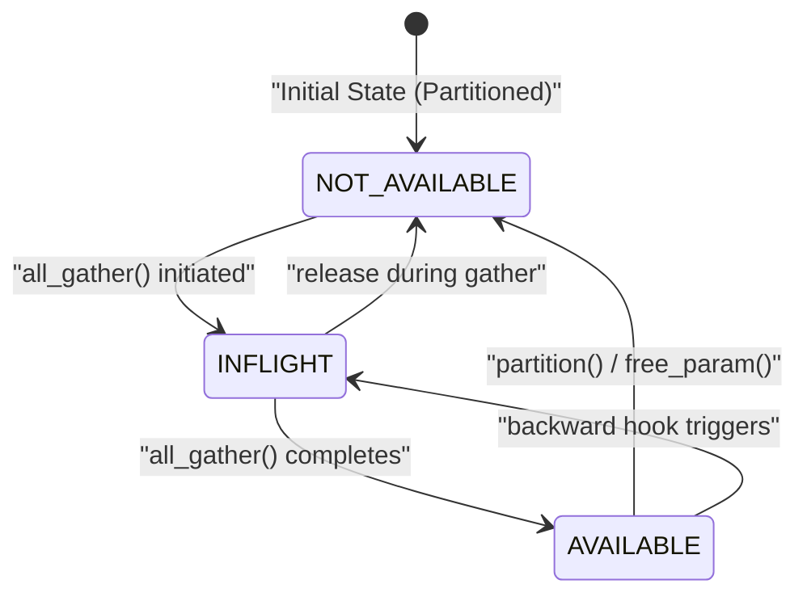
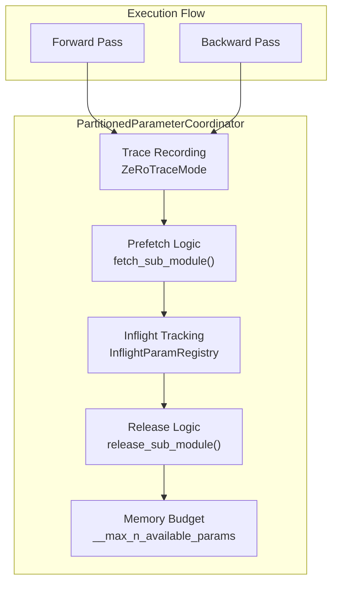
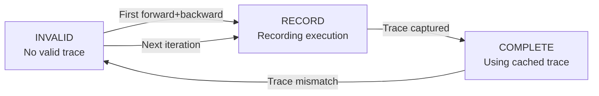
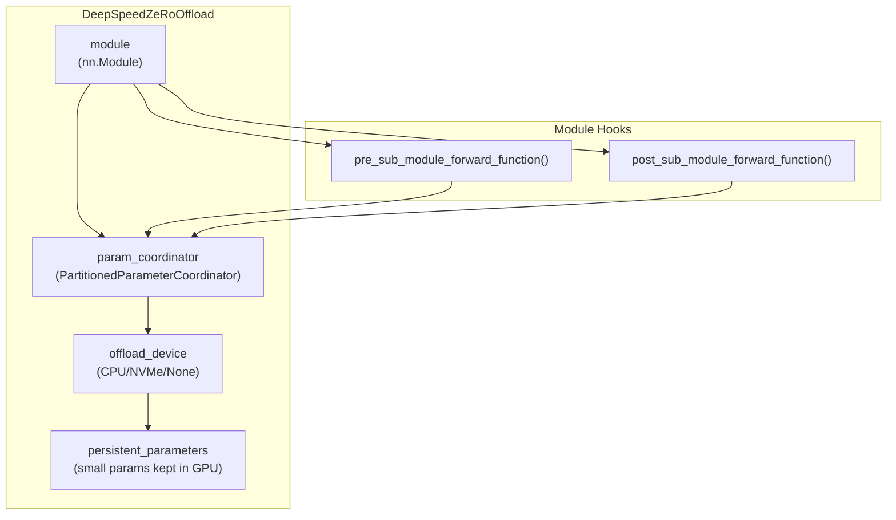
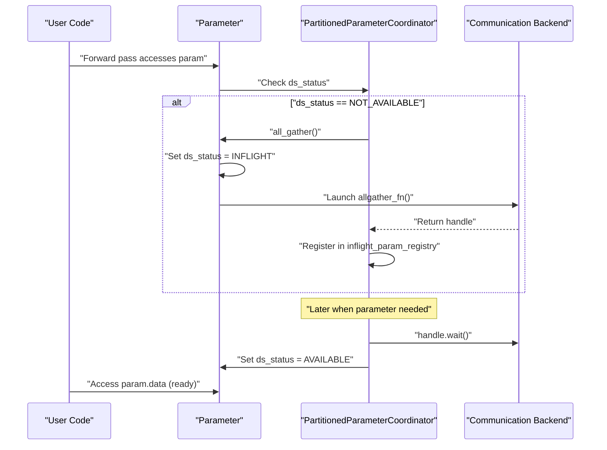
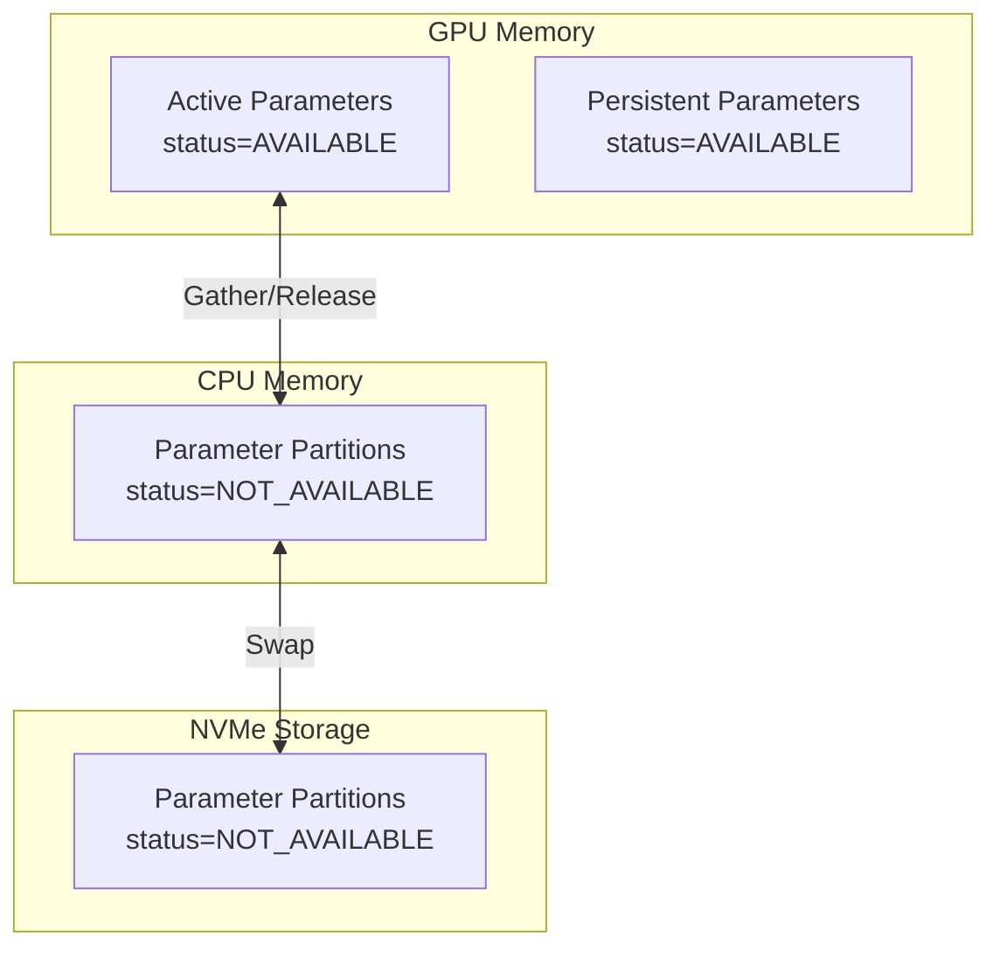

<!-- source: DeepWiki mcp.deepwiki.com · repo deepspeedai/DeepSpeed · extra page Parameter Lifecycle and Offloading · fetched 2026-10-21 -->

# Parameter Lifecycle and Offloading

<details>
<summary>Relevant source files</summary>

The following files were used as context for generating this wiki page:

- [csrc/aio/common/deepspeed_aio_common.cpp](csrc/aio/common/deepspeed_aio_common.cpp)
- [csrc/aio/py_lib/deepspeed_aio_thread.h](csrc/aio/py_lib/deepspeed_aio_thread.h)
- [csrc/aio/py_lib/deepspeed_py_aio.cpp](csrc/aio/py_lib/deepspeed_py_aio.cpp)
- [csrc/aio/py_lib/deepspeed_py_aio.h](csrc/aio/py_lib/deepspeed_py_aio.h)
- [csrc/aio/py_lib/deepspeed_py_aio_handle.cpp](csrc/aio/py_lib/deepspeed_py_aio_handle.cpp)
- [csrc/aio/py_lib/deepspeed_py_copy.cpp](csrc/aio/py_lib/deepspeed_py_copy.cpp)
- [csrc/aio/py_lib/deepspeed_py_copy.h](csrc/aio/py_lib/deepspeed_py_copy.h)
- [csrc/xpu/includes/simd.h](csrc/xpu/includes/simd.h)
- [csrc/xpu/includes/type_shim.h](csrc/xpu/includes/type_shim.h)
- [deepspeed/runtime/activation_checkpointing/checkpointing.py](deepspeed/runtime/activation_checkpointing/checkpointing.py)
- [deepspeed/runtime/base_optimizer.py](deepspeed/runtime/base_optimizer.py)
- [deepspeed/runtime/bf16_optimizer.py](deepspeed/runtime/bf16_optimizer.py)
- [deepspeed/runtime/config.py](deepspeed/runtime/config.py)
- [deepspeed/runtime/constants.py](deepspeed/runtime/constants.py)
- [deepspeed/runtime/engine.py](deepspeed/runtime/engine.py)
- [deepspeed/runtime/swap_tensor/__init__.py](deepspeed/runtime/swap_tensor/__init__.py)
- [deepspeed/runtime/swap_tensor/async_swapper.py](deepspeed/runtime/swap_tensor/async_swapper.py)
- [deepspeed/runtime/swap_tensor/optimizer_utils.py](deepspeed/runtime/swap_tensor/optimizer_utils.py)
- [deepspeed/runtime/swap_tensor/partitioned_optimizer_swapper.py](deepspeed/runtime/swap_tensor/partitioned_optimizer_swapper.py)
- [deepspeed/runtime/swap_tensor/partitioned_param_swapper.py](deepspeed/runtime/swap_tensor/partitioned_param_swapper.py)
- [deepspeed/runtime/swap_tensor/pipelined_optimizer_swapper.py](deepspeed/runtime/swap_tensor/pipelined_optimizer_swapper.py)
- [deepspeed/runtime/swap_tensor/utils.py](deepspeed/runtime/swap_tensor/utils.py)
- [deepspeed/runtime/utils.py](deepspeed/runtime/utils.py)
- [deepspeed/runtime/zero/config.py](deepspeed/runtime/zero/config.py)
- [deepspeed/runtime/zero/mics.py](deepspeed/runtime/zero/mics.py)
- [deepspeed/runtime/zero/parameter_offload.py](deepspeed/runtime/zero/parameter_offload.py)
- [deepspeed/runtime/zero/partition_parameters.py](deepspeed/runtime/zero/partition_parameters.py)
- [deepspeed/runtime/zero/partitioned_param_coordinator.py](deepspeed/runtime/zero/partitioned_param_coordinator.py)
- [deepspeed/runtime/zero/stage3.py](deepspeed/runtime/zero/stage3.py)
- [deepspeed/runtime/zero/stage_1_and_2.py](deepspeed/runtime/zero/stage_1_and_2.py)
- [deepspeed/runtime/zero/utils.py](deepspeed/runtime/zero/utils.py)
- [docs/_pages/config-json.md](docs/_pages/config-json.md)
- [docs/_posts/2020-09-09-sparse-attention.md](docs/_posts/2020-09-09-sparse-attention.md)
- [docs/_tutorials/megatron.md](docs/_tutorials/megatron.md)
- [docs/_tutorials/one-cycle.md](docs/_tutorials/one-cycle.md)
- [docs/_tutorials/pipeline.md](docs/_tutorials/pipeline.md)
- [docs/_tutorials/pytorch-profiler.md](docs/_tutorials/pytorch-profiler.md)
- [docs/_tutorials/sparse-attention.md](docs/_tutorials/sparse-attention.md)
- [docs/_tutorials/zero-offload.md](docs/_tutorials/zero-offload.md)
- [docs/_tutorials/zero.md](docs/_tutorials/zero.md)
- [op_builder/async_io.py](op_builder/async_io.py)
- [requirements/requirements-sparse_attn.txt](requirements/requirements-sparse_attn.txt)
- [tests/unit/runtime/zero/test_nvme_checkpointing.py](tests/unit/runtime/zero/test_nvme_checkpointing.py)

</details>


## Purpose and Scope

This document describes the parameter lifecycle management system in ZeRO Stage 3, focusing on how parameters transition between different states (`AVAILABLE`, `NOT_AVAILABLE`, `INFLIGHT`) and how they are offloaded to CPU or NVMe storage to reduce GPU memory usage. The `PartitionedParameterCoordinator` orchestrates parameter gathering and releasing based on computation needs and memory constraints.

For information about the overall ZeRO Stage 3 architecture and partitioning strategy, see [ZeRO Stage 3 and Parameter Partitioning](#3.2.2). For ZeRO Stages 1 and 2 which do not involve parameter partitioning, see [ZeRO Stages 1 and 2](#3.2.1).

## Parameter Status State Machine

### ZeroParamStatus Enum

Parameters in ZeRO Stage 3 can exist in three fundamental states, defined by the `ZeroParamStatus` enum:

| State | Value | Description |
|-------|-------|-------------|
| `AVAILABLE` | 1 | Parameters are fully gathered and ready for computation on the local GPU |
| `NOT_AVAILABLE` | 2 | Parameters are partitioned across ranks or stored in CPU/NVMe |
| `INFLIGHT` | 3 | Parameters are currently being gathered via asynchronous all-gather communication |

**Sources:** [deepspeed/runtime/zero/partition_parameters.py:228-237]()

### State Transitions



**State Transition Triggers:**

- **NOT_AVAILABLE → INFLIGHT**: Triggered by `param.all_gather()` which initiates asynchronous collective communication.
- **INFLIGHT → AVAILABLE**: All-gather operation completes; the parameter handle's `wait()` method is called [deepspeed/runtime/zero/partition_parameters.py:72-76]().
- **AVAILABLE → NOT_AVAILABLE**: Parameter is released via `free_param()` or `partition()` to free GPU memory [deepspeed/runtime/zero/partition_parameters.py:300-311]().

**Sources:** [deepspeed/runtime/zero/partition_parameters.py:228-237](), [deepspeed/runtime/zero/partition_parameters.py:300-311](), [deepspeed/runtime/zero/partition_parameters.py:72-76]()

## PartitionedParameterCoordinator

The `PartitionedParameterCoordinator` class manages the parameter lifecycle by determining when to fetch (gather) and release parameters based on the model's execution trace and memory constraints.

### Core Responsibilities



**Sources:** [deepspeed/runtime/zero/partitioned_param_coordinator.py:64-150]()

### Key Data Structures

| Attribute | Type | Purpose |
|-----------|------|---------|
| `__inflight_param_registry` | `InflightParamRegistry` | Maps parameters to their all-gather handles while in `INFLIGHT` state [deepspeed/runtime/zero/partitioned_param_coordinator.py:53-61]() |
| `__step_id` | `int` | Tracks position in forward/backward trace [deepspeed/runtime/zero/partitioned_param_coordinator.py:97-97]() |
| `__trace_mode` | `ZeRoTraceMode` | `RECORD`, `COMPLETE`, or `INVALID` trace status [deepspeed/runtime/zero/partitioned_param_coordinator.py:44-51]() |
| `__param_order` | `Iterable[__ParamInTrace]` | Recorded sequence of parameter accesses [deepspeed/runtime/zero/partitioned_param_coordinator.py:102-102]() |
| `__n_available_params` | `int` | Current number of parameter elements in GPU memory [deepspeed/runtime/zero/partitioned_param_coordinator.py:106-106]() |
| `__max_n_available_params` | `int` | Maximum allowed parameters in memory (budget) [deepspeed/runtime/zero/partitioned_param_coordinator.py:107-107]() |
| `__param_queue` | `Deque[__ParamInTrace]` | Queue of parameters to prefetch [deepspeed/runtime/zero/partitioned_param_coordinator.py:112-112]() |

**Sources:** [deepspeed/runtime/zero/partitioned_param_coordinator.py:44-112]()

### Trace Modes

The coordinator operates in three trace modes defined by `ZeRoTraceMode`:



- **RECORD**: First execution records which modules/parameters are accessed and in what order [deepspeed/runtime/zero/partitioned_param_coordinator.py:46-46]().
- **COMPLETE**: Subsequent executions use the recorded trace to prefetch parameters efficiently [deepspeed/runtime/zero/partitioned_param_coordinator.py:48-48]().
- **INVALID**: Trace is invalidated if execution pattern changes (e.g., control flow divergence) [deepspeed/runtime/zero/partitioned_param_coordinator.py:50-50]().

**Sources:** [deepspeed/runtime/zero/partitioned_param_coordinator.py:44-51]()

### Prefetching Strategy

The coordinator implements sophisticated prefetching to overlap communication with computation:

| Configuration Parameter | Default | Description |
|------------------------|---------|-------------|
| `prefetch_bucket_size` | 50M elements | Maximum parameters to fetch in one batch [deepspeed/runtime/zero/config.py:214-214]() |
| `max_reuse_distance` | 1B elements | Don't release if reuse within this threshold [deepspeed/runtime/zero/config.py:220-220]() |
| `max_live_parameters` | 1B elements | Maximum total parameters to keep in memory [deepspeed/runtime/zero/config.py:226-226]() |

**Prefetch Decision Logic:**
The coordinator examines upcoming parameter accesses in the recorded trace. If the reuse distance is within thresholds and the memory budget allows, it initiates asynchronous all-gather operations via the `__allgather_stream` [deepspeed/runtime/zero/partitioned_param_coordinator.py:120-133]().

**Sources:** [deepspeed/runtime/zero/partitioned_param_coordinator.py:120-133](), [deepspeed/runtime/zero/config.py:214-226]()

## Parameter Offloading Architecture

### DeepSpeedZeRoOffload Class

The `DeepSpeedZeRoOffload` class integrates parameter partitioning with offloading to CPU or NVMe storage.



**Sources:** [deepspeed/runtime/zero/parameter_offload.py:112-187]()

### Persistent Parameters

Small parameters below a threshold are kept persistent (always `AVAILABLE`) to avoid communication overhead. This is calculated in `mark_persistent_parameters` [deepspeed/runtime/zero/parameter_offload.py:165-166]().

```python
# From deepspeed/runtime/zero/parameter_offload.py
def mark_persistent_parameters(self, param_threshold, model_threshold):
    persistent_params = []
    total_persistent_parameters = 0
    for param in self.module.parameters():
        if param.ds_numel <= param_threshold and total_persistent_parameters + param.ds_numel <= model_threshold:
            param.ds_persist = True
            persistent_params.append(param)
            total_persistent_parameters += param.ds_numel
    return persistent_params
```

**Sources:** [deepspeed/runtime/zero/parameter_offload.py:163-166]()

## Parameter Lifecycle Operations

### All-Gather Operation

The all-gather operation transitions parameters from `NOT_AVAILABLE` to `AVAILABLE` state.



**Sources:** [deepspeed/runtime/zero/partition_parameters.py:108-110](), [deepspeed/runtime/zero/partition_parameters.py:75-76]()

### All-Gather Implementation Details

DeepSpeed uses `dist.allgather_fn` for gathering partitioned parameters [deepspeed/runtime/zero/partition_parameters.py:109-109](). If quantization is enabled via `zero_quantized_weights`, parameters are dequantized during the gather process [deepspeed/runtime/zero/partition_parameters.py:64-69]().

**Sources:** [deepspeed/runtime/zero/partition_parameters.py:64-109]()

### Parameter Release Operation

Parameters are released when no longer needed to free GPU memory. This is managed by `release_sub_module` in the coordinator. If offloading is configured, the parameter partition is moved to the `offload_device` (CPU or NVMe) [deepspeed/runtime/zero/parameter_offload.py:152-154]().

**Sources:** [deepspeed/runtime/zero/parameter_offload.py:152-154]()

## Integration with Training Loop

### Module-Level Hooks

`DeepSpeedZeRoOffload` wraps `nn.Module._parameters` with `ZeROOrderedDict` to detect external parameter access and triggers gathering [deepspeed/runtime/zero/parameter_offload.py:40-71]().

| Hook Type | Registration Method | Purpose |
|-----------|-------------------|---------|
| Forward pre-hook | `_register_deepspeed_module` | Fetch parameters before forward [deepspeed/runtime/zero/parameter_offload.py:110-110]() |
| Getter hook | `ZeROOrderedDict.__getitem__` | Detect and gather external parameters [deepspeed/runtime/zero/parameter_offload.py:57-71]() |

**Sources:** [deepspeed/runtime/zero/parameter_offload.py:40-110]()

### InflightParamRegistry

The `InflightParamRegistry` tracks parameters currently being gathered to prevent redundant communication [deepspeed/runtime/zero/partitioned_param_coordinator.py:53-61]().

```python
# From deepspeed/runtime/zero/partitioned_param_coordinator.py
class InflightParamRegistry(UserDict):
    def __setitem__(self, param: Parameter, handle: AllGatherCoalescedHandle) -> None:
        if param in self.data:
            raise RuntimeError(f"{param.ds_summary()} already in registry")
        if param.ds_status != ZeroParamStatus.INFLIGHT:
            raise RuntimeError(f"attempted to add non-inflight parameter")
        self.data[param] = handle
```

**Sources:** [deepspeed/runtime/zero/partitioned_param_coordinator.py:53-61]()

## Memory Management Strategy

### Three-Level Memory Hierarchy

ZeRO Stage 3 with offloading creates a three-level memory hierarchy:



**Sources:** [deepspeed/runtime/zero/parameter_offload.py:152-154](), [deepspeed/runtime/zero/stage3.py:27-35]()

### Memory Budget Enforcement

The coordinator enforces memory budgets through `__max_n_available_params`. If gathering a new parameter would exceed this budget, the coordinator identifies and releases parameters that are not needed in the immediate future based on the recorded trace [deepspeed/runtime/zero/partitioned_param_coordinator.py:107-109]().

**Sources:** [deepspeed/runtime/zero/partitioned_param_coordinator.py:105-110]()

---

