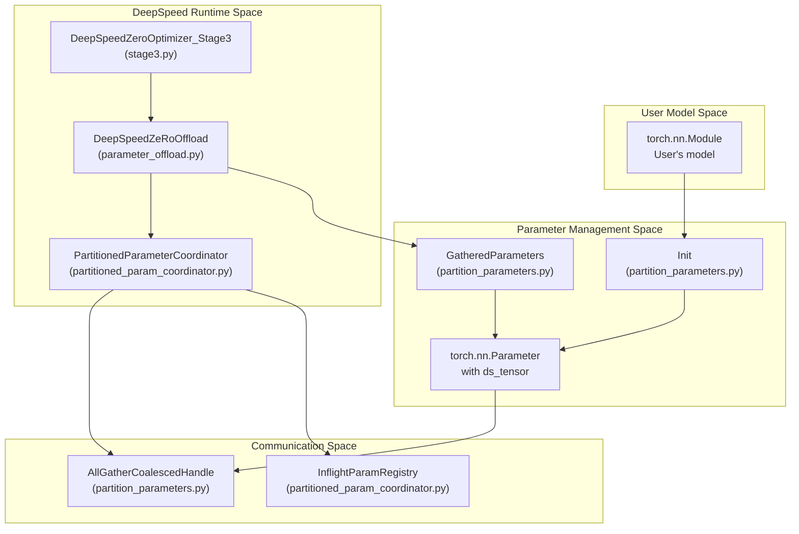
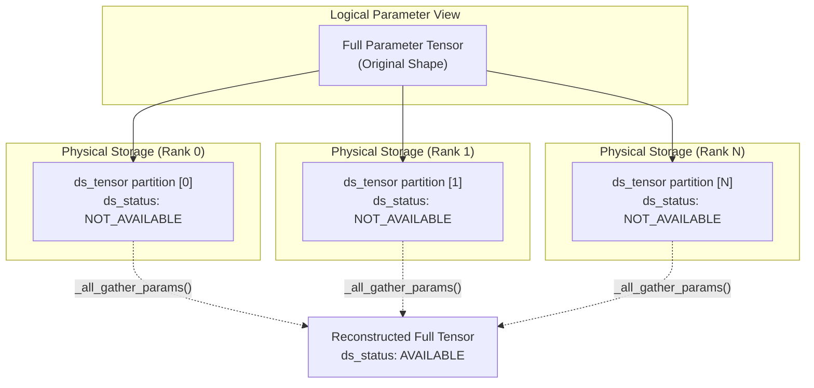
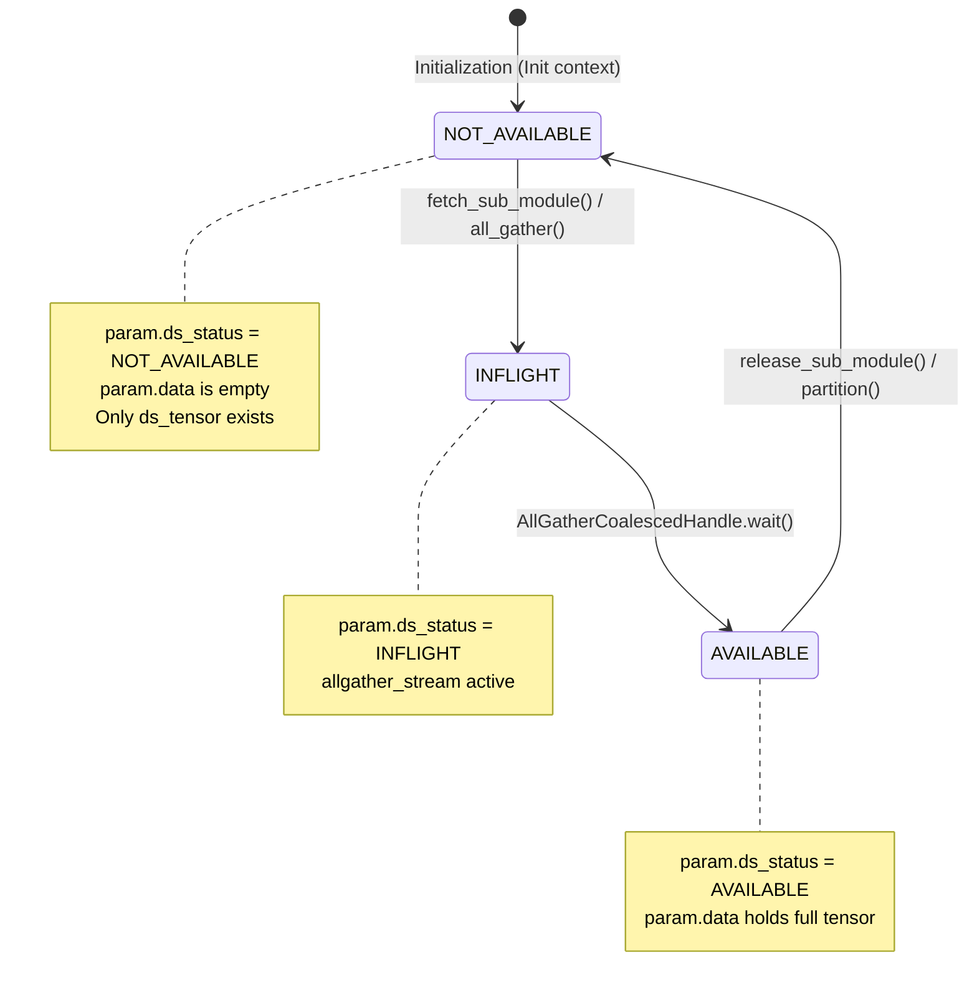

<!-- source: DeepWiki mcp.deepwiki.com · repo deepspeedai/DeepSpeed · extra page ZeRO Stage 3 and Parameter Partitioning · fetched 2026-10-21 -->

# ZeRO Stage 3 and Parameter Partitioning

<details>
<summary>Relevant source files</summary>

The following files were used as context for generating this wiki page:

- [deepspeed/runtime/activation_checkpointing/checkpointing.py](deepspeed/runtime/activation_checkpointing/checkpointing.py)
- [deepspeed/runtime/base_optimizer.py](deepspeed/runtime/base_optimizer.py)
- [deepspeed/runtime/bf16_optimizer.py](deepspeed/runtime/bf16_optimizer.py)
- [deepspeed/runtime/config.py](deepspeed/runtime/config.py)
- [deepspeed/runtime/constants.py](deepspeed/runtime/constants.py)
- [deepspeed/runtime/engine.py](deepspeed/runtime/engine.py)
- [deepspeed/runtime/utils.py](deepspeed/runtime/utils.py)
- [deepspeed/runtime/zero/config.py](deepspeed/runtime/zero/config.py)
- [deepspeed/runtime/zero/leaf_module_config.py](deepspeed/runtime/zero/leaf_module_config.py)
- [deepspeed/runtime/zero/mics.py](deepspeed/runtime/zero/mics.py)
- [deepspeed/runtime/zero/parameter_offload.py](deepspeed/runtime/zero/parameter_offload.py)
- [deepspeed/runtime/zero/partition_parameters.py](deepspeed/runtime/zero/partition_parameters.py)
- [deepspeed/runtime/zero/partitioned_param_coordinator.py](deepspeed/runtime/zero/partitioned_param_coordinator.py)
- [deepspeed/runtime/zero/stage3.py](deepspeed/runtime/zero/stage3.py)
- [deepspeed/runtime/zero/stage_1_and_2.py](deepspeed/runtime/zero/stage_1_and_2.py)
- [deepspeed/runtime/zero/utils.py](deepspeed/runtime/zero/utils.py)
- [deepspeed/utils/__init__.py](deepspeed/utils/__init__.py)
- [deepspeed/utils/mixed_precision_linkage.py](deepspeed/utils/mixed_precision_linkage.py)
- [deepspeed/utils/tensor_fragment.py](deepspeed/utils/tensor_fragment.py)
- [deepspeed/utils/z3_leaf_module.py](deepspeed/utils/z3_leaf_module.py)
- [docs/_pages/config-json.md](docs/_pages/config-json.md)
- [docs/code-docs/source/zero3.rst](docs/code-docs/source/zero3.rst)
- [tests/small_model_debugging/partial_offload_test.py](tests/small_model_debugging/partial_offload_test.py)
- [tests/unit/runtime/zero/test_zero_context.py](tests/unit/runtime/zero/test_zero_context.py)
- [tests/unit/runtime/zero/test_zero_leaf_module.py](tests/unit/runtime/zero/test_zero_leaf_module.py)
- [tests/unit/runtime/zero/test_zero_offloadpp.py](tests/unit/runtime/zero/test_zero_offloadpp.py)
- [tests/unit/runtime/zero/test_zero_tensor_fragment.py](tests/unit/runtime/zero/test_zero_tensor_fragment.py)

</details>


## Purpose and Scope

This document describes ZeRO Stage 3, the most aggressive memory optimization stage in DeepSpeed's ZeRO (Zero Redundancy Optimizer) system. ZeRO Stage 3 partitions model parameters across all data parallel ranks, enabling training of models that would not fit in a single GPU's memory.

For information about ZeRO Stages 1 and 2 (optimizer state and gradient partitioning), see [3.2.1](). For the overall ZeRO memory optimization system, see [3.2](). For parameter lifecycle management including offloading, see [3.2.3]().

## Overview of ZeRO Stage 3

ZeRO Stage 3 extends the memory optimization of earlier stages by partitioning model parameters in addition to gradients and optimizer states. Each data parallel rank stores only a fraction (1/N where N is the data parallel world size) of each parameter tensor. During forward and backward passes, parameters are dynamically gathered via all-gather operations when needed, then released back to their partitioned state.

This approach provides the following benefits:
- **Memory reduction**: Model memory footprint is reduced by a factor equal to the data parallel world size.
- **Scalability**: Enables training of models with trillions of parameters across many GPUs.
- **Flexibility**: Supports CPU/NVMe offloading for even larger models.

**Sources:** [deepspeed/runtime/zero/stage3.py:136-146](), [deepspeed/runtime/zero/config.py:81-88]()

## Parameter Partitioning Architecture

### High-Level Component Structure



**Sources:** [deepspeed/runtime/zero/stage3.py:136](), [deepspeed/runtime/zero/parameter_offload.py:112](), [deepspeed/runtime/zero/partitioned_param_coordinator.py:64](), [deepspeed/runtime/zero/partition_parameters.py:579-688]()

### Parameter Partitioning Across Ranks



Each parameter is divided into equal-sized partitions (with padding for alignment). Each rank stores only its partition in `param.ds_tensor`. The `param.data` tensor is either empty (when partitioned) or contains the fully gathered parameter (when available).

**Sources:** [deepspeed/runtime/zero/stage3.py:1552-1560](), [deepspeed/runtime/zero/partition_parameters.py:852-896]()

## Parameter States and Lifecycle

### Parameter Status State Machine

The `ZeroParamStatus` enum defines three states for parameters:
- **`NOT_AVAILABLE`**: Parameter is partitioned or remote, not usable for computation.
- **`INFLIGHT`**: Parameter is being gathered via asynchronous all-gather.
- **`AVAILABLE`**: Parameter is fully present and ready for use.



**Sources:** [deepspeed/runtime/zero/partition_parameters.py:32](), [deepspeed/runtime/zero/stage3.py:33](), [deepspeed/runtime/zero/partitioned_param_coordinator.py:53-61]()

### Parameter Lifecycle During Training

During forward and backward passes, hooks registered by `DeepSpeedZeRoOffload` manage parameter gathering and release:
1. **Pre-forward hook**: Gathers parameters for the module via `fetch_sub_module`.
2. **Forward execution**: Uses gathered parameters.
3. **Post-forward hook**: Releases parameters via `release_sub_module` based on reuse heuristics.
4. **Pre-backward hook**: Re-gathers parameters for backward pass.
5. **Post-backward hook**: Releases parameters and reduces gradients.

**Sources:** [deepspeed/runtime/zero/parameter_offload.py:246-394](), [deepspeed/runtime/zero/partitioned_param_coordinator.py:300-369]()

## Core Components

### DeepSpeedZeroOptimizer_Stage3

The main optimizer class that implements ZeRO Stage 3 parameter partitioning and gradient reduction.

**Key responsibilities:**
- Partitions parameters during initialization via `_create_fp16_partitions_with_defragmentation()`. [deepspeed/runtime/zero/stage3.py:595-636]()
- Maintains flat partitioned parameter buffers in `fp16_partitioned_groups_flat`. [deepspeed/runtime/zero/stage3.py:1008-1015]()
- Tracks parameter status and coordinates gradient reduction. [deepspeed/runtime/zero/stage3.py:1769-1800]()
- Implements optimizer step with partitioned parameter updates. [deepspeed/runtime/zero/stage3.py:1260-1300]()

**Sources:** [deepspeed/runtime/zero/stage3.py:136-498]()

### DeepSpeedZeRoOffload

Manages the parameter lifecycle by registering hooks on modules to gather and release parameters during forward and backward passes.

**Key responsibilities:**
- Converts model parameters to ZeRO parameters during initialization. [deepspeed/runtime/zero/parameter_offload.py:156]()
- Registers forward and backward hooks on all modules. [deepspeed/runtime/zero/parameter_offload.py:246-394]()
- Manages parameter persistence for frequently used parameters. [deepspeed/runtime/zero/parameter_offload.py:165-166]()

**Sources:** [deepspeed/runtime/zero/parameter_offload.py:112-188]()

### PartitionedParameterCoordinator

Orchestrates parameter prefetching, gathering, and release with sophisticated heuristics to minimize communication overhead.

**Key responsibilities:**
- Maintains trace of module execution order (`__submodule_order`) to enable prefetching. [deepspeed/runtime/zero/partitioned_param_coordinator.py:101]()
- Coalesces small all-gather operations into larger batches using `prefetch_bucket_sz`. [deepspeed/runtime/zero/partitioned_param_coordinator.py:113]()
- Manages memory budget via `max_available_parameters_in_numel`. [deepspeed/runtime/zero/partitioned_param_coordinator.py:107]()

**Sources:** [deepspeed/runtime/zero/partitioned_param_coordinator.py:64-177]()

## Initialization and Context Managers

### Init Context Manager

The `Init` context manager partitions parameters during model construction, enabling initialization of models larger than single-GPU memory.

```python
with deepspeed.zero.Init(config_dict_or_path=ds_config):
    model = MyLargeModel()
```

**Initialization flow:**
1. Wraps `torch.nn.Module.__init__()` to intercept parameter creation. [deepspeed/runtime/zero/partition_parameters.py:642-650]()
2. Partitions each parameter immediately after creation. [deepspeed/runtime/zero/partition_parameters.py:852-896]()
3. Stores only the local partition in `param.ds_tensor`. [deepspeed/runtime/zero/partition_parameters.py:868]()
4. Assigns metadata: `ds_id`, `ds_shape`, `ds_numel`, `ds_status`. [deepspeed/runtime/zero/partition_parameters.py:855-865]()

**Sources:** [deepspeed/runtime/zero/partition_parameters.py:579-688]()

### GatheredParameters Context Manager

The `GatheredParameters` context manager temporarily gathers partitioned parameters for operations that require full tensors (e.g., checkpoint saving).

```python
with deepspeed.zero.GatheredParameters(model.parameters(), modifier_rank=0):
    # Full parameters available on all ranks
    if dist.get_rank() == 0:
        torch.save(model.state_dict(), "checkpoint.pt")
```

**Sources:** [deepspeed/runtime/zero/partition_parameters.py:1425-1564]()

## Parameter Gathering and Communication

### All-Gather Mechanism

The all-gather process coalesces multiple small parameters into a single communication operation:

1. **Bucket assembly**: Parameters are grouped until reaching `prefetch_bucket_sz`. [deepspeed/runtime/zero/partitioned_param_coordinator.py:529]()
2. **Flatten partitions**: Local partition tensors are flattened into a contiguous buffer. [deepspeed/runtime/zero/partitioned_param_coordinator.py:545]()
3. **All-gather collective**: Uses `dist.allgather_fn` or `all_gather_into_tensor`. [deepspeed/runtime/zero/partition_parameters.py:108-109]()
4. **Unflatten result**: Output buffer is split back into individual parameters. [deepspeed/runtime/zero/partitioned_param_coordinator.py:570]()

**Sources:** [deepspeed/runtime/zero/partitioned_param_coordinator.py:529-597](), [deepspeed/runtime/zero/partition_parameters.py:1212-1269]()

## Gradient Reduction in Stage 3

Gradients in Stage 3 are only materialized for the partition owned by each rank:

1. **Full gradient computation**: Backward pass computes full gradient.
2. **Hook invocation**: `_reduction_and_ipg_hook()` captures gradient. [deepspeed/runtime/zero/stage3.py:2104]()
3. **Bucket accumulation**: Gradients accumulate in `IPGBucketZ3`. [deepspeed/runtime/zero/stage3.py:115]()
4. **Reduce-scatter**: When the bucket is full, performs `reduce_scatter_coalesced`. [deepspeed/runtime/zero/stage3.py:1800]()

**Sources:** [deepspeed/runtime/zero/stage3.py:1769-1927](), [deepspeed/runtime/zero/stage3.py:2104-2234]()

## Configuration

### Essential ZeRO Stage 3 Configuration

| Parameter | Description | Default |
|-----------|-------------|---------|
| `stage` | ZeRO Stage (set to 3 for parameter partitioning) | 0 |
| `stage3_max_live_parameters` | Maximum parameters in GPU memory simultaneously | 1e9 |
| `stage3_max_reuse_distance` | Maximum distance before releasing parameter | 1e9 |
| `stage3_prefetch_bucket_size` | Bucket size for prefetching all-gathers | 5e7 |
| `reduce_bucket_size` | Bucket size for gradient reduce-scatter | 5e8 |
| `overlap_comm` | Overlap communication with computation | true |

**Sources:** [deepspeed/runtime/zero/config.py:90-293](), [docs/_pages/config-json.md:284-398]()

### Parameter Offloading Configuration

ZeRO Stage 3 supports offloading parameters to CPU or NVMe via `offload_param`. [deepspeed/runtime/zero/config.py:157-162]()

```json
"offload_param": {
  "device": "cpu",
  "pin_memory": true
}
```

**Sources:** [deepspeed/runtime/zero/parameter_offload.py:152-154](), [deepspeed/runtime/zero/stage3.py:685-702]()

## Relationship with Other ZeRO Stages

ZeRO Stage 3 builds upon earlier stages:
- **Stage 1**: Only optimizer states partitioned. [deepspeed/runtime/zero/config.py:84]()
- **Stage 2**: Optimizer states and gradients partitioned. [deepspeed/runtime/zero/config.py:85]()
- **Stage 3**: Optimizer states, gradients, AND parameters partitioned. [deepspeed/runtime/zero/config.py:86]()

**Sources:** [deepspeed/runtime/zero/config.py:81-88](), [deepspeed/runtime/engine.py:367-371]()

---

