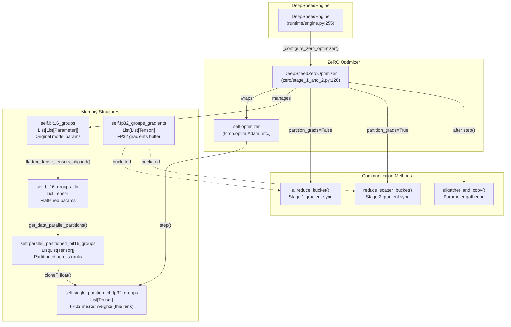
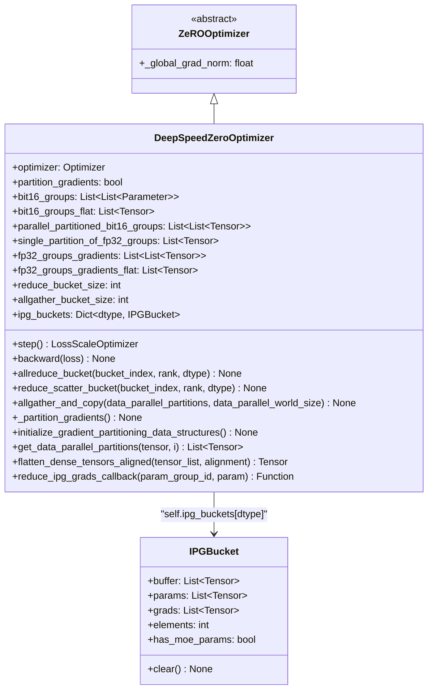
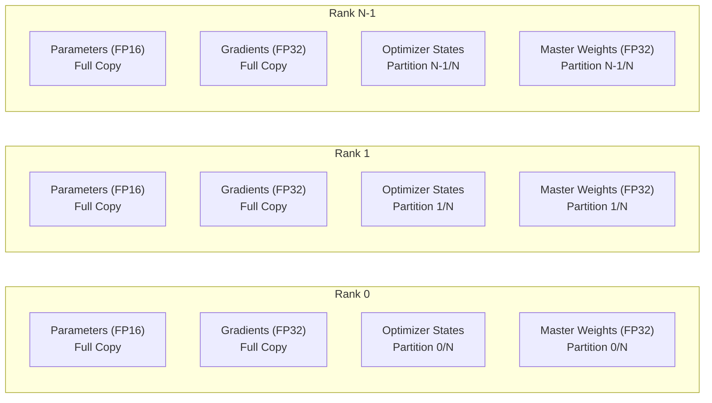
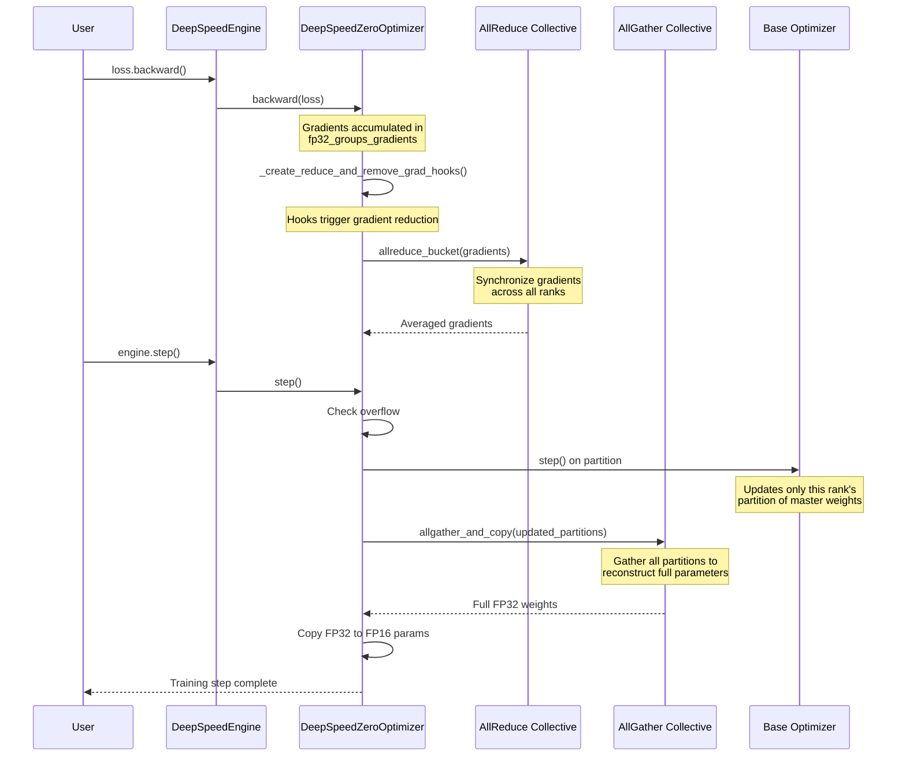
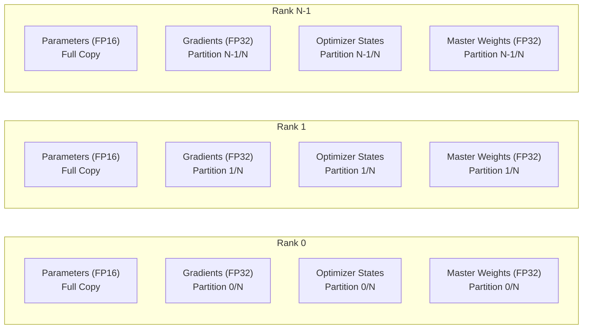
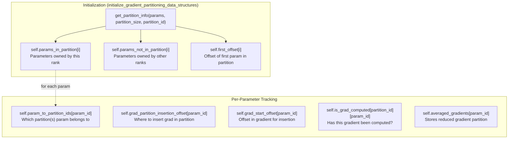
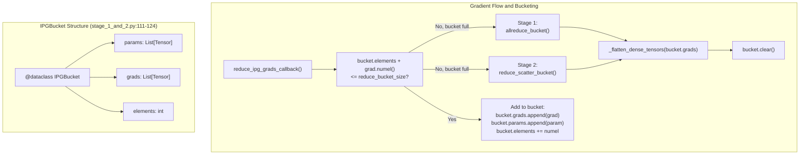

<!-- source: DeepWiki mcp.deepwiki.com · repo deepspeedai/DeepSpeed · extra page ZeRO Stages 1 and 2 · fetched 2026-10-21 -->

# ZeRO Stages 1 and 2

Relevant source files

The following files were used as context for generating this wiki page:

- [deepspeed/runtime/activation_checkpointing/checkpointing.py](deepspeed/runtime/activation_checkpointing/checkpointing.py)
- [deepspeed/runtime/base_optimizer.py](deepspeed/runtime/base_optimizer.py)
- [deepspeed/runtime/bf16_optimizer.py](deepspeed/runtime/bf16_optimizer.py)
- [deepspeed/runtime/config.py](deepspeed/runtime/config.py)
- [deepspeed/runtime/constants.py](deepspeed/runtime/constants.py)
- [deepspeed/runtime/engine.py](deepspeed/runtime/engine.py)
- [deepspeed/runtime/utils.py](deepspeed/runtime/utils.py)
- [deepspeed/runtime/zero/config.py](deepspeed/runtime/zero/config.py)
- [deepspeed/runtime/zero/mics.py](deepspeed/runtime/zero/mics.py)
- [deepspeed/runtime/zero/parameter_offload.py](deepspeed/runtime/zero/parameter_offload.py)
- [deepspeed/runtime/zero/partition_parameters.py](deepspeed/runtime/zero/partition_parameters.py)
- [deepspeed/runtime/zero/partitioned_param_coordinator.py](deepspeed/runtime/zero/partitioned_param_coordinator.py)
- [deepspeed/runtime/zero/stage3.py](deepspeed/runtime/zero/stage3.py)
- [deepspeed/runtime/zero/stage_1_and_2.py](deepspeed/runtime/zero/stage_1_and_2.py)
- [deepspeed/runtime/zero/utils.py](deepspeed/runtime/zero/utils.py)
- [docs/_pages/config-json.md](docs/_pages/config-json.md)
- [docs/_posts/2020-09-09-sparse-attention.md](docs/_posts/2020-09-09-sparse-attention.md)
- [docs/_tutorials/megatron.md](docs/_tutorials/megatron.md)
- [docs/_tutorials/one-cycle.md](docs/_tutorials/one-cycle.md)
- [docs/_tutorials/pipeline.md](docs/_tutorials/pipeline.md)
- [docs/_tutorials/pytorch-profiler.md](docs/_tutorials/pytorch-profiler.md)
- [docs/_tutorials/sparse-attention.md](docs/_tutorials/sparse-attention.md)
- [docs/_tutorials/zero-offload.md](docs/_tutorials/zero-offload.md)
- [docs/_tutorials/zero.md](docs/_tutorials/zero.md)
- [requirements/requirements-sparse_attn.txt](requirements/requirements-sparse_attn.txt)

## Purpose and Scope

This page documents the implementation of ZeRO (Zero Redundancy Optimizer) Stages 1 and 2 in DeepSpeed. These stages reduce memory consumption during training by partitioning optimizer states and gradients across data parallel processes.

**Scope:**
- **ZeRO Stage 1**: Optimizer state partitioning only.
- **ZeRO Stage 2**: Optimizer state and gradient partitioning.

**Related Pages:**
- For ZeRO Stage 3 (parameter partitioning), see [ZeRO Stage 3](3.2.2).
- For parameter offloading and lifecycle management, see [Parameter Lifecycle and Offloading](3.2.3).
- For ZeRO configuration options, see [Configuration System](2.3).

## Overview

ZeRO Stages 1 and 2 are implemented in the `DeepSpeedZeroOptimizer` class, which wraps a base optimizer and manages memory-efficient distributed training through state and gradient partitioning.

### ZeRO Stage Definitions

| Stage | What is Partitioned | Memory Savings | Class Flag |
|-------|-------------------|----------------|------------|
| Stage 0 | Nothing (disabled) | None | N/A |
| Stage 1 | Optimizer states | 4x with Adam | `partition_grads=False` |
| Stage 2 | Optimizer states + Gradients | 8x with Adam | `partition_grads=True` |

**Key Insight:** Each data parallel rank only stores and updates a partition of the optimizer states and (optionally) gradients, rather than maintaining full copies. Parameters remain replicated across all ranks.

Sources: [deepspeed/runtime/zero/stage_1_and_2.py:126-173](), [deepspeed/runtime/zero/config.py:81-87]()

## Architecture and Key Components

### Component Diagram

Sources: [deepspeed/runtime/zero/stage_1_and_2.py:126-586](), [deepspeed/runtime/engine.py:363-368]()

### Core Class Structure

Sources: [deepspeed/runtime/zero/stage_1_and_2.py:126-173](), [deepspeed/runtime/zero/stage_1_and_2.py:111-124](), [deepspeed/runtime/base_optimizer.py:18-30]()

## Stage 1: Optimizer State Partitioning

### Memory Layout

In ZeRO Stage 1, model parameters and gradients are replicated across all data parallel ranks, but optimizer states are partitioned.

**Key Characteristics:**
- **Replicated**: Model parameters (`bit16_groups`), gradients (`fp32_groups_gradients`).
- **Partitioned**: Optimizer states, FP32 master weights (`single_partition_of_fp32_groups`).
- **Communication**: `allreduce` for gradients, `allgather` for updated parameters.

Sources: [deepspeed/runtime/zero/stage_1_and_2.py:354-483]()

### Training Step Flow (Stage 1)

Sources: [deepspeed/runtime/zero/stage_1_and_2.py:773-900](), [deepspeed/runtime/zero/stage_1_and_2.py:1078-1228]()

### Implementation Details

The optimizer partitions parameters during initialization:

1. **Parameter Flattening**: Parameters are flattened into a single contiguous buffer per parameter group [deepspeed/runtime/zero/stage_1_and_2.py:404-417]().
2. **Partitioning**: The flat buffer is divided into equal-sized partitions (one per rank) [deepspeed/runtime/zero/stage_1_and_2.py:427-428]().
3. **FP32 Partition Creation**: Each rank creates an FP32 copy of its partition for optimizer updates [deepspeed/runtime/zero/stage_1_and_2.py:449-450]().

Sources: [deepspeed/runtime/zero/stage_1_and_2.py:354-483]()

## Stage 2: Optimizer State + Gradient Partitioning

### Memory Layout

In ZeRO Stage 2, both optimizer states and gradients are partitioned.

**Key Difference from Stage 1:**
- Gradients are now partitioned rather than replicated.
- Uses `reduce_scatter` instead of `allreduce` for gradient synchronization.
- Each rank only needs to store gradients for its assigned partition.

Sources: [deepspeed/runtime/zero/stage_1_and_2.py:212-214]()

### Gradient Partitioning Logic

ZeRO Stage 2 introduces gradient partitioning logic to determine which gradients belong to which rank. This is implemented through several data structures initialized in `initialize_gradient_partitioning_data_structures()` [deepspeed/runtime/zero/stage_1_and_2.py:912-1076]().

**Partition Mapping Data Structures:**

**Key Mapping Structures:**

| Structure | Type | Purpose |
|-----------|------|---------|
| `params_in_partition[i]` | List[Parameter] | Parameters whose gradients this rank updates. |
| `param_to_partition_ids` | List[int] | Partition IDs containing this parameter. |
| `grad_partition_insertion_offset` | Dict[partition_id, int] | Where to insert gradient in partition buffer. |
| `averaged_gradients` | Tensor | Stores partition of averaged gradient. |

Sources: [deepspeed/runtime/zero/stage_1_and_2.py:912-1076](), [deepspeed/runtime/zero/stage_1_and_2.py:1230-1580]()

## Communication Patterns

### Bucketing Strategy

Both stages use bucketing to batch small communication operations into larger, more efficient ones through the `IPGBucket` (Independent Parameter Gradients Bucket) mechanism.

**Implementation Flow:**
1. Backward pass computes gradient → triggers `reduce_ipg_grads_callback(i, param)` [deepspeed/runtime/zero/stage_1_and_2.py:681-770]().
2. Gradient added to appropriate dtype bucket: `self.ipg_buckets[grad.dtype]`.
3. When bucket reaches `reduce_bucket_size`, flush via `allreduce_bucket()` or `reduce_scatter_bucket()`.
4. Gradients are flattened using `_flatten_dense_tensors()` before communication.
5. Bucket is cleared with `bucket.clear()` after successful communication.

Sources: [deepspeed/runtime/zero/stage_1_and_2.py:111-124](), [deepspeed/runtime/zero/stage_1_and_2.py:681-770]()

### Communication Collectives

#### Stage 1: AllReduce Pattern
**Method: `allreduce_bucket(bucket_index, rank, dtype)`** [deepspeed/runtime/zero/stage_1_and_2.py:1394-1470]()
- Each rank has full gradients in its local bucket.
- Result scaled by `1/world_size` to compute average.
- For MoE models, uses appropriate expert data parallel group.

#### Stage 2: ReduceScatter Pattern
**Method: `reduce_scatter_bucket(bucket_index, rank, dtype)`** [deepspeed/runtime/zero/stage_1_and_2.py:1582-1732]()
- Maps gradients to correct partition owners using `self.grad_partition_insertion_offset`.
- Calls `reduce_scatter_coalesced()` to average and partition gradients.
- Each rank receives and stores only its partition in `self.averaged_gradients[param_id]`.

Sources: [deepspeed/runtime/zero/stage_1_and_2.py:1394-1470](), [deepspeed/runtime/zero/stage_1_and_2.py:1582-1732]()

## Lifecycle and Training Loop

### Gradient Reduction Hooks

Gradient reduction is triggered automatically via hooks registered on parameters during optimizer initialization [deepspeed/runtime/zero/stage_1_and_2.py:587-680]().

**Hook Registration Flow:**
1. **Hook Creation**: `reduce_ipg_grads_callback(i, param)` returns a closure that extracts the gradient and adds it to the appropriate `IPGBucket`.
2. **Registration**: Uses `register_grad_hook(param, hook)` [deepspeed/utils/torch.py:20-21]() to attach the reduction logic to the PyTorch autograd engine.
3. **Async Execution**: If `overlap_comm=True`, the reduction is issued asynchronously on `self.reduction_stream` [deepspeed/runtime/zero/stage_1_and_2.py:488]().

Sources: [deepspeed/runtime/zero/stage_1_and_2.py:587-680](), [deepspeed/runtime/zero/stage_1_and_2.py:681-770]()

### CPU Offloading

ZeRO Stages 1 and 2 support offloading optimizer states to CPU memory to free up GPU memory.

- **Configuration**: Set `offload_optimizer` with `device: "cpu"` in the config [deepspeed/runtime/zero/config.py:164-170]().
- **Optimizer Selection**: Typically uses `DeepSpeedCPUAdam` for efficient CPU-side updates [deepspeed/runtime/zero/stage_1_and_2.py:28]().
- **Data Flow**: Gradients are accumulated on CPU, optimizer updates CPU-side master weights, and updated partitions are gathered back to GPU.

Sources: [deepspeed/runtime/zero/stage_1_and_2.py:176-181](), [deepspeed/runtime/zero/config.py:164-170]()

## Configuration Parameters

| Parameter | Type | Default | Description |
|-----------|------|---------|-------------|
| `stage` | int | 0 | ZeRO stage: 1 (optimizer), 2 (optimizer+gradients) [deepspeed/runtime/zero/config.py:95](). |
| `reduce_bucket_size` | int | 500M | Max elements per gradient reduction bucket [deepspeed/runtime/zero/config.py:113](). |
| `allgather_bucket_size` | int | 5B | Max elements per parameter gathering bucket [deepspeed/runtime/zero/config.py:132](). |
| `overlap_comm` | bool | True | Overlap communication with computation [deepspeed/runtime/zero/config.py:138](). |
| `contiguous_gradients` | bool | True | Copy gradients to contiguous buffer to avoid fragmentation [deepspeed/runtime/zero/config.py:102](). |
| `round_robin_gradients` | bool | False | Reorder parameters to balance communication load [deepspeed/runtime/zero/stage_1_and_2.py:387-401](). |

Sources: [deepspeed/runtime/zero/config.py:90-260](), [docs/_pages/config-json.md:1-300]()

---

