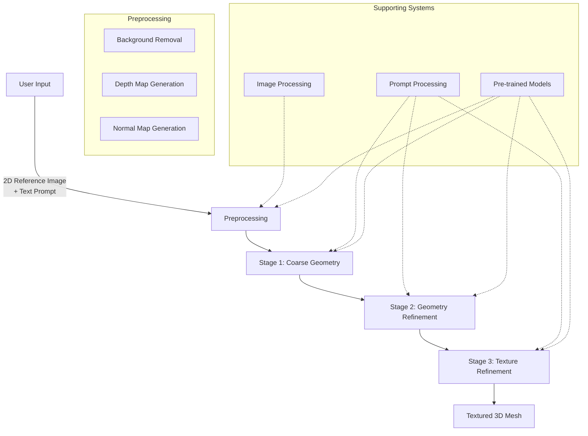
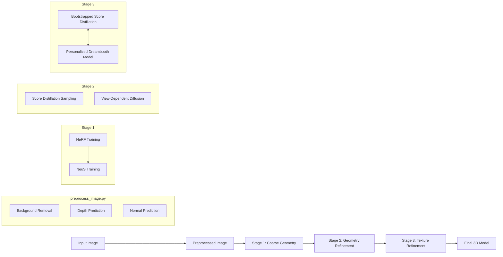
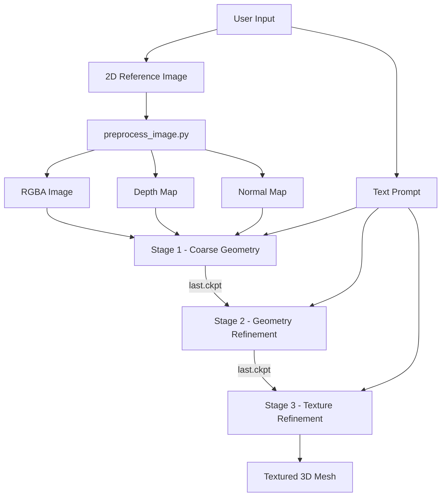
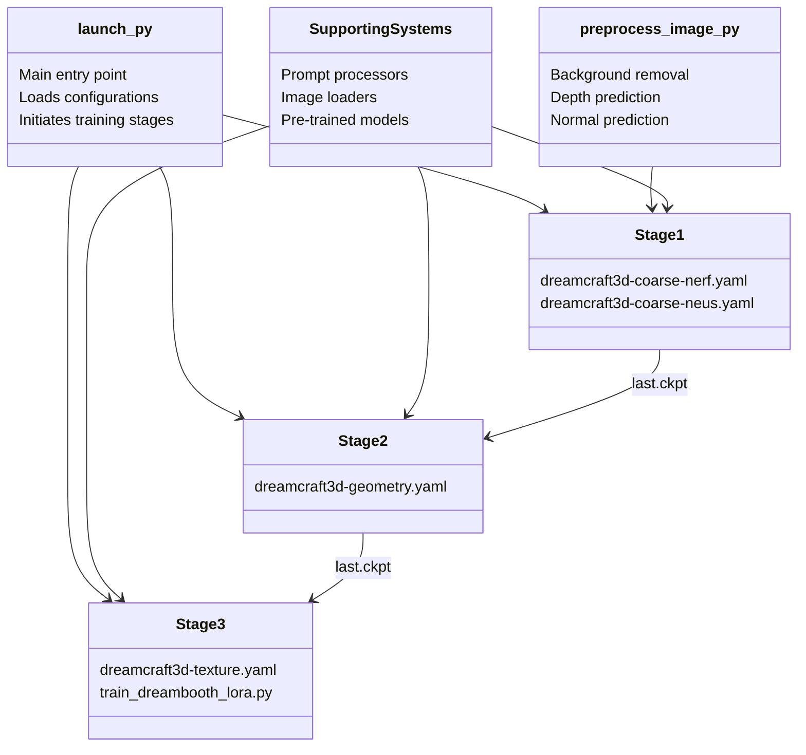

<!-- source: DeepWiki mcp.deepwiki.com · repo deepseek-ai/DreamCraft3D · page 1 Overview · fetched 2026-10-30 -->

# Overview

<details>
<summary>Relevant source files</summary>

The following files were used as context for generating this wiki page:

- [README.md](README.md)

</details>


DreamCraft3D is a hierarchical 3D content generation system that produces high-fidelity, coherent 3D objects from a single 2D reference image and text prompt. This page provides an introduction to the system architecture, key components, and workflow. For detailed installation instructions, see [Installation and Setup](#1.1), and for a quick start guide, see [Quick Start Guide](#1.2).

## Introduction

DreamCraft3D addresses consistency challenges in 3D generation by employing a three-stage hierarchical approach that progressively refines both geometry and texture. The system's primary innovation is Bootstrapped Score Distillation, which creates a mutually reinforcing feedback loop between the optimized 3D scene and a personalized diffusion model to achieve exceptional texture quality and view consistency.

## System Architecture

The following diagram illustrates the high-level architecture of DreamCraft3D:



Sources: [README.md:5-19](), [README.md:26-29]()

## Three-Stage Pipeline

DreamCraft3D employs a hierarchical approach divided into three distinct stages, each building upon the previous:



Sources: [README.md:97-121]()

### Stage 1: Coarse Geometry Generation

The first stage establishes the initial 3D structure using a combination of Neural Radiance Fields (NeRF) and Neural Surface Reconstruction (NeuS):

1. **NeRF Training**: Creates a volumetric representation of the object from the reference image
2. **NeuS Training**: Refines the volumetric representation into a more accurate surface model

This stage focuses on establishing consistent geometry while preparing for subsequent refinement.

Sources: [README.md:107-111]()

### Stage 2: Geometry Refinement

The second stage enhances the geometric details through score distillation sampling via a view-dependent diffusion model. This process sculpts the geometry to ensure coherent renders from multiple viewpoints.

Sources: [README.md:113-115]()

### Stage 3: Texture Refinement

The final stage employs Bootstrapped Score Distillation, a key innovation of DreamCraft3D:

1. A personalized diffusion model (Dreambooth) is trained on augmented renderings of the scene
2. This model provides view-consistent guidance for texture optimization
3. Through alternating optimization, improvements become mutually reinforcing:
   - The optimized 3D scene improves training of the scene-specific diffusion model
   - The improved diffusion model provides better guidance for 3D optimization

This bootstrap mechanism significantly enhances texture quality and coherence.

Sources: [README.md:118-120](), [README.md:12-19]()

## Data Flow

The following diagram illustrates the data flow through the DreamCraft3D pipeline:



Sources: [README.md:98-121]()

## Key Components

DreamCraft3D leverages several critical components and pre-trained models:

| Component | Purpose | Configuration File |
|-----------|---------|-------------------|
| Zero123 | View-dependent diffusion model | `configs/dreamcraft3d-coarse-nerf.yaml` |
| Omnidata | Depth and normal prediction | `preprocess_image.py` |
| NeRF | Initial volumetric representation | `configs/dreamcraft3d-coarse-nerf.yaml` |
| NeuS | Surface reconstruction | `configs/dreamcraft3d-coarse-neus.yaml` |
| Score Distillation Sampling | Geometry refinement | `configs/dreamcraft3d-geometry.yaml` |
| Dreambooth Lora | Personalized diffusion model | `configs/dreamcraft3d-texture.yaml` |

Sources: [README.md:83-96](), [README.md:107-120]()

## Code Structure Mapping

The following diagram maps the high-level concepts to specific code entities:



Sources: [README.md:107-120]()

## Handling Advanced Scenarios

For certain inputs, additional steps may be required to achieve optimal results:

- **Janus Problem**: When faces appear on both sides of an object in Stage 1 (an issue with view synthesis), training a custom Text2Image model can help. This involves:
  1. Generating multi-view images from the reference image using Zero123++
  2. Training a personalized DeepFloyd model using Dreambooth Lora
  3. Using this model for guidance during Stage 1

For more details on handling this specific issue, see [Handling the Janus Problem](#5.1).

Sources: [README.md:123-161]()

## Memory Requirements and Optimization

DreamCraft3D requires GPUs with significant VRAM (at least 20GB). The default configurations are designed for 40GB A100 GPUs. Memory usage can be reduced by:

- Decreasing rendering resolution in NeuS and other stages
- Adjusting batch sizes and other parameters

Sources: [README.md:49](), [README.md:164]()

## Exporting Results

The final 3D model can be exported as a textured mesh (OBJ+MTL) using the mesh-exporter:

```
python launch.py --config path/to/trial/dir/configs/parsed.yaml --export --gpu 0 resume=path/to/trial/dir/ckpts/last.ckpt system.exporter_type=mesh-exporter
```

Sources: [README.md:166-171]()

This overview provides a foundation for understanding the DreamCraft3D system. For more detailed information on specific components and processes, please refer to the relevant sections in the documentation.

---

