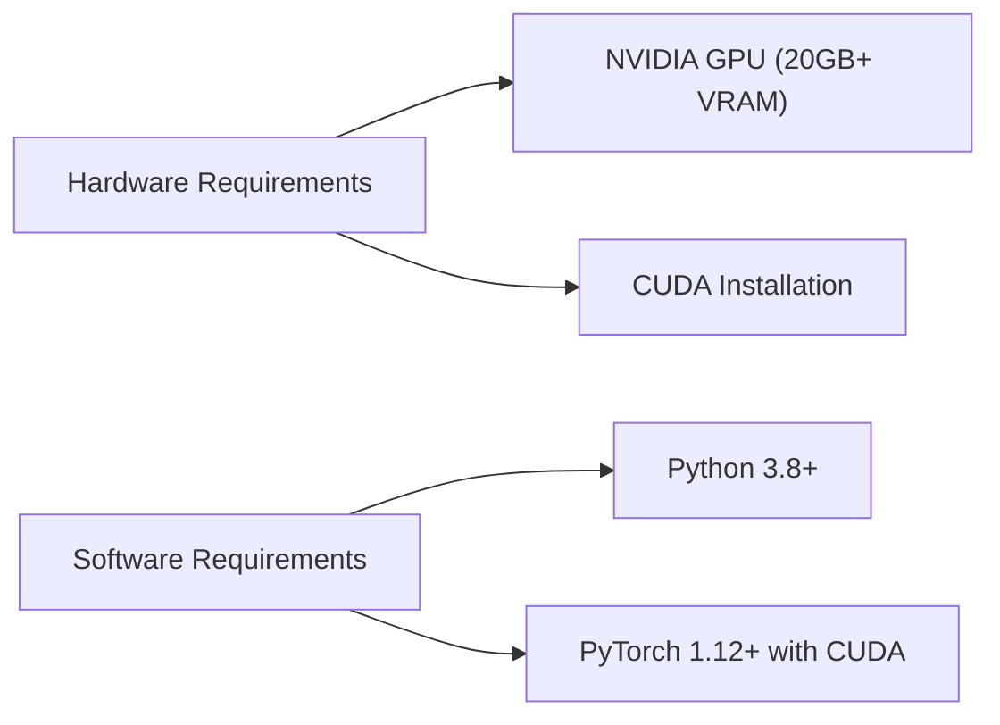
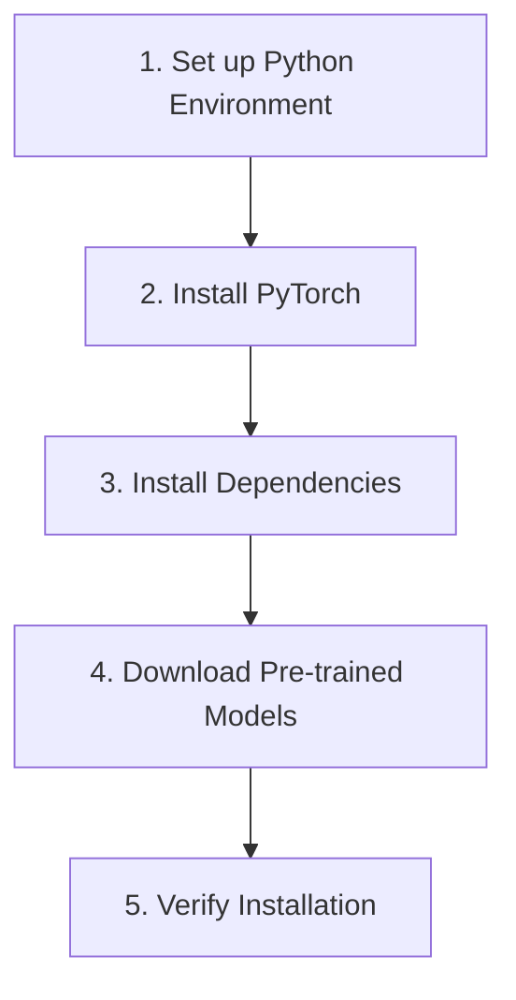
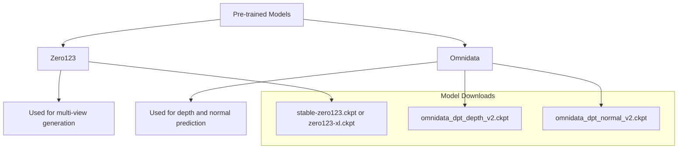

<!-- source: DeepWiki mcp.deepwiki.com · repo deepseek-ai/DreamCraft3D · page 1.1 Installation and Setup · fetched 2026-10-30 -->

# Installation and Setup

<details>
<summary>Relevant source files</summary>

The following files were used as context for generating this wiki page:

- [.gitignore](.gitignore)
- [README.md](README.md)

</details>


This document guides you through the complete installation process for DreamCraft3D, a hierarchical 3D generation system that creates high-fidelity 3D objects from a single image. For information on how to use the system after installation, see [Quick Start Guide](#1.2).

## System Requirements



Sources: [README.md:48-50](), [README.md:62-69]()

- **Hardware**: NVIDIA graphics card with at least 20GB VRAM
- **CUDA**: Compatible CUDA installation required
- **Python**: Version 3.8 or higher
- **Storage**: ~10GB for pre-trained models and dependencies

## Installation Process Overview



Sources: [README.md:42-96]()

## 1. Setting Up the Python Environment

It's recommended to use a virtual environment to avoid conflicts with other Python packages.

```bash
# Create a virtual environment
python3 -m virtualenv venv

# Activate the virtual environment
. venv/bin/activate

# Upgrade pip for faster package installation
python3 -m pip install --upgrade pip
```

Sources: [README.md:51-60]()

## 2. Installing PyTorch

DreamCraft3D has been tested with `torch1.12.1+cu113` and `torch2.0.0+cu118`, but other versions should work as well.

```bash
# For torch1.12.1+cu113
pip install torch==1.12.1+cu113 torchvision==0.13.1+cu113 --extra-index-url https://download.pytorch.org/whl/cu113

# OR for torch2.0.0+cu118
pip install torch torchvision --index-url https://download.pytorch.org/whl/cu118
```

Sources: [README.md:62-69]()

## 3. Installing Dependencies

First, install Ninja to speed up the compilation of CUDA extensions:

```bash
pip install ninja
```

Then install all required dependencies:

```bash
pip install -r requirements.txt
```

Sources: [README.md:71-81]()

## 4. Downloading Pre-trained Models

DreamCraft3D relies on two pre-trained models that need to be downloaded separately:



Sources: [README.md:83-95]()

### Zero123 Model

The default model is `stable-zero123.ckpt`. You can download it manually from [HuggingFace](https://huggingface.co/stabilityai/stable-zero123) and place it in the `load/zero123/` directory.

Alternatively, if you want to use the `zero123-xl.ckpt` version (as used in the paper):

```bash
cd load/zero123
bash download.sh
```

### Omnidata Model

Omnidata is used for depth and normal prediction during image preprocessing:

```bash
cd load/omnidata
gdown '1Jrh-bRnJEjyMCS7f-WsaFlccfPjJPPHI&confirm=t' # omnidata_dpt_depth_v2.ckpt
gdown '1wNxVO4vVbDEMEpnAi_jwQObf2MFodcBR&confirm=t' # omnidata_dpt_normal_v2.ckpt
```

Sources: [README.md:90-95]()

## 5. Directory Structure

After installation, your directory structure should look like this:

```
DreamCraft3D/
├── configs/               # Configuration files for each stage
├── load/                  # Pre-trained models
│   ├── zero123/           # Zero123 model checkpoint
│   │   └── stable-zero123.ckpt (or zero123-xl.ckpt)
│   ├── omnidata/          # Omnidata model checkpoints
│   │   ├── omnidata_dpt_depth_v2.ckpt
│   │   └── omnidata_dpt_normal_v2.ckpt
│   └── images/            # Contains your input images
├── requirements.txt       # Package dependencies
├── preprocess_image.py    # Script for processing input images
└── launch.py              # Main execution script
```

## 6. Memory Considerations

DreamCraft3D requires significant GPU memory. The default configurations are designed to run on 40GB A100 GPUs. If you have less memory available, you can reduce the rendering resolution:

```bash
# Add these parameters to reduce memory usage
data.height=128 data.width=128 data.random_camera.height=128 data.random_camera.width=128
```

Sources: [README.md:164-165]()

## 7. Verification

To verify your installation, you can try preprocessing a sample image:

```bash
python preprocess_image.py load/images/sample.png --recenter
```

If this runs without errors, you have successfully installed DreamCraft3D and are ready to generate 3D content. For next steps, see the [Quick Start Guide](#1.2).

Sources: [README.md:98-101]()

## Troubleshooting

Common issues and their resolutions:

| Issue | Possible Solution |
|-------|------------------|
| CUDA out of memory | Reduce rendering resolution as mentioned in Memory Considerations |
| Missing pre-trained models | Ensure all model files are downloaded to the correct locations |
| ImportError for dependencies | Make sure to install all requirements with `pip install -r requirements.txt` |
| PyTorch/CUDA version mismatch | Reinstall PyTorch with the correct CUDA version for your system |

If you encounter the "Janus problem" (inconsistent face generation) during Stage 1, see [Advanced Topics: Handling the Janus Problem](#5.1) for solutions including training a custom Text2Image model.

Sources: [README.md:123-163]()

---

