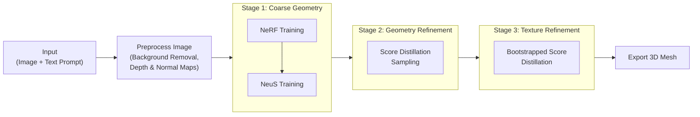
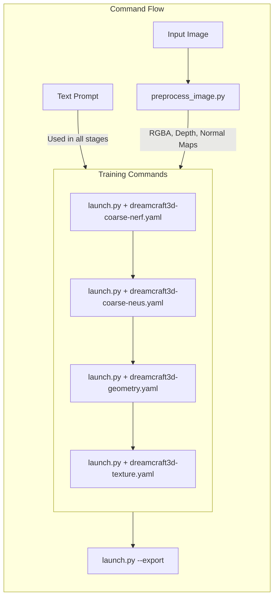

<!-- source: DeepWiki mcp.deepwiki.com · repo deepseek-ai/DreamCraft3D · page 1.2 Quick Start Guide · fetched 2026-10-30 -->

# Quick Start Guide

<details>
<summary>Relevant source files</summary>

The following files were used as context for generating this wiki page:

- [README.md](README.md)

</details>


This guide provides a concise walkthrough for generating a high-quality 3D model from a single reference image using DreamCraft3D. It covers the basic steps from preprocessing an input image to exporting the final textured 3D mesh. For detailed installation instructions, see [Installation and Setup](#1.1).

## Prerequisites

Before you begin, ensure you have:
- Successfully installed DreamCraft3D and its dependencies
- Downloaded the required pre-trained models (Zero123 and Omnidata)
- Prepared a reference image with a clear subject

## Workflow Overview

DreamCraft3D follows a hierarchical generation process that consists of three main stages:



Sources: [README.md:25-30]()

## Step 1: Preprocessing the Input Image

Before starting the 3D generation process, you need to preprocess your input image to remove the background and generate depth and normal maps:

```bash
python preprocess_image.py /path/to/image.png --recenter
```

This command will:
1. Remove the background from your image
2. Generate depth and normal maps using Omnidata models
3. Save the processed images to be used in the subsequent training stages

Sources: [README.md:98-101]()

## Step 2: Multi-Stage Training

DreamCraft3D uses a hierarchical approach with three stages of optimization. The following diagrams show the relationship between configuration files, commands, and the pipeline stages:



Sources: [README.md:104-121]()

### Stage 1: Coarse Geometry Generation (NeRF & NeuS)

This stage creates a coarse geometry in two steps: first using NeRF, then refining with NeuS.

```bash
# Define your prompt and image path
prompt="a brightly colored mushroom growing on a log"
image_path="load/images/mushroom_log_rgba.png"

# NeRF training
python launch.py --config configs/dreamcraft3d-coarse-nerf.yaml --train system.prompt_processor.prompt="$prompt" data.image_path="$image_path"

# NeuS training (using the last NeRF checkpoint)
ckpt=outputs/dreamcraft3d-coarse-nerf/$prompt@LAST/ckpts/last.ckpt
python launch.py --config configs/dreamcraft3d-coarse-neus.yaml --train system.prompt_processor.prompt="$prompt" data.image_path="$image_path" system.weights="$ckpt"
```

Sources: [README.md:107-112]()

### Stage 2: Geometry Refinement

This stage refines the geometry using score distillation sampling:

```bash
# Geometry refinement (using the last NeuS checkpoint)
ckpt=outputs/dreamcraft3d-coarse-neus/$prompt@LAST/ckpts/last.ckpt
python launch.py --config configs/dreamcraft3d-geometry.yaml --train system.prompt_processor.prompt="$prompt" data.image_path="$image_path" system.geometry_convert_from="$ckpt"
```

Sources: [README.md:114-116]()

### Stage 3: Texture Refinement

The final stage improves the texture quality using bootstrapped score distillation:

```bash
# Texture refinement (using the last geometry checkpoint)
ckpt=outputs/dreamcraft3d-geometry/$prompt@LAST/ckpts/last.ckpt
python launch.py --config configs/dreamcraft3d-texture.yaml --train system.prompt_processor.prompt="$prompt" data.image_path="$image_path" system.geometry_convert_from="$ckpt"
```

Sources: [README.md:119-121]()

## Step 3: Exporting the 3D Model

After completing all training stages, you can export the textured mesh to an OBJ file:

```bash
# Export the textured mesh (OBJ+MTL format)
python launch.py --config path/to/trial/dir/configs/parsed.yaml --export --gpu 0 resume=path/to/trial/dir/ckpts/last.ckpt system.exporter_type=mesh-exporter
```

This will generate an OBJ file with associated material files that can be imported into standard 3D software like Blender or MeshLab.

Sources: [README.md:166-171]()

## Handling Common Issues

### The Janus Problem

Sometimes during Stage 1, you might encounter the "Janus problem" where the model generates inconsistent face or geometry details on different sides of the model. If this occurs, you can train a custom Text2Image model:

1. Generate multi-view images from your reference image:
```bash
python threestudio/scripts/img_to_mv.py --image_path 'load/mushroom.png' --save_path '.cache/temp' --prompt 'a photo of mushroom' --superres
```

2. Train a personalized DeepFloyd model using DreamBooth Lora:
```bash
export MODEL_NAME="DeepFloyd/IF-I-XL-v1.0"
export INSTANCE_DIR=".cache/temp"
export OUTPUT_DIR=".cache/if_dreambooth_mushroom"

accelerate launch threestudio/scripts/train_dreambooth_lora.py \
  --pretrained_model_name_or_path=$MODEL_NAME \
  --instance_data_dir=$INSTANCE_DIR \
  --output_dir=$OUTPUT_DIR \
  --instance_prompt="a sks mushroom" \
  --resolution=64 \
  --train_batch_size=4 \
  --gradient_accumulation_steps=1 \
  --learning_rate=5e-6 \
  --scale_lr \
  --max_train_steps=1200 \
  --checkpointing_steps=600 \
  --pre_compute_text_embeddings \
  --tokenizer_max_length=77 \
  --text_encoder_use_attention_mask
```

3. Use this personalized model in Stage 1:
```bash
python launch.py --config configs/dreamcraft3d-coarse-nerf.yaml --train system.prompt_processor.prompt="$prompt" data.image_path="$image_path" system.guidance.lora_weights_path=".cache/if_dreambooth_mushroom"
```

Sources: [README.md:123-161]()

## Tips for Optimal Results

### Memory Optimization

The default configuration is designed for GPUs with 40GB VRAM (A100). For systems with less memory:

- Reduce rendering resolution for NeuS:
```bash
data.height=128 data.width=128 data.random_camera.height=128 data.random_camera.width=128
```

- You can similarly reduce resolution for other stages to save memory

Sources: [README.md:164-165]()

### Prompt Engineering

The quality of your text prompt significantly affects the output. For best results:
- Be specific about the object's appearance and materials
- Include distinctive visual characteristics
- Use descriptive adjectives that help the system understand the desired style

### Input Image Selection

Choose reference images with:
- Clear subject with minimal background clutter
- Good lighting that shows the shape clearly
- Distinctive features that help establish the 3D form

---

