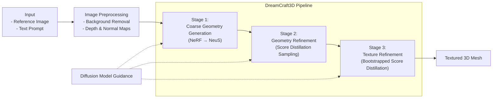
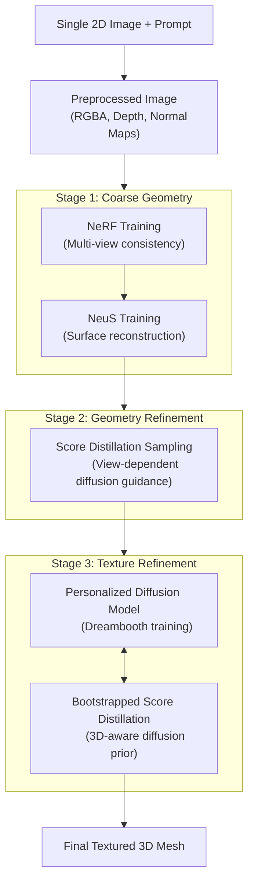
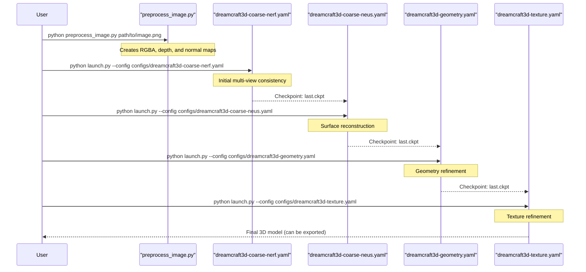
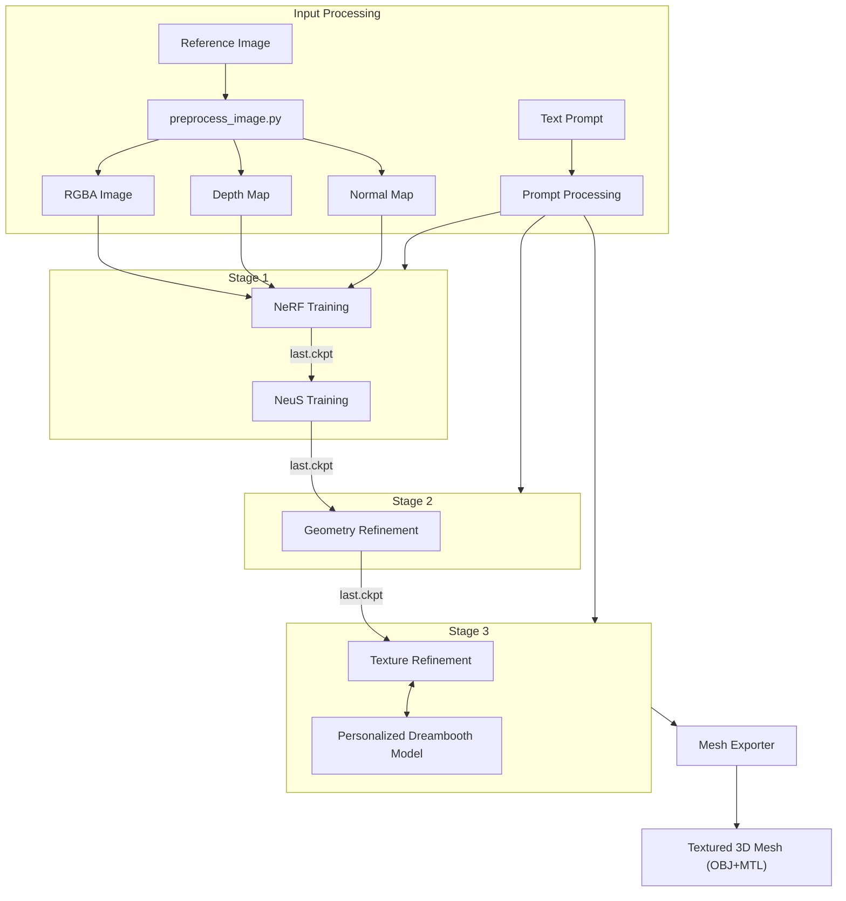

<!-- source: DeepWiki mcp.deepwiki.com · repo deepseek-ai/DreamCraft3D · page 2 Core Pipeline · fetched 2026-10-30 -->

# Core Pipeline

Relevant source files

The following files were used as context for generating this wiki page:

- [README.md](README.md)

The Core Pipeline of DreamCraft3D implements a hierarchical 3D generation approach that creates high-fidelity, coherent 3D objects from a single 2D reference image and a text prompt. This page explains the overall pipeline architecture and how the three-stage process works together to produce textured 3D models.

For specific implementation details of each stage, see [Stage 1: Coarse Geometry Generation](#2.1), [Stage 2: Geometry Refinement](#2.2), and [Stage 3: Texture Refinement](#2.3).

## Pipeline Overview

DreamCraft3D employs a hierarchical generation strategy with three sequential stages, each building upon the results of the previous stage. This design allows the system to progressively refine both geometry and texture.

Sources:
- [README.md:97-121]()
- [README.md:26-29]()

## Hierarchical Generation Process

The pipeline processes a single image through multiple stages, with each stage specializing in a specific aspect of 3D generation:

Sources:
- [README.md:10-19]()
- [README.md:97-121]()

## Pipeline Execution Flow

The pipeline is executed in sequential stages, with each stage using the output from the previous stage as its starting point:

1. **Preprocessing**: Before the main pipeline begins, the input image is processed to remove the background and generate depth and normal maps.

2. **Stage 1**: Coarse Geometry Generation
   - Part 1: NeRF training for multi-view consistency
   - Part 2: NeuS training for surface reconstruction
   - Output: Initial 3D geometry model

3. **Stage 2**: Geometry Refinement
   - Uses Score Distillation Sampling with view-dependent diffusion guidance
   - Refines the geometry while maintaining view consistency
   - Output: Refined 3D geometry

4. **Stage 3**: Texture Refinement
   - Uses Bootstrapped Score Distillation with a personalized diffusion model
   - Alternates between training the diffusion model and optimizing the 3D scene
   - Output: Final textured 3D mesh

Each stage saves checkpoint files that are used as inputs for the next stage, creating a sequential pipeline flow.

Sources:
- [README.md:97-121]()

## Command Structure

Sources:
- [README.md:97-121]()
- [README.md:166-171]()

## Key Technical Components

The pipeline integrates several key technical components that work together to achieve high-quality 3D generation:

### Data Flow Between Stages

Sources:
- [README.md:97-121]()
- [README.md:166-171]()

### Bootstrapped Optimization in Stage 3

A key innovation in DreamCraft3D is the bootstrapped optimization approach used in Stage 3. This process involves:

1. Training a personalized diffusion model (Dreambooth) on the renderings of the current 3D scene
2. Using this model to guide further optimization of the 3D scene
3. As the 3D scene improves, it provides better training data for the diffusion model
4. This creates a positive feedback loop (bootstrapping) that enhances both the diffusion model and 3D scene

This approach allows for significant texture quality improvements while maintaining view consistency.

Sources:
- [README.md:10-19]()
- [README.md:97-121]()

## Configuration Files

The pipeline is configured through a set of YAML files, each corresponding to a stage in the process:

1. `configs/dreamcraft3d-coarse-nerf.yaml` - Stage 1, Part 1 (NeRF)
2. `configs/dreamcraft3d-coarse-neus.yaml` - Stage 1, Part 2 (NeuS)
3. `configs/dreamcraft3d-geometry.yaml` - Stage 2
4. `configs/dreamcraft3d-texture.yaml` - Stage 3

These configuration files define the parameters, models, and training strategies used at each stage.

## Optional Components

### Handling the Janus Problem

If the "Janus problem" (inconsistent facial features on different sides) arises in Stage 1, the pipeline provides an optional process to train a custom Text2Image model:

1. Generate multi-view images using Zero123++
2. Train a personalized DeepFloyd model using DreamBooth Lora
3. Use this personalized model for guidance in the training stages

Sources:
- [README.md:123-161]()

## Conclusion

The DreamCraft3D Core Pipeline represents a hierarchical approach to 3D generation that progressively refines both geometry and texture. By leveraging different specialized techniques at each stage and implementing bootstrapped optimization, the pipeline achieves high-fidelity, coherent 3D objects from a single reference image and text prompt.

For detailed implementation of each stage, refer to the respective stage documentation ([Stage 1](#2.1), [Stage 2](#2.2), [Stage 3](#2.3)).

---

