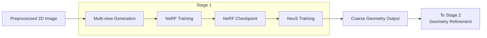
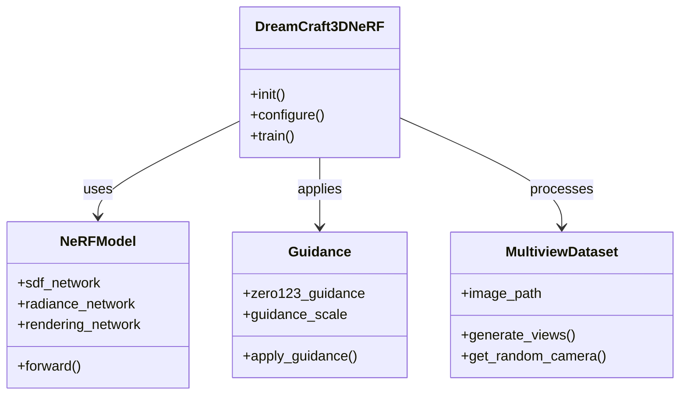
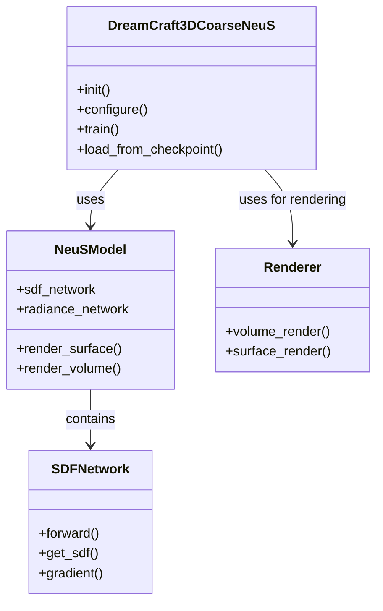

<!-- source: DeepWiki mcp.deepwiki.com · repo deepseek-ai/DreamCraft3D · page 2.1 Stage 1: Coarse Geometry Generation · fetched 2026-10-30 -->

# Stage 1: Coarse Geometry Generation

<details>
<summary>Relevant source files</summary>

The following files were used as context for generating this wiki page:

- [README.md](README.md)

</details>


## Purpose and Scope

This document details the first stage of the DreamCraft3D pipeline, which focuses on generating coarse 3D geometry from a single reference image. Stage 1 provides the foundational geometry that will be refined in later stages. The process involves sequential training of Neural Radiance Fields (NeRF) and Neural Surface Reconstruction (NeuS) models to create a coherent 3D representation of the subject.

For information about geometry refinement, see [Stage 2: Geometry Refinement](#2.2). For texture refinement, see [Stage 3: Texture Refinement](#2.3).

## Stage 1 Workflow Overview

The coarse geometry generation process follows a hierarchical approach, starting with preprocessed 2D input and progressively building 3D structure.



Sources: [README.md:107-111]()

## Prerequisites: Image Preprocessing

Before beginning Stage 1, the input image must be preprocessed to:
1. Remove the background (creating an RGBA image)
2. Generate depth and normal maps
3. Optionally recenter the object

```bash
python preprocess_image.py /path/to/image.png --recenter
```

This preprocessing step creates depth and normal maps using Omnidata models, which provide valuable 3D information to guide the initial geometry creation.

Sources: [README.md:98-101](), [README.md:90-95]()

## Step 1: NeRF Training

The first phase of Stage 1 involves training a Neural Radiance Field (NeRF) model to approximate the 3D structure and appearance of the object.

### Implementation Details



Sources: [README.md:107-109]()

### Configuration Options

The NeRF training is controlled by the `dreamcraft3d-coarse-nerf.yaml` configuration file. Key parameters include:

| Parameter | Description |
|-----------|-------------|
| `system.prompt_processor.prompt` | Text prompt describing the object |
| `data.image_path` | Path to preprocessed RGBA image |
| `data.height`/`data.width` | Rendering resolution (can be reduced to save memory) |
| `system.guidance.guidance_scale` | Controls strength of prompt guidance |
| `system.guidance.guidance_type` | The type of guidance used (default: Zero123) |

Sources: [README.md:108-109](), [README.md:164-165]()

### Training Process

The NeRF training process:
1. Takes the preprocessed reference image
2. Generates multi-view images using Zero123 model
3. Trains a NeRF model with both image-based supervision and Zero123 guidance
4. Produces a checkpoint that captures the coarse volumetric representation

```bash
python launch.py --config configs/dreamcraft3d-coarse-nerf.yaml --train system.prompt_processor.prompt="$prompt" data.image_path="$image_path"
```

This process typically runs for a few hundred iterations and saves the resulting model to `outputs/dreamcraft3d-coarse-nerf/$prompt@LAST/ckpts/last.ckpt`.

Sources: [README.md:108-109]()

## Step 2: NeuS Training

After obtaining the NeRF checkpoint, the second phase uses Neural Surface Reconstruction (NeuS) to convert the volumetric representation into a more precise surface representation.

### Implementation Details



Sources: [README.md:110-111]()

### Configuration Options

The NeuS training is controlled by the `dreamcraft3d-coarse-neus.yaml` configuration file. Key parameters include:

| Parameter | Description |
|-----------|-------------|
| `system.weights` | Path to the NeRF checkpoint |
| `system.prompt_processor.prompt` | Same text prompt as used in NeRF |
| `data.image_path` | Path to preprocessed RGBA image |
| `system.geometry.sdf_bias` | Controls the bias of the signed distance function |
| `system.geometry.sdf_network` | Network architecture for SDF prediction |

Sources: [README.md:110-111]()

### Training Process

The NeuS training process:
1. Initializes from the NeRF checkpoint
2. Refines the geometry using Signed Distance Function (SDF) representation
3. Applies both image-based supervision and Zero123 guidance
4. Produces a more defined surface representation

```bash
ckpt=outputs/dreamcraft3d-coarse-nerf/$prompt@LAST/ckpts/last.ckpt
python launch.py --config configs/dreamcraft3d-coarse-neus.yaml --train system.prompt_processor.prompt="$prompt" data.image_path="$image_path" system.weights="$ckpt"
```

The resulting model is saved to `outputs/dreamcraft3d-coarse-neus/$prompt@LAST/ckpts/last.ckpt`.

Sources: [README.md:110-111]()

## Output and Transition to Stage 2

The final output of Stage 1 is a coarse 3D geometry represented as a neural signed distance function. This geometry serves as the foundation for Stage 2, where it will be refined using score distillation sampling.

Key characteristics of Stage 1 output:
- Basic 3D structure captured
- Roughly aligned with the reference image
- Contains structural information but lacks detailed geometry and texture
- Represented as a neural SDF model, ready for further refinement

Sources: [README.md:113-115]()

## Troubleshooting: Handling the Janus Problem

A common issue in Stage 1 is the "Janus problem" - where the model generates inconsistent geometry with multiple faces or incorrect back sides.

### Solution: Custom Text2Image Model Training

If you encounter the Janus problem, you can train a personalized diffusion model:

1. Generate multi-view images from the reference image:
```bash
python threestudio/scripts/img_to_mv.py --image_path 'load/mushroom.png' --save_path '.cache/temp' --prompt 'a photo of mushroom' --superres
```

2. Train a personalized DeepFloyd model using DreamBooth Lora:
```bash
export MODEL_NAME="DeepFloyd/IF-I-XL-v1.0"
export INSTANCE_DIR=".cache/temp"
export OUTPUT_DIR=".cache/if_dreambooth_mushroom"

accelerate launch threestudio/scripts/train_dreambooth_lora.py \
  --pretrained_model_name_or_path=$MODEL_NAME  \
  --instance_data_dir=$INSTANCE_DIR \
  --output_dir=$OUTPUT_DIR \
  --instance_prompt="a sks mushroom" \
  --resolution=64 \
  --train_batch_size=4 \
  --gradient_accumulation_steps=1 \
  --learning_rate=5e-6 \
  --scale_lr \
  --max_train_steps=1200 \
  --checkpointing_steps=600 \
  --pre_compute_text_embeddings \
  --tokenizer_max_length=77 \
  --text_encoder_use_attention_mask
```

3. Use the personalized model for Stage 1 training:
```bash
python launch.py --config configs/dreamcraft3d-coarse-nerf.yaml --train system.prompt_processor.prompt="$prompt" data.image_path="$image_path" system.guidance.lora_weights_path=".cache/if_dreambooth_mushroom"
```

This approach trains a model specifically for your object, which helps ensure consistent geometry across all views.

Sources: [README.md:123-161]()

## Memory Optimization

For systems with limited GPU memory, you can reduce the rendering resolution:

```bash
data.height=128 data.width=128 data.random_camera.height=128 data.random_camera.width=128
```

This significantly reduces memory usage while still producing usable results for the next stages.

Sources: [README.md:164-165]()

---

