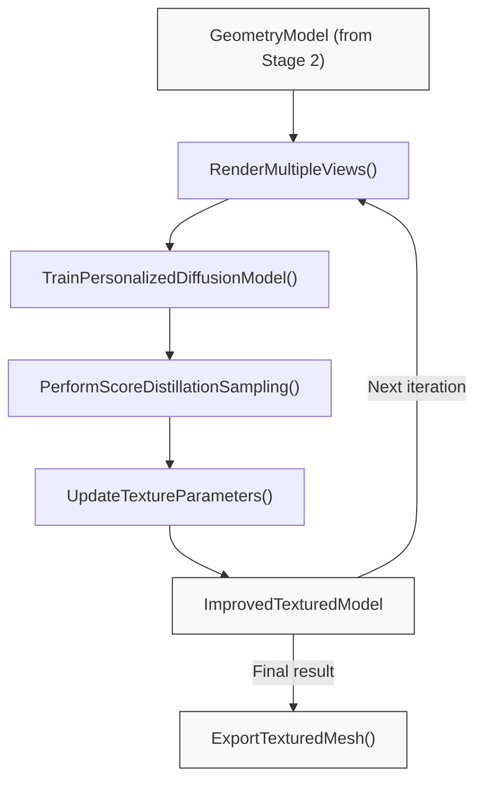
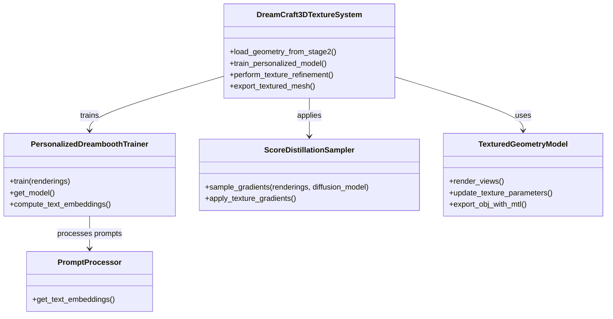
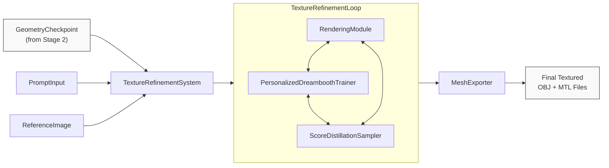

<!-- source: DeepWiki mcp.deepwiki.com · repo deepseek-ai/DreamCraft3D · page 2.3 Stage 3: Texture Refinement · fetched 2026-10-30 -->

# Stage 3: Texture Refinement

<details>
<summary>Relevant source files</summary>

The following files were used as context for generating this wiki page:

- [README.md](README.md)

</details>


## Purpose and Scope

This document details Stage 3 of the DreamCraft3D pipeline, which focuses on enhancing texture quality and fidelity of 3D objects after their geometry has been refined in Stage 2. The key innovation in this stage is the **Bootstrapped Score Distillation** technique, which creates high-quality, view-consistent textures through an alternating optimization process between a personalized diffusion model and the 3D representation.

For information about earlier stages in the pipeline, see [Stage 1: Coarse Geometry Generation](#2.1) and [Stage 2: Geometry Refinement](#2.2).

## Bootstrapped Score Distillation Process

The core of Stage 3 is the Bootstrapped Score Distillation technique, which addresses the texture consistency challenges that many 3D generation methods face. This approach creates a mutually reinforcing relationship between the 3D scene representation and a personalized diffusion model.

### Process Diagram


Sources: [README.md:10-19]()

## Implementation Architecture

The texture refinement system implements a bootstrapping approach where improvements in the 3D scene and diffusion model reinforce each other through iterative optimization.

### System Component Diagram


Sources: [README.md:12-18]()

## Technical Implementation Details

Stage 3 builds upon the refined geometry from Stage 2 and involves these key steps:

1. **Loading Refined Geometry**: The system starts by loading the geometry model refined in Stage 2.

2. **Multi-view Rendering**: The current 3D model is rendered from multiple viewpoints to generate training data.

3. **Personalized Model Training**: A Dreambooth model is trained on these renderings to capture the specific characteristics of the object.

4. **Score Distillation Sampling**: The personalized model provides view-consistent guidance for texture optimization.

5. **Texture Refinement**: Textures are updated based on the guidance from the diffusion model.

6. **Iterative Bootstrapping**: Steps 2-5 are repeated in an alternating fashion, with each component helping to improve the other.

### Comparison with Previous Stages

| Feature | Stage 1 | Stage 2 | Stage 3 |
|---------|---------|---------|---------|
| **Focus** | Coarse geometry creation | Geometry refinement | Texture enhancement |
| **Input** | Single image + prompt | Output from Stage 1 | Output from Stage 2 |
| **Techniques** | NeRF & NeuS training | Score distillation sampling | Bootstrapped score distillation |
| **Output** | Initial 3D shape | Refined 3D geometry | High-quality textured mesh |
| **Config File** | dreamcraft3d-coarse-nerf.yaml, dreamcraft3d-coarse-neus.yaml | dreamcraft3d-geometry.yaml | dreamcraft3d-texture.yaml |

Sources: [README.md:107-120]()

## Configuration and Usage

### Configuration Options

The configuration for Stage 3 is defined in `configs/dreamcraft3d-texture.yaml`. While the specific parameters aren't detailed in the provided information, they likely include:

- Learning rates for texture optimization
- Dreambooth training parameters
- Rendering resolution and quality settings
- Number of optimization steps
- Balancing weights between different loss components

### Command-line Usage

To run Stage 3, use the following command after completing Stage 2:

```bash
# Assuming Stage 2 has completed and produced a checkpoint
ckpt=outputs/dreamcraft3d-geometry/$prompt@LAST/ckpts/last.ckpt
python launch.py --config configs/dreamcraft3d-texture.yaml --train system.prompt_processor.prompt="$prompt" data.image_path="$image_path" system.geometry_convert_from="$ckpt"
```

Sources: [README.md:118-120]()

### Memory Optimization

For systems with limited GPU memory, you can reduce the rendering resolution:

```bash
python launch.py --config configs/dreamcraft3d-texture.yaml --train system.prompt_processor.prompt="$prompt" data.image_path="$image_path" system.geometry_convert_from="$ckpt" data.height=128 data.width=128 data.random_camera.height=128 data.random_camera.width=128
```

Sources: [README.md:164-164]()

## Exporting the Final Result

After Stage 3 is complete, you can export the textured mesh using:

```bash
python launch.py --config path/to/trial/dir/configs/parsed.yaml --export --gpu 0 resume=path/to/trial/dir/ckpts/last.ckpt system.exporter_type=mesh-exporter
```

This exports the model in OBJ format with MTL materials, which can be imported into standard 3D modeling software.

Sources: [README.md:166-172]()

## Data Flow in Texture Refinement Process

The following diagram illustrates how data flows through the texture refinement stage:



Sources: [README.md:118-120](), [README.md:166-172]()

## Conclusion

Stage 3: Texture Refinement is the final and crucial step in the DreamCraft3D pipeline, responsible for creating high-quality, view-consistent textures for 3D models. Through the novel Bootstrapped Score Distillation technique, it establishes a mutually reinforcing relationship between a personalized diffusion model and the 3D representation, leading to significant improvements in texture quality while maintaining consistency across different viewpoints.

The result of this stage is a complete, textured 3D mesh that can be exported in standard formats for use in various 3D applications and workflows.

---

