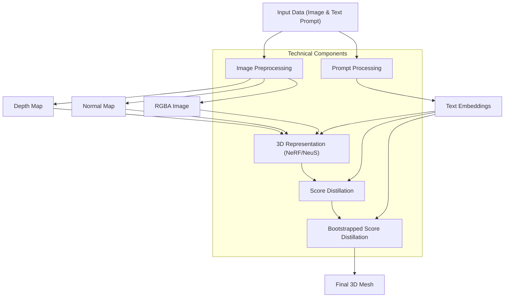
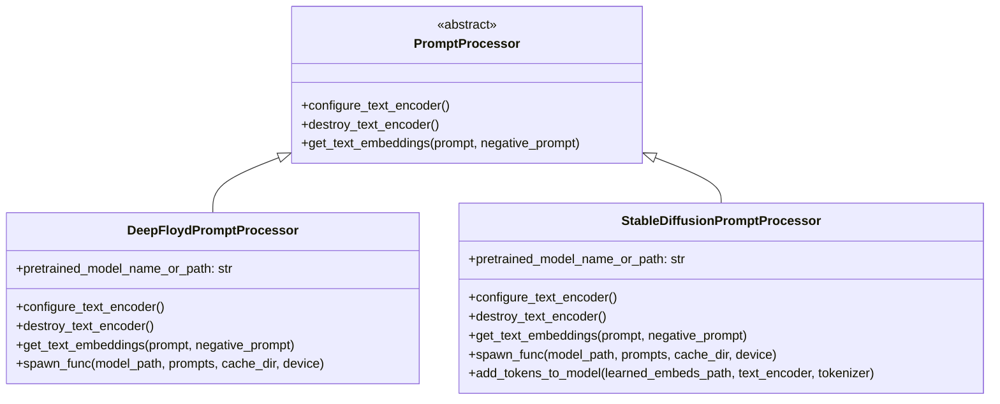
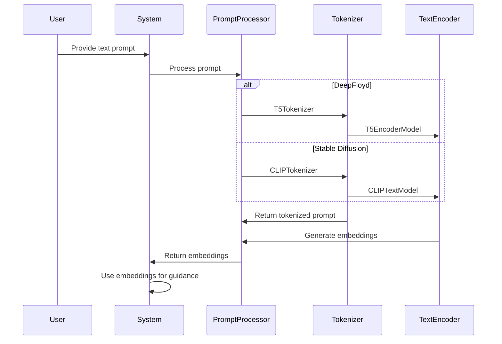
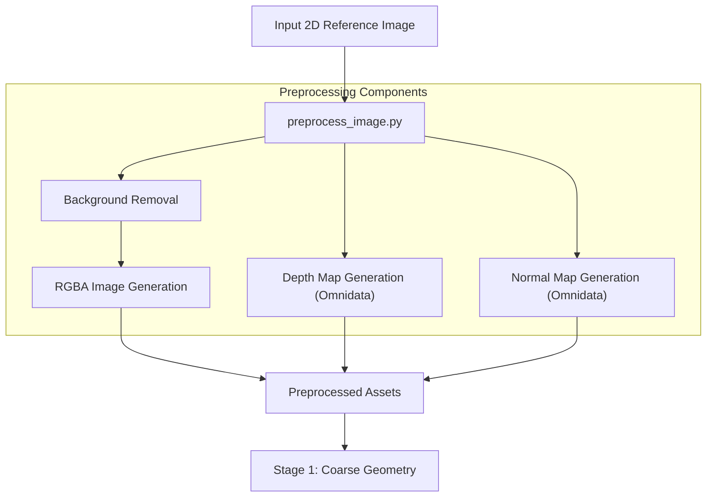
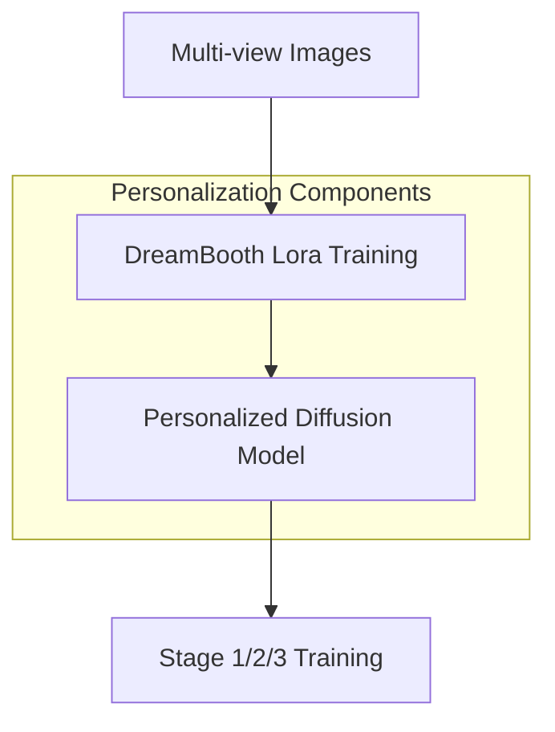
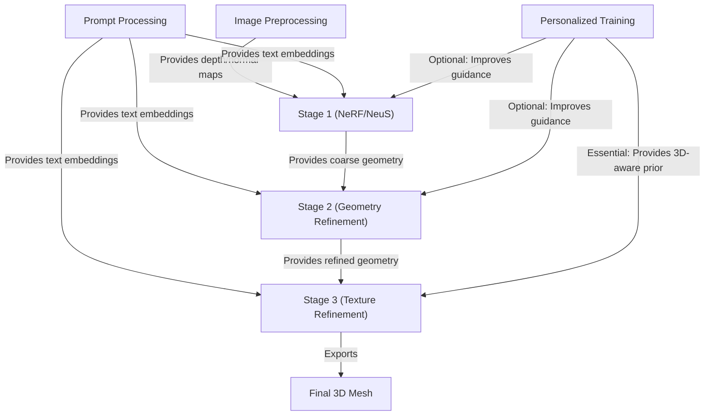

<!-- source: DeepWiki mcp.deepwiki.com · repo deepseek-ai/DreamCraft3D · page 3 Technical Components · fetched 2026-10-30 -->

# Technical Components

<details>
<summary>Relevant source files</summary>

The following files were used as context for generating this wiki page:

- [README.md](README.md)
- [threestudio/models/prompt_processors/deepfloyd_prompt_processor.py](threestudio/models/prompt_processors/deepfloyd_prompt_processor.py)
- [threestudio/models/prompt_processors/stable_diffusion_prompt_processor.py](threestudio/models/prompt_processors/stable_diffusion_prompt_processor.py)

</details>


This page provides an overview of the key technical subsystems and components that power DreamCraft3D's 3D generation capabilities. It covers the fundamental building blocks that enable the hierarchical 3D generation process described in the [Core Pipeline](#2) section.

## Component Architecture Overview

DreamCraft3D relies on several specialized technical components that work together to transform a single 2D reference image into a high-quality 3D model. The diagram below illustrates the primary technical components and their relationships:

```mermaid
classDiagram
    class "DreamCraft3D System" {
        +Stage1: Coarse Geometry Generation
        +Stage2: Geometry Refinement
        +Stage3: Texture Refinement
    }
    
    class "Prompt Processing System" {
        +Process text prompts
        +Generate embeddings
        +Support multiple models
    }
    
    class "Image Preprocessing System" {
        +Background removal
        +Depth map generation
        +Normal map generation
        +RGBA processing
    }
    
    class "Diffusion Models" {
        +Zero123/Zero123-XL
        +Stable Diffusion
        +DeepFloyd IF
    }
    
    class "3D Representation" {
        +NeRF
        +NeuS
        +Mesh
    }
    
    class "Training Techniques" {
        +Score Distillation Sampling
        +Bootstrapped Score Distillation
        +Dreambooth Lora
    }
    
    "DreamCraft3D System" --> "Prompt Processing System" : uses
    "DreamCraft3D System" --> "Image Preprocessing System" : uses
    "DreamCraft3D System" --> "Diffusion Models" : leverages
    "DreamCraft3D System" --> "3D Representation" : employs
    "DreamCraft3D System" --> "Training Techniques" : applies
    "Prompt Processing System" --> "Diffusion Models" : provides embeddings for
    "Image Preprocessing System" --> "3D Representation" : informs
    "Training Techniques" --> "Diffusion Models" : enhances
    "Training Techniques" --> "3D Representation" : refines
```

Sources: [README.md:25-31]()

## Data Flow Architecture

The following diagram illustrates how data flows through the system's technical components during the 3D generation process:



Sources: [README.md:100-121]()

## Prompt Processing System

The Prompt Processing System converts text prompts into embeddings that guide the 3D generation process. It supports multiple diffusion models through a common interface with specialized implementations.

### Class Hierarchy



Sources: [threestudio/models/prompt_processors/deepfloyd_prompt_processor.py:16-95](), [threestudio/models/prompt_processors/stable_diffusion_prompt_processor.py:15-133]()

### DeepFloyd Prompt Processor

The DeepFloyd Prompt Processor specializes in generating text embeddings using the DeepFloyd Inference models. It uses T5EncoderModel for text encoding and is optimized for memory efficiency with 8-bit quantization.

Key features:
- Processes text prompts into embeddings suitable for DeepFloyd-based diffusion models
- Uses T5Tokenizer and T5EncoderModel for text processing
- Supports 8-bit loading for memory efficiency
- Provides both regular and unconditional embeddings

Implementation details:
- Registered in the system using the `@threestudio.register("deep-floyd-prompt-processor")` decorator
- Default model path is "DeepFloyd/IF-I-XL-v1.0"
- Text embeddings have dimensions B×77×4096 (batch × sequence length × embedding dimension)

Sources: [threestudio/models/prompt_processors/deepfloyd_prompt_processor.py:16-95]()

### Stable Diffusion Prompt Processor

The Stable Diffusion Prompt Processor generates text embeddings compatible with Stable Diffusion models. It uses CLIP-based text encoding and supports custom token embedding.

Key features:
- Processes text prompts into embeddings for Stable Diffusion models
- Uses AutoTokenizer and CLIPTextModel for text processing
- Supports adding custom tokens for personalization
- Provides both regular and unconditional embeddings

Implementation details:
- Registered using the `@threestudio.register("stable-diffusion-prompt-processor")` decorator
- Text embeddings have dimensions B×77×768 (batch × sequence length × embedding dimension)
- Includes utility for adding custom tokens (`add_tokens_to_model`)

Sources: [threestudio/models/prompt_processors/stable_diffusion_prompt_processor.py:15-133]()

### Embedding Generation Process

The following diagram illustrates how text prompts are processed into embeddings:



Sources: [threestudio/models/prompt_processors/deepfloyd_prompt_processor.py:45-51](), [threestudio/models/prompt_processors/stable_diffusion_prompt_processor.py:41-68]()

## Image Preprocessing

The Image Preprocessing system transforms the input 2D reference image into formats that facilitate 3D generation. This system is crucial for extracting geometric information from a single image.

### Image Preprocessing Workflow



Sources: [README.md:90-95](), [README.md:98-101]()

### Key Preprocessing Components

The system incorporates several preprocessing components:

1. **Background Removal**: Isolates the foreground object from its background
2. **Depth Map Generation**: Creates a depth map using Omnidata models
3. **Normal Map Generation**: Generates surface normal maps using Omnidata models
4. **RGBA Image Creation**: Produces images with alpha channels for transparency

The preprocessing step can be executed using the `preprocess_image.py` script:

```bash
python preprocess_image.py /path/to/image.png --recenter
```

Sources: [README.md:90-95](), [README.md:98-101]()

### Multi-view Generation

For cases where a single view is insufficient (e.g., to address the "Janus problem"), the system includes a script to generate multi-view images from a single reference:

```bash
python threestudio/scripts/img_to_mv.py --image_path 'load/image.png' --save_path '.cache/temp' --prompt 'a photo of object' --superres
```

Sources: [README.md:126-130]()

## Personalized Model Training

For enhanced quality and consistency, DreamCraft3D incorporates personalized model training through DreamBooth Lora:



The personalized model training is particularly useful for addressing the "Janus problem" (inconsistent faces/details when viewing from different angles) in Stage 1.

Sources: [README.md:132-152]()

## Integration with Core Pipeline

These technical components integrate with the core pipeline as follows:

| Stage | Technical Components Used | Purpose |
|-------|--------------------------|---------|
| Preprocessing | Omnidata Models | Generate depth and normal maps from input image |
| Stage 1 | NeRF, NeuS, Prompt Processors | Create coarse geometry from single image |
| Stage 2 | Score Distillation, Prompt Processors | Refine geometry using diffusion guidance |
| Stage 3 | Bootstrapped Score Distillation, Personalized Models | Enhance textures with 3D-aware diffusion prior |

Sources: [README.md:107-121]()

## Component Interdependencies

The following diagram illustrates how the technical components depend on each other:



Sources: [README.md:100-121](), [README.md:126-160]()

The technical components of DreamCraft3D work together to implement the hierarchical 3D generation approach described in the paper. Each component addresses specific challenges in the 3D generation process, from prompt understanding to geometric refinement to texture enhancement.

For more detailed information about how these components are used in the generation pipeline, see the [Core Pipeline](#2) page.

---

