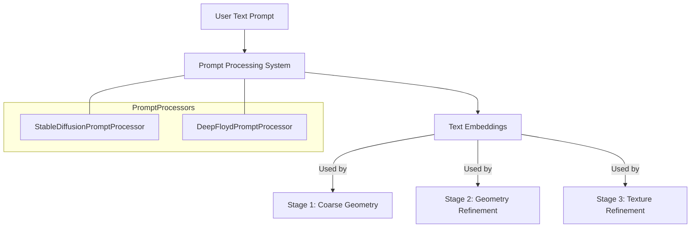
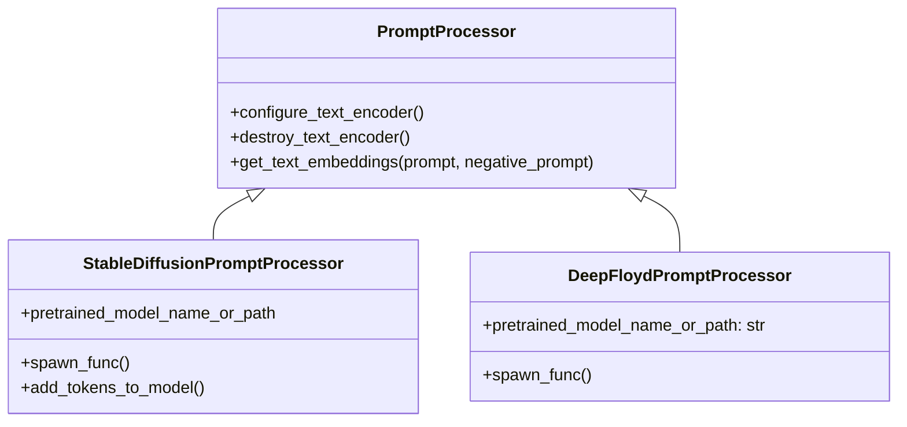
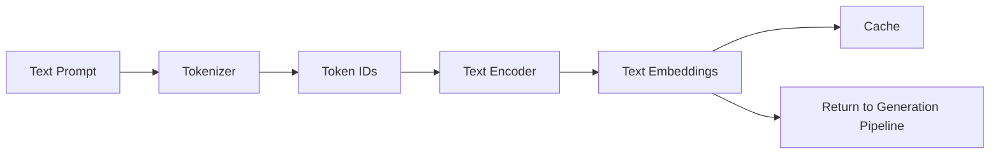
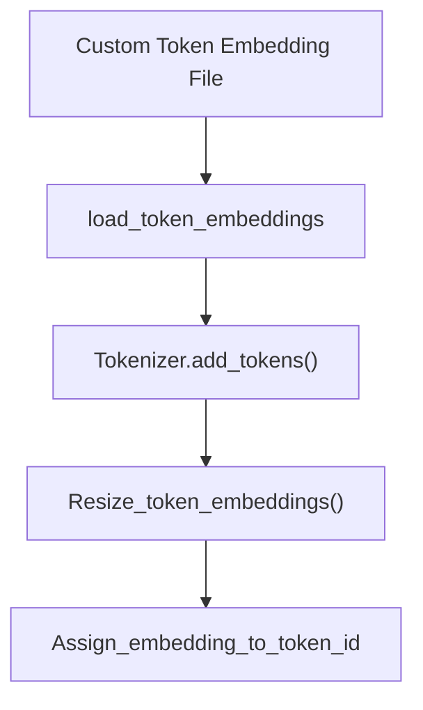

<!-- source: DeepWiki mcp.deepwiki.com · repo deepseek-ai/DreamCraft3D · page 3.1 Prompt Processing System · fetched 2026-10-30 -->

# Prompt Processing System

Relevant source files

The following files were used as context for generating this wiki page:

- [threestudio/models/prompt_processors/deepfloyd_prompt_processor.py](threestudio/models/prompt_processors/deepfloyd_prompt_processor.py)
- [threestudio/models/prompt_processors/stable_diffusion_prompt_processor.py](threestudio/models/prompt_processors/stable_diffusion_prompt_processor.py)

The Prompt Processing System in DreamCraft3D is responsible for converting text prompts into numerical embeddings that guide the 3D generation process. This system serves as the bridge between natural language descriptions and their mathematical representations that diffusion models can understand and use to generate 3D content.

For information about how these embeddings are used in the generation pipeline, see [Core Pipeline](#2).

## System Overview

The Prompt Processing System handles text encoding for both positive prompts (what you want to see in the generated content) and negative prompts (what you want to avoid). It supports different text encoding models through a modular architecture.

Sources: [threestudio/models/prompt_processors/stable_diffusion_prompt_processor.py](), [threestudio/models/prompt_processors/deepfloyd_prompt_processor.py]()

## Architecture

The Prompt Processing System follows an inheritance-based architecture where specific implementations inherit from a common base class. This allows the system to support multiple text encoding backends while maintaining a consistent interface.

Sources: [threestudio/models/prompt_processors/stable_diffusion_prompt_processor.py:15-16](), [threestudio/models/prompt_processors/deepfloyd_prompt_processor.py:16-17]()

## Prompt Processors

DreamCraft3D implements two main prompt processors:

### Stable Diffusion Prompt Processor

The Stable Diffusion Prompt Processor uses CLIP's text encoder to convert text prompts into embeddings compatible with Stable Diffusion models.

**Key features:**
- Uses CLIP tokenizer and text encoder
- Supports custom tokens (for concepts trained via Textual Inversion)
- Produces 77×768 dimensional embeddings

Sources: [threestudio/models/prompt_processors/stable_diffusion_prompt_processor.py:15-104]()

### DeepFloyd Prompt Processor

The DeepFloyd Prompt Processor uses T5 encoder model to create embeddings compatible with DeepFloyd IF models.

**Key features:**
- Uses T5 tokenizer and text encoder
- Loads models in 8-bit precision for memory efficiency
- Produces 77×4096 dimensional embeddings

Sources: [threestudio/models/prompt_processors/deepfloyd_prompt_processor.py:16-96]()

## Processing Flow

The system follows a consistent flow when processing prompts, regardless of the specific processor implementation:

Sources: [threestudio/models/prompt_processors/stable_diffusion_prompt_processor.py:72-103](), [threestudio/models/prompt_processors/deepfloyd_prompt_processor.py:55-93]()

## Implementation Details

### Embedding Generation

Both prompt processors implement methods to convert text prompts into embedding tensors:

1. **Tokenization**: Convert text to token IDs
2. **Encoding**: Process token IDs through the text encoder
3. **Caching**: Store embeddings for reuse

The embeddings are typically returned as a tuple containing both positive and negative prompt embeddings:

| Processor Type | Embedding Dimensions | Model Used |
|----------------|----------------------|------------|
| Stable Diffusion | B×77×768 | CLIP Text Encoder |
| DeepFloyd | B×77×4096 | T5 Encoder |

Where B is the batch size (number of prompts).

Sources: [threestudio/models/prompt_processors/stable_diffusion_prompt_processor.py:41-68](), [threestudio/models/prompt_processors/deepfloyd_prompt_processor.py:45-51]()

### Embedding Caching

Both processors implement a `spawn_func` static method that handles processing and caching of embeddings. This function:

1. Initializes the tokenizer and text encoder
2. Processes the given prompts
3. Saves the resulting embeddings to the specified cache directory
4. Cleans up resources

The cached embeddings are named using a hash of the model path and prompt text, allowing for consistent lookup.

Sources: [threestudio/models/prompt_processors/stable_diffusion_prompt_processor.py:72-103](), [threestudio/models/prompt_processors/deepfloyd_prompt_processor.py:55-95]()

### Custom Token Support

The Stable Diffusion processor includes functionality to add custom tokens to the model, supporting techniques like Textual Inversion:

This allows users to incorporate custom concepts (e.g., specific styles or objects) that were previously trained via Textual Inversion.

Sources: [threestudio/models/prompt_processors/stable_diffusion_prompt_processor.py:106-134]()

## Integration with DreamCraft3D Pipeline

The Prompt Processing System is used across all three stages of the DreamCraft3D pipeline:

1. **Stage 1 (Coarse Geometry)**: Uses text embeddings to guide the initial NeRF and NeuS training
2. **Stage 2 (Geometry Refinement)**: Uses text embeddings for Score Distillation Sampling to refine the geometry
3. **Stage 3 (Texture Refinement)**: Uses text embeddings for Bootstrapped Score Distillation to enhance textures

The consistent embedding format allows the system to maintain a coherent connection between the user's textual intent and the generated 3D content throughout the pipeline.

Sources: [threestudio/models/prompt_processors/stable_diffusion_prompt_processor.py](), [threestudio/models/prompt_processors/deepfloyd_prompt_processor.py]()

## Resource Management

To efficiently manage GPU memory, both prompt processors implement methods to initialize and clean up resources:

- `configure_text_encoder()`: Initializes the tokenizer and text encoder
- `destroy_text_encoder()`: Deletes models and calls cleanup utilities

This is particularly important in a multi-stage pipeline where different models may be needed at different times.

Sources: [threestudio/models/prompt_processors/stable_diffusion_prompt_processor.py:24-39](), [threestudio/models/prompt_processors/deepfloyd_prompt_processor.py:25-43]()

---

