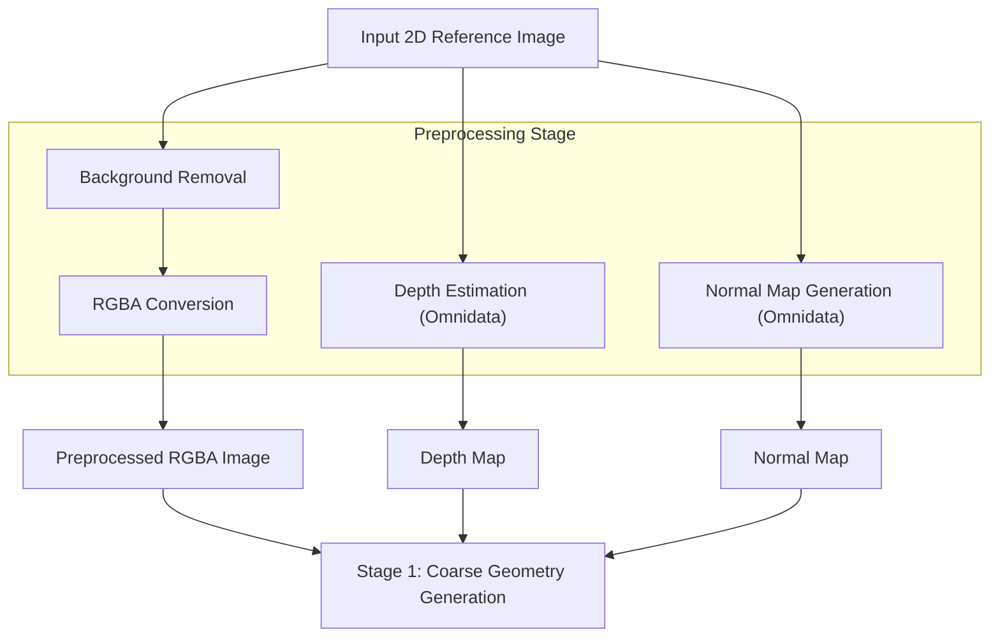
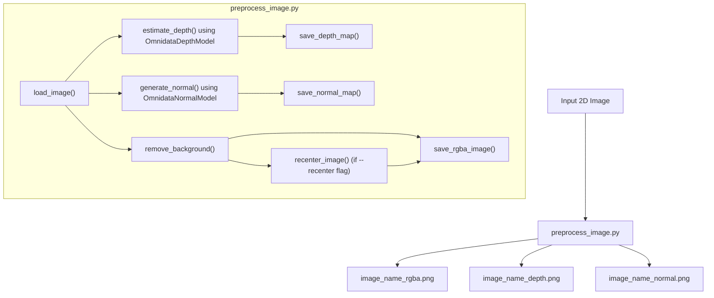
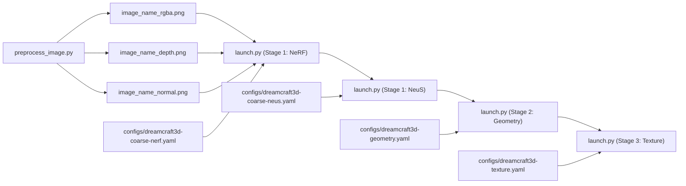
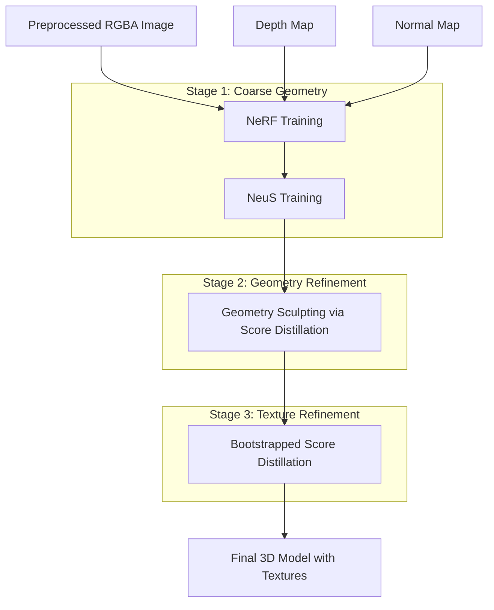

<!-- source: DeepWiki mcp.deepwiki.com · repo deepseek-ai/DreamCraft3D · page 3.2 Image Preprocessing · fetched 2026-10-30 -->

# Image Preprocessing

<details>
<summary>Relevant source files</summary>

The following files were used as context for generating this wiki page:

- [README.md](README.md)

</details>


## Purpose and Scope

Image preprocessing is the critical first step in the DreamCraft3D pipeline that transforms a single 2D reference image into a set of processed assets that guide the subsequent 3D generation stages. This document describes the preprocessing workflow, its components, and how it integrates with the rest of the pipeline.

For more detailed information about specific preprocessing outputs:
- For depth map generation and usage, see [Depth Maps](#3.2.1)
- For normal map generation and usage, see [Normal Maps](#3.2.2)
- For RGBA image processing, see [RGBA Images](#3.2.3)

## Preprocessing Pipeline Overview

The image preprocessing in DreamCraft3D follows a structured workflow to prepare input images for 3D generation:



Sources: [README.md:98-101]()

## Key Components

### preprocess_image.py

The preprocessing functionality is implemented in a single Python script that handles all aspects of image preparation. This script is responsible for:

1. Loading the input image
2. Removing the background to isolate the subject
3. Generating depth maps using Omnidata models
4. Generating normal maps using Omnidata models
5. Optionally recentering the subject
6. Saving all processed assets for use in later stages

The script is invoked with:

```bash
python preprocess_image.py /path/to/image.png --recenter
```

Sources: [README.md:98-101]()

### Omnidata Models

DreamCraft3D relies on pre-trained Omnidata models for depth and normal map prediction. These are external models that need to be downloaded before running the preprocessing script:

| Model | Purpose | Filename |
|-------|---------|----------|
| DPT Depth Model | Depth estimation | omnidata_dpt_depth_v2.ckpt |
| DPT Normal Model | Normal map generation | omnidata_dpt_normal_v2.ckpt |

These models are placed in the `load/omnidata/` directory.

Sources: [README.md:90-95]()

## Code Implementation Structure

The following diagram shows the probable structure of the `preprocess_image.py` script, mapping natural language concepts to code entities:



Sources: [README.md:98-101](), [README.md:90-95]()

## Output Files and Integration

The preprocessing script generates several output files that are used in subsequent stages of the pipeline:



| Output File | Description | Used In |
|-------------|-------------|---------|
| `{image_name}_rgba.png` | Image with background removed | Stage 1, 2, 3 |
| `{image_name}_depth.png` | Predicted depth map | Stage 1 |
| `{image_name}_normal.png` | Predicted normal map | Stage 1 |

Sources: [README.md:104-121]()

## Detailed Preprocessing Steps

### Background Removal

The script removes the background from the input image to isolate the subject. This helps the system focus on generating the 3D model of the target object without distractions from the background.

### Depth Map Generation

Using the Omnidata DPT depth model, the system estimates the depth information from the 2D image. This provides crucial spatial information that guides the initial geometry generation in Stage 1.

### Normal Map Generation

The Omnidata DPT normal model generates normal maps that represent surface orientations at each pixel. This information helps create more detailed and accurate 3D geometry.

### Image Recentering (Optional)

The `--recenter` flag enables an optional step that centers the subject in the frame, which is often beneficial for optimal results in the 3D generation process.

Sources: [README.md:98-101]()

## Advanced Usage: Handling the "Janus Problem"

In some cases, particularly with symmetric objects, the system may generate inconsistent back faces (the "Janus problem"). To address this, DreamCraft3D provides an optional multi-view generation step after preprocessing:

```bash
python threestudio/scripts/img_to_mv.py --image_path 'load/image.png' --save_path '.cache/temp' --prompt 'a photo of object' --superres
```

These generated multi-view images can then be used to train a personalized model with DreamBooth Lora, which helps enforce consistency in the generated 3D model.

Sources: [README.md:123-162]()

## Integration with the 3D Generation Pipeline

The preprocessed assets serve as critical inputs to the first stage (Coarse Geometry Generation) of the DreamCraft3D pipeline, which consists of NeRF and NeuS training:



The quality of the preprocessing directly impacts the quality of the generated 3D models. Well-isolated subjects with accurate depth and normal maps lead to better geometry generation in the subsequent stages.

Sources: [README.md:104-121]()

---

