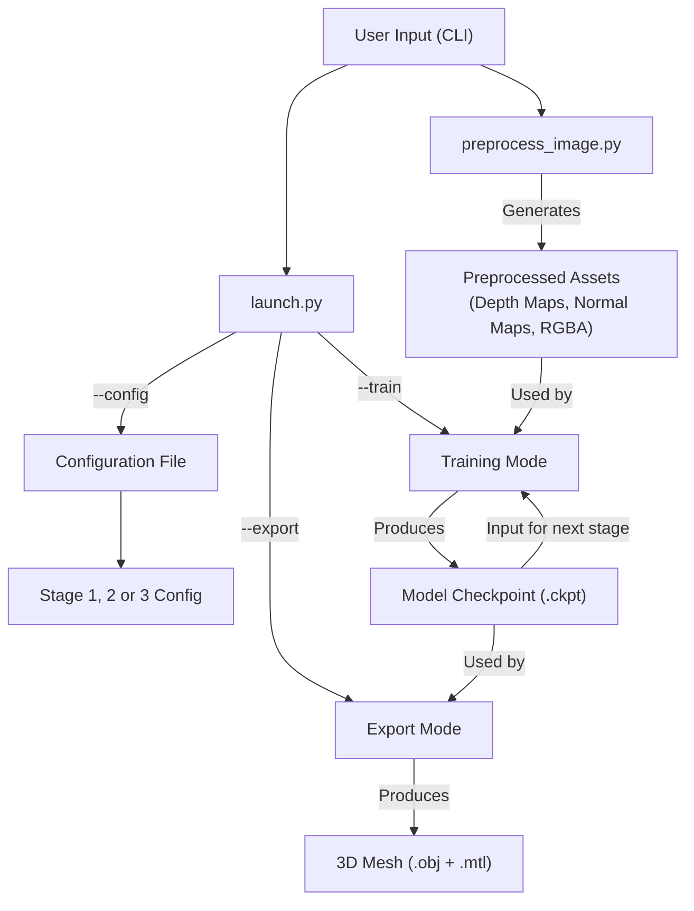
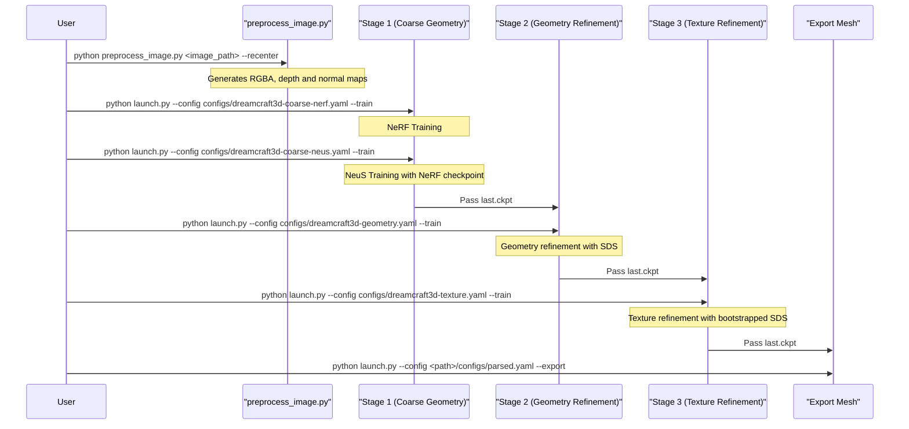
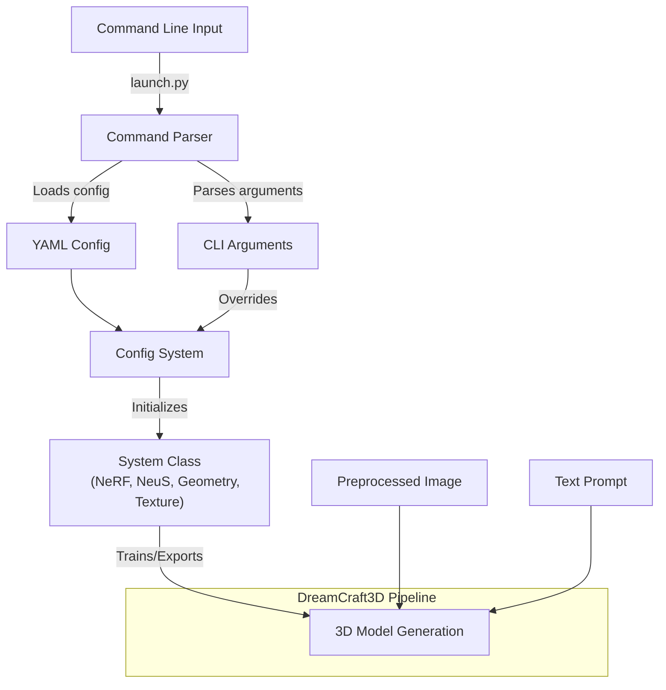
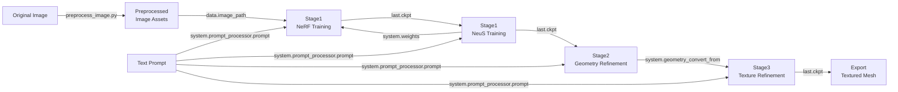

<!-- source: DeepWiki mcp.deepwiki.com · repo deepseek-ai/DreamCraft3D · page 4 Command Line Interface · fetched 2026-10-30 -->

# Command Line Interface

<details>
<summary>Relevant source files</summary>

The following files were used as context for generating this wiki page:

- [README.md](README.md)

</details>


This document provides a comprehensive guide to the DreamCraft3D command line interface, which is the primary method for interacting with the system. It covers the main command structure, workflow commands for running the three-stage pipeline, and configuration options. For installation instructions, see [Installation and Setup](#1.1), and for a quick introduction to basic usage, see [Quick Start Guide](#1.2).

## Overview

DreamCraft3D's command line interface provides tools to execute the hierarchical 3D generation pipeline from a single reference image and text prompt. The interface consists of two main entry points:

1. `preprocess_image.py` - Preprocesses input images for the pipeline
2. `launch.py` - Main execution script that runs each stage of the pipeline with different configurations



Sources: [README.md:98-121](), [README.md:167-171]()

## Main Entry Points

### Preprocessing Images

Before starting the DreamCraft3D pipeline, input images must be preprocessed to remove backgrounds and generate depth and normal maps. This is done using the `preprocess_image.py` script:

```
python preprocess_image.py /path/to/image.png --recenter
```

The `--recenter` flag ensures the subject is properly centered for better results. The preprocessing script produces several outputs:
- RGBA image with background removed
- Depth map using Omnidata
- Normal map using Omnidata

These files are automatically saved in the same directory as the input image, with appropriate suffixes.

Sources: [README.md:98-101]()

### The Launch Script

The `launch.py` script is the main entry point for running each stage of the DreamCraft3D pipeline. It has the following basic syntax:

```
python launch.py --config <config_file> [--train|--export] [parameters]
```

Key arguments:
- `--config`: Path to the configuration YAML file
- `--train`: Run in training mode (default)
- `--export`: Run in export mode to generate final 3D assets
- `--gpu`: (Optional) Specify which GPU to use

Sources: [README.md:107-120](), [README.md:167-171]()

## Pipeline Workflow Commands

DreamCraft3D operates as a hierarchical pipeline with three main stages. Each stage builds upon the results of the previous one.



Sources: [README.md:102-121](), [README.md:167-171]()

### Stage 1: Coarse Geometry Generation

Stage 1 consists of two sequential steps:

1. **NeRF Training**
```
python launch.py --config configs/dreamcraft3d-coarse-nerf.yaml --train system.prompt_processor.prompt="<prompt>" data.image_path="<image_path>"
```

2. **NeuS Training** (using checkpoint from NeRF training)
```
ckpt=outputs/dreamcraft3d-coarse-nerf/<prompt>@LAST/ckpts/last.ckpt
python launch.py --config configs/dreamcraft3d-coarse-neus.yaml --train system.prompt_processor.prompt="<prompt>" data.image_path="<image_path>" system.weights="<ckpt>"
```

Sources: [README.md:107-112]()

### Stage 2: Geometry Refinement

This stage refines the geometry using Score Distillation Sampling:

```
ckpt=outputs/dreamcraft3d-coarse-neus/<prompt>@LAST/ckpts/last.ckpt
python launch.py --config configs/dreamcraft3d-geometry.yaml --train system.prompt_processor.prompt="<prompt>" data.image_path="<image_path>" system.geometry_convert_from="<ckpt>"
```

Sources: [README.md:114-116]()

### Stage 3: Texture Refinement

The final stage refines textures using Bootstrapped Score Distillation:

```
ckpt=outputs/dreamcraft3d-geometry/<prompt>@LAST/ckpts/last.ckpt
python launch.py --config configs/dreamcraft3d-texture.yaml --train system.prompt_processor.prompt="<prompt>" data.image_path="<image_path>" system.geometry_convert_from="<ckpt>"
```

Sources: [README.md:119-120]()

### Exporting Meshes

After completing the pipeline, you can export the textured mesh as an OBJ file with materials:

```
python launch.py --config path/to/trial/dir/configs/parsed.yaml --export --gpu 0 resume=path/to/trial/dir/ckpts/last.ckpt system.exporter_type=mesh-exporter
```

This command exports the mesh as an OBJ file with an associated MTL file containing texture information.

Sources: [README.md:167-171]()

## Configuration Parameters

DreamCraft3D uses YAML configuration files to control the behavior of each stage. While each stage has its own configuration file, parameters can be overridden via command-line arguments.

### Common Parameters

| Parameter | Description | Example |
|-----------|-------------|---------|
| `system.prompt_processor.prompt` | Text prompt describing the desired 3D model | `"a brightly colored mushroom growing on a log"` |
| `data.image_path` | Path to the preprocessed reference image | `"load/images/mushroom_log_rgba.png"` |
| `system.weights` | Path to previous stage checkpoint | `"outputs/.../last.ckpt"` |
| `system.geometry_convert_from` | Path to geometry checkpoint | `"outputs/.../last.ckpt"` |
| `data.height`, `data.width` | Rendering resolution | `256` |
| `system.exporter_type` | Type of exporter for final outputs | `mesh-exporter` |

### Memory Optimization

For systems with less than 40GB VRAM, you can reduce memory usage by lowering rendering resolution:

```
data.height=128 data.width=128 data.random_camera.height=128 data.random_camera.width=128
```

Sources: [README.md:164-165]()

## Advanced Usage

### Custom Diffusion Models for Janus Problem

If the "Janus problem" (inconsistent faces on opposite sides) occurs during Stage 1, you can train a custom Text2Image model:

1. **Generate multi-view images from a single reference**:
```
python threestudio/scripts/img_to_mv.py --image_path 'load/mushroom.png' --save_path '.cache/temp' --prompt 'a photo of mushroom' --superres
```

2. **Train a personalized DeepFloyd model**:
```
export MODEL_NAME="DeepFloyd/IF-I-XL-v1.0"
export INSTANCE_DIR=".cache/temp"
export OUTPUT_DIR=".cache/if_dreambooth_mushroom"

accelerate launch threestudio/scripts/train_dreambooth_lora.py \
  --pretrained_model_name_or_path=$MODEL_NAME \
  --instance_data_dir=$INSTANCE_DIR \
  --output_dir=$OUTPUT_DIR \
  --instance_prompt="a sks mushroom" \
  --resolution=64 \
  --train_batch_size=4 \
  --gradient_accumulation_steps=1 \
  --learning_rate=5e-6 \
  --scale_lr \
  --max_train_steps=1200 \
  --checkpointing_steps=600 \
  --pre_compute_text_embeddings \
  --tokenizer_max_length=77 \
  --text_encoder_use_attention_mask
```

3. **Use the personalized model in Stage 1**:
```
python launch.py --config configs/dreamcraft3d-coarse-nerf.yaml --train system.prompt_processor.prompt="<prompt>" data.image_path="<image_path>" system.guidance.lora_weights_path=".cache/if_dreambooth_mushroom"
```

Sources: [README.md:123-161]()

## Command Line to Code Execution Flow

The following diagram illustrates how command line arguments flow through the codebase to execute the different stages of the pipeline:



Sources: [README.md:102-121]()

## Data Flow in Command Line Pipeline

This diagram shows how data flows between the different commands in the complete pipeline:



Sources: [README.md:102-121](), [README.md:167-171]()

---

