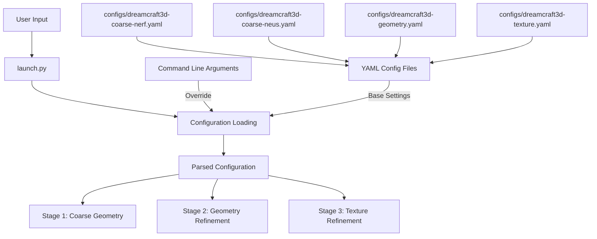
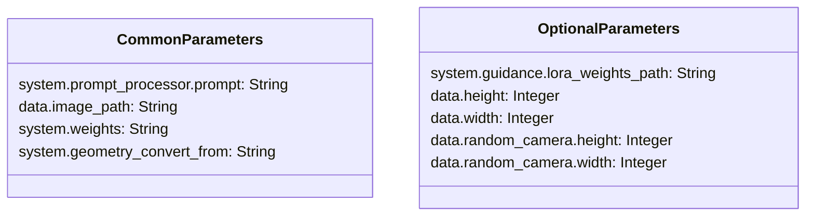
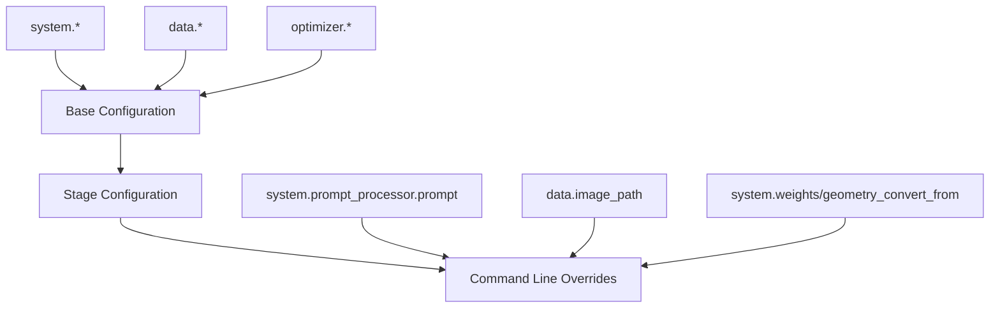

<!-- source: DeepWiki mcp.deepwiki.com · repo deepseek-ai/DreamCraft3D · page 4.1 Configuration Options · fetched 2026-10-30 -->

# Configuration Options

<details>
<summary>Relevant source files</summary>

The following files were used as context for generating this wiki page:

- [README.md](README.md)

</details>


This page details the configuration parameters available in DreamCraft3D, explaining how to adjust system behavior for different stages of the 3D generation pipeline. For information about running complete example workflows, see [Example Workflows](#4.2).

## Configuration System Overview

DreamCraft3D uses YAML-based configuration files to control all aspects of the pipeline. Each stage has its own default configuration file, and parameters can be overridden via command-line arguments.



Sources: [README.md:107-120]()

## Core Configuration Files

DreamCraft3D uses four primary configuration files corresponding to different stages of the pipeline:

| Configuration File | Purpose | Used in |
|---|---|---|
| `dreamcraft3d-coarse-nerf.yaml` | Initial coarse geometry using Neural Radiance Fields | Stage 1 (Part 1) |
| `dreamcraft3d-coarse-neus.yaml` | Refined geometry using Neural Surface Reconstruction | Stage 1 (Part 2) |
| `dreamcraft3d-geometry.yaml` | Further refining geometry with score distillation sampling | Stage 2 |
| `dreamcraft3d-texture.yaml` | Enhancing texture details with bootstrapped diffusion | Stage 3 |

Sources: [README.md:107-120]()

## Common Configuration Parameters

The following parameters are commonly used across multiple stages:



### Key Parameters

- **`system.prompt_processor.prompt`**: Text description that guides the generation process
- **`data.image_path`**: Path to the reference image (typically RGBA format)
- **`system.weights`**: Path to model weights from previous stage
- **`system.geometry_convert_from`**: Path to checkpoint for geometry initialization
- **`system.guidance.lora_weights_path`**: Path to custom LoRA weights for personalized guidance

Sources: [README.md:104-120](), [README.md:159-160]()

## Stage-Specific Configuration

### Stage 1: Coarse Geometry Configuration

Stage 1 consists of two sub-stages, each with its own configuration:

#### NeRF Configuration (Part 1)
Key parameters for Neural Radiance Fields:

- **`system.prompt_processor.prompt`**: Text prompt describing the object
- **`data.image_path`**: Reference image path
- **`system.guidance.lora_weights_path`** (optional): For custom text-to-image models

#### NeuS Configuration (Part 2)
Parameters for Neural Surface Reconstruction:

- **`system.prompt_processor.prompt`**: Same text prompt as NeRF stage
- **`data.image_path`**: Same reference image path
- **`system.weights`**: Path to the last checkpoint from NeRF stage

Sources: [README.md:107-111](), [README.md:159-160]()

### Stage 2: Geometry Refinement Configuration

Geometry refinement configuration parameters:

- **`system.prompt_processor.prompt`**: Text prompt consistent with previous stages
- **`data.image_path`**: Reference image path
- **`system.geometry_convert_from`**: Path to the last checkpoint from Stage 1 (NeuS)

Sources: [README.md:113-115]()

### Stage 3: Texture Refinement Configuration

Bootstrapped diffusion texture enhancement parameters:

- **`system.prompt_processor.prompt`**: Text prompt consistent with previous stages
- **`data.image_path`**: Reference image path
- **`system.geometry_convert_from`**: Path to the last checkpoint from Stage 2

Sources: [README.md:118-120]()

## Memory Optimization Options

You can adjust rendering resolution to reduce memory usage:

```
data.height=128 data.width=128 data.random_camera.height=128 data.random_camera.width=128
```

These parameters control:
- **`data.height`** & **`data.width`**: Resolution for main rendering
- **`data.random_camera.height`** & **`data.random_camera.width`**: Resolution for random camera renders

Sources: [README.md:164]()

## Export Configuration

To export the generated 3D model as a textured mesh:

```
python launch.py --config path/to/trial/dir/configs/parsed.yaml --export --gpu 0 resume=path/to/trial/dir/ckpts/last.ckpt system.exporter_type=mesh-exporter
```

Key export parameters:
- **`--export`**: Flag to trigger export mode
- **`resume`**: Path to the checkpoint to load
- **`system.exporter_type`**: Type of exporter to use (default: `mesh-exporter` for OBJ+MTL files)

Sources: [README.md:168-171]()

## Configuration Parameter Inheritance



DreamCraft3D configuration follows a hierarchical inheritance pattern where command-line arguments override stage-specific configurations, which in turn override base configurations.

Sources: [README.md:107-120]()

## Custom Model Configuration

For cases where the "Janus problem" (inconsistent face generation) occurs in Stage 1, you can configure a custom text-to-image model:

1. Generate multi-view images using Zero123++:
```
python threestudio/scripts/img_to_mv.py --image_path 'load/mushroom.png' --save_path '.cache/temp' --prompt 'a photo of mushroom' --superres
```

2. Train a personalized DeepFloyd model with DreamBooth LoRA:
```
export MODEL_NAME="DeepFloyd/IF-I-XL-v1.0"
export INSTANCE_DIR=".cache/temp"
export OUTPUT_DIR=".cache/if_dreambooth_mushroom"

accelerate launch threestudio/scripts/train_dreambooth_lora.py [...]
```

3. Apply in the configuration by adding: 
```
system.guidance.lora_weights_path=".cache/if_dreambooth_mushroom"
```

Sources: [README.md:123-161]()

---

