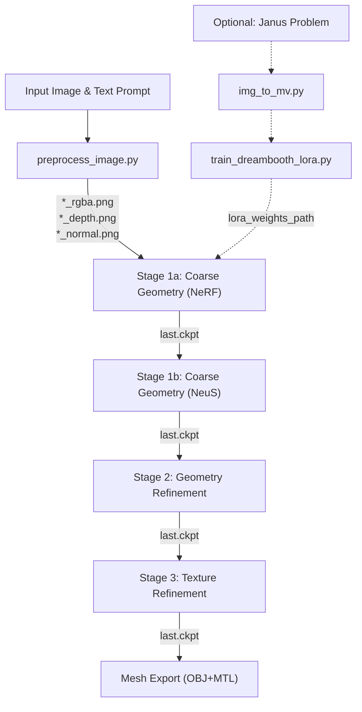
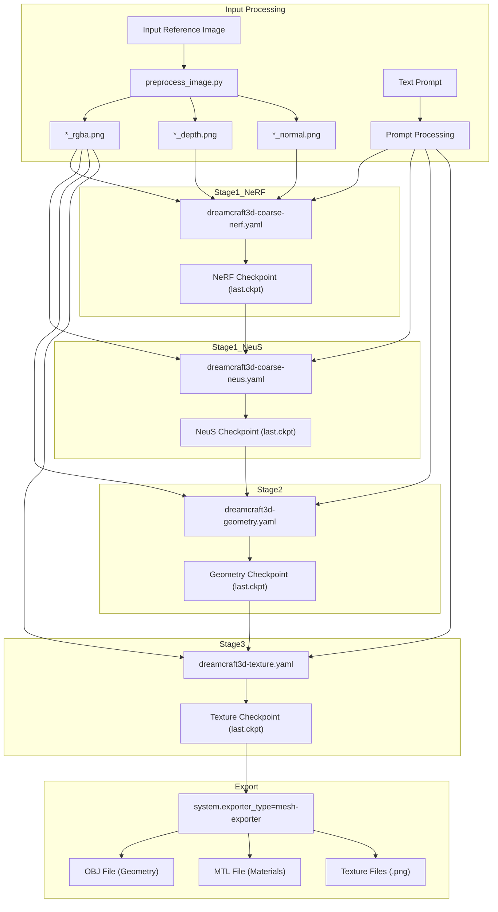
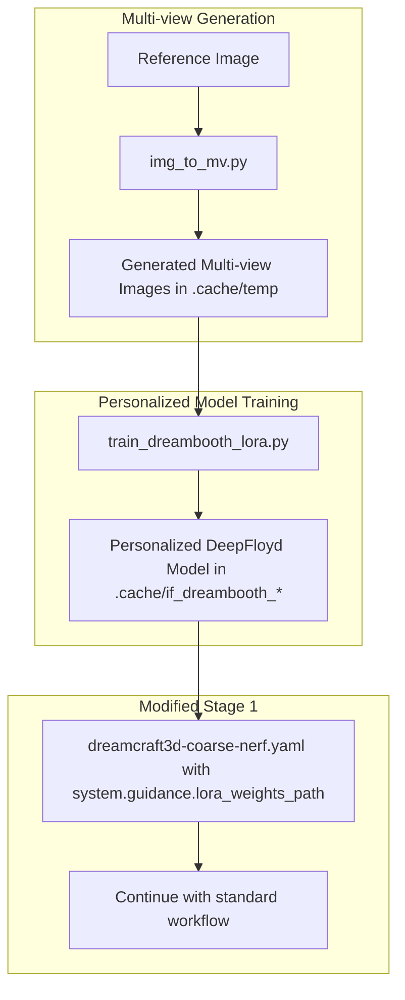
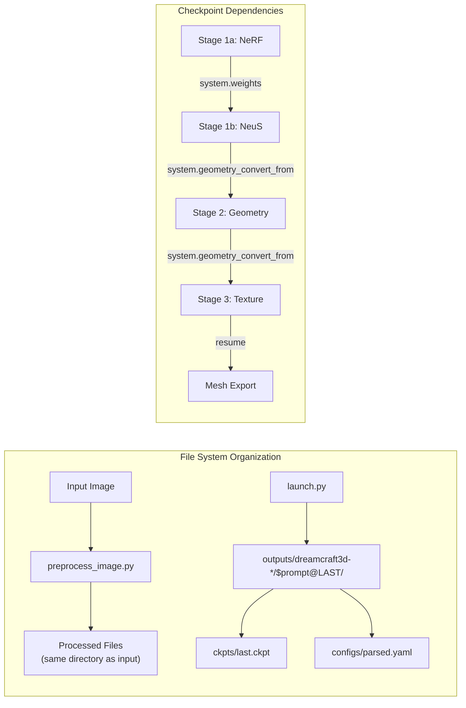

<!-- source: DeepWiki mcp.deepwiki.com · repo deepseek-ai/DreamCraft3D · page 4.2 Example Workflows · fetched 2026-10-30 -->

# Example Workflows

<details>
<summary>Relevant source files</summary>

The following files were used as context for generating this wiki page:

- [README.md](README.md)
- [assets/mesh_meshlab.jpg](assets/mesh_meshlab.jpg)

</details>


This page provides detailed walkthroughs of complete workflows for generating 3D models from single images using DreamCraft3D, from preprocessing an input image to exporting the final textured 3D mesh. For information about specific configuration parameters, see [Configuration Options](#4.1). For advanced customization topics, see [Advanced Topics](#5).

## Workflow Overview

The primary DreamCraft3D pipeline follows a hierarchical three-stage approach to generate high-quality 3D models from a single image and text prompt.



Sources: [README.md:97-121](), [README.md:166-171]()

## Standard Workflow

### Step 1: Image Preprocessing

Before running the main training pipeline, preprocess your input image to remove the background and generate depth and normal maps:

```bash
python preprocess_image.py /path/to/image.png --recenter
```

This creates the following files in the same directory as your original image:
- `*_rgba.png`: Image with background removed
- `*_depth.png`: Predicted depth map 
- `*_normal.png`: Predicted normal map

Sources: [README.md:98-101]()

### Step 2: Stage 1 - Coarse Geometry Generation

Stage 1 consists of two sequential steps: NeRF training followed by NeuS training.

#### NeRF Training
```bash
python launch.py --config configs/dreamcraft3d-coarse-nerf.yaml --train system.prompt_processor.prompt="$prompt" data.image_path="$image_path"
```

#### NeuS Training (using NeRF checkpoint)
```bash
ckpt=outputs/dreamcraft3d-coarse-nerf/$prompt@LAST/ckpts/last.ckpt
python launch.py --config configs/dreamcraft3d-coarse-neus.yaml --train system.prompt_processor.prompt="$prompt" data.image_path="$image_path" system.weights="$ckpt"
```

Sources: [README.md:107-111]()

### Step 3: Stage 2 - Geometry Refinement

This stage refines the geometry using score distillation sampling:

```bash
ckpt=outputs/dreamcraft3d-coarse-neus/$prompt@LAST/ckpts/last.ckpt
python launch.py --config configs/dreamcraft3d-geometry.yaml --train system.prompt_processor.prompt="$prompt" data.image_path="$image_path" system.geometry_convert_from="$ckpt"
```

Sources: [README.md:113-115]()

### Step 4: Stage 3 - Texture Refinement

The final stage enhances texture details through bootstrapped score distillation:

```bash
ckpt=outputs/dreamcraft3d-geometry/$prompt@LAST/ckpts/last.ckpt
python launch.py --config configs/dreamcraft3d-texture.yaml --train system.prompt_processor.prompt="$prompt" data.image_path="$image_path" system.geometry_convert_from="$ckpt"
```

Sources: [README.md:118-120]()

### Step 5: Exporting the Mesh

After completing all training stages, export the textured mesh as OBJ/MTL files:

```bash
python launch.py --config path/to/trial/dir/configs/parsed.yaml --export --gpu 0 resume=path/to/trial/dir/ckpts/last.ckpt system.exporter_type=mesh-exporter
```

Sources: [README.md:166-171]()

## Detailed Pipeline Architecture

The following diagram shows the data flow and component interactions throughout the DreamCraft3D pipeline:



Sources: [README.md:97-121](), [README.md:166-171]()

## Complete Example Workflow

Here's a complete example workflow for generating a 3D model of a mushroom:

```bash
# Define variables
prompt="a brightly colored mushroom growing on a log"
image_path="load/images/mushroom_log_rgba.png"

# Preprocess the image (if not already preprocessed)
python preprocess_image.py load/images/mushroom_log.png --recenter

# Stage 1: NeRF & NeuS
python launch.py --config configs/dreamcraft3d-coarse-nerf.yaml --train system.prompt_processor.prompt="$prompt" data.image_path="$image_path"

ckpt=outputs/dreamcraft3d-coarse-nerf/$prompt@LAST/ckpts/last.ckpt
python launch.py --config configs/dreamcraft3d-coarse-neus.yaml --train system.prompt_processor.prompt="$prompt" data.image_path="$image_path" system.weights="$ckpt"

# Stage 2: Geometry Refinement
ckpt=outputs/dreamcraft3d-coarse-neus/$prompt@LAST/ckpts/last.ckpt
python launch.py --config configs/dreamcraft3d-geometry.yaml --train system.prompt_processor.prompt="$prompt" data.image_path="$image_path" system.geometry_convert_from="$ckpt"

# Stage 3: Texture Refinement
ckpt=outputs/dreamcraft3d-geometry/$prompt@LAST/ckpts/last.ckpt
python launch.py --config configs/dreamcraft3d-texture.yaml --train system.prompt_processor.prompt="$prompt" data.image_path="$image_path" system.geometry_convert_from="$ckpt"

# Export the final mesh
ckpt=outputs/dreamcraft3d-texture/$prompt@LAST/ckpts/last.ckpt
python launch.py --config outputs/dreamcraft3d-texture/$prompt@LAST/configs/parsed.yaml --export --gpu 0 resume="$ckpt" system.exporter_type=mesh-exporter
```

Sources: [README.md:104-121](), [README.md:166-171]()

## Advanced Workflow: Handling the Janus Problem

If your model exhibits the "Janus problem" (inconsistent faces on different sides), you can train a custom Text2Image model to improve results:



### Step 1: Generate multi-view images
```bash
python threestudio/scripts/img_to_mv.py --image_path 'load/mushroom.png' --save_path '.cache/temp' --prompt 'a photo of mushroom' --superres
```

### Step 2: Train a personalized DeepFloyd model
```bash
export MODEL_NAME="DeepFloyd/IF-I-XL-v1.0"
export INSTANCE_DIR=".cache/temp"
export OUTPUT_DIR=".cache/if_dreambooth_mushroom"

accelerate launch threestudio/scripts/train_dreambooth_lora.py \
  --pretrained_model_name_or_path=$MODEL_NAME  \
  --instance_data_dir=$INSTANCE_DIR \
  --output_dir=$OUTPUT_DIR \
  --instance_prompt="a sks mushroom" \
  --resolution=64 \
  --train_batch_size=4 \
  --gradient_accumulation_steps=1 \
  --learning_rate=5e-6 \
  --scale_lr \
  --max_train_steps=1200 \
  --checkpointing_steps=600 \
  --pre_compute_text_embeddings \
  --tokenizer_max_length=77 \
  --text_encoder_use_attention_mask
```

### Step 3: Use the personalized model in Stage 1
```bash
python launch.py --config configs/dreamcraft3d-coarse-nerf.yaml --train system.prompt_processor.prompt="$prompt" data.image_path="$image_path" system.guidance.lora_weights_path=".cache/if_dreambooth_mushroom"
```

**Note:** The "sks" in the instance prompt is a unique identifier to help the model learn the specific object.

Sources: [README.md:123-161]()

## Memory Optimization Tips

For systems with limited VRAM (less than 40GB), you can reduce memory usage by adjusting rendering resolutions:

```bash
# Add these parameters to any stage command:
data.height=128 data.width=128 data.random_camera.height=128 data.random_camera.width=128
```

Example with reduced resolution:
```bash
python launch.py --config configs/dreamcraft3d-coarse-neus.yaml --train system.prompt_processor.prompt="$prompt" data.image_path="$image_path" system.weights="$ckpt" data.height=128 data.width=128 data.random_camera.height=128 data.random_camera.width=128
```

Sources: [README.md:163-164]()

## Configuration and Checkpoint Flow



Sources: [README.md:104-121](), [README.md:166-171]()

## Troubleshooting Common Issues

| Issue | Possible Solution |
|-------|-------------------|
| Out of memory errors | Reduce rendering resolution as described in the Memory Optimization Tips section |
| Janus problem (inconsistent faces) | Use the custom Text2Image model workflow described in the Advanced Workflow section |
| Poor texture quality | Ensure the reference image has good lighting and clear details |
| Slow generation | Use a GPU with more VRAM or reduce resolution parameters |
| Export issues | Verify that the checkpoint path is correct and the training completed successfully |

Sources: [README.md:123-164]()

---

