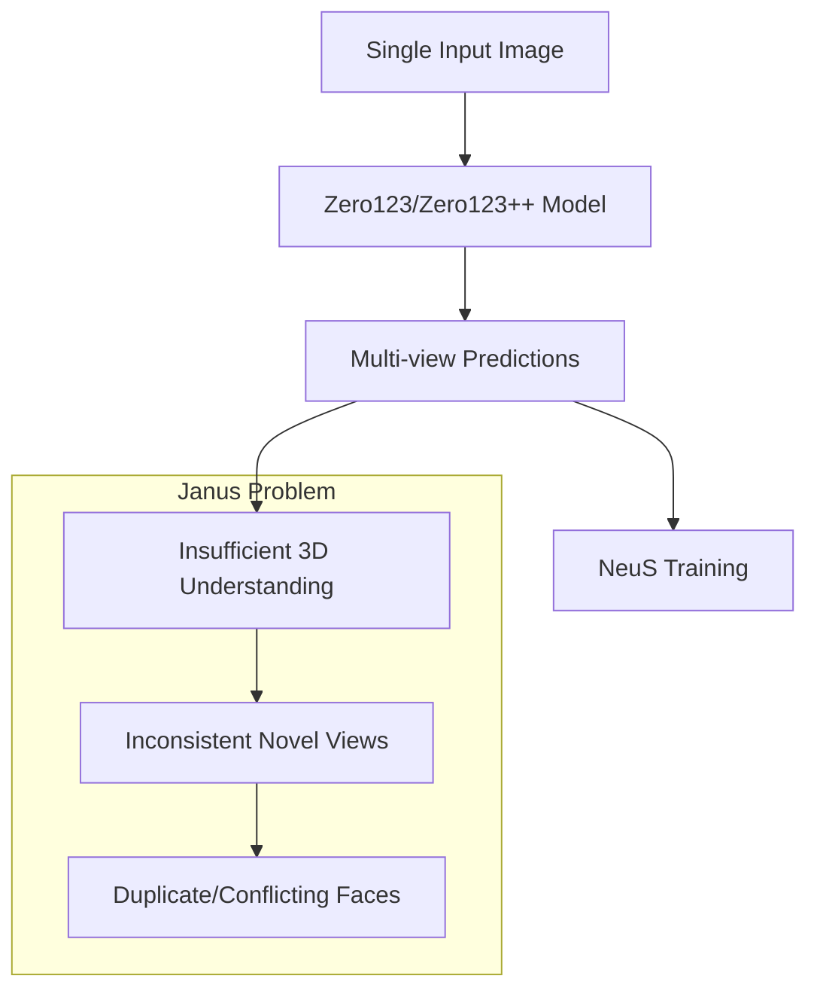
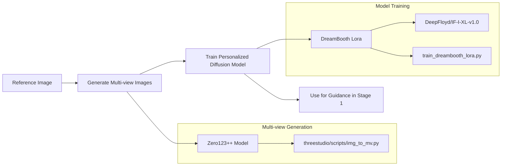
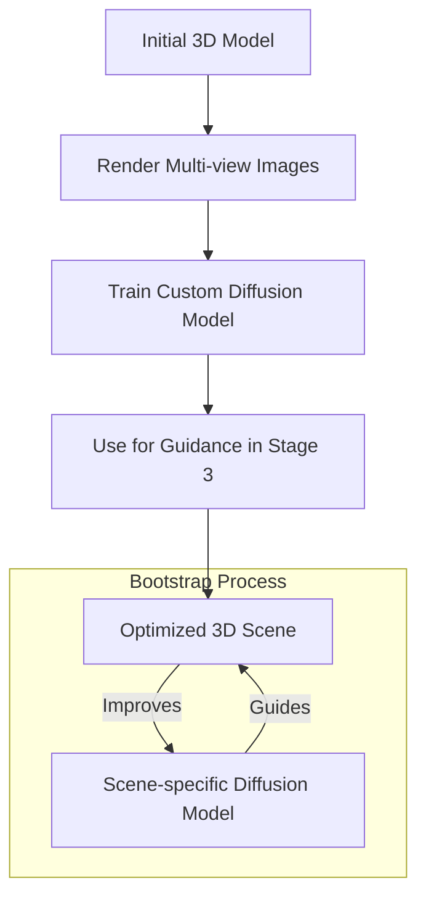
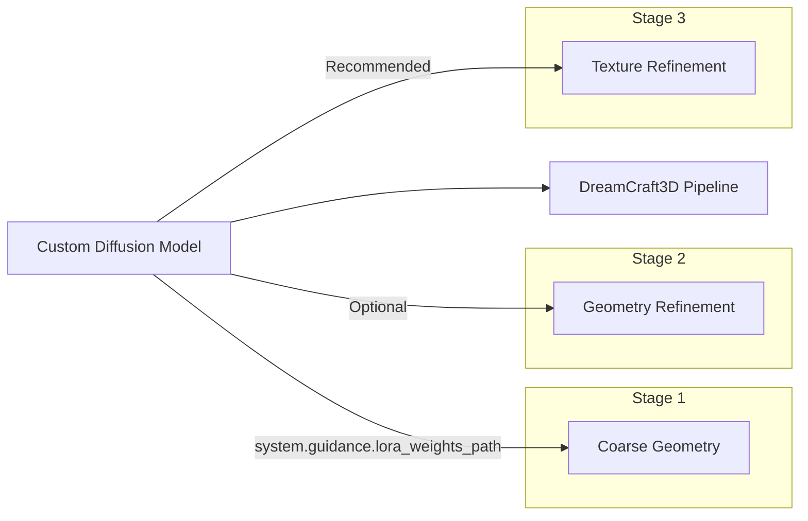
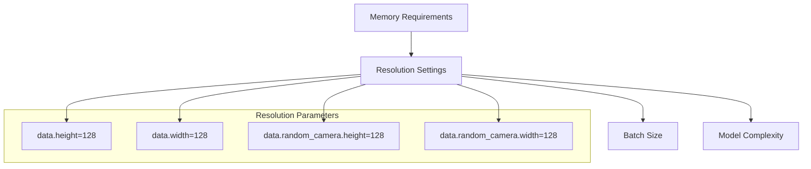
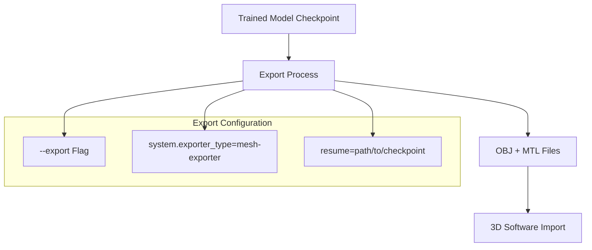
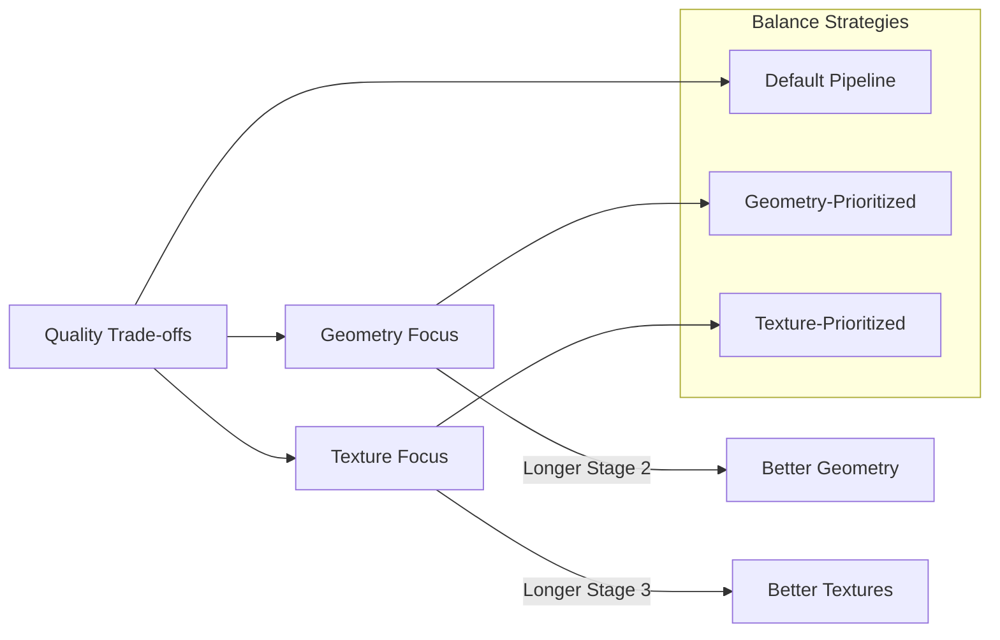

<!-- source: DeepWiki mcp.deepwiki.com · repo deepseek-ai/DreamCraft3D · page 5 Advanced Topics · fetched 2026-10-30 -->

# Advanced Topics

<details>
<summary>Relevant source files</summary>

The following files were used as context for generating this wiki page:

- [README.md](README.md)

</details>


This document covers advanced usage scenarios and customization options for DreamCraft3D. These topics are intended for users who have successfully run the basic pipeline and want to improve results, customize the generation process, or optimize resource usage. For basic usage and setup information, see [Overview](#1) and [Quick Start Guide](#1.2).

## Handling the Janus Problem

The "Janus problem" is a common issue in single-view 3D reconstruction where the model generates inconsistent or duplicate faces on the unseen side of an object (like the Roman god Janus who had two faces). This problem frequently appears during Stage 1 of the DreamCraft3D pipeline.

### What Causes the Janus Problem

The Janus problem occurs because the diffusion model lacks enough 3D understanding to consistently generate the unseen parts of an object. This results in inconsistent renderings when viewing the object from different angles.



Sources: [README.md:123-161]()

### Solution: Training a Custom Text2Image Model

To address the Janus problem, DreamCraft3D offers the option to train a personalized diffusion model specific to your object. This creates a more 3D-consistent guidance signal.

The process involves two main steps:

1. Generate multi-view images from the reference image using Zero123++
2. Train a personalized DeepFloyd model using DreamBooth Lora



Sources: [README.md:126-161]()

### Implementation Steps

1. Generate multi-view images:
```bash
python threestudio/scripts/img_to_mv.py --image_path 'load/image.png' --save_path '.cache/temp' --prompt 'a photo of object' --superres
```

2. Train a personalized DeepFloyd model:
```bash
python threestudio/scripts/train_dreambooth_lora.py \
  --pretrained_model_name_or_path="DeepFloyd/IF-I-XL-v1.0" \
  --instance_data_dir=".cache/temp" \
  --output_dir=".cache/if_dreambooth_object" \
  --instance_prompt="a sks object" \
  --resolution=64 \
  --train_batch_size=4 \
  --learning_rate=5e-6 \
  --max_train_steps=1200
```

3. Use the personalized model for Stage 1 training:
```bash
python launch.py --config configs/dreamcraft3d-coarse-nerf.yaml --train system.prompt_processor.prompt="your prompt" data.image_path="your_image_path" system.guidance.lora_weights_path=".cache/if_dreambooth_object"
```

Sources: [README.md:126-161]()

## Custom Diffusion Models

DreamCraft3D's texture refinement in Stage 3 relies on Bootstrapped Score Distillation, which can be enhanced through custom diffusion models. This section covers how to train and integrate these models for better results.

### Training Custom Diffusion Models

The system supports training personalized diffusion models specific to your 3D object. This approach leverages the DreamBooth technique with LoRA (Low-Rank Adaptation) to fine-tune pretrained models.



Sources: [README.md:9-19]()

The bootstrap process is the key innovation in DreamCraft3D, where:
1. The current 3D model renders are used to improve the diffusion model
2. The improved diffusion model provides better guidance for 3D optimization
3. This cycle creates a mutually reinforcing improvement

### Model Selection and Compatibility

DreamCraft3D supports multiple diffusion model architectures:

| Model Type | Purpose | Configuration |
|------------|---------|---------------|
| DeepFloyd IF | High-detail initial generation | `system.prompt_processor.pretrained_model_name_or_path="DeepFloyd/IF-I-XL-v1.0"` |
| Stable Diffusion | Texture refinement | `system.guidance.pretrained_model_name_or_path="runwayml/stable-diffusion-v1-5"` |

Both model types can be used with personalization techniques like DreamBooth and LoRA for object-specific optimization.

### Integration Pipeline



Sources: [README.md:97-121]()

## Memory Optimization Techniques

DreamCraft3D can be resource-intensive, especially during the NeuS training phase. Here are strategies to optimize memory usage for systems with limited VRAM.

### Reducing Rendering Resolution

The most effective way to reduce memory usage is to lower the rendering resolution, particularly during the NeuS stage:

```bash
python launch.py --config configs/dreamcraft3d-coarse-neus.yaml --train system.prompt_processor.prompt="your prompt" data.image_path="your_image_path" data.height=128 data.width=128 data.random_camera.height=128 data.random_camera.width=128
```

This technique can be applied to all stages of the pipeline. The memory consumption scales approximately quadratically with resolution.



Sources: [README.md:163-164]()

### Batch Size and Step Adjustments

For further memory optimization, consider:
1. Reducing batch size in training configs
2. Using gradient accumulation
3. Simplifying model complexity at the cost of quality

## Advanced Export Options

DreamCraft3D provides options for exporting high-quality textured 3D meshes after completion of all stages.

### Exporting Textured Meshes

To export the final 3D model as an OBJ file with materials:

```bash
python launch.py --config path/to/trial/dir/configs/parsed.yaml --export --gpu 0 resume=path/to/trial/dir/ckpts/last.ckpt system.exporter_type=mesh-exporter
```

This generates an OBJ file with associated MTL and texture files that can be imported into standard 3D software.



Sources: [README.md:166-179]()

### Export Customization

The mesh exporter supports several configuration options:

| Parameter | Description | Default |
|-----------|-------------|---------|
| `system.exporter_type` | Type of exporter (mesh-exporter, point-cloud-exporter) | mesh-exporter |
| `system.mesh_resolution` | Resolution of the exported mesh | 256 |
| `system.export_name` | Name of the exported file | output |

## Troubleshooting Advanced Scenarios

### Common Issues with the Janus Problem

If the custom diffusion model training doesn't adequately solve the Janus problem:
1. Try using a different reference image with clearer object boundaries
2. Experiment with longer training duration for the personalized model (increase `max_train_steps`)
3. Adjust the instance prompt to be more specific about the object's characteristics

### Geometry vs. Texture Quality Trade-offs

DreamCraft3D involves inherent trade-offs between geometry consistency and texture fidelity:
1. Stage 2 prioritizes geometry consistency at the cost of texture detail
2. Stage 3 enhances texture while preserving the geometry

For optimal results, consider running Stage 3 for additional iterations if texture quality is paramount, or focus more on Stage 2 if geometric accuracy is more important.



Sources: [README.md:11-19]()

---

