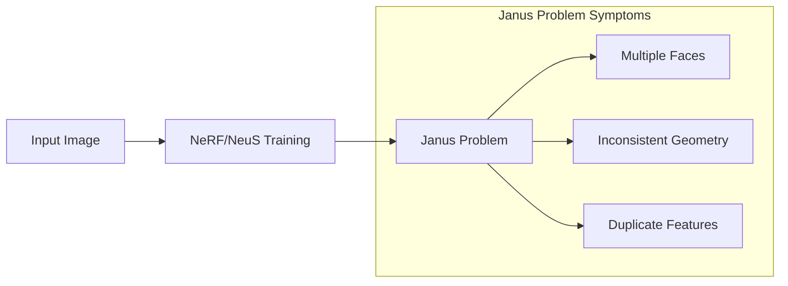
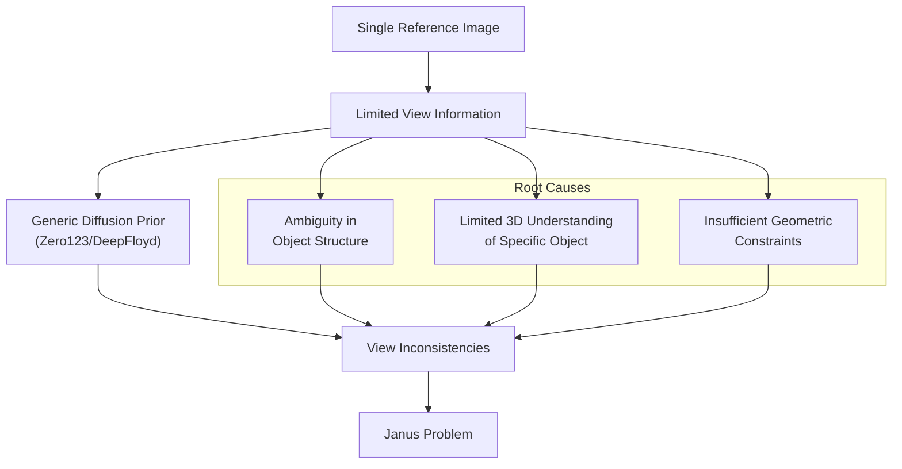
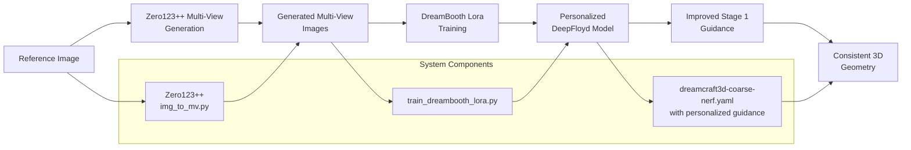
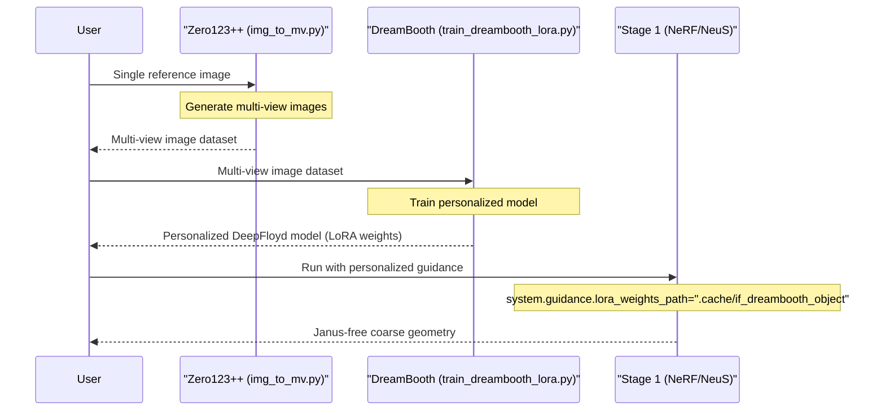
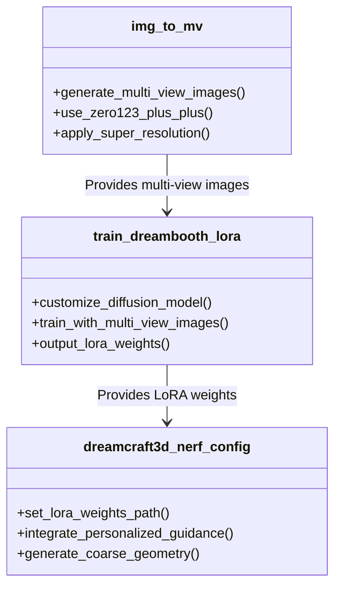

<!-- source: DeepWiki mcp.deepwiki.com · repo deepseek-ai/DreamCraft3D · page 5.1 Handling the Janus Problem · fetched 2026-10-30 -->

# Handling the Janus Problem

<details>
<summary>Relevant source files</summary>

The following files were used as context for generating this wiki page:

- [README.md](README.md)

</details>


## Purpose and Scope

This document explains the "Janus problem" that can occur during Stage 1 of the DreamCraft3D pipeline and provides a detailed solution using personalized diffusion models. For information about the standard Stage 1 pipeline, see [Stage 1: Coarse Geometry Generation](#2.1).

## What is the Janus Problem?

The Janus problem refers to an inconsistency issue in 3D reconstruction where models generate faces or features on both sides of an object, similar to the Roman god Janus who had two faces looking in opposite directions. This problem commonly manifests during the coarse geometry generation phase (Stage 1) when using NeRF and NeuS techniques.



Sources: [README.md:123-161]()

## Why the Janus Problem Occurs

The Janus problem stems from view inconsistency issues during novel view synthesis. When the diffusion prior used in Stage 1 lacks strong 3D awareness for the specific object being modeled, it may generate inconsistent predictions for different viewpoints.



Sources: [README.md:123-161]()

## Solution: Personalized Text2Image Model

DreamCraft3D provides a solution that involves training a personalized diffusion model with better 3D awareness of the specific object. This approach uses the following key steps:

1. Generate multi-view images from the single reference image
2. Train a personalized diffusion model using DreamBooth Lora
3. Use this personalized model to guide Stage 1 training



Sources: [README.md:126-160]()

## Implementation Details

### Step 1: Generate Multi-View Images

The first step uses Zero123++ to create multi-view images from your single reference image:

```bash
python threestudio/scripts/img_to_mv.py --image_path 'load/images/object.png' --save_path '.cache/temp' --prompt 'a photo of object' --superres
```

The script generates synthetic views of the object from different angles, providing a dataset that captures the 3D characteristics of the specific object.

Sources: [README.md:128-130]()

### Step 2: Train a Personalized Model

The next step trains a personalized DeepFloyd model using DreamBooth with Lora fine-tuning:

```bash
export MODEL_NAME="DeepFloyd/IF-I-XL-v1.0"
export INSTANCE_DIR=".cache/temp"
export OUTPUT_DIR=".cache/if_dreambooth_object"

accelerate launch threestudio/scripts/train_dreambooth_lora.py \
  --pretrained_model_name_or_path=$MODEL_NAME \
  --instance_data_dir=$INSTANCE_DIR \
  --output_dir=$OUTPUT_DIR \
  --instance_prompt="a sks object" \
  --resolution=64 \
  --train_batch_size=4 \
  --gradient_accumulation_steps=1 \
  --learning_rate=5e-6 \
  --scale_lr \
  --max_train_steps=1200 \
  --checkpointing_steps=600 \
  --pre_compute_text_embeddings \
  --tokenizer_max_length=77 \
  --text_encoder_use_attention_mask
```

Key parameters:
- `instance_prompt`: Uses a unique identifier ("sks") to associate with your object
- `max_train_steps`: Number of training iterations (1200 recommended)
- `checkpointing_steps`: Save checkpoints every 600 steps

Sources: [README.md:132-153]()

### Step 3: Use the Personalized Model in Stage 1

Finally, use the personalized model for guidance in Stage 1 by specifying the `lora_weights_path`:

```bash
python launch.py --config configs/dreamcraft3d-coarse-nerf.yaml --train system.prompt_processor.prompt="$prompt" data.image_path="$image_path" system.guidance.lora_weights_path=".cache/if_dreambooth_object"
```

The system will now use your personalized model which has learned the specific 3D characteristics of your object, greatly reducing the likelihood of the Janus problem.

Sources: [README.md:158-160]()

## Technical Workflow Diagram



Sources: [README.md:123-161]()

## Code System Components



Sources: [README.md:126-160]()

## Recognizing the Janus Problem

You may need to apply this fix if you observe any of the following issues after running Stage 1:

1. The model has duplicate facial features on opposite sides
2. The geometry appears to have symmetry where it shouldn't
3. The model geometry is inconsistent when viewed from different angles
4. The NeuS optimization fails to converge to a reasonable shape

## Best Practices

1. **Verify multi-view quality**: After running `img_to_mv.py`, check if the generated multi-view images look reasonable before proceeding.

2. **Unique identifier**: Use a unique identifier (like "sks") in your instance prompt when training the DreamBooth model to avoid conflicts.

3. **Training duration**: The recommended 1200 steps for DreamBooth training is usually sufficient, but complex objects may benefit from more training steps.

4. **Memory considerations**: Training the personalized model requires significant GPU memory. Consider reducing batch size if you encounter memory issues.

5. **Integration with full pipeline**: After successfully completing Stage 1 with the personalized model, you can continue with Stages 2 and 3 as normal.

Sources: [README.md:126-161]()

---

