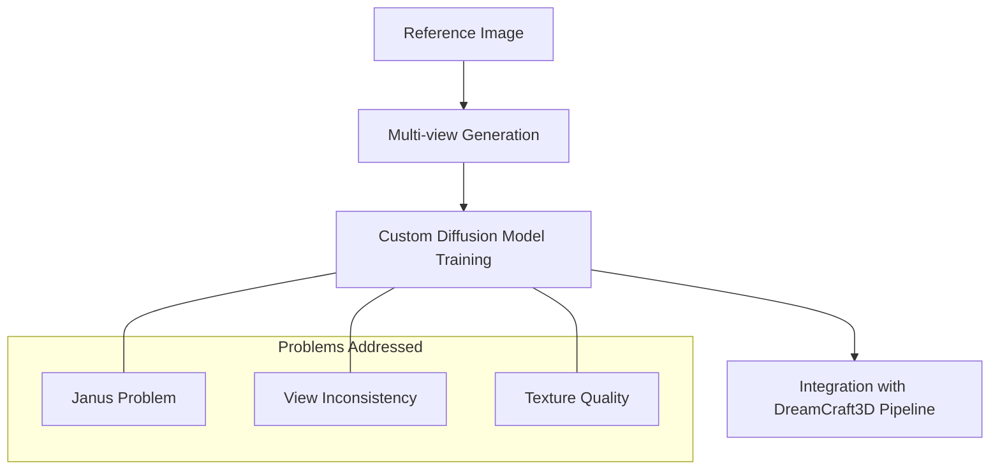
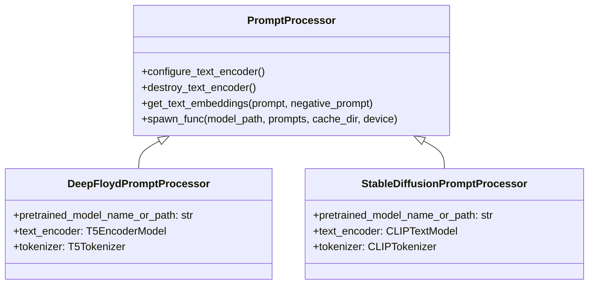
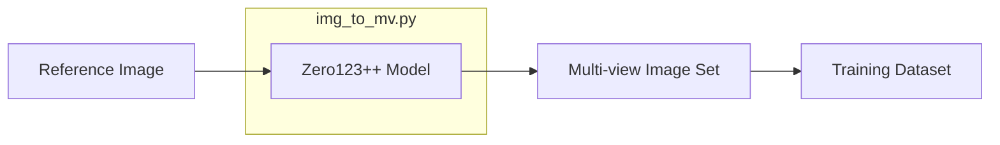
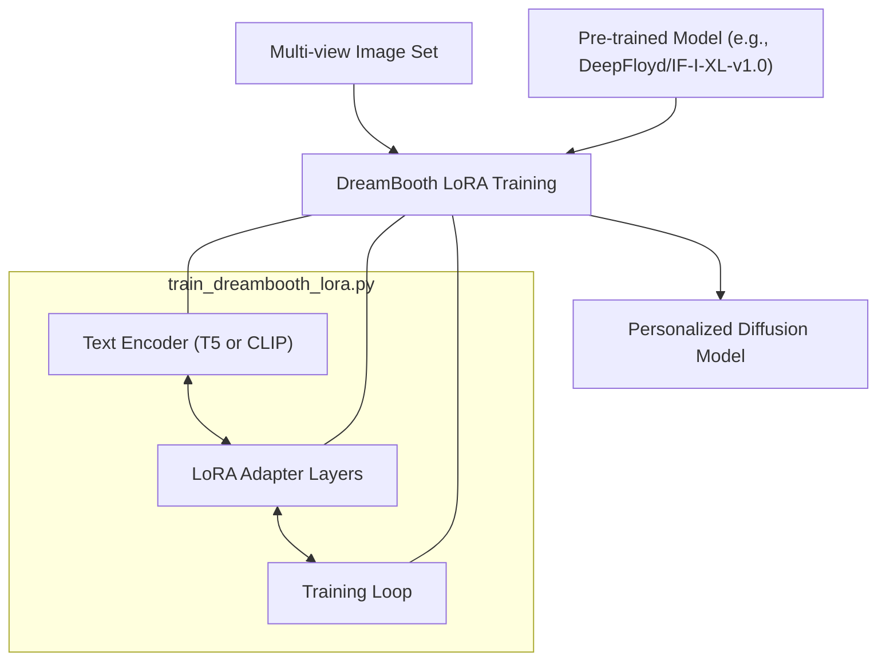
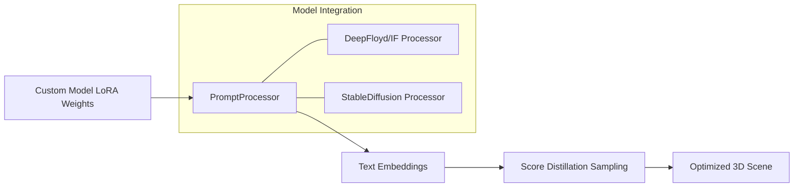
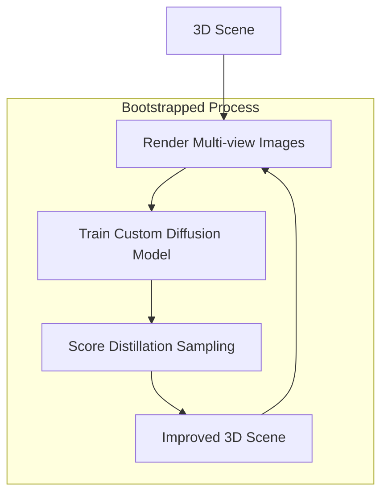
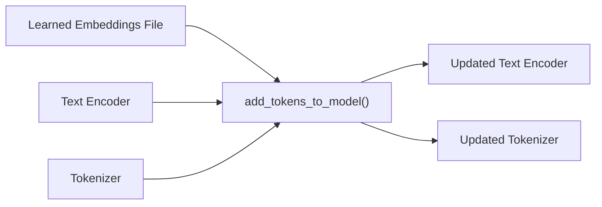

<!-- source: DeepWiki mcp.deepwiki.com · repo deepseek-ai/DreamCraft3D · page 5.2 Custom Diffusion Models · fetched 2026-10-30 -->

# Custom Diffusion Models

<details>
<summary>Relevant source files</summary>

The following files were used as context for generating this wiki page:

- [README.md](README.md)
- [threestudio/models/prompt_processors/deepfloyd_prompt_processor.py](threestudio/models/prompt_processors/deepfloyd_prompt_processor.py)
- [threestudio/models/prompt_processors/stable_diffusion_prompt_processor.py](threestudio/models/prompt_processors/stable_diffusion_prompt_processor.py)

</details>


## Purpose and Scope

This document explains how to train and integrate custom diffusion models with DreamCraft3D. Custom diffusion models are particularly useful for addressing view consistency issues (such as the "Janus problem") and improving texture quality in the 3D generation process. This page covers the creation of personalized models via DreamBooth and their integration into the DreamCraft3D pipeline.

For information about the general pipeline and stages, see [Core Pipeline](#2), and for texture refinement specifically, see [Stage 3: Texture Refinement](#2.3).

## Why Custom Diffusion Models

The default pre-trained models sometimes struggle with view consistency issues, particularly the "Janus problem" where objects may have different fronts and backs or multiple faces. Custom diffusion models can help by:

1. Learning the specific 3D characteristics of your target object
2. Providing consistent guidance across multiple viewpoints
3. Enabling the Bootstrapped Score Distillation process to enhance texture quality



Sources: [README.md:123-162]()

## Supported Diffusion Model Types

DreamCraft3D supports custom diffusion models based on:

1. **DeepFloyd/IF** - Powerful for high-resolution generation and fine details
2. **Stable Diffusion** - Versatile and widely compatible

Each model type has its own prompt processor to handle text embedding generation.



Sources: [threestudio/models/prompt_processors/deepfloyd_prompt_processor.py:1-96](), [threestudio/models/prompt_processors/stable_diffusion_prompt_processor.py:1-104]()

## Multi-View Image Generation

The first step in creating a custom diffusion model is generating multi-view images from your reference image. This is done using Zero123++, which predicts how your object looks from different angles.



Command to generate multi-view images:

```bash
python threestudio/scripts/img_to_mv.py --image_path 'load/mushroom.png' --save_path '.cache/temp' --prompt 'a photo of mushroom' --superres
```

Sources: [README.md:127-130]()

## Training a Custom Diffusion Model

DreamCraft3D uses DreamBooth with LoRA (Low-Rank Adaptation) to train personalized diffusion models efficiently. This approach fine-tunes a pre-trained model on your specific object by associating it with a unique identifier.

### Training Process



Command to train a custom DeepFloyd model with DreamBooth LoRA:

```bash
export MODEL_NAME="DeepFloyd/IF-I-XL-v1.0"
export INSTANCE_DIR=".cache/temp"
export OUTPUT_DIR=".cache/if_dreambooth_mushroom"

accelerate launch threestudio/scripts/train_dreambooth_lora.py \
  --pretrained_model_name_or_path=$MODEL_NAME  \
  --instance_data_dir=$INSTANCE_DIR \
  --output_dir=$OUTPUT_DIR \
  --instance_prompt="a sks mushroom" \
  --resolution=64 \
  --train_batch_size=4 \
  --gradient_accumulation_steps=1 \
  --learning_rate=5e-6 \
  --scale_lr \
  --max_train_steps=1200 \
  --checkpointing_steps=600 \
  --pre_compute_text_embeddings \
  --tokenizer_max_length=77 \
  --text_encoder_use_attention_mask
```

Sources: [README.md:131-153]()

### Key Parameters

| Parameter | Description | Typical Value |
|-----------|-------------|---------------|
| `--instance_prompt` | Prompt with unique identifier for your object | "a sks [object]" |
| `--resolution` | Training resolution | 64 for DeepFloyd, 512 for SD |
| `--train_batch_size` | Batch size for training | 4-8 |
| `--max_train_steps` | Total training steps | 1000-2000 |
| `--learning_rate` | Learning rate for LoRA training | 5e-6 |

Sources: [README.md:134-153]()

## Integrating Custom Models with DreamCraft3D

After training, the custom diffusion model can be integrated into the DreamCraft3D pipeline by specifying the path to the LoRA weights when launching the training.

### Integration Process



Command to use the custom model in Stage 1:

```bash
python launch.py --config configs/dreamcraft3d-coarse-nerf.yaml --train system.prompt_processor.prompt="$prompt" data.image_path="$image_path" system.guidance.lora_weights_path=".cache/if_dreambooth_mushroom"
```

Sources: [README.md:157-160]()

## Bootstrapped Score Distillation

Custom diffusion models are particularly important for Stage 3 of the pipeline, where they enable bootstrapped score distillation for texture refinement. This technique creates a feedback loop where:

1. The custom model provides consistent guidance for optimizing the 3D scene
2. The improved 3D scene helps train an even better diffusion prior
3. This cycle continues, bootstrapping the quality of both



Sources: [README.md:12-19]()

## Token Management for Custom Models

When using Stable Diffusion-based custom models, you may need to handle custom tokens for your unique object identifiers. The `add_tokens_to_model` function manages this process by:

1. Loading learned token embeddings
2. Adding the tokens to the tokenizer
3. Resizing the token embeddings in the text encoder
4. Assigning the custom embeddings to the correct token IDs



Sources: [threestudio/models/prompt_processors/stable_diffusion_prompt_processor.py:106-134]()

## Troubleshooting and Best Practices

### Common Issues

| Issue | Solution |
|-------|----------|
| Janus problem persists | Try increasing `max_train_steps` or improving multi-view image quality |
| Poor texture quality | Adjust the balance between Stages 2 and 3, or train a more specialized model |
| Memory limitations | Reduce rendering resolution as noted in Tips section |

### Best Practices

1. **Verify multi-view images**: Ensure the generated multi-view images look reasonable before training
2. **Choose unique identifiers**: Use distinctive token names (e.g., "sks") that won't conflict with common words
3. **Memory management**: Follow the tips in the README for reducing memory usage if needed
4. **Progressive refinement**: Consider iterating between model training and 3D optimization multiple times

Sources: [README.md:123-165]()