# Page: Overview

# Overview

<details>
<summary>Relevant source files</summary>

The following files were used as context for generating this wiki page:

- [README.md](README.md)

</details>


DreamCraft3D is a hierarchical 3D content generation system that produces high-fidelity, coherent 3D objects from a single 2D reference image and text prompt. This page provides an introduction to the system architecture, key components, and workflow. For detailed installation instructions, see [Installation and Setup](#1.1), and for a quick start guide, see [Quick Start Guide](#1.2).

## Introduction

DreamCraft3D addresses consistency challenges in 3D generation by employing a three-stage hierarchical approach that progressively refines both geometry and texture. The system's primary innovation is Bootstrapped Score Distillation, which creates a mutually reinforcing feedback loop between the optimized 3D scene and a personalized diffusion model to achieve exceptional texture quality and view consistency.

## System Architecture

The following diagram illustrates the high-level architecture of DreamCraft3D:

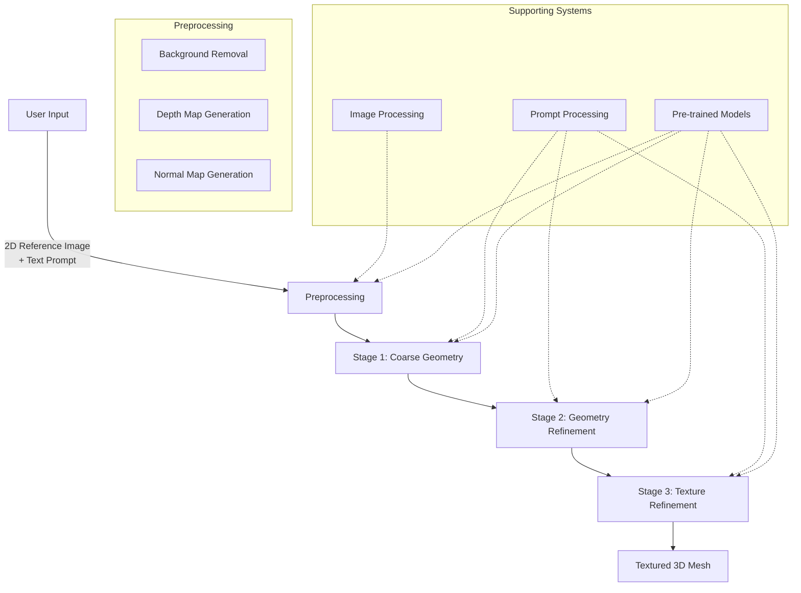

Sources: [README.md:5-19](), [README.md:26-29]()

## Three-Stage Pipeline

DreamCraft3D employs a hierarchical approach divided into three distinct stages, each building upon the previous:

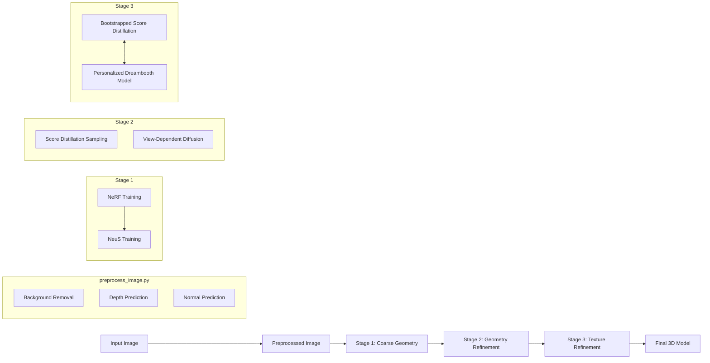

Sources: [README.md:97-121]()

### Stage 1: Coarse Geometry Generation

The first stage establishes the initial 3D structure using a combination of Neural Radiance Fields (NeRF) and Neural Surface Reconstruction (NeuS):

1. **NeRF Training**: Creates a volumetric representation of the object from the reference image
2. **NeuS Training**: Refines the volumetric representation into a more accurate surface model

This stage focuses on establishing consistent geometry while preparing for subsequent refinement.

Sources: [README.md:107-111]()

### Stage 2: Geometry Refinement

The second stage enhances the geometric details through score distillation sampling via a view-dependent diffusion model. This process sculpts the geometry to ensure coherent renders from multiple viewpoints.

Sources: [README.md:113-115]()

### Stage 3: Texture Refinement

The final stage employs Bootstrapped Score Distillation, a key innovation of DreamCraft3D:

1. A personalized diffusion model (Dreambooth) is trained on augmented renderings of the scene
2. This model provides view-consistent guidance for texture optimization
3. Through alternating optimization, improvements become mutually reinforcing:
   - The optimized 3D scene improves training of the scene-specific diffusion model
   - The improved diffusion model provides better guidance for 3D optimization

This bootstrap mechanism significantly enhances texture quality and coherence.

Sources: [README.md:118-120](), [README.md:12-19]()

## Data Flow

The following diagram illustrates the data flow through the DreamCraft3D pipeline:

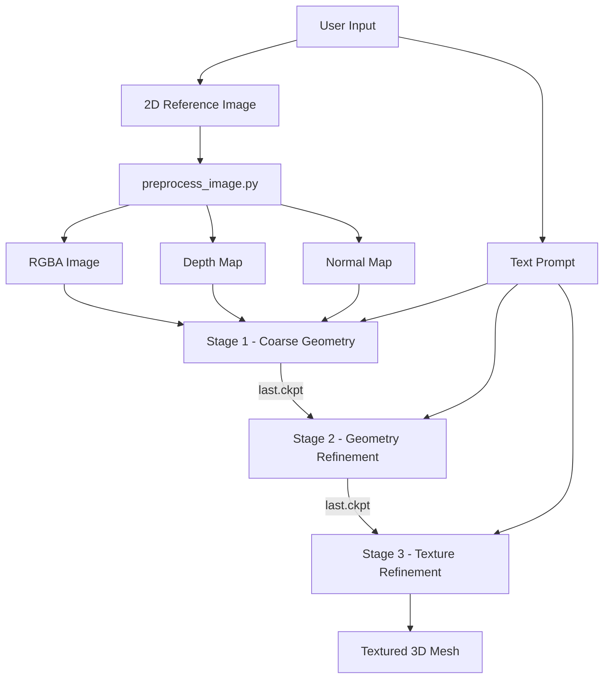

Sources: [README.md:98-121]()

## Key Components

DreamCraft3D leverages several critical components and pre-trained models:

| Component | Purpose | Configuration File |
|-----------|---------|-------------------|
| Zero123 | View-dependent diffusion model | `configs/dreamcraft3d-coarse-nerf.yaml` |
| Omnidata | Depth and normal prediction | `preprocess_image.py` |
| NeRF | Initial volumetric representation | `configs/dreamcraft3d-coarse-nerf.yaml` |
| NeuS | Surface reconstruction | `configs/dreamcraft3d-coarse-neus.yaml` |
| Score Distillation Sampling | Geometry refinement | `configs/dreamcraft3d-geometry.yaml` |
| Dreambooth Lora | Personalized diffusion model | `configs/dreamcraft3d-texture.yaml` |

Sources: [README.md:83-96](), [README.md:107-120]()

## Code Structure Mapping

The following diagram maps the high-level concepts to specific code entities:

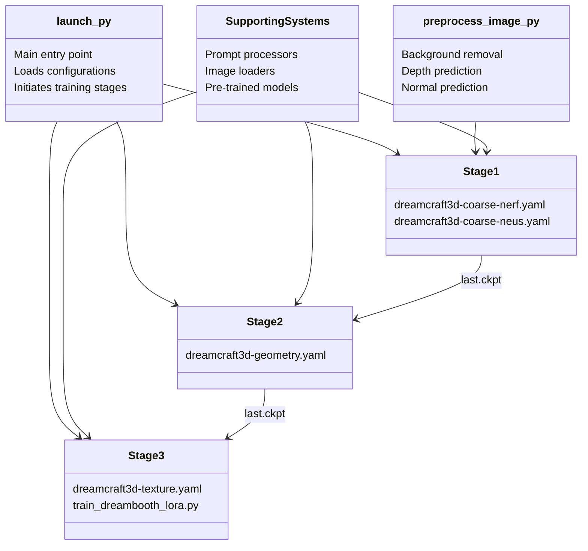

Sources: [README.md:107-120]()

## Handling Advanced Scenarios

For certain inputs, additional steps may be required to achieve optimal results:

- **Janus Problem**: When faces appear on both sides of an object in Stage 1 (an issue with view synthesis), training a custom Text2Image model can help. This involves:
  1. Generating multi-view images from the reference image using Zero123++
  2. Training a personalized DeepFloyd model using Dreambooth Lora
  3. Using this model for guidance during Stage 1

For more details on handling this specific issue, see [Handling the Janus Problem](#5.1).

Sources: [README.md:123-161]()

## Memory Requirements and Optimization

DreamCraft3D requires GPUs with significant VRAM (at least 20GB). The default configurations are designed for 40GB A100 GPUs. Memory usage can be reduced by:

- Decreasing rendering resolution in NeuS and other stages
- Adjusting batch sizes and other parameters

Sources: [README.md:49](), [README.md:164]()

## Exporting Results

The final 3D model can be exported as a textured mesh (OBJ+MTL) using the mesh-exporter:

```
python launch.py --config path/to/trial/dir/configs/parsed.yaml --export --gpu 0 resume=path/to/trial/dir/ckpts/last.ckpt system.exporter_type=mesh-exporter
```

Sources: [README.md:166-171]()

This overview provides a foundation for understanding the DreamCraft3D system. For more detailed information on specific components and processes, please refer to the relevant sections in the documentation.

---

# Page: Installation and Setup

# Installation and Setup

<details>
<summary>Relevant source files</summary>

The following files were used as context for generating this wiki page:

- [.gitignore](.gitignore)
- [README.md](README.md)

</details>


This document guides you through the complete installation process for DreamCraft3D, a hierarchical 3D generation system that creates high-fidelity 3D objects from a single image. For information on how to use the system after installation, see [Quick Start Guide](#1.2).

## System Requirements

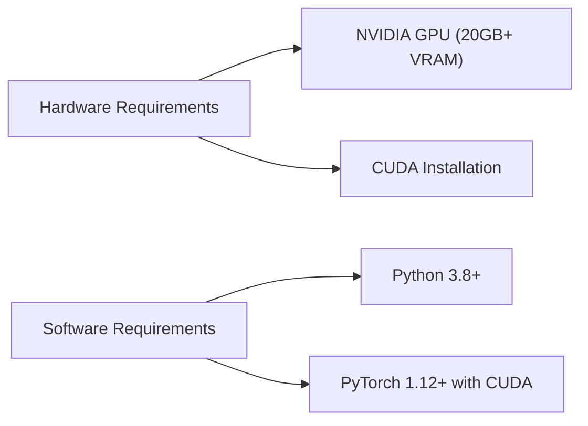

Sources: [README.md:48-50](), [README.md:62-69]()

- **Hardware**: NVIDIA graphics card with at least 20GB VRAM
- **CUDA**: Compatible CUDA installation required
- **Python**: Version 3.8 or higher
- **Storage**: ~10GB for pre-trained models and dependencies

## Installation Process Overview

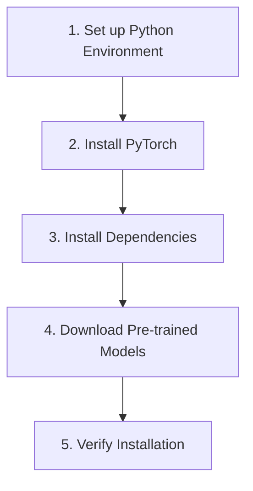

Sources: [README.md:42-96]()

## 1. Setting Up the Python Environment

It's recommended to use a virtual environment to avoid conflicts with other Python packages.

```bash
# Create a virtual environment
python3 -m virtualenv venv

# Activate the virtual environment
. venv/bin/activate

# Upgrade pip for faster package installation
python3 -m pip install --upgrade pip
```

Sources: [README.md:51-60]()

## 2. Installing PyTorch

DreamCraft3D has been tested with `torch1.12.1+cu113` and `torch2.0.0+cu118`, but other versions should work as well.

```bash
# For torch1.12.1+cu113
pip install torch==1.12.1+cu113 torchvision==0.13.1+cu113 --extra-index-url https://download.pytorch.org/whl/cu113

# OR for torch2.0.0+cu118
pip install torch torchvision --index-url https://download.pytorch.org/whl/cu118
```

Sources: [README.md:62-69]()

## 3. Installing Dependencies

First, install Ninja to speed up the compilation of CUDA extensions:

```bash
pip install ninja
```

Then install all required dependencies:

```bash
pip install -r requirements.txt
```

Sources: [README.md:71-81]()

## 4. Downloading Pre-trained Models

DreamCraft3D relies on two pre-trained models that need to be downloaded separately:

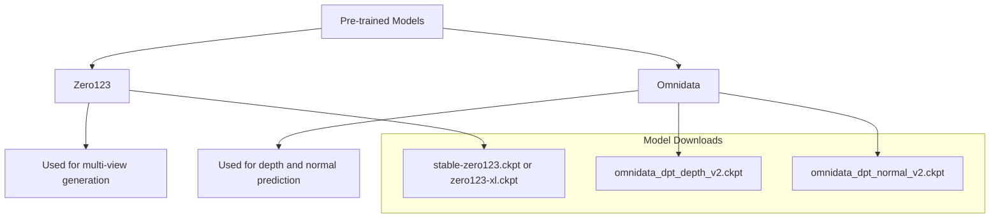

Sources: [README.md:83-95]()

### Zero123 Model

The default model is `stable-zero123.ckpt`. You can download it manually from [HuggingFace](https://huggingface.co/stabilityai/stable-zero123) and place it in the `load/zero123/` directory.

Alternatively, if you want to use the `zero123-xl.ckpt` version (as used in the paper):

```bash
cd load/zero123
bash download.sh
```

### Omnidata Model

Omnidata is used for depth and normal prediction during image preprocessing:

```bash
cd load/omnidata
gdown '1Jrh-bRnJEjyMCS7f-WsaFlccfPjJPPHI&confirm=t' # omnidata_dpt_depth_v2.ckpt
gdown '1wNxVO4vVbDEMEpnAi_jwQObf2MFodcBR&confirm=t' # omnidata_dpt_normal_v2.ckpt
```

Sources: [README.md:90-95]()

## 5. Directory Structure

After installation, your directory structure should look like this:

```
DreamCraft3D/
├── configs/               # Configuration files for each stage
├── load/                  # Pre-trained models
│   ├── zero123/           # Zero123 model checkpoint
│   │   └── stable-zero123.ckpt (or zero123-xl.ckpt)
│   ├── omnidata/          # Omnidata model checkpoints
│   │   ├── omnidata_dpt_depth_v2.ckpt
│   │   └── omnidata_dpt_normal_v2.ckpt
│   └── images/            # Contains your input images
├── requirements.txt       # Package dependencies
├── preprocess_image.py    # Script for processing input images
└── launch.py              # Main execution script
```

## 6. Memory Considerations

DreamCraft3D requires significant GPU memory. The default configurations are designed to run on 40GB A100 GPUs. If you have less memory available, you can reduce the rendering resolution:

```bash
# Add these parameters to reduce memory usage
data.height=128 data.width=128 data.random_camera.height=128 data.random_camera.width=128
```

Sources: [README.md:164-165]()

## 7. Verification

To verify your installation, you can try preprocessing a sample image:

```bash
python preprocess_image.py load/images/sample.png --recenter
```

If this runs without errors, you have successfully installed DreamCraft3D and are ready to generate 3D content. For next steps, see the [Quick Start Guide](#1.2).

Sources: [README.md:98-101]()

## Troubleshooting

Common issues and their resolutions:

| Issue | Possible Solution |
|-------|------------------|
| CUDA out of memory | Reduce rendering resolution as mentioned in Memory Considerations |
| Missing pre-trained models | Ensure all model files are downloaded to the correct locations |
| ImportError for dependencies | Make sure to install all requirements with `pip install -r requirements.txt` |
| PyTorch/CUDA version mismatch | Reinstall PyTorch with the correct CUDA version for your system |

If you encounter the "Janus problem" (inconsistent face generation) during Stage 1, see [Advanced Topics: Handling the Janus Problem](#5.1) for solutions including training a custom Text2Image model.

Sources: [README.md:123-163]()

---

# Page: Quick Start Guide

# Quick Start Guide

<details>
<summary>Relevant source files</summary>

The following files were used as context for generating this wiki page:

- [README.md](README.md)

</details>


This guide provides a concise walkthrough for generating a high-quality 3D model from a single reference image using DreamCraft3D. It covers the basic steps from preprocessing an input image to exporting the final textured 3D mesh. For detailed installation instructions, see [Installation and Setup](#1.1).

## Prerequisites

Before you begin, ensure you have:
- Successfully installed DreamCraft3D and its dependencies
- Downloaded the required pre-trained models (Zero123 and Omnidata)
- Prepared a reference image with a clear subject

## Workflow Overview

DreamCraft3D follows a hierarchical generation process that consists of three main stages:

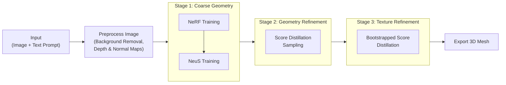

Sources: [README.md:25-30]()

## Step 1: Preprocessing the Input Image

Before starting the 3D generation process, you need to preprocess your input image to remove the background and generate depth and normal maps:

```bash
python preprocess_image.py /path/to/image.png --recenter
```

This command will:
1. Remove the background from your image
2. Generate depth and normal maps using Omnidata models
3. Save the processed images to be used in the subsequent training stages

Sources: [README.md:98-101]()

## Step 2: Multi-Stage Training

DreamCraft3D uses a hierarchical approach with three stages of optimization. The following diagrams show the relationship between configuration files, commands, and the pipeline stages:

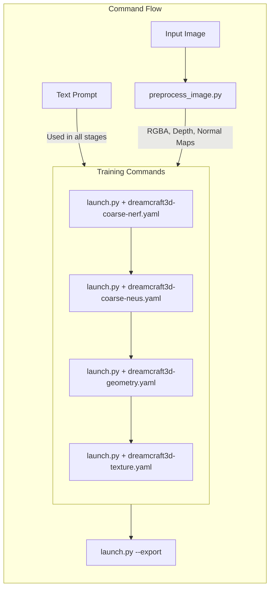

Sources: [README.md:104-121]()

### Stage 1: Coarse Geometry Generation (NeRF & NeuS)

This stage creates a coarse geometry in two steps: first using NeRF, then refining with NeuS.

```bash
# Define your prompt and image path
prompt="a brightly colored mushroom growing on a log"
image_path="load/images/mushroom_log_rgba.png"

# NeRF training
python launch.py --config configs/dreamcraft3d-coarse-nerf.yaml --train system.prompt_processor.prompt="$prompt" data.image_path="$image_path"

# NeuS training (using the last NeRF checkpoint)
ckpt=outputs/dreamcraft3d-coarse-nerf/$prompt@LAST/ckpts/last.ckpt
python launch.py --config configs/dreamcraft3d-coarse-neus.yaml --train system.prompt_processor.prompt="$prompt" data.image_path="$image_path" system.weights="$ckpt"
```

Sources: [README.md:107-112]()

### Stage 2: Geometry Refinement

This stage refines the geometry using score distillation sampling:

```bash
# Geometry refinement (using the last NeuS checkpoint)
ckpt=outputs/dreamcraft3d-coarse-neus/$prompt@LAST/ckpts/last.ckpt
python launch.py --config configs/dreamcraft3d-geometry.yaml --train system.prompt_processor.prompt="$prompt" data.image_path="$image_path" system.geometry_convert_from="$ckpt"
```

Sources: [README.md:114-116]()

### Stage 3: Texture Refinement

The final stage improves the texture quality using bootstrapped score distillation:

```bash
# Texture refinement (using the last geometry checkpoint)
ckpt=outputs/dreamcraft3d-geometry/$prompt@LAST/ckpts/last.ckpt
python launch.py --config configs/dreamcraft3d-texture.yaml --train system.prompt_processor.prompt="$prompt" data.image_path="$image_path" system.geometry_convert_from="$ckpt"
```

Sources: [README.md:119-121]()

## Step 3: Exporting the 3D Model

After completing all training stages, you can export the textured mesh to an OBJ file:

```bash
# Export the textured mesh (OBJ+MTL format)
python launch.py --config path/to/trial/dir/configs/parsed.yaml --export --gpu 0 resume=path/to/trial/dir/ckpts/last.ckpt system.exporter_type=mesh-exporter
```

This will generate an OBJ file with associated material files that can be imported into standard 3D software like Blender or MeshLab.

Sources: [README.md:166-171]()

## Handling Common Issues

### The Janus Problem

Sometimes during Stage 1, you might encounter the "Janus problem" where the model generates inconsistent face or geometry details on different sides of the model. If this occurs, you can train a custom Text2Image model:

1. Generate multi-view images from your reference image:
```bash
python threestudio/scripts/img_to_mv.py --image_path 'load/mushroom.png' --save_path '.cache/temp' --prompt 'a photo of mushroom' --superres
```

2. Train a personalized DeepFloyd model using DreamBooth Lora:
```bash
export MODEL_NAME="DeepFloyd/IF-I-XL-v1.0"
export INSTANCE_DIR=".cache/temp"
export OUTPUT_DIR=".cache/if_dreambooth_mushroom"

accelerate launch threestudio/scripts/train_dreambooth_lora.py \
  --pretrained_model_name_or_path=$MODEL_NAME \
  --instance_data_dir=$INSTANCE_DIR \
  --output_dir=$OUTPUT_DIR \
  --instance_prompt="a sks mushroom" \
  --resolution=64 \
  --train_batch_size=4 \
  --gradient_accumulation_steps=1 \
  --learning_rate=5e-6 \
  --scale_lr \
  --max_train_steps=1200 \
  --checkpointing_steps=600 \
  --pre_compute_text_embeddings \
  --tokenizer_max_length=77 \
  --text_encoder_use_attention_mask
```

3. Use this personalized model in Stage 1:
```bash
python launch.py --config configs/dreamcraft3d-coarse-nerf.yaml --train system.prompt_processor.prompt="$prompt" data.image_path="$image_path" system.guidance.lora_weights_path=".cache/if_dreambooth_mushroom"
```

Sources: [README.md:123-161]()

## Tips for Optimal Results

### Memory Optimization

The default configuration is designed for GPUs with 40GB VRAM (A100). For systems with less memory:

- Reduce rendering resolution for NeuS:
```bash
data.height=128 data.width=128 data.random_camera.height=128 data.random_camera.width=128
```

- You can similarly reduce resolution for other stages to save memory

Sources: [README.md:164-165]()

### Prompt Engineering

The quality of your text prompt significantly affects the output. For best results:
- Be specific about the object's appearance and materials
- Include distinctive visual characteristics
- Use descriptive adjectives that help the system understand the desired style

### Input Image Selection

Choose reference images with:
- Clear subject with minimal background clutter
- Good lighting that shows the shape clearly
- Distinctive features that help establish the 3D form

---

# Page: Core Pipeline

# Core Pipeline

<details>
<summary>Relevant source files</summary>

The following files were used as context for generating this wiki page:

- [README.md](README.md)

</details>


The Core Pipeline of DreamCraft3D implements a hierarchical 3D generation approach that creates high-fidelity, coherent 3D objects from a single 2D reference image and a text prompt. This page explains the overall pipeline architecture and how the three-stage process works together to produce textured 3D models.

For specific implementation details of each stage, see [Stage 1: Coarse Geometry Generation](#2.1), [Stage 2: Geometry Refinement](#2.2), and [Stage 3: Texture Refinement](#2.3).

## Pipeline Overview

DreamCraft3D employs a hierarchical generation strategy with three sequential stages, each building upon the results of the previous stage. This design allows the system to progressively refine both geometry and texture.

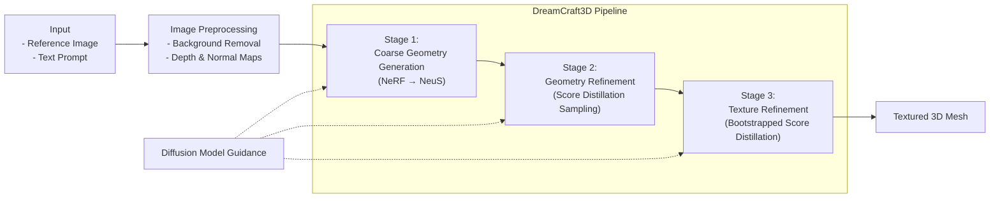

Sources:
- [README.md:97-121]()
- [README.md:26-29]()

## Hierarchical Generation Process

The pipeline processes a single image through multiple stages, with each stage specializing in a specific aspect of 3D generation:

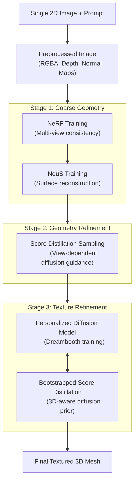

Sources:
- [README.md:10-19]()
- [README.md:97-121]()

## Pipeline Execution Flow

The pipeline is executed in sequential stages, with each stage using the output from the previous stage as its starting point:

1. **Preprocessing**: Before the main pipeline begins, the input image is processed to remove the background and generate depth and normal maps.

2. **Stage 1**: Coarse Geometry Generation
   - Part 1: NeRF training for multi-view consistency
   - Part 2: NeuS training for surface reconstruction
   - Output: Initial 3D geometry model

3. **Stage 2**: Geometry Refinement
   - Uses Score Distillation Sampling with view-dependent diffusion guidance
   - Refines the geometry while maintaining view consistency
   - Output: Refined 3D geometry

4. **Stage 3**: Texture Refinement
   - Uses Bootstrapped Score Distillation with a personalized diffusion model
   - Alternates between training the diffusion model and optimizing the 3D scene
   - Output: Final textured 3D mesh

Each stage saves checkpoint files that are used as inputs for the next stage, creating a sequential pipeline flow.

Sources:
- [README.md:97-121]()

## Command Structure

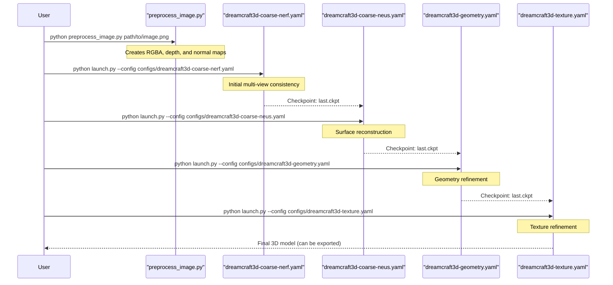

Sources:
- [README.md:97-121]()
- [README.md:166-171]()

## Key Technical Components

The pipeline integrates several key technical components that work together to achieve high-quality 3D generation:

### Data Flow Between Stages

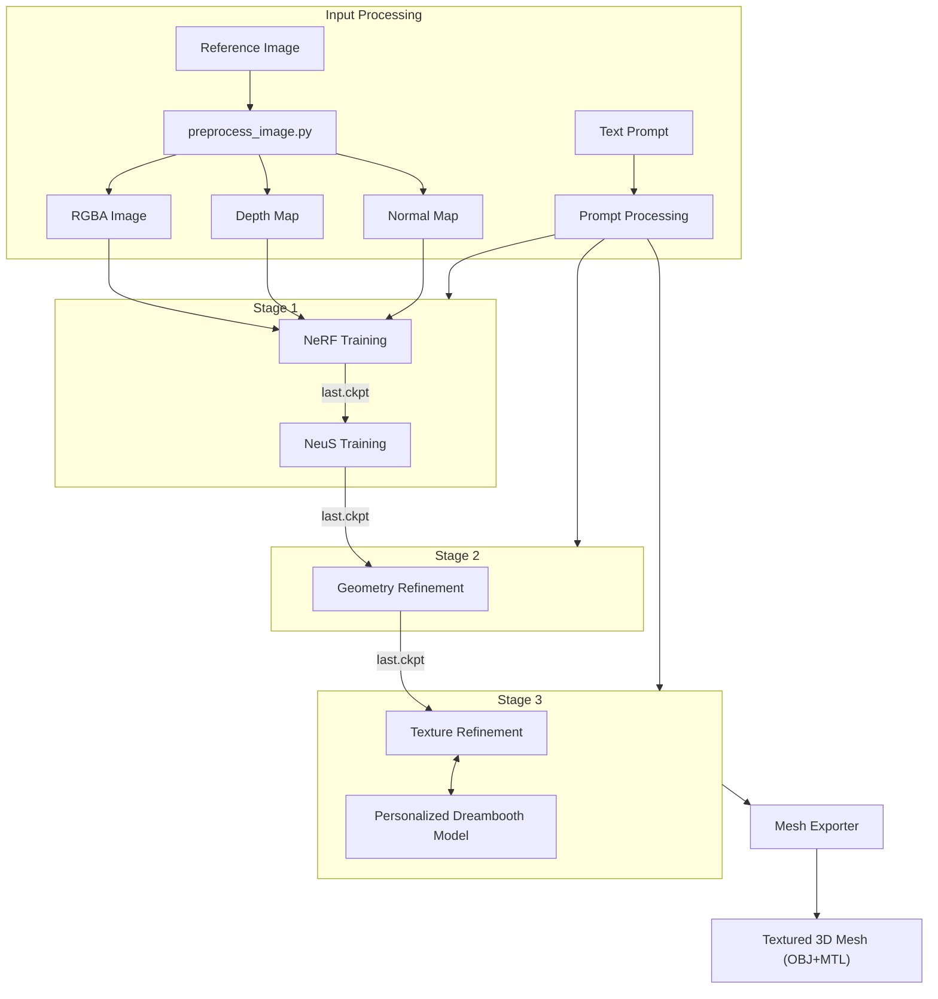

Sources:
- [README.md:97-121]()
- [README.md:166-171]()

### Bootstrapped Optimization in Stage 3

A key innovation in DreamCraft3D is the bootstrapped optimization approach used in Stage 3. This process involves:

1. Training a personalized diffusion model (Dreambooth) on the renderings of the current 3D scene
2. Using this model to guide further optimization of the 3D scene
3. As the 3D scene improves, it provides better training data for the diffusion model
4. This creates a positive feedback loop (bootstrapping) that enhances both the diffusion model and 3D scene

This approach allows for significant texture quality improvements while maintaining view consistency.

Sources:
- [README.md:10-19]()
- [README.md:97-121]()

## Configuration Files

The pipeline is configured through a set of YAML files, each corresponding to a stage in the process:

1. `configs/dreamcraft3d-coarse-nerf.yaml` - Stage 1, Part 1 (NeRF)
2. `configs/dreamcraft3d-coarse-neus.yaml` - Stage 1, Part 2 (NeuS)
3. `configs/dreamcraft3d-geometry.yaml` - Stage 2
4. `configs/dreamcraft3d-texture.yaml` - Stage 3

These configuration files define the parameters, models, and training strategies used at each stage.

## Optional Components

### Handling the Janus Problem

If the "Janus problem" (inconsistent facial features on different sides) arises in Stage 1, the pipeline provides an optional process to train a custom Text2Image model:

1. Generate multi-view images using Zero123++
2. Train a personalized DeepFloyd model using DreamBooth Lora
3. Use this personalized model for guidance in the training stages

Sources:
- [README.md:123-161]()

## Conclusion

The DreamCraft3D Core Pipeline represents a hierarchical approach to 3D generation that progressively refines both geometry and texture. By leveraging different specialized techniques at each stage and implementing bootstrapped optimization, the pipeline achieves high-fidelity, coherent 3D objects from a single reference image and text prompt.

For detailed implementation of each stage, refer to the respective stage documentation ([Stage 1](#2.1), [Stage 2](#2.2), [Stage 3](#2.3)).

---

# Page: Stage 1: Coarse Geometry Generation

# Stage 1: Coarse Geometry Generation

<details>
<summary>Relevant source files</summary>

The following files were used as context for generating this wiki page:

- [README.md](README.md)

</details>


## Purpose and Scope

This document details the first stage of the DreamCraft3D pipeline, which focuses on generating coarse 3D geometry from a single reference image. Stage 1 provides the foundational geometry that will be refined in later stages. The process involves sequential training of Neural Radiance Fields (NeRF) and Neural Surface Reconstruction (NeuS) models to create a coherent 3D representation of the subject.

For information about geometry refinement, see [Stage 2: Geometry Refinement](#2.2). For texture refinement, see [Stage 3: Texture Refinement](#2.3).

## Stage 1 Workflow Overview

The coarse geometry generation process follows a hierarchical approach, starting with preprocessed 2D input and progressively building 3D structure.

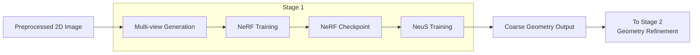

Sources: [README.md:107-111]()

## Prerequisites: Image Preprocessing

Before beginning Stage 1, the input image must be preprocessed to:
1. Remove the background (creating an RGBA image)
2. Generate depth and normal maps
3. Optionally recenter the object

```bash
python preprocess_image.py /path/to/image.png --recenter
```

This preprocessing step creates depth and normal maps using Omnidata models, which provide valuable 3D information to guide the initial geometry creation.

Sources: [README.md:98-101](), [README.md:90-95]()

## Step 1: NeRF Training

The first phase of Stage 1 involves training a Neural Radiance Field (NeRF) model to approximate the 3D structure and appearance of the object.

### Implementation Details

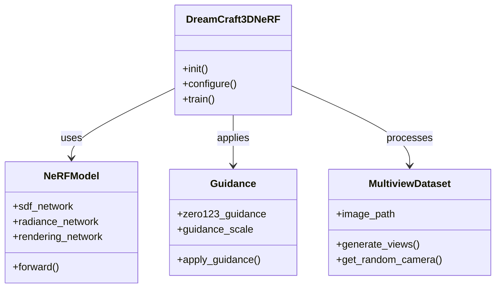

Sources: [README.md:107-109]()

### Configuration Options

The NeRF training is controlled by the `dreamcraft3d-coarse-nerf.yaml` configuration file. Key parameters include:

| Parameter | Description |
|-----------|-------------|
| `system.prompt_processor.prompt` | Text prompt describing the object |
| `data.image_path` | Path to preprocessed RGBA image |
| `data.height`/`data.width` | Rendering resolution (can be reduced to save memory) |
| `system.guidance.guidance_scale` | Controls strength of prompt guidance |
| `system.guidance.guidance_type` | The type of guidance used (default: Zero123) |

Sources: [README.md:108-109](), [README.md:164-165]()

### Training Process

The NeRF training process:
1. Takes the preprocessed reference image
2. Generates multi-view images using Zero123 model
3. Trains a NeRF model with both image-based supervision and Zero123 guidance
4. Produces a checkpoint that captures the coarse volumetric representation

```bash
python launch.py --config configs/dreamcraft3d-coarse-nerf.yaml --train system.prompt_processor.prompt="$prompt" data.image_path="$image_path"
```

This process typically runs for a few hundred iterations and saves the resulting model to `outputs/dreamcraft3d-coarse-nerf/$prompt@LAST/ckpts/last.ckpt`.

Sources: [README.md:108-109]()

## Step 2: NeuS Training

After obtaining the NeRF checkpoint, the second phase uses Neural Surface Reconstruction (NeuS) to convert the volumetric representation into a more precise surface representation.

### Implementation Details

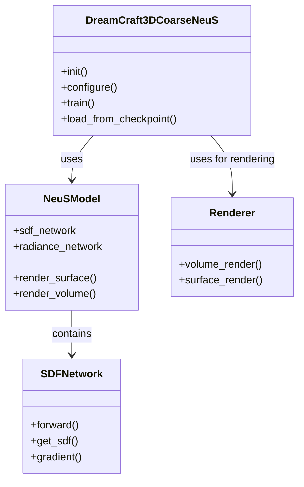

Sources: [README.md:110-111]()

### Configuration Options

The NeuS training is controlled by the `dreamcraft3d-coarse-neus.yaml` configuration file. Key parameters include:

| Parameter | Description |
|-----------|-------------|
| `system.weights` | Path to the NeRF checkpoint |
| `system.prompt_processor.prompt` | Same text prompt as used in NeRF |
| `data.image_path` | Path to preprocessed RGBA image |
| `system.geometry.sdf_bias` | Controls the bias of the signed distance function |
| `system.geometry.sdf_network` | Network architecture for SDF prediction |

Sources: [README.md:110-111]()

### Training Process

The NeuS training process:
1. Initializes from the NeRF checkpoint
2. Refines the geometry using Signed Distance Function (SDF) representation
3. Applies both image-based supervision and Zero123 guidance
4. Produces a more defined surface representation

```bash
ckpt=outputs/dreamcraft3d-coarse-nerf/$prompt@LAST/ckpts/last.ckpt
python launch.py --config configs/dreamcraft3d-coarse-neus.yaml --train system.prompt_processor.prompt="$prompt" data.image_path="$image_path" system.weights="$ckpt"
```

The resulting model is saved to `outputs/dreamcraft3d-coarse-neus/$prompt@LAST/ckpts/last.ckpt`.

Sources: [README.md:110-111]()

## Output and Transition to Stage 2

The final output of Stage 1 is a coarse 3D geometry represented as a neural signed distance function. This geometry serves as the foundation for Stage 2, where it will be refined using score distillation sampling.

Key characteristics of Stage 1 output:
- Basic 3D structure captured
- Roughly aligned with the reference image
- Contains structural information but lacks detailed geometry and texture
- Represented as a neural SDF model, ready for further refinement

Sources: [README.md:113-115]()

## Troubleshooting: Handling the Janus Problem

A common issue in Stage 1 is the "Janus problem" - where the model generates inconsistent geometry with multiple faces or incorrect back sides.

### Solution: Custom Text2Image Model Training

If you encounter the Janus problem, you can train a personalized diffusion model:

1. Generate multi-view images from the reference image:
```bash
python threestudio/scripts/img_to_mv.py --image_path 'load/mushroom.png' --save_path '.cache/temp' --prompt 'a photo of mushroom' --superres
```

2. Train a personalized DeepFloyd model using DreamBooth Lora:
```bash
export MODEL_NAME="DeepFloyd/IF-I-XL-v1.0"
export INSTANCE_DIR=".cache/temp"
export OUTPUT_DIR=".cache/if_dreambooth_mushroom"

accelerate launch threestudio/scripts/train_dreambooth_lora.py \
  --pretrained_model_name_or_path=$MODEL_NAME  \
  --instance_data_dir=$INSTANCE_DIR \
  --output_dir=$OUTPUT_DIR \
  --instance_prompt="a sks mushroom" \
  --resolution=64 \
  --train_batch_size=4 \
  --gradient_accumulation_steps=1 \
  --learning_rate=5e-6 \
  --scale_lr \
  --max_train_steps=1200 \
  --checkpointing_steps=600 \
  --pre_compute_text_embeddings \
  --tokenizer_max_length=77 \
  --text_encoder_use_attention_mask
```

3. Use the personalized model for Stage 1 training:
```bash
python launch.py --config configs/dreamcraft3d-coarse-nerf.yaml --train system.prompt_processor.prompt="$prompt" data.image_path="$image_path" system.guidance.lora_weights_path=".cache/if_dreambooth_mushroom"
```

This approach trains a model specifically for your object, which helps ensure consistent geometry across all views.

Sources: [README.md:123-161]()

## Memory Optimization

For systems with limited GPU memory, you can reduce the rendering resolution:

```bash
data.height=128 data.width=128 data.random_camera.height=128 data.random_camera.width=128
```

This significantly reduces memory usage while still producing usable results for the next stages.

Sources: [README.md:164-165]()

---

# Page: Stage 2: Geometry Refinement

# Stage 2: Geometry Refinement

<details>
<summary>Relevant source files</summary>

The following files were used as context for generating this wiki page:

- [README.md](README.md)

</details>


## Introduction

Stage 2: Geometry Refinement is the critical middle phase in the DreamCraft3D pipeline that bridges the gap between initial coarse geometry creation ([Stage 1: Coarse Geometry Generation](#2.1)) and texture enhancement ([Stage 3: Texture Refinement](#2.3)). This stage takes the coarse 3D model generated in Stage 1 and refines its geometry using Score Distillation Sampling (SDS) to create a more detailed and accurate 3D representation.

According to the DreamCraft3D approach, this stage specifically addresses the "consistency issue" that existing 3D generation methods encounter. By performing score distillation sampling via a view-dependent diffusion model, the system sculpts geometries that render coherently across multiple viewpoints, while temporarily setting aside concerns about texture fidelity.

## Process Overview

The geometry refinement process transforms the coarse geometry from Stage 1 into a refined 3D model with improved shape details and consistency.

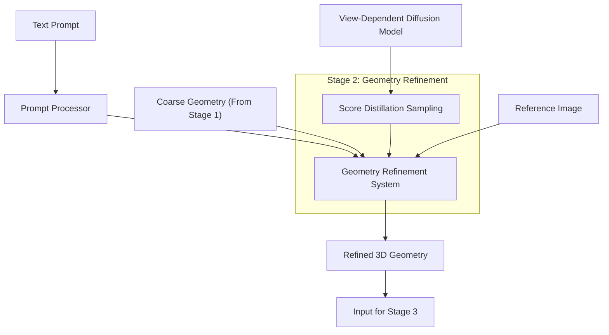

Sources: README.md

## Key Technical Components

### Score Distillation Sampling (SDS)

The core technique used in this stage is Score Distillation Sampling, which leverages pretrained diffusion models to guide the optimization of 3D representations. The system renders the current 3D model from multiple viewpoints, and the diffusion model provides gradients to adjust the geometry toward more plausible shapes.

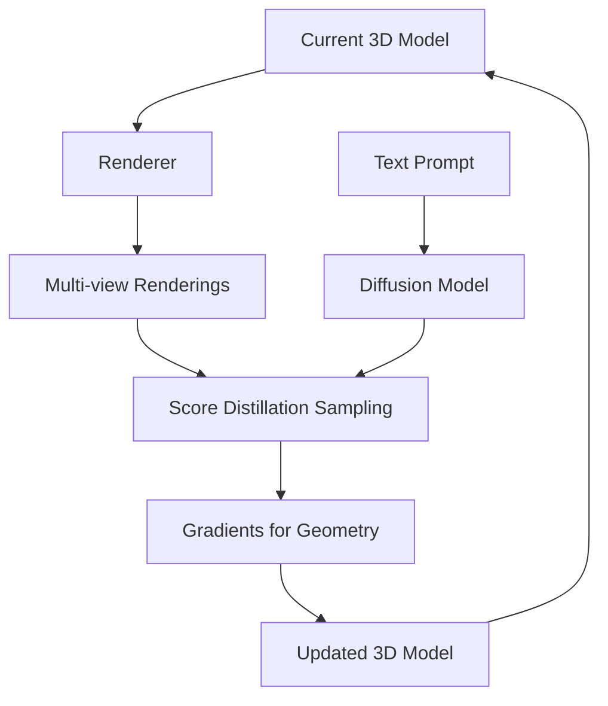

Sources: README.md:11-13

### View-Dependent Diffusion Guidance

The refinement process uses a view-dependent diffusion model that understands how the 3D object should appear from different angles. This is crucial for ensuring consistency across multiple viewpoints - addressing what the paper refers to as the "consistency issue" in existing works.

### Prioritizing Geometry Consistency

A key aspect of this stage is prioritizing geometric consistency, even if it temporarily compromises texture fidelity. According to the README, this philosophical approach is intentional, as texture enhancement is the specific focus of Stage 3:

> "We further propose Bootstrapped Score Distillation to specifically boost the texture." 

This separation of concerns allows each stage to focus on different aspects of 3D model generation, leading to better overall results.

Sources: README.md:12-13

## Implementation and Usage

To run the Geometry Refinement stage, you need the checkpoint from Stage 1 as input:

```
ckpt=outputs/dreamcraft3d-coarse-neus/<prompt>@LAST/ckpts/last.ckpt
python launch.py --config configs/dreamcraft3d-geometry.yaml --train system.prompt_processor.prompt="<prompt>" data.image_path="<image_path>" system.geometry_convert_from="<ckpt>"
```

Key parameters:
- `system.geometry_convert_from`: Path to the checkpoint from Stage 1 (containing the coarse geometry)
- `system.prompt_processor.prompt`: Text description of the desired object
- `data.image_path`: Path to the preprocessed reference image

Sources: README.md:113-115

## Configuration

The geometry refinement process is configured through `configs/dreamcraft3d-geometry.yaml`. For memory-constrained environments, the README suggests that rendering resolution can be reduced to decrease memory usage:

```
data.height=128 data.width=128 data.random_camera.height=128 data.random_camera.width=128
```

Sources: README.md:164

## Data Flow

The following diagram illustrates the data flow through Stage 2, showing how it fits into the larger DreamCraft3D pipeline:

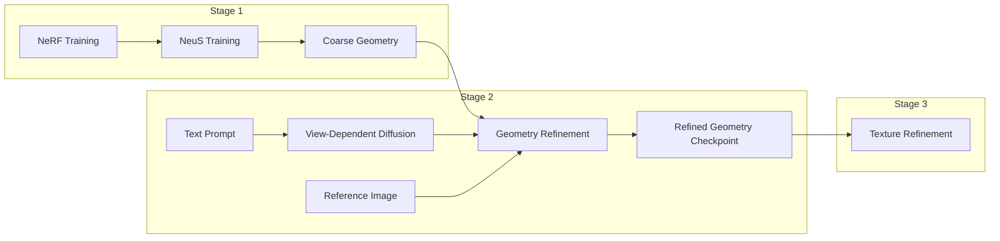

Sources: README.md:105-120

## Output and Next Steps

Upon completion, Stage 2 produces a refined 3D geometry stored as a checkpoint at:
```
outputs/dreamcraft3d-geometry/<prompt>@LAST/ckpts/last.ckpt
```

This refined geometry checkpoint serves as the direct input for Stage 3, where the focus shifts to enhancing texture quality through Bootstrapped Score Distillation.

To export the refined geometry for inspection (before proceeding to texture refinement), you can use:

```
python launch.py --config path/to/trial/dir/configs/parsed.yaml --export --gpu 0 resume=path/to/trial/dir/ckpts/last.ckpt system.exporter_type=mesh-exporter
```

Sources: README.md:166-171

## Common Issues and Troubleshooting

If you're experiencing high memory usage during this stage, consider reducing the rendering resolution as mentioned in the Configuration section above. This stage is designed to run on GPUs with at least 20GB VRAM according to the installation requirements.

Sources: README.md:49, 164

---

# Page: Stage 3: Texture Refinement

# Stage 3: Texture Refinement

<details>
<summary>Relevant source files</summary>

The following files were used as context for generating this wiki page:

- [README.md](README.md)

</details>


## Purpose and Scope

This document details Stage 3 of the DreamCraft3D pipeline, which focuses on enhancing texture quality and fidelity of 3D objects after their geometry has been refined in Stage 2. The key innovation in this stage is the **Bootstrapped Score Distillation** technique, which creates high-quality, view-consistent textures through an alternating optimization process between a personalized diffusion model and the 3D representation.

For information about earlier stages in the pipeline, see [Stage 1: Coarse Geometry Generation](#2.1) and [Stage 2: Geometry Refinement](#2.2).

## Bootstrapped Score Distillation Process

The core of Stage 3 is the Bootstrapped Score Distillation technique, which addresses the texture consistency challenges that many 3D generation methods face. This approach creates a mutually reinforcing relationship between the 3D scene representation and a personalized diffusion model.

### Process Diagram
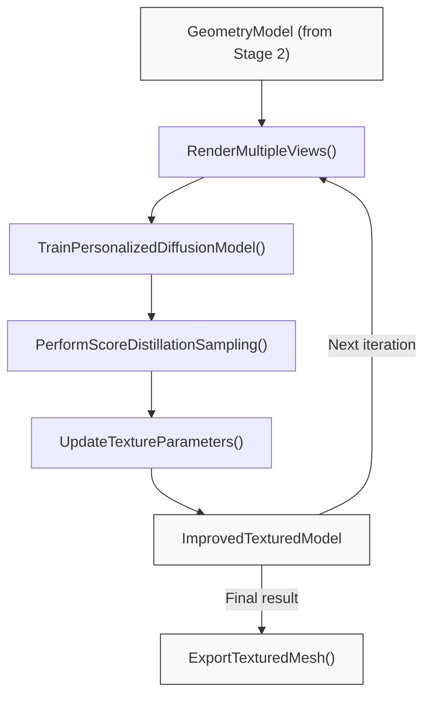

Sources: [README.md:10-19]()

## Implementation Architecture

The texture refinement system implements a bootstrapping approach where improvements in the 3D scene and diffusion model reinforce each other through iterative optimization.

### System Component Diagram
```mermaid
classDiagram
    class DreamCraft3DTextureSystem {
        +load_geometry_from_stage2()
        +train_personalized_model()
        +perform_texture_refinement()
        +export_textured_mesh()
    }
    
    class PersonalizedDreamboothTrainer {
        +train(renderings)
        +get_model()
        +compute_text_embeddings()
    }
    
    class ScoreDistillationSampler {
        +sample_gradients(renderings, diffusion_model)
        +apply_texture_gradients()
    }
    
    class TexturedGeometryModel {
        +render_views()
        +update_texture_parameters()
        +export_obj_with_mtl()
    }
    
    class PromptProcessor {
        +get_text_embeddings()
    }
    
    DreamCraft3DTextureSystem --> TexturedGeometryModel: uses
    DreamCraft3DTextureSystem --> PersonalizedDreamboothTrainer: trains
    DreamCraft3DTextureSystem --> ScoreDistillationSampler: applies
    PersonalizedDreamboothTrainer --> PromptProcessor: processes prompts
```

Sources: [README.md:12-18]()

## Technical Implementation Details

Stage 3 builds upon the refined geometry from Stage 2 and involves these key steps:

1. **Loading Refined Geometry**: The system starts by loading the geometry model refined in Stage 2.

2. **Multi-view Rendering**: The current 3D model is rendered from multiple viewpoints to generate training data.

3. **Personalized Model Training**: A Dreambooth model is trained on these renderings to capture the specific characteristics of the object.

4. **Score Distillation Sampling**: The personalized model provides view-consistent guidance for texture optimization.

5. **Texture Refinement**: Textures are updated based on the guidance from the diffusion model.

6. **Iterative Bootstrapping**: Steps 2-5 are repeated in an alternating fashion, with each component helping to improve the other.

### Comparison with Previous Stages

| Feature | Stage 1 | Stage 2 | Stage 3 |
|---------|---------|---------|---------|
| **Focus** | Coarse geometry creation | Geometry refinement | Texture enhancement |
| **Input** | Single image + prompt | Output from Stage 1 | Output from Stage 2 |
| **Techniques** | NeRF & NeuS training | Score distillation sampling | Bootstrapped score distillation |
| **Output** | Initial 3D shape | Refined 3D geometry | High-quality textured mesh |
| **Config File** | dreamcraft3d-coarse-nerf.yaml, dreamcraft3d-coarse-neus.yaml | dreamcraft3d-geometry.yaml | dreamcraft3d-texture.yaml |

Sources: [README.md:107-120]()

## Configuration and Usage

### Configuration Options

The configuration for Stage 3 is defined in `configs/dreamcraft3d-texture.yaml`. While the specific parameters aren't detailed in the provided information, they likely include:

- Learning rates for texture optimization
- Dreambooth training parameters
- Rendering resolution and quality settings
- Number of optimization steps
- Balancing weights between different loss components

### Command-line Usage

To run Stage 3, use the following command after completing Stage 2:

```bash
# Assuming Stage 2 has completed and produced a checkpoint
ckpt=outputs/dreamcraft3d-geometry/$prompt@LAST/ckpts/last.ckpt
python launch.py --config configs/dreamcraft3d-texture.yaml --train system.prompt_processor.prompt="$prompt" data.image_path="$image_path" system.geometry_convert_from="$ckpt"
```

Sources: [README.md:118-120]()

### Memory Optimization

For systems with limited GPU memory, you can reduce the rendering resolution:

```bash
python launch.py --config configs/dreamcraft3d-texture.yaml --train system.prompt_processor.prompt="$prompt" data.image_path="$image_path" system.geometry_convert_from="$ckpt" data.height=128 data.width=128 data.random_camera.height=128 data.random_camera.width=128
```

Sources: [README.md:164-164]()

## Exporting the Final Result

After Stage 3 is complete, you can export the textured mesh using:

```bash
python launch.py --config path/to/trial/dir/configs/parsed.yaml --export --gpu 0 resume=path/to/trial/dir/ckpts/last.ckpt system.exporter_type=mesh-exporter
```

This exports the model in OBJ format with MTL materials, which can be imported into standard 3D modeling software.

Sources: [README.md:166-172]()

## Data Flow in Texture Refinement Process

The following diagram illustrates how data flows through the texture refinement stage:

```mermaid
flowchart LR
    A["GeometryCheckpoint
    (from Stage 2)"] --> B["TextureRefinementSystem"]
    C["PromptInput"] --> B
    D["ReferenceImage"] --> B
    
    subgraph TextureRefinementLoop
        E["RenderingModule"] <--> F["PersonalizedDreamboothTrainer"]
        F <--> G["ScoreDistillationSampler"]
        G <--> E
    end
    
    B --> TextureRefinementLoop
    TextureRefinementLoop --> H["MeshExporter"]
    H --> I["Final Textured
    OBJ + MTL Files"]
    
    style A fill:#f9f9f9,stroke:#333
    style I fill:#f9f9f9,stroke:#333
```

Sources: [README.md:118-120](), [README.md:166-172]()

## Conclusion

Stage 3: Texture Refinement is the final and crucial step in the DreamCraft3D pipeline, responsible for creating high-quality, view-consistent textures for 3D models. Through the novel Bootstrapped Score Distillation technique, it establishes a mutually reinforcing relationship between a personalized diffusion model and the 3D representation, leading to significant improvements in texture quality while maintaining consistency across different viewpoints.

The result of this stage is a complete, textured 3D mesh that can be exported in standard formats for use in various 3D applications and workflows.

---

# Page: Technical Components

# Technical Components

<details>
<summary>Relevant source files</summary>

The following files were used as context for generating this wiki page:

- [README.md](README.md)
- [threestudio/models/prompt_processors/deepfloyd_prompt_processor.py](threestudio/models/prompt_processors/deepfloyd_prompt_processor.py)
- [threestudio/models/prompt_processors/stable_diffusion_prompt_processor.py](threestudio/models/prompt_processors/stable_diffusion_prompt_processor.py)

</details>


This page provides an overview of the key technical subsystems and components that power DreamCraft3D's 3D generation capabilities. It covers the fundamental building blocks that enable the hierarchical 3D generation process described in the [Core Pipeline](#2) section.

## Component Architecture Overview

DreamCraft3D relies on several specialized technical components that work together to transform a single 2D reference image into a high-quality 3D model. The diagram below illustrates the primary technical components and their relationships:

```mermaid
classDiagram
    class "DreamCraft3D System" {
        +Stage1: Coarse Geometry Generation
        +Stage2: Geometry Refinement
        +Stage3: Texture Refinement
    }
    
    class "Prompt Processing System" {
        +Process text prompts
        +Generate embeddings
        +Support multiple models
    }
    
    class "Image Preprocessing System" {
        +Background removal
        +Depth map generation
        +Normal map generation
        +RGBA processing
    }
    
    class "Diffusion Models" {
        +Zero123/Zero123-XL
        +Stable Diffusion
        +DeepFloyd IF
    }
    
    class "3D Representation" {
        +NeRF
        +NeuS
        +Mesh
    }
    
    class "Training Techniques" {
        +Score Distillation Sampling
        +Bootstrapped Score Distillation
        +Dreambooth Lora
    }
    
    "DreamCraft3D System" --> "Prompt Processing System" : uses
    "DreamCraft3D System" --> "Image Preprocessing System" : uses
    "DreamCraft3D System" --> "Diffusion Models" : leverages
    "DreamCraft3D System" --> "3D Representation" : employs
    "DreamCraft3D System" --> "Training Techniques" : applies
    "Prompt Processing System" --> "Diffusion Models" : provides embeddings for
    "Image Preprocessing System" --> "3D Representation" : informs
    "Training Techniques" --> "Diffusion Models" : enhances
    "Training Techniques" --> "3D Representation" : refines
```

Sources: [README.md:25-31]()

## Data Flow Architecture

The following diagram illustrates how data flows through the system's technical components during the 3D generation process:

```mermaid
flowchart TD
    A["Input Data (Image & Text Prompt)"] --> B["Image Preprocessing"]
    A --> C["Prompt Processing"]
    
    B --> B1["Depth Map"]
    B --> B2["Normal Map"]
    B --> B3["RGBA Image"]
    
    C --> C1["Text Embeddings"]
    
    B1 --> D["Stage 1: Coarse Geometry"]
    B2 --> D
    B3 --> D
    C1 --> D
    
    D --> E["Stage 2: Geometry Refinement"]
    C1 --> E
    
    E --> F["Stage 3: Texture Refinement"]
    C1 --> F
    
    F --> G["Final 3D Mesh"]
    
    subgraph "Technical Components"
        B
        C
        D["3D Representation (NeRF/NeuS)"]
        E["Score Distillation"]
        F["Bootstrapped Score Distillation"]
    end
```

Sources: [README.md:100-121]()

## Prompt Processing System

The Prompt Processing System converts text prompts into embeddings that guide the 3D generation process. It supports multiple diffusion models through a common interface with specialized implementations.

### Class Hierarchy

```mermaid
classDiagram
    class PromptProcessor {
        <<abstract>>
        +configure_text_encoder()
        +destroy_text_encoder()
        +get_text_embeddings(prompt, negative_prompt)
    }
    
    class DeepFloydPromptProcessor {
        +pretrained_model_name_or_path: str
        +configure_text_encoder()
        +destroy_text_encoder()
        +get_text_embeddings(prompt, negative_prompt)
        +spawn_func(model_path, prompts, cache_dir, device)
    }
    
    class StableDiffusionPromptProcessor {
        +pretrained_model_name_or_path: str
        +configure_text_encoder()
        +destroy_text_encoder()
        +get_text_embeddings(prompt, negative_prompt)
        +spawn_func(model_path, prompts, cache_dir, device)
        +add_tokens_to_model(learned_embeds_path, text_encoder, tokenizer)
    }
    
    PromptProcessor <|-- DeepFloydPromptProcessor
    PromptProcessor <|-- StableDiffusionPromptProcessor
```

Sources: [threestudio/models/prompt_processors/deepfloyd_prompt_processor.py:16-95](), [threestudio/models/prompt_processors/stable_diffusion_prompt_processor.py:15-133]()

### DeepFloyd Prompt Processor

The DeepFloyd Prompt Processor specializes in generating text embeddings using the DeepFloyd Inference models. It uses T5EncoderModel for text encoding and is optimized for memory efficiency with 8-bit quantization.

Key features:
- Processes text prompts into embeddings suitable for DeepFloyd-based diffusion models
- Uses T5Tokenizer and T5EncoderModel for text processing
- Supports 8-bit loading for memory efficiency
- Provides both regular and unconditional embeddings

Implementation details:
- Registered in the system using the `@threestudio.register("deep-floyd-prompt-processor")` decorator
- Default model path is "DeepFloyd/IF-I-XL-v1.0"
- Text embeddings have dimensions B×77×4096 (batch × sequence length × embedding dimension)

Sources: [threestudio/models/prompt_processors/deepfloyd_prompt_processor.py:16-95]()

### Stable Diffusion Prompt Processor

The Stable Diffusion Prompt Processor generates text embeddings compatible with Stable Diffusion models. It uses CLIP-based text encoding and supports custom token embedding.

Key features:
- Processes text prompts into embeddings for Stable Diffusion models
- Uses AutoTokenizer and CLIPTextModel for text processing
- Supports adding custom tokens for personalization
- Provides both regular and unconditional embeddings

Implementation details:
- Registered using the `@threestudio.register("stable-diffusion-prompt-processor")` decorator
- Text embeddings have dimensions B×77×768 (batch × sequence length × embedding dimension)
- Includes utility for adding custom tokens (`add_tokens_to_model`)

Sources: [threestudio/models/prompt_processors/stable_diffusion_prompt_processor.py:15-133]()

### Embedding Generation Process

The following diagram illustrates how text prompts are processed into embeddings:

```mermaid
sequenceDiagram
    participant User
    participant System
    participant PromptProcessor
    participant Tokenizer
    participant TextEncoder
    
    User->>System: Provide text prompt
    System->>PromptProcessor: Process prompt
    
    alt DeepFloyd
        PromptProcessor->>Tokenizer: T5Tokenizer
        Tokenizer->>TextEncoder: T5EncoderModel
    else Stable Diffusion
        PromptProcessor->>Tokenizer: CLIPTokenizer
        Tokenizer->>TextEncoder: CLIPTextModel
    end
    
    Tokenizer->>PromptProcessor: Return tokenized prompt
    TextEncoder->>PromptProcessor: Generate embeddings
    PromptProcessor->>System: Return embeddings
    System->>System: Use embeddings for guidance
```

Sources: [threestudio/models/prompt_processors/deepfloyd_prompt_processor.py:45-51](), [threestudio/models/prompt_processors/stable_diffusion_prompt_processor.py:41-68]()

## Image Preprocessing

The Image Preprocessing system transforms the input 2D reference image into formats that facilitate 3D generation. This system is crucial for extracting geometric information from a single image.

### Image Preprocessing Workflow

```mermaid
flowchart TD
    A["Input 2D Reference Image"] --> B["preprocess_image.py"]
    
    B --> C["Background Removal"]
    C --> D["RGBA Image Generation"]
    
    B --> E["Depth Map Generation (Omnidata)"]
    B --> F["Normal Map Generation (Omnidata)"]
    
    D --> G["Preprocessed Assets"]
    E --> G
    F --> G
    
    G --> H["Stage 1: Coarse Geometry"]
    
    subgraph "Preprocessing Components"
        B
        C
        D
        E
        F
    end
```

Sources: [README.md:90-95](), [README.md:98-101]()

### Key Preprocessing Components

The system incorporates several preprocessing components:

1. **Background Removal**: Isolates the foreground object from its background
2. **Depth Map Generation**: Creates a depth map using Omnidata models
3. **Normal Map Generation**: Generates surface normal maps using Omnidata models
4. **RGBA Image Creation**: Produces images with alpha channels for transparency

The preprocessing step can be executed using the `preprocess_image.py` script:

```bash
python preprocess_image.py /path/to/image.png --recenter
```

Sources: [README.md:90-95](), [README.md:98-101]()

### Multi-view Generation

For cases where a single view is insufficient (e.g., to address the "Janus problem"), the system includes a script to generate multi-view images from a single reference:

```bash
python threestudio/scripts/img_to_mv.py --image_path 'load/image.png' --save_path '.cache/temp' --prompt 'a photo of object' --superres
```

Sources: [README.md:126-130]()

## Personalized Model Training

For enhanced quality and consistency, DreamCraft3D incorporates personalized model training through DreamBooth Lora:

```mermaid
flowchart TD
    A["Multi-view Images"] --> B["train_dreambooth_lora.py"]
    B --> C["Personalized Diffusion Model"]
    C --> D["Stage 1/2/3 Training"]
    
    subgraph "Personalization Components"
        B["DreamBooth Lora Training"]
        C
    end
```

The personalized model training is particularly useful for addressing the "Janus problem" (inconsistent faces/details when viewing from different angles) in Stage 1.

Sources: [README.md:132-152]()

## Integration with Core Pipeline

These technical components integrate with the core pipeline as follows:

| Stage | Technical Components Used | Purpose |
|-------|--------------------------|---------|
| Preprocessing | Omnidata Models | Generate depth and normal maps from input image |
| Stage 1 | NeRF, NeuS, Prompt Processors | Create coarse geometry from single image |
| Stage 2 | Score Distillation, Prompt Processors | Refine geometry using diffusion guidance |
| Stage 3 | Bootstrapped Score Distillation, Personalized Models | Enhance textures with 3D-aware diffusion prior |

Sources: [README.md:107-121]()

## Component Interdependencies

The following diagram illustrates how the technical components depend on each other:

```mermaid
flowchart TD
    A["Image Preprocessing"] -->|"Provides depth/normal maps"| B["Stage 1 (NeRF/NeuS)"]
    C["Prompt Processing"] -->|"Provides text embeddings"| B
    C -->|"Provides text embeddings"| D["Stage 2 (Geometry Refinement)"]
    C -->|"Provides text embeddings"| E["Stage 3 (Texture Refinement)"]
    
    B -->|"Provides coarse geometry"| D
    D -->|"Provides refined geometry"| E
    
    F["Personalized Training"] -->|"Optional: Improves guidance"| B
    F -->|"Optional: Improves guidance"| D
    F -->|"Essential: Provides 3D-aware prior"| E
    
    E -->|"Exports"| G["Final 3D Mesh"]
```

Sources: [README.md:100-121](), [README.md:126-160]()

The technical components of DreamCraft3D work together to implement the hierarchical 3D generation approach described in the paper. Each component addresses specific challenges in the 3D generation process, from prompt understanding to geometric refinement to texture enhancement.

For more detailed information about how these components are used in the generation pipeline, see the [Core Pipeline](#2) page.

---

# Page: Prompt Processing System

# Prompt Processing System

<details>
<summary>Relevant source files</summary>

The following files were used as context for generating this wiki page:

- [threestudio/models/prompt_processors/deepfloyd_prompt_processor.py](threestudio/models/prompt_processors/deepfloyd_prompt_processor.py)
- [threestudio/models/prompt_processors/stable_diffusion_prompt_processor.py](threestudio/models/prompt_processors/stable_diffusion_prompt_processor.py)

</details>


The Prompt Processing System in DreamCraft3D is responsible for converting text prompts into numerical embeddings that guide the 3D generation process. This system serves as the bridge between natural language descriptions and their mathematical representations that diffusion models can understand and use to generate 3D content.

For information about how these embeddings are used in the generation pipeline, see [Core Pipeline](#2).

## System Overview

The Prompt Processing System handles text encoding for both positive prompts (what you want to see in the generated content) and negative prompts (what you want to avoid). It supports different text encoding models through a modular architecture.

```mermaid
graph TD
    A["User Text Prompt"] --> B["Prompt Processing System"]
    B --> C["Text Embeddings"]
    C -->|"Used by"| D["Stage 1: Coarse Geometry"]
    C -->|"Used by"| E["Stage 2: Geometry Refinement"]
    C -->|"Used by"| F["Stage 3: Texture Refinement"]
    
    subgraph "PromptProcessors"
        G["StableDiffusionPromptProcessor"]
        H["DeepFloydPromptProcessor"]
    end
    
    B --- G
    B --- H
```

Sources: [threestudio/models/prompt_processors/stable_diffusion_prompt_processor.py](), [threestudio/models/prompt_processors/deepfloyd_prompt_processor.py]()

## Architecture

The Prompt Processing System follows an inheritance-based architecture where specific implementations inherit from a common base class. This allows the system to support multiple text encoding backends while maintaining a consistent interface.

```mermaid
classDiagram
    class PromptProcessor {
        +configure_text_encoder()
        +destroy_text_encoder()
        +get_text_embeddings(prompt, negative_prompt)
    }
    
    class StableDiffusionPromptProcessor {
        +pretrained_model_name_or_path
        +spawn_func()
        +add_tokens_to_model()
    }
    
    class DeepFloydPromptProcessor {
        +pretrained_model_name_or_path: str
        +spawn_func()
    }
    
    PromptProcessor <|-- StableDiffusionPromptProcessor
    PromptProcessor <|-- DeepFloydPromptProcessor
```

Sources: [threestudio/models/prompt_processors/stable_diffusion_prompt_processor.py:15-16](), [threestudio/models/prompt_processors/deepfloyd_prompt_processor.py:16-17]()

## Prompt Processors

DreamCraft3D implements two main prompt processors:

### Stable Diffusion Prompt Processor

The Stable Diffusion Prompt Processor uses CLIP's text encoder to convert text prompts into embeddings compatible with Stable Diffusion models.

**Key features:**
- Uses CLIP tokenizer and text encoder
- Supports custom tokens (for concepts trained via Textual Inversion)
- Produces 77×768 dimensional embeddings

Sources: [threestudio/models/prompt_processors/stable_diffusion_prompt_processor.py:15-104]()

### DeepFloyd Prompt Processor

The DeepFloyd Prompt Processor uses T5 encoder model to create embeddings compatible with DeepFloyd IF models.

**Key features:**
- Uses T5 tokenizer and text encoder
- Loads models in 8-bit precision for memory efficiency
- Produces 77×4096 dimensional embeddings

Sources: [threestudio/models/prompt_processors/deepfloyd_prompt_processor.py:16-96]()

## Processing Flow

The system follows a consistent flow when processing prompts, regardless of the specific processor implementation:

```mermaid
flowchart LR
    A["Text Prompt"] --> B["Tokenizer"]
    B --> C["Token IDs"]
    C --> D["Text Encoder"]
    D --> E["Text Embeddings"]
    E --> F["Cache"]
    E --> G["Return to Generation Pipeline"]
```

Sources: [threestudio/models/prompt_processors/stable_diffusion_prompt_processor.py:72-103](), [threestudio/models/prompt_processors/deepfloyd_prompt_processor.py:55-93]()

## Implementation Details

### Embedding Generation

Both prompt processors implement methods to convert text prompts into embedding tensors:

1. **Tokenization**: Convert text to token IDs
2. **Encoding**: Process token IDs through the text encoder
3. **Caching**: Store embeddings for reuse

The embeddings are typically returned as a tuple containing both positive and negative prompt embeddings:

| Processor Type | Embedding Dimensions | Model Used |
|----------------|----------------------|------------|
| Stable Diffusion | B×77×768 | CLIP Text Encoder |
| DeepFloyd | B×77×4096 | T5 Encoder |

Where B is the batch size (number of prompts).

Sources: [threestudio/models/prompt_processors/stable_diffusion_prompt_processor.py:41-68](), [threestudio/models/prompt_processors/deepfloyd_prompt_processor.py:45-51]()

### Embedding Caching

Both processors implement a `spawn_func` static method that handles processing and caching of embeddings. This function:

1. Initializes the tokenizer and text encoder
2. Processes the given prompts
3. Saves the resulting embeddings to the specified cache directory
4. Cleans up resources

The cached embeddings are named using a hash of the model path and prompt text, allowing for consistent lookup.

Sources: [threestudio/models/prompt_processors/stable_diffusion_prompt_processor.py:72-103](), [threestudio/models/prompt_processors/deepfloyd_prompt_processor.py:55-95]()

### Custom Token Support

The Stable Diffusion processor includes functionality to add custom tokens to the model, supporting techniques like Textual Inversion:

```mermaid
flowchart TD
    A["Custom Token Embedding File"] --> B["load_token_embeddings"]
    B --> C["Tokenizer.add_tokens()"]
    C --> D["Resize_token_embeddings()"]
    D --> E["Assign_embedding_to_token_id"]
```

This allows users to incorporate custom concepts (e.g., specific styles or objects) that were previously trained via Textual Inversion.

Sources: [threestudio/models/prompt_processors/stable_diffusion_prompt_processor.py:106-134]()

## Integration with DreamCraft3D Pipeline

The Prompt Processing System is used across all three stages of the DreamCraft3D pipeline:

1. **Stage 1 (Coarse Geometry)**: Uses text embeddings to guide the initial NeRF and NeuS training
2. **Stage 2 (Geometry Refinement)**: Uses text embeddings for Score Distillation Sampling to refine the geometry
3. **Stage 3 (Texture Refinement)**: Uses text embeddings for Bootstrapped Score Distillation to enhance textures

The consistent embedding format allows the system to maintain a coherent connection between the user's textual intent and the generated 3D content throughout the pipeline.

Sources: [threestudio/models/prompt_processors/stable_diffusion_prompt_processor.py](), [threestudio/models/prompt_processors/deepfloyd_prompt_processor.py]()

## Resource Management

To efficiently manage GPU memory, both prompt processors implement methods to initialize and clean up resources:

- `configure_text_encoder()`: Initializes the tokenizer and text encoder
- `destroy_text_encoder()`: Deletes models and calls cleanup utilities

This is particularly important in a multi-stage pipeline where different models may be needed at different times.

Sources: [threestudio/models/prompt_processors/stable_diffusion_prompt_processor.py:24-39](), [threestudio/models/prompt_processors/deepfloyd_prompt_processor.py:25-43]()

---

# Page: DeepFloyd Prompt Processor

# DeepFloyd Prompt Processor

<details>
<summary>Relevant source files</summary>

The following files were used as context for generating this wiki page:

- [threestudio/models/prompt_processors/deepfloyd_prompt_processor.py](threestudio/models/prompt_processors/deepfloyd_prompt_processor.py)
- [threestudio/models/prompt_processors/stable_diffusion_prompt_processor.py](threestudio/models/prompt_processors/stable_diffusion_prompt_processor.py)

</details>


The DeepFloyd Prompt Processor is a specialized component within the DreamCraft3D prompt processing subsystem that converts text prompts into embeddings using the DeepFloyd IF model architecture. This document details the implementation, usage, and technical aspects of this processor. For information about the Stable Diffusion prompt processor, see [Stable Diffusion Prompt Processor](#3.1.2).

## Overview

The DeepFloyd Prompt Processor implements the base `PromptProcessor` interface specifically for the DeepFloyd text-to-image model architecture, which uses T5 as its text encoder. It transforms natural language prompts into numerical representations (embeddings) that can be consumed by diffusion models during the 3D generation pipeline.

```mermaid
classDiagram
    class PromptProcessor {
        +device: torch.device
        +configure_text_encoder()
        +destroy_text_encoder()
        +get_text_embeddings(prompt, negative_prompt)
    }
    
    class DeepFloydPromptProcessor {
        +cfg: Config
        +pretrained_model_name_or_path: str
        +configure_text_encoder()
        +destroy_text_encoder()
        +get_text_embeddings(prompt, negative_prompt)
        +spawn_func(pretrained_model_name_or_path, prompts, cache_dir, device)
    }
    
    PromptProcessor <|-- DeepFloydPromptProcessor
```

Sources: [threestudio/models/prompt_processors/deepfloyd_prompt_processor.py:16-96]()

## Technical Implementation

The DeepFloyd Prompt Processor is implemented in the `DeepFloydPromptProcessor` class, which uses T5 tokenization and encoding to convert text inputs into embedding vectors.

### Class Structure

```mermaid
classDiagram
    class Config {
        +pretrained_model_name_or_path: str
    }
    
    class DeepFloydPromptProcessor {
        +cfg: Config
        +configure_text_encoder()
        +destroy_text_encoder()
        +get_text_embeddings(prompt, negative_prompt)
        +spawn_func(static)
    }
    
    DeepFloydPromptProcessor -- Config
```

Sources: [threestudio/models/prompt_processors/deepfloyd_prompt_processor.py:16-23]()

### Processing Workflow

The following diagram illustrates how a text prompt is processed through the DeepFloyd Prompt Processor:

```mermaid
flowchart LR
    A["Text Prompt"] --> B["T5Tokenizer"]
    B --> C["Tokenized Input"]
    C --> D["T5EncoderModel"]
    D --> E["Text Embeddings (4096-dim)"]
    
    F["Negative Prompt"] --> G["T5Tokenizer"]
    G --> H["Tokenized Input"]
    H --> I["T5EncoderModel"] 
    I --> J["Uncond. Embeddings (4096-dim)"]
    
    E --> K["Final\nEmbeddings"]
    J --> K
```

Sources: [threestudio/models/prompt_processors/deepfloyd_prompt_processor.py:45-51](), [threestudio/models/prompt_processors/deepfloyd_prompt_processor.py:55-86]()

## Core Functionality

### Embedding Generation

The processor provides two ways to generate text embeddings:

1. **Direct Encoding**: Using the instance methods `configure_text_encoder`, `get_text_embeddings`, and `destroy_text_encoder`.
2. **Spawn Process**: Using the static `spawn_func` method to generate embeddings in a separate process, which helps manage memory usage.

The primary method for generating embeddings is through the `spawn_func` method, which:

1. Loads the T5 tokenizer and text encoder from the specified DeepFloyd model path
2. Tokenizes the input prompts with a maximum length of 77 tokens
3. Generates embeddings using the T5 encoder
4. Saves the embeddings to disk for caching
5. Cleans up the text encoder to free memory

### Technical Specifications

| Property | Value |
|----------|-------|
| Default Model | `DeepFloyd/IF-I-XL-v1.0` |
| Tokenizer | T5Tokenizer |
| Text Encoder | T5EncoderModel |
| Maximum Sequence Length | 77 tokens |
| Embedding Dimensions | 4096 |
| Quantization | 8-bit (load_in_8bit=True) |
| Device Mapping | Automatic (`device_map="auto"`) |

Sources: [threestudio/models/prompt_processors/deepfloyd_prompt_processor.py:20-21](), [threestudio/models/prompt_processors/deepfloyd_prompt_processor.py:57-69]()

## Integration with DreamCraft3D

The DeepFloyd Prompt Processor integrates with the broader DreamCraft3D system as follows:

```mermaid
flowchart TD
    A["User Text Prompt"] --> B["DeepFloydPromptProcessor"]
    B --> C["Text Embeddings"]
    C --> D["Score Distillation Sampling"]
    D --> E["3D Model Generation"]
    
    subgraph "Prompt Processing System"
        B
    end
    
    subgraph "Core DreamCraft3D Pipeline"
        D
        E
    end
```

Sources: [threestudio/models/prompt_processors/deepfloyd_prompt_processor.py:16-96]()

## Implementation Details

### Configuration

The DeepFloyd Prompt Processor extends the base `PromptProcessor.Config` with a single additional parameter:

```python
@dataclass
class Config(PromptProcessor.Config):
    pretrained_model_name_or_path: str = "DeepFloyd/IF-I-XL-v1.0"
```

This allows users to specify which DeepFloyd model to use as the text encoder.

Sources: [threestudio/models/prompt_processors/deepfloyd_prompt_processor.py:18-20]()

### Text Embedding Method

The `get_text_embeddings` method accepts both a prompt and a negative prompt, and returns their corresponding embeddings:

```python
def get_text_embeddings(
    self, prompt: Union[str, List[str]], negative_prompt: Union[str, List[str]]
) -> Tuple[Float[Tensor, "B 77 4096"], Float[Tensor, "B 77 4096"]]:
    text_embeddings, uncond_text_embeddings = self.pipe.encode_prompt(
        prompt=prompt, negative_prompt=negative_prompt, device=self.device
    )
    return text_embeddings, uncond_text_embeddings
```

Sources: [threestudio/models/prompt_processors/deepfloyd_prompt_processor.py:45-51]()

### Embedding Caching

The `spawn_func` static method handles embedding generation and caching:

```python
@staticmethod
def spawn_func(pretrained_model_name_or_path, prompts, cache_dir, device):
    # Load tokenizer and text encoder
    # Generate embeddings
    # Save embeddings to cache_dir
```

Each embedding is saved with a filename derived from hashing the model path and prompt, ensuring consistent caching.

Sources: [threestudio/models/prompt_processors/deepfloyd_prompt_processor.py:55-95]()

## Important Considerations

1. **Memory Usage**: The DeepFloyd T5 encoder is loaded in 8-bit precision to reduce memory footprint.
2. **Tokenizer Parallelism**: Parallelism is disabled for the tokenizer to prevent warnings.
3. **Resource Management**: The text encoder is explicitly deleted after use to free GPU memory.
4. **Device Mapping**: Automatic device mapping is used, which may have implications in multi-GPU setups.

Sources: [threestudio/models/prompt_processors/deepfloyd_prompt_processor.py:26-33](), [threestudio/models/prompt_processors/deepfloyd_prompt_processor.py:40-43]()

## Comparison with Stable Diffusion Prompt Processor

| Feature | DeepFloyd Prompt Processor | Stable Diffusion Prompt Processor |
|---------|----------------------------|-----------------------------------|
| Base Model | DeepFloyd/IF-I-XL-v1.0 | Typically SD 1.x/2.x models |
| Text Encoder | T5EncoderModel | CLIPTextModel |
| Tokenizer | T5Tokenizer | CLIPTokenizer |
| Embedding Dimensions | 4096 | 768 |
| Custom Token Support | No | Yes (via `add_tokens_to_model`) |

Sources: [threestudio/models/prompt_processors/deepfloyd_prompt_processor.py:16-96](), [threestudio/models/prompt_processors/stable_diffusion_prompt_processor.py:15-104]()

## Usage Example

To use the DeepFloyd Prompt Processor in a configuration file:

```yaml
prompt_processor:
  type: deep-floyd-prompt-processor
  pretrained_model_name_or_path: DeepFloyd/IF-I-XL-v1.0
```

This will initialize the processor with the default DeepFloyd IF-I-XL model.

Sources: [threestudio/models/prompt_processors/deepfloyd_prompt_processor.py:16-22]()

---

# Page: Stable Diffusion Prompt Processor

# Stable Diffusion Prompt Processor

<details>
<summary>Relevant source files</summary>

The following files were used as context for generating this wiki page:

- [threestudio/models/prompt_processors/deepfloyd_prompt_processor.py](threestudio/models/prompt_processors/deepfloyd_prompt_processor.py)
- [threestudio/models/prompt_processors/stable_diffusion_prompt_processor.py](threestudio/models/prompt_processors/stable_diffusion_prompt_processor.py)

</details>


## Overview

The Stable Diffusion Prompt Processor is a component responsible for converting text prompts into embedding vectors that the Stable Diffusion model can understand and process. It handles the tokenization and encoding of text prompts and negative prompts, creating numerical representations that guide the 3D generation process in DreamCraft3D. 

For information about the DeepFloyd prompt processing system, see [DeepFloyd Prompt Processor](#3.1.1).

Sources: [threestudio/models/prompt_processors/stable_diffusion_prompt_processor.py:15-16]()

## System Architecture

The Stable Diffusion Prompt Processor is part of the broader prompt processing system within DreamCraft3D, which converts human-readable text prompts into embedding vectors for diffusion models.

```mermaid
flowchart TB
    subgraph "DreamCraft3D Pipeline"
        A["User Input:<br>Text Prompts"] --> B["Prompt Processing System"]
        B --> C["Stage 1: Coarse Geometry"]
        B --> D["Stage 2: Geometry Refinement"]
        B --> E["Stage 3: Texture Refinement"]
    end

    subgraph "Prompt Processing System"
        B --> F["PromptProcessor<br>(Base Class)"]
        F --> G["StableDiffusionPromptProcessor"]
        F --> H["DeepFloydPromptProcessor"]
    end

    subgraph "StableDiffusionPromptProcessor"
        G --> I["Tokenizer<br>(AutoTokenizer)"]
        G --> J["Text Encoder<br>(CLIPTextModel)"]
        I --> K["Text Embeddings<br>(Tensor: B×77×768)"]
        J --> K
    end
```

Sources: [threestudio/models/prompt_processors/stable_diffusion_prompt_processor.py:15-69]()

## Implementation Details

The `StableDiffusionPromptProcessor` class is a specialized prompt processor that works with Stable Diffusion models. It leverages the CLIP text encoder to transform text prompts into embedding vectors.

```mermaid
classDiagram
    class PromptProcessor {
        +Config
        +configure_text_encoder()
        +destroy_text_encoder()
        +get_text_embeddings(prompt, negative_prompt)
    }
    
    class StableDiffusionPromptProcessor {
        +Config
        -tokenizer: AutoTokenizer
        -text_encoder: CLIPTextModel
        +configure_text_encoder()
        +destroy_text_encoder()
        +get_text_embeddings(prompt, negative_prompt)
        +spawn_func(model_path, prompts, cache_dir, device)
    }
    
    PromptProcessor <|-- StableDiffusionPromptProcessor
    
    class "add_tokens_to_model()" {
        <<function>>
        +learned_embeds_path
        +text_encoder
        +tokenizer
        +override_token
    }
```

The class is registered in the system using the `@threestudio.register("stable-diffusion-prompt-processor")` decorator, making it available for use in configuration files.

Sources: [threestudio/models/prompt_processors/stable_diffusion_prompt_processor.py:15-69]()

## Core Components

### 1. Tokenizer

The processor uses AutoTokenizer from the Transformers library to convert text into tokens that the model can process. The tokenizer handles the splitting of text into tokens and conversion to input IDs.

### 2. Text Encoder

The CLIPTextModel is responsible for converting tokenized input into embedding vectors. It processes the tokens and produces embeddings with dimensions B×77×768 (batch size × sequence length × embedding dimension).

### 3. Embedding Cache

To improve efficiency, the processor can cache text embeddings, avoiding repeated processing of the same prompts.

Sources: [threestudio/models/prompt_processors/stable_diffusion_prompt_processor.py:24-69]()

## Operational Flow

The process of converting text prompts to embeddings follows these steps:

```mermaid
sequenceDiagram
    participant User
    participant StableDiffusionPromptProcessor as "StableDiffusionPromptProcessor"
    participant Tokenizer as "AutoTokenizer"
    participant TextEncoder as "CLIPTextModel"
    
    User->>StableDiffusionPromptProcessor: get_text_embeddings(prompt, negative_prompt)
    StableDiffusionPromptProcessor->>Tokenizer: tokenize(prompt)
    Tokenizer-->>StableDiffusionPromptProcessor: tokens
    StableDiffusionPromptProcessor->>Tokenizer: tokenize(negative_prompt)
    Tokenizer-->>StableDiffusionPromptProcessor: uncond_tokens
    
    StableDiffusionPromptProcessor->>TextEncoder: encode(tokens)
    TextEncoder-->>StableDiffusionPromptProcessor: text_embeddings
    StableDiffusionPromptProcessor->>TextEncoder: encode(uncond_tokens)
    TextEncoder-->>StableDiffusionPromptProcessor: uncond_text_embeddings
    
    StableDiffusionPromptProcessor-->>User: (text_embeddings, uncond_text_embeddings)
```

1. The processor receives a prompt and negative prompt (what to avoid)
2. Both are tokenized using the AutoTokenizer
3. The tokens are processed by the CLIP text encoder
4. The resulting embeddings are returned as a tuple

Sources: [threestudio/models/prompt_processors/stable_diffusion_prompt_processor.py:41-68]()

## Key Methods

### 1. `configure_text_encoder()`

Initializes the tokenizer and text encoder from the pretrained model path. Sets up the text encoder with parameters frozen (not trainable).

```python
def configure_text_encoder(self) -> None:
    self.tokenizer = AutoTokenizer.from_pretrained(
        self.cfg.pretrained_model_name_or_path, subfolder="tokenizer"
    )
    os.environ["TOKENIZERS_PARALLELISM"] = "false"
    self.text_encoder = CLIPTextModel.from_pretrained(
        self.cfg.pretrained_model_name_or_path, subfolder="text_encoder"
    ).to(self.device)
    
    for p in self.text_encoder.parameters():
        p.requires_grad_(False)
```

Sources: [threestudio/models/prompt_processors/stable_diffusion_prompt_processor.py:24-35]()

### 2. `get_text_embeddings()`

Processes prompts and negative prompts to produce embedding vectors. Handles both string and list inputs.

```python
def get_text_embeddings(
    self, prompt: Union[str, List[str]], negative_prompt: Union[str, List[str]]
) -> Tuple[Float[Tensor, "B 77 768"], Float[Tensor, "B 77 768"]]:
    # Converts single strings to lists if needed
    # Tokenizes the prompts
    # Processes through text encoder
    # Returns tuple of (text_embeddings, uncond_text_embeddings)
```

Sources: [threestudio/models/prompt_processors/stable_diffusion_prompt_processor.py:41-68]()

### 3. `spawn_func()`

A static method that pre-processes prompts and caches the resulting embeddings for later use. This improves efficiency by avoiding repeated processing of the same prompts.

```python
@staticmethod
def spawn_func(pretrained_model_name_or_path, prompts, cache_dir, device):
    # Initialize tokenizer and encoder
    # Process prompts
    # Save embeddings to cache directory
    # Clean up resources
```

Sources: [threestudio/models/prompt_processors/stable_diffusion_prompt_processor.py:72-103]()

## Adding Custom Tokens

The processor supports adding custom tokens to the model through the `add_tokens_to_model()` function. This is particularly useful for personalization or fine-tuning.

```mermaid
flowchart LR
    A["Learned Embeddings<br>(From File)"] --> B["add_tokens_to_model()"]
    C["Text Encoder<br>(CLIPTextModel)"] --> B
    D["Tokenizer<br>(CLIPTokenizer)"] --> B
    E["Override Token<br>(Optional)"] --> B
    
    B --> F["1. Add Token to Tokenizer"]
    B --> G["2. Resize Token Embeddings"]
    B --> H["3. Assign Embedding to Token ID"]
    
    F --> I["Updated Tokenizer"]
    G --> J["Updated Text Encoder"]
    H --> J
```

The function loads learned embeddings from a file and adds them to the tokenizer and text encoder's embedding layer.

Sources: [threestudio/models/prompt_processors/stable_diffusion_prompt_processor.py:106-134]()

## Technical Reference

### Input and Output Specifications

| Method | Inputs | Outputs | Description |
|--------|--------|---------|-------------|
| `get_text_embeddings()` | `prompt`: String or List[String]<br>`negative_prompt`: String or List[String] | Tuple of two tensors:<br>(text_embeddings, uncond_text_embeddings)<br>Shape: B×77×768 | Converts prompts to embedding vectors |
| `spawn_func()` | `pretrained_model_name_or_path`: String<br>`prompts`: List[String]<br>`cache_dir`: String<br>`device`: String | Saved embedding files in cache directory | Pre-processes and caches embeddings |
| `add_tokens_to_model()` | `learned_embeds_path`: String<br>`text_encoder`: CLIPTextModel<br>`tokenizer`: CLIPTokenizer<br>`override_token`: Optional[String or Dict] | None (modifies tokenizer and encoder in-place) | Adds custom tokens to the model |

Sources: [threestudio/models/prompt_processors/stable_diffusion_prompt_processor.py:41-134]()

## Usage in DreamCraft3D

The Stable Diffusion Prompt Processor is used across all three stages of the DreamCraft3D pipeline:

1. In Stage 1 (Coarse Geometry Generation), it provides embeddings that guide the initial 3D shape creation
2. In Stage 2 (Geometry Refinement), it supplies embeddings for the score distillation sampling process
3. In Stage 3 (Texture Refinement), it enables the bootstrapped score distillation for high-quality textures

The processor is typically configured through YAML configuration files and instantiated by the system at runtime.

Sources: [threestudio/models/prompt_processors/stable_diffusion_prompt_processor.py:15-16]()

---

# Page: Image Preprocessing

# Image Preprocessing

<details>
<summary>Relevant source files</summary>

The following files were used as context for generating this wiki page:

- [README.md](README.md)

</details>


## Purpose and Scope

Image preprocessing is the critical first step in the DreamCraft3D pipeline that transforms a single 2D reference image into a set of processed assets that guide the subsequent 3D generation stages. This document describes the preprocessing workflow, its components, and how it integrates with the rest of the pipeline.

For more detailed information about specific preprocessing outputs:
- For depth map generation and usage, see [Depth Maps](#3.2.1)
- For normal map generation and usage, see [Normal Maps](#3.2.2)
- For RGBA image processing, see [RGBA Images](#3.2.3)

## Preprocessing Pipeline Overview

The image preprocessing in DreamCraft3D follows a structured workflow to prepare input images for 3D generation:

```mermaid
flowchart TD
    A["Input 2D Reference Image"] --> B["Background Removal"]
    B --> C["RGBA Conversion"]
    A --> D["Depth Estimation (Omnidata)"]
    A --> E["Normal Map Generation (Omnidata)"]
    C --> F["Preprocessed RGBA Image"]
    D --> G["Depth Map"]
    E --> H["Normal Map"]
    F --> I["Stage 1: Coarse Geometry Generation"]
    G --> I
    H --> I
    subgraph "Preprocessing Stage"
        B
        C
        D
        E
    end
```

Sources: [README.md:98-101]()

## Key Components

### preprocess_image.py

The preprocessing functionality is implemented in a single Python script that handles all aspects of image preparation. This script is responsible for:

1. Loading the input image
2. Removing the background to isolate the subject
3. Generating depth maps using Omnidata models
4. Generating normal maps using Omnidata models
5. Optionally recentering the subject
6. Saving all processed assets for use in later stages

The script is invoked with:

```bash
python preprocess_image.py /path/to/image.png --recenter
```

Sources: [README.md:98-101]()

### Omnidata Models

DreamCraft3D relies on pre-trained Omnidata models for depth and normal map prediction. These are external models that need to be downloaded before running the preprocessing script:

| Model | Purpose | Filename |
|-------|---------|----------|
| DPT Depth Model | Depth estimation | omnidata_dpt_depth_v2.ckpt |
| DPT Normal Model | Normal map generation | omnidata_dpt_normal_v2.ckpt |

These models are placed in the `load/omnidata/` directory.

Sources: [README.md:90-95]()

## Code Implementation Structure

The following diagram shows the probable structure of the `preprocess_image.py` script, mapping natural language concepts to code entities:

```mermaid
flowchart TD
    A["Input 2D Image"] --> B["preprocess_image.py"]
    
    subgraph "preprocess_image.py"
        C["load_image()"]
        D["remove_background()"]
        E["estimate_depth() using OmnidataDepthModel"]
        F["generate_normal() using OmnidataNormalModel"]
        G["save_rgba_image()"]
        H["save_depth_map()"]
        I["save_normal_map()"]
        J["recenter_image() (if --recenter flag)"]
        
        C --> D
        C --> E
        C --> F
        D --> G
        E --> H
        F --> I
        D --> J
        J --> G
    end
    
    B --> K["image_name_rgba.png"]
    B --> L["image_name_depth.png"]
    B --> M["image_name_normal.png"]
```

Sources: [README.md:98-101](), [README.md:90-95]()

## Output Files and Integration

The preprocessing script generates several output files that are used in subsequent stages of the pipeline:

```mermaid
flowchart LR
    A["preprocess_image.py"] --> B["image_name_rgba.png"]
    A --> C["image_name_depth.png"]
    A --> D["image_name_normal.png"]
    
    B --> E["launch.py (Stage 1: NeRF)"]
    C --> E
    D --> E
    
    E --> F["launch.py (Stage 1: NeuS)"]
    F --> G["launch.py (Stage 2: Geometry)"]
    G --> H["launch.py (Stage 3: Texture)"]
    
    I["configs/dreamcraft3d-coarse-nerf.yaml"] --> E
    J["configs/dreamcraft3d-coarse-neus.yaml"] --> F
    K["configs/dreamcraft3d-geometry.yaml"] --> G
    L["configs/dreamcraft3d-texture.yaml"] --> H
```

| Output File | Description | Used In |
|-------------|-------------|---------|
| `{image_name}_rgba.png` | Image with background removed | Stage 1, 2, 3 |
| `{image_name}_depth.png` | Predicted depth map | Stage 1 |
| `{image_name}_normal.png` | Predicted normal map | Stage 1 |

Sources: [README.md:104-121]()

## Detailed Preprocessing Steps

### Background Removal

The script removes the background from the input image to isolate the subject. This helps the system focus on generating the 3D model of the target object without distractions from the background.

### Depth Map Generation

Using the Omnidata DPT depth model, the system estimates the depth information from the 2D image. This provides crucial spatial information that guides the initial geometry generation in Stage 1.

### Normal Map Generation

The Omnidata DPT normal model generates normal maps that represent surface orientations at each pixel. This information helps create more detailed and accurate 3D geometry.

### Image Recentering (Optional)

The `--recenter` flag enables an optional step that centers the subject in the frame, which is often beneficial for optimal results in the 3D generation process.

Sources: [README.md:98-101]()

## Advanced Usage: Handling the "Janus Problem"

In some cases, particularly with symmetric objects, the system may generate inconsistent back faces (the "Janus problem"). To address this, DreamCraft3D provides an optional multi-view generation step after preprocessing:

```bash
python threestudio/scripts/img_to_mv.py --image_path 'load/image.png' --save_path '.cache/temp' --prompt 'a photo of object' --superres
```

These generated multi-view images can then be used to train a personalized model with DreamBooth Lora, which helps enforce consistency in the generated 3D model.

Sources: [README.md:123-162]()

## Integration with the 3D Generation Pipeline

The preprocessed assets serve as critical inputs to the first stage (Coarse Geometry Generation) of the DreamCraft3D pipeline, which consists of NeRF and NeuS training:

```mermaid
flowchart TB
    A["Preprocessed RGBA Image"] --> D
    B["Depth Map"] --> D
    C["Normal Map"] --> D
    
    subgraph "Stage 1: Coarse Geometry"
        D["NeRF Training"]
        E["NeuS Training"]
        D --> E
    end
    
    E --> F
    
    subgraph "Stage 2: Geometry Refinement"
        F["Geometry Sculpting via Score Distillation"]
    end
    
    F --> G
    
    subgraph "Stage 3: Texture Refinement"
        G["Bootstrapped Score Distillation"]
    end
    
    G --> H["Final 3D Model with Textures"]
```

The quality of the preprocessing directly impacts the quality of the generated 3D models. Well-isolated subjects with accurate depth and normal maps lead to better geometry generation in the subsequent stages.

Sources: [README.md:104-121]()

---

# Page: Depth Maps

# Depth Maps

<details>
<summary>Relevant source files</summary>

The following files were used as context for generating this wiki page:

- [load/images/a DSLR photo of a puffin standing on a rock_depth.png](load/images/a DSLR photo of a puffin standing on a rock_depth.png)
- [load/images/a figurine of a frog holding a birthday cake_depth.png](load/images/a figurine of a frog holding a birthday cake_depth.png)
- [load/images/a kingfisher sitting on top of a piece of wood_depth.png](load/images/a kingfisher sitting on top of a piece of wood_depth.png)

</details>


This document details the role of depth maps in the DreamCraft3D pipeline. Depth maps provide essential distance information that helps the system generate accurate 3D geometry from a single 2D reference image. For information about normal maps, which work alongside depth maps to provide surface orientation data, see [Normal Maps](#3.2.2).

## Overview

Depth maps are grayscale images where pixel intensity represents the distance from the camera viewpoint to the object. In DreamCraft3D, these maps are a critical preprocessing step that enables initial coarse geometry generation. Darker pixels indicate objects closer to the camera, while lighter pixels represent objects farther away.

```mermaid
flowchart LR
    A["Input Reference Image"] --> B["Preprocessing Pipeline"]
    B --> C["Depth Map Generation"]
    C --> D["Depth Map (.png)"]
    D --> E["Stage 1: Coarse Geometry"]
    
    subgraph "Depth Information"
        D --- F["Dark Pixels: Close to Camera"]
        D --- G["Light Pixels: Far from Camera"]
        D --- H["_depth.png Suffix"]
    end
```

Sources: load/images/a DSLR photo of a puffin standing on a rock_depth.png

## Generation Process

DreamCraft3D uses the Omnidata model for depth estimation from a single reference image. The preprocessing stage generates depth maps automatically before the main reconstruction pipeline begins.

```mermaid
flowchart TB
    A["Input 2D Image"] --> B["preprocess_image.py"]
    B --> C["Omnidata Depth Estimation"]
    C --> D["Raw Depth Prediction"]
    D --> E["Post-processing"]
    E --> F["Final Depth Map"]
    F --> G["Save as imageFilename_depth.png"]
    
    style A fill:none
    style B fill:none
    style C fill:none
    style D fill:none
    style E fill:none
    style F fill:none
    style G fill:none
```

The depth maps are stored with a consistent naming convention that appends `_depth` to the original image filename, as seen in the example file "a DSLR photo of a puffin standing on a rock_depth.png".

Sources: Repository overview diagrams

## Integration in Pipeline

Depth maps play several key roles in the DreamCraft3D pipeline:

1. **Stage 1 Initialization**: They provide initial depth constraints for the NeRF and NeuS training
2. **Multi-view Guidance**: They help generate consistent multi-view images from the single reference image
3. **Geometry Constraints**: They ensure that generated geometry respects the perceived depth in the original image

```mermaid
graph TB
    A["Input 2D Image"] --> B["Image Preprocessing"]
    B --> C["Depth Map"]
    B --> D["Normal Map"]
    B --> E["RGBA Image"]
    
    subgraph "Stage 1: Coarse Geometry Generation"
        F["img_to_mv.py"]
        G["NeRF Training"]
        H["NeuS Training"]
    end
    
    C --> F
    F --> G
    G --> H
    H --> I["Initial 3D Mesh"]
    
    I --> J["Stage 2: Geometry Refinement"]
    
    style A fill:none
    style B fill:none
    style C fill:none
    style D fill:none
    style E fill:none
    style F fill:none
    style G fill:none
    style H fill:none
    style I fill:none
    style J fill:none
```

In the first stage of the pipeline, depth maps are used alongside normal maps to generate multi-view images that guide the NeRF and NeuS training processes.

Sources: Repository overview diagrams

## Data Format and Processing

Depth maps in DreamCraft3D are stored as grayscale PNG images. The value of each pixel represents the relative distance from the camera viewpoint:

| Pixel Value | Meaning |
|-------------|---------|
| Dark (near 0) | Closest to camera |
| Light (near 255) | Farthest from camera |
| Middle values | Intermediate distances |

```mermaid
graph TD
    A["Depth Map Structure"] --> B["Grayscale PNG Image"]
    B --> C["Pixel Values Represent Distance"]
    
    C --> D["Dark (0): Closest"]
    C --> E["Gray: Intermediate"]
    C --> F["White (255): Farthest"]
    
    G["File Naming"] --> H["Original Filename + _depth.png"]
    
    I["Storage Location"] --> J["load/images/ Directory"]
    
    style A fill:none
    style B fill:none
    style C fill:none
    style D fill:none
    style E fill:none
    style F fill:none
    style G fill:none
    style H fill:none
    style I fill:none
    style J fill:none
```

Sources: load/images/a DSLR photo of a puffin standing on a rock_depth.png

## Common Issues and Troubleshooting

When working with depth maps in DreamCraft3D, you may encounter these common issues:

1. **Inaccurate depth estimation**: Happens when the reference image contains complex scenes or unusual objects
2. **Inconsistent depth boundaries**: Can cause artifacts in the generated 3D model, especially at object edges
3. **Flat depth regions**: Some areas may lack depth detail, resulting in flat geometry in those regions

To address these issues:

- Use reference images with clear subjects against simple backgrounds
- Manually check generated depth maps before proceeding to Stage 1
- If depth estimation fails, consider using alternative reference images

Sources: Repository overview diagrams

## Relationship to Other Components

Depth maps work in conjunction with normal maps and RGBA images in the preprocessing stage to provide comprehensive 3D information:

```mermaid
graph LR
    A["Image Preprocessing"] --> B["Depth Maps"]
    A --> C["Normal Maps"]
    A --> D["RGBA Images"]
    
    B --> E["Distance Information"]
    C --> F["Surface Orientation"]
    D --> G["Subject Isolation"]
    
    E & F & G --> H["Stage 1: Coarse Geometry"]
    H --> I["NeRF Training"]
    I --> J["NeuS Training"]
    J --> K["Initial 3D Mesh"]
    
    style A fill:none
    style B fill:none
    style C fill:none
    style D fill:none
    style E fill:none
    style F fill:none
    style G fill:none
    style H fill:none
    style I fill:none
    style J fill:none
    style K fill:none
```

While depth maps provide the distance information, normal maps encode surface orientation, and RGBA images isolate the subject with transparency information. Together, these three preprocessing components enable the system to generate accurate initial 3D geometry from a single 2D image.

Sources: Repository overview diagrams

---

# Page: Normal Maps

# Normal Maps

<details>
<summary>Relevant source files</summary>

The following files were used as context for generating this wiki page:

- [load/images/a DSLR photo of a puffin standing on a rock_normal.png](load/images/a DSLR photo of a puffin standing on a rock_normal.png)
- [load/images/a figurine of a frog holding a birthday cake_normal.png](load/images/a figurine of a frog holding a birthday cake_normal.png)
- [load/images/a kingfisher sitting on top of a piece of wood_normal.png](load/images/a kingfisher sitting on top of a piece of wood_normal.png)

</details>


Normal maps are an essential preprocessing component in DreamCraft3D that provide critical information about surface geometry and orientation for high-quality 3D reconstruction. This document explains how normal maps are generated, processed, and utilized within the DreamCraft3D pipeline to enhance the accuracy of geometry reconstruction, particularly in Stage 1 of the generation process. For information about other preprocessing components, see [Depth Maps](#3.2.1) and [RGBA Images](#3.2.3).

## What are Normal Maps?

Normal maps are specialized textures that encode the surface orientation (normals) of an object at each pixel. In DreamCraft3D, they provide crucial surface geometry information that helps in accurately reconstructing 3D shapes from a single 2D reference image.

A normal map represents the XYZ components of the surface normal vector at each pixel using RGB color channels:
- Red channel: X component of the normal vector
- Green channel: Y component of the normal vector
- Blue channel: Z component of the normal vector

These encoded surface normals provide detailed information about how light would interact with the surface, effectively describing the object's fine geometric details without requiring high polygon counts.

```mermaid
graph TD
    subgraph "Normal Map Structure"
        A["Input Image"] --> B["Normal Map Generation"]
        B --> C["Normal Map"]
        C --> D["RGB Channels Encoding"]
        D --> E["X Component (Red)"]
        D --> F["Y Component (Green)"]
        D --> G["Z Component (Blue)"]
    end
```

Sources: High-level system architecture diagrams

## Normal Map Generation in DreamCraft3D

Normal maps in DreamCraft3D are generated during the preprocessing stage before entering the main 3D generation pipeline. The system uses pre-trained models to predict surface normals from a single input image.

```mermaid
flowchart LR
    A["Single 2D Image"] --> B["Background Removal"]
    B --> C["Preprocessed Image"]
    
    C --> D["Depth Map Generation"]
    C --> E["Normal Map Generation"]
    C --> F["RGBA Image"]
    
    subgraph "Normal Map Processing"
        E --> G["Omnidata Model"]
        G --> H["Predicted Surface Normals"]
        H --> I["Normalized Vector Field"]
        I --> J["RGB-Encoded Normal Map"]
    end
    
    D --> K["Stage 1: Coarse Geometry"]
    E --> K
    F --> K
```

Sources: High-level system architecture diagrams, overall data flow diagram

## Normal Map Role in the Pipeline

Normal maps play a critical role in Stage 1 of the DreamCraft3D pipeline, where they help establish accurate coarse geometry. They provide essential surface orientation information that complements depth maps to create a more accurate initial 3D representation.

```mermaid
flowchart TD
    A["Preprocessed Input Image"] --> B["Normal Map"]
    A --> C["Depth Map"]
    A --> D["RGBA Image"]
    
    subgraph "Stage 1: Coarse Geometry Generation"
        B --> E["NeRF Training"]
        C --> E
        D --> E
        
        E --> F["Initial Volumetric Representation"]
        F --> G["NeuS Training"]
        G --> H["Coarse Geometry Mesh"]
    end
    
    H --> I["Stage 2: Geometry Refinement"]
```

Sources: Core Pipeline diagram, Hierarchical Generation Process diagram

## Technical Implementation

The normal map generation likely leverages the Omnidata model, a pre-trained neural network designed to predict surface normals from a single image. This implementation enhances the system's ability to reconstruct accurate 3D geometry even from a limited single-view input.

### Integration with Preprocessing Workflow

Normal maps are generated alongside depth maps and RGBA images as part of the preprocessing workflow. The example file structure suggests that normal maps are saved with a "_normal.png" suffix, as seen in the sample file `a DSLR photo of a puffin standing on a rock_normal.png`.

```mermaid
classDiagram
    class ImagePreprocessor {
        +process_image(input_image)
        +generate_depth_map(image)
        +generate_normal_map(image)
        +generate_rgba_image(image)
    }
    
    class NormalMapGenerator {
        +load_model()
        +predict_normals(image)
        +encode_to_rgb(normal_vectors)
        +save_normal_map(filename)
    }
    
    class DepthMapGenerator {
        +load_model()
        +predict_depth(image)
        +save_depth_map(filename)
    }
    
    class Stage1Processor {
        +train_nerf(images, depth_maps, normal_maps)
        +train_neus(nerf_model, depth_maps, normal_maps)
        +extract_mesh()
    }
    
    ImagePreprocessor --> NormalMapGenerator: uses
    ImagePreprocessor --> DepthMapGenerator: uses
    NormalMapGenerator --> Stage1Processor: provides data to
    DepthMapGenerator --> Stage1Processor: provides data to
```

Sources: High-level system architecture, Data Flow and Command Interface diagram

## Benefits of Normal Maps in 3D Reconstruction

Normal maps provide several key benefits in the DreamCraft3D pipeline:

1. **Enhanced Geometry Accuracy**: Normal maps provide direct surface orientation information, allowing for more accurate geometry reconstruction.

2. **Improved Detail Preservation**: Fine surface details that might not be captured by depth maps alone can be preserved through normal information.

3. **Better Light Interaction Modeling**: Normal information helps in understanding how light interacts with surfaces, critical for realistic rendering.

4. **Handling of Ambiguous Geometry**: Normal maps help resolve ambiguous geometric structures where depth information alone might be insufficient.

## Relationship to Other Preprocessing Components

Normal maps work in conjunction with depth maps and RGBA images to provide a comprehensive set of information for 3D reconstruction:

| Component | Information Provided | Role in Reconstruction |
|-----------|----------------------|------------------------|
| Normal Maps | Surface orientation | Defines how surfaces are oriented in 3D space |
| Depth Maps | Distance information | Provides spatial relationships and overall shape |
| RGBA Images | Color and transparency | Supplies texture information and object silhouette |

Together, these components enable DreamCraft3D to generate high-quality 3D models from a single reference image.

```mermaid
graph TD
    A["User Input: 2D Reference Image & Text Prompt"] --> B["Preprocessing"]
    
    subgraph "Image Preprocessing"
        B --> C["Background Removal"]
        C --> D["Depth Map Generator"]
        C --> E["Normal Map Generator"]
        C --> F["RGBA Image Processor"]
        
        D --> G["Depth Maps"]
        E --> H["Normal Maps"]
        F --> I["RGBA Images"]
    end
    
    G --> J["Stage 1: Coarse Geometry"]
    H --> J
    I --> J
    
    J --> K["Stage 2: Geometry Refinement"]
    K --> L["Stage 3: Texture Refinement"]
    L --> M["Final 3D Mesh"]
```

Sources: High-level system architecture, Overall System Architecture diagram, Data Flow diagram

## Conclusion

Normal maps are a crucial component in DreamCraft3D's image preprocessing pipeline. By providing detailed surface orientation information, they significantly enhance the system's ability to generate accurate 3D geometry from a single 2D reference image. Their integration with depth maps and RGBA images enables the comprehensive understanding of the input image necessary for high-quality 3D reconstruction.

Sources: High-level system architecture, table of contents, file structure information

---

# Page: RGBA Images

# RGBA Images

<details>
<summary>Relevant source files</summary>

The following files were used as context for generating this wiki page:

- [load/images/a DSLR photo of a puffin standing on a rock_rgba.png](load/images/a DSLR photo of a puffin standing on a rock_rgba.png)
- [load/images/a figurine of a frog holding a birthday cake_rgba.png](load/images/a figurine of a frog holding a birthday cake_rgba.png)
- [load/images/a kingfisher sitting on top of a piece of wood_rgba.png](load/images/a kingfisher sitting on top of a piece of wood_rgba.png)

</details>


This document provides a detailed explanation of how RGBA images are processed and utilized within the DreamCraft3D pipeline. It covers the purpose of RGBA images, how they're generated from input images, their role in the 3D generation process, and the technical implementation details for handling these images. For information about other preprocessing outputs, see [Depth Maps](#3.2.1) and [Normal Maps](#3.2.2).

## Purpose of RGBA Images

RGBA images serve a critical role in the DreamCraft3D pipeline by providing color information with transparency data. The "RGBA" refers to the four channels: Red, Green, Blue, and Alpha. The alpha channel represents transparency, which is essential for properly isolating the subject from the background.

When generating 3D models from single images, RGBA images enable:

1. Clear subject isolation from the background
2. Accurate generation of multi-view images with transparent backgrounds
3. Better geometry inference during the coarse geometry generation phase

Sources: `load/images/a DSLR photo of a puffin standing on a rock_rgba.png`

## RGBA Image Generation

### Background Removal Process

RGBA images in DreamCraft3D are created during the preprocessing stage. The input 2D reference image undergoes background removal to separate the subject from its surroundings.

```mermaid
flowchart LR
    A["Input Image (RGB)"] --> B["Background Removal"]
    B --> C["RGBA Image"]
    C --> D["Multi-view Generation"]
    D --> E["Stage 1: Coarse Geometry"]
    
    subgraph "Preprocessing"
        B
    end
    
    subgraph "Further Processing"
        D
        E
    end
```

The background removal process isolates the subject, creating an alpha channel that defines which pixels belong to the subject (alpha = 1 or 255) and which are background (alpha = 0).

Sources: `load/images/a DSLR photo of a puffin standing on a rock_rgba.png`

## Role in the Pipeline

RGBA images play a crucial role in the DreamCraft3D workflow, particularly in the early stages of the 3D generation process.

```mermaid
flowchart TD
    A["Single 2D Image"] --> B["Preprocessed RGBA Image"]
    B --> C["Multi-view Image Generation"]
    C --> D["Stage 1: Coarse Geometry"]
    D --> E["Stage 2: Geometry Refinement"]
    E --> F["Stage 3: Texture Refinement"]
    
    subgraph "Image Preprocessing"
        G["Background Removal"] --> B
        H["Depth Map Generation"] --> B
        I["Normal Map Generation"] --> B
    end
    
    subgraph "RGBA Usage"
        B -. "Alpha channel assists\nin accurate projection" .-> C
        B -. "Subject isolation\nimproves training" .-> D
    end
```

The RGBA image serves several key functions:

1. **Subject Isolation**: By isolating the subject from the background, the system can focus computational resources on generating accurate geometry for the main subject.

2. **Multi-view Generation**: The transparency information enables more accurate projection when generating synthetic viewpoints of the subject.

3. **NeRF/NeuS Training**: During Stage 1, the RGBA information helps improve the quality of the coarse geometry by providing clear boundaries between the subject and empty space.

Sources: `load/images/a DSLR photo of a puffin standing on a rock_rgba.png`

## Technical Implementation

### File Format and Naming

RGBA images in DreamCraft3D follow a specific naming convention and format:

- **Format**: PNG files with 4 channels (RGBA)
- **Naming Convention**: `{original_filename}_rgba.png`
- **Storage Location**: Typically stored in the `load/images/` directory

For example, an input image named "a DSLR photo of a puffin standing on a rock.jpg" would have its RGBA version stored as "a DSLR photo of a puffin standing on a rock_rgba.png".

### Data Loading Process

```mermaid
classDiagram
    class "ImagePreprocessor" {
        +process_input_image()
        +generate_rgba()
        +generate_depth_map()
        +generate_normal_map()
    }
    
    class "RGBAHandler" {
        +load_rgba_image()
        +process_alpha_channel()
        +apply_rgba_to_model()
    }
    
    class "InputProcessor" {
        +load_reference_image()
        +preprocess_all_maps()
        +prepare_for_stage1()
    }
    
    "InputProcessor" --> "ImagePreprocessor": uses
    "ImagePreprocessor" --> "RGBAHandler": generates data for
```

The system loads RGBA images as part of the preprocessing workflow. These images are then used as inputs for the Stage 1 coarse geometry generation, where they help inform the neural radiance field (NeRF) and neural surface reconstruction (NeuS) training processes.

Sources: `load/images/a DSLR photo of a puffin standing on a rock_rgba.png`

## Relationship to Other Preprocessing Outputs

RGBA images work in conjunction with other preprocessing outputs:

| Preprocessing Output | Relationship to RGBA |
|---------------------|----------------------|
| Depth Maps | Complementary - depth maps provide spatial information while RGBA provides subject boundaries |
| Normal Maps | Complementary - normal maps define surface orientations while RGBA defines object bounds |
| Multi-view Images | Dependent - RGBA images help create more accurate multi-view projections |

Each of these preprocessing outputs contributes different but essential information to the 3D generation pipeline. The RGBA image specifically contributes by providing:

1. Clear subject silhouettes
2. Transparency information for accurate projection
3. Background separation for focused geometry generation

Sources: `load/images/a DSLR photo of a puffin standing on a rock_rgba.png`

## Usage in NeRF and NeuS Training

In Stage 1, the RGBA images contribute to both the NeRF (Neural Radiance Field) and NeuS (Neural Surface Reconstruction) training processes:

```mermaid
flowchart LR
    A["RGBA Image"] --> B["Multi-view Generation"]
    B --> C["NeRF Training"]
    C --> D["NeuS Training"]
    
    subgraph "Stage 1 Processing"
        B
        C
        D
    end
    
    A -. "Alpha mask provides\nsubject boundaries" .-> C
    A -. "Transparency data\nhelps define surfaces" .-> D
```

The transparency information from RGBA images helps the system understand where the subject ends and empty space begins. This improves the quality of both the radiance field and the reconstructed surface, leading to better coarse geometry that serves as the foundation for further refinement in Stages 2 and 3.

Sources: `load/images/a DSLR photo of a puffin standing on a rock_rgba.png`

## Best Practices

For optimal results when working with RGBA images in DreamCraft3D:

1. **Input Image Quality**: Use high-resolution, well-lit images with clear subject boundaries
2. **Background Complexity**: Simpler backgrounds make for more accurate automated background removal
3. **Subject Isolation**: Ensure the subject doesn't blend too much with the background
4. **Manual Refinement**: In some cases, manually refining the alpha channel may improve results

Following these practices will help ensure that the RGBA images provide clean subject isolation, leading to better 3D generation results throughout the pipeline.

Sources: `load/images/a DSLR photo of a puffin standing on a rock_rgba.png`

---

# Page: Command Line Interface

# Command Line Interface

<details>
<summary>Relevant source files</summary>

The following files were used as context for generating this wiki page:

- [README.md](README.md)

</details>


This document provides a comprehensive guide to the DreamCraft3D command line interface, which is the primary method for interacting with the system. It covers the main command structure, workflow commands for running the three-stage pipeline, and configuration options. For installation instructions, see [Installation and Setup](#1.1), and for a quick introduction to basic usage, see [Quick Start Guide](#1.2).

## Overview

DreamCraft3D's command line interface provides tools to execute the hierarchical 3D generation pipeline from a single reference image and text prompt. The interface consists of two main entry points:

1. `preprocess_image.py` - Preprocesses input images for the pipeline
2. `launch.py` - Main execution script that runs each stage of the pipeline with different configurations

```mermaid
flowchart TD
    A["User Input (CLI)"] --> B["preprocess_image.py"]
    A --> C["launch.py"]
    
    B -->|"Generates"| D["Preprocessed Assets
    (Depth Maps, Normal Maps, RGBA)"]
    
    C -->|"--config"| E["Configuration File"]
    C -->|"--train"| F["Training Mode"]
    C -->|"--export"| G["Export Mode"]
    
    E --> H["Stage 1, 2 or 3 Config"]
    
    D -->|"Used by"| F
    F -->|"Produces"| I["Model Checkpoint (.ckpt)"]
    I -->|"Input for next stage"| F
    I -->|"Used by"| G
    G -->|"Produces"| J["3D Mesh (.obj + .mtl)"]
```

Sources: [README.md:98-121](), [README.md:167-171]()

## Main Entry Points

### Preprocessing Images

Before starting the DreamCraft3D pipeline, input images must be preprocessed to remove backgrounds and generate depth and normal maps. This is done using the `preprocess_image.py` script:

```
python preprocess_image.py /path/to/image.png --recenter
```

The `--recenter` flag ensures the subject is properly centered for better results. The preprocessing script produces several outputs:
- RGBA image with background removed
- Depth map using Omnidata
- Normal map using Omnidata

These files are automatically saved in the same directory as the input image, with appropriate suffixes.

Sources: [README.md:98-101]()

### The Launch Script

The `launch.py` script is the main entry point for running each stage of the DreamCraft3D pipeline. It has the following basic syntax:

```
python launch.py --config <config_file> [--train|--export] [parameters]
```

Key arguments:
- `--config`: Path to the configuration YAML file
- `--train`: Run in training mode (default)
- `--export`: Run in export mode to generate final 3D assets
- `--gpu`: (Optional) Specify which GPU to use

Sources: [README.md:107-120](), [README.md:167-171]()

## Pipeline Workflow Commands

DreamCraft3D operates as a hierarchical pipeline with three main stages. Each stage builds upon the results of the previous one.

```mermaid
sequenceDiagram
    participant User
    participant Preprocess as "preprocess_image.py"
    participant Stage1 as "Stage 1 (Coarse Geometry)"
    participant Stage2 as "Stage 2 (Geometry Refinement)"
    participant Stage3 as "Stage 3 (Texture Refinement)"
    participant Export as "Export Mesh"
    
    User->>Preprocess: python preprocess_image.py <image_path> --recenter
    Note over Preprocess: Generates RGBA, depth and normal maps
    
    User->>Stage1: python launch.py --config configs/dreamcraft3d-coarse-nerf.yaml --train
    Note over Stage1: NeRF Training
    
    User->>Stage1: python launch.py --config configs/dreamcraft3d-coarse-neus.yaml --train
    Note over Stage1: NeuS Training with NeRF checkpoint
    
    Stage1->>Stage2: Pass last.ckpt
    User->>Stage2: python launch.py --config configs/dreamcraft3d-geometry.yaml --train
    Note over Stage2: Geometry refinement with SDS
    
    Stage2->>Stage3: Pass last.ckpt
    User->>Stage3: python launch.py --config configs/dreamcraft3d-texture.yaml --train
    Note over Stage3: Texture refinement with bootstrapped SDS
    
    Stage3->>Export: Pass last.ckpt
    User->>Export: python launch.py --config <path>/configs/parsed.yaml --export
```

Sources: [README.md:102-121](), [README.md:167-171]()

### Stage 1: Coarse Geometry Generation

Stage 1 consists of two sequential steps:

1. **NeRF Training**
```
python launch.py --config configs/dreamcraft3d-coarse-nerf.yaml --train system.prompt_processor.prompt="<prompt>" data.image_path="<image_path>"
```

2. **NeuS Training** (using checkpoint from NeRF training)
```
ckpt=outputs/dreamcraft3d-coarse-nerf/<prompt>@LAST/ckpts/last.ckpt
python launch.py --config configs/dreamcraft3d-coarse-neus.yaml --train system.prompt_processor.prompt="<prompt>" data.image_path="<image_path>" system.weights="<ckpt>"
```

Sources: [README.md:107-112]()

### Stage 2: Geometry Refinement

This stage refines the geometry using Score Distillation Sampling:

```
ckpt=outputs/dreamcraft3d-coarse-neus/<prompt>@LAST/ckpts/last.ckpt
python launch.py --config configs/dreamcraft3d-geometry.yaml --train system.prompt_processor.prompt="<prompt>" data.image_path="<image_path>" system.geometry_convert_from="<ckpt>"
```

Sources: [README.md:114-116]()

### Stage 3: Texture Refinement

The final stage refines textures using Bootstrapped Score Distillation:

```
ckpt=outputs/dreamcraft3d-geometry/<prompt>@LAST/ckpts/last.ckpt
python launch.py --config configs/dreamcraft3d-texture.yaml --train system.prompt_processor.prompt="<prompt>" data.image_path="<image_path>" system.geometry_convert_from="<ckpt>"
```

Sources: [README.md:119-120]()

### Exporting Meshes

After completing the pipeline, you can export the textured mesh as an OBJ file with materials:

```
python launch.py --config path/to/trial/dir/configs/parsed.yaml --export --gpu 0 resume=path/to/trial/dir/ckpts/last.ckpt system.exporter_type=mesh-exporter
```

This command exports the mesh as an OBJ file with an associated MTL file containing texture information.

Sources: [README.md:167-171]()

## Configuration Parameters

DreamCraft3D uses YAML configuration files to control the behavior of each stage. While each stage has its own configuration file, parameters can be overridden via command-line arguments.

### Common Parameters

| Parameter | Description | Example |
|-----------|-------------|---------|
| `system.prompt_processor.prompt` | Text prompt describing the desired 3D model | `"a brightly colored mushroom growing on a log"` |
| `data.image_path` | Path to the preprocessed reference image | `"load/images/mushroom_log_rgba.png"` |
| `system.weights` | Path to previous stage checkpoint | `"outputs/.../last.ckpt"` |
| `system.geometry_convert_from` | Path to geometry checkpoint | `"outputs/.../last.ckpt"` |
| `data.height`, `data.width` | Rendering resolution | `256` |
| `system.exporter_type` | Type of exporter for final outputs | `mesh-exporter` |

### Memory Optimization

For systems with less than 40GB VRAM, you can reduce memory usage by lowering rendering resolution:

```
data.height=128 data.width=128 data.random_camera.height=128 data.random_camera.width=128
```

Sources: [README.md:164-165]()

## Advanced Usage

### Custom Diffusion Models for Janus Problem

If the "Janus problem" (inconsistent faces on opposite sides) occurs during Stage 1, you can train a custom Text2Image model:

1. **Generate multi-view images from a single reference**:
```
python threestudio/scripts/img_to_mv.py --image_path 'load/mushroom.png' --save_path '.cache/temp' --prompt 'a photo of mushroom' --superres
```

2. **Train a personalized DeepFloyd model**:
```
export MODEL_NAME="DeepFloyd/IF-I-XL-v1.0"
export INSTANCE_DIR=".cache/temp"
export OUTPUT_DIR=".cache/if_dreambooth_mushroom"

accelerate launch threestudio/scripts/train_dreambooth_lora.py \
  --pretrained_model_name_or_path=$MODEL_NAME \
  --instance_data_dir=$INSTANCE_DIR \
  --output_dir=$OUTPUT_DIR \
  --instance_prompt="a sks mushroom" \
  --resolution=64 \
  --train_batch_size=4 \
  --gradient_accumulation_steps=1 \
  --learning_rate=5e-6 \
  --scale_lr \
  --max_train_steps=1200 \
  --checkpointing_steps=600 \
  --pre_compute_text_embeddings \
  --tokenizer_max_length=77 \
  --text_encoder_use_attention_mask
```

3. **Use the personalized model in Stage 1**:
```
python launch.py --config configs/dreamcraft3d-coarse-nerf.yaml --train system.prompt_processor.prompt="<prompt>" data.image_path="<image_path>" system.guidance.lora_weights_path=".cache/if_dreambooth_mushroom"
```

Sources: [README.md:123-161]()

## Command Line to Code Execution Flow

The following diagram illustrates how command line arguments flow through the codebase to execute the different stages of the pipeline:

```mermaid
flowchart TD
    A["Command Line Input"] -->|"launch.py"| B["Command Parser"]
    B -->|"Loads config"| C["YAML Config"]
    B -->|"Parses arguments"| D["CLI Arguments"]
    
    C --> E["Config System"]
    D -->|"Overrides"| E
    
    E -->|"Initializes"| F["System Class
    (NeRF, NeuS, Geometry, Texture)"]
    
    F -->|"Trains/Exports"| G["3D Model Generation"]
    
    H["Preprocessed Image"] --> G
    I["Text Prompt"] --> G
    
    subgraph "DreamCraft3D Pipeline"
        G
    end
```

Sources: [README.md:102-121]()

## Data Flow in Command Line Pipeline

This diagram shows how data flows between the different commands in the complete pipeline:

```mermaid
flowchart LR
    A["Original Image"] -->|"preprocess_image.py"| B["Preprocessed
    Image Assets"]
    
    B -->|"data.image_path"| C["Stage1
    NeRF Training"]
    C -->|"last.ckpt"| D["Stage1
    NeuS Training"]
    
    D -->|"system.weights"| C
    
    D -->|"last.ckpt"| E["Stage2
    Geometry Refinement"]
    
    E -->|"system.geometry_convert_from"| F["Stage3
    Texture Refinement"]
    
    F -->|"last.ckpt"| G["Export
    Textured Mesh"]
    
    H["Text Prompt"] -->|"system.prompt_processor.prompt"| C
    H -->|"system.prompt_processor.prompt"| D
    H -->|"system.prompt_processor.prompt"| E
    H -->|"system.prompt_processor.prompt"| F
```

Sources: [README.md:102-121](), [README.md:167-171]()

---

# Page: Configuration Options

# Configuration Options

<details>
<summary>Relevant source files</summary>

The following files were used as context for generating this wiki page:

- [README.md](README.md)

</details>


This page details the configuration parameters available in DreamCraft3D, explaining how to adjust system behavior for different stages of the 3D generation pipeline. For information about running complete example workflows, see [Example Workflows](#4.2).

## Configuration System Overview

DreamCraft3D uses YAML-based configuration files to control all aspects of the pipeline. Each stage has its own default configuration file, and parameters can be overridden via command-line arguments.

```mermaid
flowchart TD
    A["User Input"] --> B["launch.py"]
    B --> C["Configuration Loading"]
    C --> D["Parsed Configuration"]
    D --> E["Stage 1: Coarse Geometry"]
    D --> F["Stage 2: Geometry Refinement"]
    D --> G["Stage 3: Texture Refinement"]
    
    H["Command Line Arguments"] -->|"Override"| C
    I["YAML Config Files"] -->|"Base Settings"| C
    
    J["configs/dreamcraft3d-coarse-nerf.yaml"] --> I
    K["configs/dreamcraft3d-coarse-neus.yaml"] --> I
    L["configs/dreamcraft3d-geometry.yaml"] --> I
    M["configs/dreamcraft3d-texture.yaml"] --> I
```

Sources: [README.md:107-120]()

## Core Configuration Files

DreamCraft3D uses four primary configuration files corresponding to different stages of the pipeline:

| Configuration File | Purpose | Used in |
|---|---|---|
| `dreamcraft3d-coarse-nerf.yaml` | Initial coarse geometry using Neural Radiance Fields | Stage 1 (Part 1) |
| `dreamcraft3d-coarse-neus.yaml` | Refined geometry using Neural Surface Reconstruction | Stage 1 (Part 2) |
| `dreamcraft3d-geometry.yaml` | Further refining geometry with score distillation sampling | Stage 2 |
| `dreamcraft3d-texture.yaml` | Enhancing texture details with bootstrapped diffusion | Stage 3 |

Sources: [README.md:107-120]()

## Common Configuration Parameters

The following parameters are commonly used across multiple stages:

```mermaid
classDiagram
    class CommonParameters {
        system.prompt_processor.prompt: String
        data.image_path: String
        system.weights: String
        system.geometry_convert_from: String
    }
    
    class OptionalParameters {
        system.guidance.lora_weights_path: String
        data.height: Integer
        data.width: Integer
        data.random_camera.height: Integer
        data.random_camera.width: Integer
    }
```

### Key Parameters

- **`system.prompt_processor.prompt`**: Text description that guides the generation process
- **`data.image_path`**: Path to the reference image (typically RGBA format)
- **`system.weights`**: Path to model weights from previous stage
- **`system.geometry_convert_from`**: Path to checkpoint for geometry initialization
- **`system.guidance.lora_weights_path`**: Path to custom LoRA weights for personalized guidance

Sources: [README.md:104-120](), [README.md:159-160]()

## Stage-Specific Configuration

### Stage 1: Coarse Geometry Configuration

Stage 1 consists of two sub-stages, each with its own configuration:

#### NeRF Configuration (Part 1)
Key parameters for Neural Radiance Fields:

- **`system.prompt_processor.prompt`**: Text prompt describing the object
- **`data.image_path`**: Reference image path
- **`system.guidance.lora_weights_path`** (optional): For custom text-to-image models

#### NeuS Configuration (Part 2)
Parameters for Neural Surface Reconstruction:

- **`system.prompt_processor.prompt`**: Same text prompt as NeRF stage
- **`data.image_path`**: Same reference image path
- **`system.weights`**: Path to the last checkpoint from NeRF stage

Sources: [README.md:107-111](), [README.md:159-160]()

### Stage 2: Geometry Refinement Configuration

Geometry refinement configuration parameters:

- **`system.prompt_processor.prompt`**: Text prompt consistent with previous stages
- **`data.image_path`**: Reference image path
- **`system.geometry_convert_from`**: Path to the last checkpoint from Stage 1 (NeuS)

Sources: [README.md:113-115]()

### Stage 3: Texture Refinement Configuration

Bootstrapped diffusion texture enhancement parameters:

- **`system.prompt_processor.prompt`**: Text prompt consistent with previous stages
- **`data.image_path`**: Reference image path
- **`system.geometry_convert_from`**: Path to the last checkpoint from Stage 2

Sources: [README.md:118-120]()

## Memory Optimization Options

You can adjust rendering resolution to reduce memory usage:

```
data.height=128 data.width=128 data.random_camera.height=128 data.random_camera.width=128
```

These parameters control:
- **`data.height`** & **`data.width`**: Resolution for main rendering
- **`data.random_camera.height`** & **`data.random_camera.width`**: Resolution for random camera renders

Sources: [README.md:164]()

## Export Configuration

To export the generated 3D model as a textured mesh:

```
python launch.py --config path/to/trial/dir/configs/parsed.yaml --export --gpu 0 resume=path/to/trial/dir/ckpts/last.ckpt system.exporter_type=mesh-exporter
```

Key export parameters:
- **`--export`**: Flag to trigger export mode
- **`resume`**: Path to the checkpoint to load
- **`system.exporter_type`**: Type of exporter to use (default: `mesh-exporter` for OBJ+MTL files)

Sources: [README.md:168-171]()

## Configuration Parameter Inheritance

```mermaid
flowchart TD
    A["Base Configuration"] --> B["Stage Configuration"]
    B --> C["Command Line Overrides"]
    
    D["system.*"] --> A
    E["data.*"] --> A
    F["optimizer.*"] --> A
    
    G["system.prompt_processor.prompt"] --> C
    H["data.image_path"] --> C
    I["system.weights/geometry_convert_from"] --> C
```

DreamCraft3D configuration follows a hierarchical inheritance pattern where command-line arguments override stage-specific configurations, which in turn override base configurations.

Sources: [README.md:107-120]()

## Custom Model Configuration

For cases where the "Janus problem" (inconsistent face generation) occurs in Stage 1, you can configure a custom text-to-image model:

1. Generate multi-view images using Zero123++:
```
python threestudio/scripts/img_to_mv.py --image_path 'load/mushroom.png' --save_path '.cache/temp' --prompt 'a photo of mushroom' --superres
```

2. Train a personalized DeepFloyd model with DreamBooth LoRA:
```
export MODEL_NAME="DeepFloyd/IF-I-XL-v1.0"
export INSTANCE_DIR=".cache/temp"
export OUTPUT_DIR=".cache/if_dreambooth_mushroom"

accelerate launch threestudio/scripts/train_dreambooth_lora.py [...]
```

3. Apply in the configuration by adding: 
```
system.guidance.lora_weights_path=".cache/if_dreambooth_mushroom"
```

Sources: [README.md:123-161]()

---

# Page: Example Workflows

# Example Workflows

<details>
<summary>Relevant source files</summary>

The following files were used as context for generating this wiki page:

- [README.md](README.md)
- [assets/mesh_meshlab.jpg](assets/mesh_meshlab.jpg)

</details>


This page provides detailed walkthroughs of complete workflows for generating 3D models from single images using DreamCraft3D, from preprocessing an input image to exporting the final textured 3D mesh. For information about specific configuration parameters, see [Configuration Options](#4.1). For advanced customization topics, see [Advanced Topics](#5).

## Workflow Overview

The primary DreamCraft3D pipeline follows a hierarchical three-stage approach to generate high-quality 3D models from a single image and text prompt.

```mermaid
flowchart TD
    A["Input Image & Text Prompt"] --> B["preprocess_image.py"]
    B --> |"*_rgba.png\n*_depth.png\n*_normal.png"| C["Stage 1a: Coarse Geometry (NeRF)"]
    C --> |"last.ckpt"| D["Stage 1b: Coarse Geometry (NeuS)"]
    D --> |"last.ckpt"| E["Stage 2: Geometry Refinement"]
    E --> |"last.ckpt"| F["Stage 3: Texture Refinement"]
    F --> |"last.ckpt"| G["Mesh Export (OBJ+MTL)"]
    
    H["Optional: Janus Problem"] -.-> I["img_to_mv.py"]
    I -.-> J["train_dreambooth_lora.py"]
    J -.-> |"lora_weights_path"| C
```

Sources: [README.md:97-121](), [README.md:166-171]()

## Standard Workflow

### Step 1: Image Preprocessing

Before running the main training pipeline, preprocess your input image to remove the background and generate depth and normal maps:

```bash
python preprocess_image.py /path/to/image.png --recenter
```

This creates the following files in the same directory as your original image:
- `*_rgba.png`: Image with background removed
- `*_depth.png`: Predicted depth map 
- `*_normal.png`: Predicted normal map

Sources: [README.md:98-101]()

### Step 2: Stage 1 - Coarse Geometry Generation

Stage 1 consists of two sequential steps: NeRF training followed by NeuS training.

#### NeRF Training
```bash
python launch.py --config configs/dreamcraft3d-coarse-nerf.yaml --train system.prompt_processor.prompt="$prompt" data.image_path="$image_path"
```

#### NeuS Training (using NeRF checkpoint)
```bash
ckpt=outputs/dreamcraft3d-coarse-nerf/$prompt@LAST/ckpts/last.ckpt
python launch.py --config configs/dreamcraft3d-coarse-neus.yaml --train system.prompt_processor.prompt="$prompt" data.image_path="$image_path" system.weights="$ckpt"
```

Sources: [README.md:107-111]()

### Step 3: Stage 2 - Geometry Refinement

This stage refines the geometry using score distillation sampling:

```bash
ckpt=outputs/dreamcraft3d-coarse-neus/$prompt@LAST/ckpts/last.ckpt
python launch.py --config configs/dreamcraft3d-geometry.yaml --train system.prompt_processor.prompt="$prompt" data.image_path="$image_path" system.geometry_convert_from="$ckpt"
```

Sources: [README.md:113-115]()

### Step 4: Stage 3 - Texture Refinement

The final stage enhances texture details through bootstrapped score distillation:

```bash
ckpt=outputs/dreamcraft3d-geometry/$prompt@LAST/ckpts/last.ckpt
python launch.py --config configs/dreamcraft3d-texture.yaml --train system.prompt_processor.prompt="$prompt" data.image_path="$image_path" system.geometry_convert_from="$ckpt"
```

Sources: [README.md:118-120]()

### Step 5: Exporting the Mesh

After completing all training stages, export the textured mesh as OBJ/MTL files:

```bash
python launch.py --config path/to/trial/dir/configs/parsed.yaml --export --gpu 0 resume=path/to/trial/dir/ckpts/last.ckpt system.exporter_type=mesh-exporter
```

Sources: [README.md:166-171]()

## Detailed Pipeline Architecture

The following diagram shows the data flow and component interactions throughout the DreamCraft3D pipeline:

```mermaid
graph TD
    subgraph "Input Processing"
        Input["Input Reference Image"] --> Preprocess["preprocess_image.py"]
        Prompt["Text Prompt"] --> PromptProcess["Prompt Processing"]
        Preprocess --> RGBA["*_rgba.png"]
        Preprocess --> Depth["*_depth.png"]
        Preprocess --> Normal["*_normal.png"]
    end

    subgraph "Stage1_NeRF"
        RGBA --> NeRF["dreamcraft3d-coarse-nerf.yaml"]
        Depth --> NeRF
        Normal --> NeRF
        PromptProcess --> NeRF
        NeRF --> NeRFCkpt["NeRF Checkpoint (last.ckpt)"]
    end

    subgraph "Stage1_NeuS"
        NeRFCkpt --> NeuS["dreamcraft3d-coarse-neus.yaml"]
        RGBA --> NeuS
        PromptProcess --> NeuS
        NeuS --> NeuSCkpt["NeuS Checkpoint (last.ckpt)"]
    end

    subgraph "Stage2"
        NeuSCkpt --> GeoRefine["dreamcraft3d-geometry.yaml"]
        RGBA --> GeoRefine
        PromptProcess --> GeoRefine
        GeoRefine --> GeoCkpt["Geometry Checkpoint (last.ckpt)"]
    end

    subgraph "Stage3"
        GeoCkpt --> TexRefine["dreamcraft3d-texture.yaml"]
        RGBA --> TexRefine
        PromptProcess --> TexRefine
        TexRefine --> TexCkpt["Texture Checkpoint (last.ckpt)"]
    end

    subgraph "Export"
        TexCkpt --> Exporter["system.exporter_type=mesh-exporter"]
        Exporter --> OBJ["OBJ File (Geometry)"]
        Exporter --> MTL["MTL File (Materials)"]
        Exporter --> TexFiles["Texture Files (.png)"]
    end
```

Sources: [README.md:97-121](), [README.md:166-171]()

## Complete Example Workflow

Here's a complete example workflow for generating a 3D model of a mushroom:

```bash
# Define variables
prompt="a brightly colored mushroom growing on a log"
image_path="load/images/mushroom_log_rgba.png"

# Preprocess the image (if not already preprocessed)
python preprocess_image.py load/images/mushroom_log.png --recenter

# Stage 1: NeRF & NeuS
python launch.py --config configs/dreamcraft3d-coarse-nerf.yaml --train system.prompt_processor.prompt="$prompt" data.image_path="$image_path"

ckpt=outputs/dreamcraft3d-coarse-nerf/$prompt@LAST/ckpts/last.ckpt
python launch.py --config configs/dreamcraft3d-coarse-neus.yaml --train system.prompt_processor.prompt="$prompt" data.image_path="$image_path" system.weights="$ckpt"

# Stage 2: Geometry Refinement
ckpt=outputs/dreamcraft3d-coarse-neus/$prompt@LAST/ckpts/last.ckpt
python launch.py --config configs/dreamcraft3d-geometry.yaml --train system.prompt_processor.prompt="$prompt" data.image_path="$image_path" system.geometry_convert_from="$ckpt"

# Stage 3: Texture Refinement
ckpt=outputs/dreamcraft3d-geometry/$prompt@LAST/ckpts/last.ckpt
python launch.py --config configs/dreamcraft3d-texture.yaml --train system.prompt_processor.prompt="$prompt" data.image_path="$image_path" system.geometry_convert_from="$ckpt"

# Export the final mesh
ckpt=outputs/dreamcraft3d-texture/$prompt@LAST/ckpts/last.ckpt
python launch.py --config outputs/dreamcraft3d-texture/$prompt@LAST/configs/parsed.yaml --export --gpu 0 resume="$ckpt" system.exporter_type=mesh-exporter
```

Sources: [README.md:104-121](), [README.md:166-171]()

## Advanced Workflow: Handling the Janus Problem

If your model exhibits the "Janus problem" (inconsistent faces on different sides), you can train a custom Text2Image model to improve results:

```mermaid
flowchart TD
    subgraph "Multi-view Generation"
        A["Reference Image"] --> B["img_to_mv.py"]
        B --> C["Generated Multi-view Images in .cache/temp"]
    end
    
    subgraph "Personalized Model Training"
        C --> D["train_dreambooth_lora.py"]
        D --> E["Personalized DeepFloyd Model in .cache/if_dreambooth_*"]
    end
    
    subgraph "Modified Stage 1"
        E --> F["dreamcraft3d-coarse-nerf.yaml with system.guidance.lora_weights_path"]
        F --> G["Continue with standard workflow"]
    end
```

### Step 1: Generate multi-view images
```bash
python threestudio/scripts/img_to_mv.py --image_path 'load/mushroom.png' --save_path '.cache/temp' --prompt 'a photo of mushroom' --superres
```

### Step 2: Train a personalized DeepFloyd model
```bash
export MODEL_NAME="DeepFloyd/IF-I-XL-v1.0"
export INSTANCE_DIR=".cache/temp"
export OUTPUT_DIR=".cache/if_dreambooth_mushroom"

accelerate launch threestudio/scripts/train_dreambooth_lora.py \
  --pretrained_model_name_or_path=$MODEL_NAME  \
  --instance_data_dir=$INSTANCE_DIR \
  --output_dir=$OUTPUT_DIR \
  --instance_prompt="a sks mushroom" \
  --resolution=64 \
  --train_batch_size=4 \
  --gradient_accumulation_steps=1 \
  --learning_rate=5e-6 \
  --scale_lr \
  --max_train_steps=1200 \
  --checkpointing_steps=600 \
  --pre_compute_text_embeddings \
  --tokenizer_max_length=77 \
  --text_encoder_use_attention_mask
```

### Step 3: Use the personalized model in Stage 1
```bash
python launch.py --config configs/dreamcraft3d-coarse-nerf.yaml --train system.prompt_processor.prompt="$prompt" data.image_path="$image_path" system.guidance.lora_weights_path=".cache/if_dreambooth_mushroom"
```

**Note:** The "sks" in the instance prompt is a unique identifier to help the model learn the specific object.

Sources: [README.md:123-161]()

## Memory Optimization Tips

For systems with limited VRAM (less than 40GB), you can reduce memory usage by adjusting rendering resolutions:

```bash
# Add these parameters to any stage command:
data.height=128 data.width=128 data.random_camera.height=128 data.random_camera.width=128
```

Example with reduced resolution:
```bash
python launch.py --config configs/dreamcraft3d-coarse-neus.yaml --train system.prompt_processor.prompt="$prompt" data.image_path="$image_path" system.weights="$ckpt" data.height=128 data.width=128 data.random_camera.height=128 data.random_camera.width=128
```

Sources: [README.md:163-164]()

## Configuration and Checkpoint Flow

```mermaid
graph LR
    subgraph "File System Organization"
        Input["Input Image"] --> Preprocess["preprocess_image.py"]
        Preprocess --> PreprocDir["Processed Files\n(same directory as input)"]
        Launch["launch.py"] --> OutDir["outputs/dreamcraft3d-*/$prompt@LAST/"]
        OutDir --> CkptDir["ckpts/last.ckpt"]
        OutDir --> ConfDir["configs/parsed.yaml"]
    end
    
    subgraph "Checkpoint Dependencies"
        S1a["Stage 1a: NeRF"] --> |"system.weights"| S1b["Stage 1b: NeuS"]
        S1b --> |"system.geometry_convert_from"| S2["Stage 2: Geometry"]
        S2 --> |"system.geometry_convert_from"| S3["Stage 3: Texture"]
        S3 --> |"resume"| Export["Mesh Export"]
    end
```

Sources: [README.md:104-121](), [README.md:166-171]()

## Troubleshooting Common Issues

| Issue | Possible Solution |
|-------|-------------------|
| Out of memory errors | Reduce rendering resolution as described in the Memory Optimization Tips section |
| Janus problem (inconsistent faces) | Use the custom Text2Image model workflow described in the Advanced Workflow section |
| Poor texture quality | Ensure the reference image has good lighting and clear details |
| Slow generation | Use a GPU with more VRAM or reduce resolution parameters |
| Export issues | Verify that the checkpoint path is correct and the training completed successfully |

Sources: [README.md:123-164]()

---

# Page: Advanced Topics

# Advanced Topics

<details>
<summary>Relevant source files</summary>

The following files were used as context for generating this wiki page:

- [README.md](README.md)

</details>


This document covers advanced usage scenarios and customization options for DreamCraft3D. These topics are intended for users who have successfully run the basic pipeline and want to improve results, customize the generation process, or optimize resource usage. For basic usage and setup information, see [Overview](#1) and [Quick Start Guide](#1.2).

## Handling the Janus Problem

The "Janus problem" is a common issue in single-view 3D reconstruction where the model generates inconsistent or duplicate faces on the unseen side of an object (like the Roman god Janus who had two faces). This problem frequently appears during Stage 1 of the DreamCraft3D pipeline.

### What Causes the Janus Problem

The Janus problem occurs because the diffusion model lacks enough 3D understanding to consistently generate the unseen parts of an object. This results in inconsistent renderings when viewing the object from different angles.

```mermaid
flowchart TD
    A["Single Input Image"] --> B["Zero123/Zero123++ Model"]
    B --> C["Multi-view Predictions"]
    C --> D["NeuS Training"]
    
    subgraph "Janus Problem"
        E["Insufficient 3D Understanding"]
        F["Inconsistent Novel Views"]
        G["Duplicate/Conflicting Faces"]
        E --> F
        F --> G
    end
    
    C --> E
```

Sources: [README.md:123-161]()

### Solution: Training a Custom Text2Image Model

To address the Janus problem, DreamCraft3D offers the option to train a personalized diffusion model specific to your object. This creates a more 3D-consistent guidance signal.

The process involves two main steps:

1. Generate multi-view images from the reference image using Zero123++
2. Train a personalized DeepFloyd model using DreamBooth Lora

```mermaid
flowchart LR
    A["Reference Image"] --> B["Generate Multi-view Images"]
    B --> C["Train Personalized Diffusion Model"]
    C --> D["Use for Guidance in Stage 1"]
    
    subgraph "Multi-view Generation"
        B1["Zero123++ Model"]
        B2["threestudio/scripts/img_to_mv.py"]
    end
    
    subgraph "Model Training"
        C1["DreamBooth Lora"]
        C2["DeepFloyd/IF-I-XL-v1.0"]
        C3["train_dreambooth_lora.py"]
    end
    
    B --> B1
    B1 --> B2
    C --> C1
    C1 --> C2
    C1 --> C3
```

Sources: [README.md:126-161]()

### Implementation Steps

1. Generate multi-view images:
```bash
python threestudio/scripts/img_to_mv.py --image_path 'load/image.png' --save_path '.cache/temp' --prompt 'a photo of object' --superres
```

2. Train a personalized DeepFloyd model:
```bash
python threestudio/scripts/train_dreambooth_lora.py \
  --pretrained_model_name_or_path="DeepFloyd/IF-I-XL-v1.0" \
  --instance_data_dir=".cache/temp" \
  --output_dir=".cache/if_dreambooth_object" \
  --instance_prompt="a sks object" \
  --resolution=64 \
  --train_batch_size=4 \
  --learning_rate=5e-6 \
  --max_train_steps=1200
```

3. Use the personalized model for Stage 1 training:
```bash
python launch.py --config configs/dreamcraft3d-coarse-nerf.yaml --train system.prompt_processor.prompt="your prompt" data.image_path="your_image_path" system.guidance.lora_weights_path=".cache/if_dreambooth_object"
```

Sources: [README.md:126-161]()

## Custom Diffusion Models

DreamCraft3D's texture refinement in Stage 3 relies on Bootstrapped Score Distillation, which can be enhanced through custom diffusion models. This section covers how to train and integrate these models for better results.

### Training Custom Diffusion Models

The system supports training personalized diffusion models specific to your 3D object. This approach leverages the DreamBooth technique with LoRA (Low-Rank Adaptation) to fine-tune pretrained models.

```mermaid
graph TD
    A["Initial 3D Model"] --> B["Render Multi-view Images"]
    B --> C["Train Custom Diffusion Model"]
    C --> D["Use for Guidance in Stage 3"]
    
    subgraph "Bootstrap Process"
        E["Optimized 3D Scene"]
        F["Scene-specific Diffusion Model"]
        E -->|"Improves"| F
        F -->|"Guides"| E
    end
    
    D --> E
```

Sources: [README.md:9-19]()

The bootstrap process is the key innovation in DreamCraft3D, where:
1. The current 3D model renders are used to improve the diffusion model
2. The improved diffusion model provides better guidance for 3D optimization
3. This cycle creates a mutually reinforcing improvement

### Model Selection and Compatibility

DreamCraft3D supports multiple diffusion model architectures:

| Model Type | Purpose | Configuration |
|------------|---------|---------------|
| DeepFloyd IF | High-detail initial generation | `system.prompt_processor.pretrained_model_name_or_path="DeepFloyd/IF-I-XL-v1.0"` |
| Stable Diffusion | Texture refinement | `system.guidance.pretrained_model_name_or_path="runwayml/stable-diffusion-v1-5"` |

Both model types can be used with personalization techniques like DreamBooth and LoRA for object-specific optimization.

### Integration Pipeline

```mermaid
flowchart LR
    A["Custom Diffusion Model"] --> B["DreamCraft3D Pipeline"]
    
    subgraph "Stage 1"
        C["Coarse Geometry"]
    end
    
    subgraph "Stage 2"
        D["Geometry Refinement"]
    end
    
    subgraph "Stage 3"
        E["Texture Refinement"]
    end
    
    A -->|"system.guidance.lora_weights_path"| C
    A -->|"Optional"| D
    A -->|"Recommended"| E
```

Sources: [README.md:97-121]()

## Memory Optimization Techniques

DreamCraft3D can be resource-intensive, especially during the NeuS training phase. Here are strategies to optimize memory usage for systems with limited VRAM.

### Reducing Rendering Resolution

The most effective way to reduce memory usage is to lower the rendering resolution, particularly during the NeuS stage:

```bash
python launch.py --config configs/dreamcraft3d-coarse-neus.yaml --train system.prompt_processor.prompt="your prompt" data.image_path="your_image_path" data.height=128 data.width=128 data.random_camera.height=128 data.random_camera.width=128
```

This technique can be applied to all stages of the pipeline. The memory consumption scales approximately quadratically with resolution.

```mermaid
graph TD
    A["Memory Requirements"] --> B["Resolution Settings"]
    B --> C["Batch Size"]
    B --> D["Model Complexity"]
    
    subgraph "Resolution Parameters"
        E["data.height=128"]
        F["data.width=128"]
        G["data.random_camera.height=128"]
        H["data.random_camera.width=128"]
    end
    
    B --> E
    B --> F
    B --> G
    B --> H
```

Sources: [README.md:163-164]()

### Batch Size and Step Adjustments

For further memory optimization, consider:
1. Reducing batch size in training configs
2. Using gradient accumulation
3. Simplifying model complexity at the cost of quality

## Advanced Export Options

DreamCraft3D provides options for exporting high-quality textured 3D meshes after completion of all stages.

### Exporting Textured Meshes

To export the final 3D model as an OBJ file with materials:

```bash
python launch.py --config path/to/trial/dir/configs/parsed.yaml --export --gpu 0 resume=path/to/trial/dir/ckpts/last.ckpt system.exporter_type=mesh-exporter
```

This generates an OBJ file with associated MTL and texture files that can be imported into standard 3D software.

```mermaid
flowchart TD
    A["Trained Model Checkpoint"] --> B["Export Process"]
    B --> C["OBJ + MTL Files"]
    C --> D["3D Software Import"]
    
    subgraph "Export Configuration"
        E["--export Flag"]
        F["system.exporter_type=mesh-exporter"]
        G["resume=path/to/checkpoint"]
    end
    
    B --> E
    B --> F
    B --> G
```

Sources: [README.md:166-179]()

### Export Customization

The mesh exporter supports several configuration options:

| Parameter | Description | Default |
|-----------|-------------|---------|
| `system.exporter_type` | Type of exporter (mesh-exporter, point-cloud-exporter) | mesh-exporter |
| `system.mesh_resolution` | Resolution of the exported mesh | 256 |
| `system.export_name` | Name of the exported file | output |

## Troubleshooting Advanced Scenarios

### Common Issues with the Janus Problem

If the custom diffusion model training doesn't adequately solve the Janus problem:
1. Try using a different reference image with clearer object boundaries
2. Experiment with longer training duration for the personalized model (increase `max_train_steps`)
3. Adjust the instance prompt to be more specific about the object's characteristics

### Geometry vs. Texture Quality Trade-offs

DreamCraft3D involves inherent trade-offs between geometry consistency and texture fidelity:
1. Stage 2 prioritizes geometry consistency at the cost of texture detail
2. Stage 3 enhances texture while preserving the geometry

For optimal results, consider running Stage 3 for additional iterations if texture quality is paramount, or focus more on Stage 2 if geometric accuracy is more important.

```mermaid
graph LR
    A["Quality Trade-offs"] --> B["Geometry Focus"]
    A --> C["Texture Focus"]
    
    B -->|"Longer Stage 2"| D["Better Geometry"]
    C -->|"Longer Stage 3"| E["Better Textures"]
    
    subgraph "Balance Strategies"
        F["Default Pipeline"]
        G["Geometry-Prioritized"]
        H["Texture-Prioritized"]
    end
    
    A --> F
    B --> G
    C --> H
```

Sources: [README.md:11-19]()

---

# Page: Handling the Janus Problem

# Handling the Janus Problem

<details>
<summary>Relevant source files</summary>

The following files were used as context for generating this wiki page:

- [README.md](README.md)

</details>


## Purpose and Scope

This document explains the "Janus problem" that can occur during Stage 1 of the DreamCraft3D pipeline and provides a detailed solution using personalized diffusion models. For information about the standard Stage 1 pipeline, see [Stage 1: Coarse Geometry Generation](#2.1).

## What is the Janus Problem?

The Janus problem refers to an inconsistency issue in 3D reconstruction where models generate faces or features on both sides of an object, similar to the Roman god Janus who had two faces looking in opposite directions. This problem commonly manifests during the coarse geometry generation phase (Stage 1) when using NeRF and NeuS techniques.

```mermaid
flowchart LR
    A["Input Image"] --> B["NeRF/NeuS Training"]
    B --> C["Janus Problem"]
    
    subgraph "Janus Problem Symptoms"
        C --> D["Multiple Faces"]
        C --> E["Inconsistent Geometry"]
        C --> F["Duplicate Features"]
    end
```

Sources: [README.md:123-161]()

## Why the Janus Problem Occurs

The Janus problem stems from view inconsistency issues during novel view synthesis. When the diffusion prior used in Stage 1 lacks strong 3D awareness for the specific object being modeled, it may generate inconsistent predictions for different viewpoints.

```mermaid
flowchart TD
    A["Single Reference Image"] --> B["Limited View Information"]
    B --> C["Generic Diffusion Prior<br/>(Zero123/DeepFloyd)"]
    C --> D["View Inconsistencies"]
    
    subgraph "Root Causes"
        B1["Ambiguity in<br/>Object Structure"]
        B2["Limited 3D Understanding<br/>of Specific Object"]
        B3["Insufficient Geometric<br/>Constraints"]
    end
    
    B --> B1
    B --> B2
    B --> B3
    B1 --> D
    B2 --> D
    B3 --> D
    
    D --> E["Janus Problem"]
```

Sources: [README.md:123-161]()

## Solution: Personalized Text2Image Model

DreamCraft3D provides a solution that involves training a personalized diffusion model with better 3D awareness of the specific object. This approach uses the following key steps:

1. Generate multi-view images from the single reference image
2. Train a personalized diffusion model using DreamBooth Lora
3. Use this personalized model to guide Stage 1 training

```mermaid
flowchart LR
    A["Reference Image"] --> B["Zero123++ Multi-View<br/>Generation"]
    B --> C["Generated Multi-View<br/>Images"]
    C --> D["DreamBooth Lora<br/>Training"]
    D --> E["Personalized<br/>DeepFloyd Model"]
    E --> F["Improved Stage 1<br/>Guidance"]
    F --> G["Consistent 3D<br/>Geometry"]
    
    subgraph "System Components"
        Z123["Zero123++<br/>img_to_mv.py"]
        DB["train_dreambooth_lora.py"]
        S1["dreamcraft3d-coarse-nerf.yaml<br/>with personalized guidance"]
    end
    
    A --> Z123
    Z123 --> C
    C --> DB
    DB --> E
    E --> S1
    S1 --> G
```

Sources: [README.md:126-160]()

## Implementation Details

### Step 1: Generate Multi-View Images

The first step uses Zero123++ to create multi-view images from your single reference image:

```bash
python threestudio/scripts/img_to_mv.py --image_path 'load/images/object.png' --save_path '.cache/temp' --prompt 'a photo of object' --superres
```

The script generates synthetic views of the object from different angles, providing a dataset that captures the 3D characteristics of the specific object.

Sources: [README.md:128-130]()

### Step 2: Train a Personalized Model

The next step trains a personalized DeepFloyd model using DreamBooth with Lora fine-tuning:

```bash
export MODEL_NAME="DeepFloyd/IF-I-XL-v1.0"
export INSTANCE_DIR=".cache/temp"
export OUTPUT_DIR=".cache/if_dreambooth_object"

accelerate launch threestudio/scripts/train_dreambooth_lora.py \
  --pretrained_model_name_or_path=$MODEL_NAME \
  --instance_data_dir=$INSTANCE_DIR \
  --output_dir=$OUTPUT_DIR \
  --instance_prompt="a sks object" \
  --resolution=64 \
  --train_batch_size=4 \
  --gradient_accumulation_steps=1 \
  --learning_rate=5e-6 \
  --scale_lr \
  --max_train_steps=1200 \
  --checkpointing_steps=600 \
  --pre_compute_text_embeddings \
  --tokenizer_max_length=77 \
  --text_encoder_use_attention_mask
```

Key parameters:
- `instance_prompt`: Uses a unique identifier ("sks") to associate with your object
- `max_train_steps`: Number of training iterations (1200 recommended)
- `checkpointing_steps`: Save checkpoints every 600 steps

Sources: [README.md:132-153]()

### Step 3: Use the Personalized Model in Stage 1

Finally, use the personalized model for guidance in Stage 1 by specifying the `lora_weights_path`:

```bash
python launch.py --config configs/dreamcraft3d-coarse-nerf.yaml --train system.prompt_processor.prompt="$prompt" data.image_path="$image_path" system.guidance.lora_weights_path=".cache/if_dreambooth_object"
```

The system will now use your personalized model which has learned the specific 3D characteristics of your object, greatly reducing the likelihood of the Janus problem.

Sources: [README.md:158-160]()

## Technical Workflow Diagram

```mermaid
sequenceDiagram
    participant User
    participant Zero123 as "Zero123++ (img_to_mv.py)"
    participant DreamBooth as "DreamBooth (train_dreambooth_lora.py)"
    participant Stage1 as "Stage 1 (NeRF/NeuS)"
    
    User->>Zero123: Single reference image
    Note over Zero123: Generate multi-view images
    Zero123-->>User: Multi-view image dataset
    
    User->>DreamBooth: Multi-view image dataset
    Note over DreamBooth: Train personalized model
    DreamBooth-->>User: Personalized DeepFloyd model (LoRA weights)
    
    User->>Stage1: Run with personalized guidance
    Note over Stage1: system.guidance.lora_weights_path=".cache/if_dreambooth_object"
    Stage1-->>User: Janus-free coarse geometry
```

Sources: [README.md:123-161]()

## Code System Components

```mermaid
classDiagram
    class img_to_mv {
        +generate_multi_view_images()
        +use_zero123_plus_plus()
        +apply_super_resolution()
    }
    
    class train_dreambooth_lora {
        +customize_diffusion_model()
        +train_with_multi_view_images()
        +output_lora_weights()
    }
    
    class dreamcraft3d_nerf_config {
        +set_lora_weights_path()
        +integrate_personalized_guidance()
        +generate_coarse_geometry()
    }
    
    img_to_mv --> train_dreambooth_lora: Provides multi-view images
    train_dreambooth_lora --> dreamcraft3d_nerf_config: Provides LoRA weights
```

Sources: [README.md:126-160]()

## Recognizing the Janus Problem

You may need to apply this fix if you observe any of the following issues after running Stage 1:

1. The model has duplicate facial features on opposite sides
2. The geometry appears to have symmetry where it shouldn't
3. The model geometry is inconsistent when viewed from different angles
4. The NeuS optimization fails to converge to a reasonable shape

## Best Practices

1. **Verify multi-view quality**: After running `img_to_mv.py`, check if the generated multi-view images look reasonable before proceeding.

2. **Unique identifier**: Use a unique identifier (like "sks") in your instance prompt when training the DreamBooth model to avoid conflicts.

3. **Training duration**: The recommended 1200 steps for DreamBooth training is usually sufficient, but complex objects may benefit from more training steps.

4. **Memory considerations**: Training the personalized model requires significant GPU memory. Consider reducing batch size if you encounter memory issues.

5. **Integration with full pipeline**: After successfully completing Stage 1 with the personalized model, you can continue with Stages 2 and 3 as normal.

Sources: [README.md:126-161]()

---

# Page: Custom Diffusion Models

# Custom Diffusion Models

<details>
<summary>Relevant source files</summary>

The following files were used as context for generating this wiki page:

- [README.md](README.md)
- [threestudio/models/prompt_processors/deepfloyd_prompt_processor.py](threestudio/models/prompt_processors/deepfloyd_prompt_processor.py)
- [threestudio/models/prompt_processors/stable_diffusion_prompt_processor.py](threestudio/models/prompt_processors/stable_diffusion_prompt_processor.py)

</details>


## Purpose and Scope

This document explains how to train and integrate custom diffusion models with DreamCraft3D. Custom diffusion models are particularly useful for addressing view consistency issues (such as the "Janus problem") and improving texture quality in the 3D generation process. This page covers the creation of personalized models via DreamBooth and their integration into the DreamCraft3D pipeline.

For information about the general pipeline and stages, see [Core Pipeline](#2), and for texture refinement specifically, see [Stage 3: Texture Refinement](#2.3).

## Why Custom Diffusion Models

The default pre-trained models sometimes struggle with view consistency issues, particularly the "Janus problem" where objects may have different fronts and backs or multiple faces. Custom diffusion models can help by:

1. Learning the specific 3D characteristics of your target object
2. Providing consistent guidance across multiple viewpoints
3. Enabling the Bootstrapped Score Distillation process to enhance texture quality

```mermaid
flowchart TD
    A["Reference Image"] --> B["Multi-view Generation"]
    B --> C["Custom Diffusion Model Training"]
    C --> D["Integration with DreamCraft3D Pipeline"]
    
    subgraph "Problems Addressed"
        E["Janus Problem"]
        F["View Inconsistency"]
        G["Texture Quality"]
    end
    
    C --- E
    C --- F
    C --- G
```

Sources: [README.md:123-162]()

## Supported Diffusion Model Types

DreamCraft3D supports custom diffusion models based on:

1. **DeepFloyd/IF** - Powerful for high-resolution generation and fine details
2. **Stable Diffusion** - Versatile and widely compatible

Each model type has its own prompt processor to handle text embedding generation.

```mermaid
classDiagram
    class PromptProcessor {
        +configure_text_encoder()
        +destroy_text_encoder()
        +get_text_embeddings(prompt, negative_prompt)
        +spawn_func(model_path, prompts, cache_dir, device)
    }
    
    class DeepFloydPromptProcessor {
        +pretrained_model_name_or_path: str
        +text_encoder: T5EncoderModel
        +tokenizer: T5Tokenizer
    }
    
    class StableDiffusionPromptProcessor {
        +pretrained_model_name_or_path: str
        +text_encoder: CLIPTextModel
        +tokenizer: CLIPTokenizer
    }
    
    PromptProcessor <|-- DeepFloydPromptProcessor
    PromptProcessor <|-- StableDiffusionPromptProcessor
```

Sources: [threestudio/models/prompt_processors/deepfloyd_prompt_processor.py:1-96](), [threestudio/models/prompt_processors/stable_diffusion_prompt_processor.py:1-104]()

## Multi-View Image Generation

The first step in creating a custom diffusion model is generating multi-view images from your reference image. This is done using Zero123++, which predicts how your object looks from different angles.

```mermaid
flowchart LR
    A["Reference Image"] --> B["Zero123++ Model"]
    B --> C["Multi-view Image Set"]
    
    subgraph "img_to_mv.py"
        B
    end
    
    C --> D["Training Dataset"]
```

Command to generate multi-view images:

```bash
python threestudio/scripts/img_to_mv.py --image_path 'load/mushroom.png' --save_path '.cache/temp' --prompt 'a photo of mushroom' --superres
```

Sources: [README.md:127-130]()

## Training a Custom Diffusion Model

DreamCraft3D uses DreamBooth with LoRA (Low-Rank Adaptation) to train personalized diffusion models efficiently. This approach fine-tunes a pre-trained model on your specific object by associating it with a unique identifier.

### Training Process

```mermaid
flowchart TD
    A["Multi-view Image Set"] --> B["DreamBooth LoRA Training"]
    B --> C["Personalized Diffusion Model"]
    D["Pre-trained Model (e.g., DeepFloyd/IF-I-XL-v1.0)"] --> B
    
    subgraph "train_dreambooth_lora.py"
        E["Text Encoder (T5 or CLIP)"]
        F["LoRA Adapter Layers"]
        G["Training Loop"]
        E <--> F
        F <--> G
    end
    
    B --- E
    B --- F
    B --- G
```

Command to train a custom DeepFloyd model with DreamBooth LoRA:

```bash
export MODEL_NAME="DeepFloyd/IF-I-XL-v1.0"
export INSTANCE_DIR=".cache/temp"
export OUTPUT_DIR=".cache/if_dreambooth_mushroom"

accelerate launch threestudio/scripts/train_dreambooth_lora.py \
  --pretrained_model_name_or_path=$MODEL_NAME  \
  --instance_data_dir=$INSTANCE_DIR \
  --output_dir=$OUTPUT_DIR \
  --instance_prompt="a sks mushroom" \
  --resolution=64 \
  --train_batch_size=4 \
  --gradient_accumulation_steps=1 \
  --learning_rate=5e-6 \
  --scale_lr \
  --max_train_steps=1200 \
  --checkpointing_steps=600 \
  --pre_compute_text_embeddings \
  --tokenizer_max_length=77 \
  --text_encoder_use_attention_mask
```

Sources: [README.md:131-153]()

### Key Parameters

| Parameter | Description | Typical Value |
|-----------|-------------|---------------|
| `--instance_prompt` | Prompt with unique identifier for your object | "a sks [object]" |
| `--resolution` | Training resolution | 64 for DeepFloyd, 512 for SD |
| `--train_batch_size` | Batch size for training | 4-8 |
| `--max_train_steps` | Total training steps | 1000-2000 |
| `--learning_rate` | Learning rate for LoRA training | 5e-6 |

Sources: [README.md:134-153]()

## Integrating Custom Models with DreamCraft3D

After training, the custom diffusion model can be integrated into the DreamCraft3D pipeline by specifying the path to the LoRA weights when launching the training.

### Integration Process

```mermaid
flowchart LR
    A["Custom Model LoRA Weights"] --> B["PromptProcessor"]
    B --> C["Text Embeddings"]
    C --> D["Score Distillation Sampling"]
    D --> E["Optimized 3D Scene"]
    
    subgraph "Model Integration"
        F["DeepFloyd/IF Processor"]
        G["StableDiffusion Processor"]
        B --- F
        B --- G
    end
```

Command to use the custom model in Stage 1:

```bash
python launch.py --config configs/dreamcraft3d-coarse-nerf.yaml --train system.prompt_processor.prompt="$prompt" data.image_path="$image_path" system.guidance.lora_weights_path=".cache/if_dreambooth_mushroom"
```

Sources: [README.md:157-160]()

## Bootstrapped Score Distillation

Custom diffusion models are particularly important for Stage 3 of the pipeline, where they enable bootstrapped score distillation for texture refinement. This technique creates a feedback loop where:

1. The custom model provides consistent guidance for optimizing the 3D scene
2. The improved 3D scene helps train an even better diffusion prior
3. This cycle continues, bootstrapping the quality of both

```mermaid
flowchart TD
    A["3D Scene"] --> B["Render Multi-view Images"]
    B --> C["Train Custom Diffusion Model"]
    C --> D["Score Distillation Sampling"]
    D --> E["Improved 3D Scene"]
    E --> B
    
    subgraph "Bootstrapped Process"
        B
        C
        D
        E
    end
```

Sources: [README.md:12-19]()

## Token Management for Custom Models

When using Stable Diffusion-based custom models, you may need to handle custom tokens for your unique object identifiers. The `add_tokens_to_model` function manages this process by:

1. Loading learned token embeddings
2. Adding the tokens to the tokenizer
3. Resizing the token embeddings in the text encoder
4. Assigning the custom embeddings to the correct token IDs

```mermaid
flowchart LR
    A["Learned Embeddings File"] --> B["add_tokens_to_model()"]
    C["Text Encoder"] --> B
    D["Tokenizer"] --> B
    B --> E["Updated Text Encoder"]
    B --> F["Updated Tokenizer"]
```

Sources: [threestudio/models/prompt_processors/stable_diffusion_prompt_processor.py:106-134]()

## Troubleshooting and Best Practices

### Common Issues

| Issue | Solution |
|-------|----------|
| Janus problem persists | Try increasing `max_train_steps` or improving multi-view image quality |
| Poor texture quality | Adjust the balance between Stages 2 and 3, or train a more specialized model |
| Memory limitations | Reduce rendering resolution as noted in Tips section |

### Best Practices

1. **Verify multi-view images**: Ensure the generated multi-view images look reasonable before training
2. **Choose unique identifiers**: Use distinctive token names (e.g., "sks") that won't conflict with common words
3. **Memory management**: Follow the tips in the README for reducing memory usage if needed
4. **Progressive refinement**: Consider iterating between model training and 3D optimization multiple times

Sources: [README.md:123-165]()