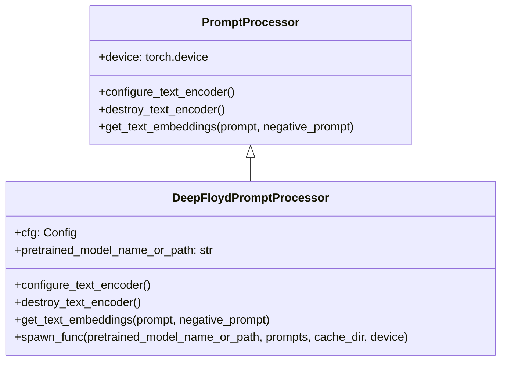
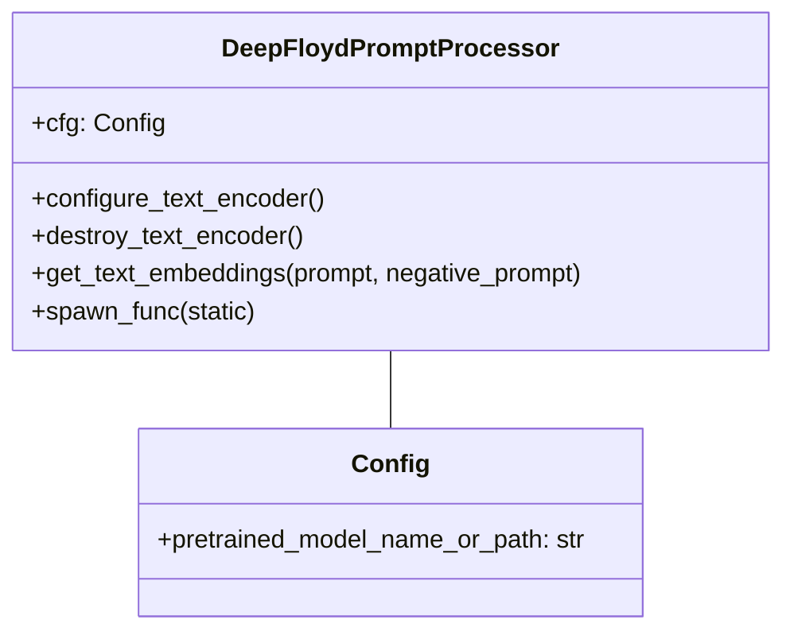
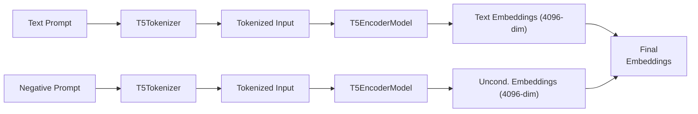
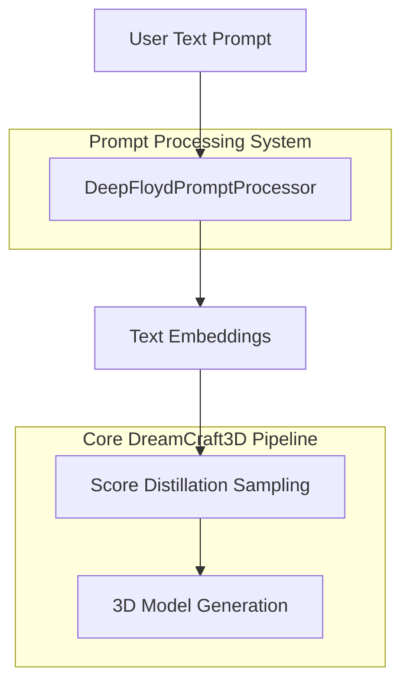

<!-- source: DeepWiki mcp.deepwiki.com · repo deepseek-ai/DreamCraft3D · extra page DeepFloyd Prompt Processor · fetched 2026-10-30 -->

# DeepFloyd Prompt Processor

<details>
<summary>Relevant source files</summary>

The following files were used as context for generating this wiki page:

- [threestudio/models/prompt_processors/deepfloyd_prompt_processor.py](threestudio/models/prompt_processors/deepfloyd_prompt_processor.py)
- [threestudio/models/prompt_processors/stable_diffusion_prompt_processor.py](threestudio/models/prompt_processors/stable_diffusion_prompt_processor.py)

</details>


The DeepFloyd Prompt Processor is a specialized component within the DreamCraft3D prompt processing subsystem that converts text prompts into embeddings using the DeepFloyd IF model architecture. This document details the implementation, usage, and technical aspects of this processor. For information about the Stable Diffusion prompt processor, see [Stable Diffusion Prompt Processor](#3.1.2).

## Overview

The DeepFloyd Prompt Processor implements the base `PromptProcessor` interface specifically for the DeepFloyd text-to-image model architecture, which uses T5 as its text encoder. It transforms natural language prompts into numerical representations (embeddings) that can be consumed by diffusion models during the 3D generation pipeline.



Sources: [threestudio/models/prompt_processors/deepfloyd_prompt_processor.py:16-96]()

## Technical Implementation

The DeepFloyd Prompt Processor is implemented in the `DeepFloydPromptProcessor` class, which uses T5 tokenization and encoding to convert text inputs into embedding vectors.

### Class Structure



Sources: [threestudio/models/prompt_processors/deepfloyd_prompt_processor.py:16-23]()

### Processing Workflow

The following diagram illustrates how a text prompt is processed through the DeepFloyd Prompt Processor:



Sources: [threestudio/models/prompt_processors/deepfloyd_prompt_processor.py:45-51](), [threestudio/models/prompt_processors/deepfloyd_prompt_processor.py:55-86]()

## Core Functionality

### Embedding Generation

The processor provides two ways to generate text embeddings:

1. **Direct Encoding**: Using the instance methods `configure_text_encoder`, `get_text_embeddings`, and `destroy_text_encoder`.
2. **Spawn Process**: Using the static `spawn_func` method to generate embeddings in a separate process, which helps manage memory usage.

The primary method for generating embeddings is through the `spawn_func` method, which:

1. Loads the T5 tokenizer and text encoder from the specified DeepFloyd model path
2. Tokenizes the input prompts with a maximum length of 77 tokens
3. Generates embeddings using the T5 encoder
4. Saves the embeddings to disk for caching
5. Cleans up the text encoder to free memory

### Technical Specifications

| Property | Value |
|----------|-------|
| Default Model | `DeepFloyd/IF-I-XL-v1.0` |
| Tokenizer | T5Tokenizer |
| Text Encoder | T5EncoderModel |
| Maximum Sequence Length | 77 tokens |
| Embedding Dimensions | 4096 |
| Quantization | 8-bit (load_in_8bit=True) |
| Device Mapping | Automatic (`device_map="auto"`) |

Sources: [threestudio/models/prompt_processors/deepfloyd_prompt_processor.py:20-21](), [threestudio/models/prompt_processors/deepfloyd_prompt_processor.py:57-69]()

## Integration with DreamCraft3D

The DeepFloyd Prompt Processor integrates with the broader DreamCraft3D system as follows:



Sources: [threestudio/models/prompt_processors/deepfloyd_prompt_processor.py:16-96]()

## Implementation Details

### Configuration

The DeepFloyd Prompt Processor extends the base `PromptProcessor.Config` with a single additional parameter:

```python
@dataclass
class Config(PromptProcessor.Config):
    pretrained_model_name_or_path: str = "DeepFloyd/IF-I-XL-v1.0"
```

This allows users to specify which DeepFloyd model to use as the text encoder.

Sources: [threestudio/models/prompt_processors/deepfloyd_prompt_processor.py:18-20]()

### Text Embedding Method

The `get_text_embeddings` method accepts both a prompt and a negative prompt, and returns their corresponding embeddings:

```python
def get_text_embeddings(
    self, prompt: Union[str, List[str]], negative_prompt: Union[str, List[str]]
) -> Tuple[Float[Tensor, "B 77 4096"], Float[Tensor, "B 77 4096"]]:
    text_embeddings, uncond_text_embeddings = self.pipe.encode_prompt(
        prompt=prompt, negative_prompt=negative_prompt, device=self.device
    )
    return text_embeddings, uncond_text_embeddings
```

Sources: [threestudio/models/prompt_processors/deepfloyd_prompt_processor.py:45-51]()

### Embedding Caching

The `spawn_func` static method handles embedding generation and caching:

```python
@staticmethod
def spawn_func(pretrained_model_name_or_path, prompts, cache_dir, device):
    # Load tokenizer and text encoder
    # Generate embeddings
    # Save embeddings to cache_dir
```

Each embedding is saved with a filename derived from hashing the model path and prompt, ensuring consistent caching.

Sources: [threestudio/models/prompt_processors/deepfloyd_prompt_processor.py:55-95]()

## Important Considerations

1. **Memory Usage**: The DeepFloyd T5 encoder is loaded in 8-bit precision to reduce memory footprint.
2. **Tokenizer Parallelism**: Parallelism is disabled for the tokenizer to prevent warnings.
3. **Resource Management**: The text encoder is explicitly deleted after use to free GPU memory.
4. **Device Mapping**: Automatic device mapping is used, which may have implications in multi-GPU setups.

Sources: [threestudio/models/prompt_processors/deepfloyd_prompt_processor.py:26-33](), [threestudio/models/prompt_processors/deepfloyd_prompt_processor.py:40-43]()

## Comparison with Stable Diffusion Prompt Processor

| Feature | DeepFloyd Prompt Processor | Stable Diffusion Prompt Processor |
|---------|----------------------------|-----------------------------------|
| Base Model | DeepFloyd/IF-I-XL-v1.0 | Typically SD 1.x/2.x models |
| Text Encoder | T5EncoderModel | CLIPTextModel |
| Tokenizer | T5Tokenizer | CLIPTokenizer |
| Embedding Dimensions | 4096 | 768 |
| Custom Token Support | No | Yes (via `add_tokens_to_model`) |

Sources: [threestudio/models/prompt_processors/deepfloyd_prompt_processor.py:16-96](), [threestudio/models/prompt_processors/stable_diffusion_prompt_processor.py:15-104]()

## Usage Example

To use the DeepFloyd Prompt Processor in a configuration file:

```yaml
prompt_processor:
  type: deep-floyd-prompt-processor
  pretrained_model_name_or_path: DeepFloyd/IF-I-XL-v1.0
```

This will initialize the processor with the default DeepFloyd IF-I-XL model.

Sources: [threestudio/models/prompt_processors/deepfloyd_prompt_processor.py:16-22]()

---

