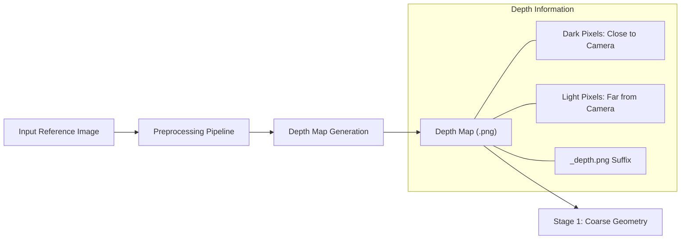
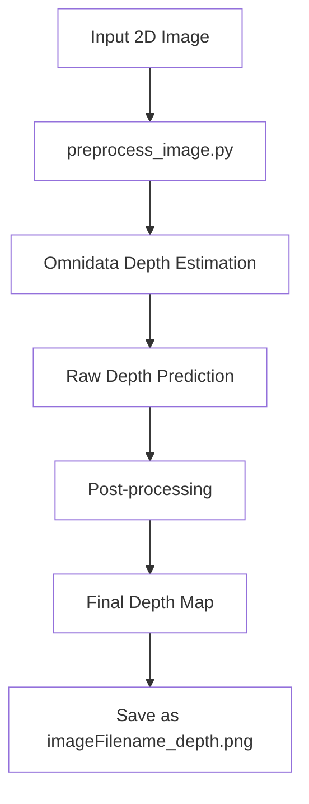
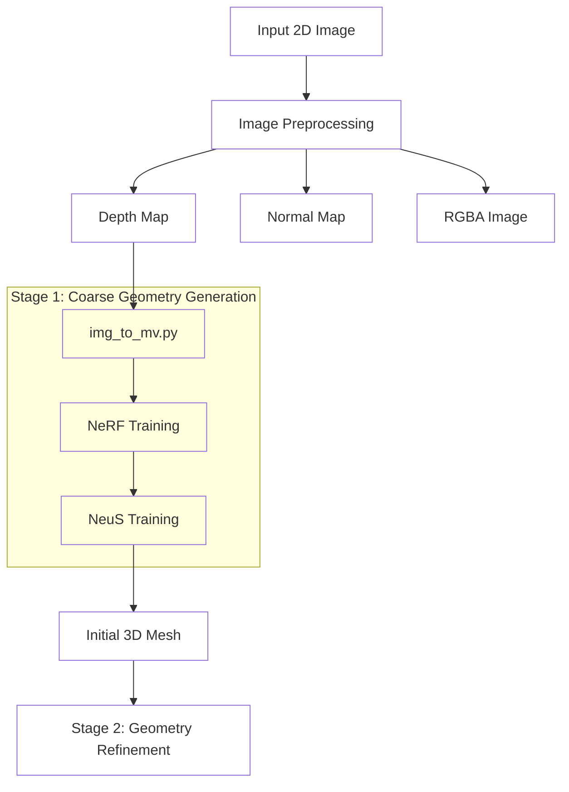
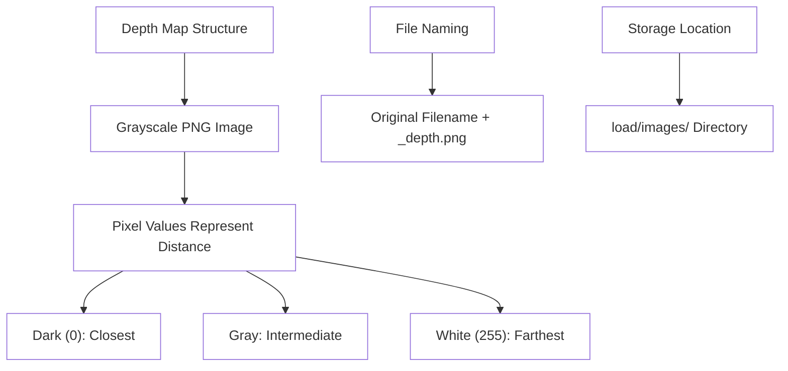
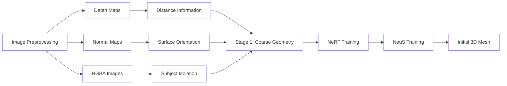

<!-- source: DeepWiki mcp.deepwiki.com · repo deepseek-ai/DreamCraft3D · extra page Depth Maps · fetched 2026-10-30 -->

# Depth Maps

Relevant source files

The following files were used as context for generating this wiki page:

- [load/images/a DSLR photo of a puffin standing on a rock_depth.png](load/images/a DSLR photo of a puffin standing on a rock_depth.png)
- [load/images/a figurine of a frog holding a birthday cake_depth.png](load/images/a figurine of a frog holding a birthday cake_depth.png)
- [load/images/a kingfisher sitting on top of a piece of wood_depth.png](load/images/a kingfisher sitting on top of a piece of wood_depth.png)

This document details the role of depth maps in the DreamCraft3D pipeline. Depth maps provide essential distance information that helps the system generate accurate 3D geometry from a single 2D reference image. For information about normal maps, which work alongside depth maps to provide surface orientation data, see [Normal Maps](#3.2.2).

## Overview

Depth maps are grayscale images where pixel intensity represents the distance from the camera viewpoint to the object. In DreamCraft3D, these maps are a critical preprocessing step that enables initial coarse geometry generation. Darker pixels indicate objects closer to the camera, while lighter pixels represent objects farther away.

Sources: load/images/a DSLR photo of a puffin standing on a rock_depth.png

## Generation Process

DreamCraft3D uses the Omnidata model for depth estimation from a single reference image. The preprocessing stage generates depth maps automatically before the main reconstruction pipeline begins.

The depth maps are stored with a consistent naming convention that appends `_depth` to the original image filename, as seen in the example file "a DSLR photo of a puffin standing on a rock_depth.png".

Sources: Repository overview diagrams

## Integration in Pipeline

Depth maps play several key roles in the DreamCraft3D pipeline:

1. **Stage 1 Initialization**: They provide initial depth constraints for the NeRF and NeuS training
2. **Multi-view Guidance**: They help generate consistent multi-view images from the single reference image
3. **Geometry Constraints**: They ensure that generated geometry respects the perceived depth in the original image

In the first stage of the pipeline, depth maps are used alongside normal maps to generate multi-view images that guide the NeRF and NeuS training processes.

Sources: Repository overview diagrams

## Data Format and Processing

Depth maps in DreamCraft3D are stored as grayscale PNG images. The value of each pixel represents the relative distance from the camera viewpoint:

| Pixel Value | Meaning |
|-------------|---------|
| Dark (near 0) | Closest to camera |
| Light (near 255) | Farthest from camera |
| Middle values | Intermediate distances |

Sources: load/images/a DSLR photo of a puffin standing on a rock_depth.png

## Common Issues and Troubleshooting

When working with depth maps in DreamCraft3D, you may encounter these common issues:

1. **Inaccurate depth estimation**: Happens when the reference image contains complex scenes or unusual objects
2. **Inconsistent depth boundaries**: Can cause artifacts in the generated 3D model, especially at object edges
3. **Flat depth regions**: Some areas may lack depth detail, resulting in flat geometry in those regions

To address these issues:

- Use reference images with clear subjects against simple backgrounds
- Manually check generated depth maps before proceeding to Stage 1
- If depth estimation fails, consider using alternative reference images

Sources: Repository overview diagrams

## Relationship to Other Components

Depth maps work in conjunction with normal maps and RGBA images in the preprocessing stage to provide comprehensive 3D information:

While depth maps provide the distance information, normal maps encode surface orientation, and RGBA images isolate the subject with transparency information. Together, these three preprocessing components enable the system to generate accurate initial 3D geometry from a single 2D image.

Sources: Repository overview diagrams

---

