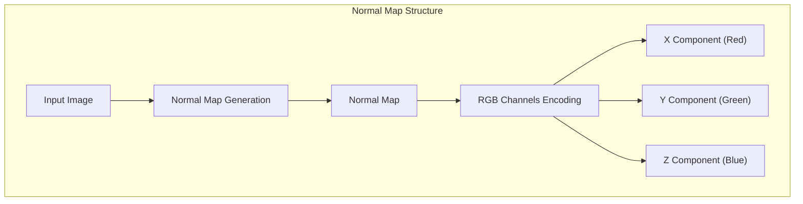
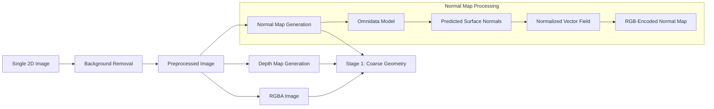
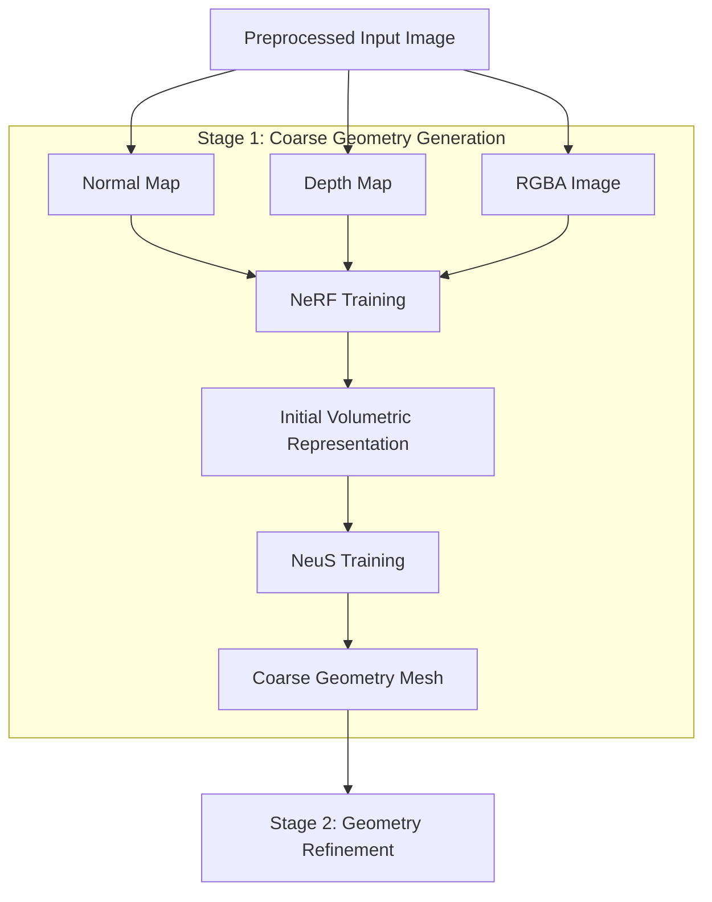
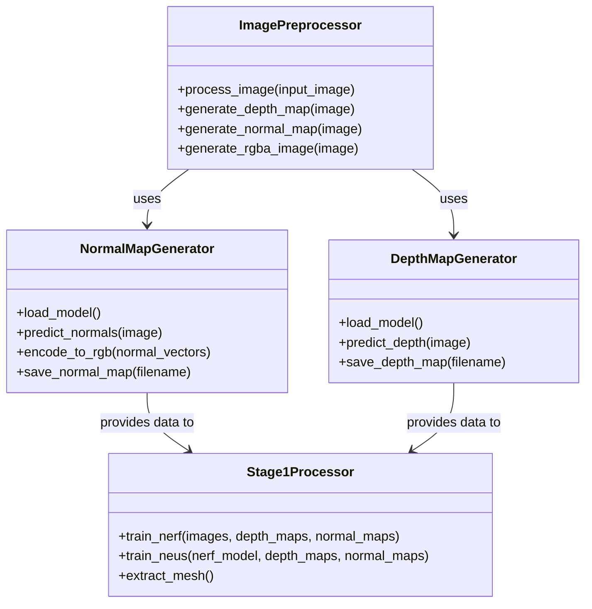
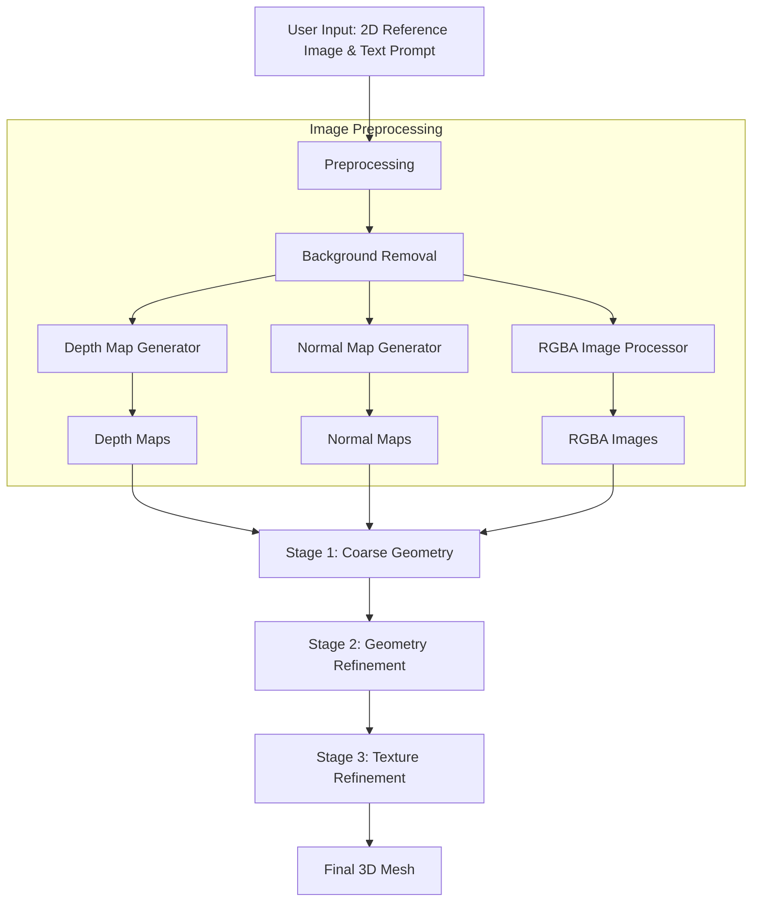

<!-- source: DeepWiki mcp.deepwiki.com · repo deepseek-ai/DreamCraft3D · extra page Normal Maps · fetched 2026-10-30 -->

# Normal Maps

Relevant source files

The following files were used as context for generating this wiki page:

- [load/images/a DSLR photo of a puffin standing on a rock_normal.png](load/images/a DSLR photo of a puffin standing on a rock_normal.png)
- [load/images/a figurine of a frog holding a birthday cake_normal.png](load/images/a figurine of a frog holding a birthday cake_normal.png)
- [load/images/a kingfisher sitting on top of a piece of wood_normal.png](load/images/a kingfisher sitting on top of a piece of wood_normal.png)

Normal maps are an essential preprocessing component in DreamCraft3D that provide critical information about surface geometry and orientation for high-quality 3D reconstruction. This document explains how normal maps are generated, processed, and utilized within the DreamCraft3D pipeline to enhance the accuracy of geometry reconstruction, particularly in Stage 1 of the generation process. For information about other preprocessing components, see [Depth Maps](#3.2.1) and [RGBA Images](#3.2.3).

## What are Normal Maps?

Normal maps are specialized textures that encode the surface orientation (normals) of an object at each pixel. In DreamCraft3D, they provide crucial surface geometry information that helps in accurately reconstructing 3D shapes from a single 2D reference image.

A normal map represents the XYZ components of the surface normal vector at each pixel using RGB color channels:
- Red channel: X component of the normal vector
- Green channel: Y component of the normal vector
- Blue channel: Z component of the normal vector

These encoded surface normals provide detailed information about how light would interact with the surface, effectively describing the object's fine geometric details without requiring high polygon counts.

Sources: High-level system architecture diagrams

## Normal Map Generation in DreamCraft3D

Normal maps in DreamCraft3D are generated during the preprocessing stage before entering the main 3D generation pipeline. The system uses pre-trained models to predict surface normals from a single input image.

Sources: High-level system architecture diagrams, overall data flow diagram

## Normal Map Role in the Pipeline

Normal maps play a critical role in Stage 1 of the DreamCraft3D pipeline, where they help establish accurate coarse geometry. They provide essential surface orientation information that complements depth maps to create a more accurate initial 3D representation.

Sources: Core Pipeline diagram, Hierarchical Generation Process diagram

## Technical Implementation

The normal map generation likely leverages the Omnidata model, a pre-trained neural network designed to predict surface normals from a single image. This implementation enhances the system's ability to reconstruct accurate 3D geometry even from a limited single-view input.

### Integration with Preprocessing Workflow

Normal maps are generated alongside depth maps and RGBA images as part of the preprocessing workflow. The example file structure suggests that normal maps are saved with a "_normal.png" suffix, as seen in the sample file `a DSLR photo of a puffin standing on a rock_normal.png`.

Sources: High-level system architecture, Data Flow and Command Interface diagram

## Benefits of Normal Maps in 3D Reconstruction

Normal maps provide several key benefits in the DreamCraft3D pipeline:

1. **Enhanced Geometry Accuracy**: Normal maps provide direct surface orientation information, allowing for more accurate geometry reconstruction.

2. **Improved Detail Preservation**: Fine surface details that might not be captured by depth maps alone can be preserved through normal information.

3. **Better Light Interaction Modeling**: Normal information helps in understanding how light interacts with surfaces, critical for realistic rendering.

4. **Handling of Ambiguous Geometry**: Normal maps help resolve ambiguous geometric structures where depth information alone might be insufficient.

## Relationship to Other Preprocessing Components

Normal maps work in conjunction with depth maps and RGBA images to provide a comprehensive set of information for 3D reconstruction:

| Component | Information Provided | Role in Reconstruction |
|-----------|----------------------|------------------------|
| Normal Maps | Surface orientation | Defines how surfaces are oriented in 3D space |
| Depth Maps | Distance information | Provides spatial relationships and overall shape |
| RGBA Images | Color and transparency | Supplies texture information and object silhouette |

Together, these components enable DreamCraft3D to generate high-quality 3D models from a single reference image.

Sources: High-level system architecture, Overall System Architecture diagram, Data Flow diagram

## Conclusion

Normal maps are a crucial component in DreamCraft3D's image preprocessing pipeline. By providing detailed surface orientation information, they significantly enhance the system's ability to generate accurate 3D geometry from a single 2D reference image. Their integration with depth maps and RGBA images enables the comprehensive understanding of the input image necessary for high-quality 3D reconstruction.

Sources: High-level system architecture, table of contents, file structure information

---

