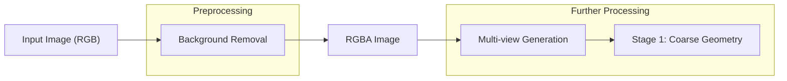
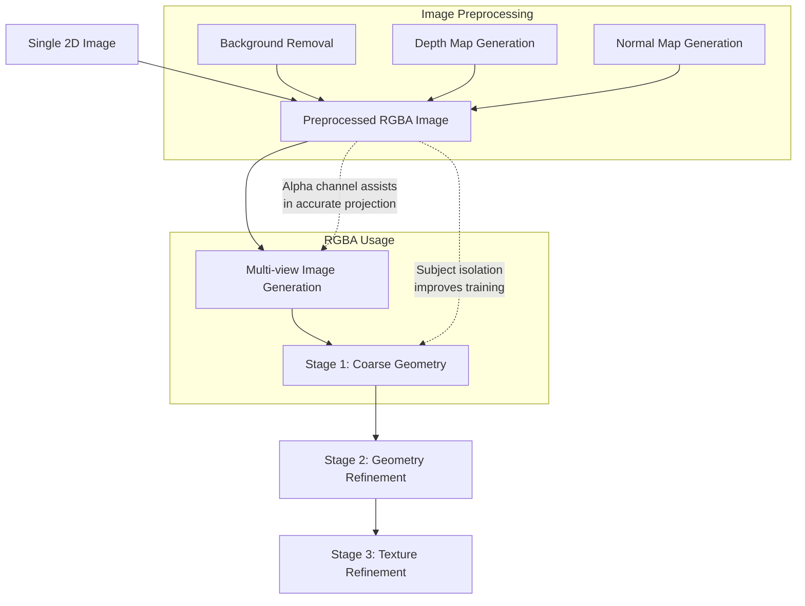
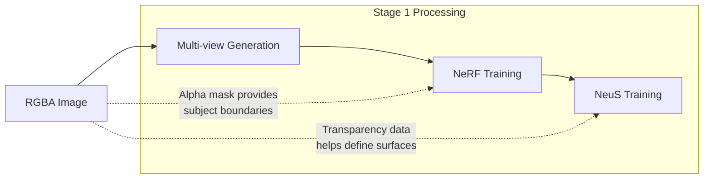

<!-- source: DeepWiki mcp.deepwiki.com · repo deepseek-ai/DreamCraft3D · extra page RGBA Images · fetched 2026-10-30 -->

# RGBA Images

<details>
<summary>Relevant source files</summary>

The following files were used as context for generating this wiki page:

- [load/images/a DSLR photo of a puffin standing on a rock_rgba.png](load/images/a DSLR photo of a puffin standing on a rock_rgba.png)
- [load/images/a figurine of a frog holding a birthday cake_rgba.png](load/images/a figurine of a frog holding a birthday cake_rgba.png)
- [load/images/a kingfisher sitting on top of a piece of wood_rgba.png](load/images/a kingfisher sitting on top of a piece of wood_rgba.png)

</details>


This document provides a detailed explanation of how RGBA images are processed and utilized within the DreamCraft3D pipeline. It covers the purpose of RGBA images, how they're generated from input images, their role in the 3D generation process, and the technical implementation details for handling these images. For information about other preprocessing outputs, see [Depth Maps](#3.2.1) and [Normal Maps](#3.2.2).

## Purpose of RGBA Images

RGBA images serve a critical role in the DreamCraft3D pipeline by providing color information with transparency data. The "RGBA" refers to the four channels: Red, Green, Blue, and Alpha. The alpha channel represents transparency, which is essential for properly isolating the subject from the background.

When generating 3D models from single images, RGBA images enable:

1. Clear subject isolation from the background
2. Accurate generation of multi-view images with transparent backgrounds
3. Better geometry inference during the coarse geometry generation phase

Sources: `load/images/a DSLR photo of a puffin standing on a rock_rgba.png`

## RGBA Image Generation

### Background Removal Process

RGBA images in DreamCraft3D are created during the preprocessing stage. The input 2D reference image undergoes background removal to separate the subject from its surroundings.



The background removal process isolates the subject, creating an alpha channel that defines which pixels belong to the subject (alpha = 1 or 255) and which are background (alpha = 0).

Sources: `load/images/a DSLR photo of a puffin standing on a rock_rgba.png`

## Role in the Pipeline

RGBA images play a crucial role in the DreamCraft3D workflow, particularly in the early stages of the 3D generation process.



The RGBA image serves several key functions:

1. **Subject Isolation**: By isolating the subject from the background, the system can focus computational resources on generating accurate geometry for the main subject.

2. **Multi-view Generation**: The transparency information enables more accurate projection when generating synthetic viewpoints of the subject.

3. **NeRF/NeuS Training**: During Stage 1, the RGBA information helps improve the quality of the coarse geometry by providing clear boundaries between the subject and empty space.

Sources: `load/images/a DSLR photo of a puffin standing on a rock_rgba.png`

## Technical Implementation

### File Format and Naming

RGBA images in DreamCraft3D follow a specific naming convention and format:

- **Format**: PNG files with 4 channels (RGBA)
- **Naming Convention**: `{original_filename}_rgba.png`
- **Storage Location**: Typically stored in the `load/images/` directory

For example, an input image named "a DSLR photo of a puffin standing on a rock.jpg" would have its RGBA version stored as "a DSLR photo of a puffin standing on a rock_rgba.png".

### Data Loading Process

```mermaid
classDiagram
    class "ImagePreprocessor" {
        +process_input_image()
        +generate_rgba()
        +generate_depth_map()
        +generate_normal_map()
    }
    
    class "RGBAHandler" {
        +load_rgba_image()
        +process_alpha_channel()
        +apply_rgba_to_model()
    }
    
    class "InputProcessor" {
        +load_reference_image()
        +preprocess_all_maps()
        +prepare_for_stage1()
    }
    
    "InputProcessor" --> "ImagePreprocessor": uses
    "ImagePreprocessor" --> "RGBAHandler": generates data for
```

The system loads RGBA images as part of the preprocessing workflow. These images are then used as inputs for the Stage 1 coarse geometry generation, where they help inform the neural radiance field (NeRF) and neural surface reconstruction (NeuS) training processes.

Sources: `load/images/a DSLR photo of a puffin standing on a rock_rgba.png`

## Relationship to Other Preprocessing Outputs

RGBA images work in conjunction with other preprocessing outputs:

| Preprocessing Output | Relationship to RGBA |
|---------------------|----------------------|
| Depth Maps | Complementary - depth maps provide spatial information while RGBA provides subject boundaries |
| Normal Maps | Complementary - normal maps define surface orientations while RGBA defines object bounds |
| Multi-view Images | Dependent - RGBA images help create more accurate multi-view projections |

Each of these preprocessing outputs contributes different but essential information to the 3D generation pipeline. The RGBA image specifically contributes by providing:

1. Clear subject silhouettes
2. Transparency information for accurate projection
3. Background separation for focused geometry generation

Sources: `load/images/a DSLR photo of a puffin standing on a rock_rgba.png`

## Usage in NeRF and NeuS Training

In Stage 1, the RGBA images contribute to both the NeRF (Neural Radiance Field) and NeuS (Neural Surface Reconstruction) training processes:



The transparency information from RGBA images helps the system understand where the subject ends and empty space begins. This improves the quality of both the radiance field and the reconstructed surface, leading to better coarse geometry that serves as the foundation for further refinement in Stages 2 and 3.

Sources: `load/images/a DSLR photo of a puffin standing on a rock_rgba.png`

## Best Practices

For optimal results when working with RGBA images in DreamCraft3D:

1. **Input Image Quality**: Use high-resolution, well-lit images with clear subject boundaries
2. **Background Complexity**: Simpler backgrounds make for more accurate automated background removal
3. **Subject Isolation**: Ensure the subject doesn't blend too much with the background
4. **Manual Refinement**: In some cases, manually refining the alpha channel may improve results

Following these practices will help ensure that the RGBA images provide clean subject isolation, leading to better 3D generation results throughout the pipeline.

Sources: `load/images/a DSLR photo of a puffin standing on a rock_rgba.png`

---

