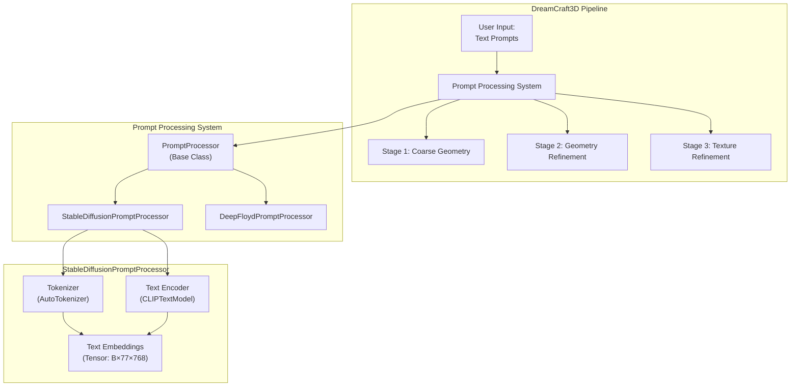
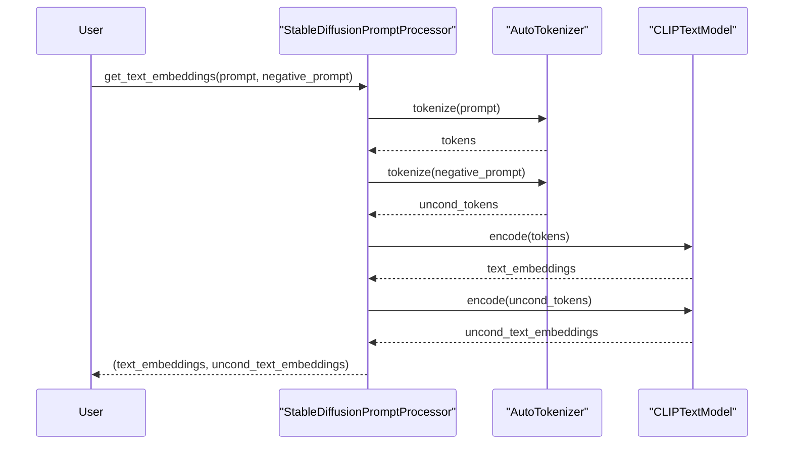
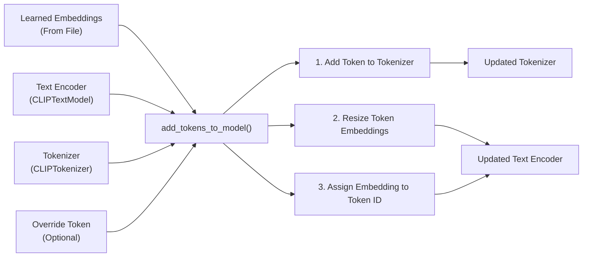

<!-- source: DeepWiki mcp.deepwiki.com · repo deepseek-ai/DreamCraft3D · extra page Stable Diffusion Prompt Processor · fetched 2026-10-30 -->

# Stable Diffusion Prompt Processor

<details>
<summary>Relevant source files</summary>

The following files were used as context for generating this wiki page:

- [threestudio/models/prompt_processors/deepfloyd_prompt_processor.py](threestudio/models/prompt_processors/deepfloyd_prompt_processor.py)
- [threestudio/models/prompt_processors/stable_diffusion_prompt_processor.py](threestudio/models/prompt_processors/stable_diffusion_prompt_processor.py)

</details>


## Overview

The Stable Diffusion Prompt Processor is a component responsible for converting text prompts into embedding vectors that the Stable Diffusion model can understand and process. It handles the tokenization and encoding of text prompts and negative prompts, creating numerical representations that guide the 3D generation process in DreamCraft3D. 

For information about the DeepFloyd prompt processing system, see [DeepFloyd Prompt Processor](#3.1.1).

Sources: [threestudio/models/prompt_processors/stable_diffusion_prompt_processor.py:15-16]()

## System Architecture

The Stable Diffusion Prompt Processor is part of the broader prompt processing system within DreamCraft3D, which converts human-readable text prompts into embedding vectors for diffusion models.



Sources: [threestudio/models/prompt_processors/stable_diffusion_prompt_processor.py:15-69]()

## Implementation Details

The `StableDiffusionPromptProcessor` class is a specialized prompt processor that works with Stable Diffusion models. It leverages the CLIP text encoder to transform text prompts into embedding vectors.

```mermaid
classDiagram
    class PromptProcessor {
        +Config
        +configure_text_encoder()
        +destroy_text_encoder()
        +get_text_embeddings(prompt, negative_prompt)
    }
    
    class StableDiffusionPromptProcessor {
        +Config
        -tokenizer: AutoTokenizer
        -text_encoder: CLIPTextModel
        +configure_text_encoder()
        +destroy_text_encoder()
        +get_text_embeddings(prompt, negative_prompt)
        +spawn_func(model_path, prompts, cache_dir, device)
    }
    
    PromptProcessor <|-- StableDiffusionPromptProcessor
    
    class "add_tokens_to_model()" {
        <<function>>
        +learned_embeds_path
        +text_encoder
        +tokenizer
        +override_token
    }
```

The class is registered in the system using the `@threestudio.register("stable-diffusion-prompt-processor")` decorator, making it available for use in configuration files.

Sources: [threestudio/models/prompt_processors/stable_diffusion_prompt_processor.py:15-69]()

## Core Components

### 1. Tokenizer

The processor uses AutoTokenizer from the Transformers library to convert text into tokens that the model can process. The tokenizer handles the splitting of text into tokens and conversion to input IDs.

### 2. Text Encoder

The CLIPTextModel is responsible for converting tokenized input into embedding vectors. It processes the tokens and produces embeddings with dimensions B×77×768 (batch size × sequence length × embedding dimension).

### 3. Embedding Cache

To improve efficiency, the processor can cache text embeddings, avoiding repeated processing of the same prompts.

Sources: [threestudio/models/prompt_processors/stable_diffusion_prompt_processor.py:24-69]()

## Operational Flow

The process of converting text prompts to embeddings follows these steps:



1. The processor receives a prompt and negative prompt (what to avoid)
2. Both are tokenized using the AutoTokenizer
3. The tokens are processed by the CLIP text encoder
4. The resulting embeddings are returned as a tuple

Sources: [threestudio/models/prompt_processors/stable_diffusion_prompt_processor.py:41-68]()

## Key Methods

### 1. `configure_text_encoder()`

Initializes the tokenizer and text encoder from the pretrained model path. Sets up the text encoder with parameters frozen (not trainable).

```python
def configure_text_encoder(self) -> None:
    self.tokenizer = AutoTokenizer.from_pretrained(
        self.cfg.pretrained_model_name_or_path, subfolder="tokenizer"
    )
    os.environ["TOKENIZERS_PARALLELISM"] = "false"
    self.text_encoder = CLIPTextModel.from_pretrained(
        self.cfg.pretrained_model_name_or_path, subfolder="text_encoder"
    ).to(self.device)
    
    for p in self.text_encoder.parameters():
        p.requires_grad_(False)
```

Sources: [threestudio/models/prompt_processors/stable_diffusion_prompt_processor.py:24-35]()

### 2. `get_text_embeddings()`

Processes prompts and negative prompts to produce embedding vectors. Handles both string and list inputs.

```python
def get_text_embeddings(
    self, prompt: Union[str, List[str]], negative_prompt: Union[str, List[str]]
) -> Tuple[Float[Tensor, "B 77 768"], Float[Tensor, "B 77 768"]]:
    # Converts single strings to lists if needed
    # Tokenizes the prompts
    # Processes through text encoder
    # Returns tuple of (text_embeddings, uncond_text_embeddings)
```

Sources: [threestudio/models/prompt_processors/stable_diffusion_prompt_processor.py:41-68]()

### 3. `spawn_func()`

A static method that pre-processes prompts and caches the resulting embeddings for later use. This improves efficiency by avoiding repeated processing of the same prompts.

```python
@staticmethod
def spawn_func(pretrained_model_name_or_path, prompts, cache_dir, device):
    # Initialize tokenizer and encoder
    # Process prompts
    # Save embeddings to cache directory
    # Clean up resources
```

Sources: [threestudio/models/prompt_processors/stable_diffusion_prompt_processor.py:72-103]()

## Adding Custom Tokens

The processor supports adding custom tokens to the model through the `add_tokens_to_model()` function. This is particularly useful for personalization or fine-tuning.



The function loads learned embeddings from a file and adds them to the tokenizer and text encoder's embedding layer.

Sources: [threestudio/models/prompt_processors/stable_diffusion_prompt_processor.py:106-134]()

## Technical Reference

### Input and Output Specifications

| Method | Inputs | Outputs | Description |
|--------|--------|---------|-------------|
| `get_text_embeddings()` | `prompt`: String or List[String]<br>`negative_prompt`: String or List[String] | Tuple of two tensors:<br>(text_embeddings, uncond_text_embeddings)<br>Shape: B×77×768 | Converts prompts to embedding vectors |
| `spawn_func()` | `pretrained_model_name_or_path`: String<br>`prompts`: List[String]<br>`cache_dir`: String<br>`device`: String | Saved embedding files in cache directory | Pre-processes and caches embeddings |
| `add_tokens_to_model()` | `learned_embeds_path`: String<br>`text_encoder`: CLIPTextModel<br>`tokenizer`: CLIPTokenizer<br>`override_token`: Optional[String or Dict] | None (modifies tokenizer and encoder in-place) | Adds custom tokens to the model |

Sources: [threestudio/models/prompt_processors/stable_diffusion_prompt_processor.py:41-134]()

## Usage in DreamCraft3D

The Stable Diffusion Prompt Processor is used across all three stages of the DreamCraft3D pipeline:

1. In Stage 1 (Coarse Geometry Generation), it provides embeddings that guide the initial 3D shape creation
2. In Stage 2 (Geometry Refinement), it supplies embeddings for the score distillation sampling process
3. In Stage 3 (Texture Refinement), it enables the bootstrapped score distillation for high-quality textures

The processor is typically configured through YAML configuration files and instantiated by the system at runtime.

Sources: [threestudio/models/prompt_processors/stable_diffusion_prompt_processor.py:15-16]()

---

