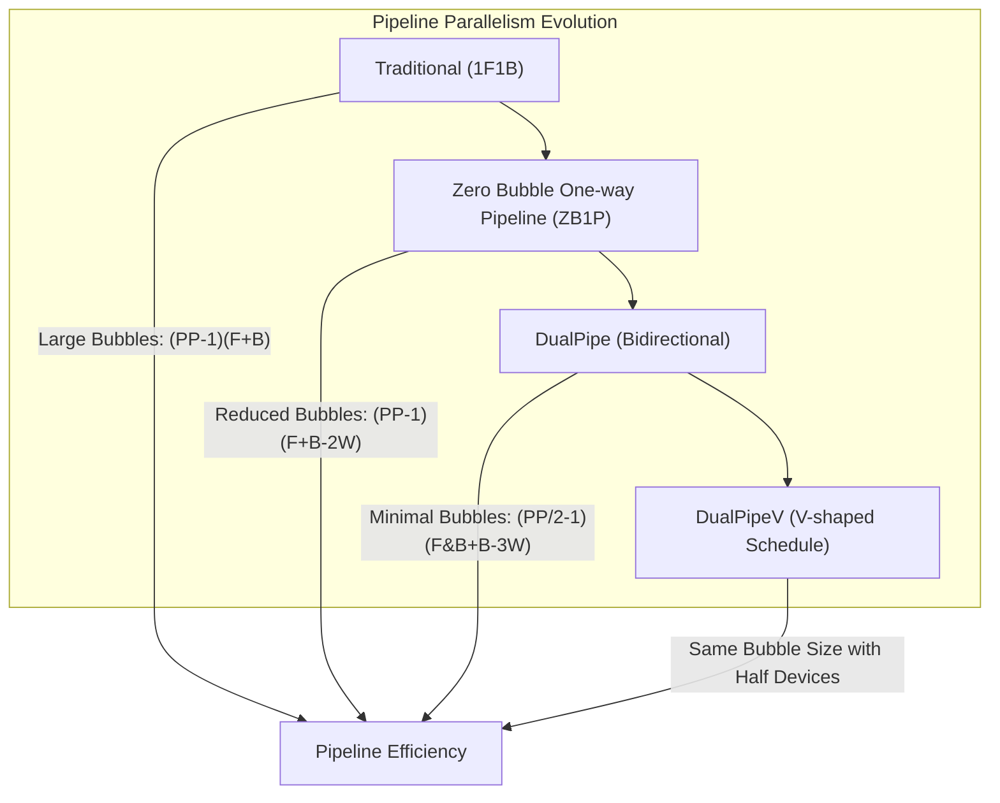
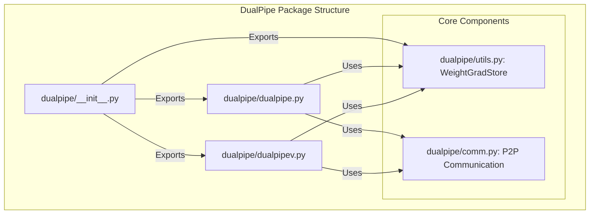
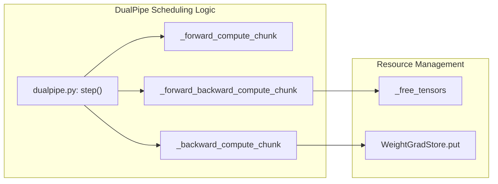

<!-- source: DeepWiki mcp.deepwiki.com · repo deepseek-ai/DualPipe · page 1 Overview · fetched 2026-10-30 -->

# Overview

<details>
<summary>Relevant source files</summary>

The following files were used as context for generating this wiki page:

- [README.md](README.md)
- [dualpipe/__init__.py](dualpipe/__init__.py)

</details>


## Purpose and Scope

This documentation covers **DualPipe**, an innovative bidirectional pipeline parallelism algorithm designed for efficient distributed training of large neural networks. DualPipe achieves full overlap of forward and backward computation-communication phases, significantly reducing pipeline bubbles compared to traditional approaches.

This overview introduces the core concepts, architecture, and benefits of both DualPipe and its variant DualPipeV. For installation instructions, see [Installation & Setup](#1.1), and for deeper technical details about specific implementations, see [Key Concepts](#1.2), [DualPipe Architecture](#2), and [DualPipeV Architecture](#3).

Sources: [README.md:1-3]()

## What is DualPipe?

DualPipe is a pipeline parallelism algorithm introduced in the DeepSeek-V3 Technical Report that optimizes distributed training by enabling full overlap between computation and communication phases. Traditional pipeline parallelism methods often suffer from efficiency issues due to pipeline bubbles (idle time) between ranks. DualPipe addresses this by implementing a bidirectional schedule that maximizes hardware utilization.

DualPipeV is a more efficient variant that uses a concise V-shape schedule derived from DualPipe through a "cut-in-half" procedure, requiring only half the number of devices while maintaining the same pipeline bubble size.



Sources: [README.md:1-16]()

## Key Benefits

DualPipe and DualPipeV offer several advantages over traditional pipeline parallelism approaches:

1.  **Full computation-communication overlap**: Both implementations achieve complete overlap of forward and backward passes.
2.  **Reduced pipeline bubbles**: Significantly smaller idle time compared to traditional methods.
3.  **Efficient resource usage**: DualPipeV achieves the same pipeline efficiency as DualPipe but with half the number of devices.
4.  **Practical trade-offs**: Uses 2× the parameter memory for better computational efficiency.

The following table compares key metrics of different pipeline parallelism methods:

| Method | Pipeline Bubble | Parameter Memory Per Device | Activation Memory Per Device | Number of Devices |
| :--- | :--- | :--- | :--- | :--- |
| 1F1B | (*PP*-1)(𝐹+𝐵) | 1× | *PP* | *PP* |
| ZB1P | (*PP*-1)(𝐹+𝐵-2𝑊) | 1× | *PP* | *PP* |
| DualPipe | (*PP*/2-1)(𝐹&𝐵+𝐵-3𝑊) | 2× | *PP*+1 | *PP* |
| DualPipeV | (*PP*/2-1)(𝐹&𝐵+𝐵-3𝑊) | 2× | *PP*+1 | *PP*/2 |

**Definitions:**
*   *PP*: Number of pipeline stages (must be even).
*   𝐹: Execution time of a forward chunk.
*   𝐵: Execution time of a full backward chunk.
*   𝑊: Execution time of a "backward for weights" chunk.
*   𝐹&𝐵: Execution time of two mutually overlapped forward and backward chunks.

Sources: [README.md:25-36]()

## High-Level Architecture

DualPipe consists of two main implementations: the standard `DualPipe` and the more resource-efficient `DualPipeV`. Both implementations are built on top of PyTorch (version 2.0+) and share core components for weight gradient management and communication.



Sources: [dualpipe/__init__.py:1-17](), [README.md:38-47]()

## Pipeline Execution Model

### DualPipe Schedule
DualPipe uses a bidirectional approach where micro-batches flow in two directions through pipeline stages. This schedule achieves full overlapping of computation and communication, minimizing idle time.

### DualPipeV Schedule
DualPipeV implements a V-shape schedule that achieves the same pipeline efficiency with half the number of devices by mapping two pipeline stages to a single physical device.



Sources: [README.md:5-23](), [dualpipe/dualpipe.py:228-348]()

## Core Components

The DualPipe repository is organized around these key components:

1.  **`DualPipe` Class**: The main implementation of the bidirectional pipeline parallelism algorithm [dualpipe/dualpipe.py:10]().
2.  **`DualPipeV` Class**: The V-shape schedule variant requiring half the number of devices [dualpipe/dualpipev.py:11]().
3.  **`WeightGradStore`**: Manages weight gradients during pipeline execution to allow for deferred gradient updates [dualpipe/utils.py:10]().
4.  **Communication Utilities**: Handles point-to-point communication (e.g., `set_p2p_tensor_shapes`) between pipeline stages [dualpipe/comm.py:11]().

Sources: [dualpipe/__init__.py:3-9]()

## System Requirements and Compatibility

DualPipe is designed to work with:
*   PyTorch 2.0 and above [README.md:51]()
*   CUDA-capable GPUs for distributed training and NCCL for P2P communication.

For real-world applications, users must implement a custom `overlapped_forward_backward` method tailored to their specific modules to handle the concurrent execution of forward and backward passes.

Sources: [README.md:47-51]()

## Getting Started

To quickly get started with DualPipe, you can run the provided examples:

```bash
python examples/example_dualpipe.py
python examples/example_dualpipev.py
```

For detailed installation instructions, see [Installation & Setup](#1.1). For practical implementation details, see [DualPipe Example Usage](#2.2).

Sources: [README.md:38-47]()

## Citation and Contributors

DualPipe was created and developed by Jiashi Li, Chengqi Deng, and Wenfeng Liang. The research is presented in the DeepSeek-V3 Technical Report. The DualPipeV variant incorporates the "Cut-in-half" concept introduced by Sea AI Lab.

Sources: [README.md:54-69]()

---

