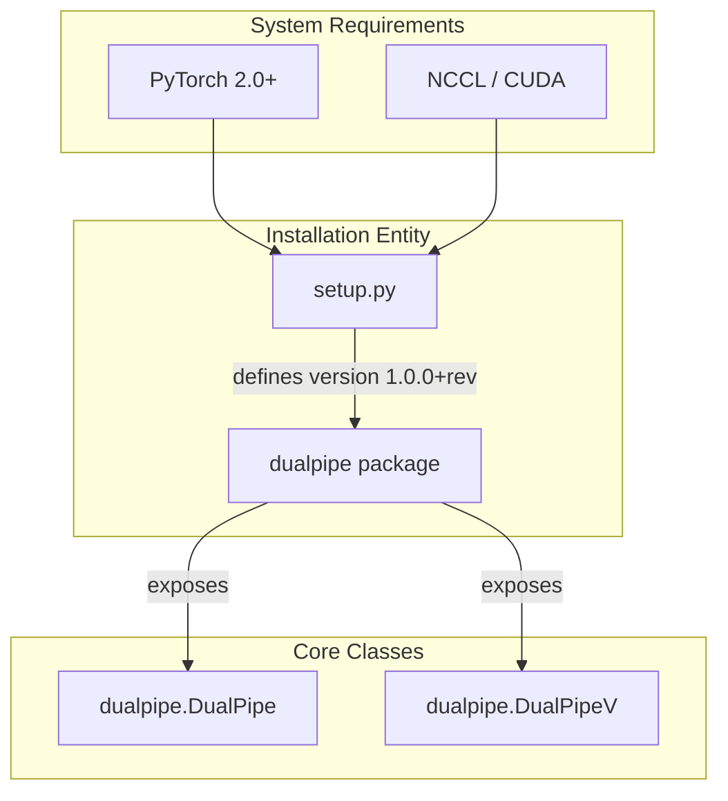
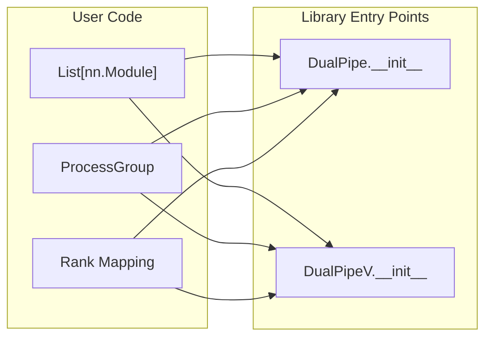

<!-- source: DeepWiki mcp.deepwiki.com · repo deepseek-ai/DualPipe · page 1.1 Installation & Setup · fetched 2026-10-30 -->

# Installation & Setup

<details>
<summary>Relevant source files</summary>

The following files were used as context for generating this wiki page:

- [.gitignore](.gitignore)
- [setup.py](setup.py)

</details>


This page provides technical details for installing and setting up the DualPipe library. DualPipe is a bidirectional pipeline parallelism library designed for distributed training, supporting both the standard DualPipe schedule and the V-shape DualPipeV variant.

## Environment Requirements

DualPipe relies on modern deep learning and distributed communication primitives. The following environment is required:

*   **PyTorch 2.0+**: Necessary for advanced autograd manipulation and distributed features.
*   **CUDA & NCCL**: Required for high-performance GPU communication via `torch.distributed`.
*   **Git**: Required for versioning during source installation.

## Package Structure and Versioning

The library is structured as a standard Python package named `dualpipe`.

### Versioning Logic
The versioning is handled dynamically in `setup.py`. It uses a base version of `1.0.0` and appends the current Git commit hash to ensure unique builds during development.

*   **Base Version**: `1.0.0` [setup.py:17]()
*   **Revision Suffix**: If Git is available, it appends `+<short-hash>`. If Git is unavailable, it appends a timestamp `+YYYY-MM-DD-HH-MM-SS` [setup.py:7-13]().

### Package Layout
The source code is contained within the `dualpipe/` directory, which is specified as the primary package for distribution [setup.py:18]().

| File/Directory | Purpose |
| :--- | :--- |
| `dualpipe/` | Core library source code. |
| `setup.py` | Installation script using `setuptools`. |
| `.gitignore` | Defines excluded paths like `build/`, `dist/`, and `__pycache__` [/.gitignore:1-4](). |

Sources: [setup.py:1-19](), [/.gitignore:1-4]()

## Installation Instructions

### Source Installation
To install DualPipe in editable mode for development, use the following command from the root of the repository:

```bash
pip install -e .
```
This triggers `setup.py`, which identifies the `dualpipe` package and sets up the environment [setup.py:15-19]().

### Verification
After installation, you can verify the package availability by importing the core classes:

```python
from dualpipe import DualPipe, DualPipeV
```

## Setup Data Flow

The following diagram illustrates how the installation and initialization process maps to specific code entities and system requirements.

**System to Code Mapping**

Sources: [setup.py:15-19]()

## Initial Configuration

Setting up a DualPipe instance requires defining the model partitions and communication parameters.

### Required Components for Initialization
1.  **Modules**: A list of `torch.nn.Module` objects representing the stages of the pipeline.
2.  **Process Group**: A `torch.distributed` process group for P2P communication.
3.  **Rank Mapping**: A dictionary mapping the internal pipeline ranks to the global distributed ranks.

**Initialization Logic Diagram**

Sources: [setup.py:18]()

## Build Artifacts
When running the installation or build process, the following directories are generated but ignored by version control:
*   `build/`: Temporary build files.
*   `dist/`: Distribution packages (wheels/source distributions).
*   `dualpipe.egg-info/`: Metadata for the installed package.

Sources: [/.gitignore:1-4]()

---

