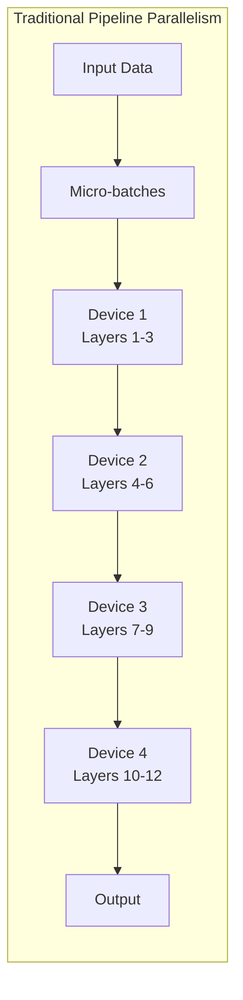
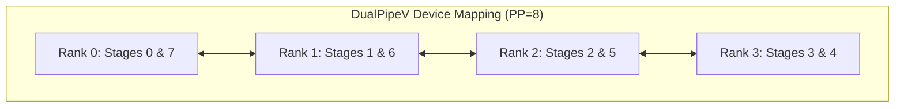
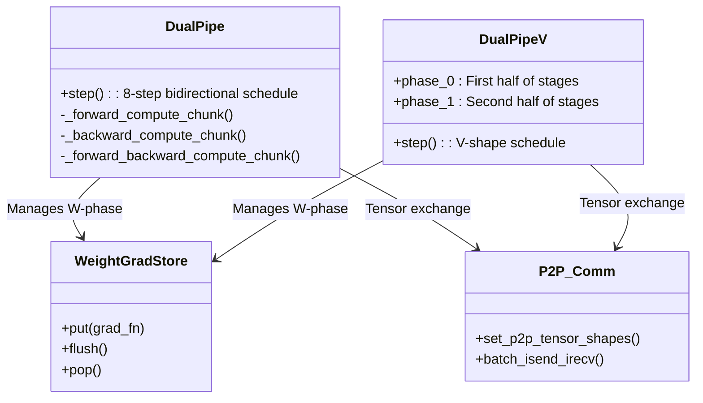

<!-- source: DeepWiki mcp.deepwiki.com · repo deepseek-ai/DualPipe · page 1.2 Key Concepts · fetched 2026-10-30 -->

# Key Concepts

<details>
<summary>Relevant source files</summary>

The following files were used as context for generating this wiki page:

- [README.md](README.md)
- [images/dualpipe.png](images/dualpipe.png)
- [images/dualpipev.png](images/dualpipev.png)

</details>


This page explains the fundamental concepts of pipeline parallelism and the innovative approaches implemented in the DualPipe repository. It covers the core principles behind DualPipe and DualPipeV, including their scheduling algorithms, memory characteristics, and performance improvements compared to traditional methods.

## Pipeline Parallelism Fundamentals

Pipeline parallelism is a distributed training technique that partitions neural network layers across multiple devices, allowing models that exceed single-device memory limitations to be trained efficiently. This approach divides the model into sequential stages, with each stage executing on a separate device.



Sources: [README.md:1-69]()

### Traditional Pipeline Parallelism Methods

Traditional pipeline parallelism methods suffer from pipeline bubbles - periods when devices are idle due to dependencies between forward and backward passes.

1. **1F1B (One Forward One Backward)**
   - Sequential execution of forward and backward passes.
   - Simple implementation but significant pipeline bubbles.
   - Bubble size: $(PP-1)(F+B)$ [README.md:28-28]().

2. **ZB1P (Zero Bubble Single Pass)**
   - Improved bubble reduction by splitting backward passes.
   - Bubble size: $(PP-1)(F+B-2W)$ [README.md:29-29]().

Where $PP$ represents pipeline stages, $F$ is forward pass time, $B$ is backward pass time, and $W$ is the weight gradient computation time [README.md:33-35]().

Sources: [README.md:24-36]()

## DualPipe Innovation

DualPipe is a bidirectional pipeline parallelism algorithm introduced in the DeepSeek-V3 Technical Report [README.md:1-3](). It achieves full overlap of forward and backward computation-communication phases, significantly reducing pipeline bubbles.

### Key Characteristics of DualPipe

1. **Bidirectional Pipeline Execution**
   - Simultaneous processing of micro-batches in two directions (forward and reverse) [README.md:9-12]().
   - The micro-batches in the reverse direction are symmetric to those in the forward direction [README.md:10-11]().

2. **F/B/W Computation Phases**
   - **F (Forward)**: Execution of a forward chunk [README.md:34-34]().
   - **B (Backward)**: Execution of a full backward chunk (activation gradients) [README.md:34-35]().
   - **W (Weight)**: Execution of a "backward for weights" chunk [README.md:35-35]().
   - **F&B**: Mutually overlapped forward and backward chunks [README.md:35-36]().

```mermaid
flowchart LR
    subgraph "DualPipe Bidirectional Strategy"
        direction LR
        Input["Micro-batches"] --> Split["Direction Split"]
        
        subgraph "Direction 0 (Forward)"
            F0["Forward Pass"] --> B0["Backward Pass"]
        end
        
        subgraph "Direction 1 (Reverse)"
            F1["Forward Pass"] --> B1["Backward Pass"]
        end
        
        Split --> "Direction 0 (Forward)"
        Split --> "Direction 1 (Reverse)"
        
        "Direction 0 (Forward)" -.->|"Overlapped"| "Direction 1 (Reverse)"
    end
```

Sources: [README.md:1-12](), [README.md:33-36]()

### DualPipe Scheduling and Overlap

DualPipe uses an 8-step schedule to interleave micro-batches. Two cells enclosed by a shared black border in the schedule diagrams have mutually overlapped computation and communication [README.md:11-12]().

| Feature | DualPipe Specification |
| :--- | :--- |
| **Bubble Size** | $(PP/2-1)(F\&B+B-3W)$ [README.md:30-30]() |
| **Parameter Memory** | 2× per device [README.md:30-30]() |
| **Activation Memory** | $PP+1$ per device [README.md:30-30]() |

Sources: [README.md:5-12](), [README.md:24-36]()

## DualPipeV Innovation

DualPipeV is a concise V-shape schedule derived from DualPipe using a "cut-in-half" procedure [README.md:14-16](). It maintains the same bubble efficiency as DualPipe but optimizes device usage.

### Key Characteristics of DualPipeV

1. **V-Shape Topology**
   - Derived by Sea AI Lab as "Cut-in-half" [README.md:16-16]().
   - A single physical device handles two pipeline stages (e.g., in an 8-stage pipeline, Device 0 handles Stage 0 and Stage 7) [README.md:20-22]().

2. **Hardware Efficiency**
   - Requires only $PP/2$ physical devices compared to DualPipe's $PP$ devices [README.md:31-31]().
   - Maintains the same reduced bubble size as DualPipe: $(PP/2-1)(F\&B+B-3W)$ [README.md:31-31]().



Sources: [README.md:14-22](), [README.md:31-31]()

## Code Connection: Implementation Entities

The innovations described above are implemented through specific classes and methods that manage the complex scheduling and overlap.



### Overlap Strategy Implementation
For real-world applications, users must implement a custom `overlapped_forward_backward` method tailored to their specific module to realize the theoretical benefits of the $F\&B$ phase [README.md:47-48]().

### Weight Gradient Management
The `WeightGradStore` is a core component that enables the $W$ (Weight gradient) phase to be separated from the $B$ (Activation gradient) phase, which is a prerequisite for the bubble reduction formulas used in both DualPipe and DualPipeV [README.md:34-35]().

Sources: [README.md:47-48](), [README.md:34-35]()

---

