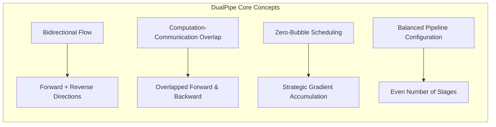
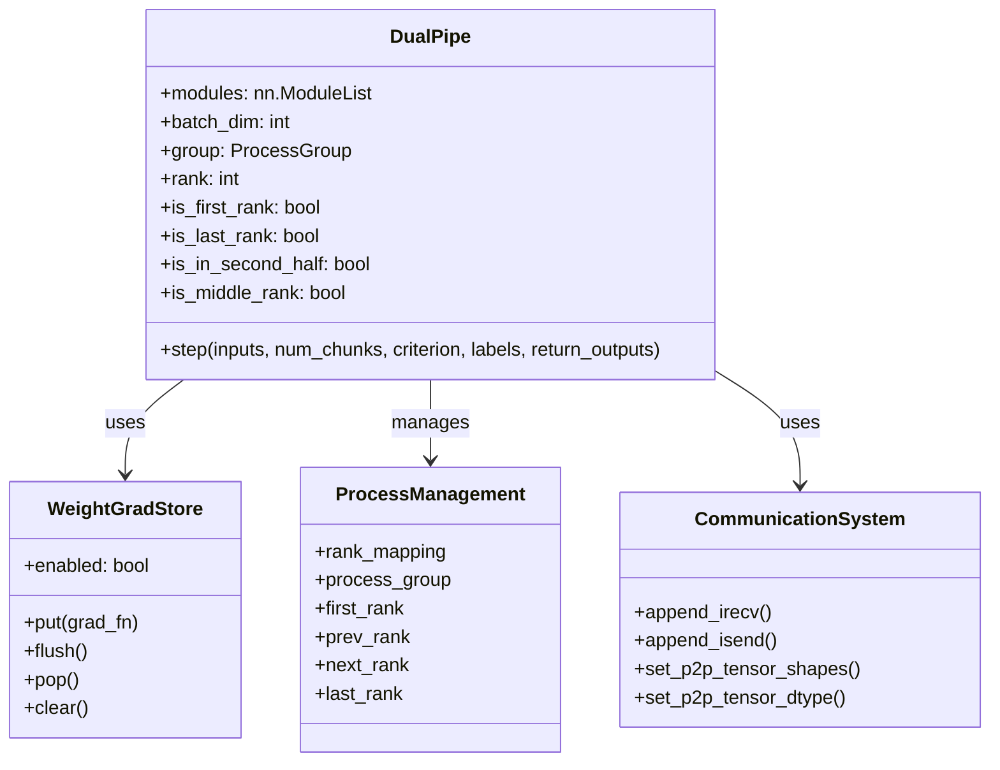
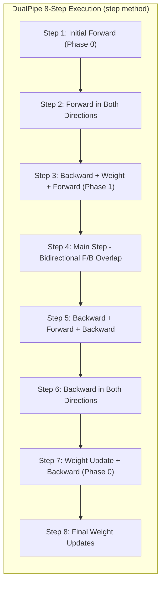
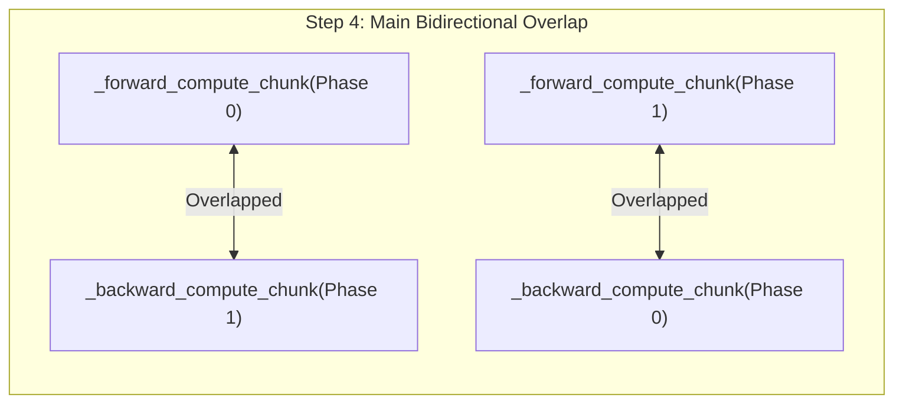
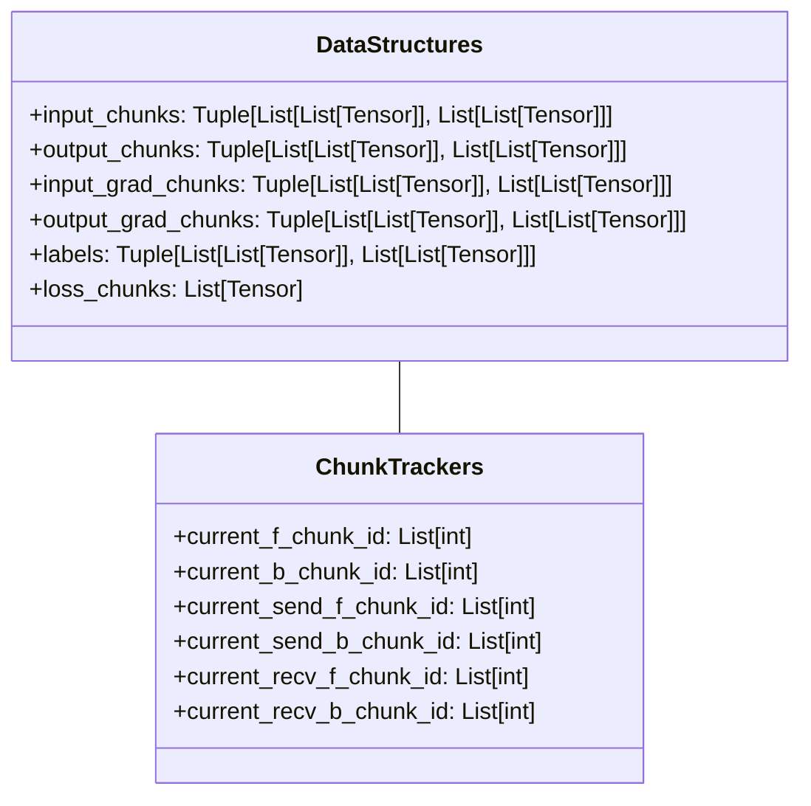
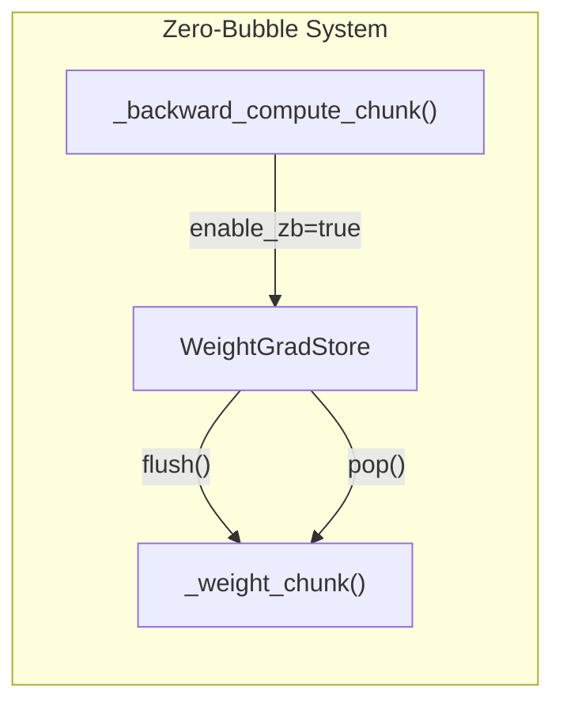

<!-- source: DeepWiki mcp.deepwiki.com · repo deepseek-ai/DualPipe · page 2 DualPipe Architecture · fetched 2026-10-30 -->

# DualPipe Architecture

Relevant source files

The following files were used as context for generating this wiki page:

- [dualpipe/dualpipe.py](dualpipe/dualpipe.py)
- [images/dualpipe.png](images/dualpipe.png)

This document provides a detailed technical overview of the DualPipe pipeline parallelism architecture. DualPipe is a bidirectional pipeline parallelism algorithm introduced in the DeepSeek-V3 Technical Report that achieves full overlap of forward and backward computation-communication phases, significantly reducing pipeline bubbles. For information about the DualPipeV variant, which uses a "cut-in-half" approach with fewer devices, see [DualPipeV Architecture](#3).

## Core Concepts and Design Principles

DualPipe is designed to maximize hardware utilization in distributed training by implementing an innovative bidirectional schedule that reduces pipeline bubbles - the idle periods in traditional pipeline parallelism methods. 

The key design principles of DualPipe are:

1.  **Bidirectional Execution**: Uses both forward and reverse pipeline directions simultaneously.
2.  **Full Computation-Communication Overlap**: Overlaps forward and backward passes with communication.
3.  **Zero-Bubble Optimization**: Strategically uses zero-bubble techniques to further reduce idle time.
4.  **Balanced Pipeline Stages**: Works with an even number of pipeline stages/ranks arranged in two halves.

Sources: [dualpipe/dualpipe.py:11-45]()

## System Architecture

DualPipe is implemented as a PyTorch module that encapsulates distributed pipeline parallelism logic. The system requires an even number of pipeline stages distributed across multiple devices.

Sources: [dualpipe/dualpipe.py:11-45](), [dualpipe/utils.py:11-13]()

## Pipeline Stage Configuration

DualPipe divides the model into two halves across an even number of ranks (pipeline stages). The directionality and behavior of each rank depends on its position in the pipeline. The `rank_mapping` allows for flexible physical-to-logical rank assignment [dualpipe/dualpipe.py:30-36]().

| Position | Description | Behavior |
|----------|-------------|----------|
| First Rank (0) | Start of forward direction | Receives initial input tensors [dualpipe/dualpipe.py:42]() |
| Last Rank (num_ranks-1) | Start of reverse direction | Receives reverse direction input tensors [dualpipe/dualpipe.py:43]() |
| Middle Ranks | Transition between halves | Special handling for phase transitions [dualpipe/dualpipe.py:45]() |
| First Half Ranks | Ranks 0 to (num_ranks/2-1) | Phase 0 = forward, Phase 1 = reverse [dualpipe/dualpipe.py:44]() |
| Second Half Ranks | Ranks (num_ranks/2) to (num_ranks-1) | Phase 0 = reverse, Phase 1 = forward [dualpipe/dualpipe.py:44]() |

```mermaid
flowchart LR
    subgraph "DualPipe Pipeline Configuration"
        direction LR
        Input1["Input Batch"] --> R0["Rank 0 (First)"]
        R0 --> R1["Rank 1"]
        R1 --> R2["Rank 2"]
        R2 --> R3["Rank 3 (Middle)"]
        R3 --> R4["Rank 4 (Middle)"]
        R4 --> R5["Rank 5"]
        R5 --> R6["Rank 6"]
        R6 --> R7["Rank 7 (Last)"]
        
        Input2["Reverse Input Batch"] --> R7
        R7 -->|"Reverse Direction"| R6
        R6 -->|"Reverse Direction"| R5
        R5 -->|"Reverse Direction"| R4
        R4 -->|"Reverse Direction"| R3
        R3 -->|"Reverse Direction"| R2
        R2 -->|"Reverse Direction"| R1
        R1 -->|"Reverse Direction"| R0
        
        classDef firstHalf fill:#eee,stroke:#333
        classDef secondHalf fill:#ddd,stroke:#333
        classDef middle stroke-width:3px
        
        class R0,R1,R2,R3 firstHalf
        class R4,R5,R6,R7 secondHalf
        class R3,R4 middle
    end
```

Sources: [dualpipe/dualpipe.py:42-45](), [dualpipe/dualpipe.py:334-338]()

## Execution Phases

The DualPipe algorithm executes in 8 distinct steps to orchestrate the bidirectional flow. Each step has a specific purpose in the overall pipeline execution, managed within the `step()` method [dualpipe/dualpipe.py:294-425]().

Sources: [dualpipe/dualpipe.py:358-425]()

### Step 1: Initial Forward (Phase 0)

Performs initial forward passes in one direction to fill the pipeline. The number of iterations is determined by the rank's position relative to the pipeline center [dualpipe/dualpipe.py:358-361]().

### Step 4: Main Step - Overlapped Bidirectional Execution

This is the core of DualPipe where forward and backward passes are fully overlapped in both directions. It utilizes `_forward_backward_compute_chunk` to execute concurrent computation [dualpipe/dualpipe.py:382-396]().

Sources: [dualpipe/dualpipe.py:382-396]()

## Technical Implementation Details

### Input/Output Management

DualPipe divides the input batch into micro-batches that are processed through the pipeline. Each stage maintains several data structures to track these micro-batches, which are reset at the start of every iteration via `_reset_states()` [dualpipe/dualpipe.py:47-65]().

Sources: [dualpipe/dualpipe.py:50-65]()

### Forward and Backward Computation

DualPipe implements several key methods for computation:

1.  `_forward_compute_chunk`: Executes a forward pass for a specific phase [dualpipe/dualpipe.py:67-86]().
2.  `_backward_compute_chunk`: Executes a backward pass with optional zero-bubble optimization via `WeightGradStore` [dualpipe/dualpipe.py:87-120]().
3.  `_forward_backward_compute_chunk`: Overlaps forward and backward computation for maximum efficiency [dualpipe/dualpipe.py:121-183]().

When the model supports it, DualPipe can use custom `overlapped_forward_backward` methods to further optimize the overlapped execution [dualpipe/dualpipe.py:168-171]().

For details, see [DualPipe Implementation](#2.1).

### Communication System

DualPipe uses non-blocking point-to-point communication operations to exchange tensors between pipeline stages. These are orchestrated by methods like `_recv_forward`, `_send_forward`, and `_commit_and_wait_comm` [dualpipe/dualpipe.py:231-292]().

For details, see [DualPipe Implementation](#2.1).

### Zero-Bubble Optimization

DualPipe strategically uses zero-bubble techniques to further reduce pipeline bubbles. This is implemented through the `WeightGradStore` system that manages gradient accumulation and deferred weight gradient computation [dualpipe/utils.py:11-53]().

Sources: [dualpipe/dualpipe.py:97-115](), [dualpipe/dualpipe.py:216-224]()

## Step Method API

The main interface to DualPipe is the `step` method, which executes a full forward and backward pass through the pipeline. It handles the splitting of inputs using `scatter` and gathering of results using `gather` [dualpipe/dualpipe.py:294-440]().

### Key Parameters:

| Parameter | Type | Description |
|-----------|------|-------------|
| inputs | torch.Tensor | Input tensors for the model (required only on first/last ranks) |
| num_chunks | int | Number of micro-batches to use (must be even and >= num_ranks*2) |
| criterion | Callable | Loss function used on first/last ranks |
| labels | List[torch.Tensor] | Labels for the loss function |
| return_outputs | bool | Whether to return model outputs |

Sources: [dualpipe/dualpipe.py:294-304]()

For details on usage, see [DualPipe Example Usage](#2.2).

## Memory and Performance Characteristics

DualPipe makes specific tradeoffs to achieve better pipeline efficiency:

| Characteristic | DualPipe | Traditional Methods (1F1B) |
|----------------|----------|----------------------------|
| Pipeline Bubbles | (PP/2-1)(F&B+B-3W) | (PP-1)(F+B) |
| Parameter Memory | 2× | 1× |
| Activation Memory | PP+1 | PP |
| Number of Devices | PP | PP |

Sources: [dualpipe/dualpipe.py:11-45]()

---

