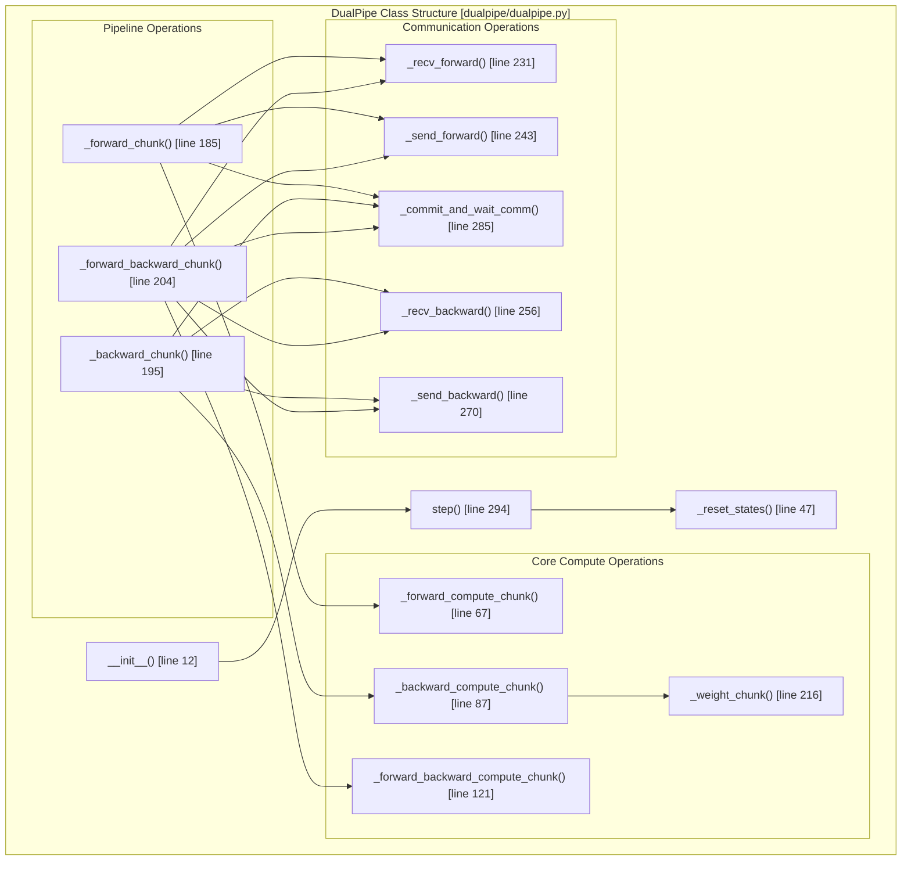
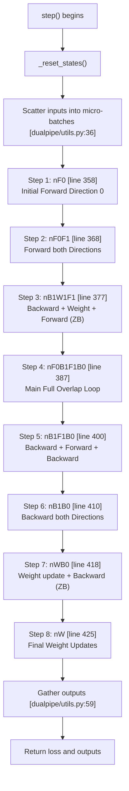

<!-- source: DeepWiki mcp.deepwiki.com · repo deepseek-ai/DualPipe · page 2.1 DualPipe Implementation · fetched 2026-10-30 -->

# DualPipe Implementation

<details>
<summary>Relevant source files</summary>

The following files were used as context for generating this wiki page:

- [dualpipe/dualpipe.py](dualpipe/dualpipe.py)

</details>


This document provides a detailed technical explanation of the DualPipe implementation, focusing on its internal methods and execution flow. For information about using DualPipe in practice, see [DualPipe Example Usage](). For details on DualPipeV, see [DualPipeV Architecture]().

## Overview

DualPipe is a pipeline parallelism system that achieves full overlap of computation and communication to minimize pipeline bubbles in distributed training. The implementation consists of a primary `DualPipe` class, along with supporting utilities for communication and weight gradient management.

```mermaid
classDiagram
    class DualPipe {
        +modules: nn.ModuleList
        +batch_dim: int
        +group: ProcessGroup
        +num_ranks: int
        +rank: int
        +step(x, labels, criterion, ...): Tuple
        -_forward_compute_chunk(phase)
        -_backward_compute_chunk(phase, enable_zb)
        -_forward_backward_compute_chunk(phase0, phase1)
        -_weight_chunk()
        -_free_tensors()
    }

    class WeightGradStore {
        +enabled: bool
        +cache: List
        +funcs_queue: Queue
        +put(func)
        +flush()
        +pop()
        +clear()
    }

    class P2PCommunication {
        +TENSOR_SHAPES: List
        +TENSOR_DTYPE: dtype
        +append_irecv(rank, group, ...)
        +append_isend(rank, group, ...)
        +batch_isend_irecv()
    }

    DualPipe --> WeightGradStore: manages gradients via [dualpipe/utils.py:8-33]
    DualPipe --> P2PCommunication: manages comms via [dualpipe/comm.py:7-38]
```

Sources: [dualpipe/dualpipe.py:11-440](), [dualpipe/utils.py:8-80](), [dualpipe/comm.py:7-38]()

## Class Architecture

The `DualPipe` class [dualpipe/dualpipe.py:11-440]() is implemented as a PyTorch module (`nn.Module`) that encapsulates the pipeline parallelism logic. It manages two model partitions and orchestrates the execution of forward and backward passes across pipeline stages.



Sources: [dualpipe/dualpipe.py:11-292]()

## Initialization

DualPipe is initialized with model partitions, batch dimension, process group, and an optional rank mapping. The initialization configures the pipeline stages and ranks for effective communication.

Key initialization steps:
1. Assign the two module partitions to `self.module` [dualpipe/dualpipe.py:22]().
2. Determine if `overlapped_forward_backward` is available based on module attributes [dualpipe/dualpipe.py:23]().
3. Configure rank mapping and determine each rank's position (prev, next, first, last) [dualpipe/dualpipe.py:30-40]().
4. Set special flags for first, last, middle, and second-half ranks [dualpipe/dualpipe.py:42-45]().

Sources: [dualpipe/dualpipe.py:12-45]()

## Core Execution Methods

### Forward Operations
`_forward_compute_chunk(phase)` [dualpipe/dualpipe.py:67-86]() executes the forward computation on a micro-batch. It identifies if the current rank is the `is_last_stage` for the given phase (0 or 1) and calculates loss if a criterion is provided [dualpipe/dualpipe.py:75-82]().

### Backward Operations
`_backward_compute_chunk(phase, enable_zb)` [dualpipe/dualpipe.py:87-119]() executes the backward computation. If `enable_zb` is True, it utilizes the `WeightGradStore` to defer weight gradient updates [dualpipe/dualpipe.py:97-114]().

### Combined Operations
DualPipe's key innovation is the ability to overlap forward and backward passes, implemented through `_forward_backward_compute_chunk(phase0, phase1)` [dualpipe/dualpipe.py:121-183](). This method checks for the `overlapped_forward_backward` attribute on the module and calls it to execute both passes concurrently [dualpipe/dualpipe.py:168-183]().

Sources: [dualpipe/dualpipe.py:67-183]()

## Step Function Scheduling Logic

The `step()` method [dualpipe/dualpipe.py:294-440]() orchestrates the entire pipeline execution through an 8-step schedule.



Sources: [dualpipe/dualpipe.py:294-440](), [dualpipe/utils.py:36-80]()

## Communication and Memory Management

### Asynchronous P2P Management
Communication is handled by appending operations to `self.comm_ops` using `comm.append_irecv` and `comm.append_isend` [dualpipe/dualpipe.py:231-283](). The method `_commit_and_wait_comm()` [dualpipe/dualpipe.py:285-292]() triggers the actual batch communication via `comm.batch_isend_irecv()` and clears the operation list.

### Memory Management via _free_tensors
To prevent memory bloat, `_free_tensors()` [dualpipe/dualpipe.py:225-229]() is called periodically. It iterates through a list of tensors and sets their `.data` to a small 1x1 tensor to release the underlying storage [dualpipe/dualpipe.py:228]().

### Weight Gradient Management
The `WeightGradStore` [dualpipe/utils.py:8-33]() acts as a singleton cache for weight gradient functions.
- `put(func)`: Adds a function to the current cache [dualpipe/utils.py:18]().
- `flush()`: Moves the current cache into `funcs_queue` [dualpipe/utils.py:22]().
- `pop()`: Executes the oldest batch of functions in the queue [dualpipe/utils.py:26]().

Sources: [dualpipe/dualpipe.py:225-292](), [dualpipe/utils.py:8-33](), [dualpipe/comm.py:25-38]()

---

