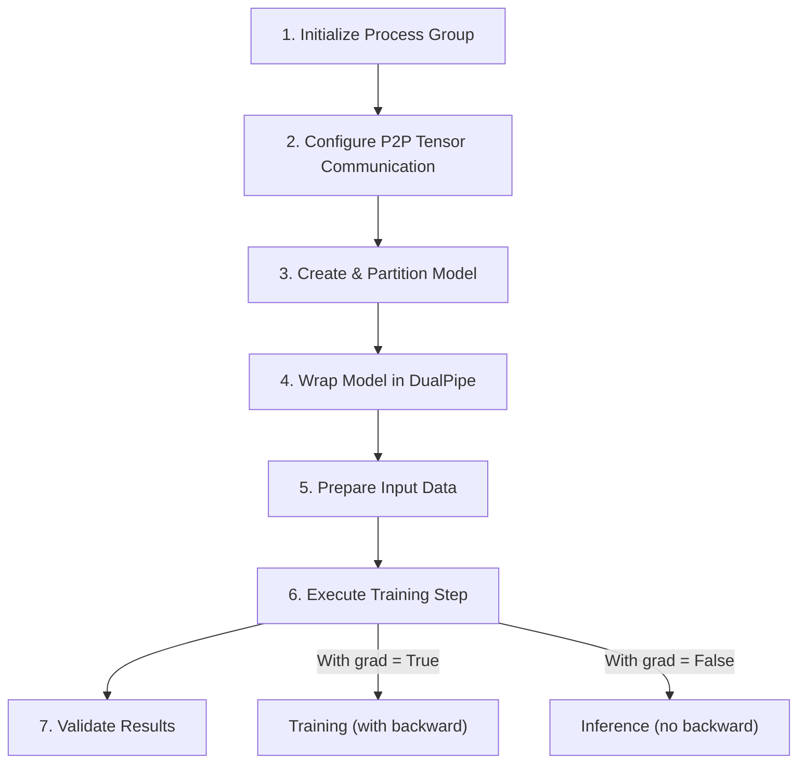
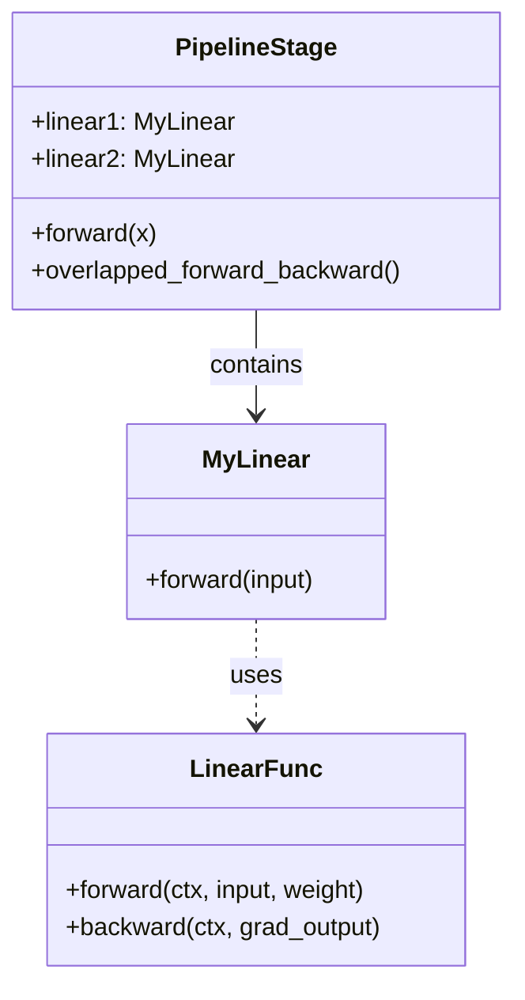
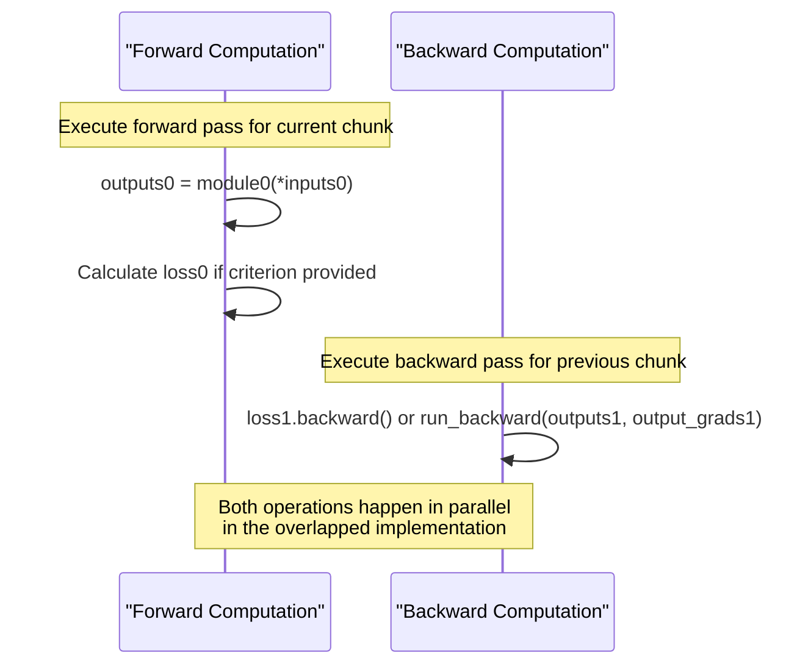
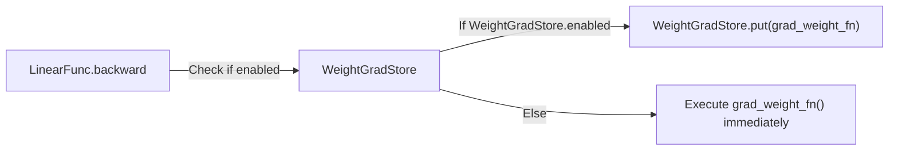
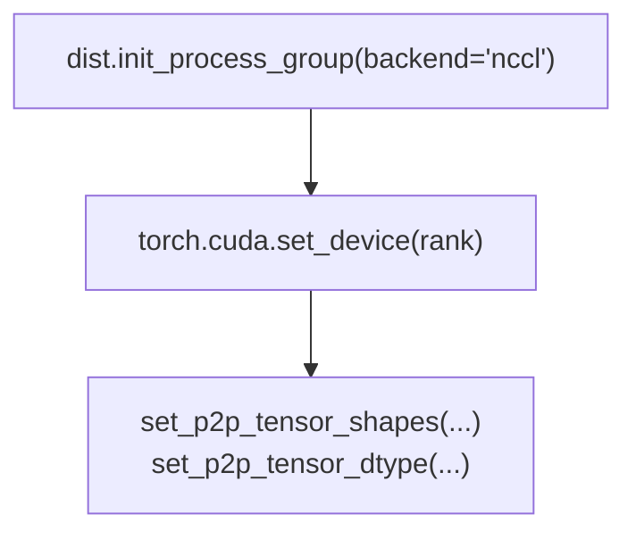
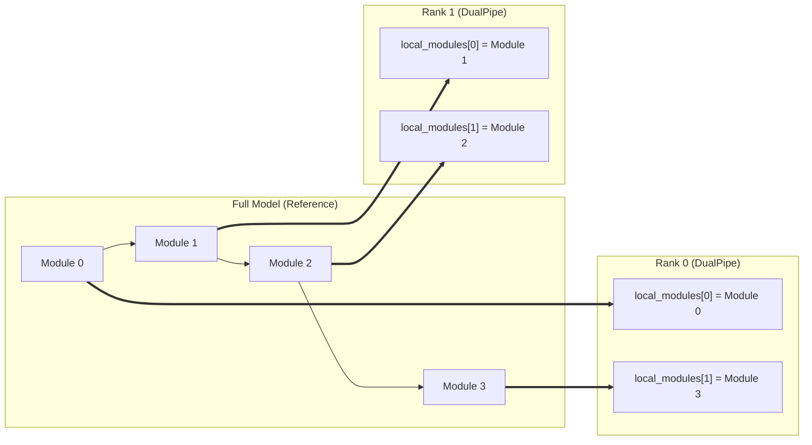
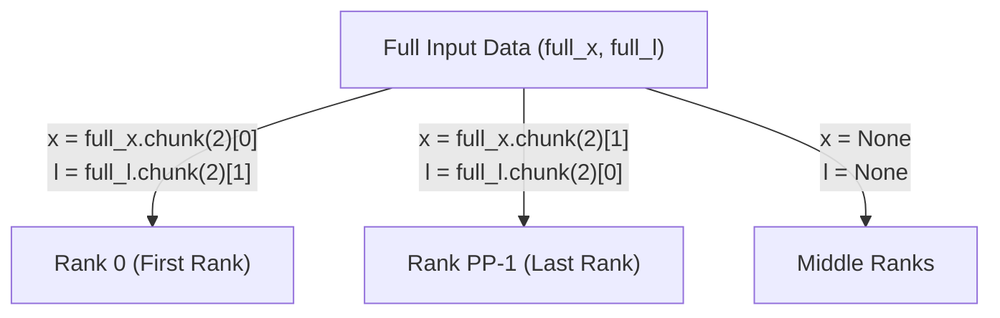
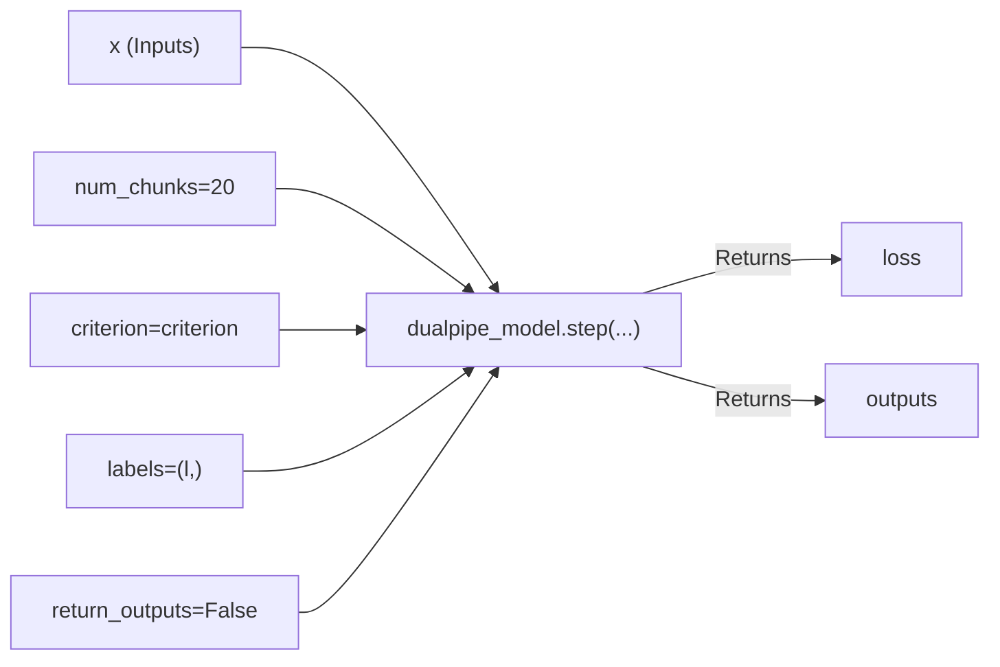

<!-- source: DeepWiki mcp.deepwiki.com · repo deepseek-ai/DualPipe · page 2.2 DualPipe Example Usage · fetched 2026-10-30 -->

# DualPipe Example Usage

<details>
<summary>Relevant source files</summary>

The following files were used as context for generating this wiki page:

- [examples/example_dualpipe.py](examples/example_dualpipe.py)

</details>


This document provides a comprehensive walkthrough of how to use the DualPipe pipeline parallelism implementation in practical applications. We'll explore the example code provided in the repository to demonstrate setup, configuration, and execution of distributed training using DualPipe. For information about the DualPipe architecture and implementation details, see [DualPipe Architecture]() and [DualPipe Implementation]().

## Prerequisites

Before using DualPipe, ensure you have:
- PyTorch 2.0 or above
- A multi-GPU environment
- NCCL backend for distributed communication

## Basic Usage Flow

DualPipe follows a specific workflow for implementing pipeline-parallel distributed training:



Sources: [examples/example_dualpipe.py:109-193](), [dualpipe/model.py:15-22]()

## Example Implementation Components

The example demonstrates how to use DualPipe with a simple two-stage neural network model. Let's examine the key components:

### Custom Module Definition

The example defines a pipeline stage consisting of two linear layers with a GELU activation in between:



Sources: [examples/example_dualpipe.py:13-52]()

The `PipelineStage` class is critical as it:
1. Defines a module that can be partitioned across devices [examples/example_dualpipe.py:42-52]()
2. Implements the required `overlapped_forward_backward` method for DualPipe [examples/example_dualpipe.py:54-83]()

### Implementing Overlapped Forward-Backward Computation

The key to DualPipe's efficiency is the customized overlapped computation implementation. The example provides a implementation in the `overlapped_forward_backward` class method:



Sources: [examples/example_dualpipe.py:54-83]()

This method is crucial for DualPipe's performance as it enables the simultaneous execution of a forward pass for the current micro-batch and a backward pass for the previous micro-batch, minimizing pipeline bubbles. DualPipe calls this method during its 8-step schedule [dualpipe/model.py:228-237]().

### Weight Gradient Management

The example implements custom gradient management through the `WeightGradStore`:



Sources: [examples/example_dualpipe.py:26-32](), [dualpipe/utils.py:16-25]()

This custom gradient handling is essential for:
1. Controlling when weight gradients are computed [examples/example_dualpipe.py:29-30]()
2. Optimizing gradient accumulation by deferring heavy matrix multiplications [examples/example_dualpipe.py:26-27]()
3. Supporting DualPipe's overlapped computation strategy where weight gradients are flushed at specific pipeline steps [dualpipe/model.py:265-267]()

## Complete Example Walkthrough

Let's examine the full workflow in the example code:

### 1. Distributed Setup



Sources: [examples/example_dualpipe.py:112-125]()

The example initializes the distributed environment using NCCL and configures the tensor shapes for point-to-point communication via `set_p2p_tensor_shapes` [examples/example_dualpipe.py:124]().

### 2. Model Creation and Partitioning

For the DualPipe approach, each rank gets assigned two `PipelineStage` modules, following a symmetric pattern:



Sources: [examples/example_dualpipe.py:138-142]()

Each rank in DualPipe manages two modules:
- `local_modules[0]`: The rank's corresponding module from the first half of the pipeline [examples/example_dualpipe.py:138]()
- `local_modules[1]`: The symmetric module from the second half of the pipeline [examples/example_dualpipe.py:138]()

### 3. Input Data Distribution

Input data is split between the first and last ranks in a specific pattern to support bidirectional flows:



Sources: [examples/example_dualpipe.py:145-153]()

This data distribution pattern ensures that:
- The first rank starts the forward pass for the first half and receives labels for the second half [examples/example_dualpipe.py:146-147]().
- The last rank starts the forward pass for the second half and receives labels for the first half [examples/example_dualpipe.py:149-150]().

### 4. Executing the Training Step

The example executes DualPipe's `step` method to run the training process:



Sources: [examples/example_dualpipe.py:156]()

The `step` method parameters control:
- `num_chunks`: How many micro-batches to create from the input [examples/example_dualpipe.py:156]().
- `criterion`: What loss function to apply at the end of the pipeline [examples/example_dualpipe.py:156]().
- `return_outputs`: Whether to return the forward pass outputs (useful for inference) [examples/example_dualpipe.py:181]().

### 5. Result Validation

The example validates the results by:
1. Checking that losses match the reference sequential implementation `ref_step` [examples/example_dualpipe.py:160-162]().
2. Verifying gradient correctness by all-gathering gradients from symmetric ranks [examples/example_dualpipe.py:168-176]().
3. Testing both training and inference (with `torch.no_grad()`) modes [examples/example_dualpipe.py:180-181]().

Sources: [examples/example_dualpipe.py:158-192]()

## Key Points for Custom Implementation

When implementing DualPipe for your own models, focus on:

1. **Custom overlapped_forward_backward method**: This is critical for performance and must be tailored to your specific module to ensure the backward of one chunk overlaps with the forward of another [examples/example_dualpipe.py:54-83]().
2. **Tensor communication configuration**: Use `set_p2p_tensor_shapes` to define the expected metadata for NCCL transfers [examples/example_dualpipe.py:124]().
3. **Weight Gradient Management**: Integrate `WeightGradStore` in your `autograd.Function` to allow DualPipe to schedule weight gradient computation during the "W" phases [examples/example_dualpipe.py:29-30]().
4. **Data partitioning**: Ensure you correctly map your model layers to `local_modules[0]` and `local_modules[1]` for the bidirectional schedule [examples/example_dualpipe.py:138]().

| Implementation Aspect | Code Entity / Function |
|-----------------------|-------------------|
| Module Wrap | `dualpipe.DualPipe(local_modules)` [examples/example_dualpipe.py:142]() |
| Parallel Exec | `PipelineStage.overlapped_forward_backward` [examples/example_dualpipe.py:55]() |
| Grad Storage | `dualpipe.utils.WeightGradStore` [examples/example_dualpipe.py:10]() |
| Manual Backward | `dualpipe.utils.run_backward` [examples/example_dualpipe.py:81]() |

Sources: [examples/example_dualpipe.py](), [dualpipe/model.py:15]()

## Running the Example

To run the provided example, use `torch.multiprocessing.spawn` or a standard distributed launcher:

```python
# In examples/example_dualpipe.py
num_gpus = torch.cuda.device_count() // 2 * 2
for ngpus in range(num_gpus, 0, -2):
    test_dualpipe(ngpus)
```

Sources: [examples/example_dualpipe.py:195-202]()

## Summary

DualPipe example usage demonstrates how to implement efficient pipeline parallelism with full overlap of forward and backward computation phases. The key aspects include:

1. Implementing custom modules with the `overlapped_forward_backward` method.
2. Configuring distributed processes and tensor communication metadata.
3. Creating and partitioning models symmetrically across ranks.
4. Managing input and label distribution for bidirectional flows.
5. Using `WeightGradStore` to defer weight gradient computation.
6. Validating results against a sequential reference.

For more advanced usage patterns and implementation details, refer to [DualPipe Implementation]() and [DualPipeV Example Usage]().

---

