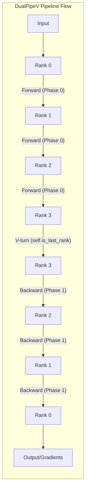
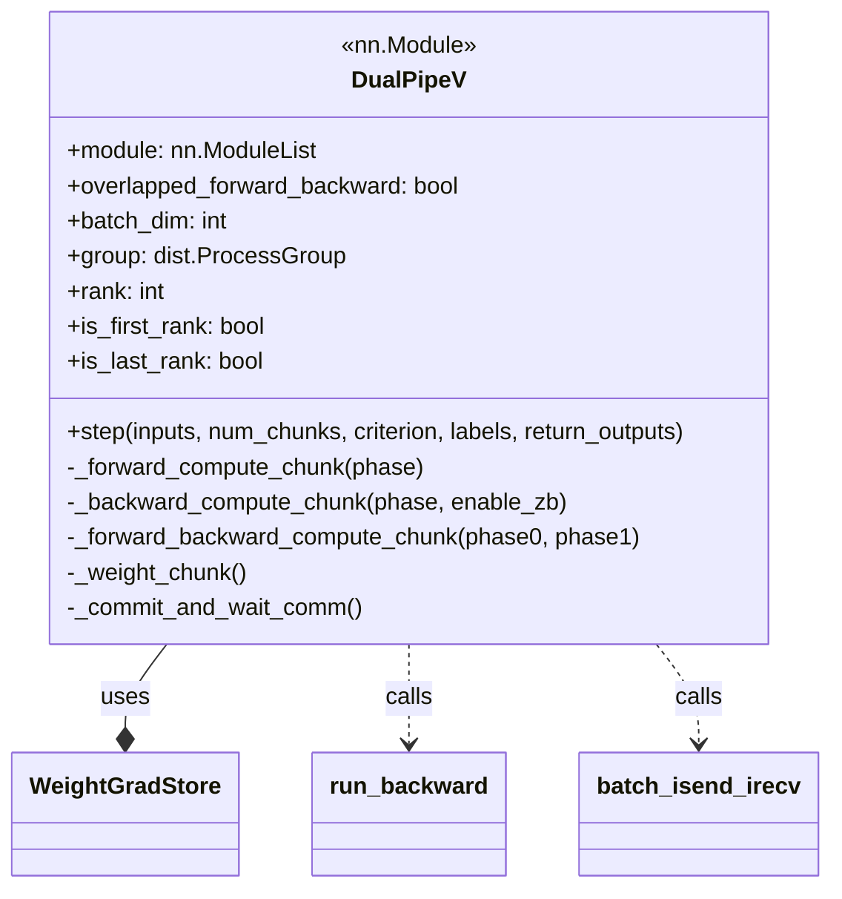
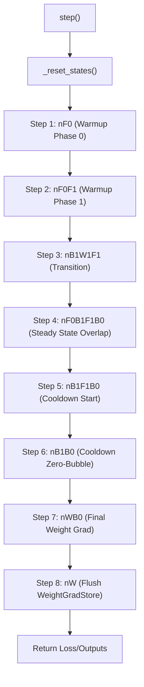

<!-- source: DeepWiki mcp.deepwiki.com · repo deepseek-ai/DualPipe · page 3 DualPipeV Architecture · fetched 2026-10-30 -->

# DualPipeV Architecture

Relevant source files

The following files were used as context for generating this wiki page:

- [dualpipe/dualpipev.py](dualpipe/dualpipev.py)
- [images/dualpipev.png](images/dualpipev.png)

## Purpose

This document explains the DualPipeV architecture, a variant of pipeline parallelism that achieves the same efficiency as DualPipe while requiring only half the number of devices. For information about the original DualPipe architecture, see [DualPipe Architecture](#2).

## Overview

DualPipeV is a concise V-shape schedule derived from DualPipe using a "cut-in-half" procedure. It was introduced by Sea AI Lab and integrated into the DeepSeek-V3 architecture as documented in the DeepSeek-V3 Technical Report.

### Key Features

- Implements a V-shape pipeline parallelism schedule [dualpipe/dualpipev.py:11-12]().
- Requires only PP/2 devices compared to DualPipe's PP devices [README.md:14-16]().
- Maintains the same pipeline bubble size as DualPipe [README.md:24-36]().
- Achieves full overlap of forward and backward computation-communication phases [dualpipe/dualpipev.py:23]().

For implementation details, see [DualPipeV Implementation](#3.1).

Sources: [README.md:14-16](), [dualpipe/dualpipev.py:11-23]()

## V-Shape Schedule Concept

### Diagram: DualPipeV V-Shape Schedule

In this diagram, data flows forward through the first half of pipeline stages (Phase 0), then makes a "V-turn" at the midpoint (the physical last rank) before flowing through the second half of the pipeline (Phase 1) on the same devices in reverse order. This differs from traditional pipeline parallelism where data flows linearly through twice as many distinct ranks.

The V-shape schedule allows DualPipeV to effectively simulate a pipeline with `PP` stages using only `PP/2` devices by having each device process data in both the forward and backward directions of the V-shape [dualpipe/dualpipev.py:70-80]().

Sources: [README.md:19-22](), [dualpipe/dualpipev.py:11-12](), [dualpipe/dualpipev.py:70-80]()

## Pipeline Parallelism Comparison

The following table compares DualPipeV with other pipeline parallelism methods:

| Method     | Pipeline Bubble Size             | Parameter Memory | Activation Memory | Required Devices |
|------------|---------------------------------|------------------|-------------------|-----------------|
| 1F1B       | (*PP*-1)(𝐹+𝐵)                  | 1×               | *PP*              | *PP*            |
| ZB1P       | (*PP*-1)(𝐹+𝐵-2𝑊)              | 1×               | *PP*              | *PP*            |
| DualPipe   | (*PP*/2-1)(𝐹&𝐵+𝐵-3𝑊)          | 2×               | *PP*+1            | *PP*            |
| DualPipeV  | (*PP*/2-1)(𝐹&𝐵+𝐵-3𝑊)          | 2×               | *PP*+1            | *PP*/2          |

Where:
- *PP* is the number of pipeline parallelism stages (must be even).
- 𝐹 is the execution time of a forward pass.
- 𝐵 is the execution time of a backward pass.
- 𝑊 is the execution time of a "backward for weights" pass.
- 𝐹&𝐵 is the execution time of overlapped forward and backward passes.

Sources: [README.md:24-36]()

## DualPipeV Class Implementation

The `DualPipeV` class is implemented as a PyTorch module that manages pipeline parallelism using the V-shape schedule.

### Class Structure and Code Entities

The `DualPipeV` class takes two modules that represent different segments of the pipeline (e.g., layers 0-N and layers N+1-2N) but reside on the same physical device [dualpipe/dualpipev.py:12-22](). It manages a complex scheduling system to ensure efficient overlapping of computation and communication.

Sources: [dualpipe/dualpipev.py:11-42](), [dualpipe/dualpipev.py:107]()

## Execution Flow

The execution of the DualPipeV pipeline is managed by the `step` method [dualpipe/dualpipev.py:288]().

### Diagram: DualPipeV Step Logic

The `step` method implements the V-shape schedule through a sequence of 8 steps [dualpipe/dualpipev.py:288-411](). The execution is divided into two phases: `phase 0` (forward path of the V) and `phase 1` (backward path of the V).

For a detailed walkthrough of this 8-step schedule, see [DualPipeV Implementation](#3.1).

Sources: [dualpipe/dualpipev.py:288-411]()

## Key Components and Internal Methods

### State Management

DualPipeV maintains several internal state variables during execution to track micro-batch progress across the V-shape [dualpipe/dualpipev.py:43-62]():

- `input_chunks`, `output_chunks`: Tensors for the forward passes of Phase 0 and 1.
- `input_grad_chunks`, `output_grad_chunks`: Gradient tensors for the backward passes.
- `current_f_chunk_id`, `current_b_chunk_id`: Tracking chunk IDs for forward and backward passes.
- `comm_ops`: Pending communication operations to be executed via `dist.batch_isend_irecv`.

Sources: [dualpipe/dualpipev.py:43-62]()

### Computation Methods

DualPipeV implements several key computation methods:

1. `_forward_compute_chunk(phase)`: Executes forward computation for a specific phase [dualpipe/dualpipev.py:63]().
2. `_backward_compute_chunk(phase, enable_zb)`: Executes backward computation, optionally enabling `WeightGradStore` for zero-bubble weight updates [dualpipe/dualpipev.py:84]().
3. `_forward_backward_compute_chunk(phase0, phase1)`: The core overlap method that can call a module's custom `overlapped_forward_backward` hook [dualpipe/dualpipev.py:120]().

Sources: [dualpipe/dualpipev.py:63-126](), [dualpipe/dualpipev.py:127-186]()

## Optimizations

### Zero Bubble Technique

DualPipeV employs a "zero bubble" optimization in several steps to further reduce pipeline bubbles by accumulating weight gradients asynchronously [dualpipe/dualpipev.py:344-350](). This is managed via the `enable_zb` flag passed to `_backward_compute_chunk` [dualpipe/dualpipev.py:84]().

### Overlapped Forward-Backward Computation

For modules that support it, DualPipeV can use an optimized `overlapped_forward_backward` computation [dualpipe/dualpipev.py:165-168](). This allows the model to overlap the forward pass of one micro-batch with the backward pass of another at the kernel level.

For details on how to implement these modules, see [DualPipeV Example Usage](#3.2).

Sources: [dualpipe/dualpipev.py:84](), [dualpipe/dualpipev.py:165-168](), [dualpipe/dualpipev.py:344-350]()

---

