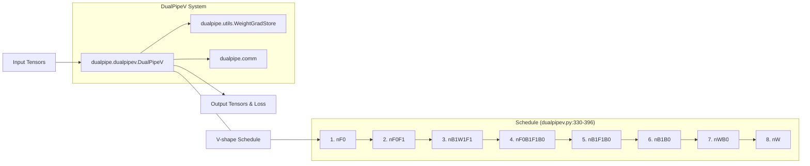
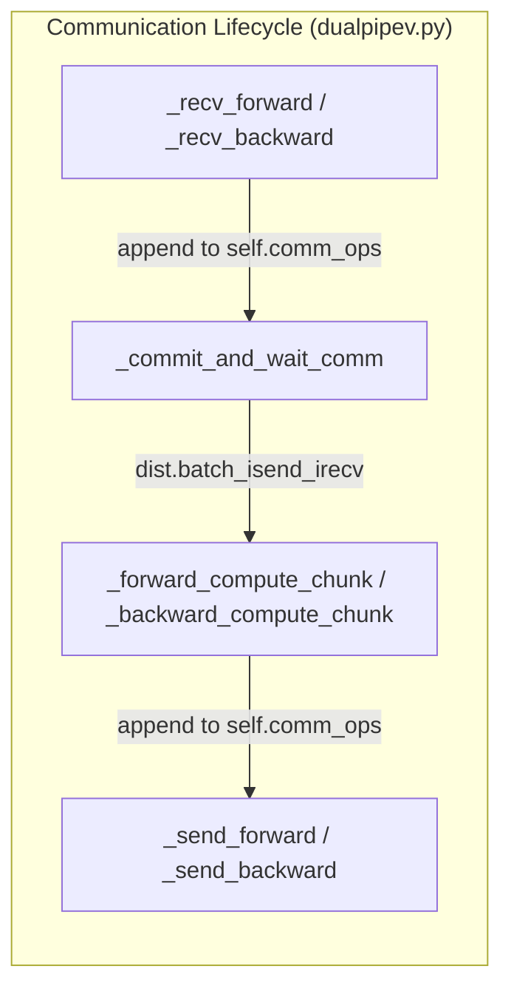

<!-- source: DeepWiki mcp.deepwiki.com · repo deepseek-ai/DualPipe · page 3.1 DualPipeV Implementation · fetched 2026-10-30 -->

# DualPipeV Implementation

<details>
<summary>Relevant source files</summary>

The following files were used as context for generating this wiki page:

- [dualpipe/dualpipev.py](dualpipe/dualpipev.py)

</details>


This document provides a detailed technical explanation of the DualPipeV implementation in the DualPipe library. DualPipeV is an optimized variant of the DualPipe pipeline parallelism system that achieves similar performance with fewer devices by using a V-shaped rank topology. For information about the overall DualPipeV architecture and concepts, see **3.0 DualPipeV Architecture**. For usage examples, see **3.2 DualPipeV Example Usage**.

## Overview

DualPipeV implements a V-shaped schedule for pipeline parallelism that requires only half the number of physical devices ($PP/2$) compared to the original DualPipe implementation while maintaining the same pipeline bubble efficiency. It achieves this by mapping two logical pipeline stages (one from each "leg" of the V) to a single physical device.



Sources: [dualpipe/dualpipev.py:11-411](), [dualpipe/dualpipev.py:330-396]()

## Core Components

DualPipeV consists of several key components that work together to implement the V-shaped pipeline parallelism schedule:

```mermaid
classDiagram
    class DualPipeV {
        +module: nn.ModuleList
        +rank: int
        +is_first_rank: bool
        +is_last_rank: bool
        +step(inputs, num_chunks, criterion, labels, return_outputs)
        -_forward_compute_chunk(phase)
        -_backward_compute_chunk(phase, enable_zb)
        -_forward_backward_compute_chunk(phase0, phase1)
        -_weight_chunk()
    }

    class WeightGradStore {
        +enabled: bool
        +cache: List[Callable]
        +funcs_queue: Queue
        +put(func)
        +flush()
        +pop()
        +clear()
    }

    class comm {
        +TENSOR_SHAPES: List
        +TENSOR_DTYPE: torch.dtype
        +append_irecv(ops, src, group)
        +append_isend(ops, tensors, dst, group)
        +set_p2p_tensor_shapes(shapes)
        +set_p2p_tensor_dtype(dtype)
    }

    DualPipeV --> WeightGradStore : uses [dualpipe/dualpipev.py:8-93]()
    DualPipeV --> comm : uses [dualpipe/dualpipev.py:7-279]()
```

Sources: 
- [dualpipe/dualpipev.py:11-43]()
- [dualpipe/utils.py:8-33]()
- [dualpipe/comm.py:7-38]()

### 1. DualPipeV Class
The main class `DualPipeV` implements the V-shaped pipeline parallelism schedule. It handles the distribution of model layers across devices, manages communication between pipeline stages, and orchestrates the forward and backward passes [dualpipe/dualpipev.py:11-411]().

Key attributes:
- `module`: A `nn.ModuleList` containing two `nn.Module` components representing the two halves of the model (Phase 0 and Phase 1) [dualpipe/dualpipev.py:22]().
- `rank_mapping`: Maps the rank in the process group to the actual PP rank to support non-linear topologies [dualpipe/dualpipev.py:30-36]().
- `overlapped_forward_backward`: A boolean flag determined by checking if the module types implement the specialized `overlapped_forward_backward` static method [dualpipe/dualpipev.py:23]().

### 2. Phase 0 and Phase 1 Management
DualPipeV splits the model into two phases. In the V-shape topology:
- **Phase 0**: The "downward" leg of the V (Ranks 0 to $N-1$).
- **Phase 1**: The "upward" leg of the V (Ranks $N-1$ back to 0).
The `is_last_rank` (rank $N-1$) serves as the transition point where Phase 0 outputs are detached and passed to Phase 1 [dualpipe/dualpipev.py:79-80]().

Sources: [dualpipe/dualpipev.py:40-41](), [dualpipe/dualpipev.py:79-80](), [dualpipe/dualpipev.py:115-116]()

## Initialization and Setup

The initialization process [dualpipe/dualpipev.py:12-42]() sets up the rank topology:
1. **Rank Mapping**: It calculates `prev_rank` and `next_rank` using a mapping that allows flexible process-to-stage assignment [dualpipe/dualpipev.py:32-38]().
2. **Device Verification**: It ensures modules are on the current CUDA device [dualpipe/dualpipev.py:21]().
3. **Capability Detection**: It checks if the provided modules support the `overlapped_forward_backward` hook for simultaneous F/B computation [dualpipe/dualpipev.py:23]().

Sources: [dualpipe/dualpipev.py:12-42]()

## V-Shaped Schedule Implementation

DualPipeV implements a 8-step schedule in the `step()` function [dualpipe/dualpipev.py:288-411](). This schedule is designed to keep both Phase 0 and Phase 1 modules busy while overlapping communication.

| Step | Code Section | Description |
| :--- | :--- | :--- |
| **1. nF0** | [dualpipe/dualpipev.py:331-333]() | Initial forward passes for Phase 0 to fill the pipeline. |
| **2. nF0F1** | [dualpipe/dualpipev.py:336-342]() | Simultaneous forward passes for Phase 0 and Phase 1. |
| **3. nB1W1F1** | [dualpipe/dualpipev.py:345-350]() | Backward Phase 1, Weight Phase 1 (ZB), and Forward Phase 1. |
| **4. nF0B1F1B0** | [dualpipe/dualpipev.py:353-367]() | The steady-state overlapped step executing F0, B1, F1, and B0. |
| **5. nB1F1B0** | [dualpipe/dualpipev.py:370-373]() | Draining Phase 1 forwards while continuing Phase 0/1 backwards. |
| **6. nB1B0** | [dualpipe/dualpipev.py:376-384]() | Final backward passes for both phases. |
| **7. nWB0** | [dualpipe/dualpipev.py:387-390]() | Final Phase 0 backward passes and weight updates. |
| **8. nW** | [dualpipe/dualpipev.py:393-396]() | Final weight updates (flushing `WeightGradStore`). |

Sources: [dualpipe/dualpipev.py:330-396]()

## Computation and Overlap Hooks

### _forward_backward_compute_chunk
This method [dualpipe/dualpipev.py:120-185]() is the core of the overlap logic. It handles two scenarios:
1. **Non-overlapped**: It sequentially calls `_forward_compute_chunk` and `_backward_compute_chunk` [dualpipe/dualpipev.py:125-128]().
2. **Overlapped**: It calls the static method `overlapped_forward_backward` on the module class [dualpipe/dualpipev.py:165-168](). This allows the implementation (e.g., a Transformer layer) to use specialized CUDA kernels or streams to run the forward pass of one micro-batch and the backward pass of another micro-batch simultaneously.

### Zero-Bubble (ZB) Integration
During `_backward_compute_chunk`, the `enable_zb` flag controls `WeightGradStore.enabled` [dualpipe/dualpipev.py:93](). When `True`, weight gradients are not accumulated immediately but are instead captured by the `WeightGradStore` and executed later during `_weight_chunk` calls [dualpipe/dualpipev.py:218-226]().

Sources: [dualpipe/dualpipev.py:84-110](), [dualpipe/dualpipev.py:120-185](), [dualpipe/dualpipev.py:218-226]()

## Communication Management

DualPipeV uses a "commit and wait" pattern for P2P communication:
1. **Append**: `_recv_forward`, `_send_forward`, etc., add `dist.P2POp` objects to `self.comm_ops` [dualpipe/dualpipev.py:233-277]().
2. **Commit**: `_commit_and_wait_comm` calls `dist.batch_isend_irecv` with the accumulated ops [dualpipe/dualpipev.py:279-286]().
3. **Wait**: The method waits for the batch to complete before the next computation chunk starts.



Sources: [dualpipe/dualpipev.py:233-286](), [dualpipe/comm.py:15-31]()

## The Main Step Method

The `step()` method [dualpipe/dualpipev.py:288-411]() manages the entire micro-batch lifecycle:
1. **Input Partitioning**: Uses `scatter` to divide the input tensor along `batch_dim` [dualpipe/dualpipev.py:317]().
2. **Schedule Execution**: Iterates through the 8 steps described above.
3. **Output Aggregation**: Uses `gather` to recombine results from micro-batches [dualpipe/dualpipev.py:407]().
4. **State Cleanup**: Calls `_reset_states()` at the beginning and end to clear tensor buffers and the `WeightGradStore` [dualpipe/dualpipev.py:43-61](), [dualpipe/dualpipev.py:315](), [dualpipe/dualpipev.py:410]().

Sources: [dualpipe/dualpipev.py:288-411](), [dualpipe/utils.py:46-63]()

---

