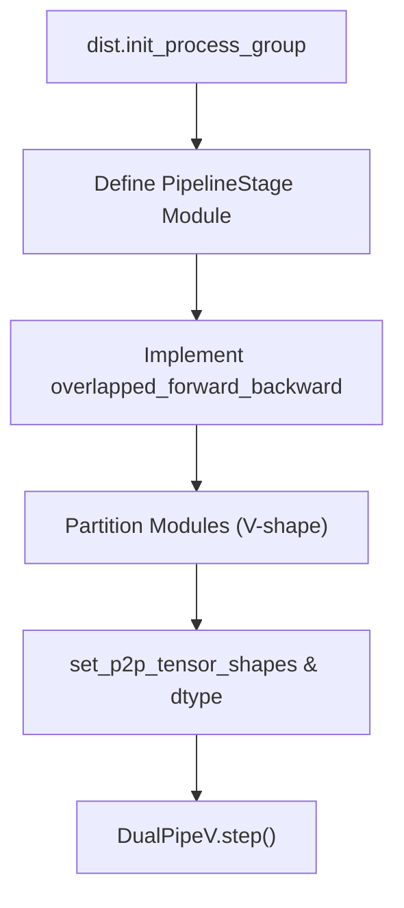
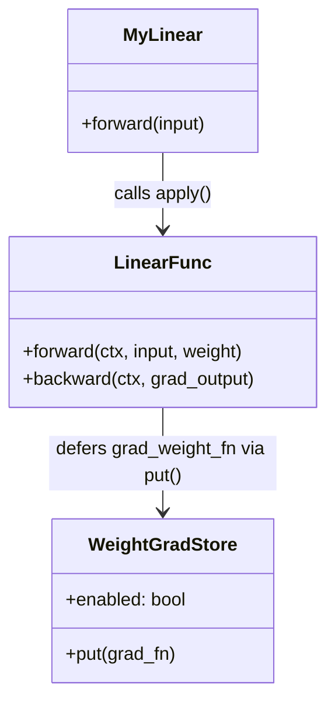
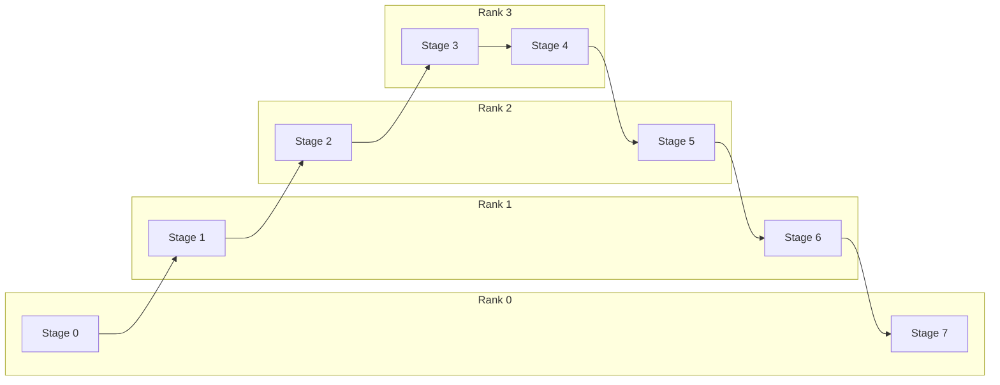

<!-- source: DeepWiki mcp.deepwiki.com · repo deepseek-ai/DualPipe · page 3.2 DualPipeV Example Usage · fetched 2026-10-30 -->

# DualPipeV Example Usage

<details>
<summary>Relevant source files</summary>

The following files were used as context for generating this wiki page:

- [examples/example_dualpipev.py](examples/example_dualpipev.py)

</details>


This page provides a detailed guide on how to use `DualPipeV` for pipeline-parallel distributed training. `DualPipeV` is a concise V-shape schedule that requires only half the physical devices ($PP/2$) compared to `DualPipe` while maintaining the same pipeline bubble efficiency.

## Setting Up Your Environment

Before using `DualPipeV`, ensure your environment meets the following requirements:
- PyTorch 2.0 or above [examples/example_dualpipev.py:9]()
- NCCL backend for distributed communication [examples/example_dualpipev.py:111]()
- Multiple GPU devices for pipeline parallelism [examples/example_dualpipev.py:181-183]()

## Basic Usage Pattern

The typical usage pattern for `DualPipeV` involves defining a model, partitioning it across the V-shape topology, and configuring the P2P communication layer.



Sources: [examples/example_dualpipev.py:109-115](), [examples/example_dualpipev.py:123-124](), [examples/example_dualpipev.py:141]()

## Example Implementation

### 1. Model Definition and Weight Gradient Storage

To support the overlapped backward passes in `DualPipeV`, modules should use `WeightGradStore` to defer weight gradient computation. This allows the schedule to overlap the weight gradient calculation of one micro-batch with the activation gradient calculation of another.



Sources: [examples/example_dualpipev.py:13-34](), [dualpipe/utils.py:16-24]()

In `LinearFunc.backward`, the weight gradient calculation is wrapped in a function and passed to `WeightGradStore.put` if `WeightGradStore.enabled` is true [examples/example_dualpipev.py:26-32]().

### 2. Custom Overlapped Forward-Backward Implementation

A critical component of `DualPipeV` is the `overlapped_forward_backward` method. This method defines how the forward pass of the current stage overlaps with the backward pass of a different stage (or chunk).

```python
    @classmethod
    def overlapped_forward_backward(
        cls,
        module0: "PipelineStage",
        inputs0: List[torch.Tensor],
        criterion0: Optional[Callable],
        labels0: Optional[List[torch.Tensor]],
        module1: "PipelineStage",
        loss1: Optional[torch.Tensor],
        outputs1: Optional[List[torch.Tensor]],
        output_grads1: Optional[List[torch.Tensor]],
    ) -> Tuple[torch.Tensor, Optional[torch.Tensor]]:
        # 1. Forward pass for module0
        outputs0 = module0(*inputs0)
        if criterion0 is not None:
            loss0 = criterion0(*outputs0, *labels0)
        
        # 2. Backward pass for module1 (overlapped)
        if loss1 is not None:
            loss1.backward()
        else:
            run_backward(outputs1, output_grads1)

        return outputs0, loss0
```

Sources: [examples/example_dualpipev.py:54-83]()

The `run_backward` utility is used when `loss` is not directly available, typically for intermediate pipeline stages [examples/example_dualpipev.py:81](), [dualpipe/utils.py:59-62]().

## Detailed Example Walkthrough

### Distributed Setup and P2P Configuration

Before initializing `DualPipeV`, you must define the shapes and data types of the tensors that will be sent between stages.

```python
set_p2p_tensor_shapes([(micro_batch_size, seq_len, hidden_size)])
set_p2p_tensor_dtype(torch.float32)
```

Sources: [examples/example_dualpipev.py:123-124](), [dualpipe/comm.py:19-27]()

### Model Partitioning (V-Shape Topology)

In `DualPipeV`, each physical rank handles two logical stages: one from the "descending" part of the V and one from the "ascending" part. For a pipeline with `pp_size` ranks, there are $2 \times pp\_size$ total stages.



Sources: [examples/example_dualpipev.py:137-141](), [dualpipe/v_shape.py:16-24]()

The local modules are passed to the `DualPipeV` constructor as an `nn.ModuleList` or `nn.Sequential` containing exactly two modules [examples/example_dualpipev.py:141]().

### Executing the Step

The `step` function manages the complex 8-step bidirectional schedule.

```python
dualpipev_model = DualPipeV(local_modules)

# Training step
loss, outputs = dualpipev_model.step(
    x, 
    num_chunks=num_chunks, 
    criterion=criterion, 
    labels=(l,), 
    return_outputs=False
)
```

Sources: [examples/example_dualpipev.py:141-149](), [dualpipe/v_shape.py:51-60]()

## Numerical Verification

The example demonstrates how to verify the distributed implementation against a sequential reference.

1.  **Reference Step**: A standard `nn.Sequential` model processes all micro-batches sequentially [examples/example_dualpipev.py:90-100]().
2.  **Loss Comparison**: The loss from the first rank of `DualPipeV` should match the reference loss [examples/example_dualpipev.py:152-153]().
3.  **Gradient Comparison**: Gradients for each local parameter are compared against the corresponding parameters in the full reference model using a cosine difference check [examples/example_dualpipev.py:159-160]().

## Performance Considerations

1.  **Overlap**: The efficiency of `DualPipeV` relies on the `overlapped_forward_backward` implementation. If the forward and backward operations are not effectively overlapped by the CUDA scheduler, the pipeline will experience stalls.
2.  **Memory**: While `DualPipeV` uses fewer devices, each device must store parameters for two stages.
3.  **Communication**: P2P communication is handled asynchronously using `batch_isend_irecv` to minimize synchronization overhead [dualpipe/comm.py:38]().

Sources: [examples/example_dualpipev.py:54-69](), [dualpipe/v_shape.py:126-140]()

---

