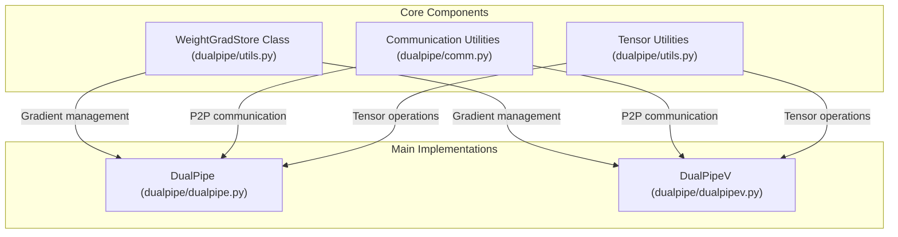
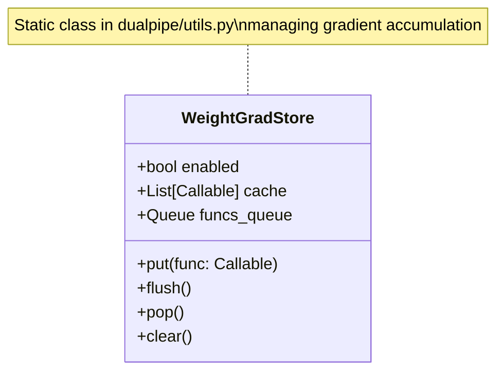
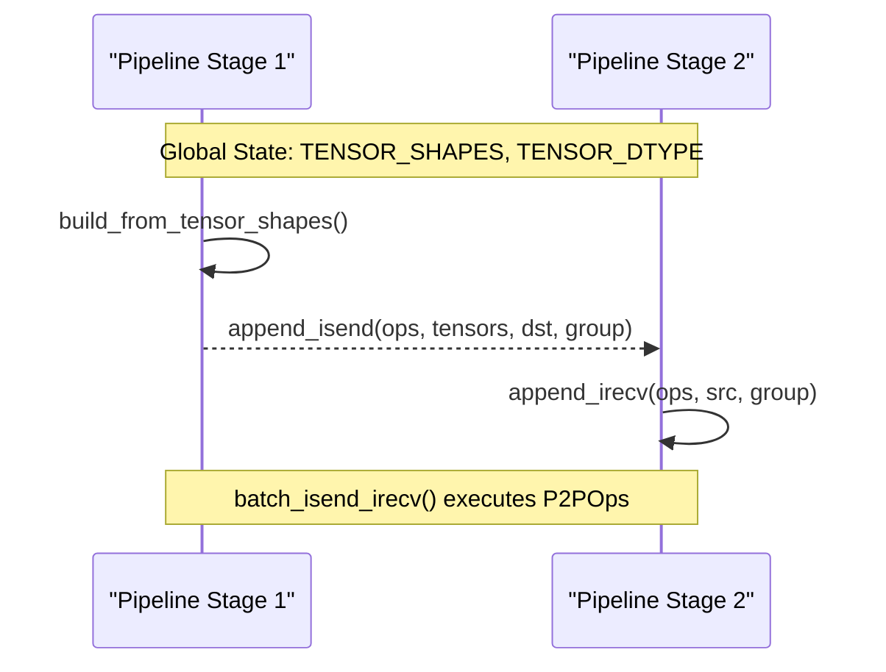
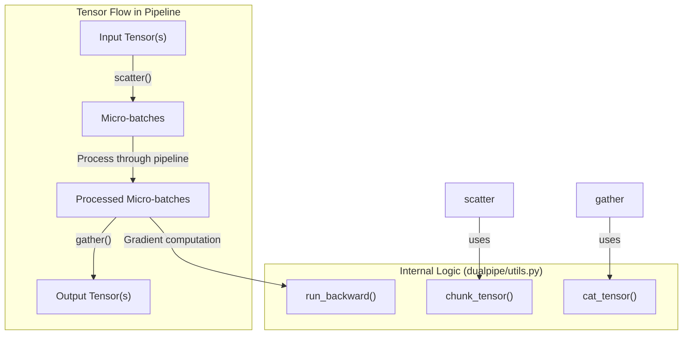

<!-- source: DeepWiki mcp.deepwiki.com · repo deepseek-ai/DualPipe · page 4 Core Components · fetched 2026-10-30 -->

# Core Components

Relevant source files

The following files were used as context for generating this wiki page:

- [dualpipe/__init__.py](dualpipe/__init__.py)
- [dualpipe/comm.py](dualpipe/comm.py)
- [dualpipe/utils.py](dualpipe/utils.py)

This page documents the foundational components shared by both `DualPipe` and `DualPipeV` implementations. These components provide essential functionality for weight gradient management, communication between pipeline stages, and tensor manipulation.

## Overview of Core Components

The DualPipe codebase is built on several key components that work together to enable efficient pipeline parallelism:

Sources: [dualpipe/__init__.py:1-17](), [dualpipe/utils.py:1-80](), [dualpipe/comm.py:1-38]()

## Weight Gradient Management

The `WeightGradStore` is a critical component that manages the collection, storage, and application of weight gradients during pipeline parallelism. It enables efficient gradient accumulation across micro-batches and supports deferred weight gradient computation (the "W" phase) to maximize overlap.

For details, see [Weight Gradient Management](#4.1).

### WeightGradStore Implementation

The `WeightGradStore` manages a lifecycle of `put`, `flush`, and `pop` [dualpipe/utils.py:15-29](). It works alongside the `run_backward` utility [dualpipe/utils.py:36-43](), which uses `accumulate_grad=True` to allow multiple backward passes to contribute to the same gradient tensors without immediate optimizer steps.

Sources: [dualpipe/utils.py:8-43]()

## Communication System

The communication system provides utilities for point-to-point (P2P) tensor exchange between pipeline stages using PyTorch's distributed communication primitives (`dist.P2POp`). It abstracts global rank translation and buffer management.

For details, see [Communication System](#4.2).

### Communication Flow

The system relies on global configuration via `set_p2p_tensor_shapes` [dualpipe/comm.py:11-13]() and `set_p2p_tensor_dtype` [dualpipe/comm.py:16-18](). It uses `dist.distributed_c10d.get_global_rank` to ensure P2P operations target the correct ranks across the distributed group [dualpipe/comm.py:27-35]().

Sources: [dualpipe/comm.py:1-38]()

## Tensor Utilities

The tensor utilities provide functions for manipulating tensors during pipeline execution, particularly for handling micro-batches and gradient computation.

### Tensor Operations

| Function | Purpose | Description |
|----------|---------|-------------|
| `run_backward` | Gradient computation | Executes backward pass with `accumulate_grad=True` [dualpipe/utils.py:36-43]() |
| `chunk_tensor` | Tensor splitting | Divides tensors into chunks using `tensor_split` [dualpipe/utils.py:46-49]() |
| `cat_tensor` | Tensor concatenation | Combines tensors from multiple micro-batches using `torch.cat` [dualpipe/utils.py:52-59]() |
| `scatter` | Input distribution | Distributes inputs into micro-batches for the pipeline [dualpipe/utils.py:62-71]() |
| `gather` | Output collection | Collects and concatenates outputs from micro-batches [dualpipe/utils.py:74-80]() |

Sources: [dualpipe/utils.py:36-80]()

## Integration in Pipeline Parallelism

The core components are integrated into the pipeline parallelism framework to facilitate the bidirectional 8-step schedule used by `DualPipe` and `DualPipeV`.

During execution:
1. **Forward Pass**: `scatter` divides inputs [dualpipe/utils.py:62](), and `append_isend`/`append_irecv` handle activation exchange [dualpipe/comm.py:25-38]().
2. **Backward Pass**: `run_backward` computes gradients [dualpipe/utils.py:36](), while `WeightGradStore.put` captures weight gradient functions [dualpipe/utils.py:15]().
3. **Overlap Phase**: While new micro-batches are computed, `WeightGradStore.pop` executes deferred weight gradient computations to fill pipeline bubbles [dualpipe/utils.py:24]().

Sources: [dualpipe/utils.py:1-80](), [dualpipe/comm.py:1-38]()

---

