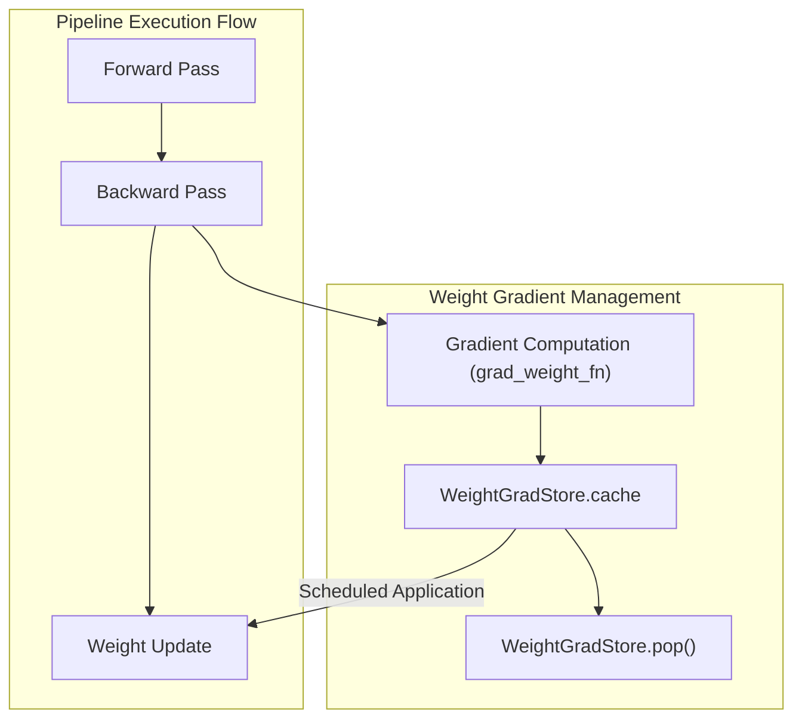
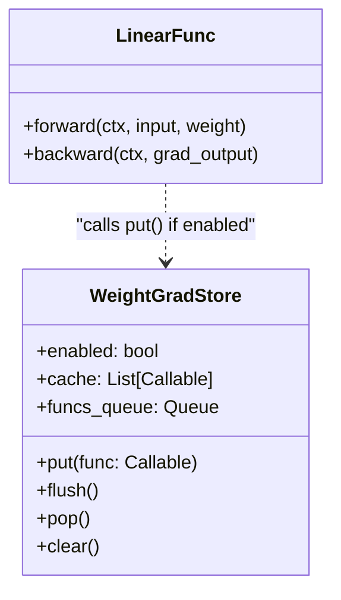
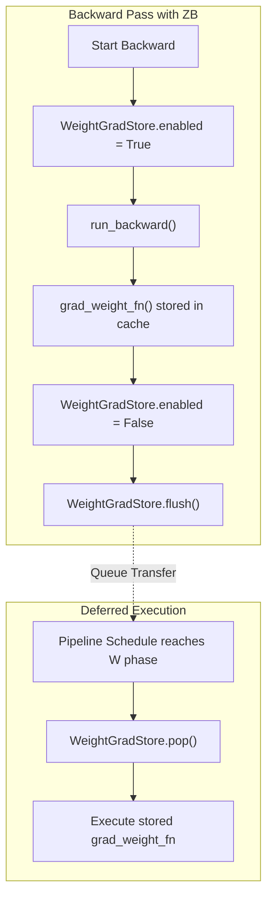

<!-- source: DeepWiki mcp.deepwiki.com · repo deepseek-ai/DualPipe · page 4.1 Weight Gradient Management · fetched 2026-10-30 -->

# Weight Gradient Management

<details>
<summary>Relevant source files</summary>

The following files were used as context for generating this wiki page:

- [dualpipe/utils.py](dualpipe/utils.py)
- [examples/example_dualpipe.py](examples/example_dualpipe.py)

</details>


## Purpose and Scope

This document explains the weight gradient management system in the DualPipe repository, focusing on how gradients are stored, accumulated, and applied during distributed pipeline-parallel training. The `WeightGradStore` system is a critical component that enables efficient gradient handling and is essential for implementing the zero-bubble optimization technique used in both `DualPipe` and `DualPipeV` implementations.

It also covers the low-level tensor utilities for microbatching (scatter/gather) and the `run_backward` primitive used to trigger manual autograd execution.

Sources: [dualpipe/utils.py:8-80](), [examples/example_dualpipe.py:13-39]()

## Overview

The Weight Gradient Management system in DualPipe solves a fundamental challenge in pipeline parallelism: coordinating when and how gradients are applied to model weights in a distributed setting. During pipeline-parallel training, weight updates (specifically the calculation of weight gradients $\nabla W$) must be carefully scheduled to ensure correctness while minimizing idle time.



Sources: [dualpipe/utils.py:8-33](), [examples/example_dualpipe.py:21-34]()

## WeightGradStore Component

The `WeightGradStore` class is the core component responsible for managing weight gradients. It uses a class-based implementation with static methods to maintain state across a single process.

### Internal Structure



Sources: [dualpipe/utils.py:8-13](), [examples/example_dualpipe.py:13-34]()

### Key Attributes

| Attribute | Type | Purpose |
|-----------|------|---------|
| `enabled` | `bool` | Global flag. If `True`, custom autograd functions should `put` their gradient logic into the store instead of executing it immediately [dualpipe/utils.py:10](). |
| `cache` | `List[Callable]` | Temporary storage for gradient functions accumulated during a single microbatch or phase [dualpipe/utils.py:11](). |
| `funcs_queue` | `queue.Queue` | A FIFO queue that stores lists of functions (flushed caches) to be executed later in the pipeline schedule [dualpipe/utils.py:12](). |

### Lifecycle Methods

The `WeightGradStore` provides four primary methods to manage the gradient lifecycle:

1.  **put(func)**: Appends a `Callable` (typically a closure containing the gradient calculation logic) to the `cache` [dualpipe/utils.py:15-16]().
2.  **flush()**: Batches all functions currently in the `cache` into the `funcs_queue` and clears the `cache` [dualpipe/utils.py:19-21]().
3.  **pop()**: Retrieves the oldest batch of functions from the `funcs_queue` and executes them sequentially [dualpipe/utils.py:24-28]().
4.  **clear()**: Resets both the `cache` and the `funcs_queue` to an empty state [dualpipe/utils.py:31-33]().

## Integration with Autograd

To utilize `WeightGradStore`, models must use custom `torch.autograd.Function` implementations. Instead of performing weight gradient updates directly in `backward`, the logic is wrapped in a function and passed to `WeightGradStore.put`.

```python
# Example from examples/example_dualpipe.py:26-32
def grad_weight_fn():
    weight.grad += grad_output.flatten(0, -2).T @ input.flatten(0, -2)

if WeightGradStore.enabled:
    WeightGradStore.put(grad_weight_fn)
else:
    grad_weight_fn()
```

Sources: [examples/example_dualpipe.py:26-32]()

## Zero Bubble Optimization

The `WeightGradStore` is crucial for implementing the zero bubble optimization technique. By deferring the weight gradient computation (the "W" phase), the scheduler can overlap these computations with the communication of other microbatches.



Sources: [dualpipe/utils.py:14-33](), [examples/example_dualpipe.py:26-32]()

## Utility Functions

### run_backward
The `run_backward` utility provides a wrapper around PyTorch's internal execution engine to manually trigger the backward pass on specific tensors with gradient accumulation enabled.

*   **Signature**: `run_backward(tensors: List[torch.Tensor], grad_tensors: List[torch.Tensor])` [dualpipe/utils.py:36]().
*   **Behavior**: It sets `accumulate_grad=True` and `allow_unreachable=True` to ensure gradients are correctly added to `.grad` fields during pipeline stages [dualpipe/utils.py:37-43]().

### Microbatch Primitives (scatter/gather)
These functions handle the splitting and merging of tensors across the `num_chunks` dimension.

*   **scatter(inputs, chunks, dim)**: Splits input tensors into a list of microbatches. It handles `None` values and ensures that even if no inputs are provided, it returns a list of empty tuples corresponding to the number of chunks [dualpipe/utils.py:62-71]().
*   **gather(micro_outputs, dim)**: Recombines a list of microbatch outputs into full tensors using `torch.cat` [dualpipe/utils.py:74-80]().
*   **chunk_tensor / cat_tensor**: Internal helpers that use `tensor_split` and `torch.cat` respectively, with robust handling for `None` types [dualpipe/utils.py:46-59]().

Sources: [dualpipe/utils.py:36-80]()

## Implementation Flow in DualPipe

The `DualPipe` and `DualPipeV` schedulers use `WeightGradStore` to manage the "W" (Weight Gradient) chunks of the 8-step schedule.

| Phase | Action | Purpose |
| :--- | :--- | :--- |
| **Initialization** | `WeightGradStore.clear()` | Prepare for a new training step [dualpipe/utils.py:31](). |
| **Backward Chunk** | `WeightGradStore.enabled = True` | Collect `grad_weight_fn` closures during `run_backward` [dualpipe/utils.py:10](). |
| **Phase End** | `WeightGradStore.flush()` | Move collected closures to the execution queue [dualpipe/utils.py:19](). |
| **Weight Chunk** | `WeightGradStore.pop()` | Execute the deferred weight gradient calculations [dualpipe/utils.py:24](). |

Sources: [dualpipe/utils.py:8-33](), [examples/example_dualpipe.py:55-83]()

---

