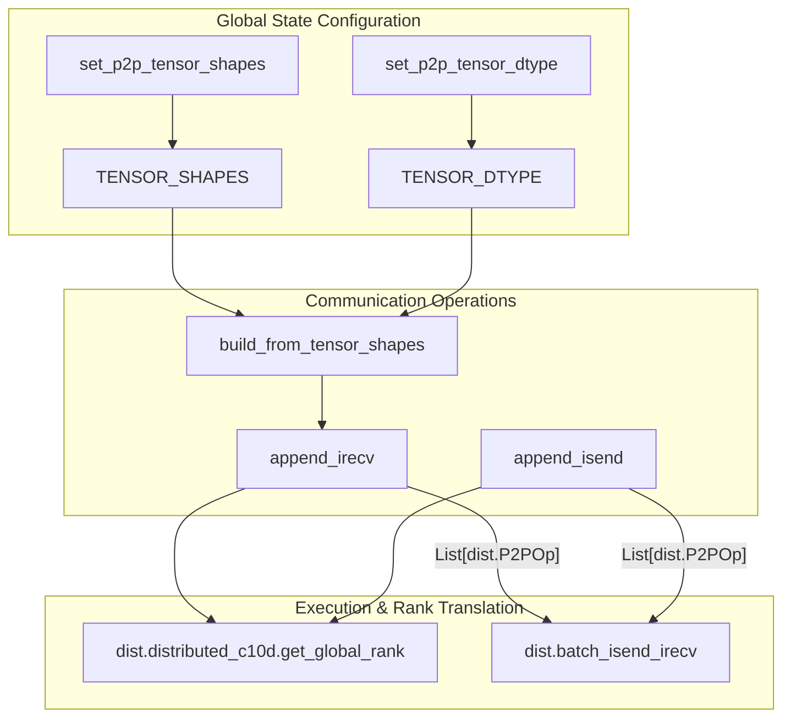
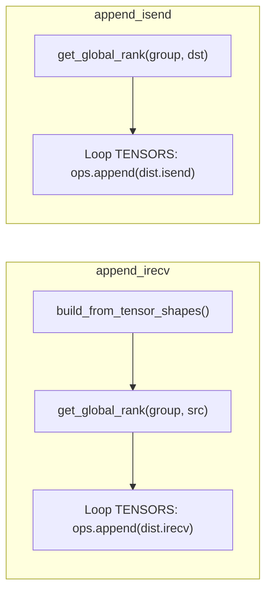
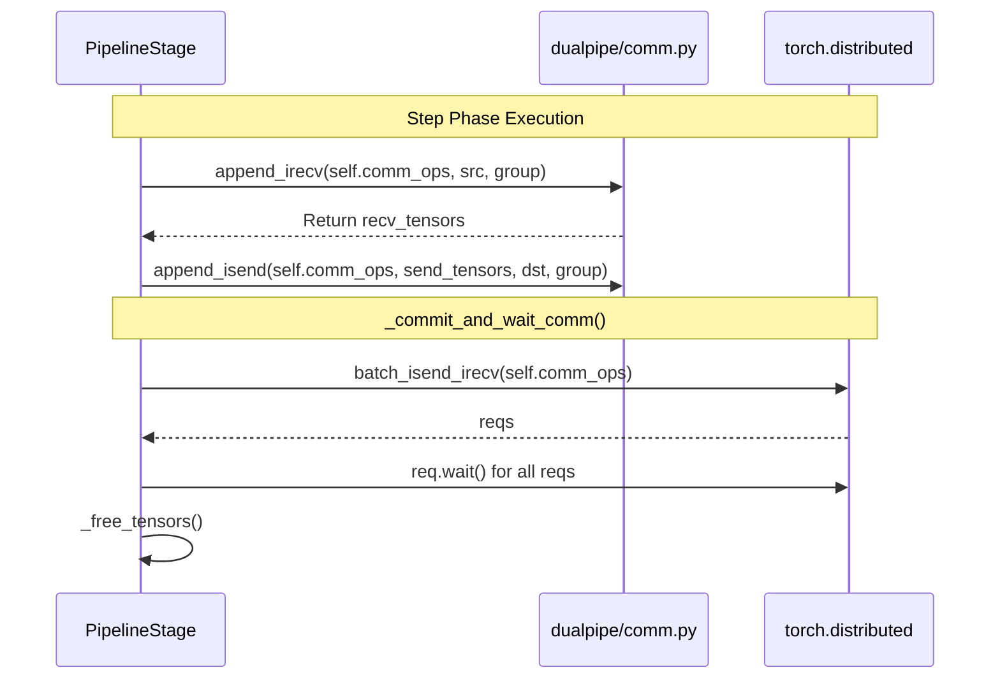

<!-- source: DeepWiki mcp.deepwiki.com · repo deepseek-ai/DualPipe · page 4.2 Communication System · fetched 2026-10-30 -->

# Communication System

<details>
<summary>Relevant source files</summary>

The following files were used as context for generating this wiki page:

- [dualpipe/comm.py](dualpipe/comm.py)

</details>


The Communication System in DualPipe provides efficient point-to-point (P2P) tensor exchange between pipeline stages during distributed training. This page documents the communication utilities, patterns, and implementation details used by both DualPipe and DualPipeV to enable overlapped computation and communication. For information about the Weight Gradient Management system that works alongside this communication system, see [Weight Gradient Management](#4.1).

## Overview

The DualPipe communication system enables efficient tensor exchange between pipeline stages by:

1.  Pre-registering tensor shapes and data types to avoid metadata transfer during runtime.
2.  Using non-blocking point-to-point communication primitives (`dist.P2POp`) for overlap.
3.  Batching communication operations for efficient execution via `dist.batch_isend_irecv`.
4.  Translating local group ranks to global ranks for compatibility with `torch.distributed`.

### Natural Language to Code Entity Mapping


Sources: [dualpipe/comm.py:7-38]()

## Global State Configuration

Before performing any communication, the tensor shapes and data type must be registered. This pre-registration allows the system to create properly sized buffers without transferring metadata during execution.

| Function | Code Entity | Description |
| :--- | :--- | :--- |
| **Set Shapes** | `set_p2p_tensor_shapes(shapes)` | Sets the global `TENSOR_SHAPES` list. [dualpipe/comm.py:11-13]() |
| **Set Dtype** | `set_p2p_tensor_dtype(dtype)` | Sets the global `TENSOR_DTYPE` variable. [dualpipe/comm.py:16-18]() |

The communication module uses these variables in `build_from_tensor_shapes` to allocate `torch.empty` tensors on the CUDA device with `requires_grad=True`.

Sources: [dualpipe/comm.py:7-23]()

## Buffer Allocation and Rank Translation

The communication system abstracts the complexity of buffer management and rank mapping through two primary functions: `append_irecv` and `append_isend`.

### Rank Translation logic
Both functions perform global rank translation using `dist.distributed_c10d.get_global_rank(group, rank)` before creating a `dist.P2POp`. This ensures that even when pipeline stages are defined within sub-groups (e.g., in complex 3D parallelism), the P2P operations correctly target the physical ranks.

### Communication Primitives



*   **`append_irecv(ops, src, group)`**:
    1.  Calls `build_from_tensor_shapes()` to allocate buffers. [dualpipe/comm.py:26]()
    2.  Translates the `src` rank. [dualpipe/comm.py:27]()
    3.  Appends a `dist.P2POp` with `dist.irecv` for each tensor in the shape list. [dualpipe/comm.py:30]()
    4.  Returns the list of allocated tensors to the caller. [dualpipe/comm.py:31]()

*   **`append_isend(ops, tensors, dst, group)`**:
    1.  Translates the `dst` rank. [dualpipe/comm.py:35]()
    2.  Appends a `dist.P2POp` with `dist.isend` for each non-null tensor provided. [dualpipe/comm.py:38]()

Sources: [dualpipe/comm.py:25-38]()

## Batching and Execution Flow

DualPipe and DualPipeV do not execute communication operations immediately. Instead, they accumulate operations into a `comm_ops` list and execute them in a single batch.

### Pipeline Stage Integration

The pipeline classes (`DualPipe` and `DualPipeV`) manage a `self.comm_ops` list and a `self.to_free` list for memory management.



### Safety Checks
Before execution, both `DualPipe` and `DualPipeV` verify that global state is initialized:
```python
assert comm.TENSOR_SHAPES is not None and comm.TENSOR_DTYPE is not None, \
    "You need to call set_p2p_tensor_shapes and set_p2p_tensor_dtype before doing a step."
```
Sources: [dualpipe/dualpipe.py:325-326](), [dualpipe/dualpipev.py:311-312]()

### View Tensor Assertion
To prevent memory corruption or unexpected behavior during `_free_tensors`, the system asserts that communicated tensors are not views:
```python
assert tensor._base is None, f"pipeline stage should not return view tensors {dist.get_rank(), tensor.shape}"
```
Sources: [dualpipe/dualpipe.py:227-231](), [dualpipe/dualpipev.py:228-231]()

## Memory Management

The communication system relies on the pipeline stage to track and release memory. 
1.  **Send Buffers**: Tensors passed to `append_isend` are typically added to `self.to_free` in the calling stage logic.
2.  **Receive Buffers**: Tensors created by `append_irecv` are managed by the computation chunks and eventually cleared after their backward pass or once they are no longer needed.
3.  **Cleanup**: The `_free_tensors()` method in the pipeline classes sets the tensor data to a small 1-element tensor to trigger memory release while maintaining the object reference if necessary.

Sources: [dualpipe/dualpipe.py:279-284](), [dualpipe/dualpipev.py:279-286]()

---

