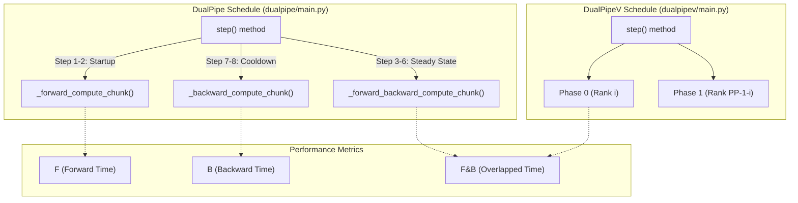
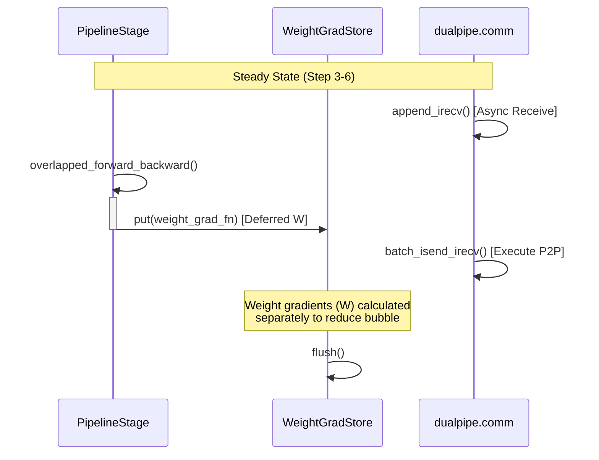

<!-- source: DeepWiki mcp.deepwiki.com · repo deepseek-ai/DualPipe · page 5 Performance Comparison · fetched 2026-10-30 -->

# Performance Comparison

Relevant source files

The following files were used as context for generating this wiki page:

- [README.md](README.md)
- [images/dualpipe.png](images/dualpipe.png)
- [images/dualpipev.png](images/dualpipev.png)

This document provides a technical comparison of DualPipe and DualPipeV pipeline parallelism methods against traditional approaches like 1F1B (One-Forward-One-Backward) and ZB1P (Zero-Bubble 1-Phase). We analyze performance characteristics, memory requirements, device utilization, and pipeline bubble optimization.

## Pipeline Bubbles and Memory Footprint

The primary motivation for DualPipe is the reduction of the "pipeline bubble"—the idle time ranks spend waiting for data from other stages. DualPipe achieves a significantly smaller bubble compared to 1F1B and ZB1P by overlapping forward (F) and backward (B) chunks across two symmetric directions.

### Comparison Table

| Method | Bubble Size Formula | Parameter Memory | Activation Memory | Devices |
| :--- | :--- | :--- | :--- | :--- |
| **1F1B** | $(PP-1)(F+B)$ | $1\times$ | $PP$ | $PP$ |
| **ZB1P** | $(PP-1)(F+B-2W)$ | $1\times$ | $PP$ | $PP$ |
| **DualPipe** | $(PP/2-1)(F\&B+B-3W)$ | $2\times$ | $PP+1$ | $PP$ |
| **DualPipeV** | $(PP/2-1)(F\&B+B-3W)$ | $2\times$ | $PP+1$ | $PP/2$ |

**Definitions:**
*   **$PP$**: Total number of pipeline stages.
*   **$F$**: Execution time of a forward chunk.
*   **$B$**: Execution time of a full backward chunk (Activation grad + Weight grad).
*   **$W$**: Execution time of a "backward for weights" chunk.
*   **$F\&B$**: Execution time of mutually overlapped forward and backward chunks.

Sources: [README.md:24-36]()

## Scheduling Logic and Data Flow

The performance gains in DualPipe are realized through an 8-step schedule that manages bidirectional micro-batches. DualPipeV achieves the same bubble efficiency by folding the pipeline into a V-shape, allowing two logical stages to reside on one physical device.

### Code-to-Entity Mapping: Scheduling Components

The following diagram maps the logical scheduling phases described in the performance formulas to the internal methods within the `DualPipe` and `DualPipeV` classes.

Sources: [dualpipe/main.py:151-240](), [dualpipev/main.py:176-281]()

## Computation-Communication Overlap

A key differentiator for DualPipe is the full overlap of computation and communication. While traditional methods often stall for P2P transfers, DualPipe utilizes asynchronous communication dispatched via `dualpipe.comm` to hide latency behind the `overlapped_forward_backward` computation.

### Data Flow for Overlapped Execution

This diagram illustrates how the system transitions from the "Natural Language" concept of overlap to the "Code Space" implementation using `WeightGradStore` and `batch_isend_irecv`.

Sources: [dualpipe/main.py:276-302](), [dualpipe/comm.py:38](), [dualpipe/utils.py:46-56]()

## Trade-off Analysis

### 1. Memory vs. Throughput
DualPipe requires **2× Parameter Memory** because each device must store parameters for two different stages (or two directions) to facilitate the bidirectional flow. This is the primary cost for reducing the bubble from $(PP-1)$ to approximately $(PP/2-1)$.

### 2. Activation Memory
Activation memory increases slightly ($PP+1$ vs $PP$) due to the additional micro-batches held in flight to maintain the bidirectional pipeline pressure.

### 3. Device Utilization (DualPipe vs DualPipeV)
*   **DualPipe**: Utilizes $PP$ physical devices. Each device handles two logical stages (one for each direction).
*   **DualPipeV**: Utilizes $PP/2$ physical devices. Each device handles two logical stages from the *same* direction but at different depths of the V-shape. 
*   **Result**: DualPipeV provides the same throughput and bubble reduction as DualPipe but consumes half the physical hardware resources.

Sources: [README.md:24-36](), [dualpipev/main.py:15-30]()

## Implementation Requirements for Peak Performance

To achieve the theoretical performance limits:
1.  **Custom Autograd**: Users must use custom autograd functions that separate input gradient computation from weight gradient computation. This is demonstrated in the `LinearFunc` implementation in the examples. [examples/example_dualpipe.py:13-34]()
2.  **WeightGradStore**: The `WeightGradStore` must be used to defer weight gradient updates, allowing the "Backward for Weights" ($W$) phase to be shifted out of the critical path. [dualpipe/utils.py:46-68]()
3.  **P2P Buffers**: Proper tensor shape and dtype configuration via `set_p2p_tensor_shapes` is mandatory to avoid dynamic allocation overhead during the `step()` loop. [dualpipe/comm.py:32-38]()

Sources: [examples/example_dualpipe.py:54-83](), [dualpipe/main.py:261-274]()

---

