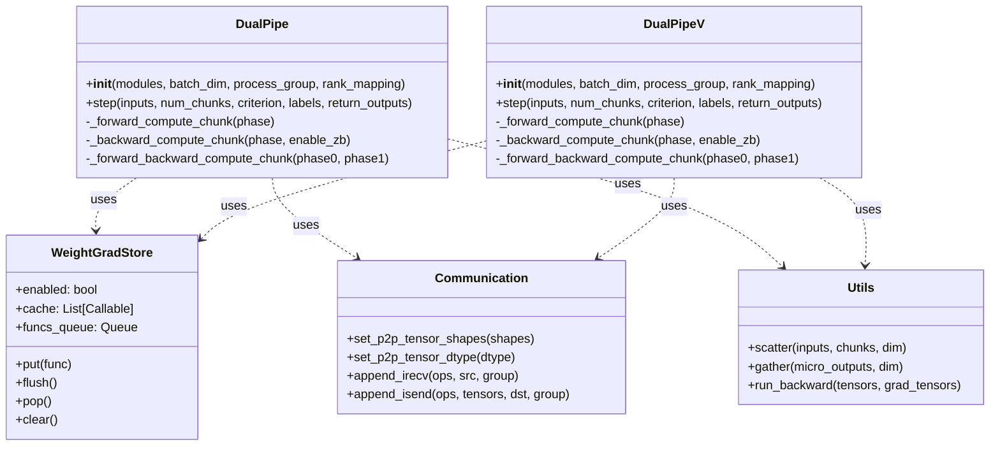
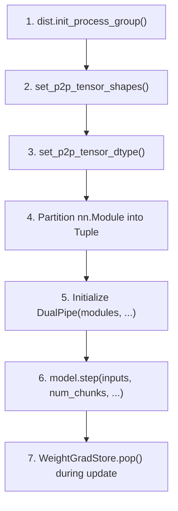

<!-- source: DeepWiki mcp.deepwiki.com · repo deepseek-ai/DualPipe · page 6 API Reference · fetched 2026-10-30 -->

# API Reference

<details>
<summary>Relevant source files</summary>

The following files were used as context for generating this wiki page:

- [dualpipe/__init__.py](dualpipe/__init__.py)
- [dualpipe/comm.py](dualpipe/comm.py)
- [dualpipe/dualpipe.py](dualpipe/dualpipe.py)
- [dualpipe/dualpipev.py](dualpipe/dualpipev.py)
- [dualpipe/utils.py](dualpipe/utils.py)

</details>


This document provides a comprehensive reference for all public interfaces in the DualPipe library. It covers the core classes, utility components, and helper functions that enable efficient pipeline parallelism in distributed training.

For conceptual understanding of the DualPipe architecture, see [DualPipe Architecture](#2). For the DualPipeV variant, see [DualPipeV Architecture](#3).

## Core Components Overview



Sources: [dualpipe/__init__.py:1-17](), [dualpipe/dualpipe.py:11-121](), [dualpipe/dualpipev.py:11-120](), [dualpipe/utils.py:8-80](), [dualpipe/comm.py:1-38]()

## Usage Flow



Sources: [dualpipe/dualpipe.py:11-46](), [dualpipe/dualpipev.py:11-43](), [dualpipe/comm.py:11-18](), [dualpipe/utils.py:24-29]()

## DualPipe

The `DualPipe` class implements a pipeline parallelism approach that achieves full overlap of forward and backward passes across two parallel micro-batch pipelines.

### Initialization

```python
DualPipe(modules, batch_dim=0, process_group=None, rank_mapping=None)
```

| Parameter | Type | Description |
|-----------|------|-------------|
| `modules` | Tuple[nn.Module, nn.Module] | Two modules representing the partitions for the two bidirectional phases. [dualpipe/dualpipe.py:14]() |
| `batch_dim` | int | The dimension to split the batch, default is 0. [dualpipe/dualpipe.py:15]() |
| `process_group` | Optional[dist.ProcessGroup] | The process group for communication. [dualpipe/dualpipe.py:16]() |
| `rank_mapping` | Optional[List[int]] | Maps ranks in `process_group` to logical pipeline ranks. [dualpipe/dualpipe.py:17]() |

Sources: [dualpipe/dualpipe.py:11-46]()

### Methods

#### step

```python
step(*inputs, num_chunks=0, criterion=None, labels=[], return_outputs=False)
```

Executes a training or inference step using the 8-step bidirectional schedule. [dualpipe/dualpipe.py:328-435]()

| Parameter | Type | Description |
|-----------|------|-------------|
| `*inputs` | Optional[torch.Tensor] | Module inputs. Required on rank 0 (Phase 0) and rank N-1 (Phase 1). [dualpipe/dualpipe.py:295-300]() |
| `num_chunks` | int | The number of micro-batches ($M$). [dualpipe/dualpipe.py:296]() |
| `criterion` | Optional[Callable] | Loss function. [dualpipe/dualpipe.py:297]() |
| `labels` | List[Optional[torch.Tensor]] | Labels for loss. Required on rank 0 (Phase 1) and rank N-1 (Phase 0). [dualpipe/dualpipe.py:302-307]() |
| `return_outputs` | bool | Whether to return final outputs. [dualpipe/dualpipe.py:299]() |

**Returns**: `(loss, outputs)`
- `loss`: Combined loss for the batch (on first/last ranks). [dualpipe/dualpipe.py:438]()
- `outputs`: Gathered module outputs if `return_outputs=True`. [dualpipe/dualpipe.py:440]()

Sources: [dualpipe/dualpipe.py:294-440]()

## DualPipeV

The `DualPipeV` class implements a V-shaped schedule that requires only $PP/2$ physical devices for the same number of logical pipeline stages.

### Initialization

```python
DualPipeV(modules, batch_dim=0, process_group=None, rank_mapping=None)
```

Sources: [dualpipe/dualpipev.py:11-43]()

### Methods

#### step

```python
step(*inputs, num_chunks=0, criterion=None, labels=[], return_outputs=False)
```

| Parameter | Type | Description |
|-----------|------|-------------|
| `*inputs` | Optional[torch.Tensor] | Module inputs. Required only on the first rank (Rank 0). [dualpipe/dualpipev.py:289]() |
| `criterion` | Optional[Callable] | Loss function. [dualpipe/dualpipev.py:291]() |
| `labels` | List[Optional[torch.Tensor]] | Labels. Required only on the first rank (Rank 0). [dualpipe/dualpipev.py:292]() |

**Returns**: `(loss, outputs)` on the first rank only. [dualpipe/dualpipev.py:409-411]()

Sources: [dualpipe/dualpipev.py:288-411]()

## Key Differences Between DualPipe and DualPipeV

| Feature | DualPipe | DualPipeV |
|---------|----------|-----------|
| **Device Requirement** | $N$ devices for $N$ stages | $N/2$ devices for $N$ stages |
| **Input Entry** | Rank 0 (Phase 0) & Rank $N-1$ (Phase 1) | Rank 0 only |
| **Loss Calculation** | Rank 0 (Phase 1) & Rank $N-1$ (Phase 0) | Rank 0 only |
| **Rank Mapping** | Linear $0 \dots N-1$ | V-shape $0 \dots N/2-1 \dots 0$ |

Sources: [dualpipe/dualpipe.py:37-45](), [dualpipe/dualpipev.py:37-41](), [dualpipe/dualpipe.py:294-326](), [dualpipe/dualpipev.py:288-319]()

## Communication Utilities

These functions manage the global state and P2P operations for tensor exchange.

### set_p2p_tensor_shapes
Sets the `TENSOR_SHAPES` global variable used to pre-allocate receive buffers. [dualpipe/comm.py:11-13]()

### set_p2p_tensor_dtype
Sets the `TENSOR_DTYPE` global variable for communication buffers. [dualpipe/comm.py:16-18]()

### append_irecv / append_isend
Helper functions that wrap `dist.P2POp` with `dist.irecv` and `dist.isend`. They automatically handle global rank translation using `dist.distributed_c10d.get_global_rank`. [dualpipe/comm.py:25-38]()

Sources: [dualpipe/comm.py:1-38]()

## WeightGradStore

A static utility class that manages the deferred execution of weight gradient updates (Zero Bubble).

### Class Methods

*   **`put(func: Callable)`**: Appends a gradient computation function to the current `cache`. [dualpipe/utils.py:15-16]()
*   **`flush()`**: Moves the current `cache` into the `funcs_queue` and clears the cache. [dualpipe/utils.py:19-21]()
*   **`pop()`**: Retrieves a batch of functions from the `funcs_queue` and executes them. This is typically called during the "W" (Weight Gradient) phase. [dualpipe/utils.py:24-29]()
*   **`clear()`**: Resets the cache and the queue. Called at the start of each `step()`. [dualpipe/utils.py:31-33]()

Sources: [dualpipe/utils.py:8-34](), [dualpipe/dualpipe.py:48]()

## Utility Functions

### scatter
Splits input tensors (or tuples of tensors) into `num_chunks` along `batch_dim`. [dualpipe/utils.py:62-71]()

### gather
Concatenates micro-batch outputs back into full tensors along `dim`. [dualpipe/utils.py:74-80]()

### run_backward
Low-level utility that invokes `Variable._execution_engine.run_backward`. It is configured with `accumulate_grad=True` to support the custom gradient accumulation logic required by the DualPipe schedules. [dualpipe/utils.py:36-43]()

Sources: [dualpipe/utils.py:36-80]()

---

