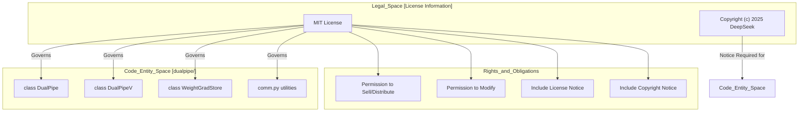
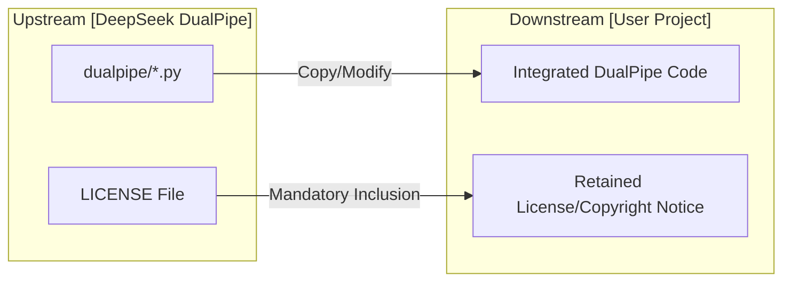

<!-- source: DeepWiki mcp.deepwiki.com · repo deepseek-ai/DualPipe · page 7 License Information · fetched 2026-10-30 -->

# License Information

<details>
<summary>Relevant source files</summary>

The following files were used as context for generating this wiki page:

- [LICENSE](LICENSE)

</details>


This page provides detailed information about the licensing terms under which the DualPipe repository is distributed. The software is provided under a permissive license to facilitate broad adoption in the distributed training community.

## License Type

DualPipe is released under the **MIT License**. This is a short and permissive software license that allows for reuse within proprietary software provided that all copies of the licensed software include a copy of the MIT License terms and the copyright notice. The copyright is held by **DeepSeek** as of 2025 [LICENSE:1-3]().

### MIT License Entity Relationship

The following diagram maps the legal permissions and requirements defined in the `LICENSE` file to the repository's entities.



Sources: [LICENSE:1-13]()

## Full License Text

The complete text of the MIT License applied to DualPipe is as follows:

```text
MIT License

Copyright (c) 2025 DeepSeek

Permission is hereby granted, free of charge, to any person obtaining a copy
of this software and associated documentation files (the "Software"), to deal
in the Software without restriction, including without limitation the rights
to use, copy, modify, merge, publish, distribute, sublicense, and/or sell
copies of the Software, and to permit persons to whom the Software is
furnished to do so, subject to the following conditions:

The above copyright notice and this permission notice shall be included in all
copies or substantial portions of the Software.

THE SOFTWARE IS PROVIDED "AS IS", WITHOUT WARRANTY OF ANY KIND, EXPRESS OR
IMPLIED, INCLUDING BUT NOT LIMITED TO THE WARRANTIES OF MERCHANTABILITY,
FITNESS FOR A PARTICULAR PURPOSE AND NONINFRINGEMENT. IN NO EVENT SHALL THE
AUTHORS OR COPYRIGHT HOLDERS BE LIABLE FOR ANY CLAIM, DAMAGES OR OTHER
LIABILITY, WHETHER IN AN ACTION OF CONTRACT, TORT OR OTHERWISE, ARISING FROM,
OUT OF OR IN CONNECTION WITH THE SOFTWARE OR THE USE OR OTHER DEALINGS IN THE
SOFTWARE.
```

Sources: [LICENSE:1-21]()

## Rights, Conditions, and Limitations

The license defines a specific set of rights granted to the user, the conditions for maintaining those rights, and the limitations of the provider's liability.

### Summary Table

| Category | Provision | Description |
| :--- | :--- | :--- |
| **Rights** | **Usage & Redistribution** | Permission to use, copy, modify, merge, publish, distribute, sublicense, and/or sell copies [LICENSE:5-9](). |
| **Conditions** | **Notice Retention** | The copyright notice and permission notice must be included in all copies or substantial portions of the software [LICENSE:12-13](). |
| **Limitations** | **No Warranty** | The software is provided "as is", without warranty of any kind, express or implied [LICENSE:15-17](). |
| **Limitations** | **Liability** | Authors/Copyright holders are not liable for any claim, damages, or other liability [LICENSE:17-21](). |

### Redistribution Data Flow

When redistributing components like `dualpipe.DualPipe` or `dualpipe.WeightGradStore`, the following flow must be observed to remain compliant with [LICENSE:12-13]().



Sources: [LICENSE:5-13]()

## Warranty Disclaimer

As specified in the license text, the developers provide no guarantees regarding the fitness of the software for a particular purpose. This is particularly relevant for high-performance computing (HPC) environments where `dualpipe` interacts deeply with NCCL and CUDA kernels. Users assume all risk regarding performance, numerical stability, and hardware compatibility [LICENSE:15-21]().

Sources: [LICENSE:1-21]()

---

