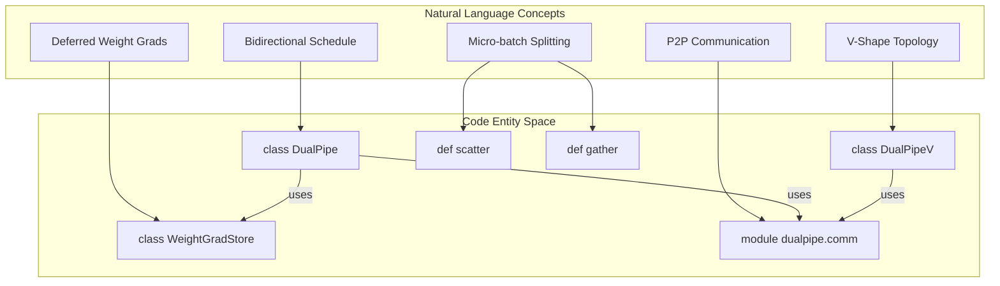
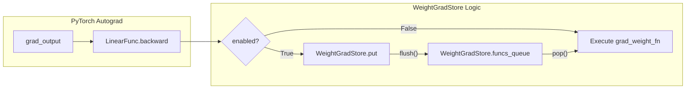

<!-- source: DeepWiki mcp.deepwiki.com · repo deepseek-ai/DualPipe · page 8 Glossary · fetched 2026-10-30 -->

# Glossary

Relevant source files

The following files were used as context for generating this wiki page:

- [README.md](README.md)
- [dualpipe/comm.py](dualpipe/comm.py)
- [dualpipe/dualpipe.py](dualpipe/dualpipe.py)
- [dualpipe/dualpipev.py](dualpipe/dualpipev.py)
- [dualpipe/utils.py](dualpipe/utils.py)
- [examples/example_dualpipe.py](examples/example_dualpipe.py)
- [examples/example_dualpipev.py](examples/example_dualpipev.py)

This page provides definitions for the specialized terminology, architectural concepts, and internal code abstractions used in the DualPipe library. It serves as a reference for engineers to understand the mapping between pipeline parallelism theory and the implementation details found in the codebase.

## Pipeline Scheduling Terminology

### F, B, and W Phases
In the context of DualPipe, computation is broken down into three distinct phases for each micro-batch.
*   **F (Forward)**: The forward pass computation [README.md:34]().
*   **B (Backward for Input)**: The backward pass to calculate gradients with respect to the inputs (activation gradients) [README.md:34]().
*   **W (Backward for Weights)**: The backward pass to calculate gradients with respect to the model parameters (weight gradients) [README.md:35]().

In traditional schedules like 1F1B, B and W are often combined into a single backward step. DualPipe separates them to enable the **ZB1P** (Zero Bubble 1 Pipe) style optimization where W is deferred to overlap with other F/B chunks [README.md:29-30]().

### Pipeline Bubble
The idle time on a device where no useful computation is occurring, typically at the start (warm-up) or end (cool-down) of a pipeline execution [README.md:3-4](). DualPipe significantly reduces this bubble compared to 1F1B by using bidirectional scheduling and F/B overlap [README.md:26-31]().

### Bidirectional Scheduling
A scheduling strategy where micro-batches are processed in two symmetric directions simultaneously (forward and reverse). In `DualPipe`, this is implemented by assigning two modules to each rank and managing two symmetric "phases" of computation [dualpipe/dualpipe.py:11-22]().

**Sources:** [README.md:26-36](), [dualpipe/dualpipe.py:11-22]()

---

## Code Abstractions and Entities

### DualPipe vs. DualPipeV
*   **DualPipe**: The original bidirectional algorithm. It requires $PP$ physical devices for $PP$ stages [README.md:30]().
*   **DualPipeV**: A V-shape variant that executes $PP$ stages on $PP/2$ physical devices by folding the pipeline [README.md:31](). In the code, this is reflected by `DualPipeV` managing a V-shape rank topology [dualpipe/dualpipev.py:36-41]().

### Overlapped Forward-Backward (`overlapped_forward_backward`)
A specialized execution mode where a forward chunk and a backward chunk are executed concurrently to hide communication latency.
*   **Logic**: Users must implement this in their `PipelineStage` class [examples/example_dualpipe.py:55-83]().
*   **Internal Call**: The library triggers this via `_forward_backward_compute_chunk` [dualpipe/dualpipe.py:121-169]().

### WeightGradStore
A global utility class used to manage the separation of weight gradient computation ($W$) from input gradient computation ($B$).
*   **`enabled`**: A flag that, when `True`, redirects weight gradient calculations into a cache rather than executing them immediately [dualpipe/utils.py:10](), [examples/example_dualpipe.py:29-32]().
*   **`put`**: Stores a gradient calculation function (closure) [dualpipe/utils.py:15-16]().
*   **`flush` / `pop`**: Used to commit cached functions to a queue and execute them during the pipeline's "bubble" or overlapped sections [dualpipe/utils.py:19-29]().

**Sources:** [dualpipe/dualpipe.py:121-169](), [dualpipe/utils.py:8-35](), [examples/example_dualpipe.py:55-83]()

---

## System Mapping Diagrams

### Concept to Code Entity Mapping
The following diagram maps high-level pipeline concepts to the specific classes and functions that implement them in the `DualPipe` repository.

**Diagram: Architectural Mapping**

**Sources:** [dualpipe/dualpipe.py:11-22](), [dualpipe/dualpipev.py:11-22](), [dualpipe/comm.py:1-38](), [dualpipe/utils.py:8-12](), [dualpipe/utils.py:62-80]()

### Computation Phase Data Flow
This diagram illustrates how the `WeightGradStore` intercepts the standard PyTorch backward flow to implement the $B$ and $W$ separation required for DualPipe's efficiency.

**Diagram: Gradient Management Flow**

**Sources:** [dualpipe/utils.py:8-35](), [examples/example_dualpipe.py:13-35]()

---

## Technical Jargon and Abbreviations

| Term | Definition | Code Pointer |
| :--- | :--- | :--- |
| **PP Rank** | The logical position of a process in the pipeline (0 to N-1). | `self.rank` in [dualpipe/dualpipe.py:36]() |
| **Phase** | Refers to one of the two symmetric directions in the bidirectional schedule (Phase 0 or Phase 1). | `phase` arg in [dualpipe/dualpipe.py:67]() |
| **Chunk ID** | The index of a micro-batch within the total `num_chunks`. | `chunk_id` in [dualpipe/dualpipe.py:69]() |
| **P2POp** | A point-to-point communication operation (send or receive) managed by NCCL. | `dist.P2POp` in [dualpipe/comm.py:30]() |
| **ZB** | Zero Bubble. Refers to the optimization where weight gradients are calculated during communication/forward phases. | `enable_zb` in [dualpipe/dualpipe.py:87]() |
| **Rank Mapping** | The translation between a process's global MPI/NCCL rank and its position in the pipeline. | `rank_mapping` in [dualpipe/dualpipe.py:28-36]() |

**Sources:** [dualpipe/dualpipe.py:28-87](), [dualpipe/comm.py:25-38](), [dualpipe/utils.py:8-35]()